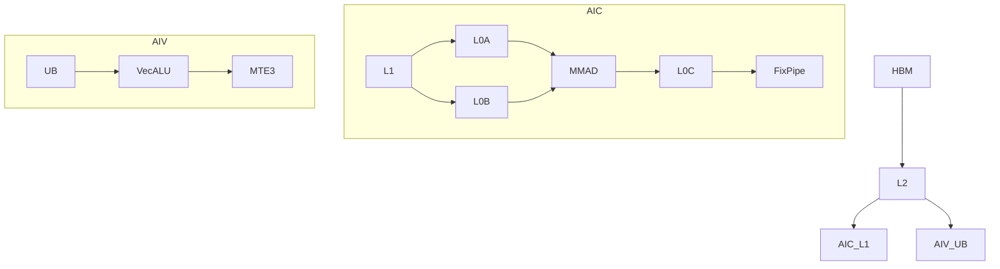
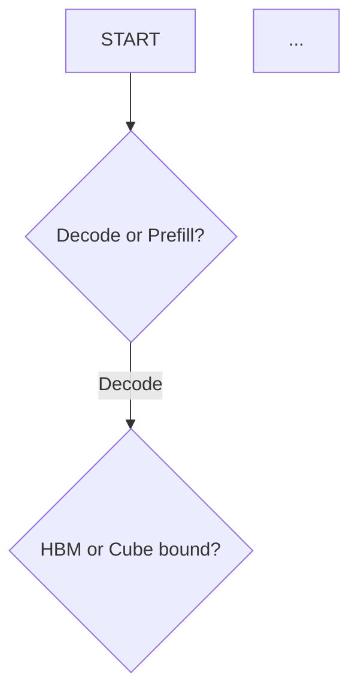

# Performance Modeling Methodology for Ascend NPU Operators

This document describes how to compute theoretical execution time for **any matmul-based operator** on Ascend NPU. Each section includes generalized formulas and worked examples from MLA Prolog V3 (Ascend 950, BF16, decode BS=1) as illustration.

---

## 1. Hardware Memory Hierarchy

### 1.1 Data Flow Architecture

An Ascend AI Core has two compute pipelines sharing HBM access:

```
HBM (off-chip, 1.6 TB/s chip total)
  │
  └─→ L2 Cache (on-chip shared, 5.2 TB/s)
        ├─→ AIC Cube Pipeline: L1(512KB) → L0A(64KB)/L0B(256KB) → MMAD → L0C(256KB) → FixPipe → output
        └─→ AIV Vector Pipeline: UB(256KB) → Vector ALU → MTE3 → output
```

### 1.2 Contention Model

Per-core bandwidth is capped by chip-total when all cores are active:

```
effective_per_core_bw = min(per_cycle × freq, chip_total / active_cores)
```

This is the **single most important formula** — it determines whether a stage is bandwidth-limited. See `chip_specs.md` for all bandwidth values.

---

## 2. Roofline Model

### 2.1 Arithmetic Intensity (AI)

```
AI = 2 × M × N × K / (M × K × sizeof(A) + K × N × sizeof(B) + M × N × sizeof(C))
```

Units: FLOPs per Byte. Measures compute-to-memory ratio.

### 2.2 Ridge Point

```
ridge = peak_compute_flops_per_sec / hbm_bw_bytes_per_sec
```

**Ascend 950 (per core, 32 cores)**: BF16 ridge = 270.3 FLOPs/B, FP8 ridge = 540.7 FLOPs/B.

### 2.3 Bound Classification

| Condition | Classification | Typical Scenario |
|-----------|---------------|------------------|
| AI << ridge | **HBM-bound** | Decode (small T), large K×N weight matrix |
| AI ≈ ridge | **Balanced** | Medium batch prefill |
| AI >> ridge | **Compute-bound** | Large batch prefill (T > 512) |

---

## 3. Matmul Timing Model (Cube/AIC)

### 3.1 Three-Stage Inner Loop

The Ascend Cube core executes matmul via a tiled two-level loop:

```
Outer loop (kL1Loops iterations): HBM/L2 → L1
  Load A[baseM, kL1StepSize] to L1
  Load B[kL1StepSize, N_per_core] to L1

  Inner loop (stepK iterations): L1 → L0 + MMAD
    Load A[baseM, baseK] → L0A
    Load B[baseK, N_per_core] → L0B (transposed)
    C[baseM, N_per_core] += A × B    ← MMAD

  Write C → output via FixPipe
```

### 3.2 Timing Formulas

```python
# Stage 1: MTE1 (HBM/L2 → L1)
load_A = baseM × kL1StepSize × sizeof(A) / a_source_bw    # HBM or L2
load_B = kL1StepSize × N_per_core × sizeof(B) / hbm_bw
mte1_time = max(load_A, load_B)

# Stage 2: Inner loop (L1 → L0 + MMAD, double-buffered)
l0a_time = baseM × baseK × sizeof(A) / l0a_bw            # 256 B/cycle × freq
l0b_time = baseK × N_per_core × sizeof(B) / l0b_bw       # 256 B/cycle × freq
mmad_time = baseM × N_per_core × baseK / mmad_throughput  # MACs/cycle × 2 × freq
inner_iter = max(l0a_time, l0b_time, mmad_time)
total_inner = stepK × inner_iter

# Stage 3: FixPipe (L0C → output)
fixpipe_time = baseM × N_per_core × sizeof(C) / fixpipe_bw

# Three stages overlap via double buffering:
per_kl1 = max(mte1_time, total_inner, fixpipe_time)
total = kL1Loops × per_kl1
```

### 3.3 Bottleneck Determination

| Bottleneck | Condition | Optimization |
|------------|-----------|-------------|
| HBM (MTE1) | mte1_time dominates | Quantize weights, increase core util |
| L0B | l0b_time dominates inner | Reduce baseK or N_per_core |
| MMAD | mmad_time dominates inner | Already at peak — use FP8 for 2× |
| FixPipe | fixpipe_time dominates | Fuse with downstream ops |

### 3.4 Tiling Parameter Derivation

**stepK** (from L1 constraint):
```python
per_step = baseM × baseK × sizeof(A) + baseK × N_per_core × sizeof(B)
stepK = L1_size // (2 × per_step)    # double buffer
kL1StepSize = baseK × stepK
kL1Loops = ceil(K / kL1StepSize)
```

**Full-load optimization**: If all data fits in L1 single-buffer, use 1× instead of 2×:
```python
if total_AB_bytes <= L1_size:
    buffer_factor = 1; stepK = ceil(K / baseK); kL1Loops = 1
```

### 3.5 Split Modes

| Mode | When | N per core | K per core | Output dtype |
|------|------|-----------|-----------|-------------|
| **Split-N** | Standard | N / cores | Full K | Normal (2B) |
| **Split-KN** | Small N + large K | N / n_groups | K / k_groups | FP32 (4B, partial sum) |
| **Split-M** | Prefill (large T) | Full N | Full K | Normal (2B) |
| **Full-Load** | Small matrix | Full N | Full K | Normal (2B) |

---

## 4. Vector Operation Timing Model (AIV)

### 4.1 Instruction-Level Model (950)

```python
# Per-AIV-core timing
data_bytes = per_core_elements × 4              # float32
per_instr_cycles = data_bytes / 256             # 256 B/cycle
total_cycles = n_instructions × per_instr_cycles / 1.3  # IPC=1.3
vec_time = total_cycles / freq_hz
```

See `chip_specs.md` §Vector Instruction Count Table for `n_instructions` by operation type.

### 4.2 Three-Stage Pipeline

```python
mte2_time = load_bytes / per_core_bw("HBM", active_cores)
mte3_time = store_bytes / per_core_bw("HBM", active_cores)
total = max(mte2_time, vec_time, mte3_time)     # pipelined
```

For scatter: `mte3_bw × 0.4` (indirect addressing penalty).

### 4.3 Common Vector Operations in CANN Operators

| Operation | Found In | Instructions (BF16) | Notes |
|-----------|----------|:-------------------:|-------|
| RmsNorm | MlaProlog, FFN | 6 | Most common normalize |
| LayerNorm | Attention, FFN | 7 | Similar to RmsNorm + bias |
| Softmax | FlashAttention | 6–8 | Online softmax: max + exp + sum + div |
| RoPE | MlaProlog, PosEmbedding | 6 | Rotary position encoding |
| GeLU/SiLU | FFN | 4–5 | Activation functions |
| Dequant | Quantized ops | 2–3 | INT32/FP32 → BF16 |
| DynamicQuant | Quantized ops | 4–5 | BF16 → INT8 with scale |
| TopK | MoE routing | 3–4 | Per-row top-k selection |
| Permute | MoE dispatch | 1 | Index-based reorder |

---

## 5. Pipeline DAG (AIC/AIV Overlap)

### 5.1 Building the DAG

For operators with both AIC and AIV stages:

1. **Nodes**: Each matmul stage (AIC) and vector stage (AIV)
2. **Edges**: Data dependencies + CrossCore sync events
3. **Edge cost**: sync_overhead (0.8 µs per flag pair on 950)

### 5.2 Critical Path Solving

```
For each node n in topological order:
    start[n] = max(end[dep] + sync_overhead for dep in n.depends_on)
    end[n] = start[n] + duration[n]

total = max(end[n] for all n)
critical_path = backtrack from argmax(end)
```

### 5.3 Key Insight: Overlap

**Never naively sum AIC + AIV times.** Common overlaps:

| AIV Stage | Overlaps With | Effect |
|-----------|--------------|--------|
| Accumulation (Split-KN) | Next AIC matmul | Usually fully hidden |
| RmsNorm | Next AIC matmul | Usually fully hidden |
| Dequant | Previous AIC write completes | Partially overlapped |
| Large vector (Softmax) | Nothing (on critical path) | Adds to total |

---

## 6. Generalizing to Any Operator

### 6.1 Step-by-Step Process

1. **Identify all matmuls**: Read kernel code for `Mmad`, `Matmul*`, `cubeObj.Iterate()`
2. **Record dimensions**: M, K, N, dtypes, core count per matmul
3. **Identify vector ops**: Anything on AIV — normalize, activate, quantize, permute
4. **Map dependencies**: CrossCore flags define the DAG edges
5. **Compute per-stage timing**: Use §3 for matmuls, §4 for vectors
6. **Build pipeline DAG**: §5 for critical path
7. **Classify bottlenecks**: §2 roofline + §3.3 per-matmul

### 6.2 Common Patterns by Operator Type

**Multi-matmul fusion** (MlaProlog, FFN):
- 3–5 sequential matmuls with vector ops between
- Critical path usually on AIC; AIV is idle most of the time
- Optimization: parallelize AIC/AIV, reduce sync points

**FlashAttention**:
- BMM1 (Q@K^T) → Softmax → BMM2 (Score@V)
- Softmax is on AIV and can be on critical path
- Tiling on sequence dimension (S1/S2 split)

**GroupedMatmul (GMM)**:
- Many independent matmuls with different shapes
- Load-balancing across cores is the key challenge
- Diagonal block assignment for even distribution

**Pure vector** (MoE permute, RoPE standalone):
- No cube ops, only UB-based processing
- Bandwidth-limited (MTE2/MTE3)
- Model as pure vector pipeline

---

## 7. Report Generation

### 7.1 Standard Report Sections

When generating a performance report, include:

1. **Hardware Configuration** — chip, cores, frequency, key bandwidth numbers
2. **Operator Stage Table** — all matmul and vector stages with dimensions
3. **Roofline Analysis** — per-matmul AI, ridge point, bound classification
4. **Detailed Timing Breakdown** — per-stage: MTE1, L0A, L0B, MMAD, FixPipe (matmul) or MTE2, Vec, MTE3 (vector)
5. **Pipeline Timeline** — ASCII or Mermaid diagram showing AIC/AIV overlap
6. **Bottleneck Summary** — dominant stages and resources
7. **Optimization Recommendations** (if requested) — see `optimization_guide.md`

### 7.2 Report with Mermaid Diagrams

When generating reports, use the **Mermaid MCP** (`mcp__mermaidchart__validate_and_render_mermaid_diagram`) to create visual diagrams:

**Hardware dataflow diagram** (flowchart):


**Pipeline timeline** (sequence diagram):
```mermaid
sequenceDiagram
    participant AIC
    participant AIV
    AIC->>AIC: MM1 (xx us)
    AIC-->>AIV: SYNC_1
    AIV->>AIV: VectorOp (xx us)
    ...
```

**Optimization decision tree** (flowchart):


Always validate diagrams via the MCP tool before embedding. Include `[在线编辑此图](link)` links from the MCP response for interactive editing.

### 7.3 Report Format

```markdown
# <Operator Name> Performance Report — Ascend <Chip>

## 1. Configuration
[chip specs, operator params, quantization mode]

## 2. Stage Overview
[table: Stage | Type | M | K | N | Cores | Time(µs) | Bound]

## 3. Roofline Analysis
[table: Stage | AI | Ridge | Efficiency | Classification]
[Mermaid roofline visualization if applicable]

## 4. Detailed Timing
[per-stage breakdown tables]

## 5. Pipeline
[Mermaid sequence diagram of AIC/AIV execution]
[critical path highlighted]

## 6. Bottleneck Summary
[top-3 bottleneck stages with resource identification]

## 7. Optimization Recommendations
[if requested — from optimization_guide.md]
[projected gains table]
```
