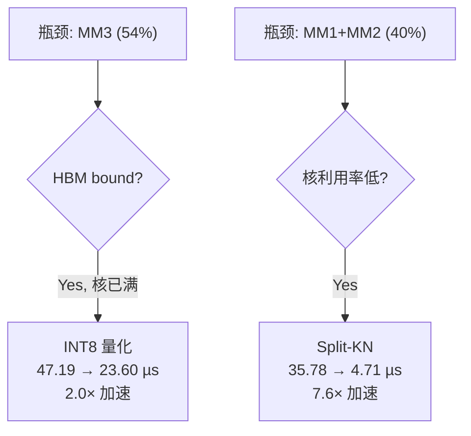

# Performance Optimization Guide for Ascend NPU Operators

This guide provides a **generalizable optimization methodology** extracted from MLA Prolog V3 performance tuning experience. It applies to any matmul-based CANN operator.

When the user opts in to optimization suggestions (via `--optimize` or answering "yes" to the prompt), follow this guide to analyze bottlenecks and propose optimizations with **projected performance gains**.

---

## 1. Optimization Workflow

### Step 1: Classify Each Stage's Bottleneck

After computing per-stage timing (see `methodology.md`), classify each stage:

```
For each matmul stage:
    if mte1_time > inner_time and mte1_time > fixpipe_time:
        bound = "HBM" (or "L2" if A is from L2)
    elif mmad_time > l0a_time and mmad_time > l0b_time:
        bound = "CUBE"
    elif l0b_time >= l0a_time:
        bound = "L0B"
    elif l0a_time > l0b_time:
        bound = "L0A"
    else:
        bound = "FIXPIPE"

For each vector stage:
    bound = argmax(mte2_time, vec_time, mte3_time)
```

### Step 2: Identify Dominant Stages

Sort stages by time. The **top-3 stages** typically account for >80% of total pipeline time. Focus optimization on these.

### Step 3: Apply Optimization Techniques

Match each bottleneck to the optimization table below (§2). For each applicable technique:
- Estimate the **projected new timing** using the formulas in §3
- Compute **speedup** = old_time / new_time
- Note **prerequisites** (what needs to change in kernel/host code)

### Step 4: Report

Present a table:

```markdown
| Optimization | Target Stage | Current (µs) | Projected (µs) | Speedup | Prerequisites |
|-------------|-------------|:------------:|:--------------:|:-------:|--------------|
| INT8 quant  | MM3_QcQr    | 47.19        | 23.60          | 2.0×    | INT8 weight, dequant logic |
| Split-KN    | MM1_Cq      | 17.89        | 3.93           | 4.6×    | 2D core split, vector accum |
```

---

## 2. Optimization Techniques by Bottleneck

### 2.1 HBM-Bound Stages (AI << Ridge)

Most common in decode scenarios. The weight matrix (B) dominates HBM load time.

| Technique | Description | Projected Gain | Applicability |
|-----------|-------------|:-------------:|---------------|
| **Weight Quantization** | INT8/FP8 reduces B matrix by 2× | ~2× on B-dominated stages | Any matmul with large K×N weight |
| **Split-KN (2D core split)** | Split both N and K axes: `n_groups × k_groups = total_cores` | 1.5–5× for small-N matmuls | When `N_per_core` is small (not enough cores utilized) |
| **L2 A-matrix Reuse** | Share A matrix across cores via L2 | ~3.25× on A load | Already used in split-N; explicit in split-M |
| **Cross-Matmul Reuse** | Reuse A from prior matmul | Eliminate 1 HBM load | When consecutive matmuls share input |
| **Increase Batch (Prefill)** | Larger T → higher AI → transition to cube-bound | Qualitative shift | Prefill scenarios only |

**Gain estimation for quantization:**
```python
# B matrix load dominates in HBM-bound:
new_B_bytes = K × N × sizeof_new_dtype
old_B_bytes = K × N × sizeof_old_dtype
new_mte1_B = old_mte1_B × (sizeof_new / sizeof_old)
# If B load was the bottleneck, speedup ≈ sizeof_old / sizeof_new
```

**Gain estimation for Split-KN:**
```python
# N split among n_groups, K split among k_groups
# Each core loads K/k_groups × N/n_groups instead of K × N/total_cores
# More cores on each N slice → better utilization
new_cube_time = estimate_matmul_with_new_split(n_groups, k_groups)
# Must evaluate full pipeline — accum overhead may eat gains
```

### 2.2 Compute-Bound Stages (AI >> Ridge)

Rare in decode, common in large-batch prefill.

| Technique | Description | Projected Gain | Applicability |
|-----------|-------------|:-------------:|---------------|
| **Maximize baseM×baseK** | Fill L0A to capacity → MMAD pipeline efficiency | 10–30% | When current baseM is small |
| **FP8 (2× MMAD throughput)** | 8192 MACs/cycle vs 4096 | ~2× on MMAD-bound | If accuracy allows |
| **K-Outer Loop** | Move K to outer loop, reuse B in L1 across N-blocks | 2–3× | Prefill with large T, moderate N |
| **Reduce kL1 Loops** | Increase stepK → fewer outer iterations | Proportional | When L1 allows larger stepK |

**Gain estimation for FP8:**
```python
# MMAD throughput doubles: 4096 → 8192 MACs/cycle
# If stage is truly MMAD-bound: speedup = 2.0×
# If mixed bound: speedup = old_total / max(mte1, inner_with_fp8, fixpipe)
```

**Gain estimation for K-Outer Loop:**
```python
# Standard: each kL1 loads B fresh from HBM
# K-Outer: B stays in L1, reused across N-blocks within each K slab
# Savings = reduced B loads from n_blocks × kL1 to just kL1
new_per_kl1 = max(load_A_hbm, n_blocks × max(load_B_l1, inner, fixpipe))
# Transition from HBM-bound to L0B/MMAD-bound
```

### 2.3 L0B-Bound Stages

When L0B load time dominates the inner loop.

| Technique | Description | Projected Gain | Applicability |
|-----------|-------------|:-------------:|---------------|
| **Increase baseM** | More compute per L0B load → MMAD overtakes L0B | transition to MMAD-bound | When `baseM × baseK × sizeof(A) × 2 ≤ L0A` allows |
| **Reduce baseK** | Smaller K tile = smaller L0B load | Proportional | Trade-off: more stepK iterations |
| **Quantize B** | INT8/FP8 halves L0B transfer | ~2× on L0B-bound | Same as HBM quantization |

**Threshold for MMAD-bound transition:**
```python
# MMAD time > L0B time when:
baseM ≥ sizeof(B_tile) × mmad_tput / l0b_bw
# For BF16 on 950:
baseM ≥ (baseK × N_per_core × 2) × (4096 × 2) / 256 / (baseK × N_per_core × 2)
# Simplifies to: baseM ≥ 32 (approximate, depends on N_per_core)
```

### 2.4 FixPipe-Bound Stages

When L0C → output write dominates.

| Technique | Description | Projected Gain | Applicability |
|-----------|-------------|:-------------:|---------------|
| **Fuse with downstream** | Write to UB instead of HBM, next op reads from UB | Eliminate GM round-trip | When next op is vector on same core |
| **Intra-core pipeline** | L0C→UB→Vector→L1 (no cross-core sync) | ~3µs per fused stage | Dequant+RoPE fusion pattern |
| **Reduce output dtype** | FP16 instead of FP32 output | 2× on fixpipe | Only if intermediate precision OK |

### 2.5 Sync-Overhead-Bound

When synchronization takes >15% of total pipeline time.

| Technique | Description | Projected Gain | Applicability |
|-----------|-------------|:-------------:|---------------|
| **Reduce sync points** | Fuse stages to eliminate CrossCore pairs | 0.8 µs per eliminated pair | When fused stages fit in UB |
| **Intra-core sync** | Replace cross-core with HardEvent (near-zero cost) | ~0.8 µs per replacement | When both ops can run on same core |
| **Batch sync** | Synchronize once per group of stages | Proportional | Multiple small stages between syncs |

### 2.6 Pipeline Imbalance

When AIC or AIV is severely underutilized.

| Metric | Threshold | Optimization |
|--------|-----------|-------------|
| AIV busy / AIC busy < 0.3 | AIV underutilized | Fuse more vector work, reduce AIC stages |
| AIV busy / AIC busy > 3.0 | AIC underutilized | Increase matmul overlap, reduce vector stages |
| Sync overhead / total > 15% | Too many sync points | Reduce or batch synchronization |
| Max core utilization < 50% | Low parallelism | Split-KN or Split-M to use more cores |

---

## 3. Gain Estimation Formulas

### 3.1 Quantization Speedup (HBM-bound matmul)

```python
def estimate_quant_speedup(old_dtype_b, new_dtype_b, matmul_timing):
    """Estimate speedup from quantizing weight matrix."""
    if matmul_timing.bound != "HBM":
        return 1.0  # No gain if not HBM-bound
    
    ratio = old_dtype_b / new_dtype_b  # e.g., 2/1 = 2.0 for BF16→INT8
    
    # B load dominates mte1; A load unchanged
    new_mte1_B = matmul_timing.mte1_B_time / ratio
    new_mte1 = max(matmul_timing.mte1_A_time, new_mte1_B)
    new_per_kl1 = max(new_mte1, matmul_timing.inner_time, matmul_timing.fixpipe_time)
    new_total = matmul_timing.kL1_loops × new_per_kl1
    
    # But output changes to INT32 (4B) → fixpipe may increase
    if new_dtype_b == 1:  # INT8/FP8
        new_fixpipe = matmul_timing.fixpipe_time × 2  # 2B → 4B output
    
    return matmul_timing.total_us / new_total
```

### 3.2 Split-KN Speedup

```python
def estimate_split_kn_speedup(n_groups, k_groups, matmul_timing, hw):
    """Estimate speedup from 2D core splitting."""
    total_cores = n_groups × k_groups  # Must equal hw.aic_num
    
    K_per_core = matmul_timing.K / k_groups
    N_per_core = matmul_timing.N / n_groups
    
    # Re-estimate with new dimensions
    new_timing = estimate_matmul(
        M=matmul_timing.M, K=K_per_core, N=N_per_core × total_cores,
        active_cores=total_cores, hw=hw
    )
    
    # Add accumulation cost (vector side)
    accum_load = k_groups × matmul_timing.M × N_per_core × 4  # FP32 partials
    accum_compute = matmul_timing.M × N_per_core × (k_groups - 1)
    accum_store = matmul_timing.M × N_per_core × sizeof(output)
    accum_time = estimate_vector_op(accum_load, accum_compute, accum_store)
    
    # But accum often overlaps with next AIC matmul — evaluate in full pipeline
    return matmul_timing.total_us / new_timing.total_us
```

### 3.3 Pipeline-Level Speedup

**Always evaluate optimizations at pipeline level**, not per-stage:

```python
def estimate_pipeline_speedup(optimized_stages, original_pipeline):
    """Replace optimized stages in DAG, re-solve critical path."""
    new_stages = {**original_pipeline.stages, **optimized_stages}
    new_result = build_pipeline_dag(new_stages)
    return original_pipeline.total_us / new_result.total_us
```

This is critical because:
- Speeding up a non-critical-path stage may have zero impact
- Vector accumulation from Split-KN may be hidden by the next matmul
- Removing one bottleneck may expose a new one

---

## 4. Optimization Decision Tree

```
Is the stage on the critical path?
├── No → Low priority (speeding it up won't reduce total time)
└── Yes → What is the bottleneck?
    ├── HBM-bound (AI << ridge)?
    │   ├── Small N (low core util)? → Split-KN (§2.1)
    │   ├── Large weight matrix? → Quantization (§2.1)
    │   └── Shared input across matmuls? → Verify L2 reuse is active
    ├── Compute-bound (AI >> ridge)?
    │   ├── Small baseM? → Increase baseM / K-Outer loop (§2.2)
    │   └── BF16? → Try FP8 for 2× MMAD (§2.2)
    ├── L0B-bound?
    │   ├── Can increase baseM? → Increase to transition to MMAD-bound (§2.3)
    │   └── B matrix large? → Quantize B (§2.3)
    ├── FixPipe-bound?
    │   └── Next op on same data? → Fuse intra-core (§2.4)
    └── Sync-bound?
        └── Multiple sync pairs? → Fuse stages, use intra-core sync (§2.5)
```

---

## 5. Presenting Optimization Recommendations

### 5.1 Format

When presenting optimization recommendations, use this structure:

```markdown
## 性能优化建议

### 瓶颈分析

| 阶段 | 耗时 (µs) | 占比 | 瓶颈类型 | 资源 |
|------|:---------:|:----:|---------|------|
| MM3_QcQr | 47.19 | 54% | HBM | MTE1 B 矩阵加载 |
| MM1_Cq | 17.89 | 20% | HBM | 核利用率低 (24/32) |
| MM2_CkvKr | 17.89 | 20% | HBM | 核利用率低 (9/32) |

### 优化方案与预期收益

| 优先级 | 优化方案 | 目标阶段 | 当前 (µs) | 优化后 (µs) | 加速比 | 实施复杂度 |
|:------:|---------|---------|:---------:|:----------:|:-----:|:---------:|
| 1 | INT8 量化 | MM3 | 47.19 | 23.60 | 2.0× | 中 (需 dequant 逻辑) |
| 2 | Split-KN N8×K4 | MM1 | 17.89 | 3.93 | 4.6× | 高 (2D 切分 + 累加) |
| 3 | Split-KN N3×K8 | MM2 | 17.89 | 0.78 | 22.9× | 高 (同上) |

### Pipeline 级总收益

| 方案组合 | Pipeline (µs) | vs 基线加速比 |
|---------|:------------:|:-----------:|
| 基线 (BF16 Split-N) | 87.63 | 1.0× |
| + Split-KN (MM1+MM2) | 53.31 | 1.64× |
| + INT8 量化 | ~27.00 | 3.25× |
```

### 5.2 Mermaid Visualization

Generate a **decision tree diagram** using Mermaid MCP showing the optimization path:



Generate a **before/after pipeline comparison** using sequence diagram.

### 5.3 Interactive Workflow

When the user asks "是否需要性能优化建议":

1. **Present bottleneck summary** (top-3 stages)
2. **For each bottleneck**, show applicable optimizations with projected gain
3. **Ask user** which optimizations to explore further
4. **For selected optimizations**, compute full pipeline impact
5. **Generate comparison table** (baseline vs optimized)
6. **If user wants implementation guidance**, point to relevant kernel/host code locations

---

## 6. Validation Checklist

Before presenting optimization recommendations:

- [ ] Gains are computed at **pipeline level**, not per-stage
- [ ] Split-KN accum overhead is included (not just cube speedup)
- [ ] Quantization output dtype change (2B→4B) is reflected in FixPipe
- [ ] L2 reuse is correctly modeled (HBM vs L2 source)
- [ ] Non-critical-path stages are flagged as low-priority
- [ ] Implementation complexity is honestly assessed
- [ ] Baseline is clearly stated in all speedup claims
