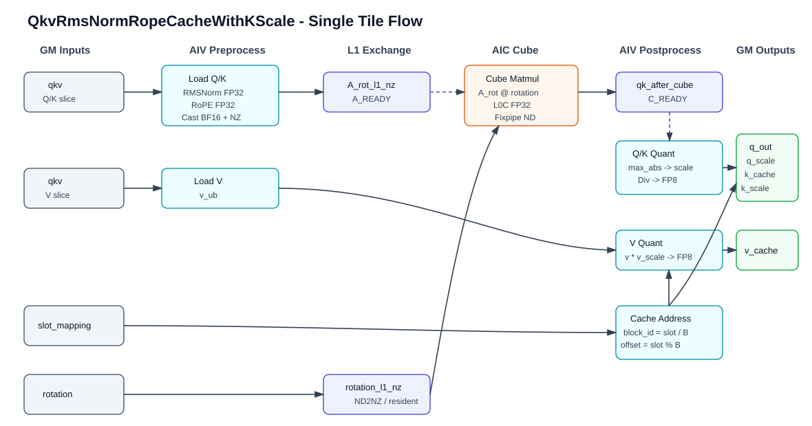
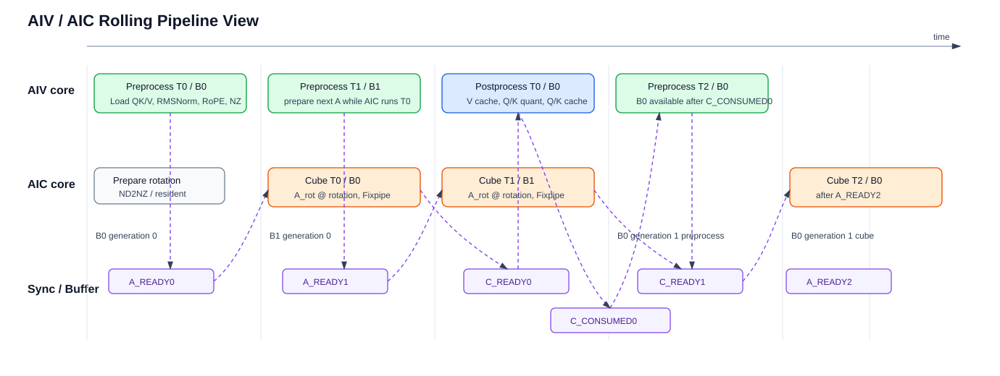

# Kernel 设计

## 1. 期望流水

Kernel 首期采用 AIV + AIC 混合执行模型。AIV 负责 Q/K/V 的搬运、Q/K 前处理、V 后处理、Q/K 后处理和 cache 写回；AIC 负责 `rope_out @ rotation` 的 Cube matmul。首期 fast path 只支持 `Nv == Nk`，host 从 `head_nums=[Nq,Nk,Nv]` 读取后校验该约束。

首期 `KERNEL_TYPE_MIX_AIC_1_2` 固定为 `1 AIC + 2 AIV` 一组。AIC 通过 `GetBlockIdx()` 获取当前 cube 核序号；AIV 通过 `GetBlockIdx() / 2` 获取其对应的 cube 核序号。两个 AIV 共同处理同一个 token tile 的两个连续 token 子区间，并写入同一个 `A_rot[M_tile,D]` 的 disjoint row 区间；AIC 等两个 AIV 的 A 数据都就绪后，一次完成该 tile 的完整 `M_tile` matmul。

### 1.1 单 tile 数据流图

单个 tile 内的数据流如下：



核心同步边：

```text
AIV preprocess done  --A_READY-->  AIC cube start
AIC fixpipe done     --C_READY-->  AIV postprocess start
AIV postprocess done --C_CONSUMED-> current tile buffer can be released
```

### 1.2 AIV/AIC 核视角滚动流水图

流水需要支持 double buffer。AIV 后处理 `Tile i` 时，可以准备 `Tile i + 1` 的前处理；AIC 计算 `Tile i` 时，可以等待或消费另一块 buffer 中已经准备好的 A 矩阵。两个核视角的滚动流水如下：



图中 `B0/B1` 表示双 buffer，`T0/T1/T2` 表示连续 tile。`T0` 和 `T2` 都使用 `B0`。核间 flag id 不按 buffer 分配，而是复用同一组硬编码 id；同一 id 上的 `Set/Wait` 事件计数和固定循环顺序共同保证后一轮 tile 不会误消费上一轮 tile 的同步事件。

同一语义也可以用文本时序表示：

```text
time ----------------------------------------------------------------------->

Buffer 0:
  AIV:  Preprocess T0  | wait C0 | Postprocess T0 | Preprocess T2 | ...
  AIC:        wait A0  | Cube T0 | wait consumed0 | wait A2      | Cube T2 | ...

Buffer 1:
  AIV:                  Preprocess T1 | wait C1 | Postprocess T1 | ...
  AIC:                         wait A1 | Cube T1 | wait consumed1 | ...

Flags:
  T0: A_READY0 -> C_READY0 -> C_CONSUMED0
  T1: A_READY1 -> C_READY1 -> C_CONSUMED1
  T2: A_READY2 -> C_READY2 -> C_CONSUMED2
```

`bufferId = tileId % 2`。如果 UB/L1 空间不足以启用 double buffer，可以退化为单 buffer，同步语义不变。核间 flag id 不按 `bufferId` 或 `generation` 派生；pingpong buffer 的复用依赖同一个 flag id 上的 `Set/Wait` 事件计数和固定循环顺序保证。

### 1.3 Rolling Pipeline 伪代码

Controller 侧伪代码：

```cpp
void Process()
{
    basicBlock.Init(globalTensors, tilingData, workspace);

    QkvRrcTileRange range = MakeTileRangeForCurrentCore();
    basicBlock.ComputeRange(range);

    basicBlock.End();
}
```

Basic block 侧伪代码：

```cpp
void Init(...)
{
    InitBuffers();
    InitInterCoreFlags();
    InitIntraCoreEvents();
}

void InitIntraCoreEvents()
{
    if (IsAiv()) {
        for each inputUb buffer:
            Set<PIPE_V, PIPE_MTE2>(EVT_PIPE_V_TO_MTE2_INPUT_UB_BASE + bufId);
        for each vOutUb buffer:
            Set<PIPE_MTE3, PIPE_V>(EVT_MTE3_TO_PIPE_V_V_OUT_UB_BASE + bufId);
        for each qkOutputUb buffer:
            Set<PIPE_MTE3, PIPE_V>(EVT_MTE3_TO_PIPE_V_QK_OUT_UB_BASE + bufId);
        if A write uses reusable temporary UB staging:
            Set<PIPE_MTE3, PIPE_V>(EVT_MTE3_TO_PIPE_V_QK_A_STAGE_UB_BASE + bufId);
    } else {
        cube.InitIntraCoreEvents();
    }
}

void ComputeRange(const QkvRrcTileRange &range)
{
    if (IsAiv()) {
        ComputeAivRolling(range);
    } else {
        ComputeAicRolling(range);
    }
}

void ComputeAivRolling(const QkvRrcTileRange &range)
{
    for (uint32_t tileId = range.begin; tileId < range.end; ++tileId) {
        QkvRrcTileParam tile = MakeTileParam(tileId);
        QkvRrcAivSlice aivSlice = MakeAivSlice(tile, GetAivLocalId());
        uint32_t bufferId = tileId & 1;

        vec.Preprocess(
            tile,
            aivSlice,
            aRotL1Nz[bufferId],
            vUb[bufferId],
            cosSinUb[bufferId],
            slotMappingUb[bufferId]);
        // Preprocess completes MTE3 write to Cube AL1 before CrossCore A_READY.
        SetAivToAic<PIPE_MTE3>(SYNC_A_READY);
        vec.PostprocessV(
            tile,
            aivSlice,
            vUb[bufferId],
            vOutUb[bufferId],
            slotMappingUb[bufferId],
            vScaleUb);

        if (tileId > range.begin) {
            QkvRrcTileParam prevTile = MakeTileParam(tileId - 1);
            uint32_t prevBuffer = (tileId - 1) & 1;

            WaitAicToAiv<PIPE_V>(SYNC_C_READY);
            QkvRrcAivSlice prevAivSlice = MakeAivSlice(prevTile, GetAivLocalId());
            vec.PostprocessQk(prevTile, prevAivSlice, qkAfterCubeUb[prevBuffer], slotMappingUb[prevBuffer]);
            // PostprocessQk overwrites qkAfterCubeUb in place as FP8 staging, then completes MTE3 writes before C_CONSUMED.
            SetAivToAic<PIPE_MTE3>(SYNC_C_CONSUMED);
        }
    }

    DrainAivTail(range);
}

void ComputeAicRolling(const QkvRrcTileRange &range)
{
    cube.PrepareRotationBeforeLoop();

    for (uint32_t tileId = range.begin; tileId < range.end; ++tileId) {
        QkvRrcTileParam tile = MakeTileParam(tileId);
        uint32_t bufferId = tileId & 1;

        WaitAivToAic<PIPE_MTE1>(SYNC_A_READY);

        cube.Matmul(tile, aRotL1Nz[bufferId], qkAfterCubeUb[bufferId]);
        SetAicToAiv<PIPE_FIX>(SYNC_C_READY);

        WaitAivToAic<PIPE_FIX>(SYNC_C_CONSUMED);
    }
}

void End()
{
    if (IsAiv()) {
        EndIntraCoreEvents();
    } else {
        cube.EndIntraCoreEvents();
    }
}

void EndIntraCoreEvents()
{
    if (IsAiv()) {
        for each inputUb buffer:
            Wait<PIPE_V, PIPE_MTE2>(EVT_PIPE_V_TO_MTE2_INPUT_UB_BASE + bufId);
        for each vOutUb buffer:
            Wait<PIPE_MTE3, PIPE_V>(EVT_MTE3_TO_PIPE_V_V_OUT_UB_BASE + bufId);
        for each qkOutputUb buffer:
            Wait<PIPE_MTE3, PIPE_V>(EVT_MTE3_TO_PIPE_V_QK_OUT_UB_BASE + bufId);
        if A write uses reusable temporary UB staging:
            Wait<PIPE_MTE3, PIPE_V>(EVT_MTE3_TO_PIPE_V_QK_A_STAGE_UB_BASE + bufId);
    }
}
```

`InitIntraCoreEvents/EndIntraCoreEvents` 只描述反向同步的初始可复用事件和结束配平。具体 event id、buffer 范围和是否存在 A staging UB 以 `07_intra_core_sync_design.md` 为准。

上面的伪代码只表达流水顺序。具体核间同步采用 `CrossCoreWaitFlag/CrossCoreSetFlag`，参考 `grouped_matmul_finalize_routing` 的 arch35 `weight_quant_basic_block` 写法：flag id 直接硬编码，不按 `bufferId` 或 `generation` 分配数组；AIV0 使用基础 id，AIV1 使用 `基础 id + FLAG_ID_MAX`，框架根据 `+ FLAG_ID_MAX` 区分 AIV1，不需要额外指定 target core。AIV 使用 `GetSubBlockIdx()` 区分 AIV0/AIV1。

建议封装：

```cpp
constexpr uint64_t SYNC_A_READY = 0;
constexpr uint64_t SYNC_C_READY = 1;
constexpr uint64_t SYNC_C_CONSUMED = 2;

template <const pipe_t pipe>
__aicore__ inline void SetAivToAic(uint64_t syncFlag)
{
    CrossCoreSetFlag<SYNC_MODE4, pipe>(syncFlag);
}

template <const pipe_t pipe>
__aicore__ inline void WaitAivToAic(uint64_t syncFlag)
{
    CrossCoreWaitFlag<SYNC_MODE4, pipe>(syncFlag + FLAG_ID_MAX);
    CrossCoreWaitFlag<SYNC_MODE4, pipe>(syncFlag);
}

template <const pipe_t pipe>
__aicore__ inline void SetAicToAiv(uint64_t syncFlag)
{
    CrossCoreSetFlag<SYNC_MODE4, pipe>(syncFlag + FLAG_ID_MAX);
    CrossCoreSetFlag<SYNC_MODE4, pipe>(syncFlag);
}

template <const pipe_t pipe>
__aicore__ inline void WaitAicToAiv(uint64_t syncFlag)
{
    CrossCoreWaitFlag<SYNC_MODE4, pipe>(syncFlag);
}
```

每个 tile 的核间同步关系固定为：

```text
A_READY:
  data      = a_rot_l1_nz[bufferId]
  location  = L1
  producer  = AIV0/AIV1 MTE3, each writes disjoint continuous M rows
  consumer  = AIC MTE1/Cube
  sync      = AIV SetAivToAic<PIPE_MTE3>(SYNC_A_READY)
              AIC WaitAivToAic<PIPE_MTE1>(SYNC_A_READY)

C_READY:
  data      = qk_after_cube_ub[bufferId]
  location  = AIV UB, AIC Fixpipe distributes by M range to AIV0/AIV1
  producer  = AIC FIX
  consumer  = AIV PIPE_V
  sync      = AIC SetAicToAiv<PIPE_FIX>(SYNC_C_READY)
              AIV WaitAicToAiv<PIPE_V>(SYNC_C_READY)

C_CONSUMED:
  data      = qk_after_cube_ub[bufferId] reusable state
  location  = AIV UB
  producer  = AIV MTE3 after Q/K postprocess side effects are complete
  consumer  = AIC FIX before reusing C output path/buffer
  sync      = AIV SetAivToAic<PIPE_MTE3>(SYNC_C_CONSUMED)
              AIC WaitAivToAic<PIPE_FIX>(SYNC_C_CONSUMED)
```

核间 flag 是事件计数语义：同一个 id 可以反复 `Set/Wait`，只要总次数配平即可。AIC 等待 AIV 到 AIC 方向时对同一基础 id 等两次，分别消费 AIV1 与 AIV0 的事件；AIC 到 AIV 方向也对同一基础 id set 两次，分别通知 AIV1 与 AIV0。tail 中即使某个 AIV 的实际 token 数为 0，也仍按固定协议参与 `A_READY/C_READY/C_CONSUMED`，避免 AIC 分支特殊化或等待缺失。

`a_rot_l1_nz` / AL1 属于 Cube 侧资源。AIV 必须在 MTE3 写 AL1 完成后再 `SetAivToAic<PIPE_MTE3>(SYNC_A_READY)`；AIC 通过 `WaitAivToAic<PIPE_MTE1>(SYNC_A_READY)` 等两个 AIV 的 AL1 写入完成后再读，AL1 到 AIC 的可见性由该 CrossCore 硬同步保证。若 AIV 内部存在额外 UB staging，其复用由 AIV 核内同步单独管理。

两个 AIV 的 tile 子区间必须按实际 token 数连续切分。非 tail tile 中两个 AIV 各处理 `tokenTile / 2` 个 token；tail tile 中：

```text
actualAiv0 = ceil(actualTokenTile / 2)
actualAiv1 = actualTokenTile - actualAiv0

AIV0 token range: [tile.tokenOffset, tile.tokenOffset + actualAiv0)
AIV1 token range: [tile.tokenOffset + actualAiv0, tile.tokenOffset + actualTokenTile)

AIV0 row range: [0, actualAiv0 * Hqk)
AIV1 row range: [actualAiv0 * Hqk, actualTokenTile * Hqk)
```

不能按固定 `tokenTilePerAiv` 给 AIV1 计算 row 起点，否则 `actualTokenTile < tokenTile` 时会在 `A_rot` 的 M 方向留下空洞。AIC matmul 使用的 `M_tile = actualTokenTile * Hqk`，因此 `A_rot[0:M_tile, :]` 必须由两个 AIV 的实际 row 区间连续拼接。AIC Fixpipe 若在 M 方向将 C 输出分发给两个 AIV，也按同一 row 边界分发。

AIV 前处理伪代码：

```cpp
void VecCompute::Preprocess(
    const QkvRrcTileParam &tile,
    const QkvRrcAivSlice &aivSlice,
    LocalTensor<bf16> aRotNz,
    LocalTensor<bf16> vUb,
    LocalTensor<float> cosSinUb,
    LocalTensor<int32_t> slotMappingUb)
{
    LoadQk(tile);
    LoadV(tile, vUb);
    LoadSlotMapping(tile, slotMappingUb);
    LoadCosSin(tile, cosSinUb);

    for each qk row in aivSlice {
        token = ResolveToken(row);
        head = ResolveQkHead(row);
        pos = ResolvePositionFromCuSeqLen(token);

        x = LoadQkRow(token, head);
        y = RmsNorm(x, qGamma or kGamma, epsilon);
        r = ApplyRope(y, cosSinUb[pos]);
        StoreBf16Nz(r, aRotNz);
    }
}
```

V 分支提前后处理伪代码：

```cpp
void VecCompute::PostprocessV(
    const QkvRrcTileParam &tile,
    const QkvRrcAivSlice &aivSlice,
    LocalTensor<bf16> vUb,
    LocalTensor<fp8> vOutUb,
    LocalTensor<int32_t> slotMappingUb,
    LocalTensor<float> vScaleUb)
{
    for each token in aivSlice {
        slot = slotMappingUb[token];
        blockId = slot / blockSize;
        blockOffset = slot % blockSize;

        QuantVToVOut(token, vUb, vScaleUb, vOutUb);
        WriteVCache(token, blockId, blockOffset, vOutUb, vCache);
    }
}
```

V cache 写回是后处理语义，但不依赖 Cube 输出；AIV 在发送 `A_READY` 后即可执行 `PostprocessV`，与 AIC 的 `rope_out @ rotation` 并行。

AIV Q/K 后处理伪代码：

```cpp
void VecCompute::PostprocessQk(
    const QkvRrcTileParam &tile,
    const QkvRrcAivSlice &aivSlice,
    LocalTensor<float> qkCubeUb,
    LocalTensor<int32_t> slotMappingUb)
{
    for each token in aivSlice {
        slot = slotMappingUb[token];
        blockId = slot / blockSize;
        blockOffset = slot % blockSize;
    }

    for each qk row in aivSlice {
        maxAbs = ReduceMaxAbs(qkCubeUb[row, :]);
        scale = maxAbs / 448;
        qkFp8 = CastE4m3fnRintSat(qkCubeUb[row, :] / scale);

        if row belongs to Q:
            WriteQOutAndScale(qkFp8, scale);
        else:
            WriteKCacheAndScale(qkFp8, scale, slotMapping);
    }
}
```

`rotation` 当前必须存在。首期 `D = 128` 下，AIC 在 tile 循环前通过 MTE2 完成一次 ND2NZ 搬运并常驻到 `rotation_l1_nz`；kernel 不按 Hadamard 结构生成或解释 rotation，只按外部 dense BF16 `[D,D]` 矩阵参与 `rope_out @ rotation`。

## 2. 代码结构

首期建议的 kernel 代码结构如下：

```text
op_kernel/
  qkv_rms_norm_rope_cache_with_kscale.cpp
  qkv_rms_norm_rope_cache_with_kscale_apt.cpp
  qkv_rms_norm_rope_cache_with_kscale.h
  arch35/
    qkv_rrc_tiling_data.h
    qkv_rrc_tiling_key.h
    qkv_rrc_controller.h
    qkv_rrc_vcv_basic_block.h
    qkv_rrc_vec_compute.h
    qkv_rrc_cube_compute.h
    qkv_rrc_vf.h
    qkv_rrc_common.h
```

入口文件职责：

1. 声明 `qkv_rms_norm_rope_cache_with_kscale` kernel 入口。
2. 设置混合核执行类型。
3. 读取 tiling data。
4. 构造 controller。
5. 将 GM 地址、workspace 地址和 tiling data 传入 controller。
6. 调用 `controller.Process()`。

入口参数顺序建议与 op_host/kernel launch 保持一致：

```cpp
extern "C" __global__ __aicore__ void qkv_rms_norm_rope_cache_with_kscale(
    GM_ADDR qkv,
    GM_ADDR qGamma,
    GM_ADDR kGamma,
    GM_ADDR cosSin,
    GM_ADDR slotMapping,
    GM_ADDR kCache,
    GM_ADDR vCache,
    GM_ADDR kScaleCache,
    GM_ADDR cuSeqLen,
    GM_ADDR rotation,
    GM_ADDR vScale,
    GM_ADDR qOut,
    GM_ADDR qScale,
    GM_ADDR workspace,
    GM_ADDR tiling)
```

`qkv_rrc_tiling_data.h` 至少需要包含以下语义字段：

```cpp
struct QkvRrcTilingData {
    uint32_t totalTokens;
    uint32_t batch;
    uint32_t numQHeads;
    uint32_t numKHeads;
    uint32_t numVHeads;
    uint32_t headDim;
    uint32_t maxSeqLen;
    uint32_t blockNum;
    uint32_t blockSize;
    uint32_t rowTile;
    uint32_t tokenTile;
    uint32_t qkHeadTile;
    uint32_t vHeadTile;
    uint32_t flags;
    float epsilon;
};
```

`numQHeads/numKHeads/numVHeads` 来自 host 解析必选属性 `head_nums=[Nq,Nk,Nv]`。kernel 不从 tensor shape 反推 head 数。

## 3. Controller 层

Controller 是 kernel 的全局调度层。它只处理地址、tiling、核间任务划分和 tile 调度，不承载 RMSNorm/RoPE/matmul/quant 的具体计算。

Controller 保存的状态：

1. 所有输入输出 GM 地址。
2. workspace GM 地址。
3. tiling data 指针或本地副本。
4. 当前 core 的 AIV/AIC 身份、core index、core 数。
5. basic block 对象。
6. tile 循环所需的 offset、size、buffer id。

Controller 需要生成两类逻辑任务：

```text
Q/K row task:
  row = t * (Nq + Nk) + h
  0 <= t < T
  0 <= h < Nq + Nk

V token task:
  token = t
  0 <= t < T
```

Q/K row task 覆盖 RMSNorm、RoPE、rotation matmul、Q/K dynamic quant 和 Q/K 写回。V token task 覆盖 V preload、V quant 和 V cache 写回。首期可以让同一个 tile 同时携带一段连续 token 和对应 Q/K heads，确保 Q/K 与 V 的生命周期简单；后续可拆成更细的 row tile 和 token tile。

Controller 的核心流程：

```text
Init:
  1. 绑定 GM 地址。
  2. 读取 tiling data。
  3. 初始化 basic block。

Process:
  1. 计算当前 core 负责的 tile 范围。
  2. 生成 QkvRrcTileRange。
  3. 调用 basicBlock.ComputeRange(tileRange)。
  4. ComputeRange 内部按 AIV/AIC 身份执行 rolling pipeline。
  5. 循环结束后调用 basicBlock.End()。
```

Tile range 和 tile 参数建议：

```cpp
struct QkvRrcTileRange {
    uint32_t begin;
    uint32_t end;
    uint32_t stride;
};
```

```cpp
struct QkvRrcTileParam {
    uint32_t tileId;
    uint32_t bufferId;
    uint32_t tokenOffset;
    uint32_t tokenSize;
    uint32_t qkHeadOffset;
    uint32_t qkHeadSize;
    uint32_t vHeadOffset;
    uint32_t vHeadSize;
    uint32_t rowOffset;
    uint32_t rowSize;
};
```

Controller 需要保证：

1. 每个 Q/K row 只进入一次 AIC matmul 和 Q/K quant。
2. 每个 token 的 V 分支只写一次 `v_cache`。
3. tile 内可以根据 `cu_seq_len` 找到每个 token 的 batch 内位置 `s(t)`。
4. Q/K 的 K 分支写 cache 时，`slot_mapping[t]` 与 V 分支使用同一套 cache slot。
5. AIV/AIC 双方对同一个 `bufferId` 使用一致的同步顺序。

## 4. Basic Block 层

Basic block 是 tile range 内的执行组织层，负责 buffer 初始化、AIV/AIC 分支选择、同步 flag 和 tile 生命周期管理。

Basic block 内部持有：

1. `VecCompute` 对象。
2. `CubeCompute` 对象。
3. L1 tensor：`rotation_l1_nz`、`a_rot_l1_nz`。
4. UB tensor：`qk_after_cube_ub`、`v_ub`、`gamma_ub`、`cos_sin_ub[2]`、`slot_mapping_ub[2]`、`v_scale_ub`、`v_out_ub[2]`。
5. 同步 flag id 或 flag offset。
6. double buffer 状态。

Kernel 按静态 layout 划分 UB，tiling data 不携带这些空间大小。40 KiB reserve 是单 AIV 本地 scratch，首期固定承载：

| 子区 | 固定容量 | 存放数据 | 说明 |
|------|----------|----------|------|
| `gamma_ub` | 1 KiB | `q_gamma[128]`、`k_gamma[128]`，fp32 | tile 内复用 |
| `cos_sin_db_pool` | 8 KiB | `cos_sin_ub[2]`，fp32 | 每个 buffer 4 KiB，随 `bufferId` 轮转 |
| `slot_mapping_db_pool` | 1 KiB | `slot_mapping_ub[2]`，int32 | 每个 buffer 512 B，随 `bufferId` 轮转 |
| `v_scale_ub` | 512 B | `v_scale[Nv]`，fp32 | basic block 初始化或首个 tile 前搬入，不开 DB |
| `v_out_db_pool` | 20 KiB | `v_out_ub[2]`，FP8 | 每个 buffer 10 KiB，随 `bufferId` 轮转 |

上述 reserve 分配合计 30.5 KiB，不要求填满 40 KiB。剩余空间仅作为对齐余量和实现预留，不绑定新的语义 tensor。除 `slot_mapping_ub[2]` 和 `v_scale_ub` 外，其他标量数组不在 UB 中常驻；Q/K row scale 计算后直接写 `q_scale` 或 `k_scale_cache`。前处理阶段的中间临时量不在 reserve 中静态分配；大块 Q/K fp32 中间量按生命周期复用 output DB pool。Q/K dynamic quant 的 FP8 staging 不占 reserve，复用 `qk_after_cube_ub` 所在 output buffer。

`v_out_ub` 明确放在 reserve 内，不占 input DB 或 output DB，并开 double buffer。首期 `Nv = Nk` 且 `Ta <= floor(160 / (Nq + 2 * Nk))`，因此：

```text
v_out_one_buffer_bytes = Ta * Nv * 128 * sizeof(fp8)
                       = Ta * Nk * 128

Nq >= 1
=> Ta * Nk < 80
=> v_out_one_buffer_bytes < 10240 B
```

整数场景最大 `Ta * Nv` 为 79，因此最大实际字节数为 `79 * 128 = 10112 B`，小于 10 KiB。

Basic block 入口：

```cpp
class QkvRrcVcvBasicBlock {
public:
    __aicore__ inline void Init(...);
    __aicore__ inline void ComputeRange(const QkvRrcTileRange &range);
    __aicore__ inline void End();
};
```

`ComputeRange` 内部按 AIV/AIC 身份分派：

```text
if current core is AIV:
    ComputeAivRolling(range)
else:
    ComputeAicRolling(range)
```

AIV rolling 分支顺序：

```text
for tile i in range:
  1. vec.Preprocess(tile i, a_rot_l1_nz[bufferId], v_ub[bufferId], cos_sin_ub[bufferId], slot_mapping_ub[bufferId])
  2. MTE3 写完 Cube AL1 中的 `a_rot_l1_nz[bufferId]`
  3. SetAivToAic<PIPE_MTE3>(SYNC_A_READY)
  4. vec.PostprocessV(tile i, v_ub[bufferId], v_out_ub[bufferId], slot_mapping_ub[bufferId], v_scale_ub)
  5. 如果 tile i - 1 存在，则 WaitAicToAiv<PIPE_V>(SYNC_C_READY)
  6. vec.PostprocessQk(tile i - 1, qk_after_cube_ub[prevBuffer], slot_mapping_ub[prevBuffer])
  7. `qk_after_cube_ub[prevBuffer]` 原地覆盖为 Q/K FP8 staging，并由 MTE3 写出
  8. SetAivToAic<PIPE_MTE3>(SYNC_C_CONSUMED)
drain:
  9. 等待最后一个 tile 的 C_READY。
  10. Q/K 后处理最后一个 tile，`qk_after_cube_ub` 原地覆盖为 FP8 staging 后写出。
  11. SetAivToAic<PIPE_MTE3>(SYNC_C_CONSUMED)
```

AIC rolling 分支顺序：

```text
1. cube.PrepareRotationBeforeLoop()
2. for tile i in range:
     WaitAivToAic<PIPE_MTE1>(SYNC_A_READY)
     cube.Matmul(tile i, a_rot_l1_nz[bufferId], qk_after_cube_ub[bufferId])
     SetAicToAiv<PIPE_FIX>(SYNC_C_READY)
     WaitAivToAic<PIPE_FIX>(SYNC_C_CONSUMED)
```

同步规则：

| Flag | 方向 | 语义 |
|------|------|------|
| `A_READY` | AIV -> AIC | AIV 已将当前 tile 的 `a_rot_l1_nz` 写入 Cube AL1 |
| `C_READY` | AIC -> AIV | AIC 已将当前 tile 的 C 结果 Fixpipe 到 UB |
| `C_CONSUMED` | AIV -> AIC | AIV 已完成后处理，当前输出 UB 可释放 |

所有 tile 级核间 flag 均使用固定硬编码 id，不携带 `bufferId` 或 `generation`。同一个 id 可以跨 tile 和 pingpong buffer 反复 `Set/Wait`，只要 AIC/AIV 两侧循环顺序一致且 Set/Wait 次数配平即可。

`rotation_l1_nz` 只由 AIC 内部使用，AIV 不等待 rotation 常驻完成；AIC 在 tile 循环前完成 `PrepareRotationBeforeLoop()` 后再进入 `A_READY` 等待和 matmul，因此 rotation 常驻不需要核间 flag。

## 5. Cube 层

Cube 层只处理 `rope_out @ rotation`。它不关心 RMSNorm、RoPE、slot_mapping、FP8 quant 或 cache 写回。

Cube 输入输出逻辑形状：

```text
A_rot:   [M_tile, D], BF16, NZ in L1
rotation:[D, D],      BF16, NZ in L1
C_rot:   [M_tile, D], FP32, L0C -> UB ND
```

其中：

```text
M_tile = tile.rowSize
D = headDim
```

Cube 层职责：

1. 保存 `rotation` GM 地址。
2. 将外部 ND `[D,D]` 的 `rotation` 转为 NZ 并搬入 L1。
3. 管理 `rotation_l1_nz` 的常驻或分块搬运策略。
4. 接收 AIV 已写好的 `a_rot_l1_nz`。
5. 执行 BF16 x BF16 -> FP32 matmul。
6. 通过 Fixpipe 将 L0C 结果搬到 UB，layout 为 ND `[M_tile,D]`。

核心接口建议：

```cpp
class QkvRrcCubeCompute {
public:
    __aicore__ inline void Init(...);
    __aicore__ inline void PrepareRotation(const QkvRrcTileParam &tile);
    __aicore__ inline void Matmul(
        const QkvRrcTileParam &tile,
        const LocalTensor<half> &aRotL1Nz,
        const LocalTensor<float> &cUb);
};
```

`PrepareRotationBeforeLoop` 策略：

1. 通过 AIC MTE2 将外部 dense BF16 ND `[D,D]` 的 `rotation` 搬入 L1，并转为 Cube 使用的 NZ layout。
2. `rotation_l1_nz` 在 tile 循环内常驻，不复用该 L1 区域。
3. 当前不启用 FWHT，不在 kernel 内生成 Hadamard，不对 `rotation` 做归一化或标准排列假设。

Matmul 约束：

1. 当前 `K = D`，A 的 K 维和 B 的 K 维均为 `headDim`。
2. `D` 典型值为 128，并满足 Cube 对齐要求。
3. Fixpipe 输出必须是 ND，供 AIV 后处理直接按 `[row,d]` 访问。
4. 如果后续支持 `D` 分 K block，需要增加 partial sum 和 scale/quant 延迟处理；首期不设计该路径。

## 6. Vec 层

Vec 层负责所有 AIV 侧计算和 GM/UB/L1 数据搬运。它分为前处理和后处理。

前处理输入：

```text
qkv, q_gamma, k_gamma, cos_sin, cu_seq_len, slot_mapping
```

前处理输出：

```text
a_rot_l1_nz:  RoPE 后 Q/K cast BF16 并转 NZ
v_ub:         V 分支暂存
cos_sin_ub:   当前 buffer 的 cos/sin DB
slot_mapping_ub: 当前 buffer 的 slot_mapping DB
```

前处理步骤：

1. 根据 tile 中的 `tokenOffset/tokenSize/qkHeadOffset/qkHeadSize` 从 `qkv` 读取 Q/K。
2. 根据 `tokenOffset/tokenSize/vHeadOffset/vHeadSize` 从 `qkv` 读取 V，写入 `v_ub`。
3. 读取当前 token 范围的 `slot_mapping` 到 `slot_mapping_ub[bufferId]`。
4. 根据 `cu_seq_len` 前缀和得到每个 token 的 batch 内位置 `s(t)`，读取 `cos_sin[s(t), :]` 到 `cos_sin_ub[bufferId]`。
5. 对 Q/K row 在 D 方向计算 RMSNorm：FP32 square sum、sqrt、除法和 gamma 乘法。
6. 使用 `cos_sin_ub[bufferId]` 执行 RoPE pair compute。
7. 将 RoPE 结果 cast 到 BF16。
8. 使用 VF/NZ 搬运路径写入 `a_rot_l1_nz`。

V 提前后处理输入：

```text
v_ub, v_out_ub[bufferId], slot_mapping_ub[bufferId], v_scale_ub
```

V 提前后处理输出：

```text
v_out_ub[bufferId], v_cache
```

V 提前后处理步骤：

1. 读取 `slot_mapping_ub[t]`，计算 `block_id = slot / BlockSize`、`block_offset = slot % BlockSize`。
2. 对 V 执行 `v * v_scale[nv]`，使用 RINT/SAT cast 到 FP8 E4M3FN，并写入 reserve 内的 `v_out_ub[bufferId]`。
3. 将 `v_out_ub[bufferId]` 写入 `v_cache[block_id,nv,block_offset,d]`。

Q/K 后处理输入：

```text
qk_after_cube_ub, slot_mapping_ub[bufferId]
```

Q/K 后处理输出：

```text
q_out, q_scale, k_cache, k_scale_cache
```

Q/K 后处理步骤：

1. 读取 `slot_mapping_ub[t]`，计算 `block_id = slot / BlockSize`、`block_offset = slot % BlockSize`。
2. 对 Cube 输出的 Q/K row 求 D 方向 `max_abs`。
3. 计算 `scale = max_abs / 448`。
4. 执行 `Div -> RINT/SAT cast FP8 E4M3FN` 得到 Q/K 量化结果。
5. Q 分支写 `q_out[t,nq,d]` 和 `q_scale[t,nq]`。
6. K 分支写 `k_cache[block_id,nk,block_offset,d]` 和 `k_scale_cache[block_id,nk,block_offset,0]`。

Vec helper 建议：

```text
LoadQkTile
LoadVTile
LoadVScale
LoadSlotMappingTile
LoadCosSinTile
ResolveTokenPositionFromCuSeqLen
RmsNormRow
ApplyRopePair
CastRopeToBf16Nz
QuantVToFp8
ReduceMaxAbs
QuantQkToFp8
WriteVCache
WriteKCacheAndScale
WriteQOutAndScale
```

FP8 cast 规则：

```text
dtype: float8_e4m3fn
round: RINT
saturation: SAT
```

`scale == 0` 时，Vec 层不新增额外跳过分支；该行为由 FP8 Div + Cast 路径自然决定，并与 golden 保持一致。

## 7. 待定项

1. `rowTile/tokenTile/qkHeadTile/vHeadTile` 的具体取值。
2. 多 batch 且 tile 跨 batch 时，`cu_seq_len` 查找是否需要额外辅助表。
3. `D != 128` 的支持边界。
4. workspace 是否需要承载跨 tile 的临时元数据。

这些待定项进入 tiling 和实现验证阶段收敛，不改变本文件定义的 kernel 分层与数据流。
