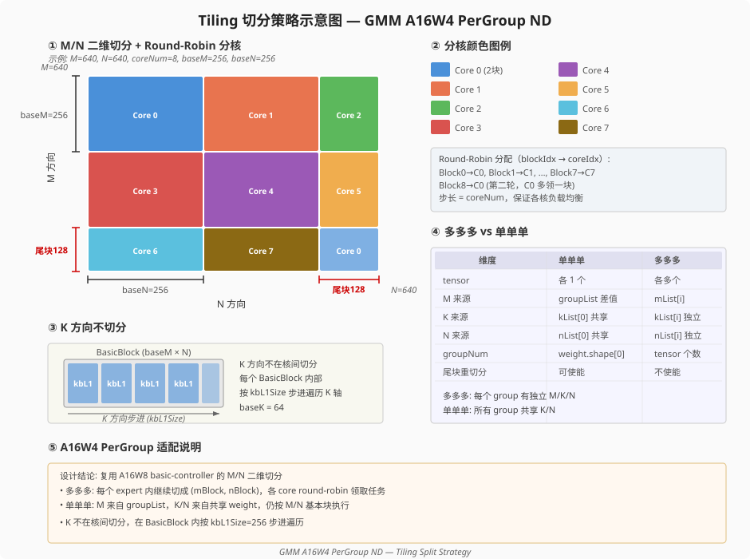
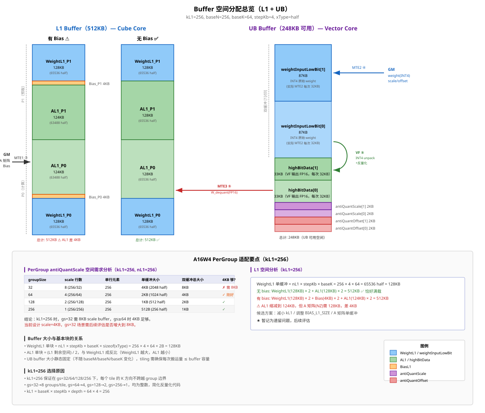
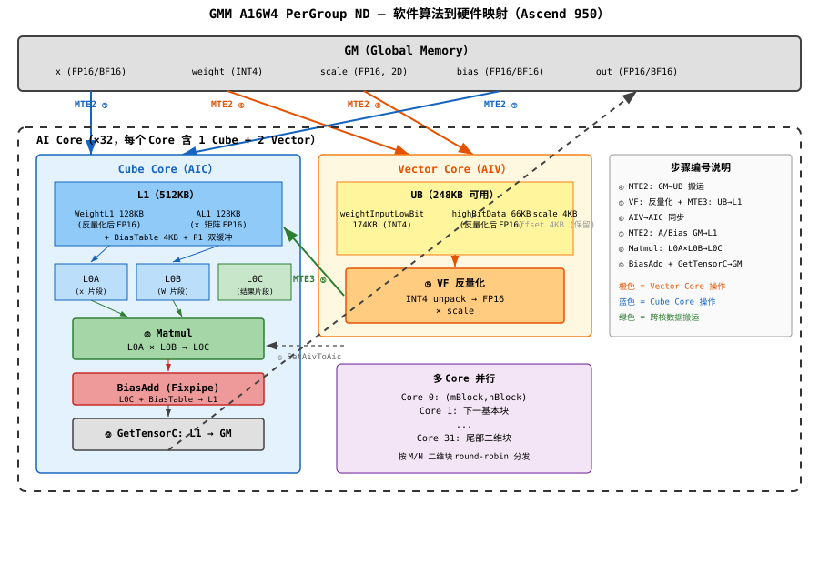

# GMM A16W4 PerGroup ND — SRS 算子实现方案

> 本文档总结 GMM A16W4 INT4 weight ND pergroup 数据流在 Ascend 950 上的 tiling + kernel 方案。实现基线为现有 A16W8 ND basic-controller 数据流；差异集中在 INT4 pergroup VF 反量化和 pergroup 参数地址偏移。

---

## §1. 需求概述

### 1.1 数据流

本数据流用于 `aclnnGroupedMatmulV5` 的 A16W4 weight ND pergroup 场景：

```text
x:      FP16/BF16, ND
weight: INT4, ND
scale:  FP16/BF16, pergroup, dtype 与 x 一致
offset: FP16/BF16, pergroup, 可选
out:    FP16/BF16, ND
```

支持：
- 单单单：`groupType=0`，x/weight/out 各 1 个 tensor。
- 多多多：`groupType=-1`，x/weight/out 各多个 tensor。
- weight 非转置和转置。
- `groupSize in {32, 64, 128, 256}`，且每个 `K_i % groupSize == 0`。

### 1.2 计算公式

```text
y = x * ((weight_int4 + offset) * scale) + bias
```

当 `antiquantOffset` 为空时：

```text
y = x * (weight_int4 * scale) + bias
```

pergroup 关系：

```text
G_i = K_i / groupSize
scale[i] shape:
  单单单: [E, G, N]
  多多多: [G_i, N_i]
```

### 1.3 PerGroup 反量化模型

K 轴按 `groupSize` 分段，每段内的 weight 元素共享同一个 scale（和 offset）：

```
K 轴: |← gs →|← gs →|← gs →|...|← gs →|
        group0  group1  group2      group_{G-1}

scale shape: (G, N)  其中 G = K / gs
weight_dequant[k, n] = (weight_int4[k, n] + offset[k/gs, n]) × scale[k/gs, n]
```

### 1.4 与 A2/A3 已有场景的关系

本场景是对 A2/A3 已有 A16W4 伪量化数据流的**兼容性扩展**：
- A2/A3 已支持 A16W4 perchannel（整个 K 轴共用一组 scale）
- Ascend 950 新增 pergroup 模式（K 轴按 gs 分段，每段独立 scale）
- 所有修改在 arch35 路径下进行，A2/A3 的 arch30 路径完全不受影响

### 1.5 关键约束

| 约束项 | 条件 |
|--------|------|
| group_size | ∈ {32, 64, 128, 256} |
| K % group_size | == 0 |
| weight 格式 | ND（非 NZ） |
| weight 最后一维 | 偶数 |
| x 转置 | 不支持（固定不转置） |
| 输入模式 | 单单单（groupType=0）/ 多多多（groupType=-1） |

---

## §2. Tiling 切分策略



### 2.1 固定切分参数

A16W4 pergroup 复用 A16W8 ND basic-controller 的 tiling 参数：

| 参数 | 值 | 说明 |
|------|:--:|------|
| `baseM` | 256 | 有 bias 时为 240 |
| `baseN` | 256 | N 标准块 |
| `baseK` | 64 | L0 K 基本块 |
| `stepKa` | 4 | A 的 L1 K 步进 |
| `stepKb` | 4 | B 的 L1 K 步进 |
| `kbL1Size` | 256 | `baseK * stepKb` |
| `templateCustom` | `MTE2_INNER_SIZE_256_BUF_NUM_4` | 4 个 MTE2 buffer，inner size 256 |

### 2.2 Kernel 侧分块

Controller 复用 A16W8 的 M/N 二维切分。

动态 `baseM`：

| 条件 | actualBaseM |
|------|:-----------:|
| `M <= baseM` 或 `M >= 4*baseM` | `baseM` |
| `baseM < M <= 2*baseM` | `ceil(M/2)` |
| `2*baseM < M < 4*baseM` | `ceil(M/4)` |

动态 `baseN`：

| 条件 | actualBaseN |
|------|:-----------:|
| `N >= baseN * coreNum` | 256 |
| `N < baseN * coreNum` | 128 |

任务分发：

```text
mBlockNum = ceil(M / actualBaseM)
nBlockNum = ceil(N / actualBaseN)

每个 core 按 coreNum 步长 round-robin 领取 (mBlock, nBlock)
K 方向不在核间切分，在 BasicBlock 内部按 kbL1Size=256 遍历
```

### 2.3 groupSize 与 kL1

`kbL1Size=256` 能被所有支持的 groupSize 整除：

| groupSize | 每个 kL1 tile 中的 group 数 |
|:---------:|:--------------------------:|
| 32 | 8 |
| 64 | 4 |
| 128 | 2 |
| 256 | 1 |

这使每个 K tile 覆盖完整 group，避免跨 group 的 scale 边界处理。

### 2.4 Tiling Key

A16W4 pergroup ND 固定进入 basic controller：

| 字段 | 取值 |
|------|------|
| `W_TYPE` | `WQGMM_ND` |
| `W_QUANT_TYPE` | `WQGMM_PER_GROUP` |
| `C_QUANT_TYPE` | `WQGMM_NONE` |
| `WQ_A_TRANS` | `WQGMM_NO_TRANS` |
| `WQ_B_TRANS` | `WQGMM_NO_TRANS` / `WQGMM_TRANS` |
| `TEMPLATE_CUSTOM_SC` | `WQGMM_MTE2_INNER_SIZE_256_BUF_NUM_4` |
| `ALGORITHM_SUB_CATEGORY` | `WQGMM_N_FIRST_BASIC_BLOCK` |
| `ALGORITHM_CATEGORY` | `WQGMM_VECTOR_ANTIQUANT` |

共 8 个组合：

```text
2 个 transB × 2 个 offset 状态 × 2 个 bias 状态
```

---

## §3. Buffer 空间分配



### 3.1 L1

L1 总量 512KB。A16W4 pergroup 复用 A16W8 ND 的 L1 分配，因为 L1 中的 weight 已经被 vector core 反量化为 `xType`。

无 bias：

| 区域 | 大小 |
|------|:----:|
| `WeightL1_P0` | 128KB |
| `AL1_P0` | 128KB |
| `AL1_P1` | 128KB |
| `WeightL1_P1` | 128KB |

有 bias：

| 区域 | 大小 |
|------|:----:|
| `WeightL1_P0` | 128KB |
| `Bias_P0` | 4KB |
| `AL1_P0` | 124KB |
| `AL1_P1` | 124KB |
| `Bias_P1` | 4KB |
| `WeightL1_P1` | 128KB |

有 bias 时 tiling 将 `baseM=240`：

```text
A tile = ceilAlign(240,16) * 256 * 2B = 120KB
AL1_Px = 124KB
```

因此 L1 空间满足计算需求。

### 3.2 UB

UB 使用 A16W8 ND 的 `GetNdBufferInfo()`，不新增 pergroup buffer 配置。

| Buffer | 总大小 | 缓冲数 | 单缓冲 | 用途 |
|--------|:------:|:------:|:------:|------|
| `weightInputLowBit` | 174KB | 4 | 43.5KB | INT4 packed weight |
| `highBitData` | 66KB | 2 | 33KB | 反量化后 FP16/BF16 weight |
| `antiQuantScale` | 4KB | 4 | 1KB | 当前 VF tile 的 scale |
| `antiQuantOffset` | 4KB | 4 | 1KB | 当前 VF tile 的 offset |

VF tile 最大 scale/offset 需求：

```text
bTrans=false: ceil(64/32) * 256 * 2B = 1KB
bTrans=true:  ceil(256/32) * 64 * 2B = 1KB
```

**UB 空间分配逻辑不变**：复用 `GetNdBufferInfo()`，`antiQuantOffset` 的 4KB 保留。scale/offset 以 VF tile 粒度组织到 UB，而不是按完整 L1 tile 一次性展开。

---

## §4. Kernel 计算流程

### 4.1 总体流程



```text
Controller.Process()
  for each group/expert:
    SetMKN()
    SetGmAddr()
    split M/N blocks

    for each BasicBlock:
      AIV:
        GM weight(INT4) -> UB
        GM scale/offset -> UB
        VF: INT4 pergroup antiquant -> xType
        UB highBitData -> L1 WeightL1
        SetAivToAic()

      AIC:
        GM x/bias -> L1
        WaitAivToAic()
        Matmul: A * WeightL1
        GetTensorC() -> GM out
        SetAicToAiv()
```

### 4.2 Controller 差异

pergroup 的核心地址差异：

| Tensor | perchannel 偏移 | pergroup 偏移 |
|--------|------------------|----------------|
| x | `m_i * k_i` | 相同 |
| weight INT4 | `(n_i * k_i) >> 1` | 相同 |
| y | `m_i * n_i` | 相同 |
| bias | `n_i` | `n_i`，独立偏移变量 |
| scale | `n_i` | `(k_i/groupSize) * n_i` |
| offset | `n_i` | `(k_i/groupSize) * n_i` |

需要在 `SetGmAddr()` 中新增 `biasBaseOffset`，避免 bias 继续共用 scale/offset 偏移。

### 4.3 VF 反量化差异

A16W4 的 VF 反量化参考 ops-nn：

```text
~/Code/ops-nn/matmul/weight_quant_batch_matmul_v2/op_kernel/arch35/
  weight_quant_batch_matmul_v2_reg_base_common.h
```

| `transB` | GMM AIV 路径 | 参考函数 |
|----------|--------------|----------|
| false | `ComputeBasicBlockAivNdKnNzNk` | `AntiquantComputeKNPerGroup` |
| true | `ComputeBasicBlockAivNdNkNzKn` | `AntiquantComputeW4NKPerGroup` |

反量化步骤：

```text
1. load INT4 packed weight from UB
2. unpack INT4
3. cast INT4 -> xType
4. if hasOffset: add offset
5. multiply scale
6. store xType weight to highBitData
```

KN 路径使用统一 `AntiquantPerGroupKN` 风格；NK 路径按 groupSize=32/64/128/256 分派专用 VF 风格。

### 4.4 VF 反量化详细代码实现方案

> 参考源码：`ops-nn/matmul/weight_quant_batch_matmul_v2/op_kernel/arch35/weight_quant_batch_matmul_v2_vf.h`

`hasAntiQuantOffset` 通过 `WqmmConfig.hasAntiQuantOffset` 做编译期分支。以下描述中 offset 相关操作在 `hasAntiQuantOffset=false` 时由编译器消除。

#### 4.4.1 KN 路径（`bTrans=false`）：统一 VF 函数

调用入口：`AntiquantComputeKNPerGroup(bubNLen, bubKLen)` → `VF_CALL<AntiquantPerGroupKN<xType, wType, hasAntiQuantOffset>>`

**参数构造**（`ParamsKN<xType>`）：

| 参数 | 计算方式 | 说明 |
|------|----------|------|
| `kBub` | `bubKLen` | K 方向实际长度 |
| `nBub` | `bubNLen` | N 方向实际长度 |
| `nBubXTypeAlign` | `CeilAlign(nBub, 16)` | N 对齐到 BLOCK_CUBE |
| `nBubWTypeAlign` | `CeilAlign(nBub, 32)` | N 对齐到 ONE_BLK_W_NUM（INT4 每 32 元素一个 block） |
| `nLoop` | `CeilDiv(nBubWTypeAlign, 128)` | N 方向外层循环次数（每次处理 128 个 wType 元素） |
| `groupSize` | `tiling->groupSize` | pergroup 大小 |
| `groupNum` | `CeilDiv(kBub, groupSize) - 1` | 完整 group 数量（减 1 因为 tail 单独处理） |
| `groupTail` | `kBub % groupSize > 0 ? kBub % groupSize : groupSize` | 尾部 group 大小 |
| `dataBlockStride` | `CeilAlign(kBub, 16) + 1` | 输出 NZ 格式的 block 间距 |
| `wNStride` | `128 >> 1 = 64` | INT4 weight N 方向步长（字节） |
| `wKStride` | `nBubWTypeAlign >> 1` | INT4 weight K 方向步长（字节） |
| `wGroupStride` | `groupSize * nBubWTypeAlign >> 1` | INT4 weight group 间步长（字节） |

**VF 函数内部循环结构**（`AntiquantPerGroupKN`）：

```text
for nIdx = 0 to nLoop-1:                          // N 方向外层循环
  maskWeight = UpdateMask(nBubXTypeAlign)          // 更新 mask（尾块可能不满）

  for gIdx = 0 to groupNum-1:                      // 完整 group 遍历
    // 1. 加载 scale（DIST_NORM：直接加载 128 个 FP16 元素）
    addrRegScale = CreateAddrReg(nIdx, 128, gIdx, nBubXTypeAlign)
    scale ← DataCopy<DIST_NORM>(scaleBaseAddr, addrRegScale)

    // 若 hasAntiQuantOffset: 加载 offset
    if hasAntiQuantOffset:
      offset ← DataCopy<DIST_NORM>(offsetBaseAddr, addrRegScale)

    for kIdx = 0 to groupSize-1:                   // group 内逐 K 行处理
      // 2. 加载 INT4 weight（DIST_UNPACK4_B8：从 UB 加载并 unpack）
      addrRegWeight = CreateAddrReg(nIdx, wNStride, gIdx, wGroupStride, kIdx, wKStride)
      weightB4 ← DataCopy<DIST_UNPACK4_B8>(weightInBaseAddr, addrRegWeight)

      // 3. Cast INT4 → FP16/BF16
      weightB16 ← Cast<xType, int4x2_t>(weightB4, maskWeight)

      // 4. 若 hasAntiQuantOffset: 加 offset
      if hasAntiQuantOffset:
        weightB16 ← Add(weightB16, offset, maskWeight)

      // 5. 乘以 scale
      weightB16 ← Mul(weightB16, scale, maskWeight)

      // 5. 写入 UB highBitData（NZ 格式，DATA_BLOCK_COPY + POST_MODE_UPDATE）
      DataCopy<DATA_BLOCK_COPY, POST_MODE_UPDATE>(weightOutBaseAddr, weightB16,
                                                   dataBlockStride, repeatStride, maskWeight)

  // 处理 groupTail（最后一个不完整 group）
  scaleTail ← DataCopy<DIST_NORM>(scaleTailAddr, ...)
  for kIdx = 0 to groupTail-1:
    // 同上：load → unpack → cast → mul → store

  weightOutBaseAddr += weightOutStride              // N 方向步进到下一个 nLoop
```

**关键指令说明**：

| 指令 | 作用 | 数据格式 |
|------|------|----------|
| `DIST_UNPACK4_B8` | 从 UB 加载 INT4 packed 数据并 unpack 到寄存器 | Vn: 每字节 2 个 INT4 → Vd: 每 8 字节存 2 个 INT4 |
| `DIST_NORM` | 从 UB 直接加载 FP16 scale 到寄存器 | 连续 128 个 FP16 元素 |
| `Cast<xType, int4x2_t>` | INT4 → FP16/BF16 类型转换 | 128 个 INT4 → 128 个 FP16 |
| `Mul` | 向量乘法 | weight × scale |
| `DATA_BLOCK_COPY + POST_MODE_UPDATE` | 将寄存器数据写入 UB（NZ 格式） | 每次写 16 个 FP16，间距 dataBlockStride |

**输出 NZ 格式布局**：

```text
UB highBitData 中的 NZ 存储（K 为内轴，N 为外轴）：

每个 16×16 block：
  K=0..15 的 N=0..15 元素连续存储
  block 间距 = dataBlockStride = CeilAlign(kBub, 16) + 1

对于 nIdx=0 的 128 个 N 元素：
  分为 8 个 16 元素 group
  每个 group 内 K 方向连续存储
  group 间距 = dataBlockStride × 16
```

#### 4.4.2 NK 路径（`bTrans=true`）：按 groupSize 分派专用 VF

调用入口：`AntiquantComputeW4NKPerGroup(bubNLen, bubKLen)` → 按 `tiling->groupSize` 分派

**分派逻辑**：

```text
if groupSize == 32:
  VF_CALL<AntiquantW4Pergroup32NK<xType, wType, false, useVag>>
elif groupSize == 64:
  VF_CALL<AntiquantW4Pergroup64NK<xType, wType, false, useVag>>
elif groupSize == 128:
  VF_CALL<AntiquantW4Pergroup128NK<xType, wType, false, useVag>>
elif groupSize == 256:
  VF_CALL<AntiquantW4Pergroup256NK<xType, wType, false, useVag>>
```

本数据流仅支持 32/64/128/256，不需要 odd 或 gt128 泛化分支。

##### gs=128：`AntiquantW4Pergroup128NK`

最简单的 NK 实现，每个 group 恰好 128 个 K 元素 = 1 个向量寄存器宽度。

**参数**（`ParamsGroupSize128And256`）：

| 参数 | 计算方式 | 说明 |
|------|----------|------|
| `groupNum` | `CeilDiv(bubKLen, 128)` | group 数量 |
| `bubNLen` | `bubNLen` | N 方向实际长度 |
| `innerStrideWeight` | `64` | K 方向 weight 步长（128 INT4 = 64 字节） |
| `outerStrideWeight` | `CeilAlign(bubKLen, 32) >> 1` | N 方向 weight 步长（字节） |
| `outerStrideScale` | `CeilAlign(groupNumBub, 128)` | N 方向 scale 步长（元素数） |
| `dataBlockStride` | `CeilAlign(bubNLen, 128) + 1` | 输出 NZ block 间距 |
| `maskWeight` | `bubKLen` | weight mask（尾块处理） |

**循环结构**：

```text
for groupIdx = 0 to groupNum-1:                    // 按 group 遍历 K 方向
  for nBubIdx = 0 to bubNLen-1:                    // N 方向逐行

    // 1. 加载 scale（DIST_BRC_B16：广播加载，1 个 scale 值广播到 128 个元素）
    scale ← DataCopy<DIST_BRC_B16>(scaleBaseAddr + groupIdx + nBubIdx * outerStrideScale)

    // 2. 加载 INT4 weight（DIST_UNPACK4_B8）
    weightB4 ← DataCopy<DIST_UNPACK4_B8>(weightInBaseAddr +
                                          groupIdx * innerStrideWeight +
                                          nBubIdx * outerStrideWeight)

    // 3. Cast INT4 → FP16/BF16
    weightB16 ← Cast<xType, int4x2_t>(weightB16, weightB4, maskAll)

    // 4. 乘以 scale
    weightB16 ← Mul(weightB16, weightB16, scale, maskAll)

    // 5. 写入 UB highBitData（NZ 格式）
    DataCopy<DATA_BLOCK_COPY, POST_MODE_UPDATE>(weightOutBaseAddr, weightB16,
                                                 dataBlockStride, repeatStride, maskWeight)

  weightOutBaseAddr += weightOutAddrOffset          // 下一个 group 的输出偏移
  maskWeight = UpdateMask(maskWeight)               // 重置 mask
```

##### gs=256：`AntiquantW4Pergroup256NK`

每个 group 有 256 个 K 元素 = 2 个向量寄存器宽度，需要加载 2 次 weight。

**与 gs=128 的差异**：

| 差异点 | gs=128 | gs=256 |
|--------|--------|--------|
| K 元素/group | 128 | 256 |
| weight 加载次数 | 1 次 | 2 次（weightB4 + weight1B4） |
| `innerStrideWeight` | 64 | 128（2×64） |
| 输出寄存器 | 1 个 | 2 个（weightB16 + weight1B16） |
| `weightOutBaseAddr1` | 无 | `weightOutBaseAddr + dataBlockStride × 128` |

**循环结构**（核心差异部分）：

```text
for groupIdx = 0 to groupNum-1:
  for nBubIdx = 0 to bubNLen-1:
    scale ← DataCopy<DIST_BRC_B16>(scaleBaseAddr + groupIdx + nBubIdx * outerStrideScale)

    // 加载 2 个 128 元素的 INT4 weight
    weightB4  ← DataCopy<DIST_UNPACK4_B8>(weightInBaseAddr + ...)
    weight1B4 ← DataCopy<DIST_UNPACK4_B8>(weightInBaseAddr1 + ...)   // 偏移 64 字节

    weightB16  ← Cast(weightB4)
    weight1B16 ← Cast(weight1B4)

    weightB16  ← Mul(weightB16, scale)
    weight1B16 ← Mul(weight1B16, scale)

    // 分别写入两个输出位置
    DataCopy<DATA_BLOCK_COPY>(weightOutBaseAddr, weightB16, ...)
    DataCopy<DATA_BLOCK_COPY>(weightOutBaseAddr1, weight1B16, ...)
```

##### gs=64：`AntiquantW4Pergroup64NK`

每个 group 有 64 个 K 元素 = 半个向量寄存器宽度，需要 `Select` 拼接 scale。

**参数**（`ParamsGroupSize64`）：

| 参数 | 计算方式 | 说明 |
|------|----------|------|
| `innerExtend` | `CeilDiv(bubKLen, 128)` | K 方向按 128 元素分块 |
| `outerExtend` | `bubNLen` | N 方向逐行 |
| `outerStrideScale` | `CeilAlign(groupNumBub, 128)` | scale N 方向步长 |
| `outerStrideWeight` | `CeilAlign(bubKLen, 32) >> 1` | weight N 方向步长（字节） |

**循环结构**：

```text
for innerIdx = 0 to innerExtend-1:                 // K 方向按 128 元素分块
  for outerIdx = 0 to outerExtend-1:               // N 方向逐行

    // 1. 加载 2 个相邻 group 的 scale，用 Select 拼接
    //    group[2*innerIdx] 和 group[2*innerIdx+1] 各 64 个 K 元素
    oriScale00 ← DataCopy<DIST_BRC_B16>(scaleBaseAddr00 + innerIdx*2 + ...)
    oriScale01 ← DataCopy<DIST_BRC_B16>(scaleBaseAddr01 + innerIdx*2 + ...)
    scale0 ← Select(oriScale00, oriScale01, maskH)  // 前半=00, 后半=01

    // 2. 加载 128 个 INT4 weight（覆盖 2 个 group × 64 K）
    weightB4 ← DataCopy<DIST_UNPACK4_B8>(weightInBaseAddr + innerIdx*64 + ...)

    // 3. Cast + Mul
    weightB16 ← Cast(weightB4)
    weightB16 ← Mul(weightB16, scale0)

    // 4. 写入 UB
    DataCopy<DATA_BLOCK_COPY>(weightOutBaseAddr, weightB16, ...)

  weightOutBaseAddr += outerStride
```

##### gs=32：`AntiquantW4Pergroup32NK`

每个 group 有 32 个 K 元素 = 1/4 向量寄存器宽度，需要 `DIST_E2B_B16` + `Interleave` 扩展 scale。

**参数**（`ParamsGroupSize32`）：

| 参数 | 计算方式 | 说明 |
|------|----------|------|
| `innerExtend` | `CeilDiv(bubKLen, 256)` | K 方向按 256 元素分块（8 groups × 32） |
| `outerExtend` | `bubNLen` | N 方向逐行 |
| `outerStrideScale` | `CeilAlign(groupNumBub, 128)` | scale N 方向步长 |
| `outerStrideWeight` | `CeilAlign(bubKLen, 32) >> 1` | weight N 方向步长（字节） |

**循环结构**：

```text
for innerIdx = 0 to innerExtend-1:                 // K 方向按 256 元素分块
  for outerIdx = 0 to outerExtend-1:               // N 方向逐行

    // 1. 加载 8 个 group 的 scale（DIST_E2B_B16：每个 scale 值扩展为 16 个副本）
    //    SRC: s0 s1 s2 s3 s4 s5 s6 s7
    //    DST: s0×16 s1×16 s2×16 s3×16 s4×16 s5×16 s6×16 s7×16
    scale0 ← DataCopy<DIST_E2B_B16>(scaleBaseAddr + innerIdx*8 + ...)
    // Interleave 拆分为两个寄存器：
    //   scale0: s0×16 s1×16 s2×16 s3×16 (前 4 groups)
    //   scale1: s4×16 s5×16 s6×16 s7×16 (后 4 groups)
    Interleave(scale0, scale1, scale0, scale0)

    // 2. 加载 256 个 INT4 weight（分 2 次 × 128 元素）
    weightB4Vl0 ← DataCopy<DIST_UNPACK4_B8>(weightInBaseAddr + innerIdx*128 + ...)
    weightB4Vl1 ← DataCopy<DIST_UNPACK4_B8>(weightInBaseAddr + 64 + innerIdx*128 + ...)

    // 3. Cast + Mul
    weightB16Vl0 ← Cast(weightB4Vl0)
    weightB16Vl1 ← Cast(weightB4Vl1)
    weightB16Vl0 ← Mul(weightB16Vl0, scale0)
    weightB16Vl1 ← Mul(weightB16Vl1, scale1)

    // 4. 分别写入两个输出位置
    DataCopy<DATA_BLOCK_COPY>(weightOutBaseAddr0, weightB16Vl0, ...)
    DataCopy<DATA_BLOCK_COPY>(weightOutBaseAddr1, weightB16Vl1, ...)

  weightOutBaseAddr0 += outDimOffset
  weightOutBaseAddr1 += outDimOffset
```

#### 4.4.3 KN vs NK 路径对比

| 维度 | KN 路径（`bTrans=false`） | NK 路径（`bTrans=true`） |
|------|--------------------------|--------------------------|
| VF 函数数量 | 1 个统一函数 | 4 个专用函数（按 gs 分派） |
| 循环结构 | nLoop → group → k（三层） | group → N 或 inner → outer（两层） |
| scale 加载方式 | `DIST_NORM`（直接加载 128 元素） | `DIST_BRC_B16`（广播）/ `DIST_E2B_B16`（扩展） |
| K 方向处理 | 逐 K 行（groupSize 次迭代） | 按 group 整体处理（gs 个 K 共享 1 个 scale） |
| weight 加载 | 每次 128 个 INT4（1 个寄存器） | gs=128: 1 次; gs=256: 2 次; gs=64/32: 按 innerExtend 分块 |
| 输出格式 | NZ（K 为内轴，`dataBlockStride = CeilAlign(K,16)+1`） | NZ（N 为内轴，`dataBlockStride = CeilAlign(N,128)+1`） |
| groupTail 处理 | 有（单独循环处理不完整 group） | 无（本规格 K%gs==0，不产生 tail） |

#### 4.4.4 迁移到 GMM 的适配要点

1. **函数签名适配**：GMM 的 VF 函数需要接收 GMM 风格的参数（`offsetParam`、`localAddressParam`），而非 wqbmmv2 的 `ParamsKN` / `ParamsGroupSize*`。需要在 `weight_quant_vec_compute.h` 中构造参数后调用。

2. **UB 地址映射**：
   - `weightInUbBaseAddr_` → GMM 的 `ubWeightInputLowBitTotalBuffer_` 偏移
   - `weightOutUbAddr_` → GMM 的 `ubHighBitTotalBuffer_` 偏移
   - `scaleBaseAddr1_` → GMM 的 `ubAntiQuantScaleTotalBuffer_` 偏移

3. **`hasAntiQuantOffset` 编译期分支**：通过 `WqmmConfig.hasAntiQuantOffset` 控制，编译器会消除不需要的 offset 条件分支代码。

4. **`useVag` 参数**：控制是否使用地址寄存器（AddrReg）优化。建议初始实现设为 `false`（直接地址计算），后续可优化为 `true`。

5. **输出 NZ 格式**：VF 输出到 UB 的 highBitData 使用 NZ 格式（`DATA_BLOCK_COPY + POST_MODE_UPDATE`），后续 MTE3 从 UB 搬到 L1 时需要按 NZ 格式解析。这与 GMM 现有的 MTE3 流程一致，无需修改。

### 4.5 Cube 复用

Cube 侧只看到 L1 中的 `xType` weight：

| 模块 | 结论 |
|------|------|
| `CopyAAndBiasGmToL1()` | 复用 |
| `LaunchMatmul()` | 复用 |
| `GetTensorC()` | 复用 |
| AIC/AIV 同步 | 复用 |

---

## §5. 软件到硬件映射

| 操作 | 硬件单元 | Local Memory | 搬运/指令 |
|------|----------|--------------|-----------|
| weight/scale GM -> UB | Vector Core | UB | MTE2 |
| INT4 unpack + pergroup 反量化 | Vector Core | UB | VF |
| highBitData UB -> WeightL1 | Vector -> Cube | L1 | MTE3 |
| x/bias GM -> L1 | Cube Core | L1/BiasTable | MTE1 |
| matmul | Cube Core | L0A/L0B/L0C | Cube |
| out 写回 | Cube Core | GM | MTE1 |

---

## §6. 修改点汇总

### 6.1 需要修改的文件

| 文件 | 修改内容 |
|------|----------|
| `grouped_weight_quant_batch_matmul_tiling.cpp` | A16W4 pergroup shape/groupSize 校验、tiling key 生成 |
| `weight_quant_tiling_key.h` | 新增 8 个 PER_GROUP ND basic key |
| `grouped_matmul_apt.cpp` | 新增 8 个 basic-controller 分支 |
| `grouped_matmul_weight_quant_basic_controller.h` | pergroup scale/offset 偏移和 bias 独立偏移 |
| `basic_block_config.h` | A16W4 ND pergroup `WqmmConfig` |
| `weight_quant_vec_compute.h` | A16W4 pergroup VF 分发与 scale/offset tile 布局 |
| `basic_block_vf_nd.h` | 新增 KN/NK INT4 pergroup VF |
| `grouped_matmul_def.cpp` | config950 增加 INT4 ND 组合 |

### 6.2 复用不修改

| 模块 | 结论 |
|------|------|
| `GMMWeightQuantParam` | 已有 `groupSize` |
| `GMMWeightQuantBasicController::Process` | M/N 分块复用 |
| `WeightQuantMatmulBasicBlock::Init` | L1 初始化复用 |
| `GetNdBufferInfo()` | UB 分配复用 |
| `weight_quant_cube_compute.h` | Cube 计算复用 |

### 6.3 兼容性

| 兼容点 | 方案 |
|--------|------|
| A16W8 perchannel | 新增 `PER_GROUP` tiling key，不改 `PER_CHANNEL` 路径 |
| 有/无 offset | `WqmmConfig.hasAntiQuantOffset` 编译期分支 |
| 有/无 bias | tiling key + runtime `hasBias` |
| A2/A3 | 修改限定在 arch35 |

---

## §7. 结论

A16W4 pergroup ND 的 tiling 和 kernel 应按 A16W8 ND basic-controller 扩展：
- `baseM/baseN/baseK=256/256/64`，有 bias 时 `baseM=240`。
- `kbL1Size=256`，支持 32/64/128/256 groupSize。
- L1/UB buffer 大小复用 A16W8 ND。
- Controller 只增加 pergroup scale 偏移和 bias 独立偏移。
- Cube 完全复用。
- 核心新增代码是 INT4 pergroup ND VF 反量化，参考 ops-nn 的 `AntiquantComputeKNPerGroup` 和 `AntiquantComputeW4NKPerGroup`。
