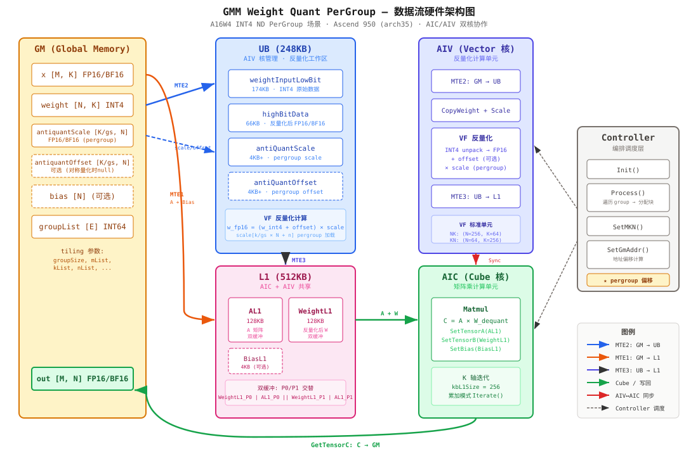

# GMM A16W8 Kernel 走读文档

> 走读对象：
> - Part 2: `grouped_matmul_weight_quant_basic_controller.h` — Controller 入口
> - Part 3: `weight_quant_basic_block.h` + `basic_block_config.h` — L1/UB 空间划分
> - Part 4: `weight_quant_cube_compute.h` + `weight_quant_vec_compute.h` — Cube/Vec 计算调度
>
> 目标：理解 A16W8 多多多的 kernel 完整计算流程，为 A16W4 pergroup ND 适配提供依据。

---

## 0. 总体视角：PerGroup 量化算子实现流程

### 0.1 宏观架构

GMM Weight Quant 算子在 Ascend 950（arch35）上采用 **AIC/AIV 双核协作**架构：

- **AIV（Vector 核）**：负责 weight 的反量化计算（INT4/INT8 → FP16/BF16），结果写入 L1
- **AIC（Cube 核）**：负责矩阵乘计算（A × dequantized_weight + bias），结果写回 GM

整体流程按 **BasicBlock** 为单位迭代执行，每个 BasicBlock 处理一个 `(mL1, nL1, kL1)` 大小的子矩阵。Controller 层负责遍历所有 group 并分配 BasicBlock 到各核。

### 0.2 数据流硬件架构图



### 0.3 计算流程概述

整个 PerGroup 量化算子的计算按以下流程执行：

```
┌─────────────────────────────────────────────────────────────────────┐
│ Controller.Process() — 遍历所有 group                                │
│                                                                     │
│  for groupIdx in 0..groupNum:                                       │
│    ① SetMKN()     — 从 mList/kList/nList 取当前 group 的 M/K/N      │
│    ② SetGmAddr()  — 计算各 tensor 的 GM 地址偏移                     │
│                     ★ pergroup: scale 偏移 = Σ(k_i/gs × n_i)        │
│    ③ 动态调整 baseM/baseN                                           │
│    ④ 分配 BasicBlock 到各核                                         │
│                                                                     │
│    for each BasicBlock (mL1, nL1):                                  │
│      ┌──────────── AIV (Vector) ────────────┐  ┌─── AIC (Cube) ───┐│
│      │                                      │  │                   ││
│      │  for kBlock in K 方向:               │  │  for kBlock:      ││
│      │    ⑤ MTE2: weight(INT4) GM → UB     │  │    ⑦ Wait AIV     ││
│      │    ⑤ MTE2: scale/offset GM → UB     │  │    ⑧ MTE1: A→L1   ││
│      │    ⑥ VF: INT4 unpack → FP16         │  │    ⑨ Matmul:      ││
│      │       + offset (可选)                │  │      C += A × W   ││
│      │       × scale (pergroup)            │  │                   ││
│      │    ⑥ MTE3: W_dequant UB → L1        │  │    ⑩ GetTensorC   ││
│      │    SetAivToAic() ─────────────────────→│      C → GM       ││
│      │                                      │  │    SetAicToAiv()  ││
│      └──────────────────────────────────────┘  └───────────────────┘│
│                                                                     │
│  End() — 写回所有 C 到 GM                                            │
└─────────────────────────────────────────────────────────────────────┘
```

### 0.4 PerGroup 量化的核心差异

与 PerChannel 量化相比，PerGroup 量化在数据流上的核心差异在于 **scale/offset 的维度和加载方式**：

| 维度 | PerChannel | PerGroup |
|------|-----------|----------|
| scale shape | `(N,)` — 每个输出通道一个 scale | `(K/gs, N)` — 每 gs 个 K 元素一个 scale |
| GM→UB 搬运 | 1 行 × N 列 | `K/gs` 行 × N 列（2D 搬运） |
| VF 加载方式 | `scale[nOffset]` | `scale[kOffset/gs × N + nOffset]` |
| 反量化粒度 | 整个 K 轴共用一组 scale | K 轴按 gs 分段，每段独立 scale |
| UB 空间需求 | 4KB（仅 1 行） | 需容纳 `ceil(kL1/gs) × N` 个 scale 值 |

### 0.5 A16W4 PerGroup ND 适配要点

基于上述架构，A16W4 PerGroup ND 的适配集中在以下 3 个层面：

1. **Controller 层**：`SetGmAddr()` 中 `antiquantParamsBaseOffset` 的更新公式从 `+= nSize` 改为 `+= (kSize/groupSize) × nSize`
2. **VF 函数层**：`basic_block_vf_nd.h` 中 `NdNkLoadScaleOffset()`/`NdKnLoadScaleOffset()` 新增 `PER_GROUP` 分支，实现 pergroup scale 加载
3. **Config 层**：新增 `WqmmConfig` 实例（`A16W4_NDKN_PG`/`A16W4_NDNK_PG`），可能需要调整 UB buffer 配置

其余部分（Cube 计算、A/Bias 搬运、主循环框架、同步机制）均可直接复用。

---

## 1. 代码结构概览

### 1.1 文件关系与层次

```
GMMWeightQuantBasicController (Controller 层 — 编排)
  └── WeightQuantMatmulBasicBlock (BasicBlock 层 — 空间管理 + 调度)
        ├── WeightQuantBatchMatmulV2CubeCompute (Cube 计算 — AIC 核)
        └── BasicBlockLibVectorAntiQuantCompute (Vec 计算 — AIV 核)
              └── basic_block_vf_nd.h / basic_block_vf_nz.h / basic_block_vf_mx.h (VF 函数)
```

### 1.2 模板参数链

```cpp
// Controller 模板参数
template <typename xType, typename wType, typename biasType, typename yType,
          const WqmmConfig &wqmmConfig, const VecAntiQuantConfig &vecConfig>
class GMMWeightQuantBasicController;

// WqmmConfig — 编译期配置
struct WqmmConfig {
    bool aTrans;              // A 转置
    bool bTrans;              // B 转置
    QuantType antiQuantType;  // PER_CHANNEL / PER_GROUP / PER_TENSOR / MX
    bool hasAntiQuantOffset;  // 是否有 antiquantOffset
    QuantType quantType;      // 量化类型
    CubeFormat weightFormat;  // ND / NZ
};

// VecAntiQuantConfig — 运行时配置
struct VecAntiQuantConfig {
    uint64_t ubMte2BufferNum = 2;    // MTE2 缓冲数
    uint64_t ubMte2InnerSize = 512;  // MTE2 内轴搬运大小
};
```

### 1.3 已有 WqmmConfig 实例

```cpp
static constexpr WqmmConfig S8S4_NZKN_G = {false, false, PER_GROUP, false, NONE, NZ};
static constexpr WqmmConfig A16MXF4_NZKN = {false, false, MX, false, NONE, NZ};
static constexpr WqmmConfig MXA8W4_NZNK = {false, true, MX, false, NONE, NZ};
```

**⚠️ A16W4 pergroup ND 适配点**：需要新增 WqmmConfig 实例：
```cpp
// A16W4 ND NK pergroup（B 非转置）
static constexpr WqmmConfig A16W4_NDKN_PG = {false, false, PER_GROUP, true/false, NONE, ND};
// A16W4 ND KN pergroup（B 转置）
static constexpr WqmmConfig A16W4_NDNK_PG = {false, true, PER_GROUP, true/false, NONE, ND};
```

---

## 2. Part 2: Controller 入口实现

### 2.1 Init() — 初始化

```cpp
void Init(GM_ADDR x, GM_ADDR weight, GM_ADDR antiquantScale, GM_ADDR antiquantOffset,
          GM_ADDR bias, GM_ADDR groupList, GM_ADDR y,
          const GMMWeightQuantParam *baseTiling,
          const TCubeTiling *mmTiling, GM_ADDR tiling,
          TILING_TYPE *gmmArrayAddrIn, TPipe *tPipe)
{
    gmmBaseTiling_ = baseTiling;
    mmTiling_ = mmTiling;

    // gmmArrayAddrIn 指向 GM 上的 mList/kList/nList 连续存储
    mListGm_ = gmmArrayAddrIn;
    kListGm_ = gmmArrayAddrIn + MKN_LIST_LEN;
    nListGm_ = gmmArrayAddrIn + MKN_LIST_LEN * 2;

    // 保存 GM 地址
    xGm_ = x; weightGm_ = weight; antiquantScaleGm_ = antiquantScale;
    antiquantOffsetGm_ = antiquantOffset; biasGm_ = bias; yGm_ = y;

    if (groupList != nullptr) {
        groupListGm_.SetGlobalBuffer((__gm__ int64_t *)groupList);
    }

    // ★ 关键调用：传递 groupSize 到 BasicBlock
    wqmmBasicBlock_.Init(
        gmmBaseTiling_->hasBias,
        gmmBaseTiling_->groupSize,  // ★ groupSize 从 tiling 传递到 kernel
        0,                          // aPrefetchSize = 0（GMM 场景不确定 group）
        mmTiling_, tPipe);
}
```

**数据流**：`tiling.groupSize` → `GMMWeightQuantParam.groupSize` → `wqmmBasicBlock_.Init(antiQuantGroupSize)` → `vectorCompute_.InitKCG(antiQuantGroupSize)`

### 2.2 Process() — 主循环

```cpp
void Process()
{
    uint32_t cubeBlockIdx = GetBlockIdx();
    if ASCEND_IS_AIV { cubeBlockIdx = cubeBlockIdx >> 1; }  // AIV 核编号 = AIC/2

    BasicBlockOffsetParam offsetParam;
    InitOffsetParam(offsetParam);

    // ★ 遍历所有 group
    for (uint32_t groupIdx = 0, count = 0; groupIdx < gmmBaseTiling_->groupNum; ++groupIdx) {
        SetMKN(groupIdx, preOffset, offsetParam);
        SetGmAddr(groupIdx, xBaseOffset, weightBaseOffset, yBaseOffset,
                  antiquantParamsBaseOffset, offsetParam);

        if (offsetParam.mSize == 0 || offsetParam.nSize == 0) continue;

        // ★ 动态调整 baseM/baseN
        uint64_t baseM = (mSize <= baseM || mSize >= baseM*4) ? baseM
                       : (mSize <= baseM*2) ? CeilDiv(mSize, 2) : CeilDiv(mSize, 4);
        uint64_t baseN = (nSize >= baseN * coreNum) ? baseN : (baseN >> 1);

        uint32_t mBlockNum = CeilDiv(mSize, baseM);
        uint32_t nBlockNum = CeilDiv(nSize, baseN);

        // ★ 基本块分配到各核
        while (curBlock < curCount) {
            offsetParam.mOffset = ((curBlock - count) / nBlockNum) * baseM;
            offsetParam.nOffset = ((curBlock - count) % nBlockNum) * baseN;
            offsetParam.mL1Size = min(baseM, mSize - mOffset);
            offsetParam.nL1Size = min(baseN, nSize - nOffset);

            wqmmBasicBlock_.ComputeBasicBlock(offsetParam, offsetParam);
            curBlock += coreNum;
        }
        count = curCount % coreNum;  // 跨 group 的核任务余数传递
    }
    wqmmBasicBlock_.End(offsetParam);
}
```

### 2.3 SetMKN() — MKN 设置

```cpp
void SetMKN(uint64_t groupIdx, uint64_t &preOffset, BasicBlockOffsetParam &offsetParam)
{
    uint64_t splitValue = GetSplitValueFromGroupList(groupIdx, preOffset);

    if (groupType == 0) {
        // ★ 单单单：M 从 groupList 取值，K/N 从 kList/nList 取值
        offsetParam.mSize = splitValue;
        offsetParam.kSize = singleWeight ? offsetParam.kSize : kListGm_[groupIdx];
        offsetParam.kAlign = CeilAlign(kSize, BLOCK_CUBE);
        offsetParam.nSize = singleWeight ? offsetParam.nSize : nListGm_[groupIdx];
    } else {
        // ★ 多多多：M/K/N 全部从 mList/kList/nList 取值
        offsetParam.mSize = mListGm_[groupIdx];
        offsetParam.kSize = kListGm_[groupIdx];
        offsetParam.kAlign = CeilAlign(kSize, BLOCK_CUBE);
        offsetParam.nSize = nListGm_[groupIdx];
    }
}
```

### 2.4 GetSplitValueFromGroupList() — groupList 解析

```cpp
uint64_t GetSplitValueFromGroupList(uint64_t groupIdx, uint64_t &preOffset)
{
    if (groupType != -1) {
        if (groupListType == 0) {
            // 累积式：groupList[i] 存储累积值
            uint64_t offset = groupListGm_.GetValue(groupIdx);
            splitValue = offset - preOffset;
            preOffset = offset;
        } else {
            // 增量式：groupList[i] 存储增量值
            splitValue = groupListGm_.GetValue(groupIdx);
        }
    }
    return splitValue;  // 多多多场景返回 0（不使用）
}
```

### 2.5 SetGmAddr() — 地址偏移计算（★ 核心差异点）

```cpp
void SetGmAddr(uint64_t groupIdx, uint64_t &xBaseOffset, uint64_t &weightBaseOffset,
               uint64_t &yBaseOffset, uint64_t &antiquantParamsBaseOffset,
               const BasicBlockOffsetParam &offsetParam)
{
    // === x 地址 ===
    if (singleX == 0) {
        xGm = GetTensorAddr<xType>(groupIdx, xGm_);  // 多多多：每个 tensor 独立地址
    } else {
        xGm = GetTensorAddr<xType>(0, xGm_) + xBaseOffset;  // 单单单：基址+偏移
    }

    // === y 地址 ===
    if (singleY == 0) {
        yGm = GetTensorAddr<yType>(groupIdx, yGm_);
    } else {
        yGm = GetTensorAddr<yType>(0, yGm_) + yBaseOffset;
    }

    // === weight/antiquantScale/antiquantOffset/bias 地址 ===
    if (singleWeight == 0) {
        weightGm = GetTensorAddr<wType>(groupIdx, weightGm_);
        antiquantScaleGm = GetTensorAddr<xType>(groupIdx, antiquantScaleGm_);
        antiquantOffsetGm = GetTensorAddr<xType>(groupIdx, antiquantOffsetGm_);
        biasGm = GetTensorAddr<biasType>(groupIdx, biasGm_);
    } else {
        weightGm = GetTensorAddr<wType>(0, weightGm_) + weightBaseOffset;
        antiquantScaleGm = GetTensorAddr<xType>(0, antiquantScaleGm_) + antiquantParamsBaseOffset;
        antiquantOffsetGm = GetTensorAddr<xType>(0, antiquantOffsetGm_) + antiquantParamsBaseOffset;
        biasGm = GetTensorAddr<biasType>(0, biasGm_) + antiquantParamsBaseOffset;
    }

    // 更新全局地址到 BasicBlock
    wqmmBasicBlock_.UpdateGlobalAddr(xGm, weightGm, antiquantScaleGm, antiquantOffsetGm,
                                      nullptr, nullptr, biasGm, yGm, isBias, true);

    // === 偏移更新（★ 关键公式）===
    xBaseOffset += mSize * kSize;                    // x: [M, K]

    if constexpr (IsSameType<wType, int4b_t>::value) {
        weightBaseOffset += (nSize * kSize) >> 1;    // ★ int4 weight: 字节数减半
    } else {
        weightBaseOffset += nSize * kSize;           // int8/fp16 weight
    }

    antiquantParamsBaseOffset += nSize;              // ★ perchannel: scale/offset 仅 N 维
    yBaseOffset += mSize * nSize;                    // y: [M, N]
}
```

#### 2.5.1 地址偏移公式汇总

| Tensor | 多多多（singleWeight=0） | 单单单（singleWeight=1） |
|--------|--------------------------|--------------------------|
| x | `GetTensorAddr(groupIdx)` | `base + Σ(m_i * k_i)` |
| weight | `GetTensorAddr(groupIdx)` | `base + Σ(n_i * k_i)` (int4: `>>1`) |
| y | `GetTensorAddr(groupIdx)` | `base + Σ(m_i * n_i)` |
| antiquantScale | `GetTensorAddr(groupIdx)` | `base + Σ(n_i)` ← **perchannel** |
| antiquantOffset | `GetTensorAddr(groupIdx)` | `base + Σ(n_i)` ← **perchannel** |
| bias | `GetTensorAddr(groupIdx)` | `base + Σ(n_i)` |

**⚠️ A16W4 pergroup 核心差异**：
- **perchannel**：`antiquantScale` shape = `(g, n)` → 偏移 = `Σ(n_i)`
- **pergroup**：`antiquantScale` shape = `(g, k/gs, n)` → 偏移 = `Σ(k_i/gs * n_i)`
- 需要修改 `antiquantParamsBaseOffset` 的更新公式

---

## 3. Part 3: L1/UB 空间划分方案

### 3.1 L1 Buffer 划分（512KB 总量）

#### 3.1.1 非 MX 场景（A16W8/A16W4 适用）

```
L1 (0~512KB):
  有 bias 时:
  | WeightL1_P0 (128KB) | Bias_P0 (4KB) | AL1_P0 (124KB) | AL1_P1 (124KB) | Bias_P1 (4KB) | WeightL1_P1 (128KB) |

  无 bias 时:
  | WeightL1_P0 (128KB) | AL1_P0 (128KB) | AL1_P1 (128KB) | WeightL1_P1 (128KB) |
```

**WeightL1 大小计算**：
```cpp
weightL1Space = baseN * stepKb * baseK;  // 标准：256 * 4 * 64 = 65536 元素 = 128KB (fp16)
weightL1DbOffset_ = L1_SIZE * GetKBUnit<xType>() - weightL1Space;  // 双缓冲偏移
```

**AL1 大小计算**：
```cpp
// 有 bias
aL1Offset = weightL1Space + biasL1Space;  // 跳过 WeightL1_P0 + Bias_P0
aL1Space = L1_SIZE * KB_UNIT - DOUBLE_BUFFER_NUM * aL1Offset;
aL1DbOffset_ = aL1Space >> 1;

// 无 bias
aL1DbOffset_ = L1_HALF_SIZE * KB_UNIT - weightL1Space;  // 256KB - 128KB = 128KB
```

#### 3.1.2 AIC/AIV 分工

- **AIC（Cube 核）**：管理 `aL1_`（输入 A 矩阵）和 `weightL1_`（反量化后的 weight）
- **AIV（Vector 核）**：管理 weight 反量化过程，结果写入 `weightL1_`

### 3.2 UB Buffer 划分

#### 3.2.1 ND 场景 Buffer 配置（`GetNdBufferInfo()`）

```cpp
// A16W8 ND 场景
{
    .ubWeightOutputHighBitBufferNum = 2,       // 双缓冲输出
    .weightInputLowbitUbTotalSize = 174KB,     // weight 输入（int4/int8 原始数据）
    .highBitDataUbTotalSize = 66KB,            // 反量化后的 fp16/bf16 weight
    .antiQuantScaleUbTotalSize = 4KB,          // antiquantScale
    .antiQuantScaleAfterCastUbTotalSize = 0,   // 无 cast 后 buffer
    .antiQuantOffsetUbTotalSize = 4KB,         // antiquantOffset
    // 单缓冲大小 = 总量 / bufferNum
    .weightInputLowBitUbSingleBufferSize = 174KB / ubMte2BufferNum,
    .antiQuantScaleUbSingleBufferSize = 4KB / ubMte2BufferNum,
    .antiQuantOffsetUbSingleBufferSize = 4KB / ubMte2BufferNum,
    .highBitDataUbSingleBufferSize = 66KB / 2,  // 33KB
};
```

#### 3.2.2 UB 空间布局

```
UB (256KB 可用 ≈ 248KB):
  | weightInputLowBit (174KB) | highBitData (66KB) | antiQuantScale (4KB) | antiQuantOffset (4KB) |
```

#### 3.2.3 VecAntiQuantConfig 作用

```cpp
struct VecAntiQuantConfig {
    uint64_t ubMte2BufferNum = 2;    // MTE2 搬运的 buffer 数（控制流水线深度）
    uint64_t ubMte2InnerSize = 512;  // MTE2 每次搬运的内轴大小（K 或 N 方向）
};
```

- `ubMte2InnerSize` 决定了每次从 GM 搬到 UB 的数据条带宽度
- `ubMte2BufferNum` 决定了 MTE2 和 V 之间的流水线级数
- 当前 A16W8 ND 默认配置：`{2, 256}`（从 `MTE2_INNER_SIZE_256_BUF_NUM_4` 推断）

**⚠️ A16W4 pergroup 适配点**：
- pergroup 场景 scale 的 UB 空间需要增大（从 4KB 增加到能容纳 `k/gs * n` 的大小）
- 可能需要新增 `GetNdPerGroupBufferInfo()` 函数
- 或者复用 `GetNdBufferInfo()` 但调整 `antiQuantScaleUbTotalSize`

### 3.3 VfConfig — VF 标准计算单元

```cpp
// ND + bTrans=false（NK 排布）
{.vfNStandardLen = 256, .vfKStandardLen = 64}

// ND + bTrans=true（KN 排布）
{.vfNStandardLen = 64, .vfKStandardLen = 256}
```

VF 计算以 `(vfNStandardLen, vfKStandardLen)` 为标准单元循环。

---

## 4. Part 4: Cube 计算与向量计算调度

### 4.1 ComputeBasicBlock() — 入口分发

```cpp
void ComputeBasicBlock(const BasicBlockOffsetParam &offsetParam, ...)
{
    if ASCEND_IS_AIV {
        // 根据 weight 格式和转置属性分发
        if ((ND && !bTrans) || (NZ && bTrans)) {
            ComputeBasicBlockAivNdKnNzNk(offsetParam);  // K 为内轴
        } else {
            ComputeBasicBlockAivNdNkNzKn(offsetParam);  // N 为内轴
        }
    } else {
        ComputeBasicBlockAic(offsetParam);  // Cube 计算
    }
}
```

**A16W4 pergroup ND 场景**：
- B 非转置 → `ComputeBasicBlockAivNdKnNzNk`（K 为内轴）
- B 转置 → `ComputeBasicBlockAivNdNkNzKn`（N 为内轴）

### 4.2 AIC 核：ComputeBasicBlockAic()

```cpp
void ComputeBasicBlockAic(const BasicBlockOffsetParam &offsetParam)
{
    for (kbGmOffset = 0; kbGmOffset < kSize; kbGmOffset += kbL1Size, cvLoopIdx_++) {
        kbL1RealSize = min(kbL1Size, kSize - kbGmOffset);

        // 1. 等待 MTE1→MTE2 同步
        cubeCompute_.WaitMTE1ToMTE2(kbGmOffset, offsetParam);

        // 2. 搬运 A 和 Bias 从 GM→L1
        cubeCompute_.CopyAAndBiasGmToL1(offsetParam, kbGmOffset, cvLoopIdx_);

        // 3. 等待 AIV→AIC（Vec 核完成反量化）
        WaitAivToAic();

        // 4. 执行 matmul
        cubeCompute_.LaunchMatmul(weightL1_[(cvLoopIdx_ & 1) * weightL1DbOffset_],
                                   kbGmOffset, kbL1RealSize, cvLoopIdx_, offsetParam);

        // 5. 设置 MTE1→MTE2 同步信号
        cubeCompute_.SetMTE1ToMTE2(kbGmOffset, offsetParam);

        // 6. 设置 AIC→AIV 同步信号
        SetAicToAiv();
    }

    // 写回 C 到 GM
    cubeCompute_.GetTensorC(offsetParam);
    cubeCompute_.ClearAFullLoadFlag();
}
```

### 4.3 AIV 核：ComputeBasicBlockAivNdKnNzNk()（B 非转置场景）

```cpp
void ComputeBasicBlockAivNdKnNzNk(const BasicBlockOffsetParam &offsetParam)
{
    uint64_t kMte2BaseSize = kbL1Size / VEC_CORE_NUM;  // 两个 Vec 核分担 K

    for (kMte2Offset = 0; kMte2Offset < kSize; kMte2Offset += kbL1Size, cvLoopIdx_++) {
        l1RealExternalLen = min(kbL1Size, kSize - kMte2Offset);

        // 两个 Vec 核分担 K 方向搬运
        mte2RealK = (SubBlockIdx == 0) ? min(kMte2BaseSize, l1RealExternalLen)
                    : (l1RealExternalLen > kMte2BaseSize) ? l1RealExternalLen - kMte2BaseSize : 0;

        if (cvLoopIdx_ > 1) WaitAicToAiv();

        // 1. 等待 V→MTE2 同步
        vectorCompute_.WaitVToMTE2();

        // 2. 搬运 weight + scale/offset 从 GM→UB
        vectorCompute_.CopyGmToUb(nL1Size, mte2RealK, nOffset,
                                   kMte2Offset + SubBlockIdx * kMte2BaseSize, offsetParam);

        // 3. 反量化计算（UB→L1）
        ubConsumeConfig.l1RequireVfComputeRealK = mte2RealK;
        vectorCompute_.WeightAntiQuantCompute(ubConsumeConfig,
            weightL1_[(cvLoopIdx_ & 1) * weightL1DbOffset_], l1ConsumeConfig, nullptr);

        // 4. 设置 AIV→AIC 同步
        SetAivToAic();

        // 5. 设置 V→MTE2 同步
        vectorCompute_.SetVToMTE2();
    }
}
```

### 4.4 Cube 计算：LaunchMatmul()

```cpp
void LaunchMatmul(const LocalTensor<xType> &weightL1, int64_t kbOffset,
                  uint64_t kbL1RealSize, uint64_t cvLoopIdx, const BasicBlockOffsetParam &param)
{
    // 非 MX 场景（A16W8/A16W4 适用）
    mmObj_.SetOrgShape(CeilAlign(mL1Size, BLOCK_CUBE), CeilAlign(nL1Size, BLOCK_CUBE),
                       CeilAlign(kbL1RealSize, BLOCK_CUBE), CeilAlign(kbL1RealSize, BLOCK_CUBE),
                       param.nSize);
    mmObj_.SetTensorA(aL1_[aL1Offset], wqmmConfig.aTrans);
    mmObj_.SetTensorB(weightL1, wqmmConfig.bTrans);
    if (isBias_) mmObj_.SetBias(biasL1_[(cvLoopIdx & 1) * biasL1DbOffset_]);
    mmObj_.SetTail(param.mL1Size, param.nL1Size, kbL1RealSize);
    mmObj_.Iterate(kbOffset != 0);  // 非首次迭代为累加模式
}
```

### 4.5 Vec 计算：反量化调度流程

#### 4.5.1 CopyGmToUb() — GM→UB 搬运

```cpp
void CopyGmToUb(uint64_t ubMte2NSize, uint64_t ubMte2KSize,
                uint64_t ubMte2NOffset, uint64_t ubMte2KOffset, ...)
{
    // 1. 搬运 weight 数据
    CopyWeightGmToUb(ubMte2NSize, ubMte2KSize, ubMte2NOffset, ubMte2KOffset, offsetParam);

    // 2. 搬运反量化参数（scale/offset）
    CopyAntiQuantParamsGmToUb(ubMte2NSize, ubMte2KSize, ubMte2NOffset, ubMte2KOffset, offsetParam);

    // 3. MTE2→V 同步
    SetFlag<HardEvent::MTE2_V>(eventIdMTE2ToV);
    WaitFlag<HardEvent::MTE2_V>(eventIdMTE2ToV);
    ubMte2LoopIdx_++;
}
```

#### 4.5.2 CopyAntiQuantParamsGmToUb() — 反量化参数搬运（★ 按 antiQuantType 分发）

```cpp
void CopyAntiQuantParamsGmToUb(...)
{
    if constexpr (antiQuantType == PER_CHANNEL) {
        // perchannel: scale shape = [1, nSize]
        DataCopyPad2D(ubAntiQuantScaleTotalBuffer_[bufIdx * singleBufSize],
                      antiQuantScaleGlobal_[ubMte2NOffset],
                      1, ubMte2NSize,
                      CeilAlign(ubMte2NSize, VECTOR_REG_WIDTH), offsetParam.nSize);
        if (hasAntiQuantOffset) {
            DataCopyPad2D(ubAntiQuantOffsetTotalBuffer_[...],
                          antiQuantOffsetGlobal_[ubMte2NOffset], ...);
        }
    } else if constexpr (antiQuantType == PER_TENSOR) {
        scaleValue_ = antiQuantScaleGlobal_.GetValue(0);
        if (hasAntiQuantOffset) offsetValue_ = antiQuantOffsetGlobal_.GetValue(0);
    } else if constexpr (antiQuantType == PER_GROUP) {
        // ★ pergroup: scale shape = [k/groupSize, nSize]
        DataCopyPad2D(ubAntiQuantScaleTotalBuffer_[bufIdx * singleBufSize],
                      antiQuantScaleGlobal_[ubMte2KOffset / antiQuantGroupSize_ * offsetParam.nSize + ubMte2NOffset],
                      CeilDivide(ubMte2KSize, antiQuantGroupSize_), ubMte2NSize,
                      VEC_MAX_ELEM_B16, offsetParam.nSize);
    }
}
```

**⚠️ A16W4 pergroup 关键发现**：
- `PER_GROUP` 分支**已存在**！scale 搬运逻辑已实现
- 但当前仅在 NZ 格式下使用（`S8S4_NZKN_G` 配置）
- A16W4 ND pergroup 需要确认此分支在 ND 格式下是否也能正确工作

#### 4.5.3 WeightAntiQuantCompute() — 反量化计算主循环

```cpp
void WeightAntiQuantCompute(const UbConsumeConfig &ubConsumeConfig,
                            const LocalTensor<xType> &weightHighBitL1, ...)
{
    // 按 VF 标准单元循环
    for (antiQuantKOffset = 0; antiQuantKOffset < l1RequireVfComputeRealK;
         antiQuantKOffset += VF_CONFIG.vfKStandardLen) {
        for (antiQuantNOffset = 0; antiQuantNOffset < l1RequireVfComputeRealN;
             antiQuantNOffset += VF_CONFIG.vfNStandardLen) {

            // 等待 MTE3→V（上一次输出完成）
            WaitFlag<HardEvent::MTE3_V>(vecEventIdMte3ToV[bufIdx]);

            // 计算实际尺寸
            nRealLen = min(vfNStandardLen, l1RequireVfComputeRealN - antiQuantNOffset);
            kRealLen = min(vfKStandardLen, l1RequireVfComputeRealK - antiQuantKOffset);

            // ★ 执行反量化 VF 函数
            WeightAntiQuantProcess(nRealLen, kRealLen, antiQuantNOffset, antiQuantKOffset, ...);

            // 反量化结果从 UB→L1
            WeightHighBitUbToL1(weightHighBitL1Offset, nRealLen, kRealLen, weightHighBitL1, ...);

            // 设置 MTE3→V 同步
            SetFlag<HardEvent::MTE3_V>(vecEventIdMte3ToV[bufIdx]);
            ubComputeLoopIdx_++;
        }
    }
}
```

#### 4.5.4 WeightAntiQuantProcess() → AntiQuantProcess() — VF 函数分发

```cpp
void AntiQuantProcess(vfExternalRealLen, vfInnerRealLen, nOffset, kOffset, ...)
{
    if constexpr (antiQuantType == MX) {
        // MX 场景...
    } else {
        if constexpr (weightFormat == ND) {
            AntiQuantProcessNd(vfExternalRealLen, vfInnerRealLen, nOffset, kOffset);
        } else {
            AntiQuantProcessNz(vfExternalRealLen, vfInnerRealLen, nOffset, kOffset);
        }
    }
}
```

#### 4.5.5 AntiQuantProcessNd() — ND 反量化 VF 分发

```cpp
void AntiQuantProcessNd(vfExternalRealLen, vfInnerRealLen, nOffset, kOffset)
{
    CalLocalAddrForVf(nOffset, kOffset, addressParam);

    if constexpr (wType == int8_t || wType == hifloat8_t) {
        // B8 场景
        if (bTrans) AntiQuantB8CommonNdNk(...);
        else        AntiQuantB8CommonNdKn(...);
    } else if constexpr (wType == fp8_e5m2_t || wType == fp8_e4m3fn_t) {
        // FP8 场景
        if (bTrans) VF_CALL<AntiQuantFP8NdNkVf>(...);
        else        VF_CALL<AntiQuantFP8NdKnVf>(...);
    } else {
        // ★ INT4 场景（A16W4 走这里）
        if (bTrans) AntiQuantInt4NdNk(...);  // ND KN 排布
        else        AntiQuantInt4NdKn(...);  // ND NK 排布
    }
}
```

**⚠️ A16W4 pergroup 关键发现**：
- 当前 `AntiQuantInt4NdNk` 和 `AntiQuantInt4NdKn` 函数中，scale/offset 的加载方式由 `wqmmConfig.antiQuantType` 决定
- 在 `NdNkLoadScaleOffset()` 和 `NdKnLoadScaleOffset()` 中：
  - `PER_TENSOR`：使用 `Duplicate` 填充常量
  - `PER_CHANNEL`：从 UB 加载 `[nOffset]` 位置的 scale
  - **但没有 `PER_GROUP` 分支！**

**⚠️ A16W4 pergroup 需要新增的核心代码**：
- 在 `basic_block_vf_nd.h` 中为 `AntiQuantInt4NdNk` 和 `AntiQuantInt4NdKn` 新增 `PER_GROUP` 分支
- pergroup 的 scale 加载方式：`scale[kOffset / groupSize * nSize + nOffset]`
- 参考 ops-nn 的 `AntiquantComputeW4NKPerGroup` / `AntiquantComputeKNPerGroup`

---

## 5. AIC/AIV 同步机制

### 5.1 跨核同步信号

```
AIV → AIC: SetAivToAic() / WaitAivToAic()
  使用 CrossCoreSetFlag<SYNC_MODE4, PIPE_MTE3>(SYNC_AIC_AIV_FLAG)
  含义：Vec 核完成反量化，weight 数据已就绪于 L1

AIC → AIV: SetAicToAiv() / WaitAicToAiv()
  使用 CrossCoreSetFlag<SYNC_MODE4, PIPE_MTE1>(SYNC_AIV_AIC_FLAG)
  含义：Cube 核完成 matmul，L1 weight 可被下一轮覆盖
```

### 5.2 流水线时序

```
时间 →
AIC: [MTE1:A→L1] [Wait AIV] [Matmul] [Set AIV] [MTE1:A→L1] [Wait AIV] [Matmul] ...
AIV: [MTE2:W→UB] [VF:反量化] [MTE3:UB→L1] [Set AIC] [MTE2:W→UB] [VF:反量化] ...
```

---

## 6. A16W4 pergroup ND 完整适配清单

### 6.1 Controller 层（`grouped_matmul_weight_quant_basic_controller.h`）

| 适配点 | 修改内容 | 复杂度 |
|--------|----------|--------|
| `SetGmAddr()` antiquantScale 偏移 | pergroup: `antiquantParamsBaseOffset += (kSize / groupSize) * nSize` | 中 |
| `SetGmAddr()` antiquantOffset 偏移 | 同上 | 中 |
| `SetGmAddr()` bias 偏移 | bias 仍为 `(g, n)` → 偏移不变 | 低 |

**具体修改方案**：
```cpp
// 当前 perchannel:
antiquantParamsBaseOffset += offsetParam.nSize;

// 修改为 pergroup:
if constexpr (wqmmConfig.antiQuantType == QuantType::PER_GROUP) {
    antiquantParamsBaseOffset += (offsetParam.kSize / groupSize) * offsetParam.nSize;
} else {
    antiquantParamsBaseOffset += offsetParam.nSize;
}
```

注意：`groupSize` 需要从 `gmmBaseTiling_->groupSize` 获取。

### 6.2 BasicBlock 层（`weight_quant_basic_block.h`）

| 适配点 | 修改内容 | 复杂度 |
|--------|----------|--------|
| `Init()` | 无需修改（groupSize 已传递） | 低 |
| `ComputeBasicBlock()` | 无需修改（分发逻辑通用） | 低 |

### 6.3 Config 层（`basic_block_config.h`）

| 适配点 | 修改内容 | 复杂度 |
|--------|----------|--------|
| 新增 `WqmmConfig` 实例 | A16W4 ND pergroup NK/KN | 低 |
| `GetBufferConfig()` | 可能需要 pergroup 专用 buffer 配置（scale UB 空间增大） | 中 |
| `GetVfConfig()` | 确认 pergroup 的 VF 标准单元大小 | 低 |

### 6.4 Vec 计算层（`weight_quant_vec_compute.h`）

| 适配点 | 修改内容 | 复杂度 |
|--------|----------|--------|
| `CopyAntiQuantParamsGmToUb()` | PER_GROUP 分支已存在，需确认 ND 场景适用性 | 低 |
| `AntiQuantProcessNd()` | 需确认 int4 pergroup 分发路径 | 中 |

### 6.5 VF 函数层（`basic_block_vf_nd.h`）— ★ 主要新增代码

| 适配点 | 修改内容 | 复杂度 |
|--------|----------|--------|
| `NdNkLoadScaleOffset()` | 新增 `PER_GROUP` 分支 | 高 |
| `NdKnLoadScaleOffset()` | 新增 `PER_GROUP` 分支 | 高 |
| `AntiQuantInt4NdNk()` | pergroup scale 加载方式适配 | 高 |
| `AntiQuantInt4NdKn()` | pergroup scale 加载方式适配 | 高 |
| 可能新增 `AntiQuantInt4NdNkPerGroup()` | 独立的 pergroup VF 函数 | 高 |
| 可能新增 `AntiQuantInt4NdKnPerGroup()` | 独立的 pergroup VF 函数 | 高 |

### 6.6 Tiling 层

| 适配点 | 修改内容 | 复杂度 |
|--------|----------|--------|
| `SetTilingKey()` | `antiquantType = PER_GROUP` | 低 |
| `CheckGroupSize()` | 新增 32/64 校验 | 低 |
| `SetAntiquantGroupSize()` | 确认 pergroup shape 解析 | 低 |

---

## 7. 可复用代码总结

### 7.1 完全可复用（无需修改）

| 模块 | 函数/代码 | 说明 |
|------|-----------|------|
| Controller | `Init()` | 初始化流程通用 |
| Controller | `Process()` 主循环 | group 遍历 + 基本块分配逻辑通用 |
| Controller | `SetMKN()` | MKN 取值逻辑通用 |
| Controller | `GetSplitValueFromGroupList()` | groupList 解析通用 |
| Controller | `SetGmAddr()` x/weight/y 偏移 | 与反量化类型无关 |
| BasicBlock | `Init()` | L1 空间分配通用 |
| BasicBlock | `ComputeBasicBlock()` 分发 | 分发逻辑基于 weightFormat/bTrans |
| BasicBlock | `ComputeBasicBlockAic()` | Cube 计算流程通用 |
| Cube | `LaunchMatmul()` | matmul 调用通用 |
| Cube | `CopyAAndBiasGmToL1()` | A/Bias 搬运通用 |
| Cube | `GetTensorC()` | C 写回通用 |
| Vec | `CopyGmToUb()` | 搬运框架通用 |
| Vec | `CopyWeightGmToUb()` | weight 搬运通用 |
| Vec | `WeightAntiQuantCompute()` | 反量化主循环框架通用 |
| Vec | `WeightHighBitUbToL1()` | UB→L1 搬运通用 |
| Vec | `CalLocalAddrForVf()` | UB 地址计算通用 |

### 7.2 需要适配（修改分支条件或参数）

| 模块 | 函数 | 修改内容 |
|------|------|----------|
| Controller | `SetGmAddr()` | antiquantScale/Offset 偏移公式 |
| Config | `GetBufferConfig()` | pergroup scale UB 空间 |
| Vec | `CopyAntiQuantParamsGmToUb()` | 确认 PER_GROUP 分支在 ND 下工作 |
| Tiling | `SetTilingKey()` | antiquantType 设置 |

### 7.3 需要新增

| 模块 | 内容 | 说明 |
|------|------|------|
| Config | `WqmmConfig` 新实例 | A16W4 ND pergroup 配置 |
| VF | `NdNkLoadScaleOffset()` PER_GROUP 分支 | pergroup scale 加载 |
| VF | `NdKnLoadScaleOffset()` PER_GROUP 分支 | pergroup scale 加载 |
| VF | `AntiQuantInt4NdNk/Kn` pergroup 适配 | 或新增独立函数 |
| Tiling | `CheckGroupSize()` A16W4 校验 | 32/64/128/256 |

---

## 8. 关键常量速查

| 常量 | 值 | 说明 |
|------|-----|------|
| `L1_SIZE` | 512 (KB) | L1 总大小 |
| `L1_SIZE_BYTE` | 512*1024 | L1 字节数 |
| `BIAS_L1_SIZE` | 4 (KB) | Bias L1 单块大小 |
| `VEC_CORE_NUM` | 2 | Vec 核数量 |
| `BLOCK_CUBE` | 16 | Cube 块大小 |
| `VECTOR_REG_WIDTH` | 256 (B) | 向量寄存器宽度 |
| `VEC_MAX_ELEM_B16` | 128 | 256B/2B = 128 个 fp16 |
| `DOUBLE_BUFFER_NUM` | 2 | 双缓冲 |
| `QUADRUPLE_BUFFER_NUM` | 4 | 四缓冲 |
| `WEIGHT_F16_UB_NZ_STRIDE` | 65 | UB NZ 排布 stride |
| `MX_GROUPSIZE` | 32 | MX group size |
