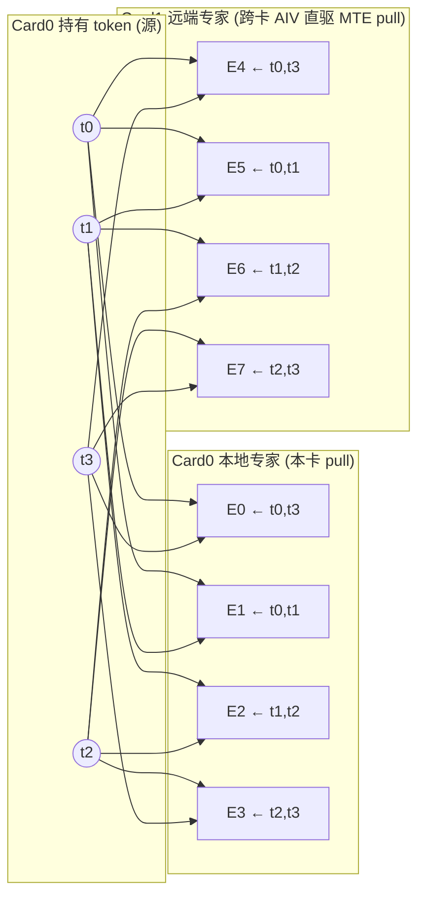
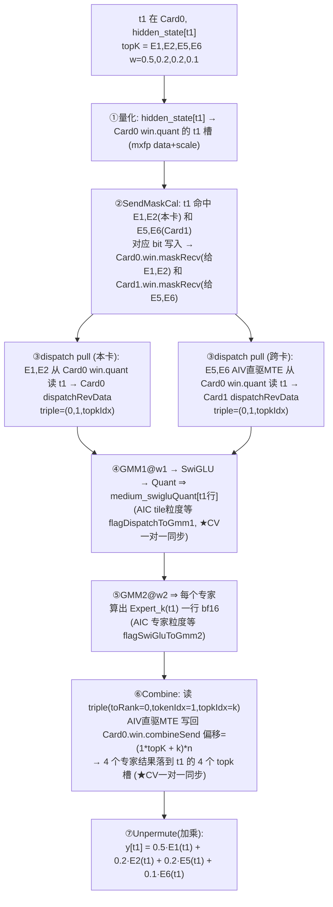

# MegaMoe 全流程图：从 hidden_state + topK 到 输出 y

> 代码基准：`mc2/mega_moe/op_kernel/arch35/`
> - 主流程 `mega_moe.h :: Process()`（4 个阶段）
> - GMM1+SwiGLU+Quant / GMM2+Combine：`mega_moe_impl.h`
> - Combine 写回：`mega_moe_combine_send.h`
> - workspace / peermem 布局：`mega_moe_workspace_info.h` / `mega_moe_base.h`
>
> 一句话：**mask 决定"谁取谁"，token 被目标专家卡 pull 过来，过 GMM1→SwiGLU→GMM2，combine 沿 mask 原路写回，最后按 topK 权重加乘 unpermute 成 y。**

---

## 0. 名词与缓冲（先建立词汇表）

| 名称 | 位置 | 含义 |
|---|---|---|
| `win.quantTokenScale` | peer mem (跨卡可见) | 本卡 token 的**量化结果**(data+scale, mxfp) |
| `win.maskRecv` | peer mem | 源卡算好的 send-mask 接收区，布局 `[localExpert][srcRank]`，每槽 = `[bit-mask \| count]` |
| `win.combineSend` | peer mem | combine 结果写回区（目标卡把算完的行写回源卡这里） |
| `win.rankSyncInWorld` | peer mem | 跨卡软同步握手位 |
| `dispatchRevData` | 本卡 workspace(HBM) | 目标专家 pull 过来的量化 token，按专家连续排布（GMM1 的 A 矩阵） |
| **`medium_swigluQuant`** | 本卡 workspace(HBM) | **GMM1→SwiGLU→Quant 的中间激活**（取名），= `swigluQuantData/Scale`（GMM2 的 A 矩阵） |
| `tripleInfo` | 本卡 workspace(HBM) | 每个 dispatch 行的三元组 `(srcRank, tokenIdx, topkIdx)`，combine 靠它原路返回 |
| `flagDispatchToGmm1` | 本卡 workspace | **wave 粒度**就绪门：每专家每 wave(256 行) 一个槽，dispatch 完成行数累加 → AIC 轮询 |
| `flagSwiGluToGmm2` | 本卡 workspace | **专家粒度**就绪门：SwiGLU 段完成数，GMM2 AIC 轮询 |

> AIC = Cube 核 (`subBlockIdx==0`)，AIV = Vector 核 (`subBlockIdx==1`)。跨卡搬运是 **AIV 直驱 MTE** 读/写对端 win（不是 RDMA）。

---

## 1. 全流程图（4 阶段，单卡视角——每张卡同时是"源卡"和"目标卡"）

```mermaid
flowchart TD
    IN["输入: hidden_state [bs, h]  +  topK_ids [bs, topK]  + topK_weights"]

    subgraph P1["阶段1 源卡: 算 mask + 量化 (Process 1601-1612)"]
        direction TB
        Q["QuantProcessInRank<br/>本卡 token 量化 → win.quantTokenScale"]
        M1["SendMaskCal: 对每个全局专家 Ej<br/>CompareScalar(topK_ids==Ej) → GatherMask<br/>得到 bit-mask + count"]
        M2["AIV 直驱 MTE 点对点写到<br/>目标专家所在卡的 win.maskRecv[Ej的localExpert][本srcRank]"]
        Q --> M1 --> M2
    end

    SYNC1["PipeBarrier + SyncAll + CrossRankSyncInWorldSize<br/>(确认所有卡 mask 都已落地)"]

    subgraph P2["阶段2 目标卡: dispatch(pull) + GMM1 + SwiGLU + Quant (Process 1614-1667)"]
        direction TB
        L2["for localExpert in 0..expertPerRank:"]
        SC["SendInfoCal / SendCntCal:<br/>读本卡 win.maskRecv[le][*].count → 建 cumsum"]
        TD["TripleInfoCalAndDispatch (AIV sb1):<br/>按 bit-mask 取命中 token<br/>—AIV 直驱 MTE 读源卡 win.quant→ 写本卡 dispatchRevData<br/>同时写 tripleInfo(srcRank,tokenIdx,topkIdx)<br/>并把 flagDispatchToGmm1 该 wave 槽 += 行数"]
        G1["GroupMatmulSwigluQuant (AIC sb0):<br/>AIC 轮询 flagDispatchToGmm1[wave] == 本wave行数<br/>→ tile(256行)粒度启动 GMM1(@w1)<br/>→ AIV 做 SwiGLU+Quant epilogue<br/>(★ 一对一 CV 同步 NotifyVector/WaitForCube)"]
        MED["→ medium_swigluQuant (swigluQuantData/Scale)<br/>置 flagSwiGluToGmm2[le]"]
        L2 --> SC --> TD --> G1 --> MED
    end

    subgraph P3["阶段3 目标卡: GMM2 + Combine (Process 1669-1687)"]
        direction TB
        L3["for expert in 0..expertPerRank:"]
        G2["GroupMatmul2Combine (AIC sb0):<br/>AIC 轮询 flagSwiGluToGmm2[le] (★专家粒度等)<br/>→ GMM2(@w2) 出 bf16 行"]
        CB["CombineTokens (AIV):<br/>读 tripleInfo → 按 (toRank,tokenIdx,topkIdx)<br/>—AIV 直驱 MTE 写回源卡 win.combineSend<br/>偏移 = (tokenIdx*topK + topkIdx)*n<br/>(★ 一对一 CV 同步 ping-pong NotifyCube/WaitForCube)"]
        L3 --> G2 --> CB
    end

    SYNC2["PipeBarrier + SyncAll + CrossRankSyncInWorldSize<br/>(确认 combine send 全部完成)"]

    subgraph P4["阶段4 源卡: Unpermute (Process 1689-1694)"]
        UP["Unpermute: 对每个本卡 token,<br/>把它 topK 个 combineSend 槽<br/>各乘 topK_weight 再求和(加乘)<br/>y[token] = Σ_k w_k · Expert_k(token)"]
    end

    OUT["输出: y [bs, h]"]

    IN --> P1 --> SYNC1 --> P2 --> P3 --> SYNC2 --> P4 --> OUT
```



---

## 2. 例子：`bs=4, topK=4, 一卡4专家, 共2卡`

### 2.1 拓扑

```
Card0 (rank0): 专家 E0 E1 E2 E3      Card1 (rank1): 专家 E4 E5 E6 E7
Card0 持有 token: t0 t1 t2 t3        Card1 也各自持有自己的 4 个 token(对称, 下面只追 Card0 的)
```

### 2.2 topK_ids 例子（Card0 的 4 个 token，各选 4 个专家 / 8 个）

| token | topK_ids (4 选 8) | topK_weights 例 |
|---|---|---|
| **t0** | E0, E1, E4, E5 | 0.4, 0.3, 0.2, 0.1 |
| **t1** | E1, E2, E5, E6 | 0.5, 0.2, 0.2, 0.1 |
| **t2** | E2, E3, E6, E7 | 0.3, 0.3, 0.3, 0.1 |
| **t3** | E0, E3, E4, E7 | 0.4, 0.4, 0.1, 0.1 |

### 2.3 由 mask 反推"每个专家去 pull 哪些 token"（dispatch 取数表）

对 topK_ids 按列扫描 → 每个专家的命中 token 集合（这正是 `win.maskRecv` 里 bit-mask 的语义）：

| 目标专家 | 所在卡 | pull 的 token (来自 Card0) |
|---|---|---|
| E0 | Card0(本地) | t0, t3 |
| E1 | Card0(本地) | t0, t1 |
| E2 | Card0(本地) | t1, t2 |
| E3 | Card0(本地) | t2, t3 |
| E4 | Card1(远端) | t0, t3 |
| E5 | Card1(远端) | t0, t1 |
| E6 | Card1(远端) | t1, t2 |
| E7 | Card1(远端) | t2, t3 |

> 读法：E5 在 Card1，它从 Card0 的 `win.quant` 把 t0、t1 两个量化 token **pull** 过来，落到 Card1 的 `dispatchRevData` 中 E5 段。每 pull 一行就写一条 tripleInfo `(srcRank=0, tokenIdx, topkIdx)`。

### 2.4 dispatch 路由图（Card0 token → 8 个专家）



---

## 3. 追踪一个 token 的"生命路径"：以 **t1** 为例（topK = E1,E2,E5,E6）



**一句话总结 t1 的路径**：
`hidden[t1]` →(量化)→ `win.quant` →(mask 点对点)→ E1/E2 本卡取、E5/E6 跨卡取 →`dispatchRevData` →(GMM1+SwiGLU+Quant, wave 粒度门控)→ `medium_swigluQuant` →(GMM2, 专家粒度门控)→ 4 行专家输出 →(Combine 按 triple 原路写回)→ `Card0.win.combineSend` 的 4 个 topk 槽 →(Unpermute 加权求和)→ `y[t1]`。

---

## 4. 关键同步点（你点名要标的）

| 同步 | 位置 | 机制 |
|---|---|---|
| **tile(wave) 粒度启动 GMM1** | `mega_moe_impl.h:152-164` | AIC 轮询 `flagDispatchToGmm1[waveIdx]` == 本 wave 实际行数(尾 wave 可 <256) |
| **★ SwiGLU 处 CV 一对一同步** | `mega_moe_impl.h:195-212` | AIC `NotifyVector` / AIV `WaitForCube`+`NotifyCube` |
| **专家粒度等 GMM2** | `mega_moe_impl.h:329-335` | AIC 轮询 `flagSwiGluToGmm2` == GMM1 总 tile 数 |
| **★ Combine 处 CV 一对一同步** | `mega_moe_impl.h:359-378` | ping-pong `NotifyVector(idx)` / `WaitForCube(idx)` |
| **跨卡阶段屏障** | `Process():1609-1612, 1686-1692` | `PipeBarrier + SyncAll + CrossRankSyncInWorldSize` |

---

> 想要 Excalidraw 画布版：本文件的 Mermaid 块可在 Excalidraw 里用 **"Mermaid to Excalidraw"** 一键导入成可编辑图元。若希望我直接用 excalidraw MCP 生成画布，请在 `claude mcp add ...` 后**重启会话**，届时我可把上面三张图落成 excalidraw 元素。
