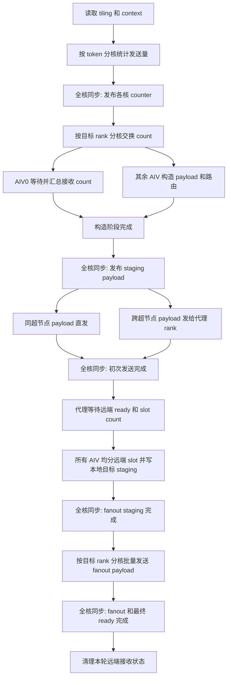

# MoeEpDispatch Hybrid 最终代码详解

## 1. 目标与适用范围

`MoeEpDispatch` 现在有两条内核路径：

- `direct`：所有 rank 位于同一个超节点，沿用原有模板。
- `hybrid`：EP 通信域跨越多个超节点，先跨超节点聚合发送，再在目标超节点内分发。

tiling 根据 `topo_type`、`rank_num_per_server` 和 EP rank 数计算 `networkMode`，并通过 tiling key 在
`moe_ep_dispatch.cpp` 中选择模板。direct 和 hybrid 使用不同的 workspace、通信窗口布局，direct 内核实现不依赖
hybrid 的状态和中转区。

本文只说明 dispatch 主算子。epilogue 读取 dispatch 写好的最终接收区，combine 使用同一通信窗口中位于其后的
combine 区域。

## 2. 基本概念

下文使用以下符号：

| 符号 | 含义 |
| --- | --- |
| `R` | EP 通信域总 rank 数 |
| `U` | 每个超节点内的 rank 数，即 `rank_num_per_server` |
| `S` | 超节点数，`S = R / U` |
| `A` | 实际使用的 AIV 核数 |
| `T` | 当前 rank 的 token 数 |
| `N` | 每个 rank 允许的最大 token 数 |
| `K` | 每个 token 的 top-k 数 |
| `E_local` | 每个 rank 的本地专家数 |
| `P` | 一个普通 payload slot 的字节数 |

代码中的 `scaleup` 表示同一超节点内通信，`scaleout` 表示跨超节点通信。

跨超节点发送使用固定代理 rank。源 rank 在本超节点内的序号为：

```text
local_index = source_rank % U
```

它向目标超节点发送时，代理 rank 为：

```text
proxy_rank = target_server_index * U + local_index
```

因此每个源 rank 在每个远端超节点只有一个代理目标。代理收到聚合 payload 后，根据随 payload 携带的目标
rank mask 和 slot 信息，在自己的超节点内完成第二次分发。

## 3. 对外接口

### 3.1 EPHandle

`EPHandle` 保留普通 dispatch 元数据，并增加以下跨超节点路由张量：

| 字段 | 形状 | 含义 |
| --- | --- | --- |
| `route_count` | `[T]` | 每个 token 的远端超节点路由项数 |
| `route_dst_scaleout` | `[T, K]` | 每个路由项的目标超节点序号 |
| `route_scaleout_slot` | `[T, K]` | payload 在目标超节点聚合区中的 slot |
| `route_scaleup_mask` | `[T, K, ceil(U / 32)]` | 目标超节点内需要接收该 payload 的 rank 位图 |
| `route_scaleup_slot` | `[T, K, U]` | 每个目标 rank 对应的最终接收 slot |

一个 token 命中同一远端超节点内的多个专家时，只生成一个远端路由项。payload 只跨超节点发送一次，代理再按
mask 分发。这就是二级去重的结果。

cache 模式把这些张量作为 cached 输入传回内核。内核按 cached 路由写 payload，同时把路由信息搬到本次
`EPHandle` 输出，保证新 handle 可以继续复用。

### 3.2 保留的临时环境变量

只保留以下两个开发控制：

- `MOE_EP_DEBUG_RANK_NUM_PER_SERVER`：覆盖每个超节点的 rank 数。
- `MOE_EP_DEBUG_FORCE_NETWORK_MODE`：接受 `0/direct` 或 `1/hybrid`，覆盖 tiling 的模板选择。

正式拓扑信息仍由 context 和算子属性传入。代码中不再存在 `debug_out` 输出、调试打印或其他调试环境变量。

## 4. 整体流程



主流程在 `Process()` 中只对 AIV 执行：

```text
PrepareDispatchPayloads()
TransferDispatchPayloads()
```

`PrepareDispatchPayloads()` 负责计数、count 交换、slot 分配、payload 和路由构造。
`TransferDispatchPayloads()` 负责同超节点发送、跨超节点发送及代理 fanout。

## 5. 分核与流水策略

### 5.1 计数和 payload 构造

当 `A > 1` 时：

- AIV0 不分配 token，专门等待所有来源 rank 的 count。
- AIV1 到 AIV(A-1) 均分 `T` 个 token，余数依次分给前面的工作核。
- 每个工作核同时统计目标 rank、目标专家和目标超节点的发送量。

count 交换后不增加一次全核同步。AIV0 进入接收 count 轮询时，其他 AIV 可以立即进入 `SendPhase()` 构造
payload。AIV0 本来就没有 token，因此这两个工作可以重叠。`SendPhase()` 结束处的全核同步同时保证：

1. AIV0 已经得到完整接收 count；
2. 其他 AIV 已经写完 workspace payload、slot 和路由输出。

### 5.2 count 交换

`R` 个目标 rank 均分给全部 AIV。一个目标 rank 的 count 数据和 ready 状态由同一个 AIV 负责发送：

- 专家 count 数据量：`E_local * 4` 字节；
- ready 和该目标的 token 总数：8 字节；
- 本 rank 目标使用本地窗口搬运，远端目标使用 HCOMM。

### 5.3 初次 payload 发送

同超节点发送按全局目标 rank 分核，再裁剪到当前超节点的 rank 范围。每个发送核把属于目标 rank 的连续 slot
一次性发到目标窗口；本 rank 目标直接写本地窗口。

跨超节点发送也按目标 rank 所属权分核。每个远端超节点映射到一个 `proxy_rank`，拥有该代理 rank 的 AIV：

1. 汇总各 AIV 为该远端超节点生成的 slot 数；
2. 把连续 scaleout slot 发到代理的 `scaleout_recv_data`；
3. 写入 `[ready, slot_count]` 状态。

数据发送完成后才发布 ready，代理看到 ready 时可以安全读取完整 payload。

### 5.4 代理 fanout

每个远端来源超节点依次处理：

1. AIV0 轮询该来源的 ready；
2. 全核同步后读取 `slot_count`；
3. 全部 AIV 均分这些 scaleout slot；
4. 每个核读取 payload、目标 rank mask 和目标 slot；
5. 本 rank 数据直接写最终窗口，其他本地 rank 数据写 workspace staging；
6. 全核归约每个目标 rank 的 fanout slot 数；
7. 目标 rank 均分给 AIV，各 AIV 批量发送连续 staging 数据并发布最终 ready；
8. 全核完成后由 AIV0 清理该来源的接收状态。

这里按 slot 分核保证大 payload 可以利用全部 AIV 搬运；按目标 rank 分核保证同一 HCOMM 连接只有一个 AIV
使用。

## 6. Slot 格式

普通 payload slot 大小为：

```text
P = Align512(
        Align32(hidden payload)
      + Align32(fp8 scales，可选)
      + Align32(topk_idx)
      + Align32(topk_weights 区)
      + 32B metadata
    )
```

同超节点最终 slot 使用 `Align512(P)`。

跨超节点 slot 在普通 payload 后追加 fanout 元数据：

```text
scaleout_slot = Align512(
      P
    + ceil(U / 32) * 4B   # 目标 rank mask
    + U * 4B              # 各目标 rank 的最终 slot
)
```

payload 和路由元数据放在同一连续 slot 中，代理不需要访问源 rank 的 `EPHandle`。

## 7. Workspace 布局

以下 offset 都相对传给 kernel 的 `workspaceGM`。`Align512(x)` 表示向上对齐到 512 字节。

```text
0
| scaleup_counter
|   A * Align512(R * 4)
|
| send_count_per_rank
|   R * 512
|
| send_count_per_expert
|   Align512(R * E_local * 4)
|-------------------------------- scaleupSendWorkspaceOffset
| same-server staging
|   U * N * scaleup_slot_bytes
|-------------------------------- scaleoutSendWorkspaceOffset
| cross-server staging
|   S * N * scaleout_slot_bytes
|-------------------------------- routeWorkspaceOffset
| scaleout_counter
|   A * Align512(S * 4)
|
| scaleout_notify
|   Align512(S * 8)
|
| 32B compatibility reserve
```

tiling 返回的总 workspace 还包含框架要求的 `SYSTEM_NEED_WORKSPACE`。

| 区域 | 主要写入者 | 主要读取者 |
| --- | --- | --- |
| `scaleup_counter` | token 工作核 | slot prefix、fanout count 归约 |
| `send_count_per_rank` | token 工作核原子累加 | count 交换、同超节点发送 |
| `send_count_per_expert` | token 工作核原子累加 | count 交换 |
| `same-server staging` | `SendPhase`、代理 fanout | 同超节点 HCOMM 发送核 |
| `cross-server staging` | `SendPhase` | 跨超节点 HCOMM 发送核 |
| `scaleout_counter` | token 工作核 | 远端代理发送核 |
| `scaleout_notify` | 远端代理发送核准备状态 | HCOMM 状态发送 |

route 表不再单独占用 workspace，路由结果直接写算子输出张量。

## 8. 通信窗口布局

每个 rank 暴露相同格式的 HCCL 窗口：

```text
0
| count ready
|   R * 512
|
| received expert counts
|   R * Align512(E_local * 4)
|-------------------------------- slotWinStateOffset
| dispatch final ready
|   R * 512
|
| combine state
|   N * K * 512 + R * 512
|-------------------------------- scaleoutRecvDataOffset
| scaleout receive payload
|   S * N * scaleout_slot_bytes
|-------------------------------- scaleupFinalRecvDataOffset / winDataOffset
| final dispatch payload
|   R * N * scaleup_slot_bytes
|-------------------------------- scaleoutRecvStatusOffset
| scaleout receive status
|   Align512(S * N * 512)
|-------------------------------- scaleupRecvStatusOffset
| reserved scaleup receive status
|   Align512(R * N * 512)
|-------------------------------- combineDataOffset
| combine data
```

关键地址关系：

- `winDataOffset` 与 `scaleupFinalRecvDataOffset` 相同，epilogue 按 `[source_rank, slot]` 读取最终 payload。
- scaleout payload 按 `[source_server, slot]` 存放。
- scaleout status 逻辑形状为 `[source_server, N]`，每个单元占 512B；当前 dispatch 使用每个来源的第一个
  单元保存 `ready` 和 `slot_count`。
- `scaleupRecvStatus` 当前不由 dispatch kernel 读写，但保留在 dispatch、epilogue、combine 共同的窗口格式中。

## 9. 同步点

全核同步只放在跨核数据依赖处：

| 位置 | 被保护的数据 |
| --- | --- |
| count workspace 清零后 | 防止其他核在清零完成前做原子累加 |
| `CalSendCnt()` 后 | 发布所有核的 rank、expert、scaleout counter |
| `SendPhase()` 后 | 发布 payload staging、slot 和 route 输出 |
| 初次发送后 | 代理 fanout 前确保本轮发送核完成 |
| 每个来源 ready 后 | AIV0 确认 ready，其他核才能读取 slot count 和 payload |
| 每个来源 payload 分发后 | 目标 rank 发送核才能读取 fanout staging 和 count |
| 每个来源 fanout 后 | 清理接收状态前确保 payload 和最终 ready 已发布 |

核内的 `PipeBarrier`、`SyncFunc` 只处理同一 AIV 不同流水线之间的依赖。通过 `GlobalTensor::SetValue`
写入、且随后会被其他核或 HCOMM 读取的状态，都调用 `DataCacheCleanAndInvalid` 发布到 GM。

## 10. 代码结构

| 文件 | 作用 |
| --- | --- |
| `torch_extension/.../elastic_buffer.py` | Python 接口、`EPHandle`、cache 参数组织 |
| `torch_extension/.../csrc/elastic_buffer.cpp` | context 属性解析、输出张量分配、aclnn 调用 |
| `mc2/moe_ep_dispatch/op_host/moe_ep_dispatch_def.cpp` | 算子输入、输出和属性定义 |
| `mc2/moe_ep_dispatch/op_host/op_tiling/moe_ep_dispatch_tiling.cpp` | 参数校验、模板选择、workspace 和窗口 offset |
| `mc2/moe_ep_dispatch/op_kernel/moe_ep_dispatch.cpp` | 根据 tiling key 选择 direct 或 hybrid |
| `mc2/moe_ep_dispatch/op_kernel/moe_ep_dispatch.h` | 原 direct 模板 |
| `mc2/moe_ep_dispatch/op_kernel/moe_ep_dispatch_hybrid.h` | 跨超节点完整流程 |
| `mc2/moe_ep_dispatch/op_kernel/moe_ep_dispatch_base.h` | 两个模板可复用的直方图、窗口地址和分片写函数 |

`moe_ep_dispatch_base.h` 不是基类，不持有 UB、TQue 或 TBuf。UB 生命周期和队列初始化仍由各模板自己管理，
因此 direct 不会因为 hybrid 路径增加 UB 占用。

## 11. 检视重点

检视代码时建议重点确认：

1. direct tiling key 仍只进入 `MoeEpDispatch`，没有使用 hybrid workspace 或状态。
2. `R` 能被 `U` 整除，且 `proxy_rank` 始终落在 EP 通信域内。
3. route mask 的第三维等于 `ceil(U / 32)`，route slot 的第三维等于 `U`。
4. payload ready 只能在对应 HCOMM 数据发送完成后发布。
5. 状态清零只能在该来源的全部 fanout 和最终 ready 完成后执行。
6. cache 和非 cache 路径生成相同格式的 `EPHandle` 输出。
