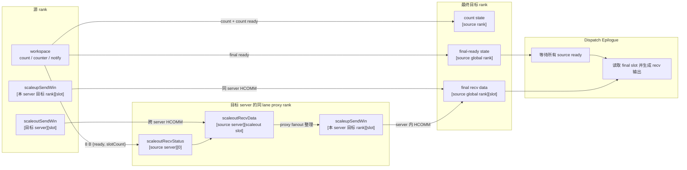
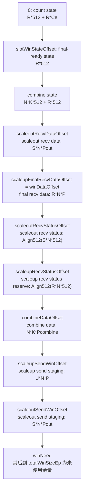
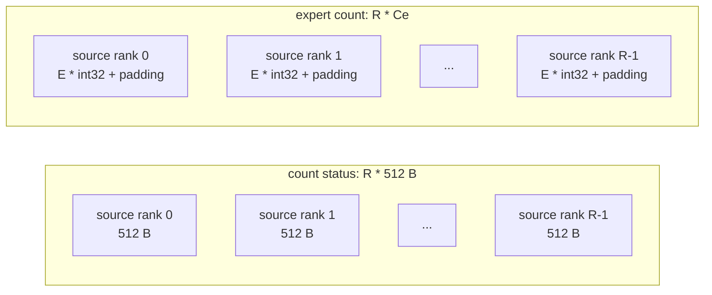
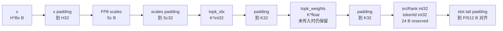
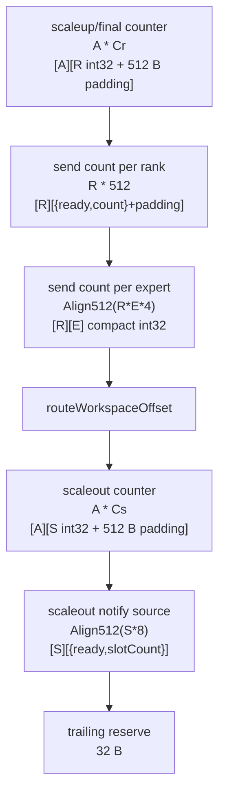

# MoeEpDispatch 跨超通信 Win 区与 Workspace 排布

## 1. 文档范围

本文按当前 `hybrid-stage1-stable` 分支提交
`a4dcfd9b12beb4b2cc19cf00ff4a16f8c6f1b188` 的代码整理，描述
`MoeEpDispatch` 在 `networkMode == HYBRID_MODE` 时的：

- 每个 rank 的 HCCL window（下文简称 win 区）总体排布；
- dispatch 使用的各子区域格式；
- dispatch workspace 排布；
- 普通 payload 和跨超 payload 的 slot 格式；
- 源 rank、proxy rank、目标 rank 与各内存区域之间的读写关系。

主要代码依据：

- `mc2/moe_ep_dispatch/op_host/op_tiling/moe_ep_dispatch_tiling.cpp`
- `mc2/moe_ep_dispatch/op_kernel/moe_ep_dispatch_tiling.h`
- `mc2/moe_ep_dispatch/op_kernel/moe_ep_dispatch_hybrid.h`
- `mc2/moe_ep_dispatch_epilogue/op_kernel/moe_ep_dispatch_epilogue.h`
- `mc2/moe_ep_combine/op_host/op_tiling/moe_ep_combine_tiling.cpp`

> 图中的块宽度不按实际字节数等比例绘制，准确大小以公式和表格为准。

## 2. 记号与基础公式

| 记号 | 含义 |
|---|---|
| `R` | `epWorldSize`，EP 通信域总 rank 数 |
| `U` | `rankSizePerServer`，单 server 内 rank 数 |
| `S` | `numScaleoutRanks = R / U`，server 数 |
| `A` | `aivNum`，dispatch 使用的 AIV 数 |
| `N` | `numMaxTokensPerRank` |
| `K` | `topK` |
| `E` | `numLocalExperts = numExperts / R` |
| `H` | `hidden` |
| `Bx` | `sizeof(XType)`；FP8 为 1，BF16/FP16 为 2 |
| `Sc` | FP8 每 token 的 scales 原始字节数；非 FP8 为 0 |
| `Align32(x)` | 向上对齐到 32 B |
| `Align512(x)` | 向上对齐到 512 B |

### 2.1 Dispatch slot 大小

```text
H32   = Align32(H * Bx)
Sc32  = FP8 ? Align32(Sc) : 0
K32   = Align32(K * 4)

P     = Align512(H32 + Sc32 + 2 * K32 + 32)
M     = ceil(U / 32)
Pout  = Align512(P + M * 4 + U * 4)
```

- `P` 对应 `perSlotBytes` 和 `scaleupSlotAlignedBytes`。
- `Pout` 对应 `scaleoutSlotAlignedBytes`。
- `M` 对应 `scaleoutMaskWordCount`。
- 当前 `perSlotBytes` 已经按 512 B 对齐，因此
  `scaleupSlotAlignedBytes == perSlotBytes == P`。

### 2.2 其他对齐大小

```text
Cr = Align512(R * sizeof(int32_t))
Cs = Align512(S * sizeof(int32_t))
Ce = Align512(E * sizeof(int32_t))

Hcombine32 = Align32(H * 2)
Pcombine   = Align512(Hcombine32 + 32)
```

`Pcombine` 使用最大输出类型宽度 2 B，是 combine 数据区的单 slot
预留大小，不等同于 dispatch 的 `P`。

## 3. 总体通信关系

每个 rank 都暴露一份格式完全相同的 win 区。远端写地址统一为：

```text
context->epHcclBuffer[targetRank] + regionOffset + elementOffset
```

跨超使用“同 lane proxy”：

```text
sourceLane = sourceRank % U
proxyRank  = destinationServerIndex * U + sourceLane
```

例如 `U = 8` 时，server 0 的 rank 3 向 server 1 发送跨超 payload，
会先发给 server 1 的 rank 11，而不是统一发给 rank 8。



## 4. Win 区总体排布

### 4.1 顺序图



### 4.2 偏移和大小

以下偏移都相对于“当前 rank 自己的 win 基址”。

| 顺序 | Tiling 字段或区域 | 起始偏移 | 大小 | 逻辑形状 |
|---:|---|---:|---:|---|
| 0 | `cntWinStateOffset` | `0` | `R*512 + R*Ce` | status `[R][512 B]` + expert count `[R][Ce]` |
| 1 | `slotWinStateOffset` | `R*512 + R*Ce` | `R*512` | `[sourceRank][512 B]` |
| 2 | combine state | 上一区域末尾 | `N*K*512 + R*512` | token/top-k state `[N][K][512 B]` + rank state `[R][512 B]` |
| 3 | `scaleoutRecvDataOffset` | dispatch state + combine state | `S*N*Pout` | `[sourceServer][scaleoutSlot][Pout]` |
| 4 | `scaleupFinalRecvDataOffset` / `winDataOffset` | 上一区域末尾 | `R*N*P` | `[sourceGlobalRank][finalSlot][P]` |
| 5 | `scaleoutRecvStatusOffset` | 上一区域末尾 | `Align512(S*N*512)` | 分配形状 `[sourceServer][N][512 B]` |
| 6 | `scaleupRecvStatusOffset` | 上一区域末尾 | `Align512(R*N*512)` | 预留形状 `[sourceRank][N][512 B]` |
| 7 | `combineDataOffset` | 上一区域末尾 | `N*K*Pcombine` | combine 数据 `[token][topk][Pcombine]` |
| 8 | `scaleupSendWinOffset` | 上一区域末尾 | `U*N*P` | `[localDstRank][slot][P]` |
| 9 | `scaleoutSendWinOffset` | 上一区域末尾 | `S*N*Pout` | `[dstServer][scaleoutSlot][Pout]` |
| 10 | 未使用余量 | `winNeed` | `totalWinSizeEp - winNeed` | 无 |

其中：

```text
countStateSize       = R * 512 + R * Ce
dispatchStateSize    = countStateSize + R * 512
combineStateSize     = N * K * 512 + R * 512
totalStateSize       = dispatchStateSize + combineStateSize

scaleoutRecvDataSize = S * N * Pout
finalRecvDataSize    = R * N * P
scaleoutStatusSize   = Align512(S * N * 512)
scaleupStatusSize    = Align512(R * N * 512)
combineDataSize      = N * K * Pcombine
scaleupSendSize      = U * N * P
scaleoutSendSize     = S * N * Pout

winNeed = totalStateSize
        + scaleoutRecvDataSize
        + finalRecvDataSize
        + scaleoutStatusSize
        + scaleupStatusSize
        + combineDataSize
        + scaleupSendSize
        + scaleoutSendSize
```

Tiling 校验 `winNeed <= ccl_buffer_size`，但写入
`totalWinSizeEp` 的是配置的完整 `ccl_buffer_size`，所以最后可能存在未使用余量。

## 5. Win 状态区详细格式

### 5.1 Count state



每个 512 B count status cell：

```text
byte 0  .. 3   int32 ready          固定写 1
byte 4  .. 7   int32 recvSlotCount  该 source 发给当前目标 rank 的 slot 数
byte 8  .. 511 padding / reserved
```

每个 expert count row：

```text
byte 0 .. E*4-1     int32[E]
                      当前 source 发给当前目标 rank 各 local expert 的命中数
byte E*4 .. Ce-1    padding
```

源 rank 发送给目标 rank `d` 时：

```text
目标 count status 地址
  = win[d] + cntWinStateOffset + sourceRank * 512

目标 expert count 地址
  = win[d] + cntWinStateOffset
           + R * 512
           + sourceRank * Ce
```

目标 rank 的 AIV0 等待全部 `R` 个 ready，并对 expert count 的 source
维做归约，生成 `num_recv_tokens_per_rank` 和
`num_recv_tokens_per_expert`。

### 5.2 Final-ready state

分配形状为 `[sourceGlobalRank][512 B]`：

```text
byte 0  .. 3   int32 ready = 1
byte 4  .. 31  当前实现不消费
byte 32 .. 511 padding / reserved
```

其地址为：

```text
win[targetRank] + slotWinStateOffset + sourceGlobalRank * 512
```

dispatch epilogue 的最后一个 AIV 轮询当前 rank 的 `R` 个 cell。
当所有 source 的首个 `int32` 都为 1 后，才允许 epilogue 读取
`final recv data`。读取完成后，epilogue 清零每个 cell 的前 32 B。

### 5.3 Scaleout receive status

Tiling 分配：

```text
[S][N][512 B]
```

当前 kernel 实际只使用每个 source server 行的第 0 个 cell：

```text
offset = sourceServerIndex * N * 512

byte 0  .. 3   int32 ready = 1
byte 4  .. 7   int32 scaleoutSlotCount
byte 8  .. 511 padding / reserved
```

因此当前实际活动状态数是 `S`，不是 `S*N`。其余 cell 是已分配但
未使用的兼容空间。

proxy 在 fanout 完成并发布所有 final-ready 后，将这两个 `int32`
清零，供下一轮复用。

### 5.4 Scaleup receive status reserve

`scaleupRecvStatusOffset` 后分配了：

```text
Align512(R * N * 512)
```

当前 `MoeEpDispatchHybrid` 和 `MoeEpDispatchEpilogue` 均不读写该区域；
最终完成状态使用的是前面的 `slotWinStateOffset`。因此这部分应理解为
当前布局中的预留区，不应作为现有协议的一部分使用。

## 6. Payload slot 详细格式

### 6.1 普通/最终 payload slot：`P` 字节



精确偏移：

| 字段 | slot 内偏移 | 原始大小 | 对齐占用 |
|---|---:|---:|---:|
| `x` | `0` | `H*Bx` | `H32` |
| `scales` | `H32` | FP8 时为 `Sc`，否则不存在 | `Sc32` |
| `topk_idx` | `H32 + Sc32` | `K*4` | `K32` |
| `topk_weights` | `H32 + Sc32 + K32` | `K*4` | `K32` |
| `sourceRank` | `H32 + Sc32 + 2*K32` | 4 | 4 |
| `tokenId` | 上一字段后 4 B | 4 | 4 |
| metadata reserve | 上一字段后 | 24 | 24 |
| slot padding | metadata 之后 | - | 补齐到 `P` |

即使调用没有传入 `topk_weights`，该段仍属于固定 slot 布局，只是
dispatch 不填充、epilogue 也不消费。

### 6.2 Scaleout payload slot：`Pout` 字节


| 字段 | scaleout slot 内偏移 | 大小 | 含义 |
|---|---:|---:|---|
| 普通 payload | `0` | `P` | 与最终 payload 完全同格式 |
| `scaleupMask` | `P` | `M*4` | bit `i` 表示目标 server 的 local rank `i` 需要此 token |
| `scaleupSlot` | `P + M*4` | `U*4` | local rank `i` 对应的最终 slot；无路由时为 `-1` |
| padding | 上一字段后 | `Pout - P - M*4 - U*4` | 512 B 对齐 |

一个源 token 对同一目标 server 只生成一个 scaleout slot。目标 server
内多个目标 rank 由 mask 和 slot 数组表达，这就是二级去重后的跨超
传输格式。

## 7. Win 数据区读写方式

### 7.1 Scaleup send staging

```text
形状: [U][N][P]
索引: [localDstRankIndex][slot]
地址: scaleupSendWinOffset
    + (localDstRankIndex * N + slot) * P
```

该区域有两个生命周期：

1. 源 rank 向本 server 其他 rank 发送普通 payload；
2. proxy fanout 时，暂存准备发给本 server 其他 rank 的最终 payload。

两个阶段之间存在全核同步，因此复用同一块 staging，不需要双份空间。
若目标 rank 就是当前 rank，kernel 直接写 `final recv data`，不经过该区。

### 7.2 Scaleout send staging

```text
形状: [S][N][Pout]
索引: [destinationServerIndex][scaleoutSlot]
地址: scaleoutSendWinOffset
    + (destinationServerIndex * N + scaleoutSlot) * Pout
```

当前 server 自己对应的行不用于跨超发送。发送时，同一目标 server
的有效 slot `[0, scaleoutSlotCount)` 是连续的，可作为连续 HCOMM
payload 发给 proxy。

### 7.3 Scaleout receive data

```text
形状: [S][N][Pout]
索引: [sourceServerIndex][scaleoutSlot]
地址: scaleoutRecvDataOffset
    + (sourceServerIndex * N + scaleoutSlot) * Pout
```

proxy 收到 payload 后按 slot 分核读取此区域，解析 mask 和
`scaleupSlot`，再直接写本 rank 的最终接收区，或写入
`scaleupSendWin` 后发给同 server 的其他目标 rank。

### 7.4 Final recv data

```text
形状: [R][N][P]
索引: [sourceGlobalRank][finalSlot]
地址: winDataOffset
    + (sourceGlobalRank * N + finalSlot) * P
```

这是 dispatch epilogue 真正消费的接收区。无论数据经过：

- 同 server 直发；
- 跨 server 到 proxy 后再 fanout；

最终都必须落到同一个 `[sourceGlobalRank][finalSlot]` 格式中。这样
epilogue 不需要区分 direct、scaleup 或 scaleout 来源。

## 8. Workspace 总体排布

### 8.1 顺序图

图中只画 kernel 可见、从 `workspaceGM_ + 0` 开始寻址的算子部分。



### 8.2 偏移和大小

| 顺序 | 区域 | 起始偏移 | 大小 | 格式 |
|---:|---|---:|---:|---|
| 0 | scaleup/final counter | `0` | `A*Cr` | `[aiv][R] int32`，每 AIV 行 512 B 对齐 |
| 1 | send count per rank | `A*Cr` | `R*512` | `[dstRank][512 B]`，前 8 B 为 `{ready, count}` |
| 2 | send count per expert | 上一区域末尾 | `Align512(R*E*4)` | 紧凑 `[dstRank][localExpert] int32` |
| 3 | `routeWorkspaceOffset` | 上一区域末尾 | 0 | scaleout workspace 起点标记 |
| 4 | scaleout counter | `routeWorkspaceOffset` | `A*Cs` | `[aiv][S] int32`，每 AIV 行 512 B 对齐 |
| 5 | scaleout notify source | 上一区域末尾 | `Align512(S*8)` | `[dstServer][2] int32 = {ready, slotCount}` |
| 6 | trailing reserve | 上一区域末尾 | `32` | 当前 kernel 未映射的尾部预留 |

算子逻辑 workspace：

```text
workspaceLogicalBytes
  = A*Cr
  + R*512
  + Align512(R*E*4)
  + A*Cs
  + Align512(S*8)
  + 32
```

Tiling 实际上报：

```text
workspaceReportedBytes = 16 MiB + workspaceLogicalBytes
```

其中 16 MiB 是 `SYSTEM_NEED_WORKSPACE` 的框架侧额外容量。kernel 的
上述偏移仍从传入的 `workspaceGM_ + 0` 开始计算，不能把 16 MiB
再加到这些区域前面。

### 8.3 Workspace 生命周期与复用

| 区域 | 写入者 | 读取者 | 生命周期 |
|---|---|---|---|
| scaleup/final counter | 各 AIV | slot prefix 归约；proxy fanout count 归约 | 初始发送计数完成后可复用于 fanout count |
| send count per rank | 各 AIV 原子累加；AIV0 写 ready | count exchange、同 server 发送、final-ready 的 8 B 通知源 | 整轮 dispatch |
| send count per expert | 各 AIV 原子累加 | count exchange | count 发送完成前 |
| scaleout counter | 各 AIV | 负责目标 proxy 的发送核 | scaleout slot 数归约完成前 |
| scaleout notify source | 对应 proxy 发送核 | HCOMM 将 8 B 写到远端 status | 每个目标 server 一项 |

## 9. 一次跨超传输的地址示例

假设：

```text
R = 16, U = 8, S = 2
sourceRank = 3
destinationServerIndex = 1
sourceLane = 3
proxyRank = 1 * 8 + 3 = 11
```

源 rank 3 聚合出发往 server 1 的 `count` 个 scaleout slot：

```text
源数据:
  win[3] + scaleoutSendWinOffset
         + (1 * N) * Pout

proxy 接收数据:
  win[11] + scaleoutRecvDataOffset
          + (0 * N) * Pout

proxy 接收状态:
  win[11] + scaleoutRecvStatusOffset
          + (0 * N) * 512
  内容 = {ready=1, scaleoutSlotCount=count}
```

proxy rank 11 fanout 某个来自 rank 3 的 slot：

```text
若最终目标是 rank 11:
  直接写 win[11] + winDataOffset
                   + (3 * N + finalSlot) * P

若最终目标是 rank 8..10 或 12..15:
  先写 win[11] + scaleupSendWinOffset
                   + (localDstRank * N + finalSlot) * P
  再 HCOMM 写到:
       win[targetRank] + winDataOffset
                       + (3 * N + finalSlot) * P

最后发布:
  win[targetRank] + slotWinStateOffset + 3 * 512
  ready = 1
```

## 10. 具体大小示例

使用近期大 shape 的关键参数：

```text
R=16, U=8, S=2, A=64
N=16384, K=9, E=19
H=1, XType=BF16
```

得到：

```text
H32      = 32 B
K32      = 64 B
P        = 512 B
M        = 1
Pout     = 1024 B
Pcombine = 512 B
```

### 10.1 Workspace 具体大小

| 区域 | 偏移 | 大小 |
|---|---:|---:|
| scaleup/final counter | 0 | 32,768 B |
| send count per rank | 32,768 | 8,192 B |
| send count per expert | 40,960 | 1,536 B |
| scaleout counter | 42,496 | 32,768 B |
| scaleout notify source | 75,264 | 512 B |
| trailing reserve | 75,776 | 32 B |

```text
workspaceLogicalBytes  = 75,808 B = 74.03125 KiB
workspaceReportedBytes = 16 MiB + 75,808 B = 16,853,024 B
```

### 10.2 Win 区具体大小

| 区域 | 偏移 | 大小 |
|---|---:|---:|
| count state | 0 | 16,384 B |
| final-ready state | 16,384 | 8,192 B |
| combine state | 24,576 | 75,505,664 B |
| scaleout recv data | 75,530,240 | 33,554,432 B |
| final recv data | 109,084,672 | 134,217,728 B |
| scaleout recv status | 243,302,400 | 16,777,216 B |
| scaleup recv status reserve | 260,079,616 | 134,217,728 B |
| combine data | 394,297,344 | 75,497,472 B |
| scaleup send staging | 469,794,816 | 67,108,864 B |
| scaleout send staging | 536,903,680 | 33,554,432 B |

```text
winNeed = 570,458,112 B = 544.03125 MiB
```

因此该 shape 的 `ccl_buffer_size` 必须至少覆盖约 544.04 MiB；实际还应
按配置留出余量。

### 10.3 当前 FP8 跨算子偏移差异

本文总体图使用 dispatch 和 dispatch epilogue 的实际 `P`：

```text
P = Align512(
      Align32(H * Bx)
    + (FP8 ? Align32(Sc) : 0)
    + 2 * Align32(K * 4)
    + 32)
```

当前 combine tiling 在重建 dispatch 接收区大小时使用：

```text
PdispatchFromCombine
  = Align512(Align32(H * 2) + 2 * Align32(K * 4) + 32)
```

因此：

- BF16/FP16 下 `Bx=2` 且无 scales，两者一致；
- FP8 下 combine 仍按 `hidden*2` 预留，且不计 scales，两者通常不一致；
- `scaleupFinalRecvDataSize`、`scaleoutRecvStatusOffset`、
  `scaleupRecvStatusOffset` 和 `combineDataOffset` 都可能随之出现偏移差异。

例如 `H=5701, K=32, Sc=180 B, XType=FP8`：

```text
dispatch / epilogue P       = 6,656 B
combine PdispatchFromCombine = 11,776 B
```

这是当前代码的跨算子布局一致性风险，不是图示取整误差。若 combine
需要在 FP8 hybrid 场景使用同一 win，应该让它直接采用与 dispatch
一致的 slot 参数或完全相同的公式。

## 11. 实现核对要点

修改布局或排查地址问题时，需要同时满足以下约束：

1. Dispatch、dispatch epilogue、combine 三个 tiling 对共享 win 前缀和
   `combineDataOffset` 的计算必须一致。
2. 每个 rank 的 win 布局必须相同，远端地址只通过 target rank
   切换，不能改变区域偏移公式。
3. `winDataOffset` 必须等于 `scaleupFinalRecvDataOffset`，epilogue
   只认 `[sourceGlobalRank][slot]` 的最终布局。
4. Scaleout 发送区按目标 server 索引，scaleout 接收区按源 server
   索引，二者索引语义相反。
5. `slotWinState` 按源 global rank 索引，不按 proxy rank 或目标
   server 索引。
6. `scaleoutRecvStatus` 当前每个 source server 只用第 0 个 512 B
   cell；若以后改成逐 slot 状态，必须同步修改分配、发送和轮询公式。
7. `scaleupRecvStatus` 当前未被 kernel 使用，删除或复用前必须同时
   修改 dispatch、epilogue、combine 的 win 大小计算。
8. Workspace 中作为 HCOMM 源的 `{ready, count}` 必须在远端写之前
   已对其他执行单元和通信引擎可见。
