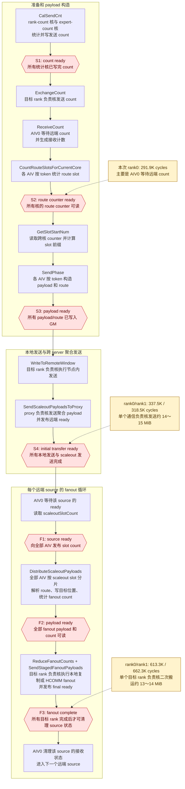
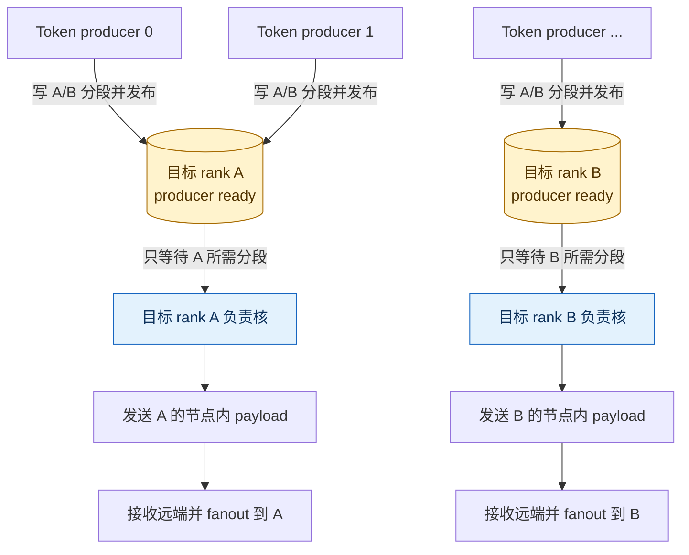
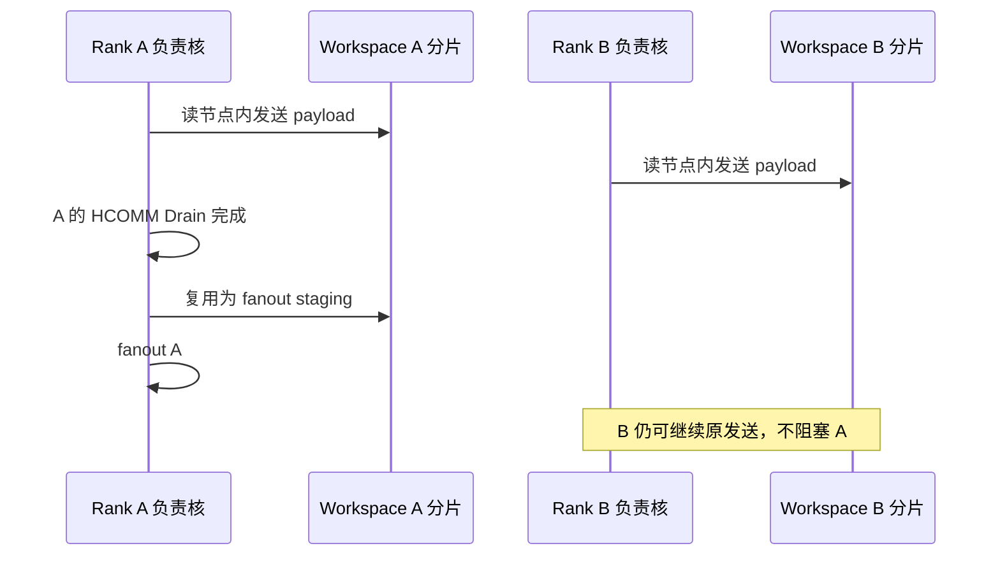
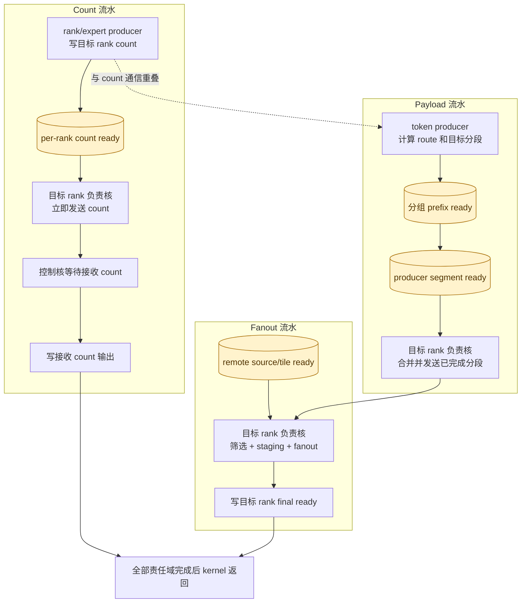

# MoeEpDispatch Hybrid 性能优化方案

## 1. 文档范围

本文基于 `train_test` 分支提交 `e8edb4779 feat: test function without ack` 的 Hybrid Dispatch 实现，重新整理后续性能优化方向。

本轮分析不以其他模板作为性能基准。其他路径只作为功能回归边界，不用于决定 Hybrid 的分核、同步和通信协议。优化依据只有三类：

1. Hybrid 当前真实的数据依赖；
2. HCOMM 连接、Window 和 Workspace 的所有权；
3. 实测关键路径和各核等待时间。

代码精简暂不在本轮范围内。ACK 逻辑和对应 Window 区已经删除，本文不再讨论兼容旧 ACK 布局。以下优化默认不改变当前 Workspace/Window 的总大小和既有区域 offset；新增状态优先复用现有对齐空间和状态区。

涉及的主要代码：

- `mc2/moe_ep_dispatch/op_kernel/moe_ep_dispatch_hybrid.h`；
- `mc2/moe_ep_dispatch/op_kernel/moe_ep_dispatch_base.h`；
- `mc2/moe_ep_dispatch/op_host/op_tiling/moe_ep_dispatch_tiling.cpp`。

## 2. 当前性能判断

此前约 `3.25e8 cycles` 的异常长尾已经定位为 HCOMM 连接在不同阶段由不同 AIV 核使用。将同一目标 rank 的通信固定到同一负责核后，大 payload 用例下降到约 `0.9e5` 至 `1.9e5 cycles`，小 payload 用例下降到约 `3.2e4` 至 `6.0e4 cycles`。

当前剩余开销不再是单一问题，主要由以下部分构成：

- 全核同步把局部慢核放大为全局关键路径；
- count 生产、count 通信和 route 构造之间缺少流水重叠；
- payload 先由 token 核生产，再统一交给通信核，阶段边界较重；
- fanout 由控制核、全体 staging 核、目标 rank 通信核三次交接；
- 小 payload 下 ready、Drain、轮询和 HCOMM 固定开销占比高；
- 大 payload 下发送和 fanout 尚未按 tile 形成流水。

后续重点不是机械删除 `SyncAll`，而是先改变数据所有权，使跨核依赖消失或缩小，再删除对应同步。

## 3. `SyncAll` 是否都需要

### 3.1 判断原则

`SyncAll<true>()` 同时满足以下语义：

- 当前 kernel 的所有 AIV 都必须执行相同次数；
- 快核必须等待最慢核；
- 它只能建立跨核阶段边界，不能替代生产核本地 MTE3 写入完成；
- 生产核在发布 GM 数据前，仍需完成正确的本地流水同步。

因此，不能仅因为两个阶段“分核方式相同”就删除 `SyncAll`。能否让先完成的核继续，取决于后阶段读取什么。

可以直接异步继续的条件：

1. 后阶段只读取本核在前阶段产生的数据；
2. 各核读写地址互不重叠；
3. 本核通过对应流水同步确认写入完成；
4. 同一 HCOMM 连接始终归同一个核；
5. 本核继续执行不会覆盖其他核尚未消费的共享区域。

即使分核相同，以下情况仍需同步或 ready 协议：

- 本核要读取其他核生成的 counter；
- 本核要发送由多个 token 核共同写入的连续 payload；
- 一个核清理或复用其他核仍在使用的 staging 区；
- 后阶段需要全局总和、前缀和或完整的目标 rank 数据；
- HCOMM 发送核和数据生产核不是同一个核。

结论：

> 相同分核只有在“相同所有权”成立时才有价值。需要把计算、Workspace 分片和 HCOMM 连接统一归到同一责任域，快核才能独立推进。

### 3.2 当前同步数量

当前主流程固定有 4 次全核同步：

1. `CalSendCnt()` 后；
2. `CountRouteSlotsForCurrentCore()` 后；
3. `SendPhase()` 后；
4. 本地发送和 scaleout proxy 发送后、fanout 前。

每个远端 source 的 fanout 还有 3 次：

1. 控制核确认 ready 后发布给其他核；
2. 全体核完成 staging 和 fanout count 后发布给通信核；
3. 所有目标 rank 发送完成后，控制核才能清接收状态并复用 staging 区。

因此单次 Hybrid Dispatch 的全核同步次数约为：

```text
4 + 3 * remoteSourceCount
```

两台 server 时为 7 次；八台 server 时可达到 25 次。server 数增加后，fanout 同步会线性增长。

### 3.3 当前同步审计

| 编号 | 位置 | 当前依赖 | 当前能否直接删除 | 优化方向 |
|---|---|---|---|---|
| S1 | `CalSendCnt` 后 | 通信核读取其他统计核写入的 per-rank/per-expert count | 否 | 按目标 rank 发布 ready，通信核只等自己负责的 count |
| S2 | route slot 计数后 | 核 `currentAivId` 要读取所有更小核号的 counter，计算 slot 前缀 | 否 | cached 专用路径；non-cached 改逐核前缀 ready 或并行前缀 |
| S3 | `SendPhase` 后 | 通信核发送由所有 token 核共同写入的 payload | 否 | 每个生产核发布目标 rank 分段 ready，通信核流式消费 |
| S4 | fanout 前 | `slotWorkspace` 从本地发送源切换为 fanout staging，且通信连接进入下一阶段 | 否 | 目标 rank 所有权贯穿本地发送和 fanout，释放后立即复用本 rank 分片 |
| F1 | ready 后 | 只有控制核轮询 ready，其他核需要获知可读 | 否 | 目标 rank 负责核独立轮询，不再广播给全部 AIV |
| F2 | staging 后 | 通信核读取所有 staging 核写入的数据和 count | 否 | 目标 rank 负责核自行筛选、staging、发送 |
| F3 | fanout 发送后 | 控制核清状态；下一 source 会复用 staging 区 | 可部分删除 | 状态延迟到下一轮清；目标 rank 分片独占后无需全核复用屏障 |

这些同步在当前代码结构下基本都有作用。正确优化方式是重构其前后的所有权，不是在原位置直接删调用。

## 4. 当前流程、同步点含义和实测阻塞

`S1`～`S4` 和 `F1`～`F3` 只是阶段 0 debug 输出中的同步点编号，不是代码函数名：

- `S` 表示 Hybrid Dispatch 主流程中的固定同步点；
- `F` 表示处理每个远端 source 时，fanout 循环内部的同步点；
- `arrival_skew_cycles` 表示最晚 AIV 与最早 AIV 到达该同步点的时间差，反映同步点之前的工作长尾，不是 `SyncAll` 指令自身的耗时。

### 4.1 完整流程与同步点



当前实现本质上是“阶段内并行、阶段间全体汇合”。每个阶段内部虽然使用多个 AIV，但任一负责核的长尾都会通过下一个 `SyncAll` 放大为所有 AIV 的等待。下文性能数据来自 64 AIV 实测，状态和 debug 布局按 Ascend 950 最大 72 AIV 设计。

### 4.2 阶段 0 实测结果

测试拓扑为两个 server、每 server 一个 rank、每 rank 64 个 AIV、一个远端 source。逐核记录全部有效，所有同步点的 `missing_aiv_ids` 均为空。各同步点的到达偏差如下：

| 同步点 | 同步前的主要工作 | rank0 到达偏差 | rank1 到达偏差 | 判断 |
|---|---|---:|---:|---|
| S1 | rank/expert count 统计 | 31.3K | 28.6K | 只有部分核承担 count 工作，有不均衡但不是首要瓶颈 |
| S2 | count 通信、远端 count 等待、route counter | 291.9K | 9.8K | rank0 的 AIV0 等待远端 count 约 291.4K cycles |
| S3 | 按 token 构造 payload 和 route | 4.1K | 5.0K | token 分核较均衡 |
| S4 | 节点内发送和到远端 proxy 的聚合发送 | 337.5K | 318.5K | 单通信核发送约 14～15 MiB 并 Drain |
| F1 | 控制核等待远端 source ready | 1.4K | 31.3K | rank1 等待远端 payload ready，当前占比次要 |
| F2 | 全 AIV 解析 route 并写 fanout staging | 2.4K | 3.3K | 每核处理 44～48 个 slot，负载均衡 |
| F3 | 目标 rank 负责核执行最终 fanout | 613.3K | 662.3K | 当前最大瓶颈，本用例为单核本地二次搬运 |

`SyncAll` 退出后的各核时间差只有 37～40 cycles，说明同步本身退出正常。主要问题是同步点之前不同 AIV 承担的工作量差异，而不是 barrier 异常。

### 4.3 F3 单核二次搬运问题

本次 `rankSizePerServer = 1`，远端 payload 最终只需要落到本 rank。当前代码先让 64 个 AIV 并行写 Workspace，随后又让一个目标 rank 负责核把整段数据逐 slot 搬到本地 Window：

```mermaid
flowchart TB
    subgraph Current[当前路径]
        RecvCurrent[("Scaleout 接收 Window<br/>约 2855～3072 slots")]
        WorkersCurrent["64 个 AIV 按 slot 分片<br/>解析 route 并读取 payload"]
        StagingCurrent[("slotWorkspace<br/>按目标 rank staging")]
        F2Current{{"F2<br/>等待全部 staging 完成"}}
        OwnerCurrent["1 个目标 rank 负责核<br/>逐 slot执行 GM→UB→GM<br/>搬运约 13～14 MiB"]
        FinalCurrent[("本地最终接收 Window")]
        F3Current{{"F3<br/>其余 63 个 AIV 等待负责核"}}

        RecvCurrent --> WorkersCurrent --> StagingCurrent --> F2Current --> OwnerCurrent --> FinalCurrent --> F3Current
    end

    subgraph Proposed[优先优化路径]
        RecvProposed[("Scaleout 接收 Window")]
        WorkersProposed["64 个 AIV 按 slot 分片<br/>解析 route 后直接写最终 slot"]
        FinalProposed[("本地最终接收 Window")]
        F2Proposed{{"F2<br/>确认全部并行写完成"}}
        OwnerProposed["目标 rank 负责核<br/>只发布 final ready"]
        F3Proposed{{"F3<br/>只等待状态发布完成"}}

        RecvProposed --> WorkersProposed --> FinalProposed --> F2Proposed --> OwnerProposed --> F3Proposed
    end

    classDef barrier fill:#ffe1e1,stroke:#c62828,color:#5d0000;
    classDef memory fill:#e8f5e9,stroke:#2e7d32,color:#16451c;
    class F2Current,F3Current,F2Proposed,F3Proposed barrier;
    class RecvCurrent,StagingCurrent,FinalCurrent,RecvProposed,FinalProposed memory;
```



`DistributeScaleoutPayload` 已经读取了 `routeScaleupSlotTensor_`，能够得到目标 rank 和最终 `scaleupSlotValue`。因此对于 `dstRankId == epRankId_` 的 payload，可以由当前 fanout AIV 直接写本地最终 Window：

1. 本 rank payload 不再写 `slotWorkspace`；
2. 删除 `CopyStagedFanoutPayloadsToLocalRank` 对这部分数据的单核二次搬运；
3. 暂时保留 F2 和 F3，先不改变状态清理与同步协议；
4. 目标 rank 负责核在 F2 后只写 final ready；
5. 同 server 其他 rank 的 payload 仍使用原 staging 和 HCOMM fanout 路径。

该改动直接针对本次最大长尾，同时不要求多个 AIV 共享同一个 HCOMM handle，也不需要修改 Workspace 或 Window 布局。

### 4.4 本轮优先级结论

1. 优先并行写入本地最终 Window，消除 F3 的单核二次搬运；
2. 随后把 scaleout payload 生产与 HCOMM 发送做分段流水，隐藏 S4 的 Drain 延迟；
3. S2 的 rank0 长尾主要是跨 rank 到达不一致，需要结合 continue 全链路判断，不应误认为 route 前缀计算耗时；
4. S1、S3 和 F2 当前负载相对均衡，暂不作为第一批性能改造对象。

这里描述的是性能瓶颈优先级。阶段 1 先在保留全部同步的前提下实现本地目标 rank 直接落最终 Window；阶段 2、阶段 3 再固化通信所有权和核组状态协议；阶段 4 扩展到同 server 其他目标 rank 的并行整理和 HCOMM fanout。

## 5. 推荐的核心流程：目标 rank 所有权贯穿传输阶段

### 5.1 所有权设计

以全局目标 rank 为稳定责任域，定义：

```text
communicationOwnerCore = OwnerOfGlobalRank(destinationRankId)
```

同一负责核在整个调用中承担：

1. 发送该目标 rank 的 count；
2. 发送该目标 rank 的节点内 payload；
3. 若该 rank 是远端 proxy，发送该 server 的聚合 scaleout payload；
4. 在本 server 接收 fanout 时，处理分配给该目标 rank 的 route、staging 和发送；
5. 写该目标 rank 的 final ready。

这可以继续保持“一个 HCOMM 连接只由一个核使用”的约束，同时避免阶段间把连接交给不同核。

### 5.2 快核独立推进后的流程



这里不再要求 A、B 两个负责核同时进入下一阶段。A 的数据先准备好，A 就可以发送；B 仍在等待自己的生产核，不影响 A。

### 5.3 “相同分核”的准确用法

建议保持以下映射一致：

```text
count 通信负责核
    == 节点内 payload 通信负责核
    == proxy 通信负责核
    == fanout 目标 rank 通信负责核
```

但 token payload 的生产仍按 token 分核。不能仅把后续几个发送函数的 `SplitToCore` 写成一样，就认为 S3 可以删除，因为负责核依然要读取所有 token 核写入的目标 rank payload。

要删除 S3，还需要生产核显式发布“本核为该目标 rank 写完的分段”，负责核按分段消费。

### 5.4 状态存储不扩大现有布局

责任域 ready 不等于新增一片 Workspace。当前布局中已有可复用空间：

1. 每个目标 rank 的 send-count 项占 512B，当前核心数据只使用开头的状态和 count；
2. Hybrid route Workspace 尾部已有一个 512B 的 `readyStatusWorkspace`；
3. scaleout receive status 按 `serverCount * numMaxTokensPerRank * 512B` 预留，当前每个 source 只使用头部状态。

按最多 72 个 AIV 计算，每个目标 rank 的 512B count 项可以布局为：

```text
0B                 32B            64B                         352B          512B
+-------------------+---------------+-----------------------------+-------------+
| 原状态 + 原发送数   | group header  | 72 * worker generation(4B) | 预留         |
+-------------------+---------------+-----------------------------+-------------+
```

group header 保存 start/release 的 generation、slot count 和完成状态。每个 AIV 只保存 32 位 generation，local hit count 复用现有 per-AIV counter，不重复存储。72 AIV 时状态区结束于 352B，仍位于每 rank 的 512B 对齐项内。

建议复用关系：

| 状态 | 复用区域 | 生命周期 |
|---|---|---|
| rank-count/expert-count ready | 目标 rank 的 512B count 项 | count 生产到 count 发送完成 |
| producer segment ready | 同一目标 rank 的 512B count 项后半部分 | payload 生产到该 rank 发送完成 |
| per-core prefix ready | 现有 512B `readyStatusWorkspace` | route prefix 到 payload 构造开始 |
| scaleout tile ready | 现有 scaleout receive status 的后续 512B entry | source tile 到 proxy fanout 完成 |

不同阶段可以复用同一物理项，但必须使用 phase/generation 区分，不能依赖上一轮恰好被清零。这样所有方案均可保持当前 Workspace/Window 总大小和 offset 不变。

### 5.5 目标 rank 数与 AIV 数不相等时的分配

“按目标 rank 分核”只固定 HCOMM 通信所有权，不要求一个 rank 的所有计算都由一个核完成。通信负责核默认也参加数据整理，不单独闲置。建议把职责分成两层，但允许同一个 AIV 同时承担两种职责：

- 通信负责核：每个全局目标 rank 唯一，参加本 rank 的 route 扫描和 payload 整理，并额外负责该 rank 的 HCOMM handle、Drain 和 notify；
- 整理核组：由通信负责核和可选的协作整理核组成，共同完成 route 扫描、payload 构造和写入该 rank 的独占 Workspace 分片；只有通信负责核使用 HCOMM。

通信 owner 必须由全局目标 rank 的稳定映射得到。第一版可以使用：

```text
communicationOwnerCore = destinationRankId % activeCommunicationCoreCount
activeCommunicationCoreCount = min(aivNum, epWorldSize)
```

count、节点内发送、proxy 发送和 fanout 只要涉及同一个 `destinationRankId`，都使用同一映射。整理核组可以随 payload 大小调整，但不能改变通信负责核。

#### AIV 数大于目标 rank 数

每个目标 rank 仍只有一个通信 owner，多出来的 AIV 作为协作整理核分配给各目标 rank。通信负责核本身也是整理核组成员：

```text
32 AIV，2 个本 server 目标 rank

rank 0: 1 个兼做整理的通信负责核 + 若干协作整理核
rank 1: 1 个兼做整理的通信负责核 + 若干协作整理核
其余核按 slot 数量分配到两个整理核组
```

fanout 时，同一整理核组内按 scaleout slot 范围分工，通信负责核也处理其中一段。route 中已有目标 rank 的绝对 `scaleupSlot`，各核可以直接写互不重叠的目标位置；通信负责核完成自己的分片后，只等待本组其他核的 ready，随后发送该 rank 的连续 payload。发送完成后发布本组 release，各核才能为下一个 source 复用同一 rank 分片。

不需要固定使用全部 AIV。小 payload 下由通信负责核独立完成整理和发送，避免 ready 和任务拆分开销；大 payload 下再加入协作整理核。未参与当前 rank 的核可以处理其他 rank/source，或者直接结束自己的工作，不应通过全核 barrier 等待。

第一版不设置专职、只通信不整理的 AIV。若后续采用 per-tile ready，通信负责核可以完成自己的首个 tile 后，开始发送已连续完成的 tile，同时其他协作核继续整理后续 tile。只有性能数据证明通信提交持续占满该核时，才减少通信负责核承担的整理份额，而不是预先把它完全空出来。

#### AIV 数等于目标 rank 数

每个 rank 一个通信负责核。payload 较小时由负责核同时完成扫描、数据整理和发送，不需要额外协作核；payload 较大时仍可从负载较轻的负责核借协作整理核，但 HCOMM 负责核不变。

#### AIV 数小于目标 rank 数

一个通信 owner 顺序负责多个目标 rank：

```text
8 AIV，32 个目标 rank

core 0: rank 0, 8, 16, 24
core 1: rank 1, 9, 17, 25
...
core 7: rank 7, 15, 23, 31
```

同一个 source 的 fanout 不应为每个 rank 重扫一遍 payload。每个 owner 扫描一次 source slot，检查自己负责的多个 rank mask，并分别写入这些 rank 的独占 staging 分片；扫描完成后依次发送各 rank。这样所有 AIV 都能工作，同时保持一个 rank 只有一个通信 owner。

如果目标 rank 负载严重不均，可在 tiling 阶段按历史或静态上限生成更均衡的 rank-owner 表；不能在不同阶段独立动态改 owner，否则会重新引入同一 HCOMM 连接跨核使用的问题。单个热点 rank 的 staging 可以由其他 worker 协助，但该 rank 的最终 HCOMM 发送仍由唯一 owner 完成。

因此，目标 rank 负责核设计不会要求 `aivNum == destinationRankCount`。真正固定的是连接所有权，计算并行度由整理核组单独调节。

## 6. 分项优化设计

### 6.1 P0：增加逐核同步等待打点

当前 cycle 主要由 AIV0 记录，无法区分：

- AIV0 自己工作慢；
- AIV0 先到 barrier 后等待其他核；
- 其他核等待 AIV0；
- 某个目标 rank 负责核因 HCOMM 或 payload 较大而成为长尾。

建议在 `debug_out` 中为每个 AIV 预留固定、不重叠的记录：

```text
sync_enter_cycle[syncId][aivId]
sync_exit_cycle[syncId][aivId]
phase_work_cycles[syncId][aivId]
owned_rank_begin[aivId]
owned_rank_end[aivId]
produced_local_slot_count[aivId]
produced_scaleout_slot_count[aivId]
```

所有核只写自己的 offset，不做共享 GM read-modify-write。测试 hook 汇总：

```text
barrier_wait_cycles = sync_exit_cycle - sync_enter_cycle
arrival_skew = max(sync_enter_cycle) - min(sync_enter_cycle)
```

这一步不提升性能，但决定后续优先删除哪个同步，避免凭 AIV0 单点数据判断。

### 6.2 P0：cached 路径避免重复 route 扫描

当前 cached 路径仍执行 route slot 预统计和前缀计算。不能直接把整段删除，因为 `scaleoutCounterGMTensor_` 仍用于计算发给远端 proxy 的聚合 slot 数。

建议为 cached 路径补一个轻量统计：

- 直接读取 cached `route_count`、`route_dst_scaleout` 和 `route_scaleout_slot`；
- 每个 token 只处理已有 route entry，不再扫描 top-k 并重复去重；
- 按远端 server 统计本核实际占用的最大 slot 末端或 entry 数；
- 仍发布本核 scaleout counter，保留后续前缀/总数协议；
- 如果 cached slot 已是全局绝对 slot，可进一步完全跳过前缀，但必须先确认 handle 的 slot 语义。

第一版只删除重复 top-k 去重，不改 cached handle 格式，也不直接删除 S2。待证明 cached slot 是全局绝对位置后，再单独删除 cached 路径的 S2。

### 6.3 P0：延迟清理 scaleout receive status

当前每个远端 source fanout 完成后，由 AIV0 清 ready/status。F3 同时保证：

- 目标 rank 发送核已经消费 staging；
- AIV0 可以清状态；
- 下一 remote source 可以复用 staging。

ACK 已删除后，可以把状态清理移动到下一轮 dispatch 开始、下一轮 count 发布之前：

```text
clear previous generation status
    -> publish next count
    -> remote source receives next count
    -> remote source sends next payload and ready
```

这条顺序利用现有 count rendezvous 防止下一代 ready 早于 clear。

收益分两层：

1. 保持当前全核 staging 时，最后一个 remote source 后的 F3 可删除；kernel 结束本身会汇合所有核；
2. 改成目标 rank 独占 staging 后，每个 source 的 staging 复用也不再要求全核同步，F3 可以完全删除。

必须验证 cached、non-cached、continue 多轮和首轮初始化，尤其是 generation 0 的 status 初值。

### 6.4 P0：按 scaleout slot 平均分核并直接写本卡最终 Window

当前 fanout 为：

```text
AIV0 等 ready
-> 全 AIV 按 scaleout slot staging
-> 目标 rank 负责核归约 count 并发送
```

阶段 0 证明全 AIV 的 slot 分片已经均衡，问题出在 F2 后重新交给单个目标 rank 负责核搬运本卡 payload。因此第一步不改变分核：

```text
SplitToCore(scaleoutSlotCount, aivNum)
-> 前 remainder 个 AIV 各多处理一个 slot
-> 所有 AIV 解析自己负责 slot 的 route
-> 本卡目标直接写最终 Window
-> 其他本地 rank 仍写独占 Workspace 分片
-> F2 后目标 rank 负责核只发送远端目标并发布 final ready
```

本阶段保留 F1、F2、F3 和 GM fanout count 归约，只消除本卡路径的单核二次搬运。即使 `scaleoutSlotCount < aivNum`，也自然由前面的 `scaleoutSlotCount` 个 AIV 各处理一个，其余 AIV 处理零个并参加现有同步，不需要额外的小 payload 单核分支。

后续删除全核同步时，再根据目标 rank 建立整理核组。通信所有权与整理并行度仍然分开：

- 本卡目标没有 HCOMM handle 约束，多个 AIV 可以直接写互不重叠的最终 slot；
- 同 server 其他 rank 仍只有一个 HCOMM owner，但多个 AIV 可以并行整理它的 payload；
- payload 大小时只影响将来是否缩小活跃整理核组，不影响当前平均分片算法。

该修改不增加重复 route 扫描，不修改 Workspace/Window 布局，也不要求多个 AIV 共享同一个 HCOMM handle。

### 6.5 P1：目标 rank 分片完成后立即进入 fanout

当前 S4 等待所有节点内发送和所有 proxy 发送完成，原因之一是 `slotWorkspace` 会从节点内发送源切换为 fanout staging。

`slotWorkspace` 本身按 server 内目标 rank 分片：

```text
slotWorkspace[localDestinationRank][slot]
```

若同一个目标 rank 负责核完成该 rank 的节点内发送后，只有它会使用该 rank 分片，则可以立即把这片空间用于该 rank 的 fanout staging，无需等待其他目标 rank。

建议顺序：



该设计可以删除 S4，但前提是：

- rank 分片严格不重叠；
- proxy 聚合发送使用独立的 `scaleoutSendWorkspace`；
- 同一 rank 分片的节点内发送已 Drain 或完成本地复制；
- fanout 不再由其他 AIV 写这片分片；
- HCOMM 连接仍由同一 rank 负责核使用。

### 6.6 P1：per-destination count ready，删除 S1

当前 count 计算分为 rank 统计核和 expert 统计核，S1 后目标 rank 通信核才能读取完整 count。

建议把 expert 统计也按目标 rank 的完整 expert block 分配，使每个目标 rank 只依赖：

- 一个 rank-count producer；
- 一个 expert-count producer。

每个目标 rank 现有 count Workspace 项按 512B 对齐，实际状态和 count 只使用很小一部分。可以在不改变 Workspace 总大小和 offset 的前提下，在本 rank 的 512B 项内定义两个 ready 字段：

```text
rank_count_ready
expert_count_ready
```

通信负责核只轮询自己负责目标 rank 的两个 ready，齐全后立即发送 count，然后继续处理下一个目标 rank。这样：

- 删除 S1；
- 快 producer 对应的目标 rank 可以先发；
- count 通信可与其他核剩余统计重叠；
- 不增加全局共享 RMW。

ready 必须包含 generation 或在每轮开始安全清零，防止 continue 模式读到上一轮状态。

### 6.7 P1：生产核分段 ready，删除 S3

当前 token 核把不同目标 rank 的 payload 写入连续 staging，S3 后目标 rank 负责核一次性发送完整区域。

现有 counter prefix 已经给每个 token 核分配了互不重叠的目标 rank slot 区间，因此可以为每个生产核发布：

```text
producerSegmentReady[destinationRankId][producerCoreId]
producerSegmentStart[destinationRankId][producerCoreId]
producerSegmentCount[destinationRankId][producerCoreId]
```

目标 rank 负责核按 producer 顺序消费：

1. 轮询该 rank 的下一 producer 分段；
2. 对相邻且已 ready 的分段做合并；
3. 提交一个或多个 `WriteNbi`；
4. 所有 producer 分段提交后执行一次 Drain；
5. 写 final ready。

收益：payload 构造和通信发生重叠，S3 不再需要。

风险：

- NBI 次数可能从每 rank 1 次增加到最多 active producer 数；
- 小分段会降低链路效率；
- ready 状态需要 generation；
- producer 在发布 ready 前必须完成对应 GM MTE3 写入。

因此需要合并策略，例如只有累计到最小字节阈值或遇到最后 producer 才提交。不要每个 token 单独发送。

### 6.8 P1：non-cached 前缀依赖由全核 barrier 改为有序 ready

S2 的数学依赖不是“等待所有核”，而是：

```text
core currentAivId 只依赖 core [0, currentAivId) 的 counter
```

现有 `SyncAll` 等待了不必要的后继核。可改为前缀发布链：

1. 每个核写本核 counter，并完成 MTE3；
2. core 0 发布 prefix 0；
3. core 1 读取 prefix 0，加本核 counter，发布 prefix 1；
4. core currentAivId 只等待 prefix `currentAivId - 1`，得到自己的 slot 起始位置；
5. 得到前缀的核立即构造 payload，不等待后继核。

这允许前面的核先继续，但会把前缀本身变成串行链。可进一步采用分组扫描：组内链式、组间两级前缀，降低 32 核串行深度。

不建议直接用大量 CrossCore flag 覆盖 32 核链路，必须先确认 flag 数量、复用和 generation 约束。更稳妥的是在现有 counter Workspace 的对齐空洞中放 per-core prefix ready，并用 bypass-cache 读取。

### 6.9 P1：缩窄本地流水屏障

`SyncAll` 解决跨核依赖，`PipeBarrier` 和 `SyncFunc` 解决本核流水依赖，两者不能互换。

当前 `SendPhase()` 末尾的 `PipeBarrier<PIPE_ALL>()` 主要是为了保证 GM 输出在跨核消费者开始前可见。如果审计确认待发布数据全部由 MTE3 写 GM，可缩窄为：

```cpp
PipeBarrier<PIPE_MTE3>();
```

但 `tpipe_->Reset()` 前的 `PipeBarrier<PIPE_ALL>()` 不能按同一理由删除。Reset 会回收整组 UB/TQue/TBuf，必须确保所有仍引用这些资源的本地流水已经完成。

每个屏障应在注释中明确“前一流水写什么地址，后一流水读什么地址”，不能只写“保证同步”。

### 6.10 P2：让 count 等待与 payload 准备重叠

实测中 `recv_count_wait_cycles` 有时明显高于 route 和 payload 构造时间。当前 AIV0 等待全部 count，而其他核虽然可以先返回，最终仍会在 S2/S3 等待。

在删除或缩小 S1、S2、S3 后，可以进一步：

- 保留一个控制核等待并归约接收 count；
- 其他 token producer 先执行不依赖接收 count 的 route 统计和 payload 构造；
- 控制核完成 count 后再写 `num_recv_tokens_per_rank/expert`；
- kernel 结束前统一保证输出完成。

另一种方案是把 `GetRecvCount()` 延后到 payload 构造之后，复用已释放 UB，但可能引入额外 `TPipe Reset`，需要比较实际收益。

该优化应放在同步拆除之后做，否则等待只是从一个 barrier 移到另一个 barrier。

### 6.11 P2：scaleout 按 tile 发布 ready

当前 source 完成整个远端 server payload 后才写一次 ready，proxy 收齐后才开始 fanout。大 payload 下无法重叠跨 server 传输和节点内 fanout。

可以在现有 scaleout receive status 区内使用：

```text
status[0] = {generation, totalTileCount}
status[1 + tileIndex] = tileReady
```

source 每完成一个 tile 的 payload Drain 后发布对应 ready；proxy 看到 tile ready 后立即 fanout。下一代开始前清旧 generation。

需要控制：

- tile 不宜过小，避免 ready 和 Drain 数过多；
- tile 边界应按完整 scaleout slot；
- 每个 tile 内仍保持 payload happens-before ready；
- proxy 的目标 rank owner 只消费属于自己的 slot；
- status 容量必须覆盖 tiling 极限下的 tile 数，不能假设固定 shape。

### 6.12 P2：减少 payload/notify Drain

当前多个发送点采用：

```text
payload WriteNbi
-> payload Drain
-> notify WriteNbi
-> notify Drain
```

理论上可优化为：

```text
payload WriteNbi
-> notify WriteNbi
-> one Drain
```

但只有在 HCOMM 明确保证同一 `commHandle` 上 NBI 的提交顺序和远端可见顺序时才成立。不能通过其他模板的写法推断此语义。

验证顺序：

1. 查当前 CANN/HCOMM channel 接口契约；
2. 确认 payload 和 notify 使用同一 `commHandle`；
3. 确认单次最终 Drain 覆盖此前 payload 和 notify；
4. 压测 continue 多轮、空 payload、跨 server 和不同 payload 大小；
5. 若接口不承诺远端可见顺序，保留 payload Drain。

`WriteWithNotify` 或批量写只能作为独立研究项，需确认当前 950/A5 channel 路径支持后再采用。

### 6.13 P2：分层 count 交换

当前 count 在全 rank 间发送，server 数和 rank 数增加时会产生大量小消息和 Drain。可考虑：

```text
server 内 rank -> 本 server proxy 聚合
proxy -> 远端 proxy 发送 server 级 count
远端 proxy -> server 内分发
```

该方案可降低跨 server 小消息数量，但会增加 proxy 聚合、协议状态和一次节点内分发。它属于结构性优化，优先级低于消除全核同步和 count 等待重叠。

## 7. 推荐的目标流程



目标流程不再以全局阶段为单位推进，而以目标 rank 和 producer 分段为单位推进。仍需保留的同步只发生在真实依赖边界：

- producer 本地 GM 写完成后发布 ready；
- 通信负责核等待自己负责的数据；
- 同一 rank 分片复用前等待该 rank 的 HCOMM/本地复制完成；
- kernel 返回前确保所有输出和通信完成。

## 8. 分阶段实施计划

每个阶段单独提交 kernel 改动，并在 `moe_train_test` 的 `ExplosiveDawn` 分支提交对应的 debug 解码和测试用例。前一阶段通过功能矩阵后再开始下一阶段，不把多个同步协议修改压在同一笔提交中。

### 阶段 0：建立逐核性能基线

目标：先量出每个 `SyncAll` 的真实到达偏差，确认后续优化命中实际长尾。

状态：已完成。两 server、每 server 一 rank、64 AIV 的首轮结果见 4.2～4.4 节。

代码改动：

1. 在 Hybrid 自己的 debug 区增加 S1～S4、F1～F3 的逐 AIV enter/exit cycle；
2. 记录每核处理的 token、scaleout slot、目标 rank 和 payload bytes；
3. 每个 AIV 只写自己的固定 offset，不增加共享 GM RMW；
4. 测试 hook 输出每个同步点的最早到达、最晚到达和最大等待时间。

本阶段不改控制流。提交后性能和精度应与当前基线一致。

### 阶段 1：本卡 fanout 直接写最终 Window

目标：保留当前全部 AIV 平均分片和 F2/F3，只消除 F2 后由单个目标 rank 负责核执行的本卡 payload 二次搬运。

代码改动：

1. `DistributeScaleoutPayloads` 继续使用 `SplitToCore(scaleoutSlotCount, aivNum, ...)`，余数由前面的 AIV 各多处理一个 slot；
2. `dstRankId == epRankId` 时，根据 `srcRankId` 和绝对 `scaleupSlot` 直接写本地最终 Window；
3. 其他本地 rank 继续写原 `slotWorkspace`，由唯一通信负责核执行 HCOMM fanout；
4. 删除本卡路径的单核 `CopyStagedFanoutPayloadsToLocalRank`；
5. F2 前保留每核 MTE3 排空，F2 后目标 rank 负责核只发布 final ready；
6. debug 记录每核直接写入的 slot 数和字节数，测试 hook 在每 server 单 rank 时与全部 fanout payload 精确比较。

本阶段不修改 Workspace、Window、ready 状态和同步次数。预期 F3 到达偏差从单核搬运整段 payload 的时间下降为 final ready 发布和固定同步开销。

### 阶段 2：统一目标 rank 的通信负责核

目标：把“同一个目标 rank 的连接只由一个核使用”固化成统一入口函数，后续函数不再各自解释分核。

代码改动：

1. 在 Hybrid 内增加 `GetCommunicationOwnerCore(destinationRankId)`；
2. 第一版使用稳定的全局 rank 映射，不根据当前阶段或 payload 动态改变 owner；
3. count、节点内发送、proxy 发送和 fanout 全部通过该 helper 判断通信所有权；
4. debug 记录每次 HCOMM 使用的 `destinationRankId` 和 owner，测试 hook 检查同一目标 rank 是否出现多个 owner；
5. 保留全部现有 `SyncAll`，只统一所有权，不同时修改同步协议。

这一阶段需要单独比较两种映射的固定开销和负载均衡：

- 当前连续 rank 分片；
- `destinationRankId % activeCommunicationCoreCount`。

最终只保留一种稳定映射。若连续分片导致同一 server 的多个 rank 集中在一个核，则采用取模映射。

### 阶段 3：建立整理核组状态协议

目标：在不改变 Workspace/Window 大小和 offset 的前提下，建立目标 rank 范围内的开始、完成和释放协议。

每个目标 rank 的 512B count 项增加以下逻辑字段：

```text
fanout_start       = {generation, scaleoutSlotCount}
worker_done[aivId] = {generation, localHitCount}
fanout_release     = {generation, completed}
```

代码改动：

1. 增加状态地址计算和 bypass-cache 轮询 helper；
2. kernel 开始时，各核清理自己负责的 group state；
3. 本阶段不增加新的 `SyncAll`，暂时复用现有 `CalSendCnt()` 后的 S1，保证所有状态完成初始化后才进入 fanout；
4. 通信负责核等待远端 source ready 后，发布本 rank 的 `fanout_start`；
5. 通信负责核和协作整理核都参与 route 扫描和 payload 整理；
6. 每个参与核完成 GM 写入后发布自己的 `worker_done`；
7. 通信负责核只等待本 rank 整理核组，不等待其他 rank；
8. 发送完成后发布 `fanout_release`，防止同一 rank 分片被下一 source 提前覆盖。

本阶段先接入 debug 验证状态机，旧 fanout 仍作为实际业务路径，避免状态协议和数据路径同时变化。

阶段 6 删除 count 后的 S1 时，将同一次同步前移到状态初始化之后、`CalSendCnt()` 之前。这样全核同步数量不会增加，同时同步前没有负载不均的可变工作。只有后续获得由 context/host 提供的单调 dispatch generation，或者证明可使用可靠的跨核点对点初始化协议后，才进一步删除这次启动同步；不能假设 Workspace 初值为零。

### 阶段 4：实现目标 rank 负责的 fanout

目标：替换当前“全 AIV 按 slot 整理，再交给通信核”的 fanout，删除每个 remote source 的 F1、F2、F3。

阶段 1 已处理本卡最终 Window 直写。本阶段在此基础上接入同 server 其他目标 rank 的 staging、核组 ready 和 HCOMM fanout。

根据 AIV 数和目标 rank 数分两条内部路径：

1. `aivNum >= destinationRankCount`：每个目标 rank 一个整理核组；通信负责核和协作核按 scaleout slot 范围分片；
2. `aivNum < destinationRankCount`：一个通信负责核处理多个 rank；同一 source payload 只扫描一次，同时检查本核负责的多个 rank mask。

数据处理顺序：

```text
通信负责核等待 source ready
-> 发布本 rank/group 的 start
-> 负责核与协作核整理各自 slot
-> 各核发布 done
-> 通信负责核汇总本组 count
-> 通信负责核发送连续 payload 和 final ready
-> 发布 release
```

实现约束：

- 通信负责核必须处理自己的 slot 分片，第一版不设置专职空闲通信核；
- 先读 route mask，命中本组目标 rank 后再读 payload，避免无效 payload 搬运；
- 使用 route 中的绝对 `scaleupSlot` 直接写目标位置，不新增 AtomicAdd；
- 沿用当前 TQue/TBuf，不能增加 TQue 数量或引入额外 `TPipe Reset`；
- 新旧 fanout 暂时同时保留，由统一的内部策略选择，非 Hybrid 路径不进入该分支。

阶段验收覆盖三种关系：

- `aivNum > destinationRankCount`；
- `aivNum == destinationRankCount`；
- `aivNum < destinationRankCount`。

### 阶段 5：延迟状态清理并删除 fanout 前全核同步

目标：删除 S4，并避免每个 remote source 结束时做全核状态清理。

代码改动：

1. scaleout receive status 改为下一轮 dispatch 开始、count 发布之前清理；
2. 节点内发送负责核完成本 rank 的 payload 发送后，发布该 rank 的 `workspace_slice_available`；
3. 该 rank 的整理核组只等待本 rank 分片可用，不等待其他 rank；
4. proxy 聚合发送继续使用独立 `scaleoutSendWorkspace`，可以和其他 rank fanout 并行；
5. 删除 `TransferDispatchPayloads()` 中 fanout 前的 S4；
6. 旧 fanout 路径仍保留原同步，只有新路径删除 S4，确保所有 AIV 的分支和同步次数一致。

完成阶段 4、5 后，每个 remote source 不再包含全核同步。若验证矩阵全部通过，再单独提交删除旧 fanout 路径。

### 阶段 6：per-destination count ready 删除 count 之后的 S1

目标：让目标 rank 的 count 一准备好就发送，不等待全部 count producer。

代码改动：

1. per-rank count producer 完成后发布 `rank_count_ready`；
2. per-expert 统计改为按完整目标 rank expert block 分配，完成后发布 `expert_count_ready`；
3. 通信负责核只等待自己负责 rank 的两个 ready；
4. 该 rank count 完整后立即发送，然后处理下一个 rank；
5. 将原 `CalSendCnt()` 后的 S1 前移到 group state 初始化之后、`CalSendCnt()` 之前；
6. 全核同步总数不增加，快核不再等待慢 count producer，且所有 group state 已在启动同步前完成初始化；
7. `GetRecvCount()` 仍由控制核完成，先不同时调整 UB 生命周期和 `TPipe Reset`。

这一阶段重点检查空 rank、expert 数不能整除统计核数，以及 continue generation 串扰。

### 阶段 7：优化 cached route 统计

目标：cached 路径不再重复扫描 top-k 并进行相同的 rank/server 去重。

代码改动：

1. 直接读取 cached route entry；
2. 从 `route_dst_scaleout` 和 `route_scaleout_slot` 生成本核 scaleout counter；
3. 保持 cached handle 格式和输出不变；
4. 暂时保留 S2，先验证 cached slot 是核内相对位置还是全局绝对位置；
5. 若确认 cached slot 已是全局绝对位置，再单独删除 cached 路径的 prefix 和 S2。

### 阶段 8：分组 prefix ready 缩小 S2

目标：前序核得到 prefix 后即可构造 payload，不等待后序慢核。

第一版使用现有 512B `readyStatusWorkspace` 存 per-core prefix generation：

```text
本核写 counter并完成 MTE3
-> 读取前一核或前一组 prefix
-> 计算并发布本核 prefix
-> 本核立即构造 payload
```

先实现 4～8 核一组的两级前缀，避免 32 核完全串行链。提交中保留旧 S2 路径，使用 debug 数据比较全核 barrier 与分组 prefix 的开销；确认收益后再删除旧路径。

### 阶段 9：producer segment ready 删除 S3

目标：目标 rank 通信负责核边等边发，重叠 payload 构造和通信。

代码改动：

1. token producer 完成某目标 rank 的连续分段后发布 segment ready；
2. 通信负责核按 producer 顺序等待，合并相邻的已完成分段；
3. 达到最小发送字节阈值或遇到最后 producer 时提交 `WriteNbi`；
4. 一个目标 rank 的全部分段提交后只执行一次最终 Drain 和 notify；
5. 删除 `SendPhase()` 后的 S3；
6. debug 记录 segment 数、平均合并大小、NBI 数和等待时间，防止切片过细导致性能退化。

### 阶段 10：大 payload 的 tile 流水和通信协议优化

前述同步优化稳定后，再处理结构性优化：

1. scaleout payload 按完整 slot 划分 tile；
2. source 每完成一个 tile 后发布 tile ready；
3. proxy 的目标 rank 整理核组立即消费已 ready tile；
4. 根据 HCOMM 文档确认同一 handle 的 payload/notify 顺序，再决定是否合并 Drain；
5. 最后评估分层 count 交换和批量写接口。

该阶段不与 S1～S4 的修改合并提交，避免通信协议和跨核同步同时变化。

### 各阶段的可工作状态和预期结果

“阶段可工作”定义为：该提交能够独立编译打包，Hybrid cached/non-cached 的单次和 continue 输出保持正确，非 Hybrid 路径不变。性能提升不是每个基础阶段的强制结果，观察和协议准备阶段允许只有可控的 debug 开销。

| 阶段 | 该提交使用的业务路径 | 功能预期 | 性能预期 | 未达到预期时的处理 |
|---|---|---|---|---|
| 0 逐核打点 | 完全沿用当前路径 | 所有输出与当前提交一致 | 允许有小幅打点开销，不作为最终性能版本 | 修复 debug offset/流水，不进入阶段 1 |
| 1 本卡直接落 Window | 全 AIV 保持原分片；本卡目标直写最终 slot | 输出一致；direct slot/bytes 与本卡 fanout 完全匹配 | F3 不再包含本卡 payload 单核二次搬运 | 恢复本卡 Workspace staging，不影响后续 owner 和状态协议 |
| 2 统一通信负责核 | 保留现有同步和发送流程 | 输出一致；同一目标 rank 始终只有一个 HCOMM owner | 中性；负载更均匀的映射可能降低长尾 | 保留当前连续映射，取模映射不启用 |
| 3 整理核组协议 | 旧 fanout 仍负责真实数据；新状态只做影子校验 | 输出一致；start/done/release 状态闭环 | 允许少量状态读写开销，不应出现数量级退化 | 状态协议提交不进入真实 fanout，修复后重测 |
| 4 目标 rank fanout | 支持用例走新路径，其他用例走旧路径 | 新旧路径输出逐项一致；三种 AIV/rank 数关系都不死锁 | 新路径删除 F1/F2/F3；小 payload 不应因协作核过多退化 | 缩小新路径适用范围，旧路径继续可用 |
| 5 删除 S4 | 仅新 fanout 使用 rank-local release；旧路径不变 | continue 多轮无旧状态、覆盖或提前复用 | 删除一次全核同步，不同 rank 可以独立进入 fanout | 恢复新路径的 S4，不影响阶段 4 数据路径 |
| 6 count ready | 完整 per-destination ready；启动同步替代 count 后同步 | count 和接收输出一致；空 rank 和不整除场景正确 | 同步总数不增加，count 发送可与慢 producer 重叠 | 恢复 count 后 S1，保留前面 fanout 优化 |
| 7 cached route | non-cached 不变；cached 使用轻量 route 统计 | cached handle 和接收输出一致 | cached 减少 top-k 扫描；未确认绝对 slot 前不承诺删除 S2 | 恢复 cached 预统计，不影响其他阶段 |
| 8 prefix ready | 支持 shape 走分组 prefix；其余走旧 S2 | slot、route 和 payload 完全一致 | arrival skew 大时收益；均匀小 shape 可能无收益 | 关闭分组 prefix，继续使用旧 S2 |
| 9 segment ready | 支持 shape 流式发送；其余整块发送 | payload 和 final ready 顺序正确 | 降低 S3 等待并重叠构造/发送；NBI 数受阈值控制 | 提高合并阈值或恢复整块发送 |
| 10 tile 流水 | 大 payload 使用 tile；小 payload 保持非 tile | 各 tile payload-before-ready，最终输出一致 | 只要求大 payload 改善，小 payload 不退化 | 分项回退 tile/Drain 修改，不整体回退前序同步优化 |

阶段 0 建立观测基线；阶段 1 是第一笔直接针对实测 F3 长尾的数据路径优化；阶段 2、3 固化 owner 和状态协议；阶段 4、5 完成无全核 fanout。阶段 6～10 每一项都保留前一阶段已验证路径作为回退，不允许在同一提交中删除旧路径并引入未经验证的新协议。

旧 fanout 只在以下条件全部满足后单独删除：

1. AIV 数大于、等于和小于目标 rank 数的用例全部通过；
2. cached/non-cached、continue 和 performance 循环全部通过；
3. 两台到八台 server 的 remote source 数变化不产生死锁；
4. 新路径 P95/P99 不劣于旧路径；
5. debug 证明不存在一个目标 rank 被多个 HCOMM owner 使用。

## 9. 验证方案

### 9.1 功能矩阵

每项优化必须覆盖：

| 维度 | 用例 |
|---|---|
| 路径 | Hybrid、非 Hybrid 回归 |
| handle | cached、non-cached |
| 执行 | 单次、continue 多轮、performance 循环 |
| server | 1、2、4、8 |
| rankSizePerServer | 1、2、4、8 |
| payload | 空 payload、1 slot、小 payload、大 payload、接近 tiling 上限 |
| dtype | fp16、bf16、fp8 + 不同 scales dtype |
| top-k | 含重复目标 rank、跨多个 server、全本地、全远端、稀疏远端 |

检查输出：

- `recv_x`；
- `recv_topk_idx`；
- `recv_topk_weights`；
- `recv_scales`；
- `recv_src_metadata`；
- `num_recv_payloads_per_rank`；
- `num_recv_tokens_per_expert`；
- cached handle route tensors；
- continue 下 combine 最终结果。

### 9.2 同步正确性压力测试

为放大核间乱序：

- token 数选择不能被 AIV 数整除的 shape；
- 让某个目标 rank 收到远多于其他 rank 的 token；
- 让某个远端 server 没有 payload，另一个接近上限；
- 连续执行至少数百轮，避免只验证首轮；
- 重复运行相同输入，检查是否出现随机零段、脏值或卡死；
- cached/non-cached 交替使用同一 Window；
- performance 模式下同时检查精度，不只看耗时。

每删除一个 `SyncAll`，debug hook 必须验证：

- consumer 读数据前，对应 producer ready 已发布；
- generation 与当前轮一致；
- 没有 producer 永久未发布；
- 同一 `commHandle` 没有被多个核使用；
- 各核最终完成数一致。

### 9.3 性能验收

性能报告不只记录总 cycles，还应给出：

- 每个同步点的 arrival skew 和等待 cycles；
- 每个目标 rank 从首个 segment ready 到发送完成的时间；
- count 等待与 route/payload 构造的重叠比例；
- NBI、Drain、ready poll 数量；
- 每个 HCOMM 负责核的 payload bytes；
- P50、P95、P99 和最大值，不能只看单次最优值。

单项优化的验收标准：

1. 精度矩阵全部通过；
2. continue 无卡死和代际串扰；
3. 目标同步点的等待确实消失或明显下降；
4. NBI/Drain 数没有因过度切片失控；
5. 小 payload 和大 payload 至少一方显著收益，另一方不能出现不可接受退化；
6. 非 Hybrid 路径的 Workspace、Window 和 kernel 行为保持不变。

## 10. 结论

当前所有 `SyncAll` 在现有实现下都不能整体、无条件删除，但其中大部分是当前工作交接方式产生的，并非 Hybrid 算法天然要求。

最有效的方向是把目标 rank 的 count 通信、节点内发送、fanout staging 和 final ready 固定给同一负责核，并让 Workspace 按目标 rank 保持独占。这样快核可以独立推进，不再被无关目标 rank 的慢核阻塞。

建议首先完成逐核 barrier 打点和小 `rankSizePerServer` 的目标 rank owned fanout。它们分别提供可靠判断依据和最大的一组同步削减。之后再用 per-destination ready、prefix ready 和 producer segment ready 逐步替换 S1、S2、S3、S4，最终从“全局阶段推进”转为“责任域流水推进”。
