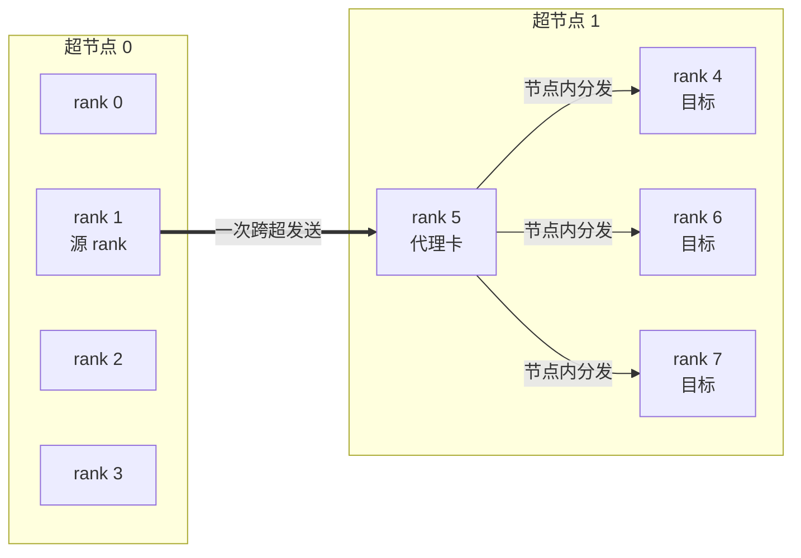
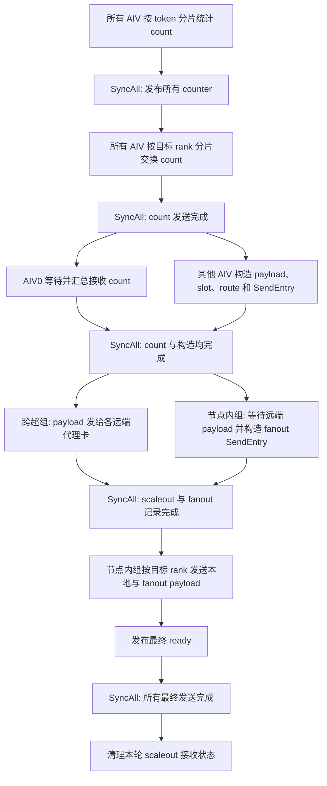

# MoeEpDispatch 跨超节点实现讲解与检视材料

## 1. 先讲结论

这版实现解决的问题是：当 EP 通信域跨越多个超节点时，一个 token 先发送到目标超节点的一张代理卡，再由代理卡在目标超节点内分发到真正需要它的 rank。

它有四个关键特点：

1. 非跨超场景继续走原来的 direct 模板，`moe_ep_dispatch.h` 不承载 hybrid 状态。
2. 同一个 token 发往同一远端超节点时只跨超发送一次，代理卡根据 `topk_idx` 和目标 slot 完成节点内分发。
3. 大块 payload 和 8 字节发送记录分开保存，发送阶段只消费发送记录，不再重新计算路由。
4. 最终数据仍按 direct epilogue 认识的 `[源 rank][slot]` 格式落到接收窗口，epilogue 不需要理解两跳通信。

当前讲解基线：`hybrid-exp` 分支，核心实现截至 `07cbbc6af`；其后的 `85a69d75f` 只增加开发环境下的拓扑覆盖能力，可以独立移除。

## 2. 建议的讲解顺序

建议按下面顺序讲，先把主线讲清，再进入公式和同步细节。

| 时间 | 内容 | 要回答的问题 |
| --- | --- | --- |
| 2 分钟 | 背景和目标 | 为什么 direct 路径不能直接用于跨超节点？ |
| 3 分钟 | 两跳拓扑 | 数据先到哪张代理卡，代理卡代表谁？ |
| 6 分钟 | kernel 主流程 | count、构造、跨超发送、节点内分发如何衔接？ |
| 4 分钟 | workspace 和窗口 | 数据本体、发送记录、状态分别放在哪里？ |
| 3 分钟 | 分核和同步 | 哪些核负责什么，每个全核同步保护什么？ |
| 2 分钟 | 兼容性和检视点 | direct、cache、epilogue、combine 为什么不被破坏？ |

## 3. 基本名词

| 名词 | 代码中的名字 | 本文含义 |
| --- | --- | --- |
| 超节点 | server / scaleup domain | 一组可以进行节点内通信的 rank |
| 跨超通信 | scaleout | 从当前超节点发送到另一个超节点 |
| 节点内通信 | scaleup | 在同一个超节点内发送 |
| 代理卡 | proxy rank | 代表一个源 rank 接收跨超 payload，并在本超节点继续分发的 rank |
| payload 暂存区 | payload stash | 当前 rank 构造好的 token 数据，位于本 rank 通信窗口 |
| 发送记录 | `SendEntry` | 两个 `uint32_t`，记录“从哪个 slot 取，写到哪个 slot” |
| 最终接收区 | final receive data | epilogue 直接读取的 `[源 rank][slot]` 数据区 |
| owner 核 | owner AIV | 唯一负责某个目标超节点或目标 rank 的 AIV |

下文使用以下符号：

| 符号 | 含义 |
| --- | --- |
| `R` | EP 通信域总 rank 数 |
| `U` | 每个超节点内的 rank 数，即 `rank_num_per_server` |
| `S` | 超节点数，`S = R / U` |
| `A` | AIV 核数 |
| `T` | 当前调用的实际 token 数 |
| `N` | 每个 rank 允许的最大 token 数 |
| `K` | top-k |
| `E` | 每个 rank 的本地专家数 |
| `M` | 当前 rank 展开后的实际接收行数，即各本地专家接收数之和 |
| `F` | fanout 发送记录的生产核数，最小为 1 |
| `P` | 最终接收区中一个普通 payload slot 的字节数 |
| `Q` | 一个跨超 payload slot 的字节数 |

## 4. 两跳通信如何工作

### 4.1 代理卡选择

源 rank 在本超节点内的序号为：

```text
source_local_index = source_rank % U
```

发往目标超节点 `target_server` 时，代理 rank 为：

```text
proxy_rank = target_server * U + source_local_index
```

代理卡与源 rank 在各自超节点内具有相同的本地序号。这样每个源 rank 对每个远端超节点只有一个跨超目标。

### 4.2 一个具体例子

假设有 2 个超节点，每个超节点 4 张卡：

```text
超节点 0: rank 0, 1, 2, 3
超节点 1: rank 4, 5, 6, 7
```

rank 1 的本地序号是 1，因此它发往超节点 1 的代理卡是 rank 5。若一个 token 的 top-k 专家分布在 rank 4、6、7：

1. rank 1 只把该 token 跨超发送一次，目标是 rank 5。
2. 跨超 payload 携带 `topk_idx` 和每个 top-k 项的最终 slot。
3. rank 5 扫描这些信息，生成发往 rank 4、6、7 的节点内发送记录。
4. rank 5 代表原始 rank 1，把数据写到各目标 rank 的“源 rank 1”区域。



最重要的不变量是：最终窗口仍以原始源 rank 为第一维。epilogue 看到的是“rank 1 发来的数据”，并不需要知道数据实际经过了 rank 5。

## 5. 对外接口和 EPHandle

Python 入口仍是 `ElasticBuffer.dispatch()`。dispatch 主算子生成计数、slot 和跨超路由，epilogue 再把最终窗口整理成连续输出。

### 5.1 EPHandle 字段

| 字段 | 形状 | 用途 |
| --- | --- | --- |
| `dst_buffer_slot_idx` | `[T, K]` | 每个 top-k 项在目标 rank 最终接收区中的 slot；无效项为 `-1` |
| `recv_src_metadata` | `[M, 4]` | epilogue 生成的接收来源信息，combine 用它把结果送回源 token |
| `num_recv_tokens_per_rank` | `[R]` | 当前 rank 从每个源 rank 接收的 payload 数 |
| `num_recv_tokens_per_expert` | `[E]` | 当前 rank 每个本地专家接收的 token 数 |
| `topk_idx` | `[T, K]` | cache dispatch 和 combine 复用的专家路由 |
| `route_count` | `[T]` | 每个 token 有效的远端超节点路由项数 |
| `route_dst_scaleout` | `[T, K]` | 每个远端路由项的目标超节点序号 |
| `route_scaleout_slot` | `[T, K]` | 每个远端路由项在目标代理接收区中的 slot |

`route_dst_scaleout` 和 `route_scaleout_slot` 只有每行前 `route_count[token]` 项有效。其容量使用 `K`，因为一个 token 最多由 `K` 个 top-k 项产生远端路由。

当前 handle 不保存节点内 rank mask，也不保存每个远端 rank 的 slot 表。代理卡直接从跨超 payload 中的 `topk_idx` 和 `dst_buffer_slot_idx` 重建节点内发送记录。

### 5.2 cache 模式

非 cache 模式负责计算：

- 每个 top-k 项的最终 slot；
- 每个 token 的远端超节点去重结果；
- 每条远端路由的 scaleout slot。

cache 模式复用 handle 中的 `dst_buffer_slot_idx` 和三个 route 张量，但仍会：

- 重新构造本轮 payload；
- 重新生成 workspace 中的 `SendEntry`；
- 将 route 信息继续写到本次输出 handle，保证 handle 可以连续复用。

## 6. 两种 slot 和一种发送记录

### 6.1 普通 payload slot

普通 slot 是 epilogue 最终消费的格式：

```text
P = Align512(
      Align32(x)
    + Align32(scales，可选)
    + Align32(topk_idx)
    + Align32(topk_weights 区)
    + 32B source metadata
)
```

source metadata 中保存源 rank、源 token 等信息。即使没有传入 top-k weights，对应布局仍由统一的 `perSlotBytes` 约束。

### 6.2 跨超 payload slot

跨超 slot 在普通 payload 后追加一行目标 slot：

```text
Q = Align512(P + K * sizeof(int32_t))
```

```text
+-----------------------------+
| 普通 payload，P 字节         |
| x / scales / topk / metadata|
+-----------------------------+
| dst_buffer_slot_idx[K]       |
+-----------------------------+
| 512B 对齐填充                |
+-----------------------------+
```

代理卡读取普通 payload 中的 `topk_idx`，再读取追加的 `dst_buffer_slot_idx[K]`，即可得到“这个 token 要发给哪些本地 rank，以及写到哪个 slot”。

### 6.3 SendEntry

`SendEntry` 固定为 8 字节：

```cpp
struct SendEntryConcept {
    uint32_t source_slot_index;
    uint32_t destination_slot_index;
};
```

它不包含 payload，只描述一次搬运：

- scaleout 记录：从本地 payload stash 的 token slot 取数据，写到代理卡的 scaleout slot；
- 本节点记录：从本地 payload stash 取数据，写到本节点目标 rank 的最终 slot；
- fanout 记录：从代理接收区的 scaleout slot 取数据，写到本节点目标 rank 的最终 slot。

这种分离让路由构造阶段只写很小的记录，通信阶段可以直接遍历记录发送。

## 7. Kernel 整体流程

kernel 入口根据 tiling key 选择模板：

- `NetworkMode == direct`：`MoeEpDispatch`；
- `NetworkMode == hybrid`：`MoeEpDispatchHybrid`。

hybrid 的 `Process()` 只有两段：

```text
PrepareDispatchPayloads()
TransferDispatchPayloads()
```

完整流程如下：



### 7.1 阶段一：统计和交换 count

所有 AIV 均分当前 rank 的 token，扫描同一批 `topk_idx`，同时统计三类数据：

1. 发往每个目标 rank 的 token 数；
2. 发往每个专家的 token 数；
3. 发往每个远端超节点的去重 token 数。

第三类统计按 token 去重：一个 token 即使命中同一远端超节点内多个 rank，对该超节点也只计数一次。

每个目标 rank 的 count 包含：

- `E * 4B` 的专家计数；
- 8B 的 ready 与该目标 rank 的总 token 数。

远端 count 使用 `WriteWithNotifyNbi` 发送，本 rank 目标使用本地窗口搬运。接收侧 AIV0 等待全部 `R` 个来源 ready，计算 `num_recv_tokens_per_rank` 和 `num_recv_tokens_per_expert`，随后清空 count ready。

### 7.2 阶段二：构造 payload 和路由

count 发送完成后：

- AIV0 等待远端 count；
- 其他 AIV 接管原有 count 分片并构造 payload。

保留“count 分片”而不是重新随意切 token，是为了让 slot 前缀与统计阶段的 counter 行保持一一对应。每个构造核先归约排在自己分片之前的 counter，得到无原子冲突的 slot 起始值。

每个 token 的构造顺序是：

1. 将 `x`、可选 scales、`topk_idx`、可选 top-k weights 搬入 UB；
2. 同一目标 rank 只分配一次最终 slot；
3. 本超节点目标生成 scaleup `SendEntry`；
4. 远端目标按目标超节点去重，每个远端超节点只分配一个 scaleout slot；
5. 写出三个 route 张量；
6. 将普通 payload 和 `dst_buffer_slot_idx[K]` 写入本地 payload stash；
7. 为每条远端超节点路由生成 scaleout `SendEntry`。

### 7.3 阶段三：跨超发送与 fanout 记录构造并行

传输阶段把 AIV 分为两组：

- 跨超组：按远端超节点分工，将本地 stash 中的 payload 发给代理卡；
- 节点内组：按 slot 交错扫描本 rank 已收到的远端 payload，生成 fanout `SendEntry`。

跨超发送按 `SendEntry` 逐 slot 调用 `WriteWithNotifyNbi`，同一个代理卡的所有 slot 提交完后执行一次 `Drain`。

代理接收状态格式：

```text
status[source_server][0] = received_slot_count + 1
status[source_server][slot > 0] = 1
```

加 1 是为了区分两种情况：

- `0`：来源还没有发布；
- `1`：来源已经发布，但本轮没有 payload；
- `n + 1`：本轮有 `n` 个 payload。

当 payload 数为 0 时，源端仍发送一个 8B 占位数据并发布状态 1，避免代理永远等待。

节点内组对每个远端来源超节点执行：

1. 等待 slot 0 得到总 slot 数；
2. 各生产核以 `producer_index, producer_index + F, ...` 的方式交错处理 slot；
3. slot 大于 0 时先等待该 slot ready；
4. 读取 `topk_idx` 和 `dst_buffer_slot_idx`；
5. 同一个 slot 对同一目标 rank 只生成一条 fanout `SendEntry`；
6. 将每个生产核、每个目标 rank 的记录数写入 fanout count 区。

这一步只生成发送记录，不复制 payload。真正的节点内发送在下一阶段统一完成。

### 7.4 阶段四：写入最终接收区

节点内组按当前超节点内的目标 rank 均分工作。每个目标 rank 的 owner 依次消费：

1. 当前 rank 自己生成的 scaleup `SendEntry`；
2. 每个远端来源超节点、每个 fanout 生产核生成的 fanout `SendEntry`。

目标是本 rank 时，通过 UB 做本地 GM 搬运；目标是本超节点内其他 rank 时，使用 `WriteWithNotifyNbi`，当前实现每个 payload 后执行一次 `Drain`。

payload 发送结束后再发布逻辑上的 final ready。远端 payload 写使用的 notify 地址位于 final-ready 记录的 `+32B` 未使用位置，真正给 epilogue 看的 ready 位于记录起始地址，两者不能混用。

### 7.5 为什么 epilogue 仍然等待 R 个 ready

每个节点内发送 owner 会发布：

- 当前 rank 自身的 ready；
- 每个远端超节点中，与当前 rank 本地序号相同的原始源 rank ready。

以 `U=4, S=2` 为例，目标超节点内 4 张代理卡共同代表远端超节点的 4 个源 rank。加上本超节点的 4 个源 rank，最终恰好覆盖全部 `R=8` 个来源。

因此 epilogue 仍按原协议等待 `R` 个 final ready，并从 `[source_rank][slot]` 读取数据。

## 8. 分核策略

tiling 先计算：

```text
remote_server_count = S - 1
local_rank_count = U
```

### 8.1 目标数量不超过核数

若：

```text
(S - 1) + U <= A
```

则：

- 每个远端超节点分配一个跨超 owner 核；
- 每个本地目标 rank 分配一个节点内 owner 核；
- 多余核不参与传输阶段。

统计 count 时仍使用全部 AIV。

### 8.2 目标数量超过核数

至少保留一个节点内核，初始按约 3:1 分配：

```text
跨超组约占 3/4
节点内组约占 1/4
```

两组都不会超过各自目标数量。若仍有剩余核，先补跨超组，再补节点内组。

每组内部均使用“平均分配，余数给前面的核”的连续区间切分。一个 owner 可以负责多个目标，但一个目标不会由多个 owner 同时使用同一通信 channel。

## 9. 同步关系

### 9.1 全核同步

| 同步位置 | 前面的生产者 | 后面的消费者 | 保护的数据 |
| --- | --- | --- | --- |
| count workspace 清零后 | 最后一个 AIV | 全部 AIV | 防止 AtomicAdd 叠加上一轮数据 |
| `CalSendCnt()` 后 | 全部统计核 | count 发送与 slot prefix | rank、expert、scaleout counter |
| `ExchangeCount()` 后 | 全部 count 发送核 | AIV0 接收 count、其他核构造 payload | 保证本 rank 的 count 已全部发出 |
| payload 构造后 | AIV0 与其他构造核 | 两个传输核组 | 接收 count、payload stash、route、SendEntry |
| scaleout/fanout 构造后 | 跨超组与节点内生产组 | 节点内发送 owner | fanout SendEntry 和 count 完整可见 |
| 最终发送后 | 节点内发送 owner | 状态清理核 | 所有 payload 和 final ready 已完成 |

### 9.2 核内流水同步

重点检查以下依赖：

- counter 由 MTE3 写入 GM 后，slot prefix 使用 MTE2 读取，因此需要 `MTE3_MTE2` 依赖；
- payload stash 和 SendEntry 在跨核读取前需要完成 MTE3 发布；
- `WriteWithNotifyNbi` 保证数据与 notify 属于同一次通信提交，`Drain` 保证当前 channel 完成；
- 本地 `GlobalTensor::SetValue` 只写入 DCache，作为跨核或跨算子状态使用时必须执行 `DataCacheCleanAndInvalid`；
- final ready 必须晚于对应 payload，scaleout slot ready 必须晚于对应跨超 payload。

### 9.3 TPipe 生命周期

实现将 UB 使用分成三个生命周期，中间通过 `TPipe::Reset()` 重新分配：

1. count 统计与交换；
2. payload 和路由构造；
3. scaleout、fanout 和最终发送。

三阶段 buffer 不同时常驻 UB，避免把 count、双缓冲 payload 和通信临时区全部叠加到 248KB UB 中。

## 10. Workspace 布局

workspace 保存计数和发送记录，不保存需要跨 dispatch/epilogue 生命周期的数据本体。

定义：

```text
send_entry_shard_bytes = Align32(ceil(N / A) * 8)
fanout_entry_core_bytes = Align32(ceil(N / F) * 8)
fanout_count_core_bytes = U * 32
```

逻辑布局如下，所有 offset 相对 kernel 收到的 `workspaceGM`：

```mermaid
flowchart TB
    W0[scaleup counter<br/>A * Align512(R * 4)]
    W1[send count per rank<br/>R * 512]
    W2[send count per expert<br/>Align512(R * E * 4)]
    W3[scaleout counter<br/>A * Align512(S * 4)]
    W4[scaleout SendEntry<br/>(S - 1) * A * send_entry_shard_bytes]
    W5[scaleup SendEntry<br/>U * A * send_entry_shard_bytes]
    W6[fanout SendEntry<br/>U * (S - 1) * F * fanout_entry_core_bytes]
    W7[fanout count<br/>(S - 1) * F * U * 32]
    W8[32B 尾部预留]

    W0 --> W1 --> W2 --> W3 --> W4 --> W5 --> W6 --> W7 --> W8
```

| 区域 | 写入者 | 读取者 |
| --- | --- | --- |
| scaleup counter | 所有 count 核 | slot prefix、节点内发送 owner |
| send count per rank/expert | 所有 count 核原子累加 | count 交换、AIV0 汇总 |
| scaleout counter | 所有 count 核 | 跨超 owner、slot prefix |
| scaleout SendEntry | payload 构造核 | 跨超 owner |
| scaleup SendEntry | payload 构造核 | 节点内目标 rank owner |
| fanout SendEntry | fanout 生产核 | 节点内目标 rank owner |
| fanout count | fanout 生产核 | 节点内目标 rank owner |

`routeWorkspaceOffset` 当前指向 scaleout counter 的起点；route 表本身直接写算子输出张量，不再单独占用 workspace。

tiling 返回的 workspace 总大小还会增加 `SYSTEM_NEED_WORKSPACE`，这是框架预留，不改变上面 kernel 逻辑区域的相对 offset。

## 11. 通信窗口布局

dispatch、epilogue 和 combine 必须使用完全一致的窗口公式。hybrid 布局如下：

```mermaid
flowchart TB
    S0[count ready<br/>R * 512]
    S1[received expert counts<br/>R * Align512(E * 4)]
    S2[dispatch final ready<br/>R * 512]
    S3[combine token state<br/>N * K * 512]
    S4[combine rank state<br/>R * 512]
    D0[scaleout receive data<br/>S * N * Q]
    D1[dispatch final receive data<br/>R * N * P]
    D2[scaleout receive status<br/>S * N * 512]
    D3[combine receive data<br/>N * K * combine_slot_bytes]
    D4[local payload stash<br/>N * Q]

    S0 --> S1 --> S2 --> S3 --> S4 --> D0 --> D1 --> D2 --> D3 --> D4
```

### 11.1 各区域作用

| 区域 | 主要生产者 | 主要消费者 | 生命周期 |
| --- | --- | --- | --- |
| count ready / expert counts | 所有源 rank | dispatch AIV0 | dispatch 内清空 |
| dispatch final ready | 节点内 owner | epilogue 最后一个 AIV | epilogue 清空 |
| scaleout receive data | 远端源 rank | 本 rank fanout 生产核 | dispatch 结束前使用 |
| dispatch final receive data | 节点内 owner | epilogue | epilogue 完成前保留 |
| scaleout receive status | 远端源 rank | 本 rank fanout 生产核 | final 发送完成后清空 |
| combine state/data | combine | combine | 不属于 hybrid dispatch 数据协议 |
| local payload stash | 本 rank payload 构造核 | 本 rank 跨超和节点内 owner | dispatch 结束前使用 |

### 11.2 为什么 payload stash 必须在窗口中

payload stash 是发送阶段的源数据，同时窗口也是已注册通信内存。将它放在窗口中可以直接作为 HCOMM 源地址，不需要再增加一次从 workspace 到通信窗口的中转搬运。

epilogue 真正依赖的是 `dispatch final receive data` 和 `dispatch final ready`。这两块也在窗口中，因此 dispatch kernel 结束后仍可由 epilogue 读取。

## 12. 状态协议

| 状态 | 索引方式 | 发布值 | 清理者 |
| --- | --- | --- | --- |
| count ready | `[source_rank]`，每项 512B | 低 32 位 ready，高 32 位接收 token 数 | dispatch AIV0 |
| scaleout slot 0 | `[source_server][0]`，每项 512B | `slot_count + 1` | dispatch 结束前的清理核 |
| scaleout slot N | `[source_server][slot]` | `1` | dispatch 结束前的清理核 |
| final ready | `[source_rank]`，每项 512B | `1` | epilogue |

需要区分两种 notify：

1. scaleout slot notify 本身就是业务状态，代理据此读取 payload；
2. 最终节点内 payload 的 notify 写到 final-ready 记录的 `+32B`，只用于通信接口完成语义；真正的 final ready 在全部 payload 完成后单独发布。

## 13. direct、epilogue 和 combine 的边界

### 13.1 direct

`moe_ep_dispatch.cpp` 只在 tiling key 为 hybrid 时实例化 `MoeEpDispatchHybrid`，否则实例化原 `MoeEpDispatch`。当前分支相对 master 没有修改 `moe_ep_dispatch.h`。

direct 和 hybrid 使用不同的窗口数据布局，但公共状态区的语义保持一致。tiling 根据 `networkMode` 分别计算 offset。

route 输出在 C++ 接口层统一分配。direct 路径保持其初始化值（`route_count=0`，其余 route 为 `-1`），不依赖这些字段完成发送；只有 hybrid cache 路径要求并消费三个 route 输入。

### 13.2 epilogue

epilogue 不参与两跳路由。它只做三件事：

1. 在 `slotWinStateOffset` 等待全部 `R` 个 final ready；
2. 从 `winDataOffset` 指向的最终接收区读取 payload；
3. 清空 final ready，供下一轮复用。

hybrid tiling 将 `winDataOffset` 指向 `scaleupFinalRecvDataOffset`，因此 epilogue kernel 主逻辑不需要识别 proxy。

### 13.3 combine

combine 不复用 hybrid 的 scaleout 接收区和 payload stash。它只需要 tiling 在 hybrid 布局中正确定位 combine state/data 区。combine 的通信协议不属于本次两跳 dispatch 协议。

### 13.4 开发环境下的拓扑覆盖

默认情况下，`rank_num_per_server` 来自 context 建链时获得的 UB domain 信息，`networkMode` 再由 `R / U` 是否大于 1 决定。

最后一笔 debug commit 额外支持：

- `MOE_EP_DEBUG_RANK_NUM_PER_SERVER`：覆盖逻辑上的每超节点 rank 数；
- `MOE_EP_DEBUG_FORCE_NETWORK_MODE`：使用 `0/direct` 或 `1/hybrid` 强制模板选择。

这两个变量用于单机验证 hybrid 协议。它们不会把单机链路变成真实跨机链路，因此只能验证路由、内存和同步功能，不能代表真实 scaleout 性能。Python 无法直接读取 context 拓扑来估算窗口时，会在所有合法 `U` 中取 hybrid 窗口需求最大值；设置 debug `U` 后则按该值计算。

## 14. 代码阅读地图

建议按以下顺序检视代码：

| 顺序 | 文件 | 重点 |
| --- | --- | --- |
| 1 | `torch_extension/cann_ops_transformer/ops/elastic_buffer.py` | EPHandle、cache 输入、输出分配、窗口大小估算 |
| 2 | `torch_extension/cann_ops_transformer/ops/csrc/elastic_buffer.cpp` | context 拓扑、`topoType`、`rankNumPerServer`、aclnn 参数 |
| 3 | `mc2/moe_ep_dispatch/op_host/moe_ep_dispatch_def.cpp` | 新增 route 输入输出和属性 |
| 4 | `mc2/moe_ep_dispatch/op_host/op_tiling/moe_ep_dispatch_tiling.cpp` | 模板选择、分核、slot/workspace/window 公式 |
| 5 | `mc2/moe_ep_dispatch/op_kernel/moe_ep_dispatch.cpp` | direct/hybrid 模板分派 |
| 6 | `mc2/moe_ep_dispatch/op_kernel/moe_ep_dispatch_base.h` | 小粒度公共函数、窗口地址和 channel handle |
| 7 | `mc2/moe_ep_dispatch/op_kernel/moe_ep_dispatch_hybrid.h` | count、构造、两组传输、状态清理 |
| 8 | `mc2/moe_ep_dispatch_epilogue/op_host/op_tiling/moe_ep_dispatch_epilogue_tiling.cpp` | 与 dispatch 一致的最终数据 offset |
| 9 | `mc2/moe_ep_combine/op_host/op_tiling/moe_ep_combine_tiling.cpp` | 与 dispatch 一致的 combine 区 offset |

阅读 `moe_ep_dispatch_hybrid.h` 时，推荐从文件末尾逆向展开：

```text
Process
  -> PrepareDispatchPayloads
       -> CalSendCnt
       -> ExchangeCount / GetRecvCount
       -> PreparePayloads
  -> TransferDispatchPayloads
       -> SendScaleoutPayloadsToProxy
       -> BuildFanoutSendEntries
       -> SendScaleupPayloads
       -> ClearReceivedScaleoutStatuses
```

## 15. 代码检视清单

### 15.1 功能与容量

- `R % U == 0`，并且 `S = R / U` 与三套 tiling 计算一致。
- 一个 token 对同一目标 rank 只分配一个最终 slot。
- 一个 token 对同一远端超节点只分配一个 scaleout slot。
- `route_count <= min(K, S - 1)`，有效 route 的目标超节点互不重复。
- `sendEntryShardBytes` 能容纳一个 count 分片对单目标产生的最大记录数。
- `fanoutSendEntryCoreBytes` 能容纳一个生产核对单来源、单目标 rank 产生的最大记录数。
- 零 token、零远端 route、无效 expert `-1` 均有明确路径。

### 15.2 内存

- dispatch、epilogue、combine 和 Python 窗口估算使用同样的区域顺序和对齐公式。
- 所有跨 rank 数据和状态地址均为 512B 布局；UB 搬运起点满足 32B 对齐。
- 每个 SendEntry 生产核写入独立对齐分片，避免两个核写同一个 32B 数据块。
- payload stash、scaleout receive、final receive 三块容量均按 `N` 而不是实际 `T` 预留。
- route 输出不应再被误算入 workspace。

### 15.3 同步和通信

- 每个 `SyncAll` 都能对应到明确的跨核生产者和消费者。
- MTE3 写 GM 后由 MTE2 读取的路径具有正确流水依赖。
- 业务 ready 始终晚于对应数据完成。
- 本地 scalar 状态写在跨核读取前执行 DCache clean/invalid。
- 一个通信阶段内，同一目标 rank/channel 只有一个 owner 核。
- `Drain` 覆盖当前 channel 的最后一次提交，且不会在发布 ready 前遗漏未完成写。
- 状态清理发生在所有消费者完成之后，并覆盖零 payload 时仍使用的 slot 0。

### 15.4 兼容性

- direct tiling key 不会实例化 hybrid 模板。
- direct 的窗口公式和 kernel 输入保持原协议。
- hybrid cache 同时要求三个 cached route 张量，不能只传其中一部分。
- epilogue 的 `winDataOffset` 与 dispatch 的 `scaleupFinalRecvDataOffset` 一致。
- combine 区 offset 在 dispatch、epilogue、combine 三套 tiling 中一致。
- 最后一个 debug commit 只改变拓扑选择和窗口预估，不改变核心 kernel 协议。

## 16. 建议测试矩阵

| 维度 | 建议覆盖 |
| --- | --- |
| 模板 | 自然 direct、自然 hybrid、开发环境强制 direct/hybrid |
| 拓扑 | 单超节点；2 个超节点；`U=1/2/4/8`；真实双机 |
| 调用 | dispatch；dispatch+epilogue；dispatch+combine；continue 多轮 |
| cache | 首轮非 cache；复用 handle 的 cache；多轮 cache |
| token | `T=1`、非整除 AIV、接近 `N`、variable batch |
| top-k | `K=1`、中间值、`K=32`、重复 rank、重复超节点、无效 `-1` |
| 数据类型 | fp16、bf16、fp8 + float scales、fp8 + fp8_e8m0 scales |
| 路由分布 | 全本地、全远端、本地远端混合、单远端超节点、多远端超节点 |
| 运行方式 | `do_cpu_sync` 开/关；性能循环 100 轮以上，检查状态复用 |

除最终张量精度外，建议额外验证：

- `dst_buffer_slot_idx`；
- `num_recv_tokens_per_rank` 和 `num_recv_tokens_per_expert`；
- 三个 route 张量；
- cache 与非 cache 的 handle 一致性；
- 重复运行后没有残留 ready 或 scaleout slot 状态。

## 17. 当前性能边界

当前版本以功能稳定和协议清晰为主，仍有以下优化空间：

1. context 已支持多 channel，但 hybrid 当前通过 `GetCommHandle(..., channelIndex=0)` 使用单 channel。
2. 跨超发送已经做到一个代理卡提交全部 slot 后只 `Drain` 一次；最终节点内远端发送仍是每个 payload 一次 `Drain`。
3. payload 构造完成后才进入传输阶段，源端构造与源端跨超发送尚未形成完整流水。
4. 当 `(S - 1) + U < A` 时，传输阶段有多余 AIV 空闲。
5. fanout 需要在代理端扫描每个收到 slot 的 `K` 个 top-k 项。
6. count 交换仍按目标 rank 执行通信和 `Drain`。

这些属于后续性能优化方向，不改变当前 EPHandle、最终接收区和 epilogue 的基本契约。

## 18. 口头总结模板

可以用下面这段话收尾：

> 这版 hybrid dispatch 把一次全局直发拆成了“跨超到代理、代理节点内分发”两跳。源端先按目标 rank 分配最终 slot，再按目标超节点去重，只把 token 跨超发送一次。代理从 payload 中读取 top-k 和目标 slot，生成很小的 SendEntry，最后仍把数据写回按原始源 rank 排列的最终窗口。这样 epilogue 和 combine 不需要理解两跳路由，direct 模板也保持独立。workspace 主要保存计数和发送记录，跨算子需要保留的数据放在通信窗口；同步点分别保护 count 发布、payload 发布、fanout 记录发布和状态清理。当前功能协议已经完整，后续优化重点是多 channel、减少节点内 Drain，以及让构造和发送更早重叠。
