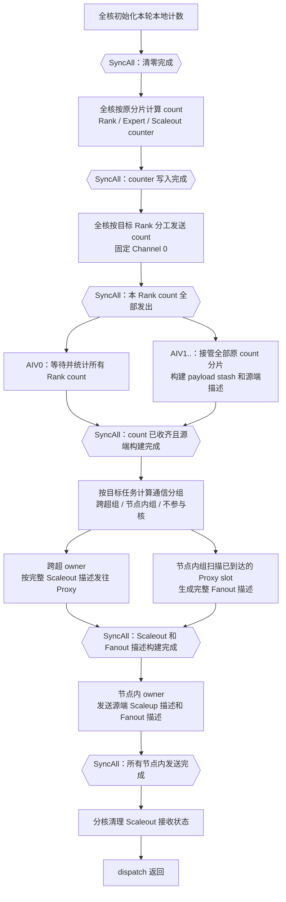

# MoeEpDispatch Hybrid 单 Channel 两阶段通信方案

## 1. 目标

本方案用于替换之前的多 Channel、三组核方案。最终目标如下：

1. count 阶段继续使用全核，并保留 count 交换提供的跨 Rank 轮次保护；
2. count 发出后，AIV0 等待所有 Rank 的 count，其他 AIV 并行完成全部源端数据和路由描述构建；
3. count 接收和源端构建均完成后，再把 AIV 分为跨超组和节点内组；
4. Hybrid 固定使用每个目标 Rank 的 Channel 0，不实现多 Channel；
5. 当目标任务少于 AIV 数时，多余 AIV 不参与通信阶段；
6. 当目标任务多于 AIV 数时，跨超组与节点内组优先按照 `3:1` 分核；
7. payload 每个 token 只保存一份，路由使用紧凑发送描述表达；
8. 源端描述完整构建后再发送，不引入跨核描述进度和 producer 完成状态；
9. 跨超发送和 Proxy 路由重建并行，Fanout 描述完整后再执行节点内发送；
10. 源端不再构造或缓存超节点内 Rank mask 和 Rank slot table；
11. Proxy 根据 `topk_idx + dst_slot_idx` 重建超节点内路由；
12. 保持 Direct 模板行为不变；
13. 保持 Epilogue 和 Combine Kernel 的现有最终接收格式与轮询方式不变；
14. 优先保证代码、状态和同步关系清晰，性能优化以不增加协议复杂度为前提。

本方案明确不做以下内容：

- 不使用 `channelsPerRank` 提供的多 Channel 并发能力；
- 不让多个 AIV 共同使用同一个目标 Rank 的 Channel 0；
- 不设置独立 Builder 组；
- 不在 count 收齐前向其他 Rank 写 payload 或完成状态；
- 不使用边构建、边发布进度、边发送的跨核生产消费协议；
- 不修改 Direct Kernel；
- 不修改 Epilogue 和 Combine Kernel 的业务逻辑。

虽然文件名中保留了 `MULTI_CHANNEL`，本文方案本身已经退化为单 Channel。保留文件名仅为了延续现有
评审路径。

## 2. 统一叫法

本文使用以下名称：

- **count 分片**：count 阶段某个 AIV 负责的连续 token 范围；
- **源端构建核**：count 发出后负责构建 payload stash 和源端发送描述的 AIV；
- **通信核**：源端构建完成后参与跨超发送、Proxy 路由重建或节点内发送的 AIV；
- **跨超组**：负责向每个远端 server 的 Proxy Rank 发送 Scaleout payload；
- **节点内组**：负责本 server 直接发送、Proxy 路由重建和 Fanout；
- **目标任务**：一个远端 server Proxy 或一个本 server 目标 Rank；
- **payload stash**：每个源 token 只写一次的稳定数据区；
- **发送描述**：记录 stash 源位置和最终目标 slot 的紧凑记录；
- **源端描述总数**：源端构建完成后，每个目标、每个构建核实际生成的描述数量。

Proxy Rank 沿用当前定义：

> 源 Rank 向远端 server 发送数据时，目标 Proxy 是远端 server 中与源 Rank 局部编号相同的 Rank。

因此，一个源 Rank 对每个远端 server 只有一个 Proxy 目标。

## 3. 核心结论

### 3.1 count 等待与源端构建并行

count 发送完成后，AIV0 和其他 AIV 执行不同工作：

```text
全核计算 count
      |
全核分工发送 count
      |
全核确认本 Rank 的 count 已发送
      +-----------------------------------+
      |                                   |
AIV0 等待所有 Rank count          AIV1.. 接管全部原 count 分片
并完成接收统计                    构建 payload stash 和源端描述
      |                                   |
      +--------------- SyncAll -----------+
                          |
                全部 AIV 同时离开同步
                          |
              计算跨超组和节点内组
```

这样具有以下优点：

1. count 等待时间可以被本地 payload 和路由描述构建掩盖；
2. 不需要额外的 `countReady` 状态和跨核轮询；
3. 源端构建只依赖本 Rank 已完成的 per-core counter，不依赖远端接收 count；
4. 同步结束时，既能证明 count 已经收齐，也能证明 stash 和源端描述已经完整可见；
5. AIV0 在同步后重新加入通信分组，不会长期闲置；
6. 通信阶段只消费完整描述，不需要描述进度和 producer 完成状态。

### 3.2 单 Channel

Hybrid 固定使用：

```cpp
GetCommHandle(context, targetRank, 0U)
```

每个目标任务只有一个 owner 核：

```text
一个远端 server Proxy -> 一个跨超 owner
一个本 server 目标 Rank -> 一个节点内 owner
```

如果目标任务多于组内核数，一个核负责多个目标；如果目标任务少于总核数，多余核不参与通信
阶段。任何情况下都不允许两个核共同向同一个目标 Rank 的 Channel 0 提交 Hcomm 操作。

### 3.3 数据与路由描述分离

每个 token 的完整 payload 只写一次：

```text
payloadStash[tokenId]
```

发送目标不再通过复制完整 payload 表达，而是通过轻量描述表达：

```text
SendDescriptor {
    sourceSlotIndex,
    destinationSlotIndex
}
```

构建按原 count 分片分工，发送按目标任务分工。两者通过发送描述和中间全核同步解耦。

## 4. count 轮次保护与本地构建边界

count 交换不仅用于计算接收数量，还承担跨 Rank 的轮次保护。

```text
快 Rank                              慢 Rank

进入下一轮 dispatch                  仍在结束上一轮
发送下一轮 count                     清理上一轮 Window 状态
等待其他 Rank 下一轮 count
```

只有慢 Rank 结束上一轮并进入下一轮后，才会发送下一轮 count。因此快 Rank 收齐所有 count 时，可以
确认所有 Rank 都已经结束上一轮。

如果没有这一步，可能出现：

```text
快 Rank 写入下一轮 payload/status
              |
慢 Rank 继续清理上一轮 status
              |
下一轮 status 被重新清零
              |
Proxy 或 Epilogue 永久等待
```

`SyncAll` 只能同步本 Rank 上的 AIV，不能代替跨 Rank count 交换。

因此规定：

> count 全部收齐前，任何核都不能向其他 Rank 写本轮 payload 或完成状态。

但该限制不禁止只写本 Rank 私有区域的源端构建。以下内容不依赖远端 count，可以与 AIV0 的 count
等待并行：

- 构建当前 Rank 的 `payloadStash`；
- 根据本 Rank 的 per-core counter 计算 `dst_slot_idx` 和 `scaleoutSlot`；
- 写 Scaleout 和 Scaleup 源端发送描述；
- 写每个目标、每个构建核的最终描述总数。

在 count 收齐前，源端构建核不得：

- 向本 Rank 之外的 Window 写 payload；
- 发布远端 slot 到达状态；
- 发布 Epilogue 使用的 Final Ready；
- 清理其他 Rank 仍可能使用的上一轮状态。

## 5. 总体流程



该流程保留两个主要并行区间：

1. AIV0 等待 count，与 AIV1.. 构建全部源端数据并行；
2. 跨超组向 Proxy 发送，与节点内组等待并扫描 Proxy slot、构建 Fanout 描述并行。

源端构建与 Hcomm 发送之间保留一个明确的全核同步。相比跨核增量描述协议，这会少一段理论流水，
但可以删除描述进度、producer 完成状态和复杂的跨核可见性处理。

## 6. Count 阶段

### 6.1 计算 count

沿用当前全核 count 逻辑：

1. 清理 count Workspace；
2. 全核同步；
3. 每个 AIV 处理一个连续 token 分片；
4. 计算每个目标 Rank 的 token 数；
5. 计算每个 Expert 的 token 数；
6. 计算每个远端 server 的 Scaleout slot 数；
7. 将每核 counter 写入 Workspace；
8. 确认 MTE3 写入完成；
9. 全核同步。

count 阶段的 token 分片称为 `countShard`。后续由 `aivNum - 1` 个源端构建核接管时，必须保留
这些分片和 counter 的对应关系，不能直接按构建核数重新切 token。

### 6.2 发送 count

count 固定使用 Channel 0。目标 Rank 仍按全 AIV 均分：

```text
有效 count 发送核数 = min(aivNum, epWorldSize)
```

每个目标 Rank 只有一个发送核：

```text
WriteWithNotifyNbi(countData, countStatus)
Drain(Channel 0)
```

本 Rank 目标使用本地 GM 搬运和状态发布，不走 Hcomm。

所有 count 发送核完成后执行一次本地 `SyncAll`。该同步保证 AIV0 开始等待远端 count 前，本 Rank
本轮所有 count 都已经提交并完成 Drain。

### 6.3 接收 count

count 发送同步后：

```text
AIV0：
    轮询所有 Rank 的 count 状态
    计算 num_recv_tokens_per_rank
    计算 num_recv_tokens_per_expert
    必要时更新 CPU Sync 输出
    清理本 Rank 的 count 状态
    确认相关 GM 写入完成

AIV1..：
    接管全部原 count 分片
    构建 payload stash
    生成 Scaleout / Scaleup 源端描述
    写最终描述总数
```

两条路径完成后进入同一个全核同步。该同步结束时同时满足：

1. 所有远端 Rank 的 count 已经收齐；
2. `num_recv_tokens_per_rank` 和 `num_recv_tokens_per_expert` 已经完成；
3. 所有源 token 的 payload stash 已经完成；
4. 所有 Scaleout / Scaleup 源端描述和描述总数已经完成；
5. 本轮可以开始向其他 Rank 写 payload 和状态。

单 AIV 时没有并行构建核，由 AIV0 先收齐 count，再串行构建全部源端数据，最后进入通信阶段。

## 7. 源端构建完成后的通信分核

### 7.1 目标任务数

定义：

```text
availableCoreCount = aivNum
scaleoutTaskCount  = serverNum - 1
scaleupTaskCount   = currentServerRankCount
totalTaskCount     = scaleoutTaskCount + scaleupTaskCount
```

其中：

- 一个远端 server 对应一个 Scaleout Proxy 目标任务；
- 本 server 每个 Rank 对应一个节点内目标任务；
- 本 Rank 自己也算一个节点内目标任务，但只做本地搬运，不占用 Hcomm Channel。

正常均匀拓扑下：

```text
currentServerRankCount == rankSizePerServer
```

最后一个 server 不满时，使用：

```text
currentServerRankCount = serverEndRank - serverStartRank
```

不能直接使用固定 `rankSizePerServer` 访问不存在的 Rank。

### 7.2 目标任务不超过核数

如果：

```text
totalTaskCount <= availableCoreCount
```

则：

```text
scaleoutCoreCount = scaleoutTaskCount
scaleupCoreCount  = scaleupTaskCount
activeCoreCount   = totalTaskCount
inactiveCoreCount = availableCoreCount - activeCoreCount
```

每个通信核只负责一个目标任务，多余核不参与通信发送。

示例：

```text
aivNum = 64
serverNum = 2
rankSizePerServer = 8

scaleoutTaskCount = 1
scaleupTaskCount  = 8

跨超组       = 1 核
节点内组     = 8 核
不参与核     = 55 核
```

### 7.3 目标任务超过核数

如果：

```text
totalTaskCount > availableCoreCount
```

且跨超和节点内任务都存在时，先处理极小核数边界：

```text
availableCoreCount == 1：
    唯一 AIV 顺序处理跨超和节点内目标，不建立两个并行组

availableCoreCount >= 2：
    跨超组和节点内组都至少保留 1 个核
```

先按照 `3:1` 计算目标核数：

```text
expectedScaleoutCoreCount = ceil(availableCoreCount * 3 / 4)
expectedScaleupCoreCount  = availableCoreCount - expectedScaleoutCoreCount
```

当两类任务都存在时：

```text
expectedScaleoutCoreCount =
    min(expectedScaleoutCoreCount, availableCoreCount - 1)

expectedScaleoutCoreCount =
    max(expectedScaleoutCoreCount, 1)
```

再按实际任务容量约束并重新分配剩余核：

```cpp
expectedScaleoutCoreCount = CeilDiv(availableCoreCount * 3U, 4U);
if (scaleoutTaskCount > 0U && scaleupTaskCount > 0U && availableCoreCount > 1U) {
    expectedScaleoutCoreCount = Min(expectedScaleoutCoreCount, availableCoreCount - 1U);
}

scaleoutCoreCount = Min(scaleoutTaskCount, expectedScaleoutCoreCount);
scaleupCoreCount = Min(scaleupTaskCount, availableCoreCount - scaleoutCoreCount);

remainingCoreCount = availableCoreCount - scaleoutCoreCount - scaleupCoreCount;

additionalScaleoutCoreCount =
    Min(remainingCoreCount, scaleoutTaskCount - scaleoutCoreCount);
scaleoutCoreCount += additionalScaleoutCoreCount;
remainingCoreCount -= additionalScaleoutCoreCount;

additionalScaleupCoreCount =
    Min(remainingCoreCount, scaleupTaskCount - scaleupCoreCount);
scaleupCoreCount += additionalScaleupCoreCount;
remainingCoreCount -= additionalScaleupCoreCount;
```

由于 `totalTaskCount > availableCoreCount`，最终：

```text
scaleoutCoreCount + scaleupCoreCount == availableCoreCount
```

当两类任务都足够多时，严格保持 `3:1`。某一类任务不足时，将剩余核分给另一类任务。
只有一个 AIV 的退化路径不满足并行分组比例，但仍覆盖全部目标任务。

示例：

```text
aivNum = 64
scaleoutTaskCount = 100
scaleupTaskCount = 100

跨超组   = 48 核
节点内组 = 16 核
```

```text
aivNum = 64
scaleoutTaskCount = 10
scaleupTaskCount = 100

跨超组   = 10 核
节点内组 = 54 核
```

```text
aivNum = 64
scaleoutTaskCount = 100
scaleupTaskCount = 5

初始跨超组   = 48 核
初始节点内组 = 5 核
剩余 11 核优先补给跨超组

最终跨超组   = 59 核
最终节点内组 = 5 核
```

### 7.4 核编号

源端构建同步结束后，按连续 AIV 编号分组：

```text
[0, scaleoutCoreCount)
    跨超组

[scaleoutCoreCount, activeCoreCount)
    节点内组

[activeCoreCount, aivNum)
    不参与通信阶段
```

不参与通信的核已经参加过源端构建。如果后续仍有全核 `SyncAll`，它们必须直接到达该同步等待，
不能提前退出 Kernel。

### 7.5 目标任务分配

跨超组均分所有远端 server：

```text
SplitRange(
    scaleoutTaskCount,
    scaleoutCoreCount,
    scaleoutCoreIndex,
    remoteServerStart,
    remoteServerEnd)
```

节点内组均分本 server 目标 Rank：

```text
SplitRange(
    scaleupTaskCount,
    scaleupCoreCount,
    scaleupCoreIndex,
    localRankStart,
    localRankEnd)
```

因为：

```text
scaleoutCoreCount <= scaleoutTaskCount
scaleupCoreCount  <= scaleupTaskCount
```

所以每个通信核至少负责一个目标任务。

当任务多于组内核数时，一个核负责多个目标任务。每个非本卡目标固定使用 Channel 0。

## 8. AIV1.. 如何接管原 count 分片

count 使用全部 `aivNum` 个核计算，源端构建由 `aivNum - 1` 个核执行。源端构建不能重新按 token
总数切分，因为每核 slot 前缀来自 count 阶段的 counter 行：

```text
counter[countShardId][target]
```

如果构建范围与原 count 分片不一致，`GetSlotStartNum` 计算出的 `destinationSlot` 会错位，导致多个
token 写同一个 slot 或留下空洞。

定义：

```text
builderCoreCount = aivNum - 1
builderCoreIndex = aivId - 1
```

每个构建核接管连续的原 count 分片：

```text
SplitRange(
    aivNum,
    builderCoreCount,
    builderCoreIndex,
    countShardStart,
    countShardEnd)
```

例如 `aivNum=64` 时：

```text
AIV0：等待并处理所有 Rank count
AIV1：接管原 count 分片 [0, 2)
AIV2：接管原 count 分片 [2, 3)
...
AIV63：接管原 count 分片 [63, 64)
```

AIV1 接管 AIV0 原本的 count 分片和自己的 count 分片，其他构建核各接管一个分片。所有原 count
分片被完整且不重叠地覆盖。

每个构建核负责的 token 范围为：

```text
startTokenId = 第 countShardStart 个原分片的起点
endTokenId   = 第 countShardEnd - 1 个原分片的终点
```

该构建核对某个目标的描述段起点为：

```text
descriptorStart[target] =
    sum(counter[countShardId][target],
        countShardId in [0, countShardStart))
```

该构建核对目标的描述数量为：

```text
descriptorCount[target] =
    sum(counter[countShardId][target],
        countShardId in [countShardStart, countShardEnd))
```

这样可以保证：

1. count 阶段不需要重算；
2. AIV0 等 count 时，其他核有完整且互不重叠的构建任务；
3. 每个 token 只由一个构建核处理；
4. `destinationSlot` 与原 count counter 完全一致；
5. 多个构建核的 slot 和描述段不重叠；
6. 同步后通信 owner 可以直接按构建核遍历完整描述段。

## 9. 参考提交的数据与路由描述分离

参考提交：

```text
b6b222b20626eabac3562e38309ca1c9998b6150
```

其核心不是具体函数或 512B 对齐方式，而是把：

```text
完整 payload 数据
```

与：

```text
发送到哪里
```

分开保存。

### 9.1 参考提交修改前

一个 token 需要发给多个 Rank 时，完整 payload 被复制到多个按目标 Rank 排布的 staging 区：

```text
token payload
  |
  +--> staging[targetRank0][destinationSlot0]
  |
  +--> staging[targetRank1][destinationSlot1]
  |
  +--> staging[targetRank2][destinationSlot2]
```

相同 payload 会发生多次本地完整搬运。

### 9.2 参考提交修改后

每个 token 只写一次 stash：

```text
slotStash[tokenId] = payload
```

再为每个目标记录地址信息：

```text
addressTable[targetRank][destinationSlot] = {
    sourceOffset,
    destinationOffset
}
```

目标发送核批量读取地址表，根据地址逐 token 调用 `WriteNbi`：

```text
slotStash[sourceOffset]
    |
    +---- WriteNbi ---->
          remoteWindow[destinationOffset]
```

因此：

- payload 构建按 token 分工；
- 发送按目标 Rank 分工；
- 多目标发送共享同一份 payload；
- 发送核不再重新构建 payload；
- 目标之间只增加很小的地址描述。

### 9.3 参考提交没有边写边发

参考提交的数据构建和远端发送仍是两个完整阶段：

```text
SendPhase
    逐 token 写 slotStash
    逐 token 写 addressTable
        |
        v
SyncAll
        |
        v
WriteToRemoteWindow
    按目标 Rank 读取完整 addressTable
    逐 token WriteNbi
```

`SendPhase` 内部使用双缓冲，把 token `N + 1` 的搬入与 token `N` 的处理重叠，但 Hcomm 发送必须等
所有 AIV 完成 `SendPhase` 并经过全核同步后才开始。

因此，本方案只借鉴参考提交的：

- payload 只保存一份；
- 路由由轻量地址描述表达；
- 构建按 token 分工；
- 发送按目标分工。

本方案同样采用“完整构建后再发送”，但把构建阶段放到 AIV0 等待 count 的时间窗口中：

```text
AIV0：等待 count

AIV1..：
    完整构建 payload stash
    完整构建源端发送描述
        |
        v
SyncAll
        |
        v
按目标分组发送
```

因此不新增 `completedDescriptorCount`、`producerFinished` 或 owner 增量轮询协议。与参考提交相比，
主要增加的是 count 等待与源端构建并行，以及跨超发送与 Proxy Fanout 描述构建并行。

## 10. Hybrid 中的数据与路由描述分离

### 10.1 payload stash

每个源 token 在 Window 中只保存一份：

```text
payloadStash[tokenId]
```

格式为：

```text
+--------------------------------+
| 基础 payload                   |
| x / scales / topk_idx          |
| topk_weights / src metadata    |
+--------------------------------+
| dst_slot_idx[topK]             |
+--------------------------------+
| 对齐                           |
+--------------------------------+
```

节点内发送只发送前 `perSlotBytes`：

```text
payloadStash[tokenId][0 : perSlotBytes]
```

跨超发送向 Proxy 发送完整 Scaleout slot：

```text
payloadStash[tokenId][0 : scaleoutSlotBytes]
```

### 10.2 紧凑发送描述

不直接照搬参考提交中两个 64 位地址和每项 512B 的排布。目标作为描述区外层索引，因此每条逻辑描述
只需要：

```cpp
struct SendDescriptor {
    uint32_t sourceSlotIndex;
    uint32_t destinationSlotIndex;
};
```

逻辑大小为 8B。描述段按 32B 对齐，四条描述可以一次 `DataCopy`。

源端有两类描述：

```text
scaleoutDescriptor[remoteServer][producerCore][descriptorIndex]
    = {tokenId, scaleoutSlot}

scaleupDescriptor[localRank][producerCore][descriptorIndex]
    = {tokenId, destinationSlot}
```

同一个 token 同时命中本 server 和远端 server 时：

```text
payloadStash[tokenId] 只写一次
       |
       +--> 节点内描述 --> 节点内 owner
       |
       +--> 跨超描述   --> 跨超 owner
```

源端构建发生在通信分组之前，因此构建核不属于跨超组或节点内组。每个构建核根据自己负责的 token
同时生成需要的 Scaleout 和 Scaleup 描述。

### 10.3 描述分段

多个构建核不能写同一个描述追加指针。为避免原子抢占，每个目标对每个构建核分配独立连续段：

```text
descriptor[target][producerCore][localDescriptorIndex]
```

段起点由第 8 节接管的原 count 分片 counter 前缀计算。不同构建核不会写同一个 32B block。

发送 owner 按 producerCore 遍历描述段，不需要扫描全部 token，也不需要重新计算路由。

### 10.4 最终描述总数

每个构建核完成自己的全部 token 后，对每个目标写一次最终描述总数：

```text
descriptorCount[target][producerCore]
```

该值是最终值，不会在发送阶段继续增长。发布顺序为：

```text
写 payload stash
      |
写该构建核的全部发送描述
      |
确认相关 MTE3 写入完成
      |
写最终 descriptorCount
      |
进入全核同步
```

同步离开后，owner 可以直接读取 `descriptorCount` 和对应描述段，不需要轮询。最终数量为零时也不
需要额外 `producerFinished` 状态。

## 11. 源 token 构建

AIV1.. 按第 8 节接管的连续原 count 分片构建 token。AIV0 同时等待和处理所有 Rank 的 count。

每个 token 的顺序为：

```text
1. 搬入 x、scales、topk_idx 和可选 topk_weights
2. 构造基础 payload
3. 非 cache：计算 dst_slot_idx
4. cache：搬入 cached dst_slot_idx
5. 扫描 topk
6. 对目标 Rank 去重
7. 对目标 server 去重
8. 分配本 server destinationSlot
9. 分配远端 server scaleoutSlot
10. 写 payloadStash[tokenId]
11. 为每个唯一的本 server 目标 Rank 写一条节点内描述
12. 为每个唯一的远端 server 写一条跨超描述
13. 当前构建核处理完全部 token 后，写每个目标的最终描述总数
```

两级去重含义不同：

```text
Rank 去重：
    同一 token 的多个 topk 落到同一 Rank
    -> 只向最终 Rank 发送一次 payload
    -> 对应 topk 复用同一个 dst_slot_idx

server 去重：
    同一 token 的多个目标 Rank 位于同一远端 server
    -> 只向该 server 的 Proxy 发送一次 Scaleout payload
    -> Proxy 再 Fanout 到唯一目标 Rank 集合
```

源端构建阶段不执行 Hcomm payload 发送。构建完成后，AIV1.. 与 AIV0 在全核同步汇合；随后所有
AIV 重新按照通信目标分为跨超组和节点内组。

## 12. 跨超组

### 12.1 目标分配

每个跨超 owner 负责一个或多个远端 server。目标 Proxy 为：

```text
proxyRankId =
    destinationServerIndex * rankSizePerServer
    + currentLocalRankIndex
```

如果最后一个 server 不完整，需要检查 `proxyRankId < epWorldSize`。

每个 Proxy 固定使用：

```text
GetCommHandle(context, proxyRankId, 0U)
```

### 12.2 发送

owner 遍历所有构建核对该远端 server 的完整描述段：

```text
for each producerCore:
    descriptorCount =
        read descriptorCount[remoteServer][producerCore]
    consume descriptors [0, descriptorCount)
```

源端构建同步已经保证 stash、描述和最终数量可见，因此这里不做跨核轮询。

每条描述计算：

```text
localSourceAddress =
    payloadStashBase
    + sourceSlotIndex * scaleoutSlotBytes

remoteDestinationAddress =
    proxyScaleoutRecvBase
    + sourceServerIndex * numMaxTokensPerRank * scaleoutSlotBytes
    + destinationSlotIndex * scaleoutSlotBytes
```

然后调用：

```text
WriteWithNotifyNbi(
    Channel 0,
    localSourceAddress,
    remoteDestinationAddress,
    scaleoutSlotBytes,
    remoteSlotStatus)
```

不再执行：

```text
payload -> scaleoutSendWindow[remoteServer][slot]
```

同一个 token 发往多个远端 server 时，所有发送读取同一个 `payloadStash[tokenId]`。

### 12.3 Drain

一个 Proxy 的全部描述提交完后，只执行一次：

```text
Drain(proxyRank, Channel 0)
```

不能逐 token Drain。stash 必须保持有效，直到所有读取它的 Proxy Channel 0 都完成 Drain。

## 13. Scaleout 到达状态

不使用 `READY_LAST` 和 `EMPTY`。每个源 server 仍保留按 slot 排布的状态记录，状态区大小不增加。

`status[0]` 同时携带预计总数：

```text
status[0] == 0      ：预计总数尚未发布
status[0] == 1      ：预计总数为 0
status[0] == N + 1  ：预计总数为 N，且 slot 0 已到达
```

其余 slot：

```text
status[slot] == 0：尚未到达
status[slot] == 1：已经到达
```

发送规则：

- `N > 0`：先发送 slot 0，notify 值为 `N + 1`；
- slot `[1, N)`：notify 值为 `1`；
- `N == 0`：发送一次 8B 占位数据，令 `status[0] = 1`。

单 Channel 下 slot 发送有固定 owner，但 Proxy 仍逐 slot 检查到达状态，不依赖 `READY_LAST` 推断全部
数据已经完成。

Proxy 的完成条件为：

```text
读取 status[0]
      |
得到 totalSlotCount
      |
确认 [0, totalSlotCount) 每个 slot 都已经处理
      |
该源 server 本轮完成
```

## 14. 节点内组

节点内组同时承担三类工作：

1. 发送源 Rank 本地产生的节点内描述；
2. 分核扫描 Proxy 已收到的 Scaleout slot；
3. 消费 Fanout 描述并发送到最终目标 Rank。

### 14.1 本 server 直接发送

每个目标 Rank 只有一个 owner。

owner 遍历所有构建核的完整描述段：

```text
scaleupDescriptor[targetRank][producerCore]
```

非本卡目标：

```text
payloadStash[sourceSlotIndex][0 : perSlotBytes]
    -- WriteNbi(Channel 0) -->
targetWindow[destinationSlotIndex]
```

本卡目标：

```text
payloadStash[sourceSlotIndex][0 : perSlotBytes]
    -- DataCopy -->
localWindow[destinationSlotIndex]
```

### 14.2 Proxy 路由重建

Scaleout slot 携带：

```text
基础 payload，内部已有 topk_idx
dst_slot_idx[topK]
```

通信第一阶段中，节点内组把 `(sourceServer, scaleoutSlot)` 均分，轮询各自负责的 slot 到达状态，
保证每个 slot 只由一个核扫描：

```text
linearScaleoutSlot =
    sourceServerOrdinal * numMaxTokensPerRank
    + scaleoutSlot

ownerScaleupCore =
    linearScaleoutSlot % scaleupCoreCount
```

扫描逻辑：

```text
for each topkIndex:
    expertId < 0：
        跳过

    destinationSlot = dst_slot_idx[topkIndex]
    destinationSlot < 0：
        跳过

    destinationRank = expertId / numLocalExperts
    destinationRank 不在当前 server：
        跳过

    destinationRank 已处理：
        跳过

    生成一条 Fanout 描述
```

目标 Rank 去重只需要当前 slot 的 UB 临时空间，最多保留 `topK` 个目标。

### 14.3 Fanout 描述

Scaleout 接收区本身是稳定数据 stash：

```text
scaleoutRecvWindow[sourceServer][scaleoutSlot]
```

扫描核不复制完整 payload，只生成：

```text
fanoutDescriptor[localRank][producerCore][descriptorIndex]
    = {
        linearScaleoutSlot,
        destinationSlot
      }
```

其中：

```text
linearScaleoutSlot
    -> 可以恢复 sourceServer 和 scaleoutSlot
```

所有跨超 owner 完成发送、所有 Proxy 扫描核完成 Fanout 描述构建后，执行一次全核同步。同步之后，
节点内目标 owner 消费完整 Fanout 描述：

```text
scaleoutRecvWindow[linearScaleoutSlot][0 : perSlotBytes]
    -- WriteNbi(Channel 0) -->
targetWindow[destinationSlot]
```

追加的 `dst_slot_idx[topK]` 只用于 Proxy 路由，不写入最终接收 slot。

这体现了参考提交的数据与路由描述分离：

```text
数据：
    Scaleout 接收 slot，只保存一份

路由：
    8B Fanout 描述

发送：
    直接从 Scaleout 接收 slot 发到最终 Rank
```

### 14.4 节点内 Drain 和 Final Ready

同一目标 Rank 的源端直发描述和 Fanout 描述都由同一个 owner 提交到 Channel 0。

采用分阶段完成策略：

1. 源端构建同步前已经完成全部本 server 直发描述；
2. 通信第一阶段由跨超组发送到 Proxy，节点内组同时生成完整 Fanout 描述；
3. 全核同步确认 Scaleout 发送和 Fanout 描述构建均完成；
4. 节点内 owner 消费该目标 Rank 的全部直发和 Fanout 描述；
5. 非本卡目标执行一次 Channel 0 Drain；
6. 发布当前 Epilogue 已使用的 Final Ready；
7. 本卡目标确认本地 MTE3 写完成后发布 Final Ready。

因为每个目标只有一个 owner，不需要 Channel 完成汇总，也不新增 Final Ready 格式。

## 15. Cache 和 EPHandle

### 15.1 删除的字段

源端不再生成或缓存 Proxy Fanout 使用的 Rank mask 和 Rank slot table，因此从 EPHandle 删除：

- `route_scaleup_mask`；
- `route_scaleup_slot`。

同步删除：

- MoeEpDispatch 对应 cache 输入；
- MoeEpDispatch 对应输出；
- Torch `EPHandle` 字段；
- Torch C++ 参数传递；
- ACLNN 原型；
- 算子定义；
- Tiling 输入输出检查；
- 测试脚本的构造、缓存、打印和比较逻辑。

### 15.2 保留的字段

保留：

- `dst_buffer_slot_idx`，形状 `[numTokens, topK]`；
- `route_count`；
- `route_dst_scaleout`；
- `route_scaleout_slot`。

后三个字段描述第一段跨超发送关系：

```text
一个 token 需要发送到哪些远端 server
以及在每个远端 server 对应的 Scaleout slot
```

它们不再描述远端 server 内的最终 Rank。

### 15.3 cache 路径

cache 每轮仍需要根据当前输入构建新的 payload stash，因为 `x`、`scales` 和可选权重会变化。

cache 路径执行：

```text
读取 cached dst_buffer_slot_idx
读取 cached route_count
读取 cached route_dst_scaleout
读取 cached route_scaleout_slot
      |
写本轮 payloadStash
      |
生成与非 cache 相同格式的 Scaleout / Scaleup 描述
```

Proxy 路由仍根据本轮 payload 携带的：

```text
topk_idx + dst_slot_idx
```

计算，不依赖 `route_scaleup_mask` 或 `route_scaleup_slot`。

发送描述和最终描述总数只属于当前 dispatch 调用，不进入 EPHandle。

## 16. Window 格式

### 16.1 Scaleout slot

原格式：

```text
+--------------------------------+
| payload                        |
+--------------------------------+
| Rank mask                      | ceil(rankSizePerServer / 32) * 4B
+--------------------------------+
| Rank slot table                | rankSizePerServer * 4B
+--------------------------------+
| 512B 对齐                      |
+--------------------------------+
```

新格式：

```text
+--------------------------------+
| payload，内部已有 topk_idx     |
+--------------------------------+
| dst_slot_idx[topK]             | topK * 4B
+--------------------------------+
| 512B 对齐                      |
+--------------------------------+
```

大小：

```text
scaleoutSlotBytes =
    AlignUp512(perSlotBytes + topK * sizeof(int32_t))
```

Dispatch、Epilogue 和 Combine 的 Tiling 必须使用同一公式计算后续 Window 偏移。Epilogue 和 Combine
Kernel 的业务逻辑不修改。

### 16.2 发送侧

原格式：

```text
scaleupSendWindow
    = currentServerRankCount
      * numMaxTokensPerRank
      * perSlotBytes

scaleoutSendWindow
    = serverNum
      * numMaxTokensPerRank
      * scaleoutSlotBytes
```

新格式：

```text
payloadStash
    = numMaxTokensPerRank
      * scaleoutSlotBytes
```

节点内发送读取每项前 `perSlotBytes`，跨超发送读取完整 `scaleoutSlotBytes`。

payload stash 替换两块按目标展开的发送 staging，不是额外增加。

### 16.3 接收侧

保持：

- count 状态区；
- Scaleout 接收数据区；
- Scaleout 每 slot 到达状态区；
- Dispatch 最终接收区；
- Epilogue 使用的 Final Ready；
- Combine 状态和数据区。

删除 Scaleout slot 中原有 Rank mask 和 Rank slot table。Scaleout 状态区大小保持不变，只调整状态
编码。

## 17. Workspace 格式

Workspace 保存以下内容：

```text
+--------------------------------------------------+
| 原有 per-AIV / per-target count counter         |
+--------------------------------------------------+
| count 发送数据和接收统计临时区                  |
+--------------------------------------------------+
| Scaleout 发送描述                               |
| [remoteServer][producerCore][descriptor]         |
+--------------------------------------------------+
| Scaleup 发送描述                                |
| [localRank][producerCore][descriptor]            |
+--------------------------------------------------+
| Fanout 发送描述                                 |
| [localRank][fanoutProducerCore][descriptor]      |
+--------------------------------------------------+
| 源端最终描述总数                                |
| [target][builderCore]                            |
+--------------------------------------------------+
| Fanout 最终描述总数                             |
| [localRank][fanoutProducerCore]                  |
+--------------------------------------------------+
```

不再需要：

- 多 Channel owner 表；
- Channel 完成汇总；
- `countReady` 状态；
- `completedDescriptorCount`；
- `producerFinished`；
- `fanoutProducerFinished`；
- `route_scaleup_mask`；
- `route_scaleup_slot`；
- 按目标展开的完整 payload staging。

逻辑描述大小为 8B，每个 producer 段按 32B 对齐。

源端描述最坏上界：

```text
sourceDescriptorBytes <=
    numMaxTokensPerRank
    * (remoteServerCount + currentServerRankCount)
    * sizeof(SendDescriptor)
    + segmentAlignment
```

Fanout 描述最坏上界：

```text
fanoutDescriptorBytes <=
    remoteServerCount
    * numMaxTokensPerRank
    * min(topK, currentServerRankCount)
    * sizeof(SendDescriptor)
    + segmentAlignment
```

Tiling 必须使用 64 位计算所有乘法和对齐，避免大 shape 下溢出或截断。第一版使用完整紧凑描述区，
不实现环形队列；后续只有在 Workspace 成为实际瓶颈时，才考虑有界环形描述队列。

最终描述总数很小，但不同构建核写入的区域仍应按 32B 分段，避免多个核修改同一 Cache Line。

## 18. 同步设计

### 18.1 保留的全核同步

| 位置 | 原因 |
|---|---|
| count Workspace 清零后 | 防止其他核在清零完成前写 counter |
| count counter 写完后 | count 发送和后续 slot 前缀需要完整 counter |
| 本 Rank count 全部发送后 | AIV0 开始远端轮次等待前，本 Rank 必须已完成发送 |
| AIV0 收齐 count 且 AIV1.. 完成源端构建后 | 通信 owner 读取 stash、源端描述和接收 count 前，二者都必须完成 |
| Scaleout 发送且 Fanout 描述构建完成后 | 节点内 owner 只能消费完整 Fanout 描述，且 Proxy 接收区必须稳定 |
| 所有节点内发送完成后 | 清理 Scaleout 接收状态前不能还有核读取 |

### 18.2 两个关键并行区间

第一个区间：

```text
AIV0：等待和处理所有 Rank count
AIV1..：构建全部源端 stash 和描述
               |
             SyncAll
```

第二个区间：

```text
跨超组：发送完整 Scaleout 描述并 Drain
节点内组：等待 Proxy slot 并构建完整 Fanout 描述
               |
             SyncAll
```

本方案不删除这两个阶段之间的全量同步，也不使用描述进度替代它们。

### 18.3 流水同步

必须明确以下地址依赖：

```text
MTE3 写 payload stash
MTE3 写源端发送描述和最终数量
    -> 全核源端构建同步
    -> Hcomm 读取 stash 和描述

Hcomm 提交某个 Scaleout 目标的全部数据
    -> Drain
    -> 第一通信阶段全核同步

Proxy 读取 Scaleout slot
    -> 写完整 Fanout 描述和最终数量
    -> 第一通信阶段全核同步
    -> 节点内 owner 读取 Fanout 描述

节点内 Hcomm 提交某个目标的全部直发和 Fanout 数据
    -> Drain
    -> 写 Final Ready

所有 Fanout 读取完成
    -> 清理 Scaleout status
```

如果无法证明相邻流水关系，使用能够保证前序写完成的同步，不使用与实际生产者、消费者不匹配的
`SyncFunc`。

### 18.4 不参与核

当 `activeCoreCount < aivNum` 时，不参与核：

1. 已经参与 AIV1.. 的源端构建工作，或者 AIV0 的 count 接收工作；
2. 通信分组后不初始化 Hcomm 发送所需的 TBuf/TQue；
3. 不扫描 Proxy slot；
4. 不使用 Hcomm；
5. 必须到达后续全核同步，不能提前退出 Kernel。

## 19. 正确性约束

实现必须满足以下不变量：

1. count 未全部收齐前，不向其他 Rank 发送 payload 或状态；
2. 每个源 token 只由一个源端构建核构建；
3. 每个源 token 在 payload stash 中只保存一份；
4. AIV1.. 接管的是连续原 count 分片，slot 前缀与 count counter 对应；
5. 每个目标任务只有一个 Channel 0 owner；
6. 每条发送描述只由一个 producer 写；
7. 源端构建同步结束前，任何通信 owner 都不能读取 stash 或源端描述；
8. 源端构建同步结束后，描述总数不再变化；
9. Scaleout slot 只由一个 Proxy 扫描核生成 Fanout 描述；
10. 第一通信阶段同步结束前，节点内 owner 不能读取 Fanout 描述；
11. Fanout 只发送 `perSlotBytes`，不发送追加的 `dst_slot_idx`；
12. 目标 Channel 0 Drain 前不能发布 Final Ready；
13. 所有 Fanout 读取结束前不能清理 Scaleout 接收状态；
14. cache 与非 cache 生成相同格式的发送描述；
15. Direct 模板不读取或依赖 Hybrid 新增 Workspace；
16. Epilogue 和 Combine Kernel 不依赖 dispatch Workspace。

## 20. 分阶段实施

### 阶段 1：count 等待与源端构建并行

改动：

- count 阶段保持全核；
- count 发出后，AIV0 接收 count；
- AIV1.. 接管全部原 count 分片并构建现有发送数据；
- count 接收和源端构建在同一个全核同步汇合；
- 同步后按目标任务数确定通信核；
- 目标不足时停用多余核；
- 目标超过核数时按 `3:1` 分配；
- 所有远端发送固定 Channel 0；
- 暂时保留现有 payload staging 和路由表。

预期：

- 功能与当前版本一致；
- count 等待与源端构建发生重叠；
- 每个目标任务只有一个 owner；
- 每个通信核至少有一个目标任务；
- 没有多 Channel 状态和完成汇总；
- 可以独立验证大、小拓扑分核。

### 阶段 2：共享 payload stash 和源端发送描述

改动：

- 每个 token 只写一次 payload stash；
- 建立 8B Scaleout/Scaleup 描述；
- 根据描述直接从 stash 发送；
- 每个构建核写一次最终描述总数；
- 保留源端完整构建后的全核同步；
- 暂时保留原 Scaleout mask/slot 格式。

预期：

- 精度与阶段 1 一致；
- 本地完整 payload 搬运次数下降；
- 通信 owner 不需要轮询跨核描述进度；
- cache 与非 cache 均能生成描述。

### 阶段 3：Proxy 路由重建

改动：

- Scaleout slot 改为 `payload + dst_slot_idx[topK]`；
- Proxy 使用 `topk_idx + dst_slot_idx` 重建目标 Rank；
- 删除源端 Rank mask 和 Rank slot table；
- 删除 EPHandle 的 `route_scaleup_mask` 和 `route_scaleup_slot`；
- 同步修改 Torch、ACLNN、算子定义、Tiling 和测试；
- 更新 Dispatch、Epilogue、Combine 的 Window 偏移计算。

预期：

- cache 和非 cache 均通过；
- Scaleout slot 缩小；
- EPHandle 缩小；
- Direct Kernel 不受影响。

### 阶段 4：Fanout 数据与描述分离

改动：

- 每个 Scaleout 接收 slot 只扫描一次；
- 生成 8B Fanout 描述；
- Scaleout 发送与 Fanout 描述构建并行；
- 两者完成后通过全核同步进入节点内发送；
- 节点内 owner 根据描述直接从 Scaleout 接收区发送；
- 删除节点内完整 payload staging；
- Fanout 只保存最终描述总数。

预期：

- 不重复搬运完整 Fanout payload；
- 不同目标 owner 不重复扫描同一 slot 的 topk；
- 本卡和非本卡目标均正确；
- Final Ready 格式不变。

### 阶段 5：状态协议和清理

改动：

- 删除 `READY_LAST` 和 `EMPTY`；
- 使用预计总数和每 slot 状态；
- 删除不再需要的实际接收 slot 数临时区；
- 清理旧 route/staging/多 Channel 死代码；
- 复核所有跨核 GM 发布和 DCache 操作。

预期：

- 零 Scaleout slot 正确结束；
- 单 slot 和多 slot 正确；
- 连续运行无状态残留；
- Workspace 和 Window 与最终设计一致。

每个阶段单独提交，测试脚本同步提交相应改动。

## 21. 验证方案

### 21.1 分核

对分核函数做 Host 侧单元检查：

- `totalTaskCount < aivNum`；
- `totalTaskCount == aivNum`；
- `totalTaskCount > aivNum`；
- 跨超任务不足；
- 节点内任务不足；
- 最后一个 server 不满；
- `serverNum=1`；
- `currentServerRankCount=1`。

每组检查：

- 所有目标任务恰好被覆盖一次；
- 没有目标任务被两个核负责；
- 每个通信核至少一个目标任务；
- 不参与核没有目标任务；
- 任务充足时比例为 `3:1`。

### 21.2 count 分片接管

检查：

1. 原 `aivNum` 个 count 分片全部被 AIV1.. 覆盖；
2. 每个源端构建核接管连续 count 分片；
3. 不同构建核的 count 分片不重叠；
4. 合并后的 token 范围连续；
5. slot 起点等于前序 count 分片 counter 之和；
6. 目标 slot 无重复、无空洞、无越界。

### 21.3 功能组合

- 单 Rank；
- 单 server 多 Rank；
- 单机模拟两个 server；
- 双机两个 server；
- 多 server；
- `rankSizePerServer=1/2/4/8/128`；
- cache 和非 cache；
- dispatch、combine、continue；
- `do_cpu_sync` 开关；
- BF16、FP16、FP8；
- `numTokens=0/1`；
- 大 token 和大 hidden；
- 可变 BS；
- `topK=1` 和大 topK；
- 无跨超 token、单个跨超 token和大量跨超 token。

### 21.4 描述与 stash

检查：

1. 同一个 token 发往多个目标时，所有描述指向同一个 stash 项；
2. `sourceSlotIndex` 和 `destinationSlotIndex` 不越界；
3. producer 描述段不重叠；
4. 源端构建同步后，stash、描述和最终数量完全一致；
5. producer 产生零条描述时，最终数量为零且 owner 能正常跳过；
6. cache 与非 cache 的目标集合和 slot 一致；
7. 所有目标 Drain 前 stash 不被复用。

### 21.5 Proxy 路由

阶段 3 可临时保留旧 mask/slot 作为只读校验：

1. 比较旧 mask 目标 Rank 集合与 Proxy 重建集合；
2. 比较每个目标 Rank 的 slot；
3. 检查相同目标 Rank 的多个 topk 只生成一条 Fanout 描述；
4. 检查非法 expert 和 `dst_slot_idx=-1`；
5. cache 和非 cache 均通过后删除旧校验。

### 21.6 状态和连续运行

覆盖：

- Scaleout 预计总数为 0；
- 预计总数为 1；
- 多 slot；
- 某些 Rank 没有发送数据；
- Rank 间 token 数差异很大；
- dispatch、epilogue、combine 连续运行 100 轮以上；
- performance 和非 performance；
- cache 和非 cache。

检查：

- count 状态每轮清理；
- Scaleout status 每轮清理；
- Final Ready 不提前发布；
- 无偶现精度错误；
- 无卡死；
- 无异常 CQE 残留。

### 21.7 性能

分别记录：

- count 计算；
- count 发送和接收；
- payload stash 构建；
- count 接收与 payload stash 构建的重叠比例；
- Scaleout 提交和 Drain；
- Proxy slot 等待；
- Proxy 路由扫描；
- Scaleout 发送与 Proxy 路由扫描的重叠比例；
- Fanout 提交和 Drain。

重点验证：

- 不再逐 token Drain；
- 完整 payload 每 token 只落一次；
- count 等待与源端构建确实重叠；
- Scaleout 发送与 Fanout 描述构建确实重叠；
- 停用多余核是否降低小拓扑同步开销；
- 单 Channel 是否成为大拓扑性能瓶颈。

## 22. 最终方案摘要

最终方案为：

1. count 阶段使用全部 AIV；
2. 全部 count 发送完成后，AIV0 等待远端 count，AIV1.. 构建源端 stash 和描述；
3. AIV1.. 接管连续的原 count 分片，保证 slot 前缀正确；
4. count 收齐且源端构建完成后全核同步，再开始通信分组；
5. 目标任务少于核数时，多余核不参与通信；
6. 目标任务多于核数时，优先按跨超与节点内 `3:1` 分配；
7. 一个远端 server Proxy 或本 server Rank 是一个目标任务；
8. 每个目标固定一个 owner，固定使用 Channel 0；
9. 不设置独立 Builder 组，也不使用跨核描述进度协议；
10. 每个 token 只写一份 payload stash；
11. Scaleout、Scaleup 和 Fanout 都通过 8B 描述驱动发送；
12. 源端描述完整构建后，由通信 owner 直接消费；
13. 跨超发送与 Proxy Fanout 描述构建并行；
14. Fanout 描述完整后，再统一执行本 server 直发和 Fanout；
15. 源端不再生成 Rank mask 和 Rank slot table；
16. Scaleout slot 携带 `dst_slot_idx[topK]`；
17. Proxy 根据 `topk_idx + dst_slot_idx` 重建节点内路由；
18. 每个 Proxy slot 只扫描一次，Fanout 直接读取 Scaleout 接收区；
19. EPHandle 删除 `route_scaleup_mask` 和 `route_scaleup_slot`；
20. 使用预计 slot 总数和每 slot 到达状态，不依赖 `READY_LAST/EMPTY`；
21. 每个目标 Channel 0 只在全部发送提交后 Drain；
22. Direct、Epilogue 和 Combine Kernel 业务逻辑保持不变。
