# MoeEpDispatch Hybrid 跨超通信长尾问题分析与修复报告

## 1. 结论

双超节点 Hybrid Dispatch 曾出现约 3.25 亿 device cycles 的异常通信长尾。问题不是 payload 大小，也不是 route、workspace 或 fanout 计算量，而是同一个目标 rank 的 HCOMM 操作在不同阶段由不同 AIV 核执行。

修复方式是：按照全局目标 rank 固定负责通信的 AIV 核，并在 count、超节点内直发、scaleout、fanout 和 ack 阶段保持一致。

小 payload 用例的最大总耗时从约 3.26 亿 cycles 降至 5.96 万 cycles，通信阶段降至 1.91 万 cycles，精度和 continue 流程正常。

## 2. 名词说明

本文统一使用以下名称：

| 名称 | 含义 |
|---|---|
| 源 rank | 当前执行 dispatch、准备发送数据的 rank |
| 目标 rank | 接收该次 HCOMM 写操作的 rank |
| 通信句柄 | 由源 rank 和目标 rank 确定、只能指向该目标 rank 的 `commHandle` |
| 通信负责核 | 源 rank 上负责使用该通信句柄的 AIV 核 |
| Proxy rank | 目标超节点中负责接收 scaleout payload 并进行节点内 fanout 的 rank |

代码中需要区分：

- `hcomm_`：每个 AIV 核初始化的 HCOMM 执行对象；
- `commHandle`：通过源 rank 和目标 rank 取得的通信句柄，固定对应一个目标 rank。

本问题不是“一个通信句柄向多个目标 rank 发送”，而是“同一个目标 rank 的通信句柄在不同阶段被不同 AIV 核使用”。

## 3. Hybrid Dispatch 通信流程

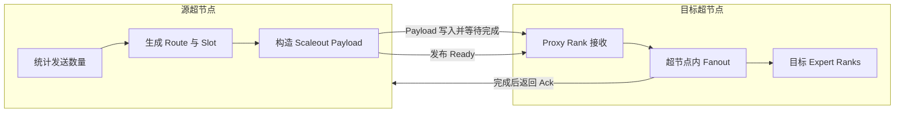

完整发布顺序如下：

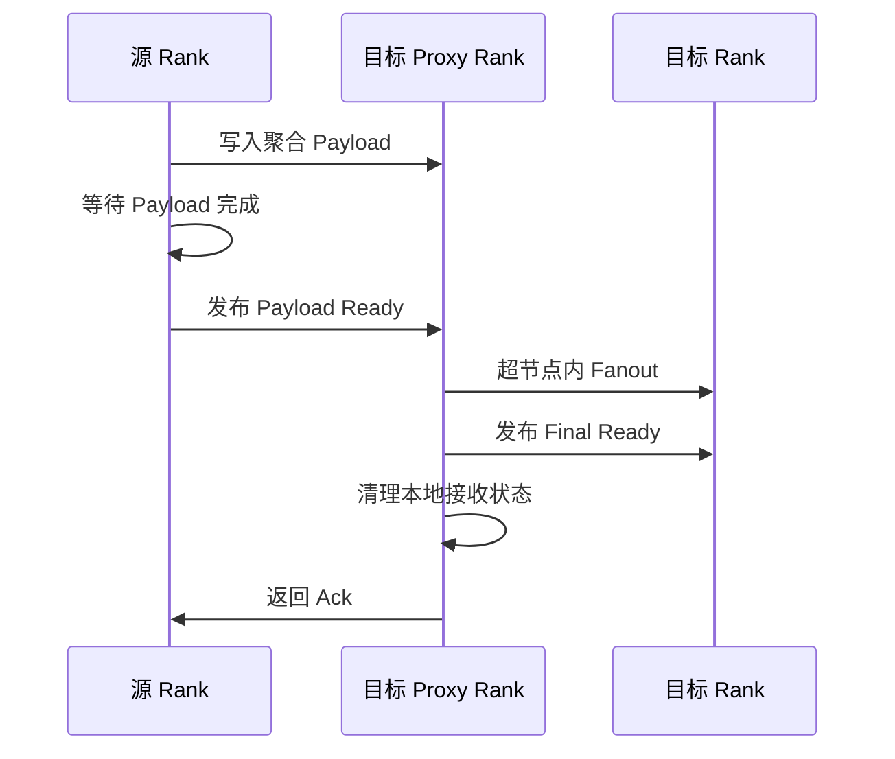

Payload、Ready 和 Ack 之间存在严格依赖，因此不能通过删除完成等待来规避问题。

### 3.1 代码整体流程、分核与内存交互

下图按当前 `moe_ep_dispatch_hybrid.h` 的实际调用顺序展开。中央是执行阶段和分核方式，紫色横线是 `SyncAll<true>` 全 AIV 同步；左侧是 Hybrid Workspace 的物理分区，右侧是每个 rank 的通信 Window 物理分区。

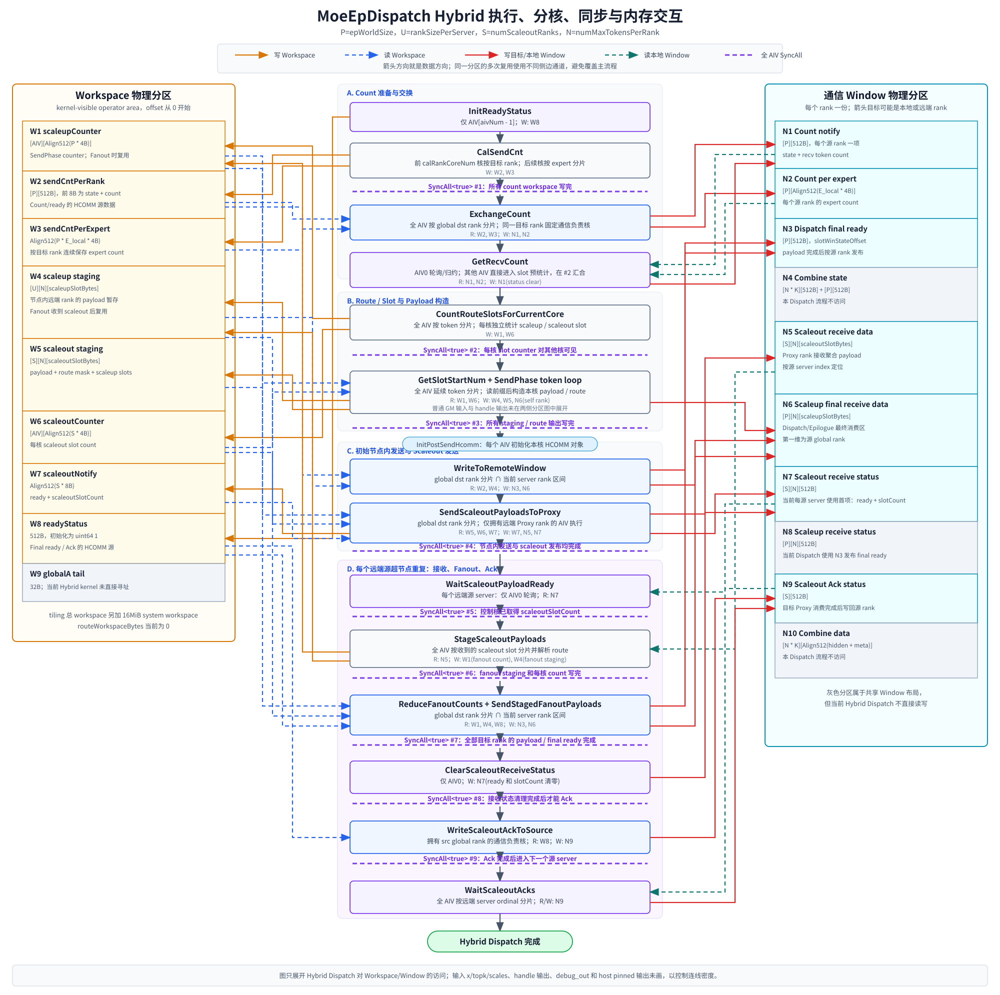

读写箭头遵循以下约定：

| 线条 | 含义 |
|---|---|
| 橙色实线，阶段指向 Workspace | 写本 rank Workspace |
| 蓝色虚线，Workspace 指向阶段 | 读本 rank Workspace |
| 红色实线，阶段指向 Window | 写本地或目标 rank Window；跨 rank 时通过 HCOMM |
| 绿色虚线，Window 指向阶段 | 读或轮询本 rank Window |
| 紫色虚线横栏 | 全 AIV 执行 `SyncAll<true>` |

图中的 9 个全核同步点分为三类：

1. `#1` 保证 `CalSendCnt` 的每核 count 已写入 Workspace，之后才能由按目标 rank 分配的通信核读取并发送；
2. `#2`、`#3` 和 `#4` 依次发布 slot counter、SendPhase staging 数据、初始节点内与 scaleout 发送结果；
3. `#5` 至 `#9` 位于每个远端源超节点的 Fanout 循环内，依次发布 ready、staging/count、final payload、状态清理和 ack。

源码调用顺序中 `GetRecvCount` 位于 SendPhase 之前，但只有 AIV0 会执行轮询和归约；其他 AIV 从该函数立即返回，可以先进入 `CountRouteSlotsForCurrentCore`，最后在 `#2` 等待 AIV0 完成自己的 slot 预统计。因此图中的纵向顺序表示调用顺序，`#2` 才是这条分支的实际全核汇合点。

分核规则不是全程固定一种，而是随阶段的数据并行方式变化：

| 阶段 | 分核方式 | 原因 |
|---|---|---|
| `CalSendCnt` | 一组核按目标 rank，另一组核按 expert | rank count 与 expert count 并行统计 |
| Route/Slot 与 payload 构造 | 全 AIV 按 token | token 之间可独立构造，counter 前缀用于避免循环内原子加 |
| Count 交换、节点内发送、Scaleout、Fanout、Ack | 按 global target rank 固定通信负责核 | 同一目标 rank 的 HCOMM 操作不能在阶段间换核 |
| Proxy 接收后的 staging | 全 AIV 按收到的 scaleout slot | 将 payload 解析和本超节点内目标展开并行化 |
| `GetRecvCount`、ready 轮询、接收状态清理 | AIV0 | 单点轮询或单写状态，避免重复消费和重复清理 |
| `WaitScaleoutAcks` | 按远端 server ordinal | 只轮询本地 ack 区，不发起面向目标 rank 的 HCOMM |

Workspace 图从 kernel 使用的 operator area offset 0 开始；tiling 返回的总大小还额外包含 16MiB system workspace。Window 中灰色区域属于 dispatch/combine 共享布局，但当前 Hybrid Dispatch 不直接访问。

## 4. 问题表现

问题最初出现在双超节点、每超节点单 rank 的 continue dispatch 性能测试中。

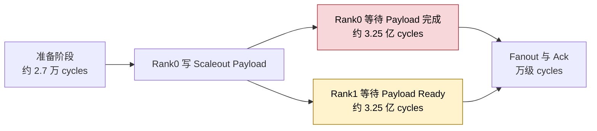

异常有两个明显特征：

1. rank0 长时间停在 HCOMM 完成等待；
2. rank1 同期等待 rank0 发布 Ready，因此两个长等待属于同一因果链。

## 5. 排查过程

### 5.1 定位到通信完成等待

在 rank0 的 AIV0 增加分阶段打点后，route、slot、payload 构造、fanout 和 ack wait 均为正常量级，约 3.25 亿 cycles 全部落在 scaleout payload 提交后的完成等待中。

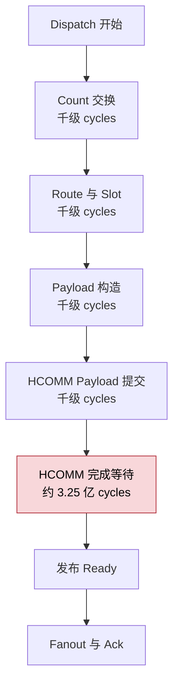

这说明算子计算逻辑不是主要问题，排查重点应转向 HCOMM 调用方式。

### 5.2 小 Payload 仍然复现

将用例缩小到单 token、`11264 bytes` payload 后，仍出现约 3.26 亿 cycles 的完成等待。

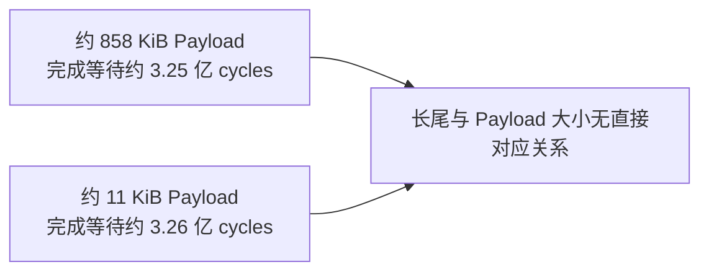

因此问题不是正常带宽耗时，也不能用 payload 较大解释。

### 5.3 对比 Direct 的分核方式

Direct 模板在 count 交换时按全局目标 rank 分核，并在后续 payload 发送中继续复用同一组目标 rank 区间。

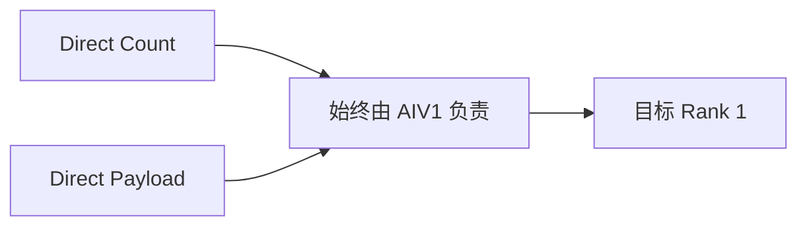

Hybrid 原实现则在不同阶段重新分核：

| 通信阶段 | 原分核依据 | 向目标 rank1 发送的 AIV |
|---|---|---:|
| Count 交换 | 全局目标 rank | AIV1 |
| Scaleout Payload | 远端超节点序号 | AIV0 |
| Proxy Fanout | 当前 server 内局部 rank | 可能与 Count 不同 |
| Scaleout Ack | 固定控制核 | AIV0 |

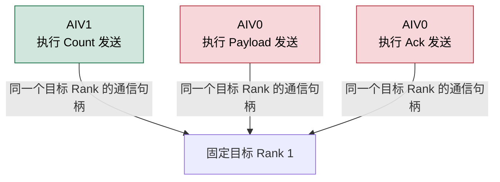

同一个目标 rank 的 HCOMM 操作在不同 AIV 核之间迁移，这是 Hybrid 与 Direct 的关键差异。

### 5.4 验证分核判断

先让 scaleout payload 与 count 一样由目标 rank 对应的 AIV 核发送后，payload 完成等待恢复正常，但约 3.32 亿 cycles 的长尾转移到了 ack 发送。

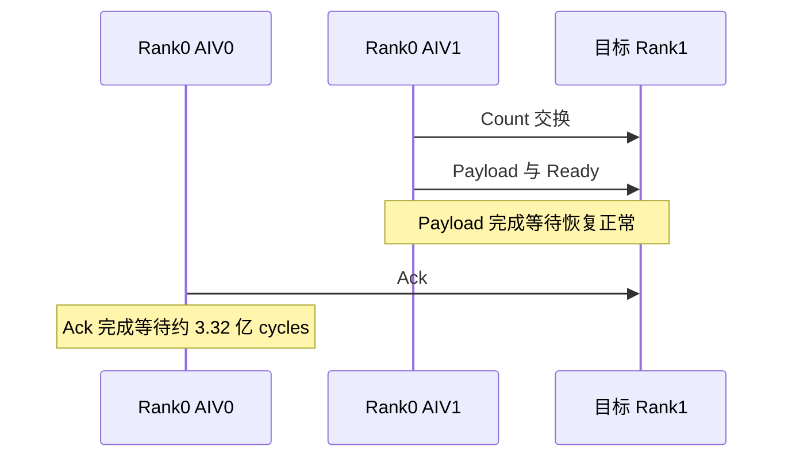

这说明只修 payload 不够。只要同一目标 rank 的某个 HCOMM 阶段仍然换到其他 AIV 核，长尾就可能在该阶段重新出现。

## 6. 与通信句柄单目标约束的关系

一个通信句柄只能对应一个目标 rank，这与问题有关，但不是因为代码违反了“单句柄单目标”的约束。

原代码每次都通过正确的目标 rank 获取通信句柄：

```cpp
uint64_t commHandle = GetCommHandle(mc2Context_, epRankId_, dstRankId);
```

真正的问题是：句柄固定对应目标 rank，但使用该句柄的 AIV 核不固定。

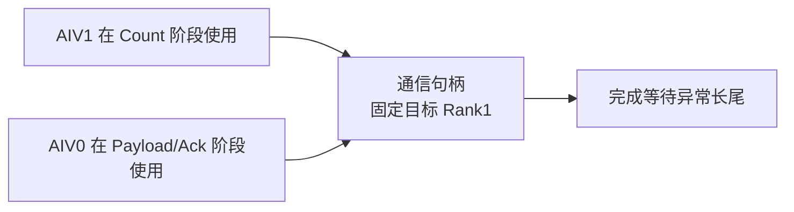

从本次实测看，通信句柄的发送队列、完成状态或底层连接资源至少与执行它的 AIV 核存在关联。仓库侧无法仅凭日志确定 HCOMM 内部的具体机制，但可以确定同一目标 rank 换核使用会触发异常，而保持固定通信负责核可以消除异常。

## 7. 修复方案

### 7.1 按全局目标 Rank 固定通信负责核

所有会调用 HCOMM 的阶段统一使用与 count 交换相同的分核规则：

```cpp
SplitToCore(epWorldSize_, aivNum_, communicationStartRankId,
            communicationEndRankId, communicationRankNumPerCore, true);
```

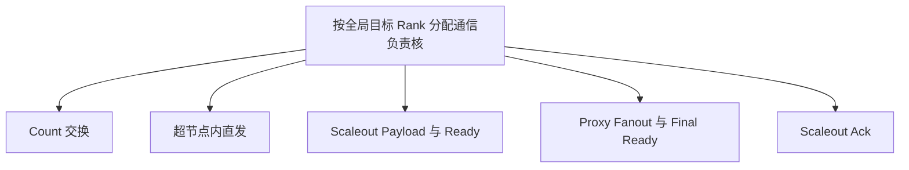

对于只处理当前 server 的超节点内直发和 fanout，使用“本 AIV 的全局 rank 区间”与“当前 server 的 rank 区间”的交集。这样通信范围不变，但负责核与 count 阶段一致。

### 7.2 拆分状态清理与 Ack 发送

原逻辑由 AIV0 同时清理本地状态并发送 ack。修复后：

1. AIV0 清理本地 scaleout 接收状态；
2. 跨核同步，确保状态清理完成；
3. 源 rank 对应的通信负责核发送 ack；
4. 再次同步，确认 ack 完成后进入下一个 source。

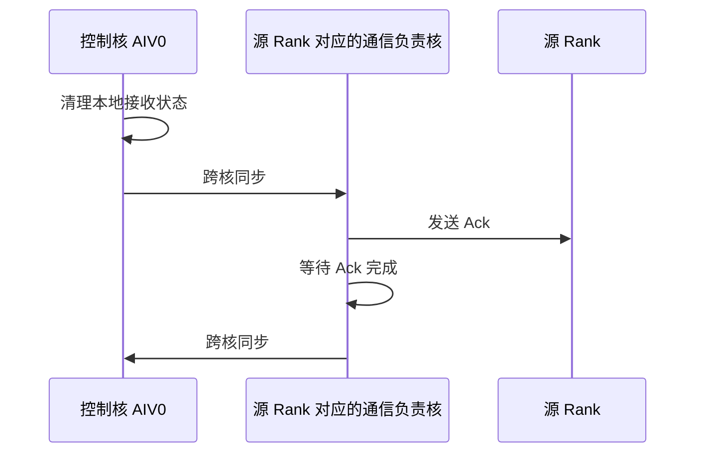

第一个同步保证发送端收到 ack 并复用接收区之前，本地状态已经清理完成。

## 8. 修复效果

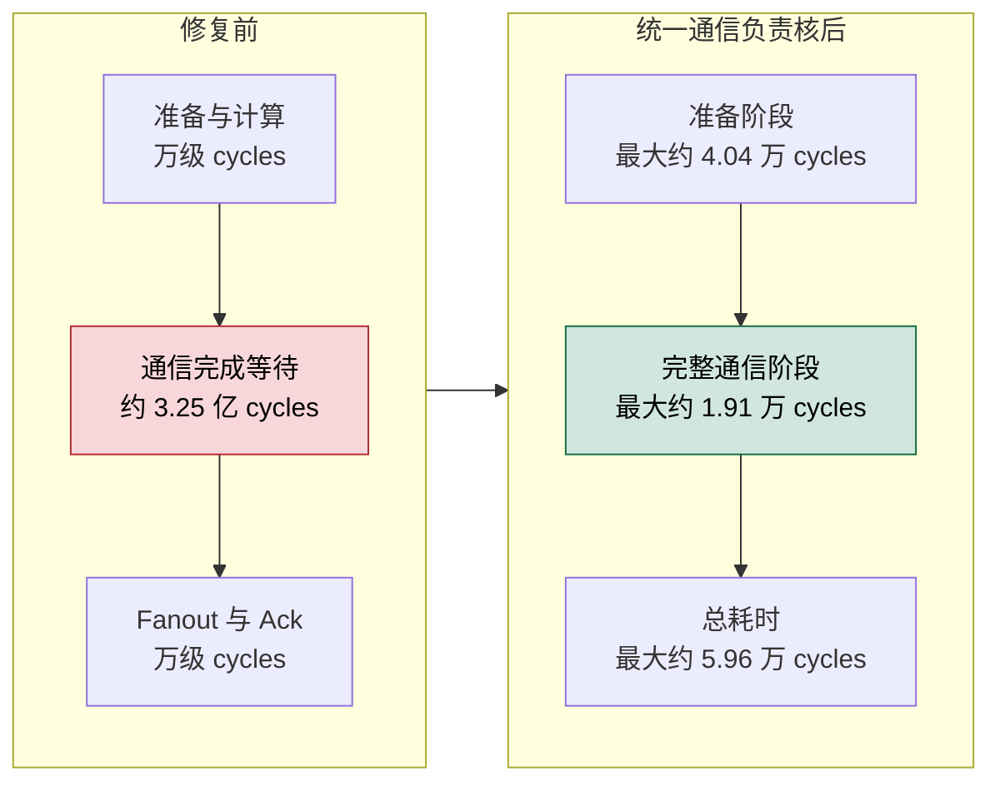

最终小 payload 用例：

| Rank | 修复前总耗时 | 修复后总耗时 | 修复后通信阶段 |
|---|---:|---:|---:|
| rank0 | 约 3.26 亿 cycles | 59555 cycles | 19129 cycles |
| rank1 | 约 3.26 亿 cycles | 32594 cycles | 17061 cycles |

修复后未再出现亿级长尾，精度与 continue 流程正常。

## 9. 兼容性

| 项目 | 影响 |
|---|---|
| Direct 模板 | 未修改 |
| Workspace 布局 | 不变 |
| Window 布局 | 不变 |
| Payload 内容 | 不变 |
| Route 与 Slot 格式 | 不变 |
| Ready/Ack 协议 | 顺序不变 |
| Cache/Non-cache | 共用修复 |
| Hybrid 分核 | 所有 HCOMM 阶段统一按全局目标 rank 分配负责核 |

## 10. 后续验证

需要继续覆盖以下场景：

1. 大 payload 与小 payload；
2. 每超节点 1 rank、2 ranks 和更多 ranks；
3. cache 与 non-cache；
4. dispatch-only 与 continue；
5. BF16、FP16 和 FP8；
6. 性能模式连续多轮，检查所有 rank 的最大耗时；
7. 单超节点 Direct 回归，确认未受到 Hybrid 修改影响。

报告文件仅用于记录分析，不加入代码提交。
