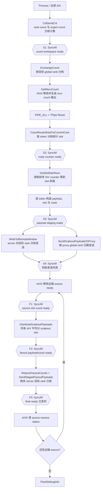
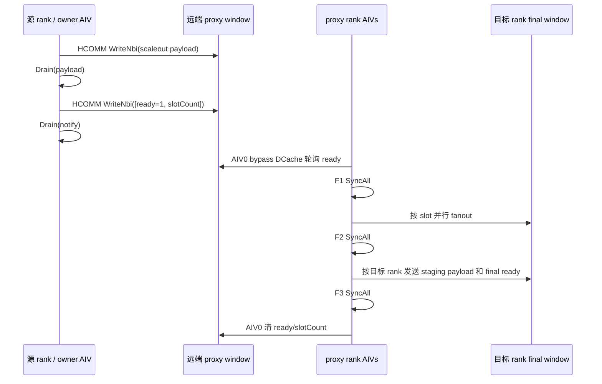

# MoeEpDispatch Hybrid 阶段 1 稳定版说明

## 1. 基线与目标

- 主仓库分支：`hybrid-stage1-stable`
- 主仓库基线：`6f3bbc846 perf: parallelize local hybrid fanout writes`
- 测试仓库分支：`hybrid-stage1-stable`
- 测试仓库基线：`abab2c0 test: validate direct local hybrid fanout`

选择阶段 1 是因为同一大 shape、2 server x 1 rank、64 AIV 的历史日志中，它是总耗时最低的稳定版本：

| 版本 | rank0 total cycles | rank1 total cycles | 最慢 rank | 结果 |
|---|---:|---:|---:|---|
| 阶段 0 | 1,547,122 | 1,308,664 | 1,547,122 | PASS |
| 阶段 1 | 853,015 | 649,210 | **853,015** | PASS |
| 阶段 2 | 1,035,653 | 649,426 | 1,035,653 | PASS |
| 阶段 3（修复后） | 857,996 | 665,916 | 857,996 | PASS |
| 阶段 4 | 150,023,006 | 25,922,004 | 150,023,006 | 精度错误、偶发卡死 |

分布式算子的实际完成时间取决于最慢 rank，因此以“最慢 rank”作为选择依据。当前稳定版不包含阶段 2 到阶段 4 引入的通信 owner mask、group state、start/release/generation 等协议。

## 2. 当前代码思路

Hybrid dispatch 把通信拆成两层：

1. **超节点内 scaleup**
   - 本 rank 目标直接写本 rank 的最终接收 window。
   - 本 server 其他 rank 的数据先写本地 workspace staging，再通过 HCOMM 写入目标 rank 的最终接收 window。

2. **跨超节点 scaleout**
   - 每个 token 对同一远端 server 只生成一个 scaleout payload。
   - payload 附带目标 server 内 rank mask 和每个目标 rank 的 scaleup slot。
   - 源 rank 把聚合 payload 发给远端 proxy rank。
   - proxy 所在 rank 接收后，由所有 AIV 按 scaleout slot 分工展开，再写入本 server 各目标 rank。

Proxy 选择保持相同的 server 内局部 rank 下标：

```text
currentScaleupIndex = epRankId % rankSizePerServer
proxyRankId         = destinationServerIndex * rankSizePerServer
                      + currentScaleupIndex
```

例如每个 server 有 4 个 rank，源 rank 1 向 server 2 发送时，proxy 为全局 rank `2 * 4 + 1 = 9`。

## 3. 主流程



### 3.1 分核方式

| 阶段 | 分核维度 | 说明 |
|---|---|---|
| count 计算 | rank / expert | 前一部分 AIV 统计 per-rank，后一部分统计 per-expert |
| count 交换 | global rank | `SplitToCore(epWorldSize, aivNum)` |
| route/slot 统计 | token | `SplitToCore(numTokens, aivNum)` |
| token payload 构造 | token | 与 route/slot 统计使用相同 token 区间 |
| server 内发送 | global rank 后与本 server 求交 | 每个目标 rank 只由一个 AIV 使用 HCOMM |
| scaleout 发送 | proxy global rank | proxy 落在哪个 AIV 的 rank 区间，就由哪个 AIV 发送 |
| proxy fanout 展开 | scaleout slot | 全部 AIV 对 slot 数量做平均切分，余数给前面的 AIV |
| fanout 后发送 | global rank 后与本 server 求交 | 每个本 server 目标 rank 由一个 AIV 发送 |

阶段 1 不使用动态 worker group，也没有 start/release/generation 控制位。所有 AIV 经过相同数量的 `SyncAll`。

## 4. Route 与二级去重

非 cache 路径对每个 token 执行：

1. 对 top-k expert 按目标 rank 去重，同一 rank 复用一个 scaleup slot。
2. 对远端 server 再去重，同一 token 发往同一远端 server 时只创建一个 route entry。
3. route entry 保存：
   - 目标 server 下标；
   - scaleout slot；
   - 目标 server 内 rank bitmask；
   - 每个目标 rank 对应的 scaleup slot。
4. route 表从 UB 批量搬出到 EPHandle 输出。

cache 路径从 EPHandle 的 cached route 输入搬入相同 UB 布局，再复用同一个 route 输出函数和 scaleout payload 构造流程。

## 5. Workspace 布局

记号：

| 记号 | 含义 |
|---|---|
| `A` | AIV 数 |
| `E` | EP world size |
| `U` | 每个 server 的 rank 数 |
| `S` | server/super-node 数 |
| `N` | `numMaxTokensPerRank` |
| `L` | 每 rank local expert 数 |
| `P` | `perSlotBytes` |
| `Pup` | `Align512(P)` |
| `Pout` | `Align512(P + maskWords*4 + U*4)` |
| `Align512(x)` | 向上对齐到 512B |

Kernel 使用的逻辑 workspace 从 offset 0 开始：

```text
0
│
├─ scaleupCounter
│    A * Align512(E * 4)
│    每个 AIV 一行，保存该 AIV 的 per-rank slot count
│
├─ sendCntPerRank
│    E * 512
│    每个 rank 512B，前 8B 为 [state=1, count]
│    count 交换和 final-ready HCOMM 复用同一条目
│
├─ sendCntPerExpert
│    Align512(E * L * 4)
│    [destination rank][local expert]
│
├─ scaleupSendWorkspace                         <- scaleupSendWorkspaceOffset
│    U * N * Pup
│    server 内非本 rank payload staging
│    当前 kernel 以 P 为紧凑 slot 步长，tiling 以 Pup 预留容量
│
├─ scaleoutSendWorkspace                        <- scaleoutSendWorkspaceOffset
│    S * N * Pout
│    [destination server][scaleout slot]
│    slot = payload + rank mask + rank slot table
│
├─ scaleoutCounter                              <- routeWorkspaceOffset
│    A * Align512(S * 4)
│    每个 AIV 一行，保存各目标 server 的 scaleout slot count
│
├─ scaleoutNotify
│    Align512(S * 8)
│    每个目标 server 8B: [ready:int32, slotCount:int32]
│
└─ globalA / runtime tail
     32B
```

Tiling 返回的总 workspace 还额外计入 `SYSTEM_NEED_WORKSPACE = 16 MiB`。这部分不由 hybrid kernel 的上述地址直接访问。

## 6. Window 布局

每个 rank 的 EP HCCL window 使用相同布局：

```text
0
│
├─ dispatch count ready
│    E * 512
│    [source rank]，每项前 4B 为 ready
│
├─ dispatch per-expert count
│    E * Align512(L * 4)
│    [source rank][local expert count]
│
├─ dispatch final-slot ready                    <- slotWinStateOffset
│    E * 512
│    [source rank]，通知该 source 的最终 payload 已写完
│
├─ combine state
│    N * topK * 512 + E * 512
│
├─ scaleout receive data                        <- scaleoutRecvDataOffset
│    S * N * Pout
│    proxy 接收各 source server 的聚合 payload
│
├─ scaleup final receive data                   <- scaleupFinalRecvDataOffset
│    E * N * Pup
│    dispatch epilogue 最终读取的数据区
│    当前 dispatch kernel 以 P 为紧凑 slot 步长
│
├─ scaleout receive status                      <- scaleoutRecvStatusOffset
│    Align512(S * N * 512)
│    每个 source server 的首项保存 [ready, slotCount]
│
├─ scaleup receive status
│    Align512(E * N * 512)
│
├─ combine data                                 <- combineDataOffset
│    N * topK * Align512(hiddenAlign + 32)
│
└─ window 末尾
```

### 6.1 跨超发送顺序



当前协议没有 ack。payload 的 `Drain` 保证 notify 发布前，远端 payload 已经完成。

## 7. SetValue 与 DataCopy 审计

`GlobalTensor::SetValue` 写入当前 AIV 的 DCache。只要数据会被其他 AIV、HCOMM 或远端轮询消费，就必须在发布前执行 `DataCacheCleanAndInvalid`。

| 位置/用途 | 写法 | 消费方 | 结论 |
|---|---|---|---|
| `debug_out` | GM `SetValue` | kernel 结束后 host 读取 | 保留；kernel 内无跨核依赖 |
| 本 rank count notify | GM `SetValue` + DCCI | AIV0 bypass DCache 轮询 | 正确 |
| 本 rank final-slot ready | GM `SetValue` + DCCI | 后续消费者 | 正确 |
| 远端 final-slot ready | HCOMM 复用 `sendCntPerRank` 前 8B | 目标 rank 后续消费者 | 与 direct 一致；无需独立 ready 区 |
| scaleout notify 8B | GM `SetValue` 两次 + DCCI | HCOMM 读取并发往 proxy | 本次修正 |
| proxy receive status 清零 | GM `SetValue` 两次 + DCCI + barrier | 下一轮远端写入/本地轮询 | 正确 |

本次将 scaleout notify 的 8B `UB SetValue -> DataCopyPad -> DCCI` 简化为 `GM SetValue -> DCCI`。总量小于 32B，不值得为它保留 UB 切片和 MTE3 搬运。

`route_count` 虽然每次只输出 4B，仍保留 UB→GM `DataCopyPad`。原因是 token 按 AIV 连续分片后，不同 AIV 可能同时写同一 GM cache line；改用 GM `SetValue` 会引入 DCache 伪共享和丢写风险。

## 8. 本次代码整理

1. 删除未使用的 `numAivStage1_`、`numAivStage2_`、`actualACnt_`、`statusTensor_`、`slotGMTensor_`、`xQueue_` 等成员。
2. 删除 hybrid 内重复的 window 地址和 comm handle helper，统一复用 `moe_ep_dispatch_base.h`。
3. 固定的 route count、route entry 和 pad 搬运参数改为初始化一次、循环内复用。
4. cache route 输出复用 `WriteRouteTableToGM`，删除一份重复的五路 DataCopy。
5. payload 和 slot 搬运复用已有 `fanoutPayloadCopyParams_`。
6. scaleout notify 改为 8B GM scalar 写并显式 DCCI。
7. debug 最大 AIV 数从 64 改为 72，测试脚本同步解码 72 个 AIV。
8. fanout final-ready 复用 send-count workspace，删除 `InitReadyStatus` 和独立 512B ready workspace。

整理未改变：

- 既有 workspace 分区 offset 和全部 win 区布局；仅 workspace 尾部总大小减少 512B；
- proxy 选择规则；
- HCOMM 调用目标；
- `SyncAll` 的数量和位置；
- cache/non-cache 对外输出；
- debug 字段和 hook，仅扩大 AIV 记录上限。

## 9. 建议验证

1. 单 server：1P、2P、8P，cache/non-cache，`is_performance=0/1`。
2. 双 server：每 server 1P、2P、4P，cache/non-cache，dispatch 与 continue。
3. 72 AIV 用例：确认 `recorded_aiv_num=72`，逐 AIV debug 记录无缺失。
4. 连续运行至少 105 loop：确认无偶发卡死、route/handle 与 golden 一致。
5. 重点观察 S1-S4、F1-F3 的 `missing_aiv_ids` 必须为空。
