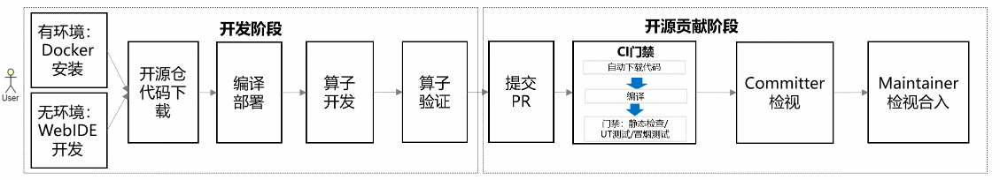

# Quick Start: Based on the ops-transformer Repository #

## Instructions for use ##

This guide is designed to help you get started quickly with CANN and`ops-transformer`The operator repository provides simplified software installation, compilation, and running guidance based on the WebIDE or Docker environment. Note that the WebIDE or Docker environment provides the latest version of CANN software package by default, which is CANN 8.5.0.

> **Note: If you manually install the CANN package or experience the latest capabilities of the master branch, you can skip the quick start and obtain detailed tutorials by referring to the following guide. This tutorial provides various operation methods in different scenarios to meet diverse service requirements.**
> 
> 1.  [Environment Deployment Guide](./docs/zh/context/quick_install.md)	\: provides guidance for setting up the environment in different scenarios, including Docker installation and manual installation of the CANN software package.
> 2.  [Compilation and Execution Operator Guide](./docs/zh/invocation/quick_op_invocation.md)	\: provides guidelines for compiling and verifying operator packages in different scenarios, for example, offline compilation. This guide provides an in-depth understanding of compilation parameters and invoking methods.
> 3.  [Operator Development Guide](./docs/zh/develop/aicore_develop_guide.md)	\: This section describes how to customize standard operator development guides, including creating operator projects and implementing Tiling and Kernel.
> 4.  [Commissioning and Optimization Guide](./docs/zh/debug/op_debug_prof.md)	\: Systematic debugging skills and performance optimization methods in different scenarios.

The following figure shows the basic process of operator development and contribution. You are welcome and encouraged to contribute operators in the community to enrich the project ecosystem.

	

To help you quickly understand the entire operator development process, the AddExample operator is used as the practice object. The source file is stored in`ops-transformer/examples/add_example`and perform the following steps:

1.  **[Environment installation](#1-environment-installation-either)**	\: Set up the operator development and running environment.
2.  **[Compilation and deployment](#2-compilation-and-deployment)**	\: Compile and install the custom operator package to quickly invoke operators.
3.  **[Operator development](#3-operator-development)**	\: Modify the existing operator kernel to experience the complete closed-loop development, compilation, and verification.
4.  **[Operator commissioning](#4-operator-commissioning)**	\: Have a good command of operator printing and performance collection methods.
5.  **[Operator Verification](#5-operator-verification)**	\: Learn how to modify the example operator example to verify the function correctness of the operator under different inputs.

## 1. Environment installation (either) ##

### 1. Environment-free scenario: WebIDE development ###

For users without any environment, you can directly use the WebIDE development platform, that is, the operator one-stop development platform. The platform provides an online Ascend environment that can run directly. The required software packages are installed in the environment and do not need to be manually installed. For more information about the development platform, see.[LINK](https://gitcode.com/org/cann/discussions/54)	.

1.  Go to the ops-transformer open source project and click`云开发`button to log in to the system using an authenticated HUAWEI CLOUD account. If you have not registered or authenticated, register and authenticate the user as prompted.
    
    
2.  Create and start the cloud development environment as prompted, and click`连接>WebIDE`Enter the one-stop operator development platform. By default, open source project resources are stored in the`/mnt/workspace`Under the directory.
    
    
3.  Check whether the environment is complete.
    
    In the terminal window of the cloud platform, run the following commands to check whether the environment and driver are normal:
    
     *  **Checking the NPU**
        
        Run the following command. If the driver information is displayed, the mounting is successful.
        
        ```
        npu-smi info
        ```
     *  **Check the CANN version.**
        
        Run the following command to check the version information about CANN Toolkit:
        
        ```
        cat /home/developer/Ascend/ascend-toolkit/latest/opp/version.info
        ```

### 2. Scenario with environment: Docker installation ###

#### Prerequisite ####

 *  **Docker environment: Atlas A2 (910B) is used as an example. In the environment, the Docker engine (version 1.11.2 or later) has been installed on the host machine.**
 *  **Driver and firmware: The Ascend NPU has been installed on the host machine.**[Driver and firmware](https://www.hiascend.com/hardware/firmware-drivers/community?product=1&model=30&cann=8.0.RC3.alpha002&driver=1.0.26.alpha)	Ascend HDK 24.1.0 or later. For details about the installation guide, see the[CANN Software Installation Guide](https://www.hiascend.com/document/detail/zh/CANNCommunityEdition/850alpha002/softwareinst/instg/instg_0005.html?Mode=PmIns&OS=openEuler&Software=cannToolKit)	".
    
    > **Note: Use the**`npu-smi info`Check the driver and firmware versions.

#### Downloading an Image ####

Pull the pre-integrated CANN software package and`ops-transformer`Specifies the image on which the depends.

1.  Log in to the host machine as the root user.
2.  Run the following command (select a value based on the host machine architecture):
    
     *  ARM architecture:
        
        ```
        docker pull --platform=arm64 swr.cn-south-1.myhuaweicloud.com/ascendhub/cann:8.5.0-910b-ubuntu22.04-py3.10-ops
        ```
     *  x86 architecture:
        
        ```
        docker pull --platform=amd64 swr.cn-south-1.myhuaweicloud.com/ascendhub/cann:8.5.0-910b-ubuntu22.04-py3.10-ops
        ```

> **Note: Under normal network speed, the image download takes about 5 to 10 minutes.**

#### Docker running ####

Run the following command to run Docker:

```
docker run --name cann_container --device /dev/davinci0 --device /dev/davinci_manager --device /dev/devmm_svm --device /dev/hisi_hdc -v /usr/local/dcmi:/usr/local/dcmi -v /usr/local/bin/npu-smi:/usr/local/bin/npu-smi -v /usr/local/Ascend/driver/lib64/:/usr/local/Ascend/driver/lib64/ -v /usr/local/Ascend/driver/version.info:/usr/local/Ascend/driver/version.info -v /etc/ascend_install.info:/etc/ascend_install.info -it swr.cn-south-1.myhuaweicloud.com/ascendhub/cann:8.5.0-910b-ubuntu22.04-py3.10-ops bash
```

The following table lists the parameters that you need to pay attention to:

| Parameters                                                           | Description                                                                                                                 | Precautions                                                                                                                                                                                                                                                                          |
| -------------------------------------------------------------------- | --------------------------------------------------------------------------------------------------------------------------- | ------------------------------------------------------------------------------------------------------------------------------------------------------------------------------------------------------------------------------------------------------------------------------------ |
| `--name cann_container`                                              | Specify a name for a container for easy management.                                                                         | Customizable.                                                                                                                                                                                                                                                                        |
| `--device /dev/davinci0`                                             | Core: Map the NPU device card of the host machine to the container. You can specify multiple NPU device cards to be mapped. | The following must be adjusted according to the actual situation:`davinci0`Corresponds to NPU card 0 in the system. Run the command on the host machine first.`npu-smi info`command, based on the device number displayed in the output (e.g.`NPU 0`,`NPU 1`) to modify this number. |
| `-v /usr/local/Ascend/driver/lib64/:/usr/local/Ascend/driver/lib64/` | Key mounting: Map the NPU driver library of the host machine to the container.                                              | -                                                                                                                                                                                                                                                                                    |

#### Check the environment. ####

After entering the container, check whether the environment and driver are normal.

 *  **Checking the NPU**
    
    Run the following command. If the driver information is displayed, the driver has been mounted successfully.
    
    ```
    npu-smi info
    ```
 *  **Check the CANN version.**
    
    Run the following command to check the version information about the CANN Toolkit:
    
    ```
    cat /usr/local/Ascend/ascend-toolkit/latest/opp/version.info
    ```

You already have an "out-of-the-box" operator development environment. Next, you need to verify the complete tool chain from the source code to the executable operators in this environment.

## 2. Compilation and deployment ##

This phase aims to quickly experience the standard project process and verify whether the environment can successfully compile, package, install, and run operator source code.

### 1. Obtain the project source code. ###

1.  Obtain the project source code.
    
    By default, the Docker or WebIDE environment provides the latest commercial source code. To obtain the source code of other versions, run the following command to download the source code. Replace $\{tag_version\} with the target branch tag name. For details about the mapping between branch tags and CANN versions, see.[Release warehouse](https://gitcode.com/cann/release-management)	.
    
    ```
    git clone -b ${tag_version} https://gitcode.com/cann/ops-transformer.git
    ```
    
    If"`fatal: destination path 'ops-transformer' already exists and is not an empty directory.`"The project source code already exists. To update the project code, run the following command:`git pull`Orders.
2.  Run the following command to go to the root directory of the project and distinguish Docker and WebIDE scenarios:
    
     *  Docker scenario:
        
        ```
        cd ops-transformer
        ```
     *  Web IDE scenario:
        
        ```
        cd /mnt/workspace/ops-transformer
        ```

### 2. Compile the AddExample operator. ###

Go to the root directory of the project and compile the specified operator. The common compilation command format is as follows:`bash build.sh --pkg --soc=<芯片版本> --ops=<算子名>`.

For example, run the following command to compile the AddExample operator:

```
bash build.sh --pkg --soc=ascend910b --ops=add_example -j16
```

If the following information is displayed, the compilation is successful:

```
Self-extractable archive "cann-ops-transformer-custom-linux.${arch}.run" successfully created.
```

After the compilation is successful, the run package is stored in the build_out directory of the project root directory.

### 3. Install the AddExample operator package. ###

```
./build_out/cann-ops-transformer-*linux*.run
```

`AddExample`Installed in`${ASCEND_HOME_PATH}/opp/vendors`In the path,`${ASCEND_HOME_PATH}`Indicates the installation directory of the CANN software.

### 4. Configure environment variables. ###

Add the path of the custom operator package to the environment variable to ensure that the path can be found during running.

```
export LD_LIBRARY_PATH=${ASCEND_HOME_PATH}/opp/vendors/custom_transformer/op_api/lib:${LD_LIBRARY_PATH}
```

### 5. Quick verification: Run the operator sample. ###

The common running command format is as follows:`bash build.sh --run_example <算子名> <运行模式> <包模式>`.

Take AddExample as an example. This section provides a simple operator example.`add_example/examples/test_aclnn_add_example.cpp`. Run this sample to verify the operator functions.

```
bash build.sh --run_example add_example eager cust --vendor_name=custom
```

Expected output: Print the operator.`AddExample`The addition result in indicates that the operator has been successfully deployed and executed.

```
add_example first input[0] is: 1.000000, second input[0] is: 1.000000, result[0] is: 2.000000
add_example first input[1] is: 1.000000, second input[1] is: 1.000000, result[1] is: 2.000000
add_example first input[2] is: 1.000000, second input[2] is: 1.000000, result[2] is: 2.000000
add_example first input[3] is: 1.000000, second input[3] is: 1.000000, result[3] is: 2.000000
add_example first input[4] is: 1.000000, second input[4] is: 1.000000, result[4] is: 2.000000
add_example first input[5] is: 1.000000, second input[5] is: 1.000000, result[5] is: 2.000000
add_example first input[6] is: 1.000000, second input[6] is: 1.000000, result[6] is: 2.000000
add_example first input[7] is: 1.000000, second input[7] is: 1.000000, result[7] is: 2.000000
...
```

## 3. Operator development ##

This phase attempts to modify the kernel function code for the AddExample operator that has been successfully executed.

### 1. The kernel implementation is modified. ###

Open the core kernel implementation file of the AddExample operator.`ops-transformer/examples/add_example/op_kernel/add_example.h`Change the Add operation in the operator to the Mul operation.

```
__aicore__ inline void AddExample<T>::Compute(int32_t progress)
{
    AscendC::LocalTensor<T> xLocal = inputQueueX.DeQue<T>();
    AscendC::LocalTensor<T> yLocal = inputQueueY.DeQue<T>();
    AscendC::LocalTensor<T> zLocal = outputQueueZ.AllocTensor<T>();
    //= = = Replace Add with Mul here ===
    //AscendC::Add(zLocal, xLocal, yLocal, tileLength_);
    AscendC::Mul(zLocal, xLocal, yLocal, tileLength_);
    outputQueueZ.EnQue<T>(zLocal);
    inputQueueX.FreeTensor(xLocal);
    inputQueueY.FreeTensor(yLocal);
}
```

### 2. Compilation and Verification ###

repeats[Compilation and deployment](#2-compilation-and-deployment)	Steps 2 through 5 in the section:

1.  **Recompiling: Go back to the root directory of the project and run the following compilation command:**
    
    ```
    bash build.sh --pkg --soc=ascend910b --ops=add_example -j16
    ```
2.  **Reinstall:**
    
    ```
    ./build_out/cann-ops-transformer-*linux*.run
    ```
3.  **Revalidation:**
    
    ```
    bash build.sh --run_example add_example eager cust --vendor_name=custom
    ```
4.  **Success flag: The output result becomes the multiplication result.**
    
    ```
    add_example first input[0] is: 1.000000, second input[0] is: 1.000000, result[0] is: 1.000000
    add_example first input[1] is: 1.000000, second input[1] is: 1.000000, result[1] is: 1.000000
    add_example first input[2] is: 1.000000, second input[2] is: 1.000000, result[2] is: 1.000000
    add_example first input[3] is: 1.000000, second input[3] is: 1.000000, result[3] is: 1.000000
    add_example first input[4] is: 1.000000, second input[4] is: 1.000000, result[4] is: 1.000000
    add_example first input[5] is: 1.000000, second input[5] is: 1.000000, result[5] is: 1.000000
    add_example first input[6] is: 1.000000, second input[6] is: 1.000000, result[6] is: 1.000000
    add_example first input[7] is: 1.000000, second input[7] is: 1.000000, result[7] is: 1.000000
    ...
    ```

## 4. Operator commissioning ##

In this phase, AddExample is used as an example to describe how to print and collect operator performance data for subsequent fault analysis and location.

### 1. Print ###

If the operator fails to be executed or the precision is abnormal, print information for fault analysis and location.

Please, please, at`examples/add_example/op_kernel/add_example.h`Modify the code in.

 *  **printf**
    
    This interface can print Scalar data, such as integer, character, and Boolean data. For details, see.[Ascend C API](https://hiascend.com/document/redirect/CannCommunityAscendCApi)	Operator Commissioning API > printf in.
    
    ```
    blockLength_ = (tilingData->totalLength + AscendC::GetBlockNum() - 1) / AscendC::GetBlockNum();
    tileNum_ = tilingData->tileNum;
    tileLength_ = ((blockLength_ + tileNum_ - 1) / tileNum_ / BUFFER_NUM) ?
          ((blockLength_ + tileNum_ - 1) / tileNum_ / BUFFER_NUM) : 1;
    //Displays the block length calculated by the current core.
    AscendC::PRINTF("Tiling blockLength is %llu\n", blockLength_);
    ```
 *  **DumpTensor**
    
    This API supports dump and specifying the content of a Tensor and printing customized additional information, such as the current line number. For details, see.[Ascend C API](https://hiascend.com/document/redirect/CannCommunityAscendCApi)	Operator Commissioning API > DumpTensor in.
    
    ```
    AscendC::LocalTensor<T> zLocal = outputQueueZ.DeQue<T>();
    //Print zLocal Tensor information.
    DumpTensor(zLocal, 0, 128);
    ```

### 2. Performance data collection ###

If the operator function is verified correctly, you can`msprof`The tool collects operator performance data.

 *  **Generate executable file**
    
    Invoke the example example of the AddExample operator to generate the executable file test_aclnn_add_example. This file is stored in the project.`ops-transformer/build`The catalog.
    
    ```
    bash build.sh --run_example add_example eager cust --vendor_name=custom
    ```
 *  **Collecting Performance Data**
    
    Go to the directory for storing the executable file of the AddExample operator.`ops-transformer/build/`. Run the following command:
    
    ```
    msprof --application="./test_aclnn_add_example"
    ```

The collection result is displayed in the project.`ops-transformer/build/`Directory. After the msprof command is executed, performance data result files are automatically parsed and exported. For details, see.[msprof](https://www.hiascend.com/document/detail/zh/mindstudio/82RC1/T&ITools/Profiling/atlasprofiling_16_0110.html#ZH-CN_TOPIC_0000002504160251)	.

## 5. Operator verification ##

In this phase, the input data in the example example of the AddExample operator is modified to verify the function correctness of the operator in multiple scenarios.

### 1. Modify the test input. ###

Find and Edit`AddExample`of the`ops-transformer/examples/add_example/examples/test_aclnn_add_example.cpp`to modify the shape and value of the input tensor.

**Modify input/output data: Modify the input and output shape information, initialize data, and construct the corresponding input and output tensors.**

```
int main() {
    //... initialization code...
    
    //= = = 1 Modify the input of selfX = = =
    //Before the modification: shape = {32, 4, 4, 4}, all values are 1.
    //After the modification: Change the input shape to {8, 8, 8, 8} and fill in different test data.
    std::vector<int64_t> selfXShape = {8, 8, 8, 8};
    std::vector<float> selfXHostData(4096); //4096 = 8 * 8 * 8 * 8
    //You can use loops to populate more discerning data, such as ascending sequences.
    for (int i = 0; i < 4096; ++i) {
        selfXHostData[i] = static_cast<float>(i % 10); //Fill the cyclic value of 0 - 9
    }
    //= = = 2 Refer to selfX. Modify the input of selfY and selfZ in the same way. = = =
    
    //...follow-up code...
}
```

### 2. Recompile and verify. ###

1.  Only the example test code is modified. Therefore, the operator package does not need to be recompiled.
2.  Run the following command again:
    
    ```
    bash build.sh --run_example add_example eager cust --vendor_name=custom
    ```
3.  Check whether the operator output meets the expectation.

## 6. Development Contribution ##

After experiencing the preceding operations, you have basically completed the development of an operator. You can contribute the operator to this project.`experimental`Directory. For the contribution process, see.[Contribution Guide](CONTRIBUTING.md)	. If you have any questions, please contact the customer through the Issue method.

