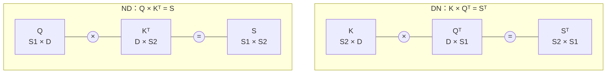
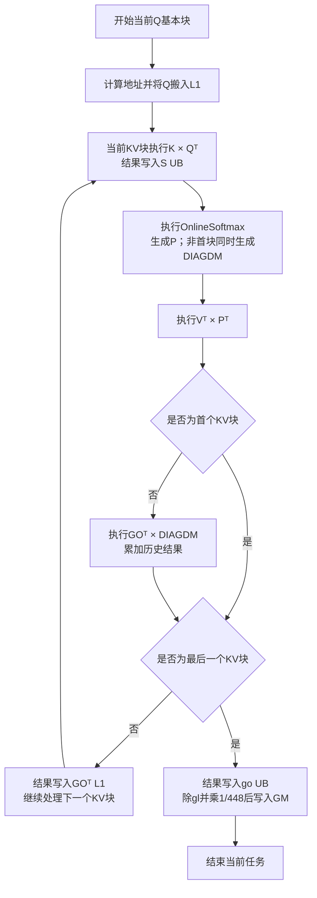
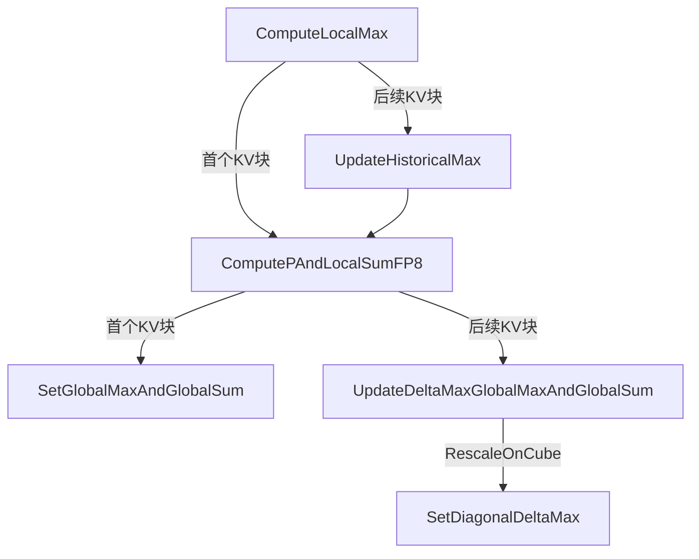
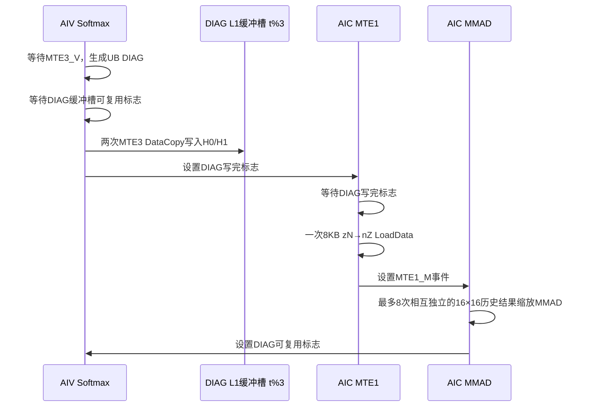

# BlockSparseAttentionV2 FP8 DN + RescaleOnCube 设计说明

> 文档状态：基于源码的实现说明，不代表当前环境已完成设备侧精度或性能验证。
> 代码基线：`79aa0fc8fc7e6b312a0778c3f086ef0a03b8276d`（分支 `uninstall-rescale-o`）。
> 目标平台：Ascend 950PR/950DT，Atlas A5（arch35）。
> 目标路径：FP8 E4M3FN 输入、FP16/BF16 输出、`innerPrecise=4`、`transposedMm1=true`、`rescaleOnCube=true`。
> 规格来源：仓库内 [`aclnnBlockSparseAttentionV2.md`](./aclnnBlockSparseAttentionV2.md)；上游参考为[官方 GitCode 文档](https://gitcode.com/cann/ops-transformer/blob/master/attention/block_sparse_attention/docs/aclnnBlockSparseAttentionV2.md)。

## 1. 文档范围与结论

本文描述 `BlockSparseAttentionV2` 在 Atlas A5 上的 FP8 DN + RescaleOnCube 最终实现，重点回答以下问题：

1. `aclnnBlockSparseAttentionV2GetWorkspaceSize` 的接口参数和约束是什么；
2. FP8、DN、512 KV基块和RescaleOnCube如何只作用于目标执行路径，而不影响其他路径；
3. `K×Qᵀ`、online softmax、`Vᵀ×Pᵀ`、`GOᵀ×DIAGDM` 如何组成完整流水；
4. 为什么对角系数不是单纯的 `dm`，而是 `dm × vScalePrev / vScaleCurr`；
5. 为什么 DIAGDM 在 L1 中是三份 `zN[128,16]`，总计 24KB，而不是两个完整 `64×64` 矩阵乘三份；
6. 为什么 L1→L0B 必须把源解释为 `zN[128,16]`，而 `zN[16,128]` 会产生错误结果；
7. D=128、KV基块512时，L1和UB的最大内存规划是什么。

核心结果如下：

- QK的FP32 FixPipe系数为`qScale × kScale × scaleValue`，FP8 low-prec softmax直接使用已经完成缩放的S；
- DN相对ND的主要性能优势是：OnlineSoftmax不再依赖只能单发射的`ReduceMax/ReduceSum`，而是使用支持双发射的多路`Max`和`Sum`形式，提高Vector指令发射效率；当前源码中的Sum由多路`Add`累加实现；
- softmax将P乘448后量化为FP8，最终输出阶段再乘 `1/448`；
- 中间结果暂不乘V反量化scale，并按当前V scale对应的数值形式保存，递推使用
  `diag = dm × vScalePrev / vScaleCurr`；
- RescaleOnCube把每个非首KV块的历史结果缩放与累加从Vector移到CUBE，使Vector只保留最终归一化；KV基本块从256扩大到512后，按KV块重复执行的softmax状态更新、DIAG处理和中间GOᵀ读写次数进一步减少；
- DIAGDM只保存每个group中的四个有效`16×16`对角块，每个L1缓冲槽为8KB，三个缓冲槽共24KB；
- 每个DIAG L1缓冲槽通过一次已有的float `zN→nZ` LoadData搬到L0B，MMAD仍按最多八个`16×16`对角块执行，不增加零块计算；
- FP8路径的`kvBaseTile`扩大到512，但QK的K L1 tile仍为256，因此QK存在两次L1循环；PV的P/V L1 tile直接覆盖512，不需要额外L1外层循环。

## 2. 算子IR与接口规格

### 2.1 两段式接口

算子先通过第一段接口完成参数校验、workspace计算和执行器构造，再通过第二段接口执行：

```cpp
aclnnStatus aclnnBlockSparseAttentionV2GetWorkspaceSize(
    const aclTensor   *query,
    const aclTensor   *key,
    const aclTensor   *value,
    const aclTensor   *blockSparseMaskOptional,
    const aclTensor   *attenMaskOptional,
    const aclIntArray *blockShapeOptional,
    const aclIntArray *actualSeqLengthsOptional,
    const aclIntArray *actualSeqLengthsKvOptional,
    const aclTensor   *blockTableOptional,
    const aclTensor   *qDequantScale,
    const aclTensor   *kDequantScale,
    const aclTensor   *vDequantScale,
    char              *qInputLayout,
    char              *kvInputLayout,
    int64_t            numKeyValueHeads,
    int64_t            maskType,
    double             scaleValue,
    int64_t            innerPrecise,
    int64_t            blockSize,
    int64_t            preTokens,
    int64_t            nextTokens,
    int64_t            softmaxLseFlag,
    aclTensor         *attentionOut,
    aclTensor         *softmaxLseOptional,
    uint64_t          *workspaceSize,
    aclOpExecutor    **executor);

aclnnStatus aclnnBlockSparseAttentionV2(
    void          *workspace,
    uint64_t       workspaceSize,
    aclOpExecutor *executor,
    aclrtStream    stream);
```

参数表使用`qDequantScaleOptional/kDequantScaleOptional/vDequantScaleOptional`描述可选语义，而函数原型使用不带`Optional`后缀的变量名；两者指向同一组输入。

### 2.2 输入Tensor和数组参数

| 参数名 | I/O | 描述与使用条件 | 数据类型 | 格式 | shape/rank | 非连续Tensor |
|---|---|---|---|---|---|---|
| `query` | 输入 | 公式中的Q | FLOAT16、BFLOAT16、FLOAT8_E4M3FN | ND | TND：`[totalQTokens, headNum, headDim]`；BNSD：`[batch, headNum, maxQSeqLength, headDim]`；BSND：`[batch, maxQSeqLength, headNum, headDim]`；rank 3/4 | 不支持 |
| `key` | 输入 | 公式中的K | FLOAT16、BFLOAT16、FLOAT8_E4M3FN | ND | TND：`[totalKTokens, numKeyValueHeads, headDim]`；BNSD：`[batch, numKeyValueHeads, maxKvSeqLength, headDim]`；BSND：`[batch, maxKvSeqLength, numKeyValueHeads, headDim]`；rank 3/4 | 不支持 |
| `value` | 输入 | 公式中的V | FLOAT16、BFLOAT16、FLOAT8_E4M3FN | ND | TND：`[totalVTokens, numKeyValueHeads, headDim]`；BNSD：`[batch, numKeyValueHeads, maxKvSeqLength, headDim]`；BSND：`[batch, maxKvSeqLength, numKeyValueHeads, headDim]`；rank 3/4 | 不支持 |
| `blockSparseMaskOptional` | 输入 | 稀疏pattern；值1表示计算该block，值0表示跳过。参数说明称nullptr可表示稠密，但当前约束要求必须传入 | INT8 | ND | `[batch, headNum, ceilDiv(maxQSeqLength, blockShapeX), ceilDiv(maxKvSeqLength, blockShapeY)]`，rank 4 | 不支持 |
| `attenMaskOptional` | 输入 | attention mask；当前不支持，必须传nullptr | INT8 | ND | rank 2 | 不支持 |
| `blockShapeOptional` | 输入 | 稀疏块尺寸`[blockShapeX, blockShapeY]`。X、Y均大于0，Y为128的倍数。通用说明允许缺省为`[128,128]`，FP8约束要求传入 | INT64 | aclIntArray | rank 1，至少两个元素 | 不适用 |
| `actualSeqLengthsOptional` | 输入 | 每个batch的Q实际长度；TND必传；BNSD/BSND缺省时使用Q shape中的S | INT64 | aclIntArray | rank 1 | 不适用 |
| `actualSeqLengthsKvOptional` | 输入 | 每个batch的K/V实际长度；TND必传；BNSD/BSND缺省时使用K/V shape中的S | INT64 | aclIntArray | rank 1 | 不适用 |
| `blockTableOptional` | 输入 | PagedAttention block table；当前不支持，必须传nullptr | INT32 | ND | rank 2 | 不支持 |
| `qDequantScaleOptional` | 输入 | FP8时必传；FP16/BF16时必须为nullptr | FLOAT32 | ND | `[batch, headNum, ceilDiv(maxQSeqLength,128), 1]`，rank 4 | 不支持 |
| `kDequantScaleOptional` | 输入 | FP8时必传；FP16/BF16时必须为nullptr | FLOAT32 | ND | `[batch, kvHeadNum, ceilDiv(maxKvSeqLength,256),1]`或`[batch,kvHeadNum,ceilDiv(maxKvSeqLength,512),1]`，rank 4 | 不支持 |
| `vDequantScaleOptional` | 输入 | FP8时必传；FP16/BF16时必须为nullptr；shape必须与K scale一致 | FLOAT32 | ND | `[batch, kvHeadNum, ceilDiv(maxKvSeqLength,256),1]`或`[batch,kvHeadNum,ceilDiv(maxKvSeqLength,512),1]`，rank 4 | 不支持 |

三种layout的shape可统一记为：

```text
TND:
  Q   [Tq, N1, D]
  K/V [Tkv, N2, D]

BNSD:
  Q   [B, N1, S1, D]
  K/V [B, N2, S2, D]

BSND:
  Q   [B, S1, N1, D]
  K/V [B, S2, N2, D]
```

### 2.3 属性和标量参数

| 参数名 | I/O | 类型 | 语义与允许值 | 目标FP8路径 |
|---|---|---|---|---|
| `qInputLayout` | 输入 | String | `TND`、`BNSD`或`BSND` | 必须与`kvInputLayout`一致 |
| `kvInputLayout` | 输入 | String | `TND`、`BNSD`或`BSND` | 必须与`qInputLayout`一致 |
| `numKeyValueHeads` | 输入 | INT64 | K/V的head数N2 | N1≥N2且N1能被N2整除 |
| `maskType` | 输入 | INT64 | 当前仅支持0，表示不叠加attention mask | 固定0 |
| `scaleValue` | 输入 | DOUBLE | attention score缩放系数，通常为`D^-0.5` | 被折叠进QK FixPipe |
| `innerPrecise` | 输入 | INT64 | 通用定义允许0/1/4；950PR/DT仅支持4 | 固定4，softmax用FP16/BF16，rescale用FP32 |
| `blockSize` | 输入 | INT64 | PagedAttention block大小；当前不支持PA | 固定0 |
| `preTokens` | 输入 | INT64 | 滑窗向前范围；当前不支持滑窗 | 固定2147483647 |
| `nextTokens` | 输入 | INT64 | 滑窗向后范围；当前不支持滑窗 | 固定2147483647 |
| `softmaxLseFlag` | 输入 | INT64 | 0不输出LSE，1输出LSE且可能有性能损失 | 0或1 |

### 2.4 输出和执行参数

| 参数名 | I/O | 描述 | 数据类型/格式 | shape | 非连续Tensor |
|---|---|---|---|---|---|
| `attentionOut` | 输出 | attention结果。shape与Q一致；虽然原参数描述写“类型和shape与query一致”，数据类型表明确输出只支持FP16/BF16，因此FP8输入并不产生FP8输出 | FLOAT16或BFLOAT16，ND | 与query相同，rank 3/4 | 支持 |
| `softmaxLseOptional` | 输出 | 每个Q位置的log-sum-exp | FLOAT32，ND | TND：`[totalQTokens,headNum,1]`；BNSD：`[batch,headNum,maxQSeqLength,1]`；BSND：`[batch,maxQSeqLength,headNum,1]` | 支持 |
| `workspaceSize` | 输出 | Device侧workspace字节数 | `uint64_t*` | 标量 | 不适用 |
| `executor` | 输出 | 包含算子执行流程的执行器 | `aclOpExecutor**` | 指针 | 不适用 |

### 2.5 通用约束

| 类别 | 约束 |
|---|---|
| 确定性 | 接口默认使用确定性实现 |
| 软件版本 | 与PyTorch配合时，CANN相关包和PyTorch相关包必须版本匹配 |
| layout | Q和KV仅支持TND/BNSD/BSND，且二者必须一致 |
| Q/K/V类型 | 三者数据类型必须一致；基础路径支持FP16/BF16，FP8由附加约束扩展 |
| D | `headDim`仅支持64或128 |
| GQA/MQA | `N1 >= N2 && N1 % N2 == 0` |
| block shape | 传入时至少有两个正整数；Y方向为128的倍数 |
| 稀疏mask | 当前版本必须传入，且shape严格匹配Q/KV的向上取整block数 |
| sequence length | qS和kvS无需被block shape整除，尾块通过`ceilDiv`产生 |
| actual sequence | TND下两组actual sequence length必传；两组参数必须同时配置或同时不配置 |
| attention mask | 必须为nullptr |
| PagedAttention | `blockTableOptional=nullptr`且`blockSize=0` |
| 滑窗 | `preTokens=nextTokens=2147483647` |
| 精度 | 目标950路径`innerPrecise=4` |
| LSE | `softmaxLseFlag`只能为0或1 |

### 2.6 FP8附加约束

| 对象 | 约束 |
|---|---|
| 产品 | 仅Ascend 950PR/950DT支持该FP8接口路径 |
| Q/K/V | 任一输入为FLOAT8_E4M3FN时，三者必须全部为FLOAT8_E4M3FN |
| scale存在性 | FP8输入必须同时提供q/k/v dequant scale；非FP8输入三者必须全部为nullptr |
| scale类型 | 三种scale均为FLOAT32 |
| Q量化块 | 固定128，对应Q scale第三维`ceilDiv(S1,128)` |
| KV量化块 | 支持256或512；K/V scale形状和量化块必须一致 |
| block shape | FP8场景必须传入，Q和KV量化块应分别对应`blockShapeX`和`blockShapeY` |

### 2.7 API、host校验与目标内核前提的映射

| 项目 | API规格 | 当前host实现 | 本文目标路径 |
|---|---|---|---|
| Q/K/V类型 | FP16、BF16、FP8 E4M3FN | 对FP8执行专用scale和block shape校验 | Q/K/V全部FP8 E4M3FN |
| 输出类型 | FP16/BF16 | 由tiling key选择half或BF16输出实例 | FP16或BF16 |
| `innerPrecise` | 通用0/1/4；950只支持4 | 950路径按4选择low-high mixed | 固定4 |
| D | 64或128 | 按对齐后的D选择L1 tiling | 64/128；D=128用于最大内存分析 |
| Q量化块 | 128 | FP8要求`blockShapeX==128` | 128 |
| KV量化块 | 256或512 | FP8仅校验`blockShapeY`为256的倍数 | 采用512；验证用例应把scale/blockShapeY与512粒度配套 |
| KV基本块 | 不属于公开API | `CalcBaseTileTilingParams950()`在FP8、innerPrecise=4、D≤128时选512 | 512 |
| 稀疏块Y | 通用为128倍数；FP8量化块需匹配 | 当前额外校验256倍数，尚未强制等于512 | 目标性能路径按512边界组织输入 |
| block sparse mask | 参数描述提到nullptr可退化为稠密 | `CheckSparsePattern()`要求存在并检查rank/shape | 必传；稠密等价测试可把mask全部置1 |
| K/V scale shape | `/256`或`/512` | 第三维按解析出的KV block数校验 | 使用512粒度 |

这里必须区分“host暂时接受”与“目标优化内核已经验证的工程前提”。例如host允许`blockShapeY`为任意256倍数，并不等价于512基本块路径已经对所有这些组合完成设备验证。

## 3. 数学模型与缩放关系

### 3.1 分块attention和online softmax

对某个Q行，在第`t`个有效KV基本块上，先计算已经包含attention scale的score：

```text
S_t = (Q · K_t^T) × qScale × kScale_t × scaleValue
```

当前实现实际在转置空间计算`S_t^T = K_t × Q^T`，但数值等价。设上一轮全局最大值、指数和分别为`m_(t-1)`和`l_(t-1)`，本轮为：

```text
localMax_t = max(S_t)
m_t        = max(m_(t-1), localMax_t)
dm_t       = exp(m_(t-1) - m_t)
P_t        = exp(S_t - m_t)
l_t        = l_(t-1) × dm_t + sum(P_t)
```

未归一化输出的递推是：

```text
H_t = H_(t-1) × dm_t + P_t · V_t
O   = H_last / l_last
```

代码中的对应状态为：

| 数学量 | 代码/缓冲名 | 说明 |
|---|---|---|
| `localMax_t` | `lm` | 当前KV块局部最大值 |
| `m_t` | `gm` | 历史全局最大值 |
| `sum(P_t)` | `ll` | 当前块局部指数和 |
| `l_t` | `gl` | 历史全局指数和 |
| `dm_t` | `dm` | 全局最大值变化后，历史指数结果需要乘的缩放系数 |
| `H_t`/中间转置结果 | `GO^T` | 在L1中跨KV tile保存 |

### 3.2 scaleValue折叠到QK FixPipe

修改前，QK FixPipe只做`qScale×kScale`反量化，softmax Vector循环还要逐行乘`scaleValue`。当前目标路径改为：

```cpp
float combinedDeqScalar = qDequantScaleValue * kDequantScaleValue;
if constexpr (RESCALE_ON_CUBE) {
    combinedDeqScalar *= scaleValue_;
}
```

因此S进入UB时已经完成：

```text
int/FP32 accumulator × qScale × kScale × scaleValue
```

FP8 low-prec S_trans中的`ComputeLocalMax()`不再重复乘scale，`ComputePAndLocalSumFP8()`也不再接收`scaleValue`参数。非FP8路径仍保留原来的Vector scale逻辑；`FULL_QUANT_FP8`编译期分支保证这项修改只作用于FP8路径。

### 3.3 P乘448与最终除448

E4M3FN的最大有限值为448。softmax概率位于`[0,1]`，直接量化会浪费FP8动态范围，因此代码先计算：

```text
P_fp8 = cast_fp8(448 × exp(S - m))
```

PV的CUBE累加于是包含额外的448倍：

```text
A_t = V_fp8_t^T × P_fp8_t^T
```

最后的`GoDivFunc()`在除以`gl`后，对FP8路径再乘：

```text
MAX_VALUE_RECIPROCAL_FP8 = 1 / 448
```

这与P侧的`×448`成对出现。448不能简单折叠进QK FixPipe，因为QK FixPipe作用于softmax之前的score，`exp(448S)`与`448exp(S)`并不等价。

### 3.4 RescaleOnCube的转置公式

将输出递推转置：

```text
H_t^T = H_(t-1)^T × diag(dm_t) + V_t^T × P_t^T
```

这使两个项都能在同一个`[D,qS]` L0C累加器中完成：

```text
C_init = V^T [D,kvS] × P^T [kvS,qS]
C      = C_init + GO_prev^T [D,qS] × DIAGDM [qS,qS]
```

物理计算不构造完整`qS×qS`矩阵，而只执行DIAGDM中非零的`16×16`对角块。

### 3.5 为什么对角系数是dm × vScalePrev / vScaleCurr

中间块的L0C→L1使用CO1→C1 `DataCopy`。该通路保持FP32 NZ布局并执行channel split，但不乘V反量化scale。因此，`GO^T`在L1中保存的是尚未乘V scale的中间结果。

设`R_t`是第`t`块计算后保存在L1中、尚未乘V scale的转置结果，`v_t`是该块的V dequant scale。代码实现的递推为：

```text
R_0 = A_0

R_t = R_(t-1) × diag(dm_t × v_(t-1) / v_t) + A_t
```

两边乘当前scale `v_t`：

```text
R_t × v_t
= R_(t-1) × dm_t × v_(t-1) + A_t × v_t
```

这样，历史结果和当前块结果就处于相同的反量化数值尺度。由归纳可知，最后一块完成后：

```text
R_last × v_last
= Σ_t [A_t × v_t × 后续dm链]
```

因此实现必须生成：

```text
DIAGDM_t = diag(dm_t × vScalePrev / vScaleCurr)
```

而不能只写`diag(dm_t)`或`diag(dm_t/vScaleCurr)`。最后一块通过FixPipe乘当前`vScaleCurr`，把FP32中间结果恢复到V的实际数值尺度；Vector端再除`gl`和448：

```text
O = R_last × vScaleLast / gl / 448
```

如果所有V scale都为1，上式自然退化为普通`diag(dm)`。

### 3.6 DN相对ND的性能优势

DN和ND的数学结果相同，主要区别是S在UB中的组织方向以及OnlineSoftmax采用的归约方式。下面以half low-prec实现说明；BF16的ND和S_trans实现采用相同的指令组织思路。



ND路径沿一个Q行的KV方向直接归约，low-prec实现使用：

```text
ReduceMax：计算当前行最大值
ReduceSum：计算当前行指数和
```

在目标Vector流水线上，`ReduceMax`和`ReduceSum`只能单发射。当前归约指令执行期间，无法用同类独立计算形成双发射，因此它们容易成为OnlineSoftmax的串行瓶颈。

DN路径先在CUBE上计算：

```text
Sᵀ = K × Qᵀ
```

FixPipe按照S_trans实现所需的布局把结果写入S UB。OnlineSoftmax随后把同一Q位置对应的数据分成多路寄存器计算：

- 局部最大值使用多路`Max`，最后再用树状`Max`合并；
- 局部指数和使用多路`Sum`形式：先在多路寄存器中逐元素累加，最后合并各路部分和。当前代码通过多路`Add`实现该过程，并不存在单独的`Sum()`函数调用；
- 不同寄存器之间没有数据依赖，`Max`和`Sum`形式的运算可以利用Vector的双发射能力。

因此，DN的收益不是减少softmax的数学运算量，而是把只能单发射的归约指令改写为可双发射的普通Vector运算，提高Vector指令发射利用率，缩短local max和local sum阶段。KV基本块越宽，归约在OnlineSoftmax中的占比通常越高，这项优化越重要。

| 对比项 | ND | DN |
|---|---|---|
| QK结果方向 | `S = Q × Kᵀ` | `Sᵀ = K × Qᵀ` |
| local max | `ReduceMax` | 多路`Max`后合并 |
| local sum | `ReduceSum` | 多路`Sum`，由`Add`逐元素累加后合并 |
| Vector发射特点 | 归约指令只能单发射 | 独立`Max`和求和操作支持双发射 |
| 主要收益位置 | — | OnlineSoftmax的max/sum阶段 |

DN也带来更复杂的S/P布局和FP8 P排布过程，因此最终收益仍需结合整个OnlineSoftmax阶段测量，不能只比较单条归约指令。

### 3.7 RescaleOnCube的性能优势

非RescaleOnCube路径在每个非首KV块都由Vector逐元素执行：

```text
go = go × dm + lo
```

这会让历史结果缩放、加法以及相关UB读写持续占用Vector流水。RescaleOnCube将同一计算改写为：

```text
GO_newᵀ = Vᵀ × Pᵀ + GO_prevᵀ × DIAGDM
```

并在CUBE的L0C中完成累加。其性能收益主要来自以下方面：

1. **减少Vector计算。** Vector不再对每个非首KV块执行逐元素`go × dm + lo`，最后一个KV块完成后只需执行`÷gl`、`×1/448`和输出Cast。
2. **改善AIC与AIV的负载分配。** 历史结果缩放从较繁忙的Vector流水转移到CUBE，并可通过`PRE_LAUNCH=2`与其他KV块的QK/OnlineSoftmax重叠执行。
3. **减少Vector侧中间数据读写。** 中间结果以`GOᵀ`保存在L1，由下一KV块直接搬到L0A，不再由Vector读取`lo`并逐元素合并。
4. **只计算DIAGDM中的有效部分。** qS=128时执行8次`D×16`乘`16×16`的MMAD，而不是补零后执行完整`D×128`乘`128×128`；D=128时，当前计算量只有完整矩阵方案的1/8。
5. **压缩DIAGDM搬运。** 每个DIAG L1缓冲槽从两个完整`64×64`矩阵的32KB压缩到8KB，并通过一次LoadData搬到L0B，降低L1占用和LoadData调用开销。

这项优化并非没有代价：它增加了`GOᵀ`的L1写入/读取、DIAGDM生成与搬运，以及最多8次FP32 MMAD。其核心目的不是让总算术操作绝对最少，而是把工作从Vector瓶颈转移到CUBE，并控制新增的CUBE计算和数据搬运。

#### 3.7.1 KV基本块从256扩大到512

在RescaleOnCube路径中，KV基本块从256扩大到512后，一次OnlineSoftmax和一次PV可以覆盖两倍的KV行数。对于相同kvS，外层KV块数量从：

```text
ceilDiv(kvS, 256)
```

降低为：

```text
ceilDiv(kvS, 512)
```

这不会减少QK和PV针对每个KV元素的主要MMAD计算量，但会减少按KV块重复发生的操作：

- OnlineSoftmax合并历史`gm/gl/dm`状态的次数；
- P和DIAG缓冲区的同步次数；
- DIAGDM的生成、L1写入和L1→L0B搬运次数；
- 中间`GOᵀ`写入L1并在下一KV块读取的次数；
- `GOᵀ × DIAGDM`历史结果缩放的执行次数；
- 外层循环、地址计算和同步标志处理开销。

例如kvS=1024且所有KV块都参与计算时：

| 项目 | KV基本块256 | KV基本块512 |
|---|---:|---:|
| 外层KV块数 | 4 | 2 |
| 中间`GOᵀ`写入L1次数 | 3 | 1 |
| 历史结果缩放次数 | 3 | 1 |
| QK的256行K L1处理次数 | 4 | 4 |

最后一行说明：K的单份L1 tile仍是256行，所以512基本块内部需要两次K L1循环；QK处理的K数据总量没有减少。性能提升来自外层KV块数量减少，而不是少算一半QK或PV。

512基本块的代价是更高的片上内存占用：S/P UB扩大一倍，P L1三缓冲扩大到192KB，V L1双缓冲扩大到128KB。D=128时L1总占用为488KB，UB规划到249,888B，因此该优化以更紧张的L1和UB空间换取更少的跨KV块处理开销。上述收益来自指令和数据通路分析，具体cycles提升仍需通过设备性能采样确认。

## 4. 目标tiling与任务划分

### 4.1 基本配置

```text
平台               Atlas A5 / arch35
输入               FP8 E4M3FN
输出               FP16或BF16
innerPrecise        4
transposedMm1       true
rescaleOnCube       true
qBaseTile           min(blockShapeX, 128)，FP8约束下为128
kvBaseTile          512
D                   64或128
PRE_LAUNCH          2
P L1 buffer数       3
V L1 buffer数       2
DIAG L1缓冲槽数     3
```

`CalcBaseTileTilingParams950()`只在`dataType=FP8 && innerPrecise=4 && D<=128`时把`kvBaseTile`设为512。非量化FP16/BF16 mixed路径仍为256，其他路径仍为128。

### 4.2 D=128的L1 tile参数

| 阶段 | 参数 | 值 | 物理含义 |
|---|---|---|---|
| QK | `mm1L1TileM` | 128 | Q方向基本块 |
| QK | `mm1L1TileN` | 256 | 每份K的序列方向容量 |
| QK | `mm1L1TileKLeft/Right` | 128/128 | D方向 |
| QK | `qL1BufNum/kL1BufNum` | 1/2 | Q保留一份，K使用双缓冲 |
| PV | `mm2L1TileM` | 128 | P的Q方向 |
| PV | `mm2L1TileN` | 128 | V的D方向 |
| PV | `mm2L1TileKLeft/Right` | 512/512 | P/V都覆盖完整KV基本块 |
| PV | `pL1BufNum/vL1BufNum` | 3/2 | P三缓冲、V双缓冲 |

### 4.3 为什么QK有两次L1循环而PV没有

QK中K的单份L1 tile只有`256×D`，而当前KV基本块为512，所以：

```text
mL1LoopNumAct  = ceilDiv(kSTile, 256)
mL1LoopNumBase = ceilDiv(512, 256) = 2
```

满块依次搬K的`[0,256)`和`[256,512)`；尾KV块只执行实际需要的循环。PV中V和P的单份L1 tile已经直接扩大到512，故最外层L0循环可以直接在同一个L1父Tensor上按K=128切四次，不需要新增PV的L1循环。

### 4.4 QK尾块计数器与UB坐标

QK同时维护“实际循环次数”和“按完整基本块计算的固定编号步长”：

```cpp
mL1LoopNumAct       = CeilDiv(kSTile, l1ATileM);
mL1LoopNumBase      = CeilDiv(kvSBaseTile, l1ATileM);
mL0LoopNumPerL1Tile = CeilDiv(l1ATileM, L0_TILE_M);
mL0LoopNumBase      = CeilDiv(kvSBaseTile, L0_TILE_M);
```

- `Act`控制尾块实际执行次数；
- `Base`用于计算不同KV基本块之间的固定缓冲编号步长，避免尾块较短时改变后续缓冲编号；
- 第二个K L1块的FixPipe结果必须写入S UB的全局行偏移：

```text
mGlobalOffset = mL1Itr × l1ATileM + mL0Itr × L0_TILE_M
```

- 等待S UB可重新写入的跨核同步只在整个512基本块第一次写S UB之前执行：

```cpp
if (mL1Itr == 0 && mL0Itr == 0) {
    WaitCrossCoreSync<4, PIPE_FIX>(mm1ToSmFlag);
}
```

缺少`mL1Itr`会让第二个256行K块覆盖S UB的前256行，或让尾块改变后续ping-pong计数。

## 5. D=128的片上内存规划

以下均按最大配置`qBaseTile=128、kvBaseTile=512、D=128`计算，1KB=1024B。

### 5.1 L1：488KB / 512KB

| 区域 | 字节区间 | 单份shape与类型 | buffer数 | 总大小 |
|---|---:|---|---:|---:|
| Q | `[0, 16KB)` | `128×128` FP8 | 1 | 16KB |
| K | `[16KB, 80KB)` | `256×128` FP8 | 2 | 64KB |
| P | `[80KB, 272KB)` | `128×512` FP8 | 3 | 192KB |
| V | `[272KB, 400KB)` | `512×128` FP8 | 2 | 128KB |
| GOᵀ | `[400KB, 464KB)` | `128×128` FP32 | 1 | 64KB |
| DIAGDM | `[464KB, 488KB)` | `zN[128,16]` FP32 | 3 | 24KB |
| 剩余 | `[488KB, 512KB)` | — | — | 24KB |

对应字节偏移为：

```text
Q        0
K        16,384
P        81,920
V        278,528
GO^T     409,600
DIAGDM   475,136
END      499,712
```

L1起始地址由以下关系累计：

```text
mm2L1AddrStart = Q总大小 + K总大小
l1GoAddrStart  = mm2L1AddrStart + P总大小 + V总大小
l1DiagAddrStart = l1GoAddrStart + qBaseTile × D × sizeof(float)
```

GOᵀ只需要一份，因为它由同一AIC在中间块结束时写入，并在下一KV块计算历史结果缩放项时读取；`FIX_MTE1`事件保证写完后再读。

### 5.2 UB：规划到249,888B

每个AIV按最大子核Q宽64计算：

| 区域 | 字节区间 | 单份shape与类型 | buffer数 | 总大小 |
|---|---:|---|---:|---:|
| S | `[0, 131,072B)` | `64×512` FP16/BF16 | 2 | 131,072B |
| P | `[131,072B, 196,672B)` | `64×512` FP8 + 32B间隔 | 2 | 65,600B |
| DIAGDM | `[196,672B, 213,280B)` | `64×64` FP32 + 7×32B间隔 | 1 | 16,608B |
| go | `[213,280B, 246,048B)` | `64×128` FP32 | 1 | 32,768B |
| lm | `[246,048B, 246,304B)` | `64`项 half/BF16，按FP32容量预留 | 1 | 256B |
| gm | `[246,304B, 246,560B)` | `64`项 FP32 | 1 | 256B |
| dm | `[246,560B, 247,328B)` | `64`项 FP32 | 3 | 768B |
| ll | `[247,328B, 247,584B)` | `64`项 half/BF16，按FP32容量预留 | 1 | 256B |
| gl | `[247,584B, 247,840B)` | `64`项 FP32 | 1 | 256B |
| LSE预留 | `[247,840B, 249,888B)` | `64×8` FP32 | 1 | 2,048B |
| 剩余 | `[249,888B, 262,144B)` | — | — | 12,256B |

256KB减去`maskStartOffset`还剩：

```text
262,144 - 249,888 = 12,256B
```

这里的`maskStartOffset`是下一段可用区域的起点，不表示前表已经额外分配一块同名mask。

### 5.3 P额外增加的32B间隔

FP8 S_trans的`StoreAlign(DATA_BLOCK_COPY)`把P写成两个区域，中间只需要一个32B DataBlock空洞来避免UB bank conflict。因此FP8路径使用：

```cpp
pExtraElemNum = 32 / sizeof(ElementP);  // FP8时为32个元素
```

不再使用：

```cpp
Max(qBaseTilePerSubCore, kvBaseTilePerSubCore)
```

后者在`kvBaseTile=512`时会把额外空间不必要地扩大到512个FP8元素。非量化路径仍保留旧规划，本次优化没有改变它。

### 5.4 L0分块

| 缓冲 | 容量与复用 | 满块D=128、qS=128、kvS=512时的阶段数 |
|---|---|---|
| L0A | 64KB，两个32KB ping/pong；QK、PV和历史结果缩放共享 | PV的Vᵀ按K=128搬4次；GOᵀ按两个64列group搬2次，共6个MM2侧搬运阶段 |
| L0B | 64KB，两个32KB ping/pong；QK、PV和历史结果缩放共享 | PV的Pᵀ按K=128搬4次；DIAG固定搬8KB一次，共5个MM2侧搬运阶段 |
| L0C | MM1使用前半区，MM2的PV和历史结果缩放使用后半区；两部分各自使用ping/pong | PV先初始化`[D,qS]`，历史结果缩放MMAD再累加到对应tile |

## 6. 完整数据通路

```mermaid
flowchart LR
    QKGM[GM Q / K FP8] --> QKL1[L1 Q保留一份 / K双缓冲]
    QKL1 --> QKL0[L0A / L0B]
    QKL0 --> QKMMAD[K × Qᵀ MMAD]
    QKMMAD --> QKFIX[FixPipe: qScale × kScale × scaleValue]
    QKFIX --> SUB[S UB, 双缓冲]
    SUB --> SM[Online Softmax]
    SM --> PQUANT[P ×448, Cast到FP8, 写NZ]
    PQUANT --> PL1[P L1, 三缓冲]
    SM --> DIAGUB[dm与DIAGDM UB]
    DIAGUB --> DIAGL1[DIAGDM L1, 三个8KB缓冲槽]

    VGM[GM V FP8] --> VL1[V L1, 双缓冲]
    VL1 --> PVL0[L0A]
    PL1 --> PVL0B[L0B]
    PVL0 --> PV[Vᵀ × Pᵀ]
    PVL0B --> PV
    PV --> L0C[L0C: D × qS]

    GOL1[上一块GOᵀ L1] --> REL0A[历史结果缩放使用的L0A]
    DIAGL1 --> REL0B[一次8KB zN→nZ到L0B]
    REL0A --> REMMAD[最多8次16×16对角MMAD]
    REL0B --> REMMAD
    L0C --> REMMAD
    REMMAD --> MID{最后一个KV块?}
    MID -- 否 --> GOL1
    MID -- 是 --> NZ2DN[FixPipe NZ2DN × vScaleCurr]
    NZ2DN --> DIV[Vector: ÷gl × 1/448]
    DIV --> OUT[GM attentionOut]
```



### 6.1 代码模块与调用关系

本节不使用渲染图，而用Markdown层级直接表示Device侧组件的调用与从属关系。缩进一级表示下层操作属于上层组件；同一级编号表示该组件内部的主要执行顺序。

1. **`BsaInferInterfaceFullQuant`：Kernel调度组件**

   1. 读取tiling，计算L1、UB和L0各缓冲区的地址。
   2. 初始化Q、K、P、V、GO、DIAG缓冲区以及跨核同步标志。
   3. 按`Batch × Head × Q基本块`划分任务。
   4. 以`PRE_LAUNCH=2`组织QK、OnlineSoftmax、PV和历史结果缩放流水。
   5. 调度下列Device组件：

      - AIC/CUBE：`BlockMmadQK`、`BlockMmadPV`；
      - AIV/VECTOR：`EpilogueOnlineSoftmaxBsa`、`EpilogueAtlasA5BsaRescaleO`。

2. **AIC/CUBE：`BlockMmadQK`组件**

   1. 将Q从GM搬入L1，并在当前任务处理期间保留在L1中。
   2. 按稀疏block索引从GM分段搬运K；每次搬256行，两个K L1缓冲区交替使用。
   3. 将Q/K从L1搬到L0A/L0B。
   4. 执行`K × Qᵀ`，在L0C中生成`Sᵀ`。
   5. FixPipe在将S写入UB时同时乘`qScale × kScale × scaleValue`。
   6. 按两个AIV的负责范围把结果写入S UB，并通过`mm1ToSm flag 0/1`通知OnlineSoftmax。

3. **AIV/VECTOR：`EpilogueOnlineSoftmaxBsa`组件**

   1. 等待S UB就绪，读取当前Q行的score。
   2. 计算当前KV块的local max和local sum。
   3. 与历史状态合并，更新global max、global sum并计算`dm`。
   4. 计算`P = exp(S - global max)`，乘448后量化为FP8并写P UB。
   5. 将P按NZ布局写入三个P L1缓冲槽，通过缓冲槽同步flag 2/3/4通知PV组件。
   6. 对非首KV块计算`dm × vScalePrev / vScaleCurr`，在UB中生成带padding的FP32 DIAGDM。
   7. 提取各`16 × 16`对角tile的H0/H1分形，通过两次`DataCopy`写成L1 `zN[128,16]`布局，并使用缓冲槽同步flag 6/7/8通知历史结果缩放步骤。

4. **AIC/CUBE：`BlockMmadPV`组件（transposed + rescaleOnCube）**

   1. 按稀疏block索引从GM分段搬运V到L1；单个KV基本块覆盖512行，两个V L1缓冲区交替使用。
   2. 等待对应的P L1缓冲槽写完，把`Vᵀ`和`Pᵀ`分块搬到L0A/L0B。
   3. 执行`Vᵀ × Pᵀ`；K方向512按128切4次，初始化`D × qS`的L0C结果。
   4. 非首KV块还需要在组件内部缩放并累加上一KV块的结果：

      1. 读取上一KV块的`GOᵀ`，按两个64列group搬到L0A。
      2. 等待对应的DIAG L1缓冲槽写完，一次搬运8KB，将`zN[128,16]`转为L0B `nZ[128,16]`。
      3. 从L0B父Tensor中读取最多8个有效的`16 × 16`对角tile。
      4. 逐tile执行FP32 `GOᵀ × DIAGDM`，累加到PV结果所在的对应L0C区域。
      5. 中间KV块将L0C结果保持NZ布局，经channel split写入`GOᵀ` L1，供下一KV块读取。
      6. 最后KV块通过FixPipe执行NZ2DN，乘当前`vScale`后写入两个AIV的go UB，并通过`mm2ToRe flag 5`通知输出组件。

5. **AIV/VECTOR：`EpilogueAtlasA5BsaRescaleO`组件**

   1. 等待最后一个KV块的go UB就绪。
   2. 每个Q行除以global sum `gl`。
   3. FP8路径再乘`1/448`，抵消P量化前引入的448倍率。
   4. Cast为FP16或BF16并写入GM `attentionOut`。

跨组件的数据传递关系如下：

| 写入组件 | 中间数据与同步 | 读取组件 |
|---|---|---|
| `BlockMmadQK` | S UB + `mm1ToSm flag 0/1` | `EpilogueOnlineSoftmaxBsa` |
| `EpilogueOnlineSoftmaxBsa` | 三缓冲P L1 + 缓冲槽同步flag 2/3/4 | `BlockMmadPV`的PV子流程 |
| `EpilogueOnlineSoftmaxBsa` | 三缓冲DIAG L1 + 缓冲槽同步flag 6/7/8 | `BlockMmadPV`的历史结果缩放步骤 |
| `BlockMmadPV`的最后块FixPipe | go UB + `mm2ToRe flag 5` | `EpilogueAtlasA5BsaRescaleO` |
| `BlockMmadPV`的中间块写回 | `GOᵀ` L1 + `FIX_MTE1`事件 | 下一KV块的历史结果缩放步骤 |

模块边界的关键点是：

- `BsaInferInterfaceFullQuant`负责Device侧任务划分、内存地址计算和流水调度，具体数学计算由AIC/AIV组件执行；
- `BlockMmadQK`负责从Q/K到S UB的完整CUBE通路；
- `BlockMmadPV`同时包含PVᵀ和历史结果缩放步骤，DIAG搬运、对角MMAD以及GOᵀ写回都属于这个组件；
- `EpilogueOnlineSoftmaxBsa`内部同时完成max/sum状态更新、P计算与量化、dm计算、DIAG生成，以及按zN布局将DIAG写入L1；这些操作都属于同一个组件；
- `EpilogueAtlasA5BsaRescaleO`只处理最后一个KV块的归一化和输出；
- P和DIAG都由AIV写入L1、再由AIC读取，各使用三个L1缓冲槽；
- 中间GOᵀ由AIC自己写L1并在下一KV tile读取，不经过AIV。

### 6.2 单个任务的代码运行流程图

以下流程图按一个逻辑KV块说明主要计算顺序，省略流水预取、缓冲区轮转和同步细节。



该图表示数学和数据依赖顺序。实际代码使用`PRE_LAUNCH=2`，使当前KV块的QK/OnlineSoftmax与之前KV块的PV/历史结果缩放重叠执行；具体缓冲区和同步方式在后续章节展开。

### 6.3 四种KV块

| KV块类型 | CUBE计算 | 结果写入位置 | Vector后处理 |
|---|---|---|---|
| 仅有一个KV块 | 只做`Vᵀ×Pᵀ`，无需累加历史结果 | FixPipe执行NZ2DN并写UB，同时乘当前vScale | `÷gl×1/448`后写GM |
| 首块 | 只做`Vᵀ×Pᵀ` | 保持NZ布局并写入L1 `GOᵀ` | 不输出 |
| 中间块 | `Vᵀ×Pᵀ`初始化L0C，再累加`GOᵀ×DIAGDM` | 保持NZ布局并写入L1 `GOᵀ` | 不输出 |
| 末块 | `Vᵀ×Pᵀ`初始化L0C，再累加`GOᵀ×DIAGDM` | FixPipe执行NZ2DN并写UB，同时乘当前vScale | `÷gl×1/448`后写GM |

### 6.4 PRE_LAUNCH流水

主循环执行`kvSLoopNum + PRE_LAUNCH`次，`PRE_LAUNCH=2`。概念上第`t`次循环同时处理：

```text
CUBE: QK(t) + PV/历史结果缩放(t-2)
VEC : softmax(t) + 最终归一化输出(t-2，仅末块)
```

P和DIAG各使用三个缓冲槽，以覆盖当前KV块以及`PRE_LAUNCH=2`带来的两个流水间隔；V和S各使用两个缓冲区。累计缓冲计数器把MM1和MM2的L0A/L0B操作映射到对应的ping/pong缓冲区。

## 7. QK阶段：GM→L1→L0→S UB

### 7.1 矩阵方向

DN路径把Q作为B矩阵：

```text
A = K      [kvTile, D]
B = Q^T    [D, qTile]
C = S^T    [kvTile, qTile]
```

Q在当前任务期间保留在L1中。K按照稀疏索引从GM分段搬到两个`256×D` L1缓冲区。D=128时，每个512基本块执行两次K L1循环；每个L1 tile再沿L0的M方向切分。

### 7.2 S UB坐标

FixPipe把`S^T`分给两个AIV。FP8时q方向先按64对齐再对半；qS最大128时每个子核处理64列，UB父布局为：

```text
S UB shape = [RoundUp(kvTile,16), 64]
```

第二个K L1 tile必须使用`mGlobalOffset`写入`[256,512)`，不能从0重新开始。尾块只写实际`l1TileMAct`，但缓冲区和事件编号仍按完整512基本块的固定步长推进。

### 7.3 在FixPipe中合并scale

Q/K scale索引来自当前稀疏Y block。CUBE端读取FP32标量后组合：

```text
combinedDeqScalar = qDequantScale × kDequantScale × scaleValue
```

这个融合只在`RESCALE_ON_CUBE`目标实例生效；其他full-quant实例仍保持`qScale×kScale`。

## 8. OnlineSoftmax与P的FP8化

### 8.1 双子核处理

每个AIV处理q方向的一半，最大64行。S_trans沿转置后的S读取每个Q行，依次完成局部最大值、历史最大值更新、指数、局部和、全局和及P存储。

### 8.2 DN OnlineSoftmax方法流程

下图只保留half版FP8 DN路径中的方法名。线上的文字表示首个KV块和后续KV块的不同执行路径；BF16版本的方法顺序相同。



同步和`DataCopy`没有单独画成节点，因为它们直接写在外层`operator()`中，没有独立的方法名；相应动作放在下面的方法说明中。

#### 8.2.1 `ComputeLocalMax`

该方法从S UB读取当前KV块的分数。DN布局把同一批Q位置放在向量寄存器的对应位置上，因此代码可以沿KV方向循环读取，并通过多组逐元素`Max`合并出每个Q位置的局部最大值`lm`，不需要调用单独的`ReduceMax`。

在目标FP8路径中，QK FixPipe已经把`scaleValue`乘入S，因此这里直接保存最大值；非FP8路径仍在保存前乘`scaleValue`。结果以half类型写入`lmUb`，供后续指数计算和全局状态更新使用。

#### 8.2.2 `UpdateHistoricalMax`

该方法只在后续KV块执行。它读取当前块的`lm`和前面KV块保存的FP32全局最大值`gm`，把`gm`转换为half后计算：

```text
hm = max(lm, gm)
```

结果`hm`覆盖写回`lmUb`。这样，后面的P计算会统一使用当前块和历史块共同的最大值作为指数基准，避免指数溢出。首个KV块没有历史值，所以跳过该方法，直接使用`lm`。

#### 8.2.3 `ComputePAndLocalSumFP8`

该方法逐段读取S和`lmUb`中的指数基准，完成：

```text
p = exp(S - hm)
ll = sum(p)
pFp8 = castToFp8(p × 448)
```

DN布局使多个KV位置的指数结果可以通过逐元素`Add`累计到`ll`，不需要调用单独的`ReduceSum`。`ll`以half类型写入`llUb`。

P的存储还包括`half → float → FP8 E4M3FN`两级Cast、寄存器数据整理以及`StoreAlign(DATA_BLOCK_COPY)`。方法结束后，外层代码把P从UB搬到L1，供后续`V^T × P^T`使用。这里计算`ll`时使用乘448之前的P；448只用于把P映射到FP8可表示范围。

#### 8.2.4 `SetGlobalMaxAndGlobalSum`

该方法只在首个KV块执行。它把当前块得到的half类型`lm`和`ll`转换为FP32，并分别写入：

```text
gm = lm
gl = ll
```

其中`gm`保存截至当前KV块的全局最大值，`gl`保存对应最大值基准下的指数和。后续KV块会在这两个状态上继续递推。

#### 8.2.5 `UpdateDeltaMaxGlobalMaxAndGlobalSum`

该方法只在后续KV块执行。此时`lmUb`中保存的是`hm=max(lm,gmOld)`。方法先计算历史结果的缩放系数：

```text
dm    = exp(gmOld - hm)
gmNew = hm
glNew = glOld × dm + ll
```

`dm`、`gmNew`和`glNew`均以FP32保存。`dm`用于把前面KV块累计的输出换算到新的最大值基准；`gmNew/glNew`则作为下一KV块的历史状态。

#### 8.2.6 `SetDiagonalDeltaMax`

该方法只在后续KV块且启用RescaleOnCube时执行。它先把`dm`换算到相邻V量化块的反量化域：

```text
diagValue = dm × vScalePrev / vScaleCurr
```

随后通过`Select`只保留对角位置，在DIAGDM UB中形成FP32对角矩阵。UB中的每行带一个32B间隔，用于减少bank conflict。方法结束后，外层代码使用两次`DataCopy`提取有效的`16×8`分形，按当前8KB DIAG缓冲区的`zN[128,16]`布局写入L1。首个KV块没有历史输出需要缩放，因此不会调用该方法。

### 8.3 FP8 P路径

half版本的核心路径为：

```text
S_half
→ Sub历史最大值
→ Exp得到P_half
→ Muls(448)
→ half Cast到两个float寄存器
→ float Cast到FP8的不同RegLayout槽位
→ Or合并
→ DeInterleave取出连续FP8值
→ StoreAlign(DATA_BLOCK_COPY)写P UB的NZ排布
→ MTE3写P L1
```

硬件Cast不支持直接从half转FP8 E4M3FN，所以half→float→FP8两级转换不可省略。本文记录最终基线的DeInterleave实现；曾尝试Gather/Pack的实验不属于最终设计，不在主体方案中展开。

### 8.4 FP8与非FP8路径的scale处理

由于目标FP8路径的S已在QK FixPipe乘过`scaleValue`：

- `ComputeLocalMax()`中的scale只对`!FULL_QUANT_FP8`执行；
- `ComputePAndLocalSumFP8()`不再接收`scaleValue`，也不再逐行Muls；
- FP16/BF16非量化路径的原scale逻辑不变。

## 9. DIAGDM：UB→L1→L0B

### 9.1 UB中生成带32B间隔的完整对角矩阵

每个AIV对应一个group，最多64个Q行。`diagDmRound=RoundUp(n,16)`，最大64。FP32的一个基础分形是`16×8`，一个`16×16`对角tile由H0/H1两个`16×8`分形组成。

`SetDiagonalDeltaMax()`先把dm变换为：

```text
dmScaled = dm × vScalePrev / vScaleCurr
```

再通过两次`Select`为每行只保留对角位置。`StoreAlign(DATA_BLOCK_COPY)`使用：

```text
blockStride = diagDmRound + 1
repeatStride = 1
```

其中`+1`在相邻段之间留下一个32B DataBlock，避免UB bank conflict。64×64有效矩阵共有7个间隔，所以额外空间为：

```text
7 × 32B = 224B
```

UB中仍然保留完整矩阵视图，是为了让Vector端用规则的Select和StoreAlign生成数据；压缩发生在UB→L1阶段。

双发射循环同时生成前后两行组：

```text
diagDmUb0：前diagDmRound/2行
diagDmUb1：后diagDmRound/2行
```

当实际行数不足以填满双行区域时，尾部进入单发射循环。该分支由编译期`MAlignedTileNum`和运行时`diagDmFirstTile`共同控制。

### 9.2 为什么不保存两个完整64×64

如果每个DIAG L1缓冲槽保存两个完整group矩阵：

```text
2 × 64 × 64 × sizeof(float) = 32KB/缓冲槽
3个缓冲槽 = 96KB
```

但每个`64×64`对角矩阵按`16×16`切成4×4网格后，只有4个对角tile有值，其他12个tile全零。有效数据只有：

```text
每group：4 × 16 × 16 × 4B = 4KB
每个缓冲槽：2 × 4KB = 8KB
三个缓冲槽：3 × 8KB = 24KB
```

因此当前L1不再保存两个完整矩阵，而保存两个group的八个有效`16×16`tile。

### 9.3 两次MTE3 DataCopy的提取方式

每个`16×16`tile由两个`16×8`分形组成。两个DataCopy使用相同参数：

```cpp
dataCopyParams.blockCount = diagDmRound / 16;
dataCopyParams.blockLen   = 16;
dataCopyParams.srcStride  = 2 * (diagDmRound + 1);
dataCopyParams.dstStride  = 0;
```

含义如下：

- `blockCount`：当前group有几个有效`16×16`对角tile；
- `blockLen=16`：每次搬16个32B DataBlock，即一个`16×8` FP32分形，共512B；
- `srcStride`：从当前对角tile的H0跳到下一个对角tile的H0；
- `dstStride=0`：目的分形连续排列。

两次copy分别搬H0和H1。源端第二次起点为：

```text
srcSecondFractalOffset = (diagDmRound + 1) × 8 float
```

### 9.4 整个DIAG缓冲槽的zN物理布局

一个DIAG L1缓冲槽固定解释为`zN[128,16]`，共2048个float、8KB。分形次序为：

```text
fractal 0..3    G0各对角tile的H0
fractal 4..7    G1各对角tile的H0
fractal 8..11   G0各对角tile的H1
fractal 12..15  G1各对角tile的H1
```

物理地址分配如下：

| 区间 | 内容 | 写入AIV |
|---|---|---|
| `[0KB,2KB)` | G0-H0，最多4个分形 | AIV0 |
| `[2KB,4KB)` | G1-H0，最多4个分形 | AIV1 |
| `[4KB,6KB)` | G0-H1，最多4个分形 | AIV0 |
| `[6KB,8KB)` | G1-H1，最多4个分形 | AIV1 |

两个AIV的写入区间互不重叠。`diagDmRound<64`时，只写各自槽位前部的有效分形；一次L1→L0B仍固定搬8KB，但MMAD不会读取未使用的槽位。

### 9.5 为什么是zN[128,16]，不是zN[16,128]

TLA的`MakeLayout(M,K)`参数不仅决定总元素数，还决定分形嵌套、stride以及LoadData参数。两个shape虽然都包含2048个float，但物理解释完全不同。

当前正确声明：

```cpp
auto l1DiagStageLayoutTla =
    tla::MakeLayout<float, NpuArch::layout::zN>(128, 16);

auto l0BDiagStageLayoutTla =
    tla::MakeLayout<float, LayoutTagL0B>(128, 16);
```

对已有float `zN→nZ`特化，目标shape`[128,16]`导出：

```text
L0K = 128
L0N = 16
mStep = ceilDiv(128,16) = 8
kStep = ceilDiv(16,8)   = 2
srcStride = 8
dstStride = 1
ifTranspose = true
```

它会把AIV按“8个tile的H0在前、8个tile的H1在后”写入的zN数据，正确转换成L0B中的八个连续nZ `16×16` tile。

错误声明`zN[16,128]`会把同一片8KB解释为K方向很长的矩阵，得到不同的`mStep/kStep/srcStride`。LoadData会跨错误的分形轴组合数据，导致G0/G1以及H0/H1错配。问题不是总搬运字节数，而是源Tensor的逻辑轴与真实物理分形顺序不一致。

### 9.6 一次L1→L0B

历史结果缩放阶段先等待对应DIAG L1缓冲槽写完，再调用一次已有Copy：

```cpp
CopyL1ToL0BRescale copyL1ToL0BRescale;
copyL1ToL0BRescale(l0BDiagStageTensorTla, l1DiagStageTensorTla);
```

它复用公共`copy_l1_to_l0b_a5.hpp`中非B8的float `zN→nZ`特化，没有增加新的Copy特化。一次LoadData固定搬8KB，小于每个32KB L0B ping/pong区域。

## 10. PV与历史结果缩放MMAD

### 10.1 PVᵀ

矩阵shape为：

```text
A = V^T  [D, kvTile]
B = P^T  [kvTile, qTile]
C = GO^T [D, qTile]
```

V按稀疏Y block索引从GM分段搬到L1，并按nZ布局读取；P由softmax按zN布局写入L1。完整的512行KV块按`L0_TILE_K=128`切成四次MMAD，第一次初始化L0C，后续三次累加。

### 10.2 GOᵀ搬到L0A

非首KV块在计算历史结果缩放项时，把上一块GOᵀ沿q方向分为最多两个group：

```text
qHalfAligned = RoundUp(rowNum, 64)
qHalf        = qHalfAligned / 2
frGrpNum     = ceilDiv(rowNum, qHalf)
```

qS=128时：

```text
G0: columns [0,64)
G1: columns [64,128)
```

每个group一次把`[D,64]` FP32搬到L0A，D=128时为32KB，刚好占满一个L0A ping/pong区。两个group使用不同的L0A缓冲编号。

### 10.3 八个对角MMAD

L0B父Tensor中tile编号为：

```text
diagPackedTileIdx = frGrp × 4 + j
```

每个tile通过父Tensor取出：

```cpp
GetTile(
    l0BDiagStageTensorTla,
    MakeCoord(diagPackedTileIdx * 16, 0),
    MakeShape(16, 16));
```

qS=128、D=128时共有2个group，每组4次：

```text
A tile: D × 16
B tile: 16 × 16
C tile: D × 16
次数：2 × 4 = 8
```

调用参数为：

```cpp
tileMmadRescale(
    l0CTensorTlaTileFr,
    l0ATensorTlaTile,
    l0BTensorTlaTile,
    RoundUp(l0TileMAct, 16),
    nAct,
    nAct,
    false);
```

其中`initC=false`，因此结果累加到PVᵀ已经写入的L0C。尾部不足16列时，`nAct`同时控制N和K，只计算实际对角范围。

八次MMAD只做：

```text
8 × D × 16 × 16
```

D=128时为262,144 MAC。若补零构造完整`128×128` DIAGDM并一次MMAD，则为：

```text
D × 128 × 128 = 2,097,152 MAC
```

后者计算量是当前做法的8倍，因此“一次完整MMAD”虽然数学正确，却不符合减少无效计算的目标。

### 10.4 地址互不重叠与无Barrier专用实现

八次历史结果缩放MMAD使用互不重叠的tile地址：

- L0C列区为`[0,16)`、`[16,32)`……`[112,128)`；
- L0A在每个group内部按16列切片；
- L0B使用tile 0..7，每个`16×16` FP32 tile为1KB；
- 不同调用不累加到同一L0C子块。

因此目标路径使用Atlas A5专用的`TileMmadRescaleTla<Arch::AtlasA5>`：实现与原无bias `TileMmadTla`相同，设置相同`MmadParams`、使用相同TLA偏移并调用`AscendC::Mmad`，但不执行公共代码中的`PIPE_M` barrier。该特化还通过`static_assert`限制A/B/C必须全部为float。

这个专用实现只适用于当前地址互不重叠的计算方式。如果未来改为多个MMAD写同一L0C区域、提前复用L0A/L0B，或者改变指令依赖，就必须重新评估barrier，不能把该特化用于普通PV/QK路径。

## 11. 中间GOᵀ与最终输出

### 11.1 中间块：L0C→L1

中间块通过CO1→C1 DataCopy把L0C的FP32 NZ结果写到L1：

- `channelSplit=true`，把L0C的FP32 `16×16`分形拆成L1标准的两个`16×8`分形；
- 目标位置标签必须为C1；
- 保持NZ/zN物理布局，不执行NZ2ND或NZ2DN；
- 不乘V反量化scale，结果继续保持为尚未乘V scale的中间数值；
- 写完设置`FIX_MTE1`事件，下一块RE读取前等待。

### 11.2 最后块：L0C→UB

最后块不再写L1，而是通过FixPipe NZ2DN搬到两个AIV的go UB：

```text
Sub0: [D, qHalf]
Sub1: [D, qHalf]
```

FixPipe在搬运过程中同时乘当前`vDequantScale`，把中间结果恢复到当前V的实际数值尺度。NZ2DN把转置空间的`[D,qS]`转换为Vector后处理需要的行主序`[qS,D]`。

### 11.3 Vector只保留最终归一化

`rescaleOnCube=true`时，旧的逐tile：

```text
go = go × dm + lo
```

已经由CUBE完成。Vector端`GoDivFunc()`只执行：

```text
go = go / gl
if FP8:
    go = go × (1/448)
cast到FP16/BF16
写GM
```

非RescaleOnCube路径仍保留旧`lo/dm` UB缓冲和Vector rescale函数，不受本文目标优化影响。

## 12. 同步和缓冲区复用

### 12.1 跨AIC/AIV flag

| 数据 | flag id | 写入方→读取方 | 同步作用 |
|---|---:|---|---|
| S缓冲区 | 0/1 | QK CUBE→softmax VEC | CUBE写完S后通知VEC；VEC读取完成后允许CUBE重新写入对应UB缓冲区 |
| P缓冲槽 | 2/3/4 | softmax VEC→PV CUBE | VEC写完L1 P后通知CUBE；P最后一次从L1搬到L0B后允许VEC复用该槽位 |
| 最终go | 5 | MM2 CUBE→输出归一化VEC | 最后块NZ2DN完成后通知Vector输出 |
| DIAG缓冲槽 | 6/7/8 | softmax VEC↔历史结果缩放CUBE | 双向同步标志：VEC写完后通知CUBE；CUBE读取前等待，最后一次MMAD后通知VEC可以复用；VEC再次写该槽位前等待 |

mode 4下，CUBE分别处理两个AIV对应的`flagId`和`flagId+16`：只有两个AIV都写完DIAG后，CUBE才开始读取；CUBE使用完DIAG后，也分别通知两个AIV可以重新写入该缓冲槽。

### 12.2 同核硬事件

| 事件 | 作用 |
|---|---|
| `MTE1_MTE2/MTE2_MTE1` | 保证GM→L1写入和后续L1读取按正确顺序执行 |
| `M_MTE1/MTE1_M` | L0A/L0B在MMAD与LoadData之间的ping/pong切换 |
| `FIX_M/M_FIX` | 保证L0C上的MMAD与后续FixPipe/DataCopy按正确顺序执行 |
| `FIX_MTE1`，id 4 | 中间GOᵀ写L1完成后，允许下一块RE从L1读取 |
| `V_MTE3/MTE3_V` | 保证Vector写UB、MTE3读UB以及下一轮重新写入按正确顺序执行 |

### 12.3 DIAG三个L1缓冲槽的同步顺序



## 13. 代码位置映射

| 设计内容 | 关键符号 | 源文件 |
|---|---|---|
| FP8 512基本块与L1 tiling | `CalcBaseTileTilingParams950()`、`CalcMatmulPhaseL1TileInfo950()` | `op_host/block_sparse_attention_tiling.cpp` |
| full-quant主流程、L1/UB偏移、scale折叠 | `CalcOnChipBufTileInfo()`、`CalcUBufTileInfo()`、`combinedDeqScalar` | `op_kernel/arch35/block_sparse_attention_kernel_arch35_full_quant.h` |
| QK双L1循环 | `mL1LoopNumAct`、`mL1LoopNumBase`、`mGlobalOffset` | `attn_infra/gemm/block/block_mmad_k_qt_st_arch35.hpp` |
| ND与DN的softmax归约方式 | ND：`ReduceMax/ReduceSum`；DN：`Max`和多路`Add`累加 | `attn_infra/epilogue/block/block_epilogue_online_softmax_arch35_reg_low_prec.hpp`<br/>`attn_infra/epilogue/block/block_epilogue_online_softmax_arch35_reg_low_prec_S_trans.hpp`<br/>`attn_infra/epilogue/block/block_epilogue_online_softmax_arch35_reg_low_prec_bf16.hpp`<br/>`attn_infra/epilogue/block/block_epilogue_online_softmax_arch35_reg_low_prec_bf16_S_trans.hpp` |
| half S_trans、P量化、DIAG生成并按zN布局写入L1 | `ComputePAndLocalSumFP8()`、`SetDiagonalDeltaMax()` | `attn_infra/epilogue/block/block_epilogue_online_softmax_arch35_reg_low_prec_S_trans.hpp` |
| BF16输出对应路径 | 同名softmax/DIAG逻辑 | `attn_infra/epilogue/block/block_epilogue_online_softmax_arch35_reg_low_prec_bf16_S_trans.hpp` |
| PVᵀ、历史结果缩放、DIAG一次LoadData、最终FixPipe | `BlockMmadTla<MmadAtlasA5BsaPV<true,true>,...>` | `attn_infra/gemm/block/block_mmad_pv_transposed_rescale_arch35.hpp` |
| float zN→nZ已有Copy | `TileCopyTla<AtlasA5,...zN...nZ...>` | `attn_infra/gemm/tile_common/copy_l1_to_l0b_a5.hpp` |
| 中间GOᵀ L0C→L1 | `CopyL0CToL1Tla` | `attn_infra/gemm/tile_common/copy_l0c_to_l1_a5.hpp` |
| Rescale无PIPE_M barrier MMAD | `TileMmadRescaleTla<Arch::AtlasA5>` | `attn_infra/gemm/tile_common/bsa_tile_mmad_rescale.hpp` |
| 最终Vector归一化 | `GoDivFunc()` | `attn_infra/epilogue/block/block_epilogue_rescale_o_arch35_reg_high_prec.hpp` |
| tiling key到FP8 full-quant实例 | `BsaInferInterfaceFullQuant` | `op_kernel/block_sparse_attention.cpp` |

## 14. 关键方案演进

本节只记录形成最终实现所必需的技术演进，不记录打印提交或已撤销的局部性能实验。

### 14.1 完整DIAG矩阵：正确但浪费L1

初始正确路径为每个子核保存完整`64×64` FP32 DIAGDM。它易于按父矩阵取对角tile，但三个L1缓冲槽共需要96KB，其中大多数为明确的零分形。

### 14.2 只保存有效对角tile：L1降到24KB

随后把每个group的四个有效`16×16`对角tile提取到固定的4KB槽位，L1总量降为：

```text
2 group × 3个缓冲槽 × 64 × 16 × sizeof(float) = 24KB
```

逐tile L1→L0B路径验证了紧凑数据本身和MMAD坐标正确，但最多需要八次LoadData。

### 14.3 一次LoadData失败：shape解释错误

直接把已有紧凑物理数据声明为`zN[16,128]`并一次搬8KB，虽然字节数正确，但LoadData按错误的逻辑轴组合分形，导致qS跨越多个16列tile时精度失败。

### 14.4 整个缓冲槽采用zN[128,16]：一次LoadData正确

最终AIV把所有tile的H0集中写到前4KB、H1集中写到后4KB，并把父Tensor声明为`zN[128,16]`。这与已有float `zN→nZ`特化的轴解释完全一致，因此一次8KB LoadData可得到八个正确的nZ `16×16` tile。

### 14.5 kvBaseTile从256扩大到512

扩大基本块减少了外层KV tile数量，使一次online softmax覆盖更多列并减少跨tile流水开销。代价是：

- S/P UB扩大一倍，UB规划接近256KB上限；
- P L1三份扩大到192KB；
- V L1双缓冲扩大到128KB；
- QK因K L1 tile仍为256而增加第二次L1循环；
- L1总占用达到488KB，只剩24KB。

### 14.6 scaleValue折叠到FixPipe

最后把FP8目标路径的逐行S scale从Vector softmax移到QK FixPipe，减少Vector重复Muls。`RESCALE_ON_CUBE`和`FULL_QUANT_FP8`编译期条件把该修改限制在目标FP8路径，非量化路径的数值流程保持不变。

## 15. 静态结论与验证边界

本文的容量、shape、地址、DataCopy参数和同步关系均来自基线提交的静态源码分析。文档生成过程中完成了以下静态复核：

- `GetWorkspaceSize`参数表覆盖函数原型中的全部26个参数；
- 通用约束和FP8附加约束分别整理，保留原规格中的差异表述；
- ND low-prec路径使用`ReduceMax/ReduceSum`，DN S_trans路径使用多路`Max`和`Add`累加；
- D=128的L1分段复算结果为488KB；
- UB复算到`maskStartOffset=249,888B`，剩余12,256B；
- DIAGDM每个L1缓冲槽为`128×16×4B=8KB`，三个缓冲槽共24KB；
- qS=128时有效DIAG tile索引为0..7，均落在一次8KB L0B父Tensor范围内；
- qS尾块由`frGrpNum/nGrpAct/nAct`限制，未使用槽位虽然被搬到L0B，但不参与MMAD；
- 公共`copy_l1_to_l0b_a5.hpp`无需新增float特化。

本文没有在当前环境执行950设备编译、精度回归或性能采样，因此不把“用户此前调试通过”写成可复现的仓库测试结果。后续若修改以下任一条件，需要重新检查本文结论：

- `kvBaseTile`、`blockShapeY`或scale粒度；
- P的FP8量化倍率448；
- DIAG L1缓冲槽中的H0/H1物理顺序；
- L0B父Tensor的`zN/nZ` shape；
- 中间GOᵀ是否继续保持为尚未乘V scale的数值；
- 历史结果缩放MMAD的地址是否继续互不重叠，以及`PIPE_M` barrier策略是否改变。
