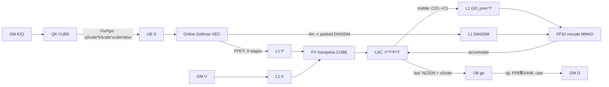

# FP8 DN 场景 RescaleO 上移 CUBE 设计

> 文档基线：`45c26f409d0a37ef0311d23c8667f5b571669fa4`
>
> 最终实现：`79aa0fc8fc7e6b312a0778c3f086ef0a03b8276d`
>
> 适用平台：Atlas A5 / arch35 / 950
>
> 目标路径：FP8 E4M3 输入，FP16 或 BF16 输出，`transposedMm1=true`，`rescaleOnCube=true`，`innerPrecise=LOW_HIGH_MIXED`，`D<=128`

本文以最终提交 `79aa0fc8` 的源码为事实来源。`45c26f4..79aa0fc8` 之间包含打印、定位代码、失败实验和后续修复；这些中间状态不作为最终设计。文中的“已实现”表示最终源码中存在该逻辑，不等价于声明所有测试组合均已执行。

## 1. 背景与目标

原始 FP8 路径在每个 KV tile 上执行：

```text
MM1(CUBE):      K × Q^T -> S^T -> FixPipe -> UB S
Softmax(VEC):   S -> P，同时更新 lm/gm/ll/gl/dm
MM2(CUBE):      P × V -> lo -> FixPipe -> UB lo
RescaleO(VEC):  go = go * dm + lo
Last tile:      O = go / gl -> cast -> GM
```

FP8 使 QK/PV 的 CUBE 计算变快，但 VEC 仍要承担 online softmax、P 的 FP8 转换和逐 tile 的 `go * dm + lo`。本方案把后者改写为对角矩阵乘，并与转置 PV 的 L0C 累加融合：

```text
PV^T:       C = V^T × P^T
Rescale:    C += GO_prev^T × DIAGDM
Middle:     C 原样写入 L1，作为下一 tile 的 GO_prev^T
Last:       C 经 NZ2DN 和 vScale 写入 UB，VEC 只做 /gl、×(1/448)、cast 和写 GM
```

目标是：

- 删除目标路径中逐 tile 的 UB `lo` 双缓冲和 VEC rescale 乘加；
- 保持 PV 与 rescale 共用同一份 L0C，不产生额外中间矩阵；
- DIAGDM 只保存和计算非零的 `16×16` 对角块；
- 不改变非量化、非转置和 `rescaleOnCube=false` 路径。

## 2. 路径选择与范围隔离

full-quant kernel 中的最终开关是：

```cpp
static constexpr bool RESCALE_ON_CUBE =
    transposedMm1 && BlockMmadPV::rescaleOnCube;
```

接口只允许 `rescaleOnCube=true` 与 `transposedMm1=true` 同时出现：

```cpp
static_assert(!rescaleOnCube || transposedMm1,
    "rescaleOnCube=true is only valid with transposedMm1=true (DN + FP8 input)");
```

目标 tiling key 将 `BsaInferInterfaceFullQuant` 实例化为 `<..., true, true>`。FP8 ND、普通 FP16/BF16、high-precision softmax 和旧 PV/RescaleO 路径继续使用原实现。

当前 host 规则还有两点需要区分：

- FP8 full-quant 要求 `blockShapeX=128`，`blockShapeY` 只在 host 侧校验为256的整数倍；
- `kvBaseTile=512` 后的性能/精度验证应使用与512基块匹配的 `blockShapeY`，但当前代码没有新增“必须为512整数倍”的 host 校验。

## 3. 数学等价与量化比例

### 3.1 Rescale 改写为对角矩阵乘

对第 `t` 个 KV tile，online softmax 的递推为：

```text
GO_t = dm_t ⊙ GO_(t-1) + PV_t
```

其中 `dm_t` 按 q 行广播。令 `D_t = diag(dm_t)`，转置后为：

```text
GO_t^T = GO_(t-1)^T × D_t + V_t^T × P_t^T
```

因此 PV 的结果可以留在 L0C，随后用 `initC=false` 的 FP32 MMAD 把对角矩阵乘累加进去。

### 3.2 为什么对角系数是dm×vScalePrev/vScaleCurr

FP8 的 `V^T×P^T` 先在 CUBE 中得到 raw FP32 累加值。定义：

```text
A_t = V_raw,t^T × P_raw,t^T
v_t = 第t个KV tile的V反量化scale
R_t = 截止第t个tile、尚未除global sum的真实分子
C_t = L0C/L1中保存的raw域GO^T
```

真实数值希望满足：

```text
R_t = dm_t × R_(t-1) + v_t × A_t
```

而中间 tile 的 L0C→L1 使用 `DataCopy(CO1→C1)` 保形搬运。这个通路负责把 FP32 L0C 的 `16×16` fractal 拆成 L1 标准 `16×8` fractal，但不能同时执行 FP32→FP32 的随路反量化。因此 L1 中保存的是 `C_(t-1)`，并且：

```text
R_(t-1) = v_(t-1) × C_(t-1)
```

把它代入真实递推：

```text
R_t = dm_t × v_(t-1) × C_(t-1) + v_t × A_t
```

提取当前 tile 的 `v_t`：

```text
R_t = v_t × [A_t + C_(t-1) × dm_t × v_(t-1)/v_t]
```

因此 CUBE 内部必须计算：

```text
C_t = A_t + C_(t-1) × diag(dm_t × v_(t-1)/v_t)
```

末块再由 FixPipe 用当前 `deqScalar=v_t` 统一乘回真实域。这样两项分别变为：

```text
当前PV项: v_t × A_t
历史GO项: v_t × C_(t-1) × dm_t × v_(t-1)/v_t
         = v_(t-1) × C_(t-1) × dm_t
         = R_(t-1) × dm_t
```

所以 `SetDiagonalDeltaMax()` 生成的是：

```text
diag(dm × vScalePrev / vScaleCurr)
```

而不是旧文档中的简单 `diag(dm/vScale)`。该比值使不同 KV tile 使用不同 `vScale` 时仍能逐项消元。首 tile 不执行 DIAGDM；传入的 `vScalePrev=1.0` 只是占位。

### 3.3 Softmax scale 折叠进QK FixPipe

目标路径中，attention `scaleValue` 已合入 QK 的 FixPipe 标量：

```cpp
float combinedDeqScalar = qDequantScaleValue * kDequantScaleValue;
if constexpr (RESCALE_ON_CUBE) {
    combinedDeqScalar *= scaleValue_;
}
```

所以 UB 中的 S 已是：

```text
S_UB = QK_acc × qScale × kScale × scaleValue
```

half/BF16 两条 low-prec S_trans 实现使用 `FULL_QUANT_FP8` 隔离：

- FP8 P 路径的 `ComputeLocalMax()` 不再重复乘 `scaleValue`；
- `ComputePAndLocalSumFP8()` 不再接收或逐行乘 `scaleValue`；
- 非 FP8 路径仍在 softmax VEC 中执行原有 scale，不受影响。

## 4. 总体流水



主循环保留 `PRE_LAUNCH=2`：QK/softmax 处理当前 tile，PV/RE 消费两拍前的 tile。P 和 DIAGDM 均采用三 stage，以匹配该流水距离。

## 5. Tiling与片上内存

### 5.1 最终基础tile

`CalcBaseTileTilingParams950()` 的最终策略是：

| 条件 | qBaseTile | kvBaseTile |
|---|---:|---:|
| FP8、LOW_HIGH_MIXED、D≤128 | min(blockShapeX,128) | 512 |
| 非量化 LOW_HIGH_MIXED、D≤128 | min(blockShapeX,128) | 256 |
| 其他 | min(blockShapeX,128) | 128 |

D按128对齐时，`CalcMatmulPhaseL1TileInfo950()` 生成：

| 阶段 | L1 tile | buffer数 |
|---|---|---:|
| Q | `128×128 FP8` | 1 |
| K | `256×128 FP8` | 2 |
| P | `128×512 FP8` | 3 |
| V | `512×128 FP8` | 2 |

K 仍以256行为一个 L1 tile；V 和 P 则完整覆盖512长度的 MM2 基块。

### 5.2 D=128时的L1分配

L1 总容量为512KB。目标路径的最终布局为：

| 区域 | 字节区间 | 单份 | 份数 | 合计 |
|---|---:|---:|---:|---:|
| Q | `[0,16KB)` | 16KB | 1 | 16KB |
| K | `[16KB,80KB)` | 32KB | 2 | 64KB |
| P | `[80KB,272KB)` | 64KB | 3 | 192KB |
| V | `[272KB,400KB)` | 64KB | 2 | 128KB |
| GO^T FP32 | `[400KB,464KB)` | 64KB | 1 | 64KB |
| DIAGDM FP32 | `[464KB,488KB)` | 8KB | 3 | 24KB |
| 剩余 | `[488KB,512KB)` | - | - | 24KB |

DIAGDM 每 stage 固定为：

```text
2 groups × 64 rows × 16 cols × sizeof(float)
= 2048 float
= 8KB
```

它不再为每个 group 预留完整 `64×64 FP32=16KB`，因此总容量由旧方案的96KB压缩为24KB。

三份固定地址为：

| DIAG stage | L1区间 | 对应P stage |
|---|---:|---:|
| 0 | `[464KB,472KB)` | `l1PBufId=0` |
| 1 | `[472KB,480KB)` | `l1PBufId=1` |
| 2 | `[480KB,488KB)` | `l1PBufId=2` |

一个 group 的4KB所有权并不是L1中单段连续4KB，而是H0占stage前半中的2KB、H1占stage后半中的2KB；这种拆分正是完整 `zN[128,16]` 的物理要求，详见 §7.4～§7.5。

### 5.3 D=128、kvBaseTile=512时的UB分配

每个 AIV 拥有256KB UB。half/BF16 S 均为2B，P为FP8。`CalcUBufTileInfo()` 得到：

| 区域 | 起始偏移 | 大小 | 说明 |
|---|---:|---:|---|
| S stage 0/1 | 0 | 131072B | `2×64×512×2B` |
| P stage 0/1 | 131072B | 65600B | `2×(64×512×1B+32B)` |
| DIAGDM中转 | 196672B | 16608B | `64×64×4B + 224B` padding，1份 |
| go | 213280B | 32768B | `64×128×4B`，1份 |
| lm | 246048B | 256B | 64行状态 |
| gm | 246304B | 256B | 64行状态 |
| dm | 246560B | 768B | `3×64×4B` |
| ll | 247328B | 256B | 64行状态 |
| gl | 247584B | 256B | 64行状态 |
| lse | 247840B | 2048B | `64×8×4B` |
| `maskStartOffset` | 249888B | - | 该点之后剩余12256B |

两个 padding 必须区分：

- P 每 stage 只额外分配一个32B DataBlock，取代旧的 `Max(qBaseTilePerSubCore, kvBaseTilePerSubCore)` 过量分配；
- DIAGDM UB 使用 `diagDmRound+1` 的 StoreAlign 跨距，64行满块共有7个32B间隔，因此额外分配224B。

目标路径不再为 `lo` 分配 UB 双缓冲。

### 5.4 L0分配

- L0A：64KB，两个32KB ping/pong stage；PV^T 和 RE 分时复用同一物理区域；
- L0B：64KB，两个32KB ping/pong stage；一次 DIAGDM 搬运只占8KB；
- L0C：256KB，MM1 使用前半，PV^T+RE 使用后半的两个64KB stage；
- qS=128、D=128时，每个 RE group 的 GO^T 块为 `128×64 FP32=32KB`，正好占一个 L0A stage。

## 6. QK阶段：512基块与两次K L1循环

`kvBaseTile` 扩大到512后，Q常驻 L1，K 仍按256行加载，因此 `block_mmad_k_qt_st_arch35.hpp` 每个完整 KV tile 执行两次 K 的 L1 循环：

```cpp
mL1LoopNumAct       = CeilDiv(kSTile, l1ATileM);
mL1LoopNumBase      = CeilDiv(kvSBaseTile, l1ATileM);
mL0LoopNumPerL1Tile = CeilDiv(l1ATileM, L0_TILE_M);
mL0LoopNumBase      = CeilDiv(kvSBaseTile, L0_TILE_M);
```

其中：

- `Act` 控制尾 tile 实际执行次数；
- `Base` 固定不同 KV tile 之间的 stage counter 跨距，防止最后一个短 tile 改变 ping/pong 映射；
- `mGlobalOffset = mL1Itr*l1ATileM + mL0Itr*L0_TILE_M`，保证第二个256行块写入 S UB 的 `[256,512)`，不覆盖前半；
- 反向 `mm1ToSmFlag` 只在 `mL1Itr==0 && mL0Itr==0` 时等待一次；
- Q→L0B 的无重复加载判定覆盖完整的两次 L1 循环，Q不因K分块而重复搬运。

每个子核的 S 视图仍为 `[kvSTile,64]`；完整512基块写满各自的 `512×64` UB 区域。

## 7. Online Softmax与DIAGDM生产

### 7.1 P路径

FP8 P 路径保持：

```text
S -> exp(S-historicalMax) -> ×448
  -> half/BF16到float
  -> float到FP8 E4M3
  -> Or + DeInterleave
  -> DATA_BLOCK_COPY StoreAlign到P UB
  -> MTE3到L1 P
```

当前最终提交仍使用 DeInterleave；后续 Gather/Pack 探索不属于本设计基线。

### 7.2 为什么不再保存两个完整64×64

qS最大为128，两个 AIV/group 各负责最多64个 q 行。最直观的旧方案是为每个 group 保存一个 `64×64 FP32` 对角矩阵：

```text
每group: 64×64×4B = 16KB
每stage: 2×16KB   = 32KB
三stage: 3×32KB   = 96KB
```

但一个 `64×64` 对角矩阵按 `16×16` 划分后是4×4个块，只有4个块非零：

```text
[D0  0  0  0]
[ 0 D1  0  0]
[ 0  0 D2  0]
[ 0  0  0 D3]
```

每个非零 `16×16 FP32` 块由两个 `16×8` fractal组成，因此一个 group 真正需要：

```text
4 tiles × 16×16 × 4B = 4KB
```

两个 group 合计8KB，三 stage 合计24KB。被删除的72KB全是永远不会参与MMAD的零块槽位。计算仍按4个 `16×16` 对角块执行，没有把零区重新算回来。

### 7.3 从dm生成UB对角矩阵

非首 tile 先由 `UpdateDeltaMaxGlobalMaxAndGlobalSum()` 生成 `dm`，存入三份轮转的 `dmUbTensor[l1PBufId]`。随后 `SetDiagonalDeltaMax()`：

1. 读取当前 dm；
2. 计算 `vScalePrev/vScaleCurr`，将整个 dm 向量乘该比例；
3. 使用两次 Select 只保留每行的对角元素；
4. 使用 `DATA_BLOCK_COPY + POST_MODE_UPDATE` 写入带 bank-conflict padding 的 UB；
5. 满64行时优先双发生成前半行与后半行，尾部才进入单发循环。

FP32 一个小分形为 `16×8`。UB 中的完整逻辑对角矩阵含有意义的小分形为：

```text
F(0,0), F(0,1),
F(1,2), F(1,3),
F(2,4), F(2,5),
F(3,6), F(3,7)
```

### 7.4 UB→L1：两次DataCopy打包成stage级zN

每个 AIV 对自己负责的 group 执行两次 DataCopy：

```cpp
blockCount = diagDmRound / 16;
blockLen   = 16;
srcStride  = 2 * (diagDmRound + 1);
dstStride  = 0;
```

源端第二次起点为：

```cpp
srcSecondFractalOffset = (diagDmRound + 1) * 8; // float元素
```

第一次抽取每个对角 `16×16` tile 的H0分形，第二次抽取H1分形。目标 stage 的16个 `16×8 FP32` fractal 顺序为：

```text
fractal  0..3  : group0 H0, tile0..3
fractal  4..7  : group1 H0, tile0..3
fractal  8..11 : group0 H1, tile0..3
fractal 12..15 : group1 H1, tile0..3
```

两个 AIV 的写入区互不重叠：

```text
stage前4KB: [G0-H0 2KB][G1-H0 2KB]
stage后4KB: [G0-H1 2KB][G1-H1 2KB]
```

三份 stage 按 `l1DiagAddrStart + stageId×8KB` 排列，对应 `l1PBufId=0/1/2`。

### 7.5 为什么必须声明zN[128,16]，而不是zN[16,128]

这里的两个shape在元素数上都等于2048 float，也都是8KB，但它们的 fractal 外层方向和 stride 不同，不能互换：

```text
zN[128,16]: K/M方向有8个16行块，N方向有2个8列半分形
zN[16,128]: K/M方向只有1个16行块，N方向有16个8列半分形
```

当前物理排布先连续放所有tile的H0，再连续放所有tile的H1，正好对应 `zN[128,16]` 的外层组织。已有 `zN→nZ` Copy特化由Tensor shape/stride推导LoadData参数。对 `zN[128,16]→nZ[128,16]`，它得到：

```text
mStep=8, kStep=2, srcStride=8, dstStride=1, ifTranspose=true
```

这样一次LoadData能把H0/H1重新组合成L0B中的8个连续 `16×16` nZ tile。

旧尝试把若干独立tile按“每tile H0紧跟H1”的方式存放，却在消费侧把父Tensor声明成 `zN[16,128]` 或把紧凑tile误解释为一个大父矩阵。LoadData会按父Tensor的外层stride跨步，H0/H1的物理位置与它推导的位置不一致：小shape或部分随机数据可能碰巧通过，但qS跨过16行、需要第二个及后续tile时就会读错分形。最终方案不是只交换两个常量的书写顺序，而是生产端物理顺序和消费端逻辑layout一起统一为真正的 `zN[128,16]`。

`diagDmRound=16/32/48/64` 时，每个 group 分别写入1/2/3/4个有效 `16×16` tile；未写槽位允许保留旧值，因为后续 MMAD 只索引有效 tile。

## 8. PV^T与CUBE Rescale

### 8.1 PV^T

PV 采用转置计算：

```text
C[D,qS] = V^T[D,kvS] × P^T[kvS,qS]
```

- V 从 GM 以 ColumnMajor `[D,kvS]` 视图 gather 到 L1 nZ；
- P 由 softmax 写入 L1 zN，从 `[kvS,qS]` 视角直接作为 B；
- `kvBaseTile=512`、`L0_TILE_K=128` 时，PV 每个完整基块执行4次 K方向 MMAD；
- V 和 P 都已完整覆盖512，无需像QK的K那样再增加一层 L1 循环；
- PV 结果保留在 L0C，作为后续 RE 的 bias。

### 8.2 DIAGDM一次搬入L0B

RE 把整个 stage 构造成：

```cpp
L1:  zN[128,16]
L0B: nZ[128,16]
```

然后复用仓库已有的 Atlas A5 非B8 `zN→nZ` `CopyL1ToL0B` 特化，只调用一次：

```cpp
copyL1ToL0BRescale(l0BDiagStageTensorTla, l1DiagStageTensorTla);
```

FP32满stage对应的LoadData参数为：

```text
mStep       = 8
kStep       = 2
srcStride   = 8
dstStride   = 1
ifTranspose = true
```

搬运量固定为8KB，远小于一个32KB L0B ping/pong stage。这里没有新增 DIAGDM 专用 `CopyL1ToL0B` 特化；正确性的关键是生产端真实匹配 `zN[128,16]`。

与旧“两个完整64×64”方案相比：

| 项目 | 旧方案 | 最终方案 |
|---|---:|---:|
| L1每group | 16KB | 4KB |
| L1每stage | 32KB | 8KB |
| L1三stage | 96KB | 24KB |
| L1→L0B | 每group一次，最多2次且共32KB | 每stage一次，固定8KB |
| MMAD | 每group4个非零tile | 不变，仍每group4个非零tile |

所以容量和搬运量下降，但数学计算量没有增加。

### 8.3 GO^T搬运和8次独立MMAD

qS=128时分成两个64列 group。每个 group：

- 从 L1 GO^T 搬 `D×64 FP32` 到一个 L0A stage；
- 从 L0B父 Tensor 通过 `GetTile(tileIdx*16,0)` 取得4个 `16×16` 对角块；
- 对每块执行：

```text
A = D×16
B = 16×16
C = D×16
```

因此 qS=128 时共8次 rescale MMAD。尾块使用实际 `nAct` 作为 N/K，不增加无效的完整 `128×128` 对角矩阵计算。

每次 MMAD 的 L0A列区、L0B tile 和 L0C列区均互不重叠。目标路径使用 Atlas A5 专用 `TileMmadRescaleTla`：其参数、Tensor offset 和 `AscendC::Mmad` 调用与公共 TileMmad 一致，但不执行公共实现中小case使用的 `PIPE_M` barrier。普通 QK/PV 继续使用原 TileMmad。

### 8.4 L0C搬出

| tile类型 | 搬出方式 | 结果 |
|---|---|---|
| 单tile且为末tile | NZ2DN FixPipe→UB | 直接得到row-major `[qS,D]` |
| 首/中间tile | DataCopy CO1→C1，`channelSplit=true` | raw `GO^T` zN写L1 |
| 最后tile | NZ2DN FixPipe→UB，`deqScalar=vScaleCurr` | 反量化后的go |

中间路径使用 `CopyL0CToL1Tla<AtlasA5>`，原因是 FP32 L0C fractal 为 `16×16`，而标准 L1 NZ fractal 为 `16×8`；CO1→C1 DataCopy 的 `channelSplit` 完成该拆分。末块 NZ2DN 将转置空间 `[D,qS]` 还原成 UB 中按行存放的 `[qS,D]`。

VEC RescaleO 在目标路径只处理末块：

```text
go /= gl
go *= 1/448
optional LSE
cast to FP16/BF16
write GM O
```

`1/448` 与 softmax 中写入 FP8 P 之前的 `×448` 对消；它仍在 `GoDivFunc()` 中执行，没有折叠进 DIAGDM 或末块 FixPipe。

## 9. 同步与buffer生命周期

### 9.1 跨核flag

| flag | id | 协议 |
|---|---:|---|
| MM1→Softmax | 0/1 | S UB两stage就绪/释放 |
| Softmax→PV | 2/3/4 | P L1三stage就绪/释放 |
| PV→RescaleO | 5 | 末块go UB就绪/释放 |
| DIAGDM | 6/7/8 | 三stage ready/consumed双向token |

mode-4 下 CUBE 对两个 AIV 分别操作成对 flag：6/22、7/23、8/24。若 AIV1 在短 qS 下分到0行，softmax 的 `n==0` 分支仍需转发 DIAGDM token，避免 CUBE 等待不到第二个 ready。

### 9.2 同核事件

- `MTE3_V EVENT_ID5`：保护唯一一份 DIAGDM UB，中转数据被MTE3读完前不能覆写；
- `FIX_MTE1 GO_READY_EVENT_ID=4`：中间 GO^T 写入L1后通知下一次RE读取；
- L0A/L0B 使用既有 `M_MTE1`、`MTE1_M` 事件；
- L0C 首次使用前等待 `FIX_M`，最终 FixPipe/DataCopy 后再释放；
- 无barrier的 rescale MMAD只移除了 `PIPE_M` barrier，不移除以上数据就绪和buffer生命周期事件。

## 10. 关键实现文件

| 文件 | 最终职责 |
|---|---|
| `op_host/block_sparse_attention_tiling.cpp` | FP8 `kvBaseTile=512`；D=128时P/V L1 tile和buffer数量 |
| `op_kernel/block_sparse_attention.cpp` | FP8 DN tiling key实例化 `<transposedMm1=true,rescaleOnCube=true>` |
| `op_kernel/block_sparse_attention_kernel_interface.cpp` | full-quant接口、dispatch policy、合法组合约束 |
| `op_kernel/arch35/block_sparse_attention_kernel_arch35_full_quant.h` | 主流水、L1/UB地址、scale折叠、vScale索引、同步初始化 |
| `gemm/block/block_mmad_k_qt_st_arch35.hpp` | 512基块下K的双L1循环、counter和S UB全局偏移 |
| `gemm/block/block_mmad_pv_transposed_rescale_arch35.hpp` | PV^T、DIAGDM一次搬运、GO×DIAGDM、L0C输出 |
| `gemm/tile_common/copy_l0c_to_l1_a5.hpp` | FP32 CO1→C1 `channelSplit`，中间GO写L1 |
| `gemm/tile_common/copy_l0c_to_ub_a5.hpp` | 末块NZ2DN和随路vScale |
| `gemm/tile_common/bsa_tile_mmad_rescale.hpp` | Atlas A5 FP32 rescale专用无`PIPE_M` barrier MMAD |
| `epilogue/block/block_epilogue_online_softmax_arch35_reg_low_prec_S_trans.hpp` | half S路径，P量化、dm和紧凑DIAGDM生产 |
| `epilogue/block/block_epilogue_online_softmax_arch35_reg_low_prec_bf16_S_trans.hpp` | BF16 S路径的同构实现 |
| `epilogue/block/block_epilogue_rescale_o_arch35_reg_high_prec.hpp` | 目标路径末块 `/gl`、cast、O/LSE写出 |

## 11. 最终实现与历史中间方案的区别

以下描述均已过时，不应再用于解释最终代码：

- `kvBaseTile=256`；最终目标路径为512；
- P L1=96KB、V L1=64KB；最终分别为192KB和128KB；
- DIAGDM L1=`2×3×64×64×4B=96KB`；最终为24KB；
- 每个group把完整 `64×64` 搬入L0B；最终每stage一次搬8KB；
- 把独立 `16×16` tile物理拼接后声明成 `zN[16,128]`；该布局不能由一次父Tensor LoadData正确解释；
- L1→L0B需要新增公共Copy特化；最终复用已有float `zN→nZ` 特化；
- DIAGDM只使用 `dm/vScale`；最终因中间GO为raw域，使用 `dm×vScalePrev/vScaleCurr`；
- FP8 softmax中继续逐行乘attention scale；最终已折叠到QK FixPipe；
- Gather/Pack替换DeInterleave；不属于 `79aa0fc8` 最终基线。

## 12. 验证建议与验收标准

本节是基于实现推导的回归建议，不冒充已执行记录。

| 验证场景 | 建议用例 | 预期结果 |
|---|---|---|
| qS边界 | `8,10,16,17,32,33,40,64,65,127,128` | 单/双group及尾 `nAct` 均与golden一致 |
| kvS边界 | `257,512,769,1024,1536,2048` | K双L1循环、PV四K块及KV尾块正确 |
| D | `64,128` | L0A大小、MMAD M和L1容量正确 |
| 输出dtype | FP16、BF16 | 两条S_trans路径均正确 |
| 格式 | TND、BNSD、BSND | GM offset和最终布局正确 |
| attention scale | `1.0,0.125,1/sqrt(D)` | FixPipe折叠后与旧数学路径一致 |
| vScale | 跨tile相同和不同 | `vPrev/vCurr`比值补偿正确 |
| 稀疏 | `sparsity_ratio=1`及非连续块 | gather索引和scale索引一致 |
| 稳定性 | `seed=77`及多个seed，多次重复 | 无偶发精度错误、hang或buffer提前复用 |

还应检查：

- L1各段结束于488KB，未越过512KB；
- UB `maskStartOffset=249888B`，未越过256KB；
- 每次RE只有一次8KB DIAGDM `CopyL1ToL0B`；
- qS=128时RE仍为8次 `D×16 × 16×16`，没有扩成一次 `D×128 × 128×128`；
- 普通PV/QK仍调用公共 TileMmad，只有rescale循环调用 `tileMmadRescale`；
- 非FP8和 `rescaleOnCube=false` 生成路径无行为变化。

## 13. 提交追溯原则

- `45c26f4`：用户指定的分析起点；
- `54608a8f5`：初版 rescale-on-cube 集成和旧设计文档；
- 后续多次 `add print`、`try`、`plan2`：只用于定位，不按提交标题推断最终行为；
- `ff115f98b` 之后形成最终 DIAGDM stage级布局；
- `8f8ee4a08`：rescale专用无barrier MMAD；
- `80f393307`：FP8 P UB精确32B padding；
- `a1f55ae45`：FP8 `kvBaseTile=512`及QK双L1循环；
- `79aa0fc8`：attention scale折叠到QK FixPipe，是本文最终实现边界。

如果提交说明与最终源码冲突，以 `79aa0fc8` 的源码为准。

## 14. 参考位置

- 转置QK参考：`block_mmad_k_qt_st_arch35.hpp`
- 转置PV+RE：`block_mmad_pv_transposed_rescale_arch35.hpp`
- L1→L0B已有特化：`copy_l1_to_l0b_a5.hpp`
- L0C→L1：`copy_l0c_to_l1_a5.hpp`
- L0C→UB NZ2DN：`copy_l0c_to_ub_a5.hpp`
- DIAGDM生成：`block_epilogue_online_softmax_arch35_reg_low_prec_S_trans.hpp`、`block_epilogue_online_softmax_arch35_reg_low_prec_bf16_S_trans.hpp`
- 最终VEC输出：`block_epilogue_rescale_o_arch35_reg_high_prec.hpp`
