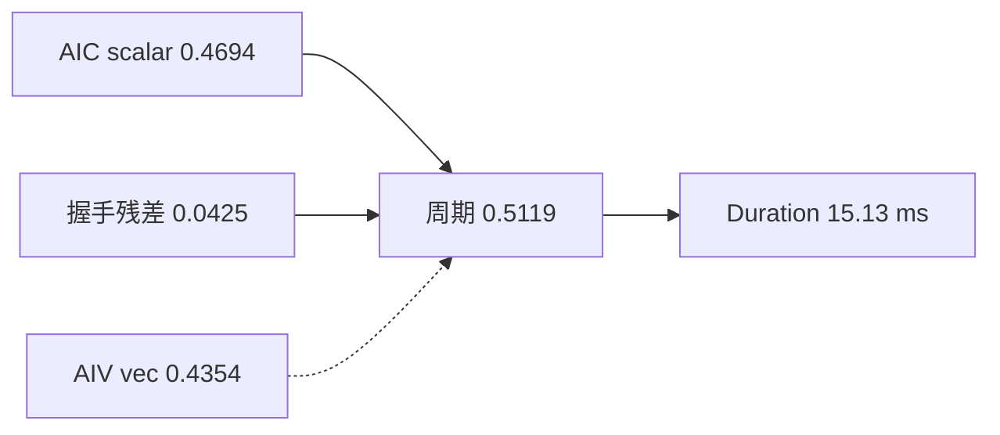

# BSA MXFP8 keep=1 Duration 剩余方案

记录截止：2026-09-17。平台 3510 / arch35。基线 `cann_bsa_0916_qk_gather256`，O1 `cann_bsa_0916_o1_scalar_mod`，O2 `cann_bsa_0916_o2_mins_fold`，O4 `cann_bsa_0916_o4_v1c1_early_set`（已量、源码已回退），O5 `cann_bsa_0917_o5_ny2_fast`（bootstrap O2，已上板）。O1/O2/O5 已独立安装。

配套：[`bsa-mxfp8-s1-pipeline-tuning.md`](bsa-mxfp8-s1-pipeline-tuning.md) 管已验证杠杆与禁区。本文管 **s1 之后还开着的门**。

**触发**：用户问 keep=1 Duration 还能怎么掉、scalar vs vec 谁绑定、O1 取模 / O2 Mins / O3 V1_C1 粒度。

**不触发**：精度-only、FP16、MXFP4、再改 QK gather / PrefetchV / MTE2。

---

## 0. 一句话

keep=1 墙钟锁在 **4-tile V1_C1 握手周期**（好 run 14.968–14.976 ms）。O1/O2 砍占用几乎不动墙钟；O3 原写法不存在；O4 的 1.77 ms 外推作废。4 槽 UB S **塞不下**。keep=0.1 是真 scalar 绑定，O5 把 nY==2 非连续 K gather 收成一条 `CopyKDataNdNum2`：Duration **1667 → 1612 µs（−55 / −3.3%）**，scalar −150 µs，keep=1 持平。现网最好 `cann_bsa_0917_o5_ny2_fast`。

---

## 1. 数据口径

| 项 | 值 |
|---|---|
| 点 | S=118800 keep=1 · B=1 N=1 D=128 BNSD · `BSA_OUT=bfloat16` · wu=5 lc=10 |
| Duration | OpBasicInfo 唯一一条 BSA `Task Duration(us)` |
| 管道 | PipeUtilization **核均**（AIC 28 / AIV 56） |
| cube / instr | 核均锁 10151.9 µs / 最忙核 `mte2_instr` 127447 |
| 频率 | 1650 MHz |
| gather 包 | npu2 `OPPROF_20260916153242_DRLSWJGYAIONQNAI` |
| O1 包 | npu7 `OPPROF_20260916172951_BIZQLTLVURTULMUO` |
| O2 包 | npu7 `OPPROF_20260916175244_FIJPUWQABAOQIEJN` |
| O4 包 | npu7 `OPPROF_20260916200000_GJOFYIOIRGORFSFG`（坏 run）；复跑 r2 `OPPROF_20260916201506_BJRWEJQGVDJKOWDR`（好 run） |
| O5 包 | npu7 keep=0.1 `OPPROF_20260917094553_QNSVGBCURXESVUZV`；keep=1 `OPPROF_20260917094640_WTUKUNWZORAPVMDT` |
| O5 噪声 | npu7 交错：O2 r1 `OPPROF_20260917094817_IESNTYNSBWOVNNJF` / O5 r1 `OPPROF_20260917094902_LFYCTRYUXLRGBARK` |
| P5 | npu0 `OPPROF_20260916142351_ZDQEFIHFWYZYBWKT` |
| s1_part | npu0 `OPPROF_20260911171332_ZJOYLKPUDHRRFYFJ` |

qk_gather256 keep=1 核均：

| | Duration | aiv_time | aic_scalar | aiv_vec | cube | mte2 |
|---|---:|---:|---:|---:|---:|---:|
| µs | 15125.0 | 14744.5 | 13521.7 | 12540.0 | 10151.9 | 9402.0 |
| ms | 15.125 | 14.745 | 13.522 | 12.540 | 10.152 | 9.402 |

`aic_time` 列 max 19612 µs 高于 Duration，按 P4 同类报表毛刺处理，bound **不看** gather 的 `aic_ratio`。

`Duration − aiv_time` 在 gather 及更早四个包稳定 376–381 µs（头尾开销，取 378）；O1 是 390 µs，同量级。

---

## 2. 更正上一轮：vec 12.54 不是当前地板

上一轮把 `Duration − vec = 2.59 ms` 当成握手税地板，读法会变成「先砍 softmax」。这把 **AIC 在等 AIV 的时间** 和 **AIV 自己的向量时间** 混在一起了。

正确读法：`Wait(V1_C1)` 把 AIC / AIV 锁成同一寿命（O1 后 `aic_time ≈ aiv_time ≈ 14733 µs`）。占用上 scalar 仍长于 vec，但 O1 证明 **占用长短 ≠ 周期长短**：scalar 核均 −607 µs，周期几乎不动。

每核 tile 数 **N = 28804**，由 cube 核均 10151.9 µs ÷ 仿真单对工作量 0.7049 µs（QK256 0.3255 + 2×PV 0.1897）推出，**属推导值**。

| | µs/tile | 占 AIC 寿命 |
|---|---:|---:|
| AIC 寿命 `aiv_time / N` | 0.5119 | 100% |
| AIC scalar | 0.4694 | 92% |
| AIV vec | 0.4354 | 85% |
| 残差 `寿命 − max(scalar, vec)` | 0.0425 | 8% |

scalar 比 vec 还长 **8%**。同一根条按 AIV 侧读：vec 0.4354 + 等 S 空转 0.0766。两侧寿命相等，因为 V1_C1 把它们锁成一个周期。

汇率：**1 ms Duration ≈ 57 scalar cycle/tile** @ 1650 MHz。



vec 虚线：短于 scalar，当前不绑定。

### 2.1 四个包对上同一个模型

`Duration ≈ 378 µs + N × [max(scalar_t, vec_t) + 残差]`

| 包 | Duration | aiv_time | 差 | scalar/t | vec/t | aiv/t | 残差 |
|---|---:|---:|---:|---:|---:|---:|---:|
| s1_part | 15209.4 | 14833.4 | 376.0 | 0.5098 | 0.3778 | 0.5150 | 0.0052 |
| mins_pipe | 15207.8 | 14829.4 | 378.4 | 0.4962 | 0.4354 | 0.5148 | 0.0186 |
| P5 | 15127.3 | 14749.4 | 377.9 | 0.4737 | 0.4354 | 0.5121 | 0.0384 |
| qk_gather256 | 15125.0 | 14744.5 | 380.5 | 0.4694 | 0.4354 | 0.5119 | 0.0425 |
| o1_scalar_mod | 15124.2 | 14734.6 | 389.6 | 0.4484 | 0.4354 | 0.5115 | 0.0631 |
| o2_mins_fold | 14976.4 | 14591.2 | 385.2 | 0.4494 | 0.3825 | 0.5066 | 0.0572 |

五个包 `Duration − aiv_time` 仍 376–390 µs。s1_part → gather：scalar 每 tile 0.5098 → 0.4694（−0.040），vec 0.3778 → 0.4354（+0.058），周期只从 0.5150 动到 0.5119——两边互相抵消，这就是墙钟都卡在 15.1–15.2 的原因。

O1 把这件事说死了：scalar/t 再从 0.4694 → 0.4484（核均 −607 µs），周期几乎不动（0.5119 → 0.5115）。残差 0.0425 → 0.0631，**握手把 scalar 省下的时间全吃掉**。`max(scalar, vec)` 不再决定 keep=1 Duration。

---

## 3. O1 先做：干掉每 tile 的常量除法

纯标量、零数值风险。占用打在 AIC/AIV scalar 上；keep=1 墙钟没跟着掉。

### 3.1 热路径每拍在算什么

[`block_sparse_attention_kernel_arch35_mxfp8_full_quant.h`](block_sparse_attention_kernel_arch35_mxfp8_full_quant.h)：

```89:92:attention/block_sparse_attention/op_kernel/arch35/block_sparse_attention_kernel_arch35_mxfp8_full_quant.h
    static constexpr uint32_t PV_RE_DELAY_N = 20; // G=16 → Dpv>=19，取 20
    static constexpr uint32_t DELAY_PSCALE_N = 3;

    static constexpr uint32_t PRELOAD_TASK_CACHE_SIZE = PV_RE_DELAY_N + 1;
```

主循环每拍 6 次 `% PRELOAD_TASK_CACHE_SIZE`（=21）：

```227:233:attention/block_sparse_attention/op_kernel/arch35/block_sparse_attention_kernel_arch35_mxfp8_full_quant.h
            TaskInfo &curTaskInfo = taskInfos[coreTaskId % PRELOAD_TASK_CACHE_SIZE];
            TaskInfo &delay12TaskInfo = taskInfos[delay12CoreTaskId % PRELOAD_TASK_CACHE_SIZE];
            TaskInfo &delay3TaskInfo = taskInfos[delay3CoreTaskId % PRELOAD_TASK_CACHE_SIZE];

            TileInfo &curTileInfo = tileInfos[coreTileLoop % PRELOAD_TASK_CACHE_SIZE];
            TileInfo &delay12TileInfo = tileInfos[(coreTileLoop - PV_RE_DELAY_N) % PRELOAD_TASK_CACHE_SIZE];
            TileInfo &delay3TileInfo = tileInfos[(coreTileLoop - DELAY_PSCALE_N) % PRELOAD_TASK_CACHE_SIZE];
```

2 次 `% L1_P_BUF_CNT`（=20）：

- AIV softmax 写 P：kernel L427 `curTileInfo.loop % GmMXFP8::L1_P_BUF_CNT`
- AIC PV 读 P：[`block_mmad_pv_arch35_mxfp8.hpp`](../attn_infra/gemm/block/block_mmad_pv_arch35_mxfp8.hpp) L506 `delay12TileInfo.loop % MXFP8::L1_P_BUF_CNT`

1 次整数除：`CreateTileInfo` L798 `pscaleNum_ / 10`。

21 和 20 都不是 2 的幂，编译成 magic-multiply + 移位，每条约 4–5 条标量指令，且每 128 tile 都跑（keep=1 约 28804 次/核）。

### 3.2 改法

| 现场 | 现在 | 改成 |
|---|---|---|
| `PRELOAD_TASK_CACHE_SIZE` | 21 | 32，下标 `& 31`。数组多 11 项，栈 32 KB 够 |
| P slot `% 20` | AIC/AIV 各自对 `loop` 取模 | 滚动计数 `i = (i + 1 == 20) ? 0 : i + 1` 写入 `TileInfo`，两边只读字段 |
| `pscaleNum_ / 10` | 除法 | 比较 / 移位等价 |

不碰 `Wait(V1_C1)`、不碰 PAIR256、不把 Wait 包进 `if`。

### 3.3 收益（外推，已被 3.4 推翻）

曾外推 **−27 cyc/tile ≈ −0.47 ms**，并假设 O1 单独就能掉 Duration。上板后不成立，见 3.4。

### 3.4 上板实测（npu7，独立安装 `cann_bsa_0916_o1_scalar_mod`）

冒烟 KFILTER 同 gather：`8 passed`。`Wait(V1_C1)` 仍无条件。cube / `mte2_instr` 锁死，数值路径没动。

keep=1（AIC 28 / AIV 56 核均，µs）：

| | Duration | aiv_time | aic_scalar | aiv_vec | cube | mte2 | aiv_scalar |
|---|---:|---:|---:|---:|---:|---:|---:|
| gather | 15125.0 | 14744.5 | 13521.7 | 12540.0 | 10151.9 | 9402.0 | 7624.7 |
| O1 | 15124.2 | 14734.6 | 12914.6 | 12539.8 | 10151.9 | 9275.9 | 6208.1 |
| Δ | −0.8 | −9.9 | **−607.1** | −0.2 | 0 | −126.1 | −1416.6 |

keep=0.1：

| | Duration | aiv_time | aic_scalar | aiv_vec |
|---|---:|---:|---:|---:|
| gather | 1711.4 | 1651.6 | 1563.9 | 1287.7 |
| O1 | 1667.9 | 1611.3 | 1525.4 | 1287.4 |
| Δ | **−43.5** | −40.3 | −38.5 | −0.3 |

结论：

- 热路径 `%21/%20//10` 确实买到了：AIC scalar −607 µs，AIV scalar −1.42 ms。
- keep=1 Duration 噪声级持平。汇率「1 ms Duration ≈ 57 scalar cyc/tile」对 **占用** 成立、对 **墙钟** 不成立——占用掉了，周期没掉。
- keep=0.1 才是 scalar 绑定（Duration ≈ aiv_time ≈ scalar），O1 在这里兑现 −43 µs。
- gather 的 `aic_time` 核均 19170 是报表毛刺；O1 的 `aic_time` 14733 ≈ `aiv_time` 14735，两侧寿命重新对齐。

---

## 4. O2：指数折叠替掉 Mins

### 4.1 为什么有 8 条 Mins

OCP `emax=8`，旧 `NEG_EIGHT_VALE = -8`，P ∈ [256, 512)。e4m3fn 有限最大值 448，超了 Cast 出 **NaN 不是 Inf**。Mins 每 4 行 8 条，vec 从 s1_part 10.88 抬到 12.54。

### 4.2 改法（符号纠正）

`P = exp(S − (K + Adds)·ln2)`。要把 [256, 512) 乘 448/512=0.875，Adds 必须 **更大**（更接近 0），不是更负：

`Adds = −8 + log2(512/448) ≈ −7.807355`

文档初稿写成 `−8 − log2(512/448) ≈ −8.1926`，方向反了，会把 P 抬到 [293, 585)。

fp16 在 [4, 8) 的 ulp=1/256。`−7.807355` 四舍五入落到 `−7.80859375` → `2^(emax+1)≈448.38>448`，仍会 NaN。落地常量用精确 fp16 **`−7.8046875`**（`NEG_EIGHT_VALE`），P ∈ [223.59, 447.17)。

e8m0 仍按 Store 之前的未偏置 K 编；q 与 ℓ 同步 ×0.875，`O/ℓ` 抵消。宏 `EXPSUB_*_4WAY_MINS` 去掉全部 `Mins`，qs64/qs128/align 共用。golden `_blockwise_snap_local_raw` 用同一 `P_SNAP_EMAX=7.8046875`。

### 4.3 上板实测（npu7，`cann_bsa_0916_o2_mins_fold`，bootstrap O1）

冒烟 8 passed。cube / `mte2_instr` 锁死。

keep=1 核均 µs：

| | Duration | aiv_time | aic_scalar | aiv_vec | cube |
|---|---:|---:|---:|---:|---:|
| O1 | 15124.2 | 14734.6 | 12914.6 | 12539.8 | 10151.9 |
| O2 | 14976.4 | 14591.2 | 12943.1 | 11016.9 | 10151.9 |
| Δ | **−147.8** | −143.4 | +28.5 | **−1522.9** | 0 |

per-tile：vec 0.4353 → 0.3825（低于 scalar 0.4494）；周期 0.5115 → 0.5066。vec 占用掉了 1.52 ms，墙钟只跟 `aiv_time` 走了 0.15 ms。

keep=0.1 Duration 1667.9 → 1667.3（持平），vec 1287 → 1135；稀疏仍 scalar 绑定。

`--reg` 未跑。

---

## 5. O3 复盘：V1_C1 每 256 握一次 — 前提错了，但封印的理由也错了

### 5.1 现网每个 peer 已经是「每 256 握一次」

`block_sparse_attention_kernel_arch35_mxfp8_full_quant.h:364-459`：

```
mm1ResBufId = (loop >> 1) & 1     // buffer 每 2 tile 翻
subBlockIdx = (loop     ) & 1     // AIV 每 1 tile 翻
AIC: Wait/Set (V1_C1[mm1ResBufId] + subBlockIdx*16)
AIV: if (subBlockIdx == GetSubBlockIdx()) Wait/Set (V1_C1[mm1ResBufId])
```

AIC 每 256 行发 2 次 Wait/Set，但这 2 次 **打给两个不同的 AIV**（`+subBlockIdx*16` 选 peer）。从任一 AIV 看，它每 2 tile 才握一次 —— **O3 想要的 256 粒度，AIV 侧本来就有了**。

所以「握手次数减半」只能靠让**一个** AIV 吃掉整对 256，那就是 softmax-256（s3/C1）本身。O3 不是 C1 的轻量替代品，O3 ≡ C1。§5 初稿里「减少 flag 次数、VF 形状不变」的写法不存在。

### 5.2 用现网数字复现 C1 的 +2 ms

O2 包 keep=1，pair(256 行) 周期 = 2×14589.5/28804 = **1.0130 µs**。同一 pair 窗口内各 agent 的串行块：

| agent | 每 pair 占用 µs | /周期 |
|---|---:|---:|
| **拥有该 tile 的 AIV：VF 0.7650 + CopyP(MTE3) 0.1227** | **0.8877** | **87.6%** |
| AIC cube（QK256 + 2×PV） | 0.7048 | 69.6% |
| AIC mte2（gather 256 K 行 + scale） | 0.6488 | 64.0% |
| AIC fix（2×128） | 0.5370 | 53.0% |
| AIC mte1 | 0.4812 | 47.5% |

C1 把整对交给一个 AIV，而**一对用满 buf0+buf1**，AIV 的 ping-pong 就没了。buffer 周期退化成「AIC Fix0+Fix1 → AIV 2×(VF+CopyP) → 释放」，覆盖 2 个 pair：

`pair ≥ (0.537 + 2×0.888 + 2×flag)/2 ≈ 1.16 + 0.06 = 1.22 µs`

外推 Duration = 14591 × 1.22/1.013 ≈ **17.6 ms**，实测 s3/c1nowait **17.01**。误差 4%，机理对上了：C1 死于 **UB S ping-pong 被吃掉**，不是死于「QK256 盖不住 Wait」。

### 5.3 当年封印的理由现在不成立

结案写的地板是「step1 scalar 15.06 > 14.94」。那是 bcb05 scalar 14.676 + 握手重构 +0.38。O1 之后 scalar 已是 **12.943**，同样 +0.38 也只有 **13.32** —— 地板论作废。同理 `ub_s3`（+0.81 ms，归因「scalar 信封被撑厚」）也是 pre-O1 的 scalar 绑定现象，O1 已放出 1.65 ms 信封。

### 5.4 4 槽 UB S 环：门票算错了，塞不下

要让 softmax-256 赢，吃整对的 AIV 必须保住 ping-pong → 4 个 S 槽。上一轮写成「UB 用到 184KB，剩 64KB 刚好塞」——**两项都错**。

`block_epilogue_arch35_utils.hpp` MXFP8 窗（256KB 上限）：

| 窗 | 区间 KB | 大小 |
|---|---|---:|
| S（2 槽、256B 交错） | [0, 64) | 64 |
| OTMP | [64, 96) | 32 |
| P 物理（2 槽交错） | [96.5, 128.5) | 32 |
| O | [128.5, 160.5) | 32 |
| localGroupMax（Dpv=20） | [161.75, 181.75) | 20 |
| pScale（20×768） | [184, 199) | 15 |
| 其它 max/index/rowsum | 穿插 | ~4.5 |
| **已用 / 尾部空** | | **199 / 57** |

两处几何对不上：

1. S 是 **offset 0 的交错窗**，加 2 槽是把 [0, 64) 扩成 [0, 128)，直接撞 OTMP 和 P，不是往 199KB 后面拼。
2. 就算改成立即邻接的 4×32KB 连续槽，也要 128KB；尾部只剩 57KB，Dpv/G 又不许动，腾不出。

外推 −1.4 ms 建立在「门票免费」上。门票是整表重排（S/OTMP/P/O 全挪），再叠加 softmax-256。ub_s3 已经用 3 槽试过一次（+0.81 ms）。**4 槽环不再当作开着的门。**

### 5.5 更便宜的同池子：V1_C1 提前释放（记为 O4）

§5.2 表里最长的串行块是 AIV 的 **VF 0.765 + CopyP 0.1227**。但 `CopyPUBToPL1` 读的是 UB **P**（偏移 ~96KB），不是 UB **S**（0–64KB）——**UB S 的最后一次读发生在 softmax VF 结束时**，而 `CrossCoreSetFlag(V1_C1)` 在 `epilogueOnlineSoftmax()` **返回之后**（kernel:459），也就是在 CopyP 之后。

旗被多押了 **0.1227 µs/tile = 1.77 ms/核**。把 `Set(V1_C1)`（`PIPE_V`）挪到 softmax VF 之后、`SetFlag<V_MTE3>`+CopyP 之前，AIV 的串行块 0.888 → 0.765，pair 周期上限 0.765+flag：

| 池子 | ms |
|---|---:|
| AIV idle（aiv − vec − mte3） | 1.81 |
| CopyP 压在旗里 | 1.77 |

`Set` 走 `PIPE_V`，本来就只等 V 流水排空，语义上正是「VF 读完 S 即释放」。改动量一行，不动 UB、不动数值、golden 无影响。这才是结案原文说的「缩短现网 Wait_128 本身」。

### 5.6 上板实测 + 噪声带（npu7 交错复跑）

冒烟 8 passed。`Wait(V1_C1)` 仍无条件。cube / `mte2_instr` 锁死（10151.9 / 127447）。源码已回退到 O2。

keep=1 Duration / 核均 `aiv_time` / `mte2`：

| 跑 | Duration | aiv_time | mte2 | 档 |
|---|---:|---:|---:|---|
| O2 orig | 14976.4 | 14591.2 | 9344 | 好 |
| O2 r1 | 14975.8 | 14598.8 | 9470 | 好 |
| O2 r2 | 14969.5 | 14587.2 | 9339 | 好 |
| **O4 r2** | **14968.2** | **14588.4** | **9310** | **好（与 O2 重合）** |
| O4 orig | 15102.1 | 14729.8 | 10590 | 差 |
| O4 r1 | 15097.7 | 14716.0 | 10724 | 差 |

好档带宽 ~105 GB/s，差档 ~92 GB/s；`mte2_instr` 始终 127447，是重叠变差不是多搬。vec / mte3 六次全锁（vec 11003–11017，mte3 1758–1767）。keep=0.1 首跑 1667.3 → 1665.7，持平。

两档差 ~130 µs。O2 三次全在好档；O4 2/3 掉进差档。结构上 O4 **没有** +1.77 ms，也没有稳定 +126 µs；它最多提高「MTE2 重叠变差」的概率。源码不留。

**外推错在哪**：每个 `(buf, AIV)` 的 V1_C1 复用间隔是 **4 tile ≈ 2.03 µs**。CopyP 0.123 µs 远小于这段空窗，下一次 `Wait` 等不到 CopyP。把 CopyP 占用 1.77 ms 当成握手税，把 4-tile ping-pong 当成 1-tile 锁步了。**O4 关闭。**

---

## 6. 推演

`Duration ≈ 378 µs + N × 握手周期`。keep=1 握手周期不再等于 `max(scalar_t, vec_t) + 残差` 里那个会跟着占用走的项——O1 把占用砍了，周期几乎不动。下表 O1 行是实测，其余外推。

| 情景 | 周期 µs/tile | Duration | Δ ms | 谁绑定 |
|---|---:|---:|---:|---|
| qk_gather256 | 0.5119 | 15.13 | 0 | 握手；scalar 占用 13.52 |
| **O1 实测** | **0.5115** | **15.12** | **0** | 握手吃掉 −607 µs scalar |
| **O2 实测** | **0.5066** | **14.98** | **−0.15** | AIV 串行块 0.888/1.013 = 87.6% |
| O3 握手减半（2 槽 UB S） | 0.61 | 17.6 外推 / 17.01 实测 | **+2.0** | UB S ping-pong 被吃掉 |
| O3 + 4 槽 UB S | — | 无门票 | — | 交错窗口要 128KB，撞 OTMP+P；尾部只剩 57KB |
| **O4 好档** | **0.5064** | **14.97** | **0** | 与 O2 重合 |
| O4 差档 | 0.511 | 15.10 | +0.13 | mte2 重叠抖动，2/3 次 |

O2「单做 Duration 不动」部分作废：动了 148 µs。O4「CopyP 1.77 ms 在旗里」部分作废：复用间隔 4 tile。keep=1 再砍占用、挪 Set、加深 S 环，都没有便宜门票。

---

## 7. 已经关掉的门，别重开

| 方案 | 结果 | 证据 |
|---|---|---|
| UB S 环加深到 3 块 | Duration 15.75，+0.81 ms，已回退 | ub_s3：scalar 信封被撑厚（**pre-O1 现象，O1 后信封已放出 1.65 ms**，§5.3） |
| Fixpipe `dualDstCtl=2` | Fixpipe 被打回，瓶颈换成 VF | dual-aiv softmax 设计复盘 |
| 旧 softmax-256 / 握手/2（s3·C1） | Duration 17.01–23.12 | 2026-09-15 结案。**归因更正**：死于 UB S ping-pong 被吃掉，不是 QK256 盖不住；地板 15.06 已随 O1 作废（§5.2/5.3） |
| QK 拆回 128 + L0A K/V DB | 等于回到 p0b 流水 | S=4096 仿真：MTE1 6.86 ≪ cube 11.17 |
| 再抬 MTE2 带宽 | mte2 9.40 ≪ 周期，不绑定 | 本轮 PipeUtilization |
| QK gather nY 分发 | keep=1 Duration 持平，scalar 核均只 −122 µs | gather vs P5。**没覆盖 keep=0.1**；稀疏对偶是 O5（§9.6） |
| PrefetchV 再往 Wait 里塞 | P5 已塞过，再塞会拉长 Duration | P5 vs mins_pipe |
| rowsum 从 cube seed 搬到 VF | cube 0.352 µs/tile 本就不绑定，且会加 vec | `PV_MMAD_M_DIM=144` 仍在用 |
| PV 按 QK 一次搬 256 并 mmad | PV 计算仍是 128×128 | 用户已停 |
| O4 `Set(V1_C1)` 提前到 CopyP 前 | Duration 中性；2/3 次掉进 15.10 抖动档 | 交错复跑；CopyP 不在旗上。源码已回退 |
| 4 槽 UB S 环 | 无门票 | 用到 199KB；4 槽交错要 128KB 窗口，撞 OTMP+P |

---

## 8. 建议顺序

1. ~~O1~~ 已完成。keep=1 Duration 持平；keep=0.1 −43 µs。`cann_bsa_0916_o1_scalar_mod`
2. ~~O2~~ 已完成。keep=1 Duration −148 µs，vec −1.52 ms。`cann_bsa_0916_o2_mins_fold`。`--reg` 未跑。
3. ~~O3 握手 128→256（原写法）~~ **不存在**：AIV 侧已是每 256 握一次（§5.1）。要减 AIC flag 次数 ⇒ 必须是 softmax-256 ⇒ 必须先有 4 槽 UB S 环。
4. ~~O4 `Set(V1_C1)` 提前到 CopyP 前~~ **已否决**（§5.6）。好档与 O2 重合，差档 15.10 是 mte2 抖动。源码回退。
5. ~~O3′ 4 槽 UB S~~ **无门票**（§5.4）。不是「剩 64KB 刚好塞」。
6. ~~O5 nY==2 非连续 K gather~~ 已完成。keep=0.1 Duration −55 µs / scalar −150 µs；keep=1 持平。`cann_bsa_0917_o5_ny2_fast`。`--reg` 未跑（冒烟 12 passed，含 gap_sparse / Y=64）。

keep=1 现网最好仍贴 14.97 ms（O2 与 O5 无差）。握手周期 0.506 µs/tile 里占用已经短于周期（scalar 0.449、vec 0.382），剩下 ~1.65 ms AIC bubble 是 4-tile V1_C1 协议本身。便宜刀砍完了。

keep=0.1 现网最好 `cann_bsa_0917_o5_ny2_fast`，**1.612 ms**。scalar/aic 从 0.948 降到 0.883，残差从 83 涨到 181，下一刀砍 scalar 不再 1:1。

---

## 9. 还剩多少空间

用 O2 包按 `Duration = 头尾 + max(绑定管道) + 残差` 逐层剥：

| | keep=1 | keep=0.1 |
|---|---:|---:|
| 头尾（`Duration − aiv_time`） | 385 | 61 |
| **现状** | **14976** | **1667** |
| 残差归零（scalar 绑定） | 13328 | 1582 |
| scalar 再降到 vec | 11402 | 1195 |
| cube 硬底 | 10537 | 1080 |
| 理论可省 | 4439 µs / 30% | 588 µs / 35% |

cube 核均 10151.9 µs 是当前 tiling（qs128×kvs128）下的算法底，不动 mmad 形状就下不去。

### 9.1 keep=1：理论 30%，但下一层没门票

绑定链是闭的：

1. 残差 1646 µs = 每 tile 2 次 `CrossCoreWaitFlag/SetFlag` 的固定开销，**不是**往返延迟 —— O4 给了往返 0.123 µs 额外余量，墙钟没动，说明往返本来就有富余。
2. 往返有富余 ⇒ 加深 S 环（3 槽 / 4 槽）也吃不到这 1646 µs。ub_s3 的 +0.81 ms 不只是 pre-O1 的 scalar 信封问题。
3. 要减的是 flag **次数** ⇒ 必须 softmax-256 ⇒ 必须 4 槽 ⇒ UB 放不下（§5.4）。

**未确认项**：keep=1 的 `aic_scalar` 12943 里有多少是 `Wait(V1_C1)` 被计进 scalar 的。O1 砍掉 607 µs **真实指令** 而墙钟不动，说明占比不低。若 wait 占大头，「残差归零 → 13328」偏保守，真实无握手地板更接近 vec/cube 侧的 11.4 ms，奖金从 1.6 ms 变 3.5 ms。

**便宜的测法**（一次编译 + 一次 msprof，不跑 golden）：做一个丢弃包，把 AIV 的 `Set(V1_C1)` 提到循环入口、VF 之前。数值必错，但 AIC 从此不等旗，`Duration` 直接给出真实无握手地板。这个数决定「要不要为 1.6–3.5 ms 去做 UB 整表重排」。

### 9.2 keep=0.1：23% 且没有门票问题

三个包一致 `scalar/aic = 0.948`，残差只有 83–87 µs（keep=1 是 1646）。这里是**真·scalar 绑定**：

| | gather | O1 | O2 |
|---|---:|---:|---:|
| Duration | 1711.4 | 1667.9 | 1667.3 |
| aic_scalar | 1563.9 | 1525.4 | 1521.7 |
| aiv_vec | 1287.7 | 1287.4 | 1134.6 |

- O1 砍 scalar −38.5 → Duration −43.5，**约 1:1 兑现**。
- O2 砍 vec −153 → Duration −0.6，vec 不绑定。

scalar 高出 vec **387 µs = Duration 的 23%**，这就是可取的量，且不依赖 UB / 握手协议。

### 9.3 定位：稀疏 tile 的 scalar 比稠密 tile 贵 139 cyc

两种独立方法同一个答案。

**方法一：两 keep 点联立**（`scalar = A·N_tile + K`，N_tile 由 cube 比例定，keep=1 28804 / keep=0.1 2892）：

| 包 | A (cyc/tile) | K (µs) | K 占 keep0.1 Duration |
|---|---:|---:|---:|
| gather | 761 | 229.3 | 13.4% |
| O1 | 725 | 254.3 | 15.2% |
| O2 | 727 | 247.0 | 14.8% |

自校验：O1 把 A 从 761 降到 725，×28804 = −631 µs，keep=1 实测 scalar −607 µs。模型成立。

**方法二：S 扫描联合拟合**（同代包 `s1_part_clean_keep1` + `s1_part_keep01_long`，各 12 个 S 点，`scalar = A_keep·N_tile + B·N_task`）：

- `A_dense = 847 cyc/tile`
- `A_sparse = 986 cyc/tile`
- **稀疏溢价 = +139 cyc/tile = +16.4%**，在 S=118800/keep0.1 上 = **+244 µs**
- per-task 项 ≈ 0（拟合出负值，即被吸收）。keep=1 侧 12 点残差全在 ±0.4%。

方法一的 K=247 和方法二的 244 对上了。所以那 247 µs **不是 per-task 开销**（per-task 只值 27 µs），是**每个稀疏 tile 都多花 139 cyc**。

### 9.4 机制：K gather 掉出 `consecutive` 快路径

`block_mmad_qk_arch35_mxfp8.hpp: SparseKFusedBaseTileL1FullLoad`。PAIR256 下 nRows=256，现网 blockShapeY=128 ⇒ **nY 恒为 2**。

- **keep=1**：sparseIdx 连续（0,1,2,…）⇒ `ori[1]==ori[0]+1` ⇒ `consecutive=true` ⇒ 行 298 快路径，一发 `CopyKDataAndScale(256 行)` 直接 return。
- **keep=0.1**：sparseIdx 跳跃 ⇒ `consecutive=false` ⇒ 全量走通用机器：`consecutive` 扫描 + 外层 while + 内层 run-merge while + 反复 `YBlockRows`，最后才落到 NDNUM2 的 `CopyKDataNdNum2`。

也就是说 nY=2 这个恒定形状下，通用机器每次都把答案重新推导一遍，而答案永远是「两块满 128 行，起点 ori[0]·128 和 ori[1]·128」。

### 9.5 为什么这不是已关的门

`§7` 里的 `QK gather nY 分发` 和 `msprof_idx_prefetch` 都**只在 keep=1 上量过**（`msprof_idx_prefetch` 目录下只有 `S118800_keep1.0`，`ndnum2` 同样）。keep=1 走 `consecutive` 快路径，稀疏机器根本不执行，溢价只占 1.6% —— 在那里量当然持平。**这两扇门没覆盖 keep=0.1。**

### 9.6 O5 上板实测（npu7，`cann_bsa_0917_o5_ny2_fast`，bootstrap O2）

落点：`SparseKFusedBaseTileL1FullLoad` 在读齐 `ori[]` 之后、`consecutive` 扫描之前。条件 `nY==2 && nRows==2·Y && ori[1]!=ori[0]+1 && ori[1]>ori[0] && 两块都满`，直发 `CopyKDataNdNum2`。尾块 / Y=64(nY=4) / 非升序 / 短 y-block 回落原通用路径。

冒烟：12 passed / 0 failed（O2 同款 + `gap_sparse`，含 `blk128x64`）。

同口径核均（PipeUtilization cube0 / vector mean；Duration = OpBasicInfo 最大 Task Duration）：

| | keep=0.1 Duration | scalar | vec | mte2 | sc/aic | 残差 |
|---|---:|---:|---:|---:|---:|---:|
| O2 orig | 1667.3 | 1521.7 | 1134.6 | 1133.4 | 0.948 | 83.3 |
| O2 r1（交错） | 1668.5 | 1522.6 | 1134.3 | 1124.0 | 0.948 | 83.0 |
| **O5 orig** | **1612.2** | **1371.3** | 1134.6 | 978.7 | 0.883 | 180.9 |
| O5 r1（交错） | 1613.7 | 1371.3 | 1134.8 | 978.9 | 0.884 | 180.6 |

| | keep=1 Duration | scalar | vec | cube |
|---|---:|---:|---:|---:|
| O2 | 14976.4 | 12943.1 | 11016.9 | 10151.9 |
| O5 | 14970.8 | 12919.2 | 11014.1 | 10151.9 |

- keep=0.1 Duration **−55 µs / −3.3%**（两跑 1612.2 / 1613.7，噪声 ±1.5 µs）。scalar **−150 µs / −9.9%** = **−86 cyc/tile**（预估 60–100，打中）。
- `mte2_instr` / `readKB` 两 keep 都不变（19231 / 106601），copy 条数没变，砍的是发 copy 之前的 scalar 机器。mte2_time 随 scalar 一起掉 −155 µs。
- 兑现比 55/150 ≈ **0.37**，不是 O1 的 1:1。原因：scalar 不再盖住 aic（sc/aic 0.948→0.883），残差 83→181。墙钟现在更接近 `aic_time` 1552 + 头尾 60，而不是 scalar。
- keep=1 Duration −6 µs / scalar −24 µs，走原 `consecutive` 路径，护栏通过。

### 9.7 O5 之后 keep=0.1 还剩多少

| | O2 | O5 |
|---|---:|---:|
| 现状 | 1667 | **1612** |
| 残差归零 | 1582 | 1431（scalar 已低于 aic） |
| scalar 再降到 vec | 1195 | 1195 |
| cube 硬底 | 1080 | 1080 |

sparse 溢价 139 cyc 里 O5 吃掉 86 cyc，剩下 ~53 cyc/tile ≈ 93 µs 还在通用机器上（Y=64 的 nY=4、task 尾块、V gather 的 peek while）。再往下：

- **Y=64 / nY==4**：PAIR256 满对 4 个满块，可两条 NDNUM2 或一条连续+一条 NDNUM2。现网主点是 Y=128，这条对 S=118800/keep=0.1 **几乎不触发**。
- **V gather peek while**：`SparseVFusedBaseTileL1FullLoad` 每 tile 仍跑偷看合并。keep=0.1 非连续时 peek 失败得快，但每 tile 仍有一次 `GetValue`。没量过，不确定是不是剩下 53 cyc 的家。
- 残差 181 µs 现在比「scalar−vec 余量再砍」更先碰到墙钟。没定位，可能是稀疏 K 的 MTE2 分段（两条 copy vs keep=1 一条）发得晚，和 cube/vec 重叠变差。

## 10. 短点 +6 µs 同卡二分（NPU5，2026-09-17）

SLO 改成 64 格相对 bcb05 不回退之后，O5 全量扫在 S=4096 上全 keep 红。同卡五包只跑 S=4096 keep=0.1 / 1.0，日志 `tests/mxfp8_pytest/bisect_s4096_npu5.log`。

| 包 | keep=0.1 Dur | aic | scalar | cube | vec | keep=1 Dur | aic | vec |
|---|---:|---:|---:|---:|---:|---:|---:|---:|
| bcb05 | 20.3 | 19.3 | 13.3 | 2.3 | 4.7 | 50.1 | 49.1 | 24.4 |
| gather256 | **20.2** | 19.3 | 11.3 | 2.3 | 5.3 | 51.2 | 50.3 | 29.1 |
| **O1** | **25.4** | **23.0** | 12.7 | 2.3 | 5.0 | **54.9** | **52.6** | 28.4 |
| O2 | 24.9 | 22.6 | 12.9 | 2.3 | 4.4 | 54.4 | 51.9 | 24.4 |
| O5 | 24.1 | 21.9 | 12.9 | 2.3 | 4.2 | 53.8 | 51.4 | 24.3 |

- **税在 O1**（gather256→O1）：keep=0.1 **+5.2 µs**，aic +3.7；keep=1 **+3.7 µs**。cube/mte2/instr 不变。
- PAIR256 / QK gather256 **不是**短点元凶（keep=0.1 20.3→20.2）。不要给 PAIR256 做占用开关。
- O2 / O5 略往回修（vec / nY=2），不是税。O5 保留。
- O1 相对 gather 的源码差：`PRELOAD` 21→32、`taskInfos/tileInfos[32] = {}`、下标 `%`→`& mask`、pSlot 滚动。短点 aic 多出来的时间不在 cube/scalar 占用上，符合 **核入口把 32 槽 TaskInfo+TileInfo 整表清零**（21 项编译器可能展开，32 项掉进 memset 循环）。
- 下一刀：保留 `& mask`（长 keep=0.1 的 O1 收益），去掉 `= {}`。delay 窗 `coreTileLoop >= PV_RE_DELAY_N` 保证先写后读。独立安装后四哨兵过了再 64 点。`Wait(V1_C1)` 仍无条件。

### 10.1 去清零不够，21 槽滚动才把短点扳回来（NPU5，同卡）

`TaskInfo`/`TileInfo` 有 NSDMI，只删 `={}` 仍会整表构造。改 `__attribute__((uninitialized))` 后装 `cann_bsa_0917_o1_nostack0`（bootstrap O5）。短点 aic 基本回来，Duration 还剩 ~2 µs。再把数组收成 21、下标改 if-wrap（热路径仍无 `%`），装 `cann_bsa_0917_o1_ring21`。冒烟均为 12 passed / 0 failed。

| 包 | S4096 k0.1 | S4096 k1 | S118800 k0.1 | S118800 k1 |
|---|---:|---:|---:|---:|
| bcb05 | 20.3 | 50.1 | 1769 | 14941 |
| gather256 | 20.2 | 51.2 | — | — |
| O5 | 24.1 | 53.8 | 1612 | 14971 |
| nostack0（32 uninit + mask） | 22.4 | 52.8 | **1608.8** | 14955 |
| **ring21（21 uninit + wrap）** | **19.2** | **49.0** | 1655.0 | 14993 |

- 短点税的主体是 **32 槽栈框**，不是 PAIR256。ring21 两短哨兵都优于 bcb05。
- wrap 的 `if (slot==21)` 每拍 6 次，长 keep=0.1 scalar 1465→1571，Duration 1609→1655（相对 O5 −46 µs，相对 bcb05 仍 −114）。长 keep=1 Duration 14993 vs bcb05 14941（+52 / +0.35%），握手吃掉了大部分 scalar。
- 现网候选：短点过关选 ring21；若长 keep=1 的 +50 µs 不可接受，下一刀把 wrap 改成无分支 `slot += 1; slot -= 21u * (slot == 21)`，或短路径 21 / 长路径 32+mask 分发。

### 10.2 零构造 + 32 槽 + mask（NPU5 同场次，2026-09-17 11:43）

两项成本拆开后补上缺格：删 `TaskInfo`/`TileInfo` NSDMI（`BatchOffsetInfo` 保留），数组 32 槽不带 `={}`，下标回到 `& mask`。安装 `cann_bsa_0917_o1_zeroctor`（bootstrap O5）。冒烟 12 passed。bcb05 同场次重测，长点与 9/14 画布一致。

| 包 | S4096 k0.1 | S4096 k1 | S118800 k0.1 | S118800 k1 |
|---|---:|---:|---:|---:|
| bcb05 同场次 | 19.6 | 49.6 | 1771.1 | 14943.0 |
| O5 | 24.1 | 53.8 | 1612 | 14971 |
| nostack0 | 22.4 | 52.8 | 1608.8 | 14955 |
| ring21 | 19.2 | 49.0 | 1655.0 | 14993 |
| **zeroctor** | **19.3** | 50.4 | **1607.0** | 14976.1 |

- 短 keep=0.1：19.3 vs 19.6，入口税关掉了，和 ring21 一档。
- 长 keep=0.1：1607 vs 1771（−9.3%），scalar 1419.9，优于 nostack0 的 mask 路径，wrap 税不在。
- 短 keep=1：50.4 vs 49.6（+0.8）；aic 48.2 vs 48.7，计算侧没退，Duration 差在头尾。
- 长 keep=1：14976 vs 14943（+33 / +0.22%），和 O5 同量级，仍是 4-tile `V1_C1` 握手，不是这次改动引入的。
- 源码现状即 zeroctor。64 点前短 keep=1 / 长 keep=1 算噪声带内还是红格，由验收阈值定。
