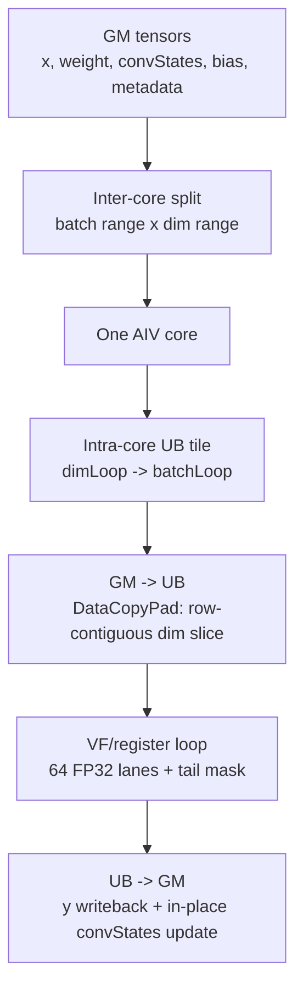

# CausalConv1dDecode Operator Requirements

## 1. Background

`CausalConv1dDecode` is a BF16 causal depthwise conv1d operator for inference decode/update. The target scenario is MTP/speculative decoding: one request may produce 1 to 4 candidate tokens in one decode step. The operator computes convolution outputs for all candidate tokens, but only accepted tokens are allowed to advance the persistent convolution state.

The operator aligns with the decode/update semantics of vLLM Ascend `causal_conv1d` where applicable. It intentionally excludes prefill, mixed prefill/decode, APC block mapping, `initialStateMode`, and `runMode`.

## 2. Environment Requirements

| Item | Requirement |
|---|---|
| Backend | Ascend C / A5-style operator package |
| dtype | BF16 input/output, FP32 accumulation |
| Invocation | ACLNN registry-invoke |
| Kernel route | SIMD VF + Reg API, not SIMT |
| Current validation | CPU reference covers core semantics; CANN compile is not completed in the current environment |

## 3. Invocation Mode

The operator uses the two-stage ACLNN API:

```cpp
aclnnStatus aclnnCausalConv1dDecodeGetWorkspaceSize(
    const aclTensor *x,
    const aclTensor *weight,
    aclTensor *convStates,
    const aclTensor *queryStartLoc,
    const aclTensor *cacheIndices,
    const aclTensor *bias,
    const aclTensor *numAcceptedTokens,
    int64_t activationMode,
    int64_t padSlotId,
    int64_t convMode,
    aclTensor *y,
    uint64_t *workspaceSize,
    aclOpExecutor **executor);

aclnnStatus aclnnCausalConv1dDecode(
    void *workspace,
    uint64_t workspaceSize,
    aclOpExecutor *executor,
    aclrtStream stream);
```

`convStates` is an input tensor and is updated in place. The public output is `y` only.

## 4. Operator Specification

### 4.1 Functional Definition

For every batch's current decode tokens, the operator performs one-dimensional causal depthwise convolution:

- Each channel is computed independently.
- Each token window is built from historical `convStates` and earlier tokens in the current chunk.
- `weight[0]` is the oldest tap and `weight[W-1]` is the current-token tap.
- `y` is computed for all candidate tokens.
- `convStates` appends accepted tokens only.

### 4.2 Supported Domain

| Axis / mode | Supported range |
|---|---|
| `B` | `1 <= B <= 256` |
| tokens per batch | `1..4` |
| `D` | `64 <= D <= 16384`, `D % 16 == 0` |
| `W` | `W == 4` |
| `state_len` | Normal decode: `state_len >= W - 1`; W=4 speculative/update with `num_accepted_tokens`: `state_len >= 2 + max_token_count` |
| `x` layout | `[B,S,D]` or `[T,D]` |
| metadata dtype | INT32 |
| activation | v1 supports none only, `activationMode = 0` |

## 5. Inputs And Outputs

### 5.1 Inputs

| Name | Required | dtype | shape | Description |
|---|---:|---|---|---|
| `x` | yes | BF16 | `[B,S,D]` or `[T,D]` | Current decode tokens. Flattened `[T,D]` requires `queryStartLoc`. |
| `weight` | yes | BF16 | `[W,D]` | Causal conv weights, `W=4`, ordered oldest to newest. |
| `convStates` | yes | BF16 | `[num_slots,state_len,D]` | Persistent state cache, read/written by slot, updated in place. |
| `queryStartLoc` | no | INT32 | `[B+1]` | Batch token ranges in flattened `x`. |
| `cacheIndices` | no | INT32 | `[B]` | Batch-to-state-slot mapping; default is `slot=b`. |
| `bias` | no | BF16 | `[D]` | Channel bias, broadcast over batch and token. |
| `numAcceptedTokens` | no | INT32 | `[B]` | Number of tokens accepted into state; default is the batch token count. |

### 5.2 Attributes

| Name | Type | Supported value | Description |
|---|---|---|---|
| `activationMode` | int64 | `0` | v1 supports no activation only. |
| `padSlotId` | int64 | any | Skip the batch if `slot == padSlotId`. |
| `convMode` | int64 | `0` | v1 supports decode/update only. |

### 5.3 Output

| Name | dtype | shape | Description |
|---|---|---|---|
| `y` | BF16 | same token layout as `x` | Convolution output for all candidate tokens. |

## 6. Dtype And Precision Requirements

| Stage | dtype |
|---|---|
| GM input | BF16 |
| UB storage | BF16 |
| VF load register | BF16 register |
| Accumulation | FP32 register |
| Output | BF16 |

Compute chain:

```text
GM/UB BF16 -> Reg BF16 -> Cast FP32 -> FP32 Mul/Add -> Cast BF16 -> UB/GM BF16
```

The reference computes with FP32 accumulation and casts the output to BF16. Tolerance should be set for BF16 output with FP32 accumulation.

## 7. Constraints

- `[T,D]` input requires `queryStartLoc`.
- In flattened mode, `queryStartLoc[b+1] - queryStartLoc[b]` should be in `1..4`; host tiling cannot inspect runtime values.
- If `cacheIndices` is absent, use identity slot `slot=b`.
- If `numAcceptedTokens` is absent, use the current batch's `token_count`.
- `numAcceptedTokens[b]` is clamped into `[0, token_count]`.
- `state_len` must cover `W-1` history tokens plus the current chunk.
- v1 does not support `activationMode != 0`.
- v1 does not support INT64 metadata.
- v1 does not support prefill or mixed mode.

## 8. Performance Targets

This operator targets decode with very small token counts. The workload is state-access heavy and arithmetic-light. Priority order:

1. Preserve state-update semantics and prevent rejected tokens from polluting `convStates`.
2. Use channel-contiguous `D` slices for DataCopyPad and VF vector compute.
3. Do not split the token axis; at most 4 tokens stay inside one core's local logic.
4. Balance inter-core work on `batch x dim` without over-splitting small shapes where movement cost can dominate arithmetic.

Final latency targets are not specified yet because Ascend hardware profiling has not been completed.

## 9. Acceptance Criteria

- CPU/Python reference covers `[B,S,D]` and `[T,D] + queryStartLoc`.
- Covers `W=4`.
- Covers token counts `1..4`.
- Covers `cacheIndices` absent/present.
- Covers `numAcceptedTokens` absent, zero, partial acceptance, and full acceptance.
- Covers `bias` absent/present.
- Covers dim main/tail tiles.
- Covers `padSlotId` hit/miss.
- CANN compile and hardware correctness must be completed in an environment with Ascend toolkit.

## Appendix A: Compute Semantics

### A.1 Three Index Spaces

| Index space | Example | Role |
|---|---|---|
| batch index `b` | `0..B-1` | Request row in the current invocation. |
| token row index `row` | `0..T-1` or `b*S+s` | Actual row in `x` and `y`. |
| cache slot index `slot` | `cacheIndices[b]` | Persistent state position in `convStates`. |

If `cacheIndices` is present:

```text
slot = cacheIndices[b]
```

Otherwise:

```text
slot = b
```

### A.2 Token Range

Fixed-batch input:

```text
x.shape = [B,S,D]
row_start = b * S
row_end   = (b + 1) * S
token_count = S
```

Flattened input:

```text
x.shape = [T,D]
row_start = queryStartLoc[b]
row_end   = queryStartLoc[b+1]
token_count = row_end - row_start
```

`queryStartLoc` does not participate in arithmetic. It maps each batch to token rows in flattened `x`.

### A.3 Causal Window For One Token

For token `s` in batch `b`, the window length is `W`:

```text
base = W - 1
rel = s - base + k
```

- `rel < 0`: the tap reads from history in `convStates[slot]`.
- `rel >= 0`: the tap reads from the current chunk `x`.

Formula:

```text
acc = bias[d] if bias exists else 0

for k in 0..W-1:
    rel = s - (W - 1) + k
    if rel < 0:
        v = convStates[slot, state_len + rel, d]
    else:
        v = x[row_start + rel, d]
    acc += fp32(v) * fp32(weight[k, d])

y[row_start + s, d] = bf16(acc)
```

### A.4 Width=4 Example

Assume:

```text
W = 4
state_len = 6
old state = [h0, h1, h2, h3, h4, h5]
x tokens  = [x0, x1, x2]
weight    = [w0, w1, w2, w3]   # oldest -> newest
```

Token 0:

```text
window = [h3, h4, h5, x0]
y0 = h3*w0 + h4*w1 + h5*w2 + x0*w3 + bias
```

Token 1:

```text
window = [h4, h5, x0, x1]
y1 = h4*w0 + h5*w1 + x0*w2 + x1*w3 + bias
```

Token 2:

```text
window = [h5, x0, x1, x2]
y2 = h5*w0 + x0*w1 + x1*w2 + x2*w3 + bias
```

### A.5 Role Of `numAcceptedTokens`

`numAcceptedTokens` does not decide how many `y` rows are computed. `y` may be computed for all speculative tokens.

It only decides how many tokens enter `convStates`:

```text
accepted = clamp(numAcceptedTokens[b], 0, token_count)
```

Example:

```text
old state = [h0,h1,h2,h3,h4,h5]
x = [x0,x1,x2]
accepted = 1
new state = [h1,h2,h3,h4,h5,x0]
```

`x1` and `x2` may have output rows, but they are rejected and must not enter state.

## Appendix B: Tiling And Memory Layout

### B.1 Overall Hierarchy



### B.2 Inter-Core Split

```text
                         D / channel dimension
              0        dimOffset               dimOffset+coreDimLen        D
              |------------|===========================|-------------------|
B batch  b0   | other core |        core k dim range   |     other core    |
         b1   | other core |        core k dim range   |     other core    |
              |------------|===========================|-------------------|
              firstBatchIdx          batchNum rows
```

### B.3 Intra-Core UB Tile

```text
        dimLoop=0          dimLoop=1                  dimLoop=N
     |===============| |===============|        |===============|
b0   | UB tile       | | UB tile       |  ...   | UB tail tile   |
b1   | batchLoop=0   | | batchLoop=0   |        | batchLoop=0   |
     |===============| |===============|        |===============|
b2   | UB tile       | | UB tile       |  ...   | UB tail tile   |
b3   | batchLoop=1   | | batchLoop=1   |        | batchLoop=1   |
     |===============| |===============|        |===============|
```

### B.4 `x` Movement Continuity

```text
GM x, row-major by D:

row r0: | d0 ... d0+dimTile-1 | skipped D-dimTile |
        |---- contiguous ----|<----- srcStride --->|
row r1: | d0 ... d0+dimTile-1 | skipped D-dimTile |
row r2: | d0 ... d0+dimTile-1 | skipped D-dimTile |

UB xLocal:
  | r0 dimTile | r1 dimTile | r2 dimTile | ...
  compact, no row gap
```

### B.5 `convStates` Movement Continuity

```text
cacheIndices[b] = slot

GM convStates [num_slots, state_len, D]

slot 5:
  h0: | d0 ... d0+dimTile-1 | skipped D-dimTile |
  h1: | d0 ... d0+dimTile-1 | skipped D-dimTile |
  ...
  hN: | d0 ... d0+dimTile-1 | skipped D-dimTile |

UB stateLocal:
  | h0 dimTile | h1 dimTile | ... | hN dimTile |
```

### B.6 VF Inner Loop

```text
src0:   [0........63][64.......127] ... [tail]
src1:   [0........63][64.......127] ... [tail]
src2:   [0........63][64.......127] ... [tail]   # W>=3
src3:   [0........63][64.......127] ... [tail]   # W>=4
weight: [w0 rows][w1 rows][w2 rows][w3 rows]
y:      [0........63][64.......127] ... [tail]

for offset = 0, 64, 128, ...
  LoadAlign BF16
  Cast BF16 -> FP32
  FP32 mul/add
  Cast FP32 -> BF16
  StoreAlign BF16

tail:
  mask = UpdateMask<float>(dimRem)
```

### B.7 State Writeback

```text
old stateLocal:
  [h0][h1][h2][h3][h4][h5]

accepted x rows:
  [x0][x1]

new convStates[slot]:
  [h2][h3][h4][h5][x0][x1]
```

Each box is the current dim tile. GM writeback is contiguous within each row and strided by `D` between rows.
