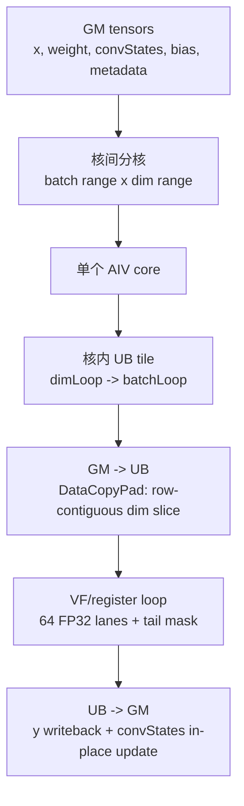

# CausalConv1dDecode 算子需求说明书

## 1. 背景

`CausalConv1dDecode` 是面向推理 decode/update 阶段的 causal depthwise conv1d 算子。目标使用场景是 MTP/speculative decoding：一个请求在一次 decode 中可能产生 1 到 4 个候选 token，算子需要计算所有候选 token 的卷积输出，但只允许被接受的 token 推进持久状态缓存。

本算子对齐 vLLM Ascend `causal_conv1d` update/decode 语义中与 decode 相关的功能，但不引入 prefill、混合模式、APC block mapping、`initialStateMode`、`runMode` 等 prefill 或模式切换字段。

## 2. 环境要求

| 项目 | 要求 |
|---|---|
| 后端 | Ascend C / A5 风格算子工程 |
| dtype | BF16 输入输出，FP32 累加 |
| 执行模式 | ACLNN registry-invoke |
| kernel 路线 | SIMD VF + Reg API，非 SIMT |
| 当前验证状态 | CPU reference 已覆盖核心语义；当前环境未完成 CANN 编译验证 |

## 3. 调用方式

算子通过 ACLNN 两段式接口调用：

```cpp
aclnnStatus aclnnCausalConv1dDecodeGetWorkspaceSize(
    const aclTensor *x,
    const aclTensor *weight,
    aclTensor *convStates,
    const aclTensor *queryStartLoc,
    const aclTensor *cacheIndices,
    const aclTensor *bias,
    const aclTensor *numAcceptedTokens,
    int64_t activationMode,
    int64_t padSlotId,
    int64_t convMode,
    aclTensor *y,
    uint64_t *workspaceSize,
    aclOpExecutor **executor);

aclnnStatus aclnnCausalConv1dDecode(
    void *workspace,
    uint64_t workspaceSize,
    aclOpExecutor *executor,
    aclrtStream stream);
```

`convStates` 是输入张量，同时被原地更新。公开输出只有 `y`。

## 4. 算子规格

### 4.1 功能定义

对每个 batch 的当前 decode token，算子执行一维 causal depthwise convolution：

- 每个 channel 独立计算，不跨 channel 混合。
- 每个 token 的窗口由历史 `conv_states` 和当前 chunk 内较早 token 组成。
- `weight` 的第一行对应最旧位置，最后一行对应当前 token。
- 输出 `y` 对所有候选 token 计算。
- 状态 `conv_states` 只追加被接受的 token。

### 4.2 支持范围

| 维度/模式 | 支持范围 |
|---|---|
| `B` | `1 <= B <= 256` |
| 每 batch token 数 | `1..4` |
| `D` | `64 <= D <= 16384`，且 `D % 16 == 0` |
| `W` | `W == 4` |
| `state_len` | 普通 decode：`state_len >= W - 1`；W=4 speculative/update 且存在 `num_accepted_tokens`：`state_len >= 2 + max_token_count` |
| `x` layout | `[B,S,D]` 或 `[T,D]` |
| metadata dtype | INT32 |
| activation | v1 只支持 none，即 `activationMode = 0` |

## 5. 输入输出

### 5.1 输入

| 名称 | 必选 | dtype | shape | 说明 |
|---|---:|---|---|---|
| `x` | 是 | BF16 | `[B,S,D]` 或 `[T,D]` | 当前 decode token。`[T,D]` flatten 模式需要 `queryStartLoc`。 |
| `weight` | 是 | BF16 | `[W,D]` | causal conv 权重，`W=4`，从 oldest 到 newest。 |
| `convStates` | 是 | BF16 | `[num_slots,state_len,D]` | 持久状态缓存，按 slot 读写，原地更新。 |
| `queryStartLoc` | 否 | INT32 | `[B+1]` | flatten 模式下每个 batch 在 `x` 中的起止位置。 |
| `cacheIndices` | 否 | INT32 | `[B]` | batch 到 `convStates` slot 的映射；缺省 `slot=b`。 |
| `bias` | 否 | BF16 | `[D]` | channel bias，对 batch/token 广播。 |
| `numAcceptedTokens` | 否 | INT32 | `[B]` | 每个 batch 接受并写入 state 的 token 数；缺省为该 batch 的 token_count。 |

### 5.2 属性

| 名称 | 类型 | 支持值 | 说明 |
|---|---|---|---|
| `activationMode` | int64 | `0` | v1 仅支持无激活。 |
| `padSlotId` | int64 | 任意值 | 若 `slot == padSlotId`，跳过该 batch。 |
| `convMode` | int64 | `0` | v1 仅支持 decode/update。 |

### 5.3 输出

| 名称 | dtype | shape | 说明 |
|---|---|---|---|
| `y` | BF16 | 与 `x` token layout 一致 | 所有候选 token 的卷积输出。 |

## 6. dtype 和精度要求

| 阶段 | dtype |
|---|---|
| GM 输入 | BF16 |
| UB 中间存储 | BF16 |
| VF load register | BF16 register |
| 累加 | FP32 register |
| 输出 | BF16 |

计算链：

```text
GM/UB BF16 -> Reg BF16 -> Cast FP32 -> FP32 Mul/Add -> Cast BF16 -> UB/GM BF16
```

参考实现使用 FP32 累加，再转换为 BF16。允许误差应按 BF16 输出和 FP32 累加路径设置。

## 7. 约束

- `x` 为 `[T,D]` 时必须提供 `queryStartLoc`。
- flatten 模式下 `queryStartLoc[b+1] - queryStartLoc[b]` 应在 `1..4`；host tiling 无法静态检查其运行时值。
- `cacheIndices` 缺省时使用 identity slot，即 `slot=b`。
- `numAcceptedTokens` 缺省时使用当前 batch 的 `token_count`。
- `numAcceptedTokens[b]` 会被 clamp 到 `[0, token_count]`。
- `state_len` 必须足够覆盖 `W-1` 个历史 token 和当前 chunk 内 token。
- v1 不支持 `activationMode != 0`。
- v1 不支持 INT64 metadata。
- v1 不支持 prefill 或混合模式。

## 8. 性能目标

本算子用于 decode 小 token 数场景，计算量小、状态访问明显。性能目标优先级：

1. 保持状态更新语义正确，避免 rejected token 污染 `convStates`。
2. 利用 `D` 方向连续性做批量 DataCopyPad 和 VF 向量计算。
3. 避免过度切分 token 维度；token 数最多 4，留在核内处理。
4. 核间在 `batch x dim` 上取平衡，避免小 shape 下为了占满所有核导致搬运远大于计算。

当前尚未完成 Ascend 硬件 profile，性能目标不标注最终 latency 数字。

## 9. 验收标准

- CPU/Python reference 覆盖 `[B,S,D]` 和 `[T,D] + queryStartLoc`。
- 覆盖 `W=4`。
- 覆盖 token 数 `1..4`。
- 覆盖 `cacheIndices` 缺省/存在。
- 覆盖 `numAcceptedTokens` 缺省、0、部分接受、全部接受。
- 覆盖 `bias` 缺省/存在。
- 覆盖 dim main/tail tile。
- 覆盖 `padSlotId` 命中/不命中。
- CANN 编译和硬件正确性验证在具备 Ascend toolkit 的环境中补齐。

## 附录 A：计算语义详解

### A.1 三个索引域

本算子里容易混淆的是三个索引域：

| 索引域 | 例子 | 作用 |
|---|---|---|
| batch 索引 `b` | `0..B-1` | 当前调用中的请求行。 |
| token row 索引 `row` | `0..T-1` 或 `b*S+s` | `x` 和 `y` 中的实际 token 行。 |
| cache slot 索引 `slot` | `cacheIndices[b]` | `convStates` 中持久状态所在位置。 |

`b` 不是一定等于 `slot`。当 `cacheIndices` 存在时：

```text
slot = cacheIndices[b]
```

当 `cacheIndices` 缺省时：

```text
slot = b
```

### A.2 token 范围如何确定

固定 batch 输入：

```text
x.shape = [B,S,D]
row_start = b * S
row_end   = (b + 1) * S
token_count = S
```

flatten 输入：

```text
x.shape = [T,D]
row_start = queryStartLoc[b]
row_end   = queryStartLoc[b+1]
token_count = row_end - row_start
```

因此 `queryStartLoc` 不是参与卷积计算的数值，而是告诉 kernel：当前 batch 的 token 在 flatten `x` 中从哪一行开始，到哪一行结束。

### A.3 一个 token 的 causal window

对 batch `b` 的第 `s` 个 token，窗口长度是 `W`。令：

```text
base = W - 1
rel = s - base + k
```

其中 `k` 是 weight tap 下标，范围 `0..W-1`。

- `rel < 0`：说明这个 tap 需要历史 token，从 `convStates[slot]` 取。
- `rel >= 0`：说明这个 tap 可以从当前 chunk 的 `x` 取。

计算公式：

```text
acc = bias[d] if bias exists else 0

for k in 0..W-1:
    rel = s - (W - 1) + k
    if rel < 0:
        v = convStates[slot, state_len + rel, d]
    else:
        v = x[row_start + rel, d]
    acc += fp32(v) * fp32(weight[k, d])

y[row_start + s, d] = bf16(acc)
```

### A.4 W=4 示例

假设：

```text
W = 4
state_len = 6
old state = [h0, h1, h2, h3, h4, h5]
x tokens  = [x0, x1, x2]
weight    = [w0, w1, w2, w3]   # oldest -> newest
```

第 0 个 token：

```text
s = 0
window = [h3, h4, h5, x0]
y0 = h3*w0 + h4*w1 + h5*w2 + x0*w3 + bias
```

第 1 个 token：

```text
s = 1
window = [h4, h5, x0, x1]
y1 = h4*w0 + h5*w1 + x0*w2 + x1*w3 + bias
```

第 2 个 token：

```text
s = 2
window = [h5, x0, x1, x2]
y2 = h5*w0 + x0*w1 + x1*w2 + x2*w3 + bias
```

### A.5 `numAcceptedTokens` 的作用

`numAcceptedTokens` 不决定 `y` 算几个 token；`y` 可以为所有 speculative token 计算。

它只决定有几个 token 写入 `convStates`：

```text
accepted = numAcceptedTokens[b]
accepted = clamp(accepted, 0, token_count)
```

如果：

```text
old state = [h0,h1,h2,h3,h4,h5]
x = [x0,x1,x2]
accepted = 1
```

则新状态是：

```text
[h1,h2,h3,h4,h5,x0]
```

`x1/x2` 的 `y` 可以已经计算出来，但它们没有被接受，所以不能进入状态缓存。

如果：

```text
accepted = 3
```

则新状态是：

```text
[h3,h4,h5,x0,x1,x2]
```

### A.6 `padSlotId` 的作用

如果当前 batch 映射到的 slot 等于 `padSlotId`：

```text
slot == padSlotId
```

则该 batch 跳过计算和状态更新。它用于屏蔽 padding 请求。

## 附录 B：分核和内存排布

### B.1 总体层级



### B.2 核间分核

```text
                         D / channel dimension
              0        dimOffset               dimOffset+coreDimLen        D
              |------------|===========================|-------------------|
B batch  b0   | other core |        core k dim range   |     other core    |
         b1   | other core |        core k dim range   |     other core    |
              |------------|===========================|-------------------|
              firstBatchIdx          batchNum rows
```

### B.3 核内 UB tile

```text
        dimLoop=0          dimLoop=1                  dimLoop=N
     |===============| |===============|        |===============|
b0   | UB tile       | | UB tile       |  ...   | UB tail tile   |
b1   | batchLoop=0   | | batchLoop=0   |        | batchLoop=0   |
     |===============| |===============|        |===============|
b2   | UB tile       | | UB tile       |  ...   | UB tail tile   |
b3   | batchLoop=1   | | batchLoop=1   |        | batchLoop=1   |
     |===============| |===============|        |===============|
```

### B.4 `x` 搬运连续性

```text
GM x, row-major by D:

row r0: | d0 ... d0+dimTile-1 | skipped D-dimTile |
        |---- contiguous ----|<----- srcStride --->|
row r1: | d0 ... d0+dimTile-1 | skipped D-dimTile |
row r2: | d0 ... d0+dimTile-1 | skipped D-dimTile |

UB xLocal:
  | r0 dimTile | r1 dimTile | r2 dimTile | ...
  compact, no row gap
```

### B.5 `convStates` 搬运连续性

```text
cacheIndices[b] = slot

GM convStates [num_slots, state_len, D]

slot 5:
  h0: | d0 ... d0+dimTile-1 | skipped D-dimTile |
  h1: | d0 ... d0+dimTile-1 | skipped D-dimTile |
  ...
  hN: | d0 ... d0+dimTile-1 | skipped D-dimTile |

UB stateLocal:
  | h0 dimTile | h1 dimTile | ... | hN dimTile |
```

### B.6 VF 内循环

```text
src0:   [0........63][64.......127] ... [tail]
src1:   [0........63][64.......127] ... [tail]
src2:   [0........63][64.......127] ... [tail]   # W>=3
src3:   [0........63][64.......127] ... [tail]   # W>=4
weight: [w0 rows][w1 rows][w2 rows][w3 rows]
y:      [0........63][64.......127] ... [tail]

for offset = 0, 64, 128, ...
  LoadAlign BF16
  Cast BF16 -> FP32
  FP32 mul/add
  Cast FP32 -> BF16
  StoreAlign BF16

tail:
  mask = UpdateMask<float>(dimRem)
```

### B.7 状态写回

```text
old stateLocal:
  [h0][h1][h2][h3][h4][h5]

accepted x rows:
  [x0][x1]

new convStates[slot]:
  [h2][h3][h4][h5][x0][x1]
```

每个框只代表当前 dim tile。写回 GM 时每行内部连续，行间按 `D` stride。
