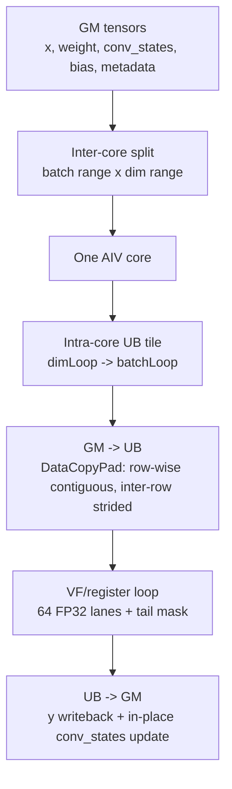

# CausalConv1dDecode BF16 Decode Operator Requirements

## 1. Goal And Scope

`CausalConv1dDecode` is a BF16 causal conv1d operator for decode/update only. It handles the current decode chunk and does not implement prefill or mixed prefill/decode paths.

Goals:

- Match the vLLM Ascend `causal_conv1d` update/decode semantics where applicable.
- Support MTP/speculative decoding with 1 to 4 candidate tokens per batch.
- Produce convolution output `y` for all candidate tokens.
- Align state update with decode/update semantics: the default path appends only accepted tokens, while the vLLM-style W=4 speculative path uses `num_accepted_tokens` to select the history window and writes the current token chunk.
- Update `conv_states` in place. The public output is `y` only.

Out of scope:

- Prefill.
- `initialStateMode`, `runMode`, APC block mapping, residual connection.
- Non-BF16 input/output in v1.
- `activation_mode != 0` in v1 host tiling.

## 2. Interface Requirements

### 2.1 Inputs

| Name | Required | dtype | shape | Semantics |
|---|---:|---|---|---|
| `x` | yes | BF16 | `[B, D]`, `[B, S, D]`, or `[T, D]` | Current decode tokens. `[B,D]` is non-MTP single-token decode; `S` is the fixed-MTP token count per batch; `T` is the flattened varlen token-row count. |
| `weight` | yes | BF16 | `[W, D]` | Depthwise causal conv weights. `W` is 2 to 4. |
| `conv_states` | yes | BF16 | `[num_slots, state_len, D]` | Persistent state cache, selected by `cache_indices`, updated in place. |
| `query_start_loc` | no | INT32 | `[B + 1]` | Required for flattened `x:[T,D]`; maps each batch to its token range in `x`. |
| `cache_indices` | no | INT32 | `[B]` | Maps current batch rows to `conv_states` cache slots; default is `slot = b`. |
| `bias` | no | BF16 | `[D]` | Channel bias, broadcast over batch and token. |
| `num_accepted_tokens` | no | INT32 | `[B]` | Number of tokens accepted and appended to state for each batch; default is the batch token count. |

### 2.2 Attributes

| Name | dtype | Supported in v1 | Semantics |
|---|---|---|---|
| `activation_mode` | int | `0` | `0` means no activation. The attribute is kept, but v1 does not implement SiLU. |
| `pad_slot_id` | int | any int | If `slot == pad_slot_id`, skip that batch. |
| `conv_mode` | int | `0` | Reserved field. v1 supports decode update only. |

### 2.3 Output

| Name | dtype | shape | Semantics |
|---|---|---|---|
| `y` | BF16 | same token layout as `x`: `[B,D]`, `[B,S,D]`, or `[T,D]` | Causal conv output for every candidate token. |

`conv_states` is an in-place side effect on the input tensor and is not returned as a public output.

## 3. Shape And Layout Requirements

- `1 <= B <= 256`
- In `[B,D]` non-MTP decode mode, each batch has exactly 1 token.
- In `[B,S,D]` fixed-MTP decode mode, `1 <= S <= 4`.
- In flattened mode, `query_start_loc[b+1] - query_start_loc[b]` should be in `1..4`.
- `64 <= D <= 16384` and `D % 16 == 0`
- `W == 4`
- Normal decode: `state_len >= W - 1`
- W=4 speculative layout with `num_accepted_tokens`: `state_len >= 2 + max_token_count`
- Default contiguous GM layout:
  - `D` is contiguous for `[B,D]` and `[B,S,D]`, with `xStride = D`.
  - `D` is contiguous for `[T,D]`, with `xStride = D`.
  - `D` is contiguous for `conv_states`, with `cacheStride1 = D` and `cacheStride0 = state_len * D`.
  - `D` is contiguous for `weight[W,D]`.

## 4. Compute Semantics

For batch `b`:

```text
if x is [B,D]:
    row_start = b
    row_end   = b + 1
elif x is [B,S,D]:
    row_start = b * S
    row_end   = (b + 1) * S
else:
    row_start = query_start_loc[b]
    row_end   = query_start_loc[b + 1]

token_count = row_end - row_start
slot = cache_indices[b] if cache_indices exists else b
accepted = num_accepted_tokens[b] if exists else token_count
accepted = clamp(accepted, 0, token_count)
```

If `slot == pad_slot_id`, the batch is skipped.

For token `s` and channel `d`:

```text
base = W - 1
acc = bias[d] if bias exists else 0
hist_base = 0 if num_accepted_tokens absent
hist_base = clamp(accepted - 1, 0, state_len - base) if num_accepted_tokens exists

for k in 0..W-1:
    rel = s - base + k
    if rel < 0:
        v = conv_states[slot, hist_base + rel + base, d]
    else:
        v = x[row_start + rel, d]
    acc += fp32(v) * fp32(weight[k, d])

y[row_start + s, d] = bf16(acc)
```

State update:

```text
default:
    hist = conv_states[slot, hist_base : hist_base + W - 1, :]
    conv_states[slot, 0 : W - 1, :] = last W - 1 rows of concat(hist, x[row_start : row_start + accepted, :])

vLLM-style speculative path when num_accepted_tokens exists and W == 4:
    hist_base = clamp(accepted - 1, 0, state_len - 3)
    conv_states[slot, 0:2, :] = old_state[hist_base + 1 : hist_base + 3, :]
    conv_states[slot, 2 : 2 + token_count, :] = x[row_start : row_end, :]
```

When `num_accepted_tokens` is absent, normal decode persistently stores the history window in `conv_states[slot, 0:W-1, :]`. Rows written by one decode call are therefore read directly by the next call.

Therefore:

- `y` may be computed for all speculative tokens.
- In the default path, only the first `accepted` tokens enter `conv_states`.
- In the vLLM-style W=4 speculative path, `accepted` selects two history rows and the current token chunk is written from state row 2.
- `num_accepted_tokens[b] - 1` is also the state-history read offset, so it affects the history used to compute `y`.

There is an important vLLM Ascend PR 8215 alignment difference: the reference
speculative decode path uses `num_accepted_tokens[b] - 1` as an offset when
loading the history window from `conv_states`. Therefore `num_accepted_tokens`
can affect the computed `y`. The current implementation must either be fixed to
match that behavior or explicitly document the difference as custom semantics.

## 5. Tiling And Dataflow

### 5.1 Overall Hierarchy



Loop hierarchy:

```text
for core in used_cores:                         # inter-core: batch x dim
  for dimLoop in loopNumDim:                    # intra-core UB: dim tile
    CopyWeightBias once for this dim tile       # weight/bias reused across batchLoop
    for batchLoop in loopNumBS:                 # intra-core UB: batch tile
      CopyX for current batch tile
      for batch b in current batch tile:
        CopyIn conv_states[slot(b)] slice
        for token s in token_count(b):
          for vfDimLoop in dimSizeInLoop / 64:  # VF: full mask
            compute 64 FP32 lanes
          if dimRem != 0:                       # VF: tail mask
            compute dimRem lanes
        write accepted state suffix
      write y tile
```

### 5.2 Inter-Core Split

Logical task space:

```text
batch axis x dim axis
```

Token positions are not split because the decode token count is at most 4.

```text
                         D / channel dimension, contiguous inside each tile
              0        dimOffset               dimOffset+coreDimLen        D
              |------------|===========================|-------------------|
B batch  b0   | other core |        core k dim range   |     other core    |
         b1   | other core |        core k dim range   |     other core    |
              |------------|===========================|-------------------|
              firstBatchIdx          batchNum rows
```

One core owns a contiguous batch interval and a contiguous dim interval. The dim interval is contiguous; batch rows are separated by row stride in GM. `cache_indices` selects state slots but does not change inter-core batch ownership.

The current version explicitly selects BH as the main path: `[B,D]`, `[B,S,D]`,
and `[T,D]+query_start_loc` all split `batch x dim`, with the token/S axis kept
inside the core. BSH `flattened_token_rows x dim` tiling is only a future
performance candidate. It fits long sequences or prefill/mixed paths better, but
for 1..4-token decode it adds row-to-batch/s mapping, cross-core state-update
merge, and synchronization overhead.

### 5.3 Intra-Core UB Split

```text
Current core's batch range x dim range

        dimLoop=0          dimLoop=1                  dimLoop=N
     |===============| |===============|        |===============|
b0   | UB tile       | | UB tile       |  ...   | UB tail tile   |
b1   | batchLoop=0   | | batchLoop=0   |        | batchLoop=0   |
     |===============| |===============|        |===============|
b2   | UB tile       | | UB tile       |  ...   | UB tail tile   |
b3   | batchLoop=1   | | batchLoop=1   |        | batchLoop=1   |
     |===============| |===============|        |===============|

Each UB tile = token rows from several batches x one contiguous dim slice.
```

Current UB tile shape:

```text
batchNumInLoop <= ubMainFactorBS
dimSizeInLoop  <= ubMainFactorDim
row_count = query_start_loc[first + batchNumInLoop] - query_start_loc[first]
```

For `[B,D]`, default query offsets are:

```text
query_start_loc[b] = b
```

For `[B,S,D]`, default query offsets are:

```text
query_start_loc[b] = b * S
```

For flattened `[T,D]`, query offsets are read from GM.

## 6. GM To UB Movement Continuity

### 6.1 x

```text
GM x, layout [T,D] or flattened [B*S,D]

row r0:  [d0 ... d0+dimTile-1]  gap: D-dimTile elems
          <---- contiguous ----> <---- skipped by srcStride ---->
row r1:  [d0 ... d0+dimTile-1]  gap
          <---- contiguous ---->
row r2:  [d0 ... d0+dimTile-1]  gap
          <---- contiguous ---->

DataCopyPad:
  blockCount = row_count
  blockLen   = dimSizeInLoop * sizeof(bf16)
  srcStride  = (xStride - dimSizeInLoop) * sizeof(bf16)
  dstStride  = 0

UB xLocal, compact:

row 0: [dimTile elems][dimTile elems][dimTile elems]...
        r0            r1            r2
        no row gap in UB
```

Conclusion: `x` is contiguous within each row, strided between rows, and compact in UB.

### 6.2 weight And bias

```text
GM weight [W,D], W=4

w0: [d0 ... d0+dimTile-1] gap
w1: [d0 ... d0+dimTile-1] gap
w2: [d0 ... d0+dimTile-1] gap    # W>=3
w3: [d0 ... d0+dimTile-1] gap    # W>=4

UB weightLocal, compact:

[w0 dimTile][w1 dimTile][w2 dimTile if exists][w3 dimTile if exists]
```

`bias` is a single contiguous `[dimSizeInLoop]` copy and is logically broadcast across batch and token in VF.

### 6.3 conv_states

```text
cache_indices[b] = slot

GM conv_states [num_slots, state_len, D]

slot 0:  state rows ...
slot 5:  row 0: [d0 ... d0+dimTile-1] gap
         row 1: [d0 ... d0+dimTile-1] gap
         ...
         row state_len-1: [d0 ... d0+dimTile-1] gap
slot 6:  state rows ...

DataCopyPad for current batch:
  src base   = slot * cacheStride0 + hist_base * D + dimOffset + dimOffsetPerLoop
  blockCount = W - 1
  blockLen   = dimSizeInLoop * sizeof(bf16)
  srcStride  = (D - dimSizeInLoop) * sizeof(bf16)
  dstStride  = 0

UB stateLocal, compact:

[history row0 dimTile]...[history row W-2 dimTile]
```

Conclusion: state is copied per batch according to `slot`; it is contiguous within each row, strided between rows, and compact in UB.

## 7. VF/Register Compute

VF processes one contiguous dim slice inside the current UB tile. When `tokenCount == 1`, the kernel uses the single-S path and processes one token row:

```text
src0/src1/src2/src3: [dimSizeInLoop]
weight rows:        [W, dimSizeInLoop]
bias:               [dimSizeInLoop]
y slice:            [dimSizeInLoop]
```

VF loops by register width:

When `tokenCount >= 2`, the kernel uses the multi-S path and processes up to 4 token rows from the same batch:

```text
timeline = [history rows..., x0, x1, x2, x3]
acc0 -> y[b, 0, d0:d1]
acc1 -> y[b, 1, d0:d1]
acc2 -> y[b, 2, d0:d1]
acc3 -> y[b, 3, d0:d1]
```

The multi-S path reuses the same `weight[W, dimTile]` and overlapping state/x timeline values, but increases VF register pressure. CANN compile and profiling are still required to prove that this path is stable and faster than single-S.

```text
reg_elems = 256 / sizeof(float) = 64 fp32 lanes
dimLoopNum = dimSizeInLoop / 64
dimRem = dimSizeInLoop % 64
```

VF register-loop layout:

```text
Input UB slices, all contiguous dimTile:

src0:   [0........63][64.......127] ... [tail]
src1:   [0........63][64.......127] ... [tail]
src2:   [0........63][64.......127] ... [tail]   # W>=3
src3:   [0........63][64.......127] ... [tail]   # W>=4
weight: [w0 rows][w1 rows][w2 rows][w3 rows]
bias:   [0........63][64.......127] ... [tail]
y:      [0........63][64.......127] ... [tail]

for offset = 0, 64, 128, ...
  LoadAlign BF16 x/weight/bias
  Cast BF16 -> FP32
  FP32 mul/add
  Cast FP32 -> BF16
  StoreAlign BF16 y

tail:
  mask = UpdateMask<float>(dimRem)
```

BF16 compute chain:

```text
UB BF16 -> Reg BF16 -> Cast FP32 -> Mul/Add FP32 -> Cast BF16 -> UB BF16
```

`W=4` is the only supported path; the AICore wrapper calls only `Conv1dDecodeW4` or `Conv1dDecodeW4MultiS`, and the VF body has no width-dispatch branch.

## 8. y And conv_states Writeback

`y` writeback:

```text
UB compact slice: [row_count, dimSizeInLoop]
GM logical slice: [row_count, D-subrange]
dstStride = (D - dimSizeInLoop) * sizeof(bf16)
```

State update writeback:

```text
old stateLocal in UB:
  [h0][h1][h2][h3][h4][h5]                 state_len = 6

accepted x rows in UB:
  [x0][x1]                                  accepted = 2

new conv_states[slot]:
  keep suffix old rows + append accepted x
  [h2][h3][h4][h5][x0][x1]

Each [..] denotes only the current dim tile; GM writeback lands each row into the selected channel sub-slice with row stride D.
```

## 9. Synchronization And Queues

- `xQueue`: UB buffer for the current batch tile's x data, synchronized with compute through `EnQue/DeQue`.
- `weightBiasBuf`: UB buffer for the current dim tile's weight and optional bias. Its lifetime covers all batchLoop iterations under the same dimLoop; `CopyWeightBias` uses `SetFlag/WaitFlag` to order GM->UB movement before VF compute.
- `stateQueueIn`: UB buffer for one cache slot state.
- `yQueue`: UB output buffer for y.
- `EnQue` publishes the buffer after MTE movement for compute consumption.
- `DeQue` is the per-tile synchronization boundary before compute uses the tensor.
- Metadata buffers (`query_start_loc`, `cache_indices`, `num_accepted_tokens`) live in `TBuf`; after GM copy, `SetFlag/WaitFlag` must ensure MTE2 completion before scalar reads.

## 10. Correctness Requirements

Coverage must include:

- `x` as `[B,D]` without `query_start_loc`.
- `x` as `[B,S,D]` without `query_start_loc`.
- `x` as `[T,D]` with `query_start_loc`.
- `W = 2, 3, 4`.
- `S/token_count = 1, 2, 3, 4`.
- `cache_indices` absent and present.
- `num_accepted_tokens` absent, zero, partially accepted, and fully accepted.
- `bias` absent and present.
- dim main/tail tiles.
- `pad_slot_id` hit and miss.

The oracle is a Python/NumPy or PyTorch reference with FP32 accumulation and BF16 output rounding.

## 11. Known Limits

- CANN compile validation has not been completed in the current environment.
- SiLU is not implemented in v1.
- Host tiling cannot inspect runtime `query_start_loc` values; flattened-mode per-batch token count validity must be guaranteed by the caller or tested at runtime.
- The current code now supports `[B,D]` non-MTP decode input; CANN compile validation is still pending.
- The current code now uses `num_accepted_tokens` to offset state-history loading, so it can affect `y`. When `W == 4` and `num_accepted_tokens` exists, it also implements the vLLM Ascend PR 8215-style speculative state writeback path. CANN compile validation is still pending.
- INT64 metadata is intentionally not included; this project keeps INT32 metadata by decision.
