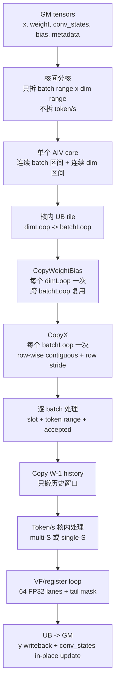

# CausalConv1dDecode BF16 Decode 算子需求

## 1. 目标和边界

`CausalConv1dDecode` 是面向 decode/update 场景的 BF16 causal conv1d 算子。它只处理当前 decode chunk，不处理 prefill，不处理 prefill/decode 混合路径。

目标：

- 对齐 vLLM Ascend `causal_conv1d` 的 update/decode 语义。
- 支持 MTP/speculative decoding：每个 batch 可以有 1 到 4 个候选 token。
- 输出所有候选 token 的卷积结果 `y`。
- 状态更新对齐 decode/update 语义：默认路径只追加 accepted token；vLLM-style W=4 speculative 路径按 `num_accepted_tokens` 选择历史窗口并写入当前 token chunk。
- `conv_states` 原地更新，公开输出只有 `y`。

非目标：

- 不支持 prefill。
- 不支持 `initialStateMode`、`runMode`、APC block mapping、residual connection。
- v1 只支持 BF16 输入输出。
- v1 host tiling 只接受 `activation_mode = 0`。

## 2. 接口需求

### 2.1 输入

| 名称 | 必选 | dtype | shape | 语义 |
|---|---:|---|---|---|
| `x` | 是 | BF16 | `[B, D]`、`[B, S, D]` 或 `[T, D]` | 当前 decode token。`[B,D]` 是非 MTP 单 token decode；`S` 是定长 MTP 每 batch token 数；`T` 是 flatten 变长模式总 token 数。 |
| `weight` | 是 | BF16 | `[W, D]` | depthwise causal conv 权重，`W` 当前仅支持 4。 |
| `conv_states` | 是 | BF16 | `[num_slots, state_len, D]` | 持久状态缓存，按 `cache_indices` 选择 slot，原地更新。 |
| `query_start_loc` | 否 | INT32 | `[B + 1]` | flatten `x:[T,D]` 时必选，描述每个 batch 在 `x` 中的 token 范围。 |
| `cache_indices` | 否 | INT32 | `[B]` | 当前 batch 到 `conv_states` cache slot 的映射；缺省时 `slot = b`。 |
| `bias` | 否 | BF16 | `[D]` | channel bias，对 batch 和 token 广播。 |
| `num_accepted_tokens` | 否 | INT32 | `[B]` | 每个 batch 接受并写入 state 的 token 数；缺省时等于该 batch 的 token 数。 |

### 2.2 属性

| 名称 | dtype | v1 支持值 | 语义 |
|---|---|---|---|
| `activation_mode` | int | `0` | `0` 表示无激活。接口保留该属性，但 v1 不实现 SiLU。 |
| `pad_slot_id` | int | 任意 int | 当 `slot == pad_slot_id` 时跳过该 batch 的计算和状态更新。 |
| `conv_mode` | int | `0` | 保留字段，v1 只支持 decode update 模式。 |

### 2.3 输出

| 名称 | dtype | shape | 语义 |
|---|---|---|---|
| `y` | BF16 | 与 `x` 的 token 布局一致：`[B,D]`、`[B,S,D]` 或 `[T,D]` | 每个候选 token 的 causal conv 输出。 |

`conv_states` 是输入张量的原地副作用，不作为公开输出返回。

## 3. Shape 和布局需求

- `1 <= B <= 256`
- `[B,D]` 非 MTP decode 下每个 batch 固定 1 个 token。
- `[B,S,D]` 定长 MTP decode 下 `1 <= S <= 4`。
- flatten 模式下，`query_start_loc[b+1] - query_start_loc[b]` 应在 `1..4`。
- `64 <= D <= 16384`，且 `D % 16 == 0`
- `W == 4`
- 普通 decode：`state_len >= W - 1`
- W=4 且存在 `num_accepted_tokens` 的 speculative layout：`state_len >= 2 + max_token_count`
- GM 默认连续布局：
  - `[B,D]` 和 `[B,S,D]` 中 `D` 方向连续，`xStride = D`。
  - `[T,D]` 中 `D` 方向连续，`xStride = D`。
  - `conv_states` 中 `D` 方向连续，`cacheStride1 = D`，`cacheStride0 = state_len * D`。
  - `weight[W,D]` 中 `D` 方向连续。

## 4. 计算语义

对 batch `b`：

```text
if x is [B,D]:
    row_start = b
    row_end   = b + 1
elif x is [B,S,D]:
    row_start = b * S
    row_end   = (b + 1) * S
else:
    row_start = query_start_loc[b]
    row_end   = query_start_loc[b + 1]

token_count = row_end - row_start
slot = cache_indices[b] if cache_indices exists else b
accepted = num_accepted_tokens[b] if exists else token_count
accepted = clamp(accepted, 0, token_count)
```

当 `slot == pad_slot_id` 时，该 batch 跳过。

对第 `s` 个 token 和 channel `d`：

```text
base = W - 1
acc = bias[d] if bias exists else 0
hist_base = 0 if num_accepted_tokens absent
hist_base = clamp(accepted - 1, 0, state_len - base) if num_accepted_tokens exists

for k in 0..W-1:
    rel = s - base + k
    if rel < 0:
        v = conv_states[slot, hist_base + rel + base, d]
    else:
        v = x[row_start + rel, d]
    acc += fp32(v) * fp32(weight[k, d])

y[row_start + s, d] = bf16(acc)
```

状态更新：

```text
default:
    hist = conv_states[slot, hist_base : hist_base + W - 1, :]
    conv_states[slot, 0 : W - 1, :] = last W - 1 rows of concat(hist, x[row_start : row_start + accepted, :])

vLLM-style speculative path when num_accepted_tokens exists and W == 4:
    hist_base = clamp(accepted - 1, 0, state_len - 3)
    conv_states[slot, 0:2, :] = old_state[hist_base + 1 : hist_base + 3, :]
    conv_states[slot, 2 : 2 + token_count, :] = x[row_start : row_end, :]
```

无 `num_accepted_tokens` 时，普通 decode 的持久历史窗口固定在 `conv_states[slot, 0:W-1, :]`。这样本轮写回的 `W-1` 行会被下一轮 decode 直接读到。

因此：

- `y` 可以为 speculative token 全量计算。
- 默认路径只有前 `accepted` 个 token 进入 `conv_states`。
- vLLM-style W=4 speculative 路径会按 `accepted` 选择两行历史，并从 state row 2 开始写入本次 token chunk。

`num_accepted_tokens[b] - 1` 会作为读取 `conv_states` 历史窗口的偏移，
因此它会影响 `y` 的计算输入，而不是只影响 state 写回。

## 5. 分核和数据流

### 5.1 总体层级



循环层级：

```text
for core in used_cores:                         # 核间: batch x dim
  for dimLoop in loopNumDim:                    # 核内 UB: dim tile
    CopyWeightBias once for this dim tile       # weight/bias 在 batchLoop 间复用
    for batchLoop in loopNumBS:                 # 核内 UB: batch tile
      CopyX for current batch tile
      for batch b in current batch tile:
        CopyIn conv_states[slot(b)] slice
        if token_count(b) >= 2:
          Conv1dDecodeMultiS(...)               # s=0..3 在一次 multi-S VF 中展开
        else:
          for token s in token_count(b):        # 单 token 路径，实际最多一次
            Conv1dDecodeW4(...)
        for vfDimLoop in dimSizeInLoop / 64:    # VF 内: full mask
          compute 64 FP32 lanes
        if dimRem != 0:                         # VF 内: tail mask
          compute dimRem lanes
        write accepted state suffix
      write y tile
```

说明：`s/token` 维不是核间分核轴。当前 BH 路径只在核间拆 `batch x dim`；每个 batch 的 token 在 `Compute()` 内处理。`token_count>=2` 时，代码构造 `[history..., x0, x1, x2, x3]` timeline，并通过 `Conv1dDecodeMultiS` 一次最多计算 `s=0..3` 的 `y0..y3`；`token_count==1` 时走 single-S VF。

### 5.2 核间分核

逻辑任务空间是：

```text
batch axis x dim axis
```

不拆 token，因为 decode token 数最多 4。

```text
                         D / channel dimension, contiguous inside each tile
              0        dimOffset               dimOffset+coreDimLen        D
              |------------|===========================|-------------------|
B batch  b0   | other core |        core k dim range   |     other core    |
         b1   | other core |        core k dim range   |     other core    |
              |------------|===========================|-------------------|
              firstBatchIdx          batchNum rows
```

一个 core 只拥有一个连续 batch 区间和一个连续 dim 区间。dim 区间内部连续；batch 行之间在 GM 上通过行 stride 跳转。`cache_indices` 只影响 state slot，不改变核间 batch 归属。

当前版本明确选择 BH 主路径：`[B,D]`、`[B,S,D]`、`[T,D]+query_start_loc`
都按 `batch x dim` 分核，token/S 维度在核内循环。BSH 的
`flattened_token_rows x dim` 分核只作为后续性能候选；它适合长序列或 prefill/mixed，
但对 1..4 token 的 decode 会引入 row 到 batch/s 反查、跨核 state update 合并和同步成本。

### 5.3 核内 UB 切分

```text
当前 core 的 batch range x dim range

        dimLoop=0          dimLoop=1                  dimLoop=N
     |===============| |===============|        |===============|
b0   | UB tile       | | UB tile       |  ...   | UB tail tile   |
b1   | batchLoop=0   | | batchLoop=0   |        | batchLoop=0   |
     |===============| |===============|        |===============|
b2   | UB tile       | | UB tile       |  ...   | UB tail tile   |
b3   | batchLoop=1   | | batchLoop=1   |        | batchLoop=1   |
     |===============| |===============|        |===============|

每个 UB tile = 若干 batch 的 token rows x 一段连续 dim。
```

当前 UB tile 的形状：

```text
batchNumInLoop <= ubMainFactorBS
dimSizeInLoop  <= ubMainFactorDim
row_count = query_start_loc[first + batchNumInLoop] - query_start_loc[first]
```

对 `[B,D]` 输入，`query_start_loc` 使用默认值：

```text
query_start_loc[b] = b
```

对 `[B,S,D]` 输入，`query_start_loc` 使用默认值：

```text
query_start_loc[b] = b * S
```

对 flatten `[T,D]` 输入，`query_start_loc` 来自 GM。

## 6. GM 到 UB 搬运连续性

### 6.1 x

```text
GM x, layout [T,D] or flattened [B*S,D]

row r0:  [d0 ... d0+dimTile-1]  gap: D-dimTile elems
          <---- contiguous ----> <---- skipped by srcStride ---->
row r1:  [d0 ... d0+dimTile-1]  gap
          <---- contiguous ---->
row r2:  [d0 ... d0+dimTile-1]  gap
          <---- contiguous ---->

DataCopyPad:
  blockCount = row_count
  blockLen   = dimSizeInLoop * sizeof(bf16)
  srcStride  = (xStride - dimSizeInLoop) * sizeof(bf16)
  dstStride  = 0

UB xLocal, compact:

row 0: [dimTile elems][dimTile elems][dimTile elems]...
        r0            r1            r2
        no row gap in UB
```

结论：`x` 每一行内部连续搬运，行间非连续，UB 内连续压实。

### 6.2 weight 和 bias

```text
GM weight [W,D], W=4

w0: [d0 ... d0+dimTile-1] gap
w1: [d0 ... d0+dimTile-1] gap
w2: [d0 ... d0+dimTile-1] gap    # W>=3
w3: [d0 ... d0+dimTile-1] gap    # W>=4

UB weightLocal, compact:

[w0 dimTile][w1 dimTile][w2 dimTile if exists][w3 dimTile if exists]
```

`bias` 是单行 `[dimSizeInLoop]` 连续搬运，在 VF 中对 batch 和 token 逻辑广播。

### 6.3 conv_states

```text
cache_indices[b] = slot

GM conv_states [num_slots, state_len, D]

slot 0:  state rows ...
slot 5:  row 0: [d0 ... d0+dimTile-1] gap
         row 1: [d0 ... d0+dimTile-1] gap
         ...
         row state_len-1: [d0 ... d0+dimTile-1] gap
slot 6:  state rows ...

DataCopyPad for current batch:
  src base   = slot * cacheStride0 + hist_base * D + dimOffset + dimOffsetPerLoop
  blockCount = W - 1
  blockLen   = dimSizeInLoop * sizeof(bf16)
  srcStride  = (D - dimSizeInLoop) * sizeof(bf16)
  dstStride  = 0

UB stateLocal, compact:

[history row0 dimTile]...[history row W-2 dimTile]
```

结论：state 是每个 batch 根据 slot 单独搬；当前 decode 只搬 `W-1` 行历史窗口，行内连续，行间按 `D` stride，UB 内 compact。

## 7. VF/register 计算

VF 处理当前 UB tile 内的一段连续 dim。`tokenCount == 1` 时走 single-S 路径，一次处理一个 token row：

```text
src0/src1/src2/src3: [dimSizeInLoop]
weight rows:        [W, dimSizeInLoop]
bias:               [dimSizeInLoop]
y slice:            [dimSizeInLoop]
```

VF 内按寄存器宽度循环：

`tokenCount >= 2` 时走 multi-S 路径，一次最多处理同一 batch 的 4 个 token row：

```text
timeline = [history rows..., x0, x1, x2, x3]
acc0 -> y[b, 0, d0:d1]
acc1 -> y[b, 1, d0:d1]
acc2 -> y[b, 2, d0:d1]
acc3 -> y[b, 3, d0:d1]
```

multi-S 路径复用同一组 `weight[W, dimTile]` 和重叠的 state/x timeline，但会增加 VF register 压力。CANN 编译和 profiling 仍需验证该路径是否稳定优于 single-S。

```text
reg_elems = 256 / sizeof(float) = 64 fp32 lanes
dimLoopNum = dimSizeInLoop / 64
dimRem = dimSizeInLoop % 64
```

VF 内部寄存器循环图：

```text
输入 UB slice，均为连续 dimTile:

src0:   [0........63][64.......127] ... [tail]
src1:   [0........63][64.......127] ... [tail]
src2:   [0........63][64.......127] ... [tail]   # W>=3
src3:   [0........63][64.......127] ... [tail]   # W>=4
weight: [w0 rows][w1 rows][w2 rows][w3 rows]
bias:   [0........63][64.......127] ... [tail]
y:      [0........63][64.......127] ... [tail]

for offset = 0, 64, 128, ...
  LoadAlign BF16 x/weight/bias
  Cast BF16 -> FP32
  FP32 mul/add
  Cast FP32 -> BF16
  StoreAlign BF16 y

tail:
  mask = UpdateMask<float>(dimRem)
```

BF16 计算链路：

```text
UB BF16 -> Reg BF16 -> Cast FP32 -> Mul/Add FP32 -> Cast BF16 -> UB BF16
```

`W=4` 是唯一支持路径；AICore wrapper 只调用 `Conv1dDecodeW4` 或 `Conv1dDecodeW4MultiS`，VF 内没有 width 分发分支。

## 8. y 和 conv_states 写回

`y` 写回：

```text
UB compact slice: [row_count, dimSizeInLoop]
GM logical slice: [row_count, D-subrange]
dstStride = (D - dimSizeInLoop) * sizeof(bf16)
```

状态更新写回：

```text
old stateLocal in UB:
  [h0][h1][h2][h3][h4][h5]                 state_len = 6

accepted x rows in UB:
  [x0][x1]                                  accepted = 2

new conv_states[slot]:
  keep suffix old rows + append accepted x
  [h2][h3][h4][h5][x0][x1]

每个 [..] 只表示当前 dim tile；写回 GM 时每一行按 D stride 落到对应 channel 子片。
```

## 9. 同步和队列

- `xQueue`：承载当前 batch tile 的 x UB buffer，通过 `EnQue/DeQue` 和 compute 同步。
- `weightBiasBuf`：承载当前 dim tile 的 weight 和可选 bias，生命周期覆盖该 dimLoop 内所有 batchLoop；`CopyWeightBias` 后用 `SetFlag/WaitFlag` 建立 GM->UB 到 VF 的顺序。
- `stateQueueIn`：承载单个 cache slot 的 state UB buffer。
- `yQueue`：承载 y 的 UB output buffer。
- `EnQue` 表示对应 MTE 搬运提交完成后，计算侧可以 `DeQue` 消费。
- `DeQue` 是 tile 内计算使用该 UB tensor 的同步边界。
- metadata buffer（`query_start_loc`、`cache_indices`、`num_accepted_tokens`）通过 `TBuf` 存放，GM copy 后用 `SetFlag/WaitFlag` 保证 scalar 读取前 MTE2 完成。

## 10. 正确性需求

必须覆盖：

- `x` 为 `[B,D]`，无 `query_start_loc`。
- `x` 为 `[B,S,D]`，无 `query_start_loc`。
- `x` 为 `[T,D]`，带 `query_start_loc`。
- `W = 2, 3, 4`。
- `S/token_count = 1, 2, 3, 4`。
- `cache_indices` 缺省和存在。
- `num_accepted_tokens` 缺省、0、部分接受、全部接受。
- `bias` 缺省和存在。
- dim main/tail tile。
- `pad_slot_id` 命中和不命中。

验证 oracle 使用 Python/NumPy 或 PyTorch reference，FP32 累加，输出 cast 到 BF16。

## 11. 已知限制

- 当前环境未完成 CANN 编译验证。
- v1 未实现 SiLU。
- host tiling 不能读取 `query_start_loc` 的运行时内容，所以 flatten 模式的每 batch token 数合法性依赖调用侧保证或运行时测试覆盖。
- 当前代码已补 `[B,D]` 非 MTP decode 输入；仍需 CANN 编译验证。
- 当前代码已补 `num_accepted_tokens` 对 state 历史窗口读取的影响，因此它会影响 `y`；W=4 且存在 `num_accepted_tokens` 时也已补 vLLM Ascend PR 8215 风格 speculative state writeback。仍需 CANN 编译验证。
- INT64 metadata 未纳入当前接口，按项目决策保留 INT32。
