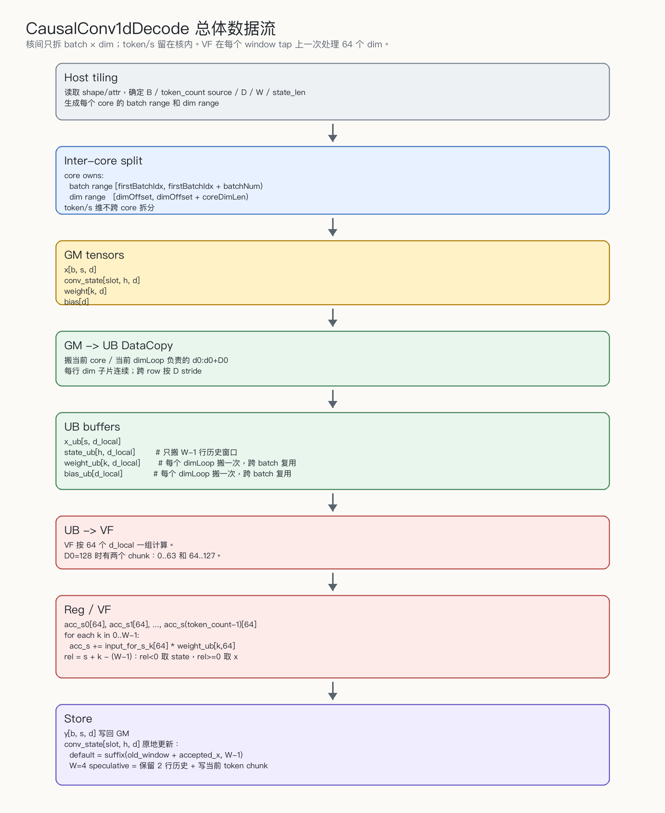

# CausalConv1dDecode 基线对齐与流程图

## 1. 基线目标

本算子当前基线分成两层：

1. 功能语义对齐 vLLM Ascend PR 8215 的 `CausalConv1d` decode/update 路径。
2. 接口组织、AICore kernel 结构、GM->UB->VF->GM 数据流对齐 `ops-transformer` A5 风格。

有意保留的项目差异：

| 项目 | vLLM Ascend PR 8215 | 本算子 |
|---|---|---|
| 算子范围 | `runMode` 覆盖 prefill/decode | decode-only |
| `initialStateMode` | 支持 | 不支持，按用户确认排除 prefill 相关输入 |
| dtype | FP16 路径 | BF16 only |
| metadata dtype | INT64 | INT32 |
| activation | `activationMode=0/1` | v1 只支持 `activation_mode=0` |
| width | 2..4，speculative writeback 仅 W=4 | 当前仅支持 W=4 |

这些差异之外，decode/update 的输入模式、历史窗口选择、`cache_indices` slot 选择、`query_start_loc` 变长范围、W=4 speculative state layout 应保持可替换语义。

## 2. 当前已对齐文件

代码：

- `op_host/causal_conv1d_decode_def.cpp`
- `op_host/causal_conv1d_decode_tiling.cpp`
- `op_graph/causal_conv1d_decode_proto.h`
- `op_api/causal_conv1d_decode.cpp`
- `op_kernel/arch35/causal_conv1d_decode_cut_bh.h`
- `op_kernel/arch35/vf/causal_conv1d_decode_width4_vf.h`
- `tests/reference_causal_conv1d_decode.py`

主文档：

- `docs/REQUIREMENTS.zh.md`
- `docs/REQUIREMENTS.en.md`
- `reports/spec.zh.md`
- `reports/spec.md`
- `reports/tiling_strategy.zh.md`
- `reports/tiling_strategy.md`
- `specs/ascendc_operator_dataflow_spec.zh.md`
- `specs/ascendc_operator_dataflow_spec.md`
- `reports/work_log.zh.md`
- `reports/work_log.md`

## 3. 接口与输入模式

当前公开接口：

```text
x                    BF16  [B,D] / [B,S,D] / [T,D]
weight               BF16  [W,D], W=4
conv_states          BF16  [num_slots,state_len,D], in-place update
query_start_loc      INT32 optional [B+1]
cache_indices        INT32 optional [B]
bias                 BF16 optional [D]
num_accepted_tokens  INT32 optional [B]
y                    BF16 same token layout as x

attrs:
  activation_mode = 0 only
  pad_slot_id
  conv_mode = 0 only
```

三种 decode 输入模式：

| 输入 | `query_start_loc` | token 范围来源 | 对齐关系 |
|---|---|---|---|
| `[B,D]` | 缺省或空 | `row_start=b, row_end=b+1` | vLLM inputMode=2 |
| `[B,S,D]` | 缺省或空 | `row_start=b*S, row_end=(b+1)*S` | vLLM inputMode=1 |
| `[T,D]` | `[B+1]` | `query_start_loc[b:b+1]` | vLLM inputMode=0 |

Flatten 变长模式要求调用侧保证：

```text
query_start_loc[0] = 0
query_start_loc 单调
1 <= query_start_loc[b+1] - query_start_loc[b] <= 4
query_start_loc[B] = T
```

host tiling 当前只能检查 `query_start_loc` shape，不能读取运行时值。

## 4. 功能语义

对 batch `b`：

```text
row_start = token range begin
row_end   = token range end
token_count = row_end - row_start

slot = cache_indices[b] if cache_indices exists else b
accepted = num_accepted_tokens[b] if exists else token_count
accepted = clamp(accepted, 0, token_count)

base = W - 1
hist_base = 0 if num_accepted_tokens absent
hist_base = clamp(accepted - 1, 0, state_len - base) if num_accepted_tokens exists
```

计算第 `s` 个 token、channel `d`：

```text
acc = bias[d] if bias exists else 0
for k in 0..W-1:
    rel = s - (W - 1) + k
    if rel < 0:
        v = conv_states[slot, hist_base + rel + W - 1, d]
    else:
        v = x[row_start + rel, d]
    acc += fp32(v) * fp32(weight[k, d])
y[row_start + s, d] = bf16(acc)
```

普通 decode 写回：

```text
hist = conv_states[slot, hist_base : hist_base + W - 1]
conv_states[slot, 0 : W - 1] = last(W - 1, concat(hist, x[row_start : row_start + accepted]))
```

W=4 speculative / MTP 写回：

```text
hist_base = clamp(accepted - 1, 0, state_len - 3)
conv_states[slot, 0:2] = old_state[hist_base + 1 : hist_base + 3]
conv_states[slot, 2 : 2 + token_count] = x[row_start : row_end]
```

注意：MTP 路径不是只写 accepted 个 token，而是写完整当前 token chunk。这是为了对齐 vLLM 的 speculative state layout，让下一轮可以继续按新的 `num_accepted_tokens` 从 state 中切出历史窗口。

## 5. 总体流程图

PNG 版本保存为：

```text
reports/images/causal_conv1d_decode_overall_flow_text.png
```



文本版如下。这里故意不使用 B*S 作为核间分核轴；`[T,D]` 只是变长输入的存储形态，核间仍然只拆 `batch x dim`，每个 batch 的 token 范围在核内由 `query_start_loc` 或固定 `S` 得到。

```text
Host tiling
  读取 shape/attr，确定 B / token_count source / D / W / state_len
  生成每个 core 的 batch range 和 dim range

        |
        v

Inter-core split
  core owns:
    batch range [firstBatchIdx, firstBatchIdx + batchNum)
    dim range   [dimOffset, dimOffset + coreDimLen)
  token/s 维不跨 core 拆分

        |
        v

GM tensors
  x[b, s, d]
  conv_state[slot, h, d]
  weight[k, d]
  bias[d]

        |
        | DataCopy 当前 core / 当前 dimLoop 负责的 d0:d0+D0
        v

UB buffers
  x_ub[s, d_local]
  state_ub[h, d_local]        # 只搬 W-1 行历史窗口
  weight_ub[k, d_local]       # 每个 dimLoop 搬一次，跨 batch 复用
  bias_ub[d_local]            # 每个 dimLoop 搬一次，跨 batch 复用

        |
        | VF 按 64 个 d_local 一组计算
        v

Reg / VF
  acc_s0[64]
  acc_s1[64]
  ...
  acc_s(token_count-1)[64]

  for each k in 0..W-1:
    acc_s += input_for_s_k[64] * weight_ub[k, 64]

        |
        | Store
        v

GM outputs / side effects
  y[b, s, d]
  conv_state[slot, h, d] 更新
```

对应的核内循环骨架：

```text
for dimTile in current core dim range:
    CopyWeightBias(weight[0:W, dimTile], bias[dimTile])

    for batchTile in current core batch range:
        CopyX(x[batchTile token rows, dimTile])

        for b in batchTile:
            slot = cache_indices[b] if exists else b
            token_count = token range length for b
            accepted = clamp(num_accepted_tokens[b], 0, token_count)

            CopyState(conv_state[slot, history window, dimTile])  # W-1 rows
            VFComputeOneBatch(x_ub, state_ub, weight_ub, bias_ub)
            StoreY(y[b, token range, dimTile])
            UpdateState(conv_state[slot, 0:W-1, dimTile])
```

## 6. 分核与数据流

核间分核：

```text
blockIdx -> (batchCoreIdx, dimCoreIdx)

batchCoreIdx owns:
  batch range [firstBatchIdx, firstBatchIdx + batchNum)

dimCoreIdx owns:
  dim range [dimOffset, dimOffset + coreDimLen)
```

核内循环：

```text
for dimLoop in loopNumDim:
    dimSizeInLoop = ubMainFactorDim or ubTailFactorDim
    dimOffsetPerLoop = dimLoop * ubMainFactorDim
    CopyWeightBias()               # only once per dimLoop

    for batchLoop in loopNumBS:
        batchNumInLoop = ubMainFactorBS or ubTailFactorBS
        rowStart = queryLocal[firstBatchIdxInLoop]
        rowEnd   = queryLocal[firstBatchIdxInLoop + batchNumInLoop]
        CopyX(rowStart:rowEnd, dimTile)
        Compute(...)
```

`s/token` 维不参与核间分核，也不是 `Process()` 外层循环。它在 `Compute()` 内部、每个 batch 的 `tokenCount` 里处理：

```text
for b in current batchLoop:
    curRowStart = queryLocal[b]
    curRowEnd   = queryLocal[b + 1]
    tokenCount  = curRowEnd - curRowStart
    ubOffset    = (curRowStart - tileRowStart) * dimSizeInLoop

    CopyState(W-1 history rows)

    if tokenCount >= 2:
        # 当前优化路径：multi-S VF
        # 构造 timeline = [history..., x0, x1, x2, x3]
        # 一次 VF call 最多计算 s=0..3 的 y
        Conv1dDecodeMultiS(...)
    else:
        # tokenCount == 1，single-S VF
        for s in 0..tokenCount-1:
            src[k] = history row if s - (W - 1) + k < 0 else x row
            Conv1dDecodeW4(...)

    UpdateConvStates(...)
```

所以当前代码里看不到通用的外层 `for s in 0..S`，是因为：

- `tokenCount == 1` 时确实有显式 `for s`，但只循环一次。
- `tokenCount >= 2` 时走 multi-S，`s=0..3` 被展开成 `y0/y1/y2/y3`，由 VF 函数内部按 `tokenCount` 计算有效 token。
- 分核仍然是 BH：核间拆 `batch x dim`，token/s 留在核内。

### 6.1 token/s 维计算图

以 `W=4, tokenCount=4` 为例：

```text
输入到当前 batch 的核内 timeline:

history: [h0][h1][h2]          # W-1 = 3 行，从 conv_states 搬入
x:                       [x0][x1][x2][x3]

拼成逻辑 timeline:
index:     0   1   2   3   4   5   6
value:    h0  h1  h2  x0  x1  x2  x3

s=0: y0 uses [h0,h1,h2,x0]
s=1: y1 uses [h1,h2,x0,x1]
s=2: y2 uses [h2,x0,x1,x2]
s=3: y3 uses [x0,x1,x2,x3]
```

multi-S VF 做的是把上面 4 个 `s` 的窗口在同一个 dimTile 上一起算：

```text
Conv1dDecodeMultiS(
  line0=h0, line1=h1, line2=h2, line3=x0,
  line4=x1, line5=x2, line6=x3,
  weight, bias,
  y0, y1, y2, y3,
  dimSizeInLoop, W, tokenCount)
```

每个 `line*` 都是 `[dimSizeInLoop]` 的连续 dim 子片；VF 内再按 64 个 FP32 lane + tail mask 切 dim。

数据流：

```text
GM weight[W,D] / bias[D]
  -> DataCopyPad once per dimLoop
  -> UB weightBiasBuf
  -> reused by all batchLoop under this dimLoop

GM x rows
  -> DataCopyPad per batchLoop
  -> UB xQueue

GM conv_states selected slot/history
  -> DataCopyPad W-1 rows per batch
  -> UB stateQueueIn

UB x + UB state + UB weight/bias
  -> VF Reg compute
  -> UB y
  -> GM y

UB state/x
  -> GM conv_states in-place update
```

## 7. 变长 W=4 / state_len=6 Case

设：

```text
B = 3
T = 7
D = dim
W = 4
state_len = 6

query_start_loc = [0, 2, 3, 7]
cache_indices   = [5, 6, 7]
num_accepted_tokens = [2, 1, 3]
```

batch token 范围：

```text
b0: x[0:2] = [x0, x1], token_count=2, slot=5, accepted=2
b1: x[2:3] = [x2],     token_count=1, slot=6, accepted=1
b2: x[3:7] = [x3, x4, x5, x6], token_count=4, slot=7, accepted=3
```

聚焦 `b2`：

```text
old conv_states[slot=7]:
row0 row1 row2 row3 row4 row5
[h0][h1][h2][h3][h4][h5]

accepted = 3
hist_base = accepted - 1 = 2
W - 1 = 3
```

GM -> UB 只搬 W-1 个历史行：

```text
GM conv_states[7, 2:5]:
row2 row3 row4
[h2][h3][h4]

UB stateLocal:
[h2][h3][h4]
```

x 搬运：

```text
GM x[3:7]:
[x3][x4][x5][x6]

UB xLocal for b2:
[x3][x4][x5][x6]
```

y 计算：

```text
y3 = h2*w0 + h3*w1 + h4*w2 + x3*w3 + bias
y4 = h3*w0 + h4*w1 + x3*w2 + x4*w3 + bias
y5 = h4*w0 + x3*w1 + x4*w2 + x5*w3 + bias
y6 = x3*w0 + x4*w1 + x5*w2 + x6*w3 + bias
```

W=4 speculative state 写回：

```text
selected history = [h2][h3][h4]
keep two rows    = [h3][h4]
current chunk    = [x3][x4][x5][x6]

new conv_states[7]:
row0 row1 row2 row3 row4 row5
[h3][h4][x3][x4][x5][x6]
```

下一轮如果 `accepted=3`，历史窗口从 row2 开始切：

```text
hist_base = 3 - 1 = 2
history = conv_states[7, 2:5] = [x3][x4][x5]
```

这就是 vLLM-style speculative layout 的目的：本轮写完整候选 chunk，下一轮通过新的 accepted offset 选择逻辑历史。

## 8. 变长 batch group 搬运图

当前实现为了减少 x 搬运调度，会把一个 batch tile 内连续的 token rows 一次搬到 UB。这里的 row 是 `x` 的存储行，不是核间分核轴；核间仍然按 `batch x dim` 拆：

```text
query_start_loc = [0, 2, 3, 7]
batch tile = b0..b2

GM x rows:
row0 row1 | row2 | row3 row4 row5 row6
 b0 b0   | b1   | b2  b2  b2  b2

CopyX:
rowStart = query_start_loc[b0] = 0
rowEnd   = query_start_loc[b3] = 7
blockCount = 7

UB xLocal:
[row0][row1][row2][row3][row4][row5][row6]
```

每个 batch 在 UB 内的位置：

```text
b0 offset = query_start_loc[0] - rowStart = 0
b1 offset = query_start_loc[1] - rowStart = 2
b2 offset = query_start_loc[2] - rowStart = 3
```

这个方案与 vLLM per-batch task 的差异：

```text
vLLM:
  one task copies one batch segment

本实现:
  one batchLoop copies a contiguous group of batch segments
```

只要 `query_start_loc` 单调、batch group rows 连续、token_count 合法，语义一致；这是搬运策略差异，不改变 decode/update 基线。

## 9. A5 / ops-transformer 对齐点

当前 kernel 保持 A5 风格：

- host tiling 生成固定 tiling data。
- kernel 入口为 `__global__ __aicore__`，使用 `workspace` 和 `tiling`。
- GM tensor 通过 `GlobalTensor` 访问。
- GM->UB 使用 `DataCopyPad`，支持行内连续、行间 stride。
- x/state/y 使用 `TQue` 管理阶段边界。
- metadata 和 weight/bias 使用 `TBuf`，通过 `SetFlag/WaitFlag` 表达 GM copy 后的使用顺序。
- VF 计算通过 `__simd_vf__` + `RegTensor` + `LoadAlign/StoreAlign/Cast/Mul/Add`。
- `W=4` 在 AICore wrapper 层分发到固定宽度 VF 函数，避免 VF 内对 W 做 tap 分支。

## 10. 待验证项

- CANN 编译未在本地完成。
- VF multi-S 的 register pressure 仍需单独优化和 profiling。
- batch-group row copy 需要 runtime case 覆盖非法/边界 `query_start_loc`。
- W=4 speculative writeback 需要与 vLLM reference 做硬件侧逐元素对比。
