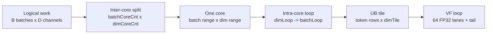

# Tiling Strategy

## Goals

The CUDA cleanroom version showed that causal decode with `S <= 4` is naturally lane-parallel. For Ascend C, preserve the intent:

- one independent lane is `(batch, channel)`
- keep the whole short decode chunk in local computation
- avoid prefill-like sequence tiling
- update state in the same kernel

## Tile Axes

Primary split:

```text
batch axis x dim axis
```

No split on `seq_len` because `seq_len <= 4`.



2D core split:

```text
                  D / channel
        |------ core dim 0 ------|------ core dim 1 ------|--- tail ---|
B  b0   | C(0,0)                 | C(0,1)                 | C(0,t)    |
   b1   | C(0,0)                 | C(0,1)                 | C(0,t)    |
        |------------------------|------------------------|-----------|
   b2   | C(1,0)                 | C(1,1)                 | C(1,t)    |
   b3   | C(1,0)                 | C(1,1)                 | C(1,t)    |

Each C(batchCore, dimCore) is one AIV core's logical ownership.
```

## Candidate Channel Tiles

```yaml
channel_tile_candidates: [64, 128, 256]
```

Initial recommendation: `128`.

Reasoning:

- `dim` is multiple of 16.
- BF16 channel-contiguous loads are efficient.
- UB footprint is small:
  - x: `seq_len * channel_tile`
  - state: `(3 + seq_len) * channel_tile`
  - weight: `4 * channel_tile`
  - y: `seq_len * channel_tile`

For `seq_len=4`, `state_len=7`, `channel_tile=128`, BF16 input footprint is roughly:

```text
(4 + 7 + 4 + 4) * 128 * 2 bytes = 4864 bytes
```

This is small enough to leave room for FP32 temporaries.

## Core Assignment

```text
num_channel_tiles = ceil(dim / channel_tile)
total_tiles = batch * num_channel_tiles
core_id maps to one or more linear tiles
```

Each tile:

```text
b = tile_id / num_channel_tiles
channel_tile_id = tile_id % num_channel_tiles
d0 = channel_tile_id * channel_tile
```

The implementation first selects `dimCoreCnt` and `batchCoreCnt`, then maps `blockIdx` to 2D core coordinates:

```text
batchCoreIdx = blockIdx / dimCoreCnt
dimCoreIdx   = blockIdx % dimCoreCnt

dimCoreIdx   -> dimOffset + coreDimLen
batchCoreIdx -> firstBatchIdx + batchNum
```

Intra-core UB tile:

```text
core owns:
  batches: [firstBatchIdx, firstBatchIdx + batchNum)
  dims:    [dimOffset, dimOffset + coreDimLen)

for dimLoop:
  dimSizeInLoop <= ubMainFactorDim
  CopyWeightBias once
  for batchLoop:
    batchNumInLoop <= ubMainFactorBS

UB tile:
  rows = sum token_count for batches in batchLoop
  cols = dimSizeInLoop, contiguous in channel dimension
```

The current implementation uses `dimLoop -> batchLoop`; `weight[W, dimTile]` and `bias[dimTile]` are copied once for the dim tile, then reused across all batch tiles under that dimLoop.

Memory continuity:

```text
GM row-major by D:

row r: | d0 ... d0+dimTile-1 | skipped D-dimTile |
       |---- contiguous ----|<----- stride ----->|

UB compact:

| row0 dimTile | row1 dimTile | row2 dimTile | ...

So movement is "contiguous within each row, strided between rows; no gap in UB".
```

VF split:

```text
dimSizeInLoop = 128 example

UB dim tile:
  [0..63] [64..127]
     |       |
     |       +-- VF full-mask iteration 1
     +---------- VF full-mask iteration 0

dimSizeInLoop = 144 example
  [0..63] [64..127] [128..143]
     full     full     tail mask UpdateMask(16)
```

## State Update

Normal decode persistently keeps only `W-1` history rows, so it requires `state_len >= W-1`. W=4 speculative/update keeps the vLLM-style `state[0:2] + x chunk` layout and requires `state_len >= 2 + seq_len`.

Given `accepted = num_accepted_tokens[b]` or `seq_len`:

```text
history = conv_states[slot, 0:W-1, :]                         # no num_accepted_tokens
history = conv_states[slot, accepted-1:accepted-1+W-1, :]      # with num_accepted_tokens
append accepted tokens from x
keep latest W-1 entries in conv_states[slot, 0:W-1, :]
```

When `accepted < seq_len`, only the accepted prefix updates state. All output tokens may still be computed for speculative/MTP visibility; the runtime can ignore rejected positions.

State update layout:

```text
ordinary W=4 stateLocal, compact UB:
  [h0][h1][h2]

accepted x:
  [x0][x1]

writeback conv_states[slot]:
  [h2][x0][x1]

Each box denotes the current dim tile. GM writeback is still contiguous within each row and strided by D between rows.
```

W=4 speculative keeps the vLLM-style layout:

```text
selected old history:
  [hA][hB][hC]

current x chunk:
  [x0][x1][x2]

writeback conv_states[slot]:
  row0 row1 row2 row3 row4
  [hB][hC][x0][x1][x2]
```

## Kernel Search Space

Round 1:

```yaml
channel_tile: [64, 128, 256]
activation_mode: [none]
num_accepted_tokens: [null, present]
state_update: [inplace]
```

Round 2:

```yaml
channel_tile: winner +/- neighboring tile
load_strategy:
  - scalar DataCopy loops
  - vectorized aligned channel copy
```

Future extension:

```yaml
activation_mode: [silu]  # not supported in current v1; include only after requirements change
```
