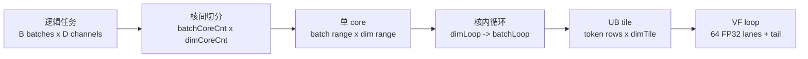

# Tiling 策略

## 目标

CUDA cleanroom 版本已经证明：`S <= 4` 的 causal conv1d decode 天然适合按 `(batch, channel)` lane 并行。迁移到 Ascend C 时，我们保留这个优化意图：

- 一个独立 lane 是 `(batch, channel)`。
- 小 decode chunk 全部放在本地计算中完成。
- 不做 prefill 式长序列切分。
- 同一个 kernel 完成输出和状态更新。

## 切分轴

主切分：

```text
batch axis x dim axis
```

不切 `seq_len`，因为 `seq_len` 只有 `1..4`。



二维分核图：

```text
                  D / channel
        |------ core dim 0 ------|------ core dim 1 ------|--- tail ---|
B  b0   | C(0,0)                 | C(0,1)                 | C(0,t)    |
   b1   | C(0,0)                 | C(0,1)                 | C(0,t)    |
        |------------------------|------------------------|-----------|
   b2   | C(1,0)                 | C(1,1)                 | C(1,t)    |
   b3   | C(1,0)                 | C(1,1)                 | C(1,t)    |

每个 C(batchCore, dimCore) 是一个 AIV core 的逻辑责任区域。
```

## Channel Tile 候选

```yaml
channel_tile_candidates: [64, 128, 256]
```

初始推荐：`128`。

原因：

- `dim` 是 16 的倍数。
- BF16 在 channel 连续方向搬运更自然。
- UB 占用较小：
  - x：`seq_len * channel_tile`
  - state：`(3 + seq_len) * channel_tile`
  - weight：`4 * channel_tile`
  - y：`seq_len * channel_tile`

当 `seq_len=4`、`state_len=7`、`channel_tile=128` 时，BF16 输入/输出相关 footprint 约：

```text
(4 + 7 + 4 + 4) * 128 * 2 bytes = 4864 bytes
```

这还没有算 FP32 临时，但整体仍然很小，适合 A5 decode 小算子。

## 核心分配

```text
num_channel_tiles = ceil(dim / channel_tile)
total_tiles = batch * num_channel_tiles
```

线性 tile 映射：

```text
b = tile_id / num_channel_tiles
channel_tile_id = tile_id % num_channel_tiles
d0 = channel_tile_id * channel_tile
```

实现中的 core 映射不是简单一维 `tile_id`，而是先选 `dimCoreCnt` 和 `batchCoreCnt`，再由 `blockIdx` 拆成二维坐标：

```text
batchCoreIdx = blockIdx / dimCoreCnt
dimCoreIdx   = blockIdx % dimCoreCnt

dimCoreIdx   -> dimOffset + coreDimLen
batchCoreIdx -> firstBatchIdx + batchNum
```

核内 UB tile：

```text
core owns:
  batches: [firstBatchIdx, firstBatchIdx + batchNum)
  dims:    [dimOffset, dimOffset + coreDimLen)

for dimLoop:
  dimSizeInLoop <= ubMainFactorDim
  CopyWeightBias once
  for batchLoop:
    batchNumInLoop <= ubMainFactorBS

UB tile:
  rows = sum token_count for batches in batchLoop
  cols = dimSizeInLoop, contiguous in channel dimension
```

当前实现采用 `dimLoop -> batchLoop` 顺序；同一个 dim tile 的 `weight[W, dimTile]` 和 `bias[dimTile]` 只搬一次，然后在该 dimLoop 下的所有 batch tile 中复用。

内存连续性图：

```text
GM row-major by D:

row r: | d0 ... d0+dimTile-1 | skipped D-dimTile |
       |---- contiguous ----|<----- stride ----->|

UB compact:

| row0 dimTile | row1 dimTile | row2 dimTile | ...

所以搬运是“每行连续，行间 stride；UB 内无 gap”。
```

VF 子切分：

```text
dimSizeInLoop = 128 example

UB dim tile:
  [0..63] [64..127]
     |       |
     |       +-- VF full-mask iteration 1
     +---------- VF full-mask iteration 0

dimSizeInLoop = 144 example
  [0..63] [64..127] [128..143]
     full     full     tail mask UpdateMask(16)
```

## 状态更新

普通 decode 只持久保存 `W-1` 行历史，要求 `state_len >= W-1`。W=4 speculative/update 为了保留 vLLM-style `state[0:2] + x chunk` 布局，要求 `state_len >= 2 + seq_len`。

```text
accepted = num_accepted_tokens[b] or seq_len
history = conv_states[slot, 0:W-1, :]                         # 无 num_accepted_tokens
history = conv_states[slot, accepted-1:accepted-1+W-1, :]      # 有 num_accepted_tokens
append x[b, 0:accepted, :]
keep latest W-1 entries in conv_states[slot, 0:W-1, :]
```

如果 `accepted < seq_len`，只把被接受的 prefix 写入 state。`y` 仍然可以对完整 speculative chunk 计算出来，运行时忽略 reject 的位置。

状态更新内存图：

```text
ordinary W=4 stateLocal, compact UB:
  [h0][h1][h2]

accepted x:
  [x0][x1]

writeback conv_states[slot]:
  [h2][x0][x1]

每个框表示当前 dim tile，写回 GM 时每行仍然是连续 dimTile，行间按 D stride。
```

W=4 speculative 路径额外保留 vLLM-style layout：

```text
selected old history:
  [hA][hB][hC]

current x chunk:
  [x0][x1][x2]

writeback conv_states[slot]:
  row0 row1 row2 row3 row4
  [hB][hC][x0][x1][x2]
```

## 调优空间

第一轮：

```yaml
channel_tile: [64, 128, 256]
activation_mode: [none]
num_accepted_tokens: [null, present]
state_update: [inplace]
```

第二轮：

```yaml
channel_tile: winner +/- neighboring tile
load_strategy:
  - scalar DataCopy loops
  - vectorized aligned channel copy
```

未来扩展项：

```yaml
activation_mode: [silu]  # 当前 v1 不支持，仅在需求变更后进入调优空间
```
