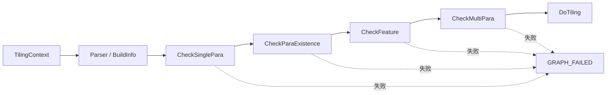

# FlashAttn、LightningIndexerV2 与 QuantLightningIndexerV2 拦截说明

## 1. 文档目的

本文档汇总以下三个算子的 Host Tiling 参数拦截结构和当前代码中实际执行的检查内容：

- `FlashAttn`
- `LightningIndexerV2`
- `QuantLightningIndexerV2`

其中 `LightningIndexerV2` 和 `QuantLightningIndexerV2` 的规则来源于：

- [`lightning_indexer.md`](../torch_extension/cann_ops_transformer/docs/zh/lightning_indexer.md)
- [`quant_lightning_indexer.md`](../torch_extension/cann_ops_transformer/docs/zh/quant_lightning_indexer.md)

两个 IndexerV2 算子的公共拦截实现统一放在
[`lightning_indexer_v2/op_host/checkers`](./lightning_indexer_v2/op_host/checkers)，量化算子目录仅保留量化差异和自身聚合入口。

## 2. 统一拦截代码格式

三个算子均采用组合模式管理专项 Checker。Parser 先将 TilingContext 转换为参数信息结构，聚合 Checker 再按固定阶段依次执行检查，任一阶段失败都会返回 `GRAPH_FAILED`，不会进入后续 Tiling。



四个阶段的职责如下：

| 阶段 | 主要职责 |
| --- | --- |
| `CheckSinglePara` | 单个参数的 dtype、format、rank、shape、取值范围等检查 |
| `CheckParaExistence` | 必选参数、条件必选参数以及条件禁止参数检查 |
| `CheckFeature` | 芯片平台、量化模式、功能开关等特性交叉检查 |
| `CheckMultiPara` | 多输入之间的布局、形状、head、batch、序列长度和 stride 一致性检查 |

## 3. FlashAttn

### 3.1 目录与组合关系

目录：[`flash_attn/op_host/checkers`](./flash_attn/op_host/checkers)

聚合入口：[`fa_checker.cpp`](./flash_attn/op_host/checkers/fa_checker.cpp)

`FAChecker` 注册顺序如下：

1. `CommonChecker`
2. `ActualSeqLenChecker`
3. `PagedAttentionChecker`
4. `MaskChecker`
5. `SinksChecker`
6. `MetadataChecker`
7. `SoftmaxLSEChecker`

Tiling 调用链位于 [`flash_attn_tiling.cpp`](./flash_attn/op_host/flash_attn_tiling.cpp)：

```text
FaInfoParser::Parse
    -> FAChecker::Init
    -> FAChecker::Process
    -> FiaTilingRegistry::DoTilingImpl
```

### 3.2 CommonChecker

实现文件：[`common_checker.cpp`](./flash_attn/op_host/checkers/common_checker.cpp)

主要检查内容：

| 检查项 | 当前规则 |
| --- | --- |
| 必选参数 | `query`、`key`、`value`、`attn_out` 的 desc 和 shape 均不能为空 |
| format | `query`、`key`、`value`、`attn_out` 仅支持 ND |
| dtype | 上述四个张量支持 FP16、BF16，且 dtype 必须一致 |
| query layout | `BNSD`、`BSND`、`TND` |
| key/value layout | `BNSD`、`BSND`、`TND`、`PA_BBND`、`PA_BNBD`、`PA_NZ` |
| output layout | `BNSD`、`BSND`、`TND` |
| B | `0 < B < 65536` |
| N | `Nq > 0`、`Nkv > 0`、`Nq >= Nkv`、`Nq % Nkv == 0` |
| S/T | 相关序列轴必须大于 0 |
| D | Q/K/V 的 head dim 相等，支持 64、128、256 |
| shape | 根据 layout 对 Q、K、V、输出的 B/N/S/T/D 逐轴比较 |

布局组合限制：

| query layout | key/value layout | output layout |
| --- | --- | --- |
| `BNSD` | `BNSD` 或任一 PA layout | `BNSD` 或 `BSND` |
| `BSND` | `BSND` 或任一 PA layout | `BSND` |
| `TND` | `TND` 或任一 PA layout | `TND` |

PA shape 额外要求：`block_size` 必须是 `32 / sizeof(kv_dtype)` 的整数倍。

### 3.3 ActualSeqLenChecker

实现文件：[`seq_len_checker.cpp`](./flash_attn/op_host/checkers/seq_len_checker.cpp)

| 参数 | 当前规则 |
| --- | --- |
| `seqused_q` | 可选；INT32、ND、1 维、长度为 B |
| `seqused_kv` | 可选；INT32、ND、1 维、长度为 B；PA 场景必须传入 |
| `cu_seqlens_q` | query 为 TND 时必须传入，否则禁止传入；INT32、ND、1 维、长度为 B+1 |
| `cu_seqlens_kv` | key/value 为 TND 时必须传入，否则禁止传入；INT32、ND、1 维、长度为 B+1 |
| `max_seqlen_q` | 不得小于 -1 |
| `max_seqlen_kv` | 不得小于 -1 |

当前 `CheckMultiPara` 没有进一步读取并检查序列张量的数据值。

### 3.4 PagedAttentionChecker

实现文件：[`paged_attention_checker.cpp`](./flash_attn/op_host/checkers/paged_attention_checker.cpp)

| 检查项 | 当前规则 |
| --- | --- |
| `block_size` | `[16, 1024]`，并且 16 对齐 |
| `block_table` | PA 场景必须传入，非 PA 场景禁止传入；INT32、ND、2 维 |
| batch | `block_table.shape[0] == B` |
| 非 PA stride | key、value 必须连续 |
| `PA_BBND` stride | key、value 仅允许第 0 轴非连续 |
| `PA_BNBD`/`PA_NZ` stride | key、value 仅允许第 0 或第 1 轴非连续 |

### 3.5 MaskChecker

实现文件：[`mask_checker.cpp`](./flash_attn/op_host/checkers/mask_checker.cpp)

| 参数/模式 | 当前规则 |
| --- | --- |
| `mask_mode` | 支持 0、3、4 |
| `attn_mask` | 传入时必须为 INT8、ND、2 维，shape 固定为 `[2048, 2048]` |
| `win_left`、`win_right` | 均不得小于 -1 |
| mode 0 | `attn_mask` 必须为空，左右窗口均为 -1 |
| mode 3 | `attn_mask` 必须传入，左右窗口均为 -1 |
| mode 4 | `attn_mask` 必须传入，左右窗口允许取大于等于 -1 的值 |

### 3.6 其他专项 Checker

| Checker | 当前规则 |
| --- | --- |
| `SinksChecker` | 当前不支持 sinks；传入后直接失败 |
| `MetadataChecker` | metadata 必须传入；INT32、ND、1 维，且第 0 维大于 0 |
| `SoftmaxLSEChecker` | `return_softmax_lse` 仅支持 0/1；启用时 `lse_out` shape 不能为空，dtype 为 FP32、format 为 ND |

## 4. LightningIndexerV2

### 4.1 目录与组合关系

公共目录：[`lightning_indexer_v2/op_host/checkers`](./lightning_indexer_v2/op_host/checkers)

聚合入口：[`li_checker.cpp`](./lightning_indexer_v2/op_host/checkers/li_checker.cpp)

`LIChecker` 注册顺序如下：

1. `CommonChecker`
2. `NonQuantChecker`
3. `SeqLenChecker`
4. `PagedAttentionChecker`
5. `MaskChecker`
6. `CompressionChecker`
7. `MetadataChecker`

中立参数视图 [`checker_info.h`](./lightning_indexer_v2/op_host/checkers/checker_info.h) 用于隔离两个算子原有 TilingInfo 的结构差异。所有共享 Checker 仅依赖 `IndexerCheckerInfo`，量化算子可直接复用。

### 4.2 公共输入、布局和形状

实现文件：[`common_checker.cpp`](./lightning_indexer_v2/op_host/checkers/common_checker.cpp)

必选输入/输出：

- `query`
- `key`
- `weights`
- `sparse_indices`
- `sparse_values`，当 `return_value=0` 时仍需存在，但 shape 为 `[0]`

所有张量 format 均为 ND。除 `return_value=0` 对应的 `sparse_values` 外，必选输入和输出不能包含小于等于 0 的维度。

布局组合：

| query layout | key layout | 输出 layout |
| --- | --- | --- |
| `BSND` | `BSND`、`PA_BBND` | `BSND` |
| `TND` | `TND`、`PA_BBND` | `TND` |

形状关系：

| 参数 | BSND | TND |
| --- | --- | --- |
| query | `[B, S1, N1, D]` | `[Tq, N1, D]` |
| weights | `[B, S1, N1]` | `[Tq, N1]` |
| sparse_indices | `[B, S1, N2, topk]` | `[Tq, N2, topk]` |
| sparse_values，return=1 | 同 sparse_indices | 同 sparse_indices |
| sparse_values，return=0 | `[0]` | `[0]` |

key shape：

| key layout | shape |
| --- | --- |
| `BSND` | `[B, S2, N2, D]` |
| `TND` | `[Tk, N2, D]` |
| `PA_BBND` | `[block_num, block_size, N2, D]` |

基础轴限制：

- `0 < B < 65536`
- `D = 128`
- `N2 = 1`
- `N1 > 0`
- `N1 % N2 = 0`
- `G = N1 / N2` 且 `1 <= G <= 64`
- `max_seqlen_q = -1`
- `return_value` 仅支持 0/1

### 4.3 非量化规则

实现文件：[`non_quant_checker.cpp`](./lightning_indexer_v2/op_host/checkers/non_quant_checker.cpp)

| 参数 | dtype |
| --- | --- |
| query、key | FP16 或 BF16，且两者一致 |
| weights | FP32 |
| sparse_indices | INT32 |
| sparse_values | FP32 |

### 4.4 平台特性

| 平台 | 当前拦截规则 |
| --- | --- |
| Ascend 950 / DAV_3510 | `1 <= N1 <= 64`；`1 <= topk <= 8192`；`1 <= cmp_ratio <= 128`；支持 `output_idx_offset` 和 `return_value` |
| Ascend A2/A3 / DAV_2201 | `N1 = 64`；`1 <= topk <= 2048`；key layout 必须为 `PA_BBND`；禁止 `output_idx_offset`；`return_value=0`；`cmp_ratio` 仅支持 1～128 内的 2 的幂 |

### 4.5 SeqLenChecker

实现文件：[`seq_len_checker.cpp`](./lightning_indexer_v2/op_host/checkers/seq_len_checker.cpp)

| 参数 | 当前规则 |
| --- | --- |
| `cu_seqlens_q` | query 为 TND 时必须传入，否则禁止；INT32、ND、shape `[B+1]` |
| `cu_seqlens_k` | key 为 TND 时必须传入，否则禁止；INT32、ND、shape `[B+1]` |
| `seqused_q` | 可选；INT32、ND、shape `[B]` |
| `seqused_k` | 可选；INT32、ND、shape `[B]`；PA 场景必须传入 |

数据可在编译期读取时，还会检查：

- `cu_seqlens` 非负、非递减、首元素为 0、末元素等于对应 T；
- `seqused` 非负且不超过对应 batch 的有效序列长度；
- A2/A3 上，当对应 layout 为 TND 时，禁止传入该侧的 `seqused`。

### 4.6 PagedAttentionChecker

实现文件：[`paged_attention_checker.cpp`](./lightning_indexer_v2/op_host/checkers/paged_attention_checker.cpp)

- `block_table` 必须与 `PA_BBND` 同时出现；非 PA 场景禁止传入；
- PA 场景必须传入 `seqused_k`；
- `block_size` 取值范围 `[16, 1024]`，并且 16 对齐；
- `block_table` 为 INT32、ND、2 维、非空，第一维等于 B；
- 可读取数据时，block id 必须位于 key block 范围内；
- 非 PA 场景 key 必须连续；PA 场景 key 仅允许第 0 轴非连续。

### 4.7 Mask、压缩、metadata 和偏移

| Checker/参数 | 当前规则 |
| --- | --- |
| `MaskChecker` | `mask_mode` 仅支持 0、3 |
| `CompressionChecker` | 仅当 `cmp_ratio > 1 && mask_mode == 3` 时必须传入 `cmp_residual_k`，其他场景禁止传入 |
| `cmp_residual_k` | INT32、ND、shape `[B]`；可读取时要求 `0 <= value < cmp_ratio` |
| `MetadataChecker` | metadata 必须传入；INT32、ND、shape `[1024]` |
| `output_idx_offset` | 可选；INT32、ND、shape `[B]`；每个值大于 0，偏移后的最大索引不得超过 INT32_MAX |

## 5. QuantLightningIndexerV2

### 5.1 目录与复用关系

量化专用目录：[`quant_lightning_indexer_v2/op_host/checkers`](./quant_lightning_indexer_v2/op_host/checkers)

该目录只包含：

- [`quant_checker.cpp`](./quant_lightning_indexer_v2/op_host/checkers/quant_checker.cpp)：量化 dtype、quant_mode 和 descale shape；
- [`qli_checker.cpp`](./quant_lightning_indexer_v2/op_host/checkers/qli_checker.cpp)：量化算子的 BuildInfo 与组合入口。

`QLIChecker` 注册以下 Checker：

1. 共享 `CommonChecker`
2. 量化专用 `QuantChecker`
3. 共享 `SeqLenChecker`
4. 共享 `PagedAttentionChecker`
5. 共享 `MaskChecker`
6. 共享 `CompressionChecker`
7. 共享 `MetadataChecker`

因此，第 4 章中的布局、公共 shape、平台、序列、PA、mask、压缩、metadata、output offset 规则同样适用于 QuantLightningIndexerV2。

### 5.2 量化模式和 dtype

| quant_mode | query/key | weights | q_descale/k_descale |
| --- | --- | --- | --- |
| 1 | FLOAT8_E4M3FN | FP32 | FP32 |
| 2 | INT8 | FP16 | FP16 |
| 3 | FLOAT8_E4M3FN | FP32 | FLOAT8_E8M0 |
| 4 | HIFLOAT8 | FP32 | FP32 |
| 5 | FLOAT4_E2M1 | FP32 | FLOAT8_E8M0 |

其他输出 dtype：

- `sparse_indices`：INT32；
- `sparse_values`：BF16；
- `query` 与 `key` 必须满足同一 quant_mode 的 dtype 组合。

A2/A3 仅支持 `quant_mode=2`。

### 5.3 descale shape

quant_mode 3/5：

| 参数/layout | shape |
| --- | --- |
| q_descale，BSND | `[B, S1, N1, D/64, 2]` |
| q_descale，TND | `[Tq, N1, D/64, 2]` |
| k_descale，BSND | `[B, S2, N2, D/64, 2]` |
| k_descale，TND | `[Tk, N2, D/64, 2]` |
| k_descale，PA_BBND | `[block_num, block_size, N2, D/64, 2]` |

quant_mode 4：

- q_descale shape 为 `[1]`；
- k_descale shape 为 `[1]`。

quant_mode 1/2：

| 参数/layout | shape |
| --- | --- |
| q_descale，BSND | `[B, S1, N1]` |
| q_descale，TND | `[Tq, N1]` |
| k_descale，BSND | `[B, S2, N2]` |
| k_descale，TND | `[Tk, N2]` |
| k_descale，PA_BBND | `[block_num, block_size, N2]` |

`q_descale`、`k_descale` 均为必选、ND、非空张量。PA 场景下 `k_descale` 与 key 一样仅允许第 0 轴非连续，非 PA 场景必须连续。

## 6. 三个算子的结构对比

| 项目 | FlashAttn | LightningIndexerV2 | QuantLightningIndexerV2 |
| --- | --- | --- | --- |
| 聚合器 | `FAChecker` | `LIChecker` | `QLIChecker` |
| 基类 | `FABaseChecker` | `LIBaseChecker` | 复用 `LIBaseChecker` |
| 参数视图 | `FaTilingInfo` | `IndexerCheckerInfo` | 复用 `IndexerCheckerInfo` |
| 核心输入 | Q/K/V | Q/K/W | 量化 Q/K/W + descale |
| PA layout | BBND、BNBD、NZ | PA_BBND | PA_BBND |
| Mask | 0/3/4，含 mask tensor 和 window | 0/3 | 0/3 |
| metadata | INT32、1 维、长度大于 0 | INT32 `[1024]` | INT32 `[1024]` |
| 平台分支 | 当前 Checker 未单独实现平台规则 | 950 与 A2/A3 分支 | 共享平台规则，并增加 quant_mode 分支 |
| 公共代码复用 | 算子内部专项 Checker | 公共实现所在地 | 复用 LightningIndexerV2 公共实现 |

## 7. 修改或新增规则的位置

后续维护时，可按以下方式定位：

| 需求 | 修改位置 |
| --- | --- |
| 修改 FlashAttn 公共 layout/shape/dtype | `flash_attn/op_host/checkers/common_checker.*` |
| 修改 FlashAttn 专项参数 | 对应的 `seq_len`、`paged_attention`、`mask`、`metadata` 等 Checker |
| 修改两个 IndexerV2 的共同规则 | `lightning_indexer_v2/op_host/checkers` 下对应 Checker |
| 修改 LightningIndexerV2 非量化 dtype | `non_quant_checker.*` |
| 修改 QuantLightningIndexerV2 量化模式 | `quant_lightning_indexer_v2/op_host/checkers/quant_checker.*` |
| 新增专项 Checker | 继承对应 BaseChecker，并在 `RegisterCheckers()` 中注册 |

新增规则时应保持四阶段职责边界，避免将同一约束分别复制到两个 IndexerV2 目录。

## 8. 错误日志规范

三个算子的 `op_host/checkers` 目录禁止直接使用 `OP_LOGE`。拦截失败必须根据错误类型使用可上报错误码的专用宏：

| 错误类型 | 使用宏示例 |
| --- | --- |
| format | `OP_LOGE_FOR_INVALID_FORMAT`、`OP_LOGE_FOR_INVALID_FORMATS_WITH_REASON` |
| value | `OP_LOGE_FOR_INVALID_VALUE`、`OP_LOGE_FOR_INVALID_VALUES_WITH_REASON` |
| dtype | `OP_LOGE_FOR_INVALID_DTYPE`、`OP_LOGE_FOR_INVALID_DTYPES_WITH_REASON` |
| shape | `OP_LOGE_FOR_INVALID_SHAPE`、`OP_LOGE_FOR_INVALID_SHAPES_WITH_REASON` |
| rank | `OP_LOGE_FOR_INVALID_SHAPEDIM`、`OP_LOGE_FOR_INVALID_SHAPEDIM_WITH_REASON` |
| shape size | `OP_LOGE_FOR_INVALID_SHAPESIZE`、`OP_LOGE_FOR_INVALID_SHAPESIZES_WITH_REASON` |
| 参数缺失或条件非法 | `OP_LOGE_FOR_INVALID_ARGUMENT_WITH_REASON` |

日志应包含算子名、参数名、实际值以及期望值或失败原因。多个参数发生交叉冲突时，使用 `VALUES`、`DTYPES`、`SHAPES` 等复数形式，避免退化为普通字符串日志。
