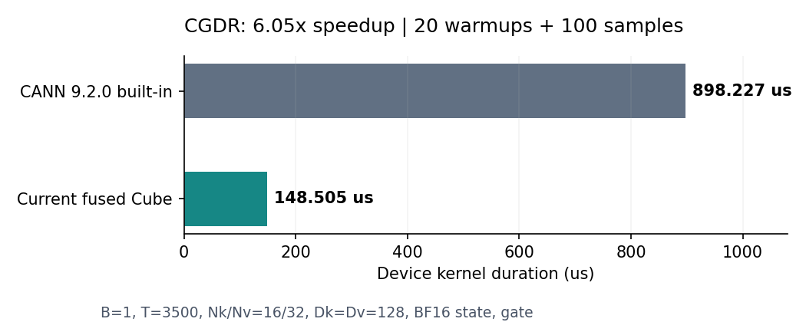
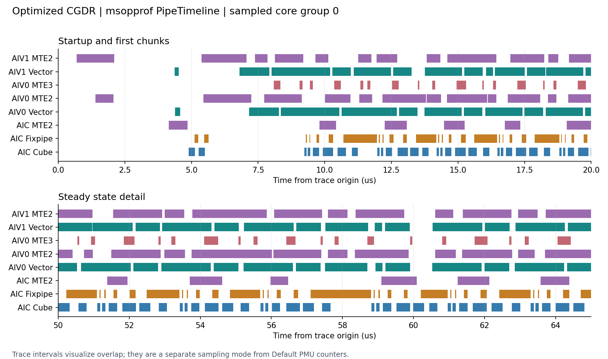
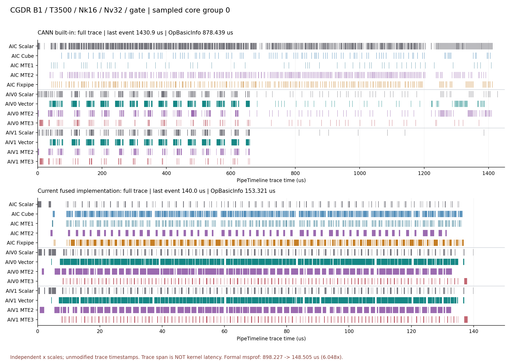

# CGDR核心网络用例性能分析：B1 / T3500 / Nk16 / Nv32 / gate

**CANN 9.2.0内置原版898.227µs，当前优化版148.505µs，加速6.048×，耗时减少83.47%。主要收益来自减少控制开销、阶段间GM往返及Vector工作，Cube实际计算时间基本不变。当前剩余问题集中在Vector写回/转换和流水依赖；一次gate指数预计算消融未证明稳定收益。**

本轮只测用户指定的这一个网络用例；结果不代表其余七个网络shape的实测。源码分析、msopprof独立审阅和候选构建分别由三个subagent完成，主任务串行执行设备测试并复核数据。

## 1. 正式性能、精度及版本

| 实现 | 平均耗时µs | 中位数µs | CV | attention / final state精度 |
|---|---:|---:|---:|---|
| CANN 9.2.0内置原版 | 898.227 | 898.396 | 0.260% | 均通过 |
| 当前融合优化版 | 148.505 | 148.569 | 0.617% | 均通过 |



参数：`B=1, T=3500, Nk=16, Nv=32, Dk=Dv=128, chunk_size=64, has_g=True`，Q/K/V/beta及state为BF16，g为FP32，state连续；测试器将Q/K做L2归一化，g为负随机值，scale为`1/sqrt(128)`。device0为Ascend950PR_9589，32 AIC/64 AIV，seed=20260908，torch 2.13.0+cpu、torch_npu 2.13.0.rc1。

两版均通过仓库`tests/pytest/test_chunk_gated_delta_rule_single.py`的CUSTOM_CASE入口生成输入，eager运行；每版20次预热+100次正式调用。仅统计msprof `OP Type=ChunkGatedDeltaRule`的设备`Task Duration(us)`，排除输入生成、外部Cast及host耗时。固定输入反复调用，不能直接当作整个网络端到端或图模式时延。性能与精度分别运行，精度使用仓库golden/benchmark/compare_cv，不把性能模式PASSED当作精度结论。

原版是CANN内置实现，不是Git父提交重编译。优化版对应`6f599eb3aa317ac1f737def7b1eaaf51c1551d15`，算术逻辑来自`121832027`。系统默认custom仍是旧包，本次选用已独立构建安装的`cgdr_stream_update_transformer`；校验当前arch35头文件与安装源码一致。正式两版采集时均临时隔离系统vendor，结束后全文件SHA256核对并恢复。msopprof导出的实际kernel二进制与各自目标安装包逐字节匹配，两版所有输入tensor的SHA256及scale相同。[实际kernel校验](network_case_3500/loaded_kernel_audit.json)、[版本校验](network_case_3500/version_audit.json)。

初次优化版采集时，CANN自动扫描并加载了系统旧vendor，触发严格审计失败；该轮保留为`diagnostic_default_vendor_loaded/`，未纳入任何正式均值。隔离后重新完整采集的pytest和工具退出码均为0。

## 2. 这组case走什么路径

本例走融合Cube，不走小维度Streaming。55个chunk中54个完整、尾块44token；B×Nv=32，每个AIC核组负责一个value head，两个AIV均有有效任务，没有head数量不足或Dv切片空闲的问题。物理token为3520，padding仅20/3520=0.568%，Dk/Dv无padding。

每个核组连续处理同一head的全部chunk；AIV各做32-token前缀切片和64行Dv状态切片。状态放UB/L1，两个160KiB的L1 chunk槽轮转，另有32KiB状态，总L1使用352KiB；L0A/B双缓冲，L0C保留Vnew和output。命中128维预处理特化与DirectBrc Panel8求逆。

内置版本例只有一个chunk group，执行Stage1→Stage2→Stage3三个完整阶段，入口及阶段末做全核汇合。不能把原版屏障写成“每chunk三次”；主要差别是阶段间需要GM发布/消费且无法形成当前的跨chunk融合流水。详见[源码分析](network_case_3500/static_analysis.md)。

## 3. 为什么快：msopprof与源码互相验证

`Default,Occupancy,Roofline`各匹配一个kernel并重放。每个CSV是32 AIC+64 AIV的96条分核记录，下表按同角色32核平均，**不是32次独立调用**。两版采集频率均1650MHz。msopprof所记880.146/153.108µs属于探针重放口径，不与上面100次正式样本混算。

| 每核管线耗时µs | CANN原版 | 当前优化版 |
|---|---:|---:|
| AIC Cube | 47.282 | 47.467 |
| AIC Scalar | 522.942 | 14.428 |
| AIC MTE2 | 272.576 | 47.312 |
| AIC Fixpipe | 353.823 | 71.344 |
| AIV0 Vector | 322.680 | 115.938 |
| AIV1 Vector | 273.021 | 115.711 |
| AIV0 MTE2 | 198.265 | 108.587 |
| AIV1 MTE2 | 128.967 | 107.535 |
| AIV0 MTE3 | 99.750 | 27.125 |
| AIV1 MTE3 | 71.382 | 27.096 |

这些管线可以重叠，不能相加分摊墙钟时延。比率、wait及采样字段按[msopprof官方字段说明](https://github.com/Ascend/msopprof/blob/master/docs/zh/user_guide/msopprof_performance_data.md)解释；本次详细逐核结果见[独立审阅](network_case_3500/msopprof_review.md)。

### 3.1 减少控制和重复装载，主要矩阵算术保留

AIC Scalar从522.942降至14.428µs，减少97.24%；Cube活跃时间47.282→47.467µs基本不变，占比却从5.39%升至31.45%。Cube总指令550→495条/核，减少10%，与KKT/QKT合并以及高层Matmul调度简化一致。完整tile的主要MAC量仍为每head每chunk5,832,704，整个case约20.531GFLOPs（仅Cube，乘加计两次操作）。六倍整体加速不能解释成乘加算术减少六倍。

当前将KKT/QKT合为一次矩阵乘、共享K的L0B装载；`kcd*S^T`和`qPrime*S^T`又复用同一份L0B状态。直接MMAD/Fixpipe、固定布局及head内递推缩短了高层Matmul初始化、调度和全阶段结果交换的控制路径。原版AIC ICache miss约2.60%、AIV约4.1%～4.5%，当前均为0，也是指令工作集改善的证据。

### 3.2 中间结果和状态改留片上，主存请求显著下降

| 全核工具计数，保留原单位KB | CANN原版 | 当前优化版 |
|---|---:|---:|
| 主存读取数据 | 856327.375 | 183260.250 |
| 主存写出数据 | 494730.750 | 32096.000 |
| L0C→GM | 238748.000 | 28000.000 |
| L0C→L1 | 0 | 63360.000 |

读取数据计数减少78.60%，写出减少93.51%；L0C→GM降低、L0C→L1增加，直接支持中间结果转为片上交换。AIC MTE2指令2205→226条/核；AIV MTE2指令则由723/502增至884/878，不能概括成所有DMA都减少。

原版kcd、qPrime、kg、vInner、qkt、gCum等跨阶段张量经GM传递，state按chunk从GM读取、衰减、矩阵更新。当前state在序列开头读入、结尾写回，output两项先在L0C合并后写一次。仅主要六种中间量的软件等价逻辑读写就约345.510MB，在当前跨阶段GM路径中消失；这没有包含原版全部临时量。

工作区分配、软件逻辑流量、PMU请求量是三个不同口径。按源码公式原版工作区约204.5MiB→当前16MiB系统区，但前者尚未另做运行时分配量核验。上述KB请求计数也不是离芯片HBM实测流量；不能直接除以时延声称HBM带宽已饱和。

### 3.3 含gate与逆矩阵的Vector工作减少

原版Stage1两个AIV分别生成完整的64×64 gate矩阵，Stage3再次生成一份；当前两个AIV各处理32行，用同一`exp(G_i-G_j)`同时形成KKT和QKT门控。矩阵域从约三份合为一份，并融合缩放、FP32计算、BF16转换和compact NZ写出，减少中间UB张量及独立格式转换。

对每个32×32对角逆块，原版逐行Gather前代与当前8行panel都保留496次FMA及原j累加顺序；当前旧inverse行读取496→48次，store→load局部屏障32→4次。新行留在寄存器中并跨8行复用旧行，系数改用B32广播。identity也从每chunk初始化改为每head初始化。本例identity标量写112640→2048次。

这些是源码级调用计数，不能当作PMU指令数，也不能把“旧inverse行加载减少90.3%”写成所有UB读取减少90.3%。与PMU相互印证的是AIV Vector绝对耗时从约273～323µs降至约116µs；尚未对历史每个改动分别消融分摊收益。

## 4. 当前瓶颈与流水证据

| 当前AIV指标 | AIV0 | AIV1 |
|---|---:|---:|
| Vector active | 76.96% | 76.81% |
| MTE2 active | 72.08% | 71.38% |
| Vector STU conflict | 23.82% | 23.68% |
| Vector LDU conflict | 4.07% | 4.07% |

当前是Vector、输入搬运与依赖共同限制的流水。STU写冲突从原版约2%上升到约24%，值得定位compact NZ的Store/Cast、UB地址布局及其与输入DMA的关系，但该字段不能证明某个具体bank冲突，也不等于24%可回收墙钟时间。GM→UB带宽使用率约7.6%，GM→L1约6.7%，没有HBM吞吐饱和证据。L2读命中率优化后反而更低，也不支持把主要收益归因于更高cache命中。



PipeTimeline采样core0～5共18个角色轨道；12个AIV的MTE2区间已有85.1%～88.0%与Vector重叠。现有实现已经做了大量搬运/计算重叠，不能把约72%的MTE2活动全部视为新增双缓冲可消除的时间。

启动阶段可见3.73～4.31µs的Cube间隙，例如core0在5.498～9.232µs没有CUBE区间，同时AIV进行搬运和Vector处理；稳态仍有更短的反复间隙。需要进一步关联具体VF/信号才能确定各间隙原因。PipeTimeline区间与Default PMU定义不同，不用其区间总和覆盖PMU活跃时间；SIMD VF内部指令不会在InstrTimeline中展开，见[官方采集指南](https://github.com/Ascend/msopprof/blob/master/docs/zh/user_guide/msopprof_user_guide.md)。

### 4.1 原来的 pipeline_timeline.png 是截取的片段

**是片段，不是整个kernel时间线。** [原优化版图](network_case_3500/figures/pipeline_timeline.png)取自优化版`trace.json`的两个时间窗口：上图0～20µs，观察启动及最初几个chunk；下图50～65µs，观察执行中段的重复流水。图像由原始事件重新绘制，不是工具界面截图；窗口外的事件没有展示，跨窗口边界的色块由坐标轴裁切。

另外还有空间上的筛选：原始trace包含core0～5共6个核组，即6个AIC和12个AIV；原图只展示**core0核组的1个AIC和2个AIV**，选取其中8条管线，省略了Scalar、MTE1及AIV1的MTE3。因此它既不是所有32个核组的总图，也不是跨核均值，更不是连续两次算子调用。

横轴是PipeTimeline原始事件的时间坐标，单位µs；原始JSON的`displayTimeUnit=ns`只是显示选项，Chrome Trace的`ts/dur`按微秒解释。每一行是一条硬件管线，不是一整个算子，也不是一个chunk。

| 图中轨道 | 表示的工作 |
|---|---|
| AIC Cube，蓝色 | 矩阵乘累加 |
| AIC Fixpipe，橙色 | Cube结果的转换和搬出，涉及L0C→UB/L1/GM |
| AIC MTE2，紫色 | 从GM搬入L1 |
| AIV0/1 Vector，绿色 | 向量计算，例如gate、求逆、转换及state更新；单个色块没有具体VF函数标签 |
| AIV0/1 MTE2，紫色 | 从GM搬入UB |
| AIV0/1 MTE3，粉色 | 从UB向GM或L1搬出、发布数据 |
| 新对照图补充的MTE1 | 从L1向L0A/L0B等矩阵计算缓冲搬运 |
| 新对照图补充的Scalar，灰色 | 标量控制及指令调度活动 |

一个色块表示工具记录的该管线活动区间；多个指令可以形成连续区间，所以不能将一个色块数成一次MMAD或一个chunk。同一横坐标上不同管线都有色块，表示其活动有重叠。空白只说明该管线上没有记录到活动，不能单凭空白断言整核空闲、正在等待某个flag，或这段时间能被全部优化掉。

### 4.2 新增CANN原版流水与对照图

本次使用同一case、seed、device、输入及`--aic-metrics=PipeTimeline --kernel-name=ChunkGatedDeltaRule --launch-count=1 --warm-up=5`补采内置版。采集时临时隔离系统custom，工具与pytest均退出0；输入SHA256与旧优化版时间线一致，导出的kernel二进制与CANN内置包一致，结束后默认vendor全文件哈希恢复一致。优化版对照沿用前轮同参数的已验证时间线，本次没有重新采集优化版。

新增图均保留原始时间戳，不做时间拉伸或按正式耗时归一化，并统一core0的13条轨道和颜色：

- [CANN原版单独图](network_case_3500/figures/pipeline_timeline_baseline.png)：完整trace、0～20µs、50～65µs三个视图；原版50～65µs仍是早期工作，不能称作与优化版相同进度的“稳态”。
- [完整时间线对照图](network_case_3500/figures/pipeline_timeline_comparison_full.png)：上方CANN原版、下方融合优化版；两幅图各用自己的原始时间范围，**横轴刻度不同**。
- [相同时间窗口的放大对照](network_case_3500/figures/pipeline_timeline_comparison_zoom.png)：两版均展示0～20µs和50～65µs；窗口相同，算法执行进度不同。



完整图能看到原版的AIC Scalar活动密集、Cube活动分散，原版AIV1的Vector及搬运活动在trace后半段基本消失；这与源码分阶段运行、Stage2/3主要由vector0处理相符。优化版两个AIV持续参与，Vector、MTE2与Cube呈现重复交叠的流水。图没有函数或源码阶段标签，因此不把某个色块或某个精确时间位置直接标成Stage1/2/3边界。

**这些图用来比较执行结构，不能用trace长度相除计算加速比。**

| 口径 | CANN原版 | 优化版 |
|---|---:|---:|
| PipeTimeline全部采样轨道末事件位置µs | 1430.864 | 140.033 |
| 同次采集的OpBasicInfo Task Durationµs | 878.439 | 153.321 |
| 前轮正式msprof，100次均值µs | 898.227 | 148.505 |

官方源码中，PipeTimeline按各核[BIU累计周期除以AICore频率](https://github.com/Ascend/msopprof/blob/40df4721c8d2da71e91ea2dc4d4d3617aa389b61/csrc/op_profiling/profiling/device/data_visualize/biu_timeline.cpp#L50)生成ts/dur；OpBasicInfo则从[独立的duration.bin任务起止记录](https://github.com/Ascend/msopprof/blob/40df4721c8d2da71e91ea2dc4d4d3617aa389b61/csrc/op_profiling/profiling/device/data_parse/metric_data_handler.cpp#L292)按任务调度频率换算。PipeTimeline还会[启用动态插桩](https://github.com/Ascend/msopprof/blob/40df4721c8d2da71e91ea2dc4d4d3617aa389b61/csrc/op_profiling/profiling/device/run/device_task.cpp#L176)。这是两条不同计时路径，不能假设记录范围等长。

独立核对本机raw数据：两版duration.bin分别为878439ns和153321ns；各timeline.bin均有18个通道块，每通道一个，没有发现多次重放被直接拼接。原版BIU在结束标记前累计的周期换算后本就约1431µs，说明差异不是绘图拉伸或µs/ns误用。结束标记后的NOP已被工具裁掉，不能把多出的约552µs全部归因于末尾NOP。采集扰动或插桩后的执行变化是可能因素，现有证据不足以精确解释全部差异。

本机导出的trace时间范围与OpBasicInfo并不相等，原版差异尤其明显。保留原始值并在图中分别标注，不能将1430.864/140.033解释为10.22×加速，也不能把trace尾部与OpBasicInfo的差值解释成等待时间。正式加速比仍是6.048×。[原始时间线元数据](network_case_3500/timeline_comparison.json)记录文件SHA256、采样轨道、事件数量和绘图范围。

## 5. 已实测的额外优化：gate decay预计算

在独立副本中，将128维预处理逐token重复的`exp(G_last-G_i)`提前到持有全部64-lane G的VF内一次向量计算，再逐token广播。已有1KiB gExp槽从使用256B增为512B，地址和状态递推顺序保持；无gate初始化和尾chunk补零均保留。本例该处Exp源码调用112000→3520次，不影响pairwise attention中的Exp。[完整消融补丁](network_case_3500/gate_exp_candidate.patch)。

构建命令：`bash build.sh --pkg --soc=ascend950 --ops=chunk_gated_delta_rule --vendor_name=cgdr_gate_exp_probe`，只安装到本轮实验目录的独立vendor。主分支源码没有应用此补丁。

| 执行顺序 | 100次均值µs | CV |
|---|---:|---:|
| A：当前版第1轮 | 148.633 | 0.850% |
| B：候选第1轮 | 148.849 | 0.740% |
| B：候选第2轮 | 147.822 | 0.834% |
| A：当前版第2轮 | 148.446 | 0.854% |

每轮另有20次预热。A两轮均值148.540µs，B两轮148.335µs，仅降低0.138%，候选两轮自身相差约1.03µs，**未证明稳定性能收益**。候选的Vector管线时间也未降低，虽然Scalar少约1.4µs；这说明该处Exp源码计数不是本例整体时延的有效代理，仍需由流水关键路径判断。

四轮捕获的attention与final state逐元素完全一致，候选还单独通过仓库golden/benchmark精度。覆盖仅本case、seed20260908，不是完整288例精度回归。通用维度目前也会额外执行预计算而未消费新数组，若推广需限制到128维特化或一起调整通用路径。依据本次结果，**不建议仅凭Exp调用数下降合入该候选**。[消融统计与逐元素校验](network_case_3500/probe_summary.json)。

## 6. 后续优化建议

1. **先定位Vector写回冲突和各VF占时。** 对预处理compact NZ Store、逆矩阵panel、状态转换分别做局部计时或单点消融，检查生成代码、寄存器溢出和UB写地址分布。优先降低关键路径上的写回压力；STU比率本身不足以选择具体布局。
2. **实测求逆panel宽度与布局。** 比较4/8/16行及已有候选布局，保持前代j顺序。16行理论上将旧行读取48→16、panel屏障4→2，但寄存器压力和代码体积增加，收益未验证。必须同时检查attention和state精度。
3. **针对剩余依赖调整流水。** 关联`PREFIX_CRITICAL_READY`、`STATE_READY`及当前/下一chunk的VF，检查是否可分段发布或调整状态更新位置。现有UB末尾已到248KiB，不适合直接复制整套缓冲；时间线也证明搬运已高度重叠。
4. **低优先级：尾块、head分工、共享Q/K。** padding仅0.568%，32核组已填满，Streaming分流不影响本例。相邻两个value head虽共享Q/K，完美复用前缀也只节省约9%的总Cube MAC；若合并head导致活跃核组从32减至16或增加跨核发布，可能得不偿失。

目前能量化证明的是已实现的6.048×收益；剩余优化空间有具体线索，但没有证据承诺再提高某个固定倍数。gate消融已提供一个“看起来减少大量源码操作、实际收益未成立”的例子。

## 7. 数据与复现

可随仓库归档的[逐轮统计](network_case_3500/comparison.csv)、[全部正式逐次样本](network_case_3500/timing_samples.csv)、[分核PMU摘要](network_case_3500/core_metrics.csv)、[时间线PDF](network_case_3500/figures/pipeline_timeline.pdf)均保留本轮独立测量；没有挑选快样本替换原样本。

原始数据及脚本在`attention/chunk_gated_delta_rule/tests/pytest/output/rdv_perf_20260908/network_case_3500/`：

- `run_experiments.py`：串行原版/当前版timing、msopprof及独立精度；临时隔离系统vendor并finally恢复。
- `run_tests.py`：原pytest输入与调用适配，20次预热+100次正式调用，输入SHA256及实际加载库审计。
- `run_probe.py`：A-B-B-A消融复测、候选PMU与独立精度。
- `analyze.py`、`probe_summary.json`：正式统计及候选结果；`plot_results.py`生成静态图。
- `baseline_metrics/`、`optimized_metrics/`、`baseline_timeline/`、`optimized_timeline/`：可导入MindStudio Insight的`visualize_data.bin`、原始CSV与trace.json。
- `run_baseline_timeline.py`、`plot_timeline_comparison.py`：补采CANN原版时间线，并绘制完整/局部对照图。
- `gate_exp_probe/`：独立补丁、编译安装日志、源码与二进制哈希证据及隔离包。

msopprof基础命令为：

```bash
msopprof --output=<本轮输出目录> --aic-metrics=Default,Occupancy,Roofline \
  --kernel-name=ChunkGatedDeltaRule --launch-count=1 --warm-up=5 \
  python3 <regression_analysis/run_msopprof_hooked.py>
```

本机CANN 9.2的ACL函数分发表需要上述既有进程内hook适配，`CGDR_MSOP_TARGET`指向本次`run_tests.py`，只修改被采集子进程并逐项审计，不改系统库。PipeTimeline另采`--aic-metrics=PipeTimeline`。`run_experiments.py`保留完整参数和环境，复跑应使用新的结果目录，防止覆盖本轮产物。大型原始profile和实验包被git忽略，关键CSV/JSON、图及本报告可归档；算子源码与系统默认包保持本轮开始时内容。
