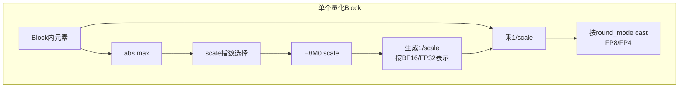
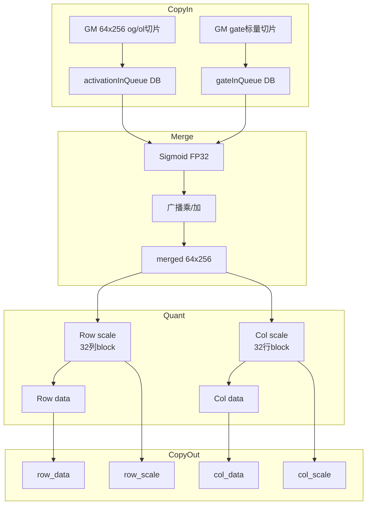
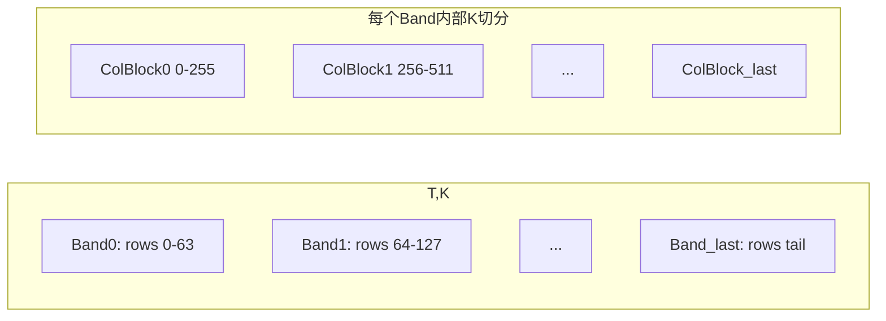
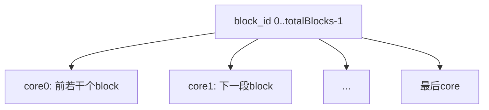
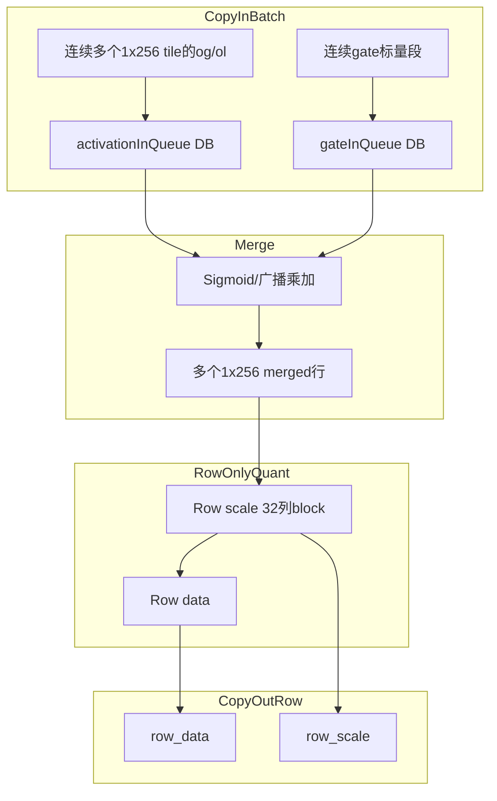
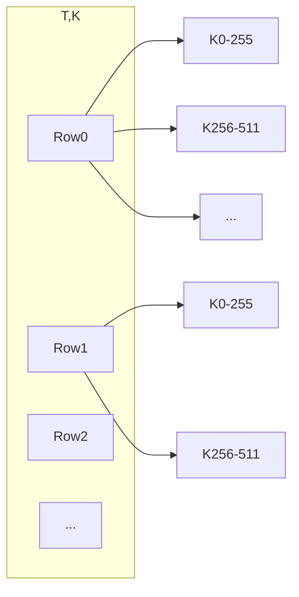
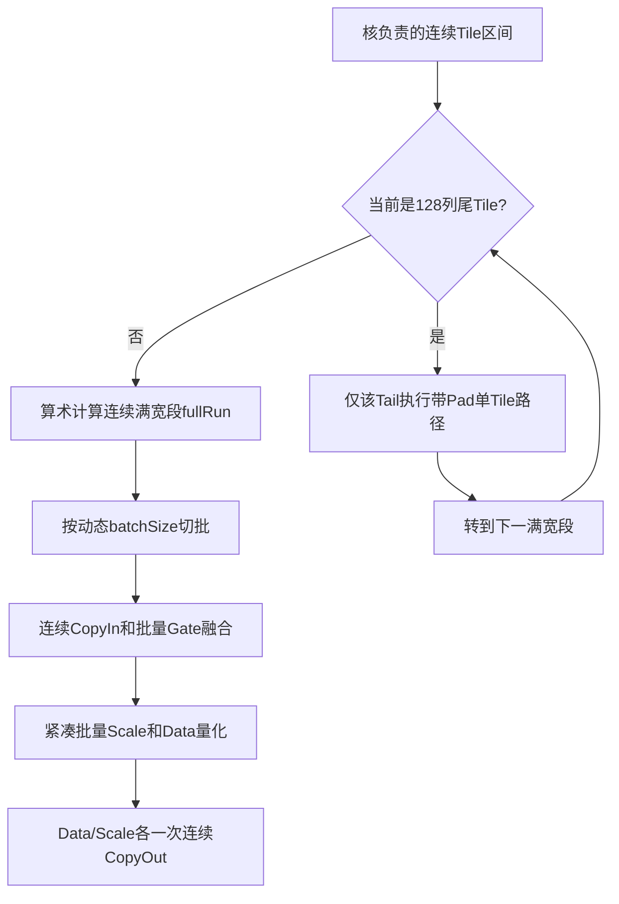
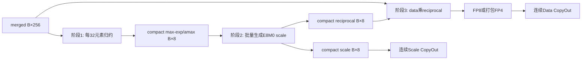

# ClaGateMxQuantWithDualAxis 算子详细设计说明书

<center><strong>修订记录</strong></center>

<div align="center">

| 日期 | 修订版本 | 修改描述 | 作者 |
| :---: | :---: | :---: | :---: |
| 2026-09-09 | 1.0 | 详细设计初稿 | 算子MDE |
| 2026-09-10 | 1.1 | 单轴动态UB批处理、满宽段/尾块分流、紧凑批量量化与性能验证 | 算子MDE |

</div>

> 文档说明：本文档为 `ClaGateMxQuantWithDualAxis` 算子的详细设计说明，覆盖接口实现、总体设计、双轴/单轴两套 Kernel 模板的 Tiling、Buffer、量化计算流程、异常场景、确定性/训推一致性、精度与性能设计等内容。单轴动态 batch 设计不改变双轴固定 `64×256` Tile 和 UB 布局。

# 1 关联需求

| 需求编号 | 需求标题 | 需求链接 | 概要设计链接 | 修订版本 |
| --- | --- | --- | --- | --- |
| 待补充 | CLA Gate + MXFP8 双轴/单轴融合量化算子 | 待补充 | [cla_gate_mx_quant_dual_axis算子需求分析与设计说明书](./cla_gate_mx_quant_dual_axis算子需求分析与设计说明书%20(1).md) | 1.0 |

# 2 接口实现设计

## 2.1 PTA接口实现

### 2.1.1 函数原型

```text
torch_npu.npu_cla_gate_mx_quant_with_dual_axis(
    global_out, local_out, global_gate_logits, local_gate_logits, *,
    dst_type=None, round_mode="rint", scale_alg=1, layout=0, quant_mode=1
) -> (Tensor, Tensor, Tensor, Tensor)
```

算子同时提供 Torch Extension 方式（`cann_ops_transformer.cla_gate_mx_quant_with_dual_axis`），关键字参数顺序与上表一致。

### 2.1.2 参数说明

| 参数 | 输入/输出 | 描述 | shape/类型 | 约束 |
| --- | --- | --- | --- | --- |
| global_out | 输入 | Global/CLA 分支 Attention 输出 | [T,N,D]，BF16/FP16 | 非连续Tensor支持 |
| local_out | 输入 | Local/SWA 分支 Attention 输出 | [T,N,D]，与global_out一致 | 与global_out同shape同dtype |
| global_gate_logits | 输入 | Global gate 的 Sigmoid 前值 | [T,N]，BF16/FP16 | 与两路输出同dtype |
| local_gate_logits | 输入 | Local gate 的 Sigmoid 前值 | [T,N]，BF16/FP16 | 与两路输出同dtype |
| dst_type | 属性 | 量化输出数据类型 | 35=E5M2,36=E4M3FN,40=E2M1,41=E1M2 | 默认36 |
| round_mode | 属性 | 舍入模式 | rint/floor/round | FP8仅rint，FP4支持rint/floor/round |
| scale_alg | 属性 | scale指数选择算法 | 0=OCP,1=cuBLAS | FP4仅0 |
| layout | 属性 | 输入排布 | 0=TND | 当前仅支持0 |
| quant_mode | 属性 | 量化模式 | 0=单轴，1=双轴 | 默认1 |

### 2.1.3 返回值

| 返回 | shape | 类型 | 说明 |
| --- | --- | --- | --- |
| row_data | [T,N*D] | dst_type对应类型 | row-wise量化结果 |
| row_scale | [T,ceil(N*D/64),2] | FP8 E8M0 | row-wise scale，两两打包 |
| col_data | [T,N*D] 或 [0] | dst_type对应类型 | col-wise量化结果；单轴为空 |
| col_scale | [ceil(T/64),N*D,2] 或 [0] | FP8 E8M0 | col-wise scale；单轴为空 |

### 2.1.4 PTA/Extension 实现逻辑

- Torch Extension 在 C++ 侧完成 NPU tensor 校验、shape/dtype/attr 校验、输出 tensor 预分配，再通过 `ACLNN_CMD(aclnnClaGateMxQuantWithDualAxis, ...)` 下发。
- `quant_mode=0` 时 C++ 侧返回 `col_data/col_scale` 为 shape `[0]` 的空 tensor，但调用 aclnn 时对这两个输出传 `nullptr`，与 aclnn 接口“单轴模式 col 输出必须为空指针”的约束保持一致。
- `layout` 参数在 extension 层校验必须为 0，并原样传给 aclnn。

## 2.2 aclnn接口实现

### 2.2.1 函数原型

```cpp
aclnnStatus aclnnClaGateMxQuantWithDualAxisGetWorkspaceSize(
    const aclTensor *globalOut,
    const aclTensor *localOut,
    const aclTensor *globalGateLogits,
    const aclTensor *localGateLogits,
    const char       *roundModeOptional,
    int64_t           scaleAlg,
    int64_t           dstType,
    int64_t           layout,
    int64_t           quantMode,
    const aclTensor  *rowDataOut,
    const aclTensor  *rowScaleOut,
    const aclTensor  *colDataOut,
    const aclTensor  *colScaleOut,
    uint64_t         *workspaceSize,
    aclOpExecutor    **executor);
```

```cpp
aclnnStatus aclnnClaGateMxQuantWithDualAxis(
    void *workspace,
    uint64_t workspaceSize,
    aclOpExecutor *executor,
    aclrtStream stream);
```

### 2.2.2 参数说明

| 参数名 | 输入/输出 | 说明 |
| --- | --- | --- |
| globalOut/localOut/globalGateLogits/localGateLogits | 输入 | 四路输入，BF16/FP16，非连续Tensor在aclnn入口做Contiguous |
| scaleAlg | 输入 | 0/1，FP4仅0 |
| dstType | 输入 | 35/36/40/41 |
| roundModeOptional | 输入 | 空指针按`rint`处理 |
| layout | 输入 | 当前仅支持0 |
| quantMode | 输入 | 0/1，双轴默认 |
| rowDataOut/rowScaleOut | 输出 | 必填 |
| colDataOut/colScaleOut | 输出 | quantMode=1必填；quantMode=0必须传nullptr |
| workspaceSize/executor | 输出 | 两段式接口返回 |

### 2.2.3 aclnn适配逻辑

- 先校验输入shape/dtype、输出shape/dtype、round_mode/scale_alg/dst_type/layout/quant_mode。
- 对非连续输入调用 `l0op::Contiguous` 得到连续tensor。
- 调用 `l0op::ClaGateMxQuantWithDualAxis` 构造算子执行器。
- 内部 l0op 仍会为 `quant_mode=0` 生成 shape 为 `[0]` 的空 `col_data/col_scale` 中间输出，但 aclnn 层只在外部输出非空时执行 `ViewCopy`，因此单轴模式下不访问用户 col 输出。
- workspace 大小来自 `uniqueExecutor->GetWorkspaceSize()`，主要由运行框架/公共库 workspace 组成。

## 2.3 算子信息库

算子原型定义摘要如下：

```cpp
this->Input("global_out").ParamType(REQUIRED)
    .DataType({ge::DT_FLOAT16, ge::DT_BF16, ...}).Format({ge::FORMAT_ND, ...}).AutoContiguous();
this->Input("local_out").ParamType(REQUIRED)...
this->Input("global_gate_logits").ParamType(REQUIRED)...
this->Input("local_gate_logits").ParamType(REQUIRED)...

this->Output("row_data").ParamType(REQUIRED)
    .DataType({ge::DT_FLOAT4_E2M1, ge::DT_FLOAT4_E1M2,
               ge::DT_FLOAT8_E4M3FN, ge::DT_FLOAT8_E5M2}).Format({ge::FORMAT_ND, ...});
this->Output("row_scale").ParamType(REQUIRED).DataType({ge::DT_FLOAT8_E8M0,...});
this->Output("col_data").ParamType(REQUIRED).DataType(...);
this->Output("col_scale").ParamType(REQUIRED).DataType({ge::DT_FLOAT8_E8M0,...});

this->Attr("dst_type").AttrType(OPTIONAL).Int(36);
this->Attr("scale_alg").AttrType(OPTIONAL).Int(1);
this->Attr("round_mode").AttrType(OPTIONAL).String("rint");
this->Attr("quant_mode").AttrType(OPTIONAL).Int(1);
this->Attr("layout").AttrType(OPTIONAL).Int(0);
```

InferShape：
- 输入必须为 `[T,N,D]`；
- `row_data = [T,N*D]`；
- `row_scale = [T,ceil(N*D/64),2]`；
- `quant_mode=0` 时 `col_data/col_scale = [0]`；
- `quant_mode=1` 时 `col_data = [T,N*D]`，`col_scale = [ceil(T/64),N*D,2]`。

InferDataType：
- `row_data/col_data` 由 `dst_type` 决定；
- `row_scale/col_scale` 固定为 `DT_FLOAT8_E8M0`。

## 2.4 图模式设计

- Graph Converter 接收 `round_mode/scale_alg/dst_type/layout/quant_mode` 等关键字属性。
- 将 `layout`、`quant_mode` 一并写入 GE 算子属性。
- 图模式算子仍固定输出四个 tensor；`quant_mode=0` 时 col 输出为 `[0]` 空 tensor。
- FP4 输出在图模式下按 `uint8` 打包：逻辑 FP4 GE tensor 通过 bitcast/reshape 方式打包为 `uint8` 输出。

# 3 总体设计

## 3.1 交付方式

| 类型 | 描述 |
| --- | --- |
| 交付内容 | 自定义算子包/图模式适配/torch extension |
| 代码承载 | `attention/cla_gate_mx_quant_with_dual_axis/` |
| 期望交付时间 | 待补充 |

## 3.2 交付件汇总

| 序号 | 交付件 | 是否需要 | 涉及变动 | 备注 |
| --- | --- | --- | --- | --- |
| 1 | aclnn接口适配 | 是 | 是 | 新增layout参数、单轴col传nullptr |
| 2 | 算子原型/OpDef | 是 | 是 | 新增layout attr，quant_mode默认1 |
| 3 | InferShape/InferDataType | 是 | 是 | 单轴col为[0] |
| 4 | Tiling函数 | 是 | 是 | 双轴/单轴两套切分 |
| 5 | Kernel实现 | 是 | 是 | dual-axis/single-axis两套kernel |
| 6 | Torch Extension | 是 | 是 | 透传layout，默认双轴 |
| 7 | GE图模式适配 | 是 | 是 | 透传layout/quant_mode |

## 3.3 TilingKey设计

| TilingKey参数 | 取值 | 含义 |
| --- | --- | --- |
| mode | `TPL_MODE_ROTATE=0` / `TPL_MODE_BLOCK=1` | 当前host统一下发`TPL_MODE_BLOCK`；`ROTATE`为预留 |
| roundMode | `TPL_RINT=4` / `TPL_ROUND=0` / `TPL_FLOOR=1` | 转换舍入方式 |
| scaleAlg | `TPL_SCALE_ALG_0=0` / `TPL_SCALE_ALG_1=1` | 0=OCP MX；1=cuBLAS兼容 |

Kernel 模板参数同时包括输入类型、输出类型、roundMode、scaleAlg，按 `GET_TPL_TILING_KEY` 编译实例化。

## 3.4 模板列表

| 模板 | 应用场景 | 核间切分 | 核内切分 | 说明 |
| --- | --- | --- | --- | --- |
| 双轴模板（dual-axis） | quant_mode=1 训练/需要col-wise | T按64行分band，K按256列分block | 每个核处理若干64×256 tile | 同时生成row_data/row_scale/col_data/col_scale |
| 单轴模板（single-axis） | quant_mode=0 推理/仅需row-wise | T按1行，K按256列，tile按行优先连续分发 | 每核按UB容量动态分批；仅真实尾块单独处理 | 跳过col链路 |

## 3.5 代码结构设计

| 目录/文件 | 内容 | 说明 |
| --- | --- | --- |
| `op_host/cla_gate_mx_quant_with_dual_axis_def.cpp` | 算子信息库 | 输入/输出/Attr |
| `op_host/cla_gate_mx_quant_with_dual_axis_infershape.cpp` | InferShape/InferDataType | 输出shape/dtype推导 |
| `op_host/arch35/cla_gate_mx_quant_with_dual_axis_tiling_arch35.cpp/h` | Tiling | 双轴/单轴切分参数 |
| `op_kernel/arch35/cla_gate_mx_quant_common.h` | 公共kernel | CopyIn、Gate融合、Row量化、Buffer |
| `op_kernel/arch35/cla_gate_mx_quant_with_dual_axis.h` | 双轴kernel | Col量化、scale interleave、CopyOut |
| `op_kernel/arch35/cla_gate_mx_quant_single_axis.h` | 单轴kernel | 仅row链路批量流水 |
| `op_api/aclnn_cla_gate_mx_quant_with_dual_axis.cpp/h` | aclnn接口 | 两段式接口 |
| `torch_extension/` | PTA/图模式 | extension、meta、graph converter |

# 4 模板设计

## 4.0 公共计算设计

### 4.0.1 整体计算流图

```mermaid
flowchart TD
    A[global_out T,N,D] --> G0[global sigmoid gate]
    B[local_out T,N,D] --> G1[local sigmoid gate]
    C[global_gate_logits T,N] --> G0
    D[local_gate_logits T,N] --> G1
    G0 --> M[Merge FP32\nOg*sg + Ol*sl]
    G1 --> M
    M --> X[Reshape T,K\nK=N*D]
    X --> RQ[Row-wise MX量化\n[1,32] block]
    X --> CQ[Col-wise MX量化\n[32,1] block\n仅双轴]
    RQ --> RD[row_data T,K]
    RQ --> RS[row_scale T,ceilK/64,2]
    CQ --> CD[col_data T,K]
    CQ --> CS[col_scale ceilT/64,K,2]
```

### 4.0.2 Gate融合伪代码

```text
输入:
  og[0:T,0:N,0:D], ol[0:T,0:N,0:D]
  zg[0:T,0:N], zl[0:T,0:N]

对每个t,n:
  sg = sigmoid_fp32(zg[t,n])
  sl = sigmoid_fp32(zl[t,n])
  对每个d:
    y_fp32 = og_fp32[t,n,d] * sg + ol_fp32[t,n,d] * sl
    merged[t,n,d] = cast_input_dtype(y_fp32)

reshape merged -> x[T,N*D]
```

实现中：
- gate 计算在 FP32 中完成，Sigmoid 使用 `1/(1+exp(-x))`；
- attention 输出先升 FP32、乘 gate、相加后再落回输入 dtype（FP16/BF16）；
- 中间结果只驻留 UB，不写 HBM。

### 4.0.3 MX量化计算总流程



Row-wise block：同一行内连续 32 个 `K` 方向元素共享一个 scale。

Col-wise block：同一列内连续 32 行（`T` 方向）元素共享一个 scale。
实际物理输出中，每相邻两个 32-block 的 scale 两两打包到最后一维 `2`，即：

- row_scale：`[T, ceil(K/64), 2]`，第 `s` 对对应 K 上 block `2s` 和 `2s+1`；
- col_scale：`[ceil(T/64), K, 2]`，第 `s` 对对应 T 上 block `2s` 和 `2s+1`。

### 4.0.4 scale_alg=0（OCP）scale计算伪代码

```text
输入:
  block_abs_max: 每个32元素block的最大绝对值
  dst_type: E4M3/E5M2/E2M1/E1M2
  emax = dst_type 的最大正则指数

对每个block:
  if abs_max 为 Inf/NaN:
      scale = E8M0_NaN(0xff)
  elif abs_max == 0:
      scale = 0
  else:
      # 从BF16/FP16浮点位提取指数
      exp = extract_exponent_bits(abs_max)   // 16bit浮点exp域
      exp = min(exp, emax_exp_field)         // 防溢出/饱和
      scale_exp = exp - emax_exp_field       // 计算E8M0的指数偏移
      scale = pack_e8m0(scale_exp)

  reciprocal = 2^(-scale_exp)
  特殊处理全零、Inf/NaN以及过小指数
```

代码实现中：
- FP16 输入会先转为 BF16 指数域，再提取指数；
- 对 NaN/Inf 使用 E8M0 的 NaN 编码 `0xff` 或特殊保护值；
- 对全零 block 将 scale 置 0，reciprocal 置 0，避免除零。

### 4.0.5 scale_alg=1（cuBLAS兼容）scale计算伪代码

```text
输入:
  block_abs_max: 每个32元素block的最大绝对值
  invMax = 1 / max_finite(dst_type)   // 预计算常数

对每个abs_max:
  if abs_max 为 Inf/NaN:
      scale = FP8_NAN特殊指数
  elif abs_max == 0:
      scale = 0
  else:
      v = abs_max * invMax
      exp = exponent(v)
      man = mantissa(v)
      need_round_up = (exp>0 and exp<254 and man>0)
                      or (exp==0 and man>0.5)
      if need_round_up:
          exp = exp + 1
      scale = pack_e8m0(exp)
  reciprocal = 2^(127 - exp)   // 以FP32/BF16倒数形式存储
```

该算法用于对齐 cuBLAS 的 MX scale 取整规则；`scale_alg=0/1` 对输出 data 的差异来自 scale 指数是否向上取整。

### 4.0.6 数据量化伪代码

```text
FP8路径:
  for each element x:
      y = cast_to_fp8(x * reciprocal, round_mode=rint, saturate=true)

FP4路径:
  for each pair (x0,x1):
      y0 = cast_to_fp4(x0 * reciprocal0, round_mode)
      y1 = cast_to_fp4(x1 * reciprocal1, round_mode)
      packed_byte = pack_two_fp4(y0,y1)
```

## 4.1 双轴量化计算模板（quant_mode=1）

### 4.1.1 计算流程图



### 4.1.2 Tiling实现设计

#### 4.1.2.1 TilingData设计

```cpp
struct ClaGateMxQuantWithDualAxisTilingData {
    int64_t usedCoreNum;
    int64_t dstType;
    int64_t activateLeft;
    int64_t dimM;         // T
    int64_t dimN;         // K=N*D
    int64_t numGroups;
    int64_t blockW;       // 256
    int64_t splitBlockH;  // 64
    int64_t dimNBlockNum; // ceil(K/256)
    int64_t dimNTail;     // 尾部实际列数
    int64_t headNum;      // N
    int64_t headDim;      // D
    int64_t quantMode;    // 0/1
    // 单轴使用
    int64_t rowTileNum;
    int64_t colTileNum;
    int64_t rowBlockSize;
    int64_t rowTailSize;
    int64_t colBlockSize;
    int64_t colTailSize;
    int64_t batchCount;
    int64_t batchSize;
};
```

#### 4.1.2.2 双轴核间Tiling策略

双轴模式必须保证一个 64 行 T-block 不跨核，原因：

- 64 行 = 2 个 32 行 col-wise block；
- 每 2 个 col-scale 需要打包为一个 `[K,2]` 输出 pair；
- 若 32 行块跨核，会产生跨核拼 pair 的写回问题，破坏确定性和效率。

因此切分为：

```text
T方向: rowSplitCount = ceil(T/64)
K方向: dimNBlockNum  = ceil(K/256)
任务空间: (rowSplitCount x dimNBlockNum)
```



核间任务分配采用“连续block区间均分”：

```text
totalBlocks = rowSplitCount * dimNBlockNum
blockPerCore = totalBlocks / usedCoreNum
tailCore = totalBlocks % usedCoreNum
for core in [0,usedCoreNum):
    loops = blockPerCore + (core < tailCore ? 1 : 0)
    firstBlock = core*blockPerCore + min(core,tailCore)
```



每个 block 解码：

```text
rowBlockIdx = block / dimNBlockNum
colBlockIdx = block % dimNBlockNum
absRowStart = rowBlockIdx * 64
colOffset   = colBlockIdx * 256
calcRow     = 实际行数（尾band可能<64）
calcCol     = 实际列数（尾col block可能<256）
```

#### 4.1.2.3 双轴核内Tiling策略

核内以 `64行 x 256列` 为一个完整 UB tile：

- `calcRow <= 64`，`calcCol <= 256`；
- 当 `calcRow < 64` 时，merge 后对多余行填 0，使后续按 64 行整体做 col-scale/row-scale 的向量化路径统一；
- 当 `calcCol < 256` 时，CopyIn 使用带 stride 的 `DataCopyPad`，UB 内仍按 256 列连续摆放；
- 行方向 64 行拆成 2 个 32 行 col-scale slot，UB 内分别累积两个 slot 的列方向绝对最大值，最后用 `DIST_INTLV_B8` 交织成 col_scale pair。

```mermaid
flowchart TD
    subgraph UB tile
        R0[Row 0-31 slot0]
        R1[Row 32-63 slot1]
    end
    R0 --> C0[col_scale slot0 256列]
    R1 --> C1[col_scale slot1 256列]
    C0 --> PAIR[交织成 [256,2]]
    C1 --> PAIR
```

双轴模式核内主循环伪代码：

```text
for each owned block:
    1. CopyInClaGate: 拷入64x256 og/ol切片 + 对应head gate标量
    2. ComputeClaGateFullTile:
       - 对gate做FP32 sigmoid
       - 按head将gate广播到D维
       - og*sg + ol*sl，结果落回输入dtype到mergedBuf
    3. 若尾行不足64，mergedBuf尾部补0
    4. scale_alg=1:
         ComputeScaleCuBLAS(整tile row/col scale + reciprocal)
       scale_alg=0:
         按64行block循环:
            ComputeScaleOcp(row scale + col scale + reciprocal)
    5. 对每个32行slot:
         row量化:
           - row scale已得到
           - ComputeRowDataToFp8/Fp4
         col量化:
           - col data用该slot的col reciprocal逐行乘并cast
           - FP4时按2元素打包
    6. scale_alg=0时对奇偶slot的col_scale做交织
    7. EnQue输出队列，DataCopyPad写出
```

### 4.1.3 Buffer设计

公共Buffer（双轴/单轴共用同一套声明，只是部分buffer在单轴下不使用）：

| UB Buffer | 用途 | 设计说明 |
| --- | --- | --- |
| activationInQueue_ | 64x256的global/local两路输入 | 双Buffer，每个Buffer含两份activation半区 |
| gateInQueue_ | 64行对应head gate标量 | 双Buffer，global/local gate分两个半区 |
| mergedClaGateBuf_ | CLA gate融合结果 | 单Buffer，64x256输入精度 |
| sigmoidBroadcastBuf_ | FP32 sigmoid临时/广播 | 每head每行一个FP32标量 |
| rowDataQueue_ | row_data输出暂存 | 双Buffer |
| colDataQueue_ | col_data输出暂存 | 双Buffer |
| rowScaleQueue_ | row_scale输出暂存 | 双Buffer |
| colScaleQueue_ | col_scale输出暂存 | 双Buffer |
| rowScaleReciprocalBuf_ | row 1/scale临时 | 行方向量化使用 |
| colScaleReciprocalBuf_ | col 1/scale临时 | 列方向量化使用 |

Workspace：
- host 侧只申请框架公共 workspace，即 `GetLibApiWorkSpaceSize()`；
- 大块中间数据均使用 UB，不需要额外 HBM workspace。

### 4.1.4 Kernel设计

#### 4.1.4.1 Init/入口

```text
kernel_entry:
  if tilingData.quantMode == 0:
      ClaGateMxQuantTailAxisBase.Process()
  else:
      ClaGateMxQuantWithDualAxisBase.Process()
```

#### 4.1.4.2 CopyIn

```text
CopyInClaGate(absRowStart,colOffset,calcRow,calcCol,headsThisTile):
  - activationInQueue.AllocTensor
  - DataCopyPad globalOut切片到前半
  - DataCopyPad localOut切片到后半
  - 对headsThisTile个head:
      - 从globalGateGm按行间隔拷gate标量到gateInQueue前半
      - 从localGateGm 按行间隔拷gate标量到gateInQueue后半
  - EnQue
```

- 若 `calcCol<256`，使用 `dstStride` 保证 UB 内行间按256列对齐；
- 双Buffer在下一轮 CopyIn 时可与当前 Compute 重叠。

#### 4.1.4.3 Gate融合计算

```text
ComputeClaGateFullTile:
  for head in headsThisTile:
      sigmoid_global = sigmoid(globalGate[head,:])
      sigmoid_local  = sigmoid(localGate[head,:])
  for row in calcRows:
    for head in heads:
      load sigmoid标量并广播到D维
      for vf in D/vectorLen:
          y = fp32(global[row,head,vf])*sg + fp32(local[row,head,vf])*sl
          merged[row,head,vf] = cast_input_dtype(y)
```

#### 4.1.4.4 双轴scale与量化

双轴模式复用公共 `ComputeRowDataToFp8/Fp4` 做 row 方向量化，新增 col 方向量化函数：

- `ComputeColDataToFp8`：每个 32 行 slot 内，对 256 列分别加载 col reciprocal，逐行乘后 cast 为 FP8。
- `ComputeColDataToFp4`：加载 col reciprocal，逐行乘后 cast 为 FP4，并用 `StoreAlign(DIST_PACK4_B32)` 两两打包。
- 对 OCP scale 算法，奇偶两个 32 行 slot 的 col_scale 会通过 `ComputeInterleave` 交织成一个 `[256,2]` 连续段，方便一次写回。

#### 4.1.4.5 CopyOut

```text
CopyOut:
  - row_data: GM地址按行连续，DataCopyPad多burst写出
  - row_scale: 每行固定 ceil(K/64)*2 字节，按行burst写出
  - col_data: 与row_data同shape，同偏移写出
  - col_scale: 每64行一个pair段，UB内按[col,2]交织后按行跨步写出
```

### 4.1.5 异常场景设计

- 空tensor：aclnn/PTA入口均不允许空输入。
- T或K不整除32：尾block按实际元素求max，scale补齐/输出pad行为与 `npu_dynamic_mx_quant` 一致。
- T不整除64：尾band不足64行，补0后完成scale计算，写回时只写实际行。
- K不整除256：尾col block不足256，CopyIn用strided pad，UB内补齐，写回按实际列。
- 全零block：scale为0，不产生除零。
- NaN/Inf：OCP/cuBLAS路径均映射为特殊E8M0保护值。
- FP4：要求K可被4整除，且scale_alg=0；输出按字节打包。

### 4.1.6 支持确定性计算设计

- 所有归约限制在 32 元素 block 内；
- 64 行 T-block 保证 col-wise block 不跨核；
- 核间任务为静态连续区间分配，无原子操作、无跨核归约；
- 同shape同输入多次执行输出逐bit一致。

### 4.1.7 训推一致性设计

- `quant_mode=0` 的 row_data/row_scale 与 `quant_mode=1` 的 row_data/row_scale 使用同一公共 row 量化路径，保证逐bit一致。

### 4.1.8 batch一致性设计

- 任务按 `(T-block, K-block)` 切分，各任务无依赖；batch 内样本在 T 维上按相同规则切分，不因batch内其他样本改变计算路径。

### 4.1.9 精度分析及设计

- gate 融合在 FP32 中完成，避免 BF16/FP16 中间乘加误差；
- scale 指数计算分别使用 OCP/cuBLAS 规则，与同版本动态量化对齐；
- FP16 输入时先转 BF16 指数域用于scale计算，数据量化路径仍用FP32乘加，保证精度。

### 4.1.10 性能分析及设计

- 输入只读一次，两路attention输出和gate均在UB内完成融合；
- 融合结果不写HBM，直接作为row/col两路量化的输入，避免两遍读取；
- 输入/输出队列均双Buffer，可隐藏MTE2搬运时延；
- 双轴模式T-block=64使col_scale pair可在一个核内生成并连续写出，避免字节级散写。

## 4.2 单轴量化计算模板（quant_mode=0）

### 4.2.1 计算流程图



单轴模式不产生 col_data/col_scale 的 HBM 写回，Kernel 侧也不调用 col 量化函数。

### 4.2.2 Tiling实现设计

#### 4.2.2.1 单轴核间Tiling策略

单轴模式没有 col-wise 归约，因此不要求 32/64 行同核驻留。Tiling 将任务粒度降为：

```text
rowBlockSize = 1
colBlockSize = 256
rowTileNum   = T
colTileNum   = ceil(K/256)
totalTiles   = T * colTileNum
```



核数选择不是简单 `min(core,totalTiles)`，而是先按数据量估算：

```text
inputBytes = T*K*2
coreHint = max(1, inputBytes / 4096 / 2)
usedCoreNum = min(totalCoreNum, coreHint)
```

之后把 `totalTiles` 连续均分给核：

```text
blockPerCore = floor(totalTiles / usedCoreNum)
tailCore     = totalTiles % usedCoreNum
前tailCore个核各处理blockPerCore+1个tile，其余核处理blockPerCore个tile
```

#### 4.2.2.2 单轴核内Tiling/批处理策略

单轴 Kernel 中每个任务本质是“1行×256列”。为了减少 MTE2、队列同步和向量常量初始化次数，Kernel 引入由 Host 根据实际 UB 容量推导的 UB Batch，而不是固定上限 64。

Host 的 `CalcTailAxisUbBytes(batchTiles)` 与公共 Kernel 初始化保持一致，累计以下物理空间并逐项按 32B 对齐：

- global/local activation 输入队列，双 Buffer；
- global/local gate 输入队列，双 Buffer；
- merged、FP32 sigmoid scratch；
- row/col data、row/col scale 公共队列及其双 Buffer；
- row reciprocal、compact max-exp/amax scratch；
- 额外 2KB 安全预留。

Host 从 `batchTiles=1` 开始递增，得到 UB 可容纳的最大值 `ubBatchSize`。若单核所有任务可一次装下，直接使用实际 Tile 数；否则重复批次按完整 64-gate Sigmoid VF 取整：

```text
headsPerTile       = 256 / D
sigmoidTileQuantum = 64 / headsPerTile

D=256：1 gate/Tile，重复 batch 为 64、128、192...
D=128：2 gate/Tile，重复 batch 为 32、64、96、128...

if maxTilesPerCore <= ubBatchSize:
    batchSize = maxTilesPerCore
else:
    batchSize = floor(ubBatchSize / sigmoidTileQuantum)
                * sigmoidTileQuantum

batchCount = ceil(maxTilesPerCore / batchSize)
```

这里的 64 是 gate 标量数而非 Tile 固定上限。该粒度也覆盖 OCP 第二阶段的 16-Tile 粒度和 cuBLAS 第二阶段的 8-Tile 粒度。

Kernel 不再扫描后续每个 Tile 判断满宽，而是利用“短尾块固定在每行最后一列”的事实直接计算连续满宽段：

```text
hasColTail = (colTailSize != 256)

无列尾：
  fullRun = 本核剩余全部Tile

存在列尾且当前不是尾Tile：
  fullTilesBeforeTail = colTileNum - 1 - currentColTile
  fullRun = min(本核剩余Tile, fullTilesBeforeTail)

当前是尾Tile：
  只处理该Tile，然后恢复下一行满宽段批处理
```



这种分段方式保证尾块不会使整个 Core 退化为逐 Tile 路径，也消除了大 Shape 中重复的取模、尾宽判断和逐 Tile 扫描开销。

典型 Shape 推导：

```text
T=1024, N=96, D=256
K=24576, colTileNum=96, totalTiles=98304
usedCoreNum=64，每核1536 Tile
UB原始容量约67 Tile，D=256的Sigmoid Tile粒度为64
最终 batchSize=64，batchCount=24
```

对于 `N=11,D=128`，每行的 Tile 序列为：

```text
| 256 | 256 | 256 | 256 | 256 | 128-tail |
|<--------- 满宽段批量处理 --------->| 单独处理 |
```

尾 Tile 结束后，下一行的5个满宽 Tile重新进入批量路径。

### 4.2.3 Buffer设计

单轴模式 Buffer 与双轴共用公共类，但实际使用上：

- `colDataQueue_`、`colScaleQueue_` 不参与 EnQue/DeQue；
- `colScaleReciprocalBuf_` 可作为 cuBLAS row-scale 的 `absMaxTempAddr` 临时区复用；
- 输出队列只需要 `rowDataQueue_`、`rowScaleQueue_`；
- 输入队列仍保持双Buffer；
- `tileRowCount_` 在单轴取 Host 下发的动态 `batchSize`，双轴仍固定为64；
- 单轴 gate/sigmoid 的 global/local 每侧物理跨度按完整64-scalar VF向上对齐，既满足MTE地址对齐，也为最后一次无掩码VF写入保留padding；
- 上述动态容量和额外padding仅在 `quant_mode=0` 生效，双轴UB布局不变。

### 4.2.4 Kernel设计

#### 4.2.4.1 完整tile批量路径

```text
ProcessBatchChunk(firstTile, tileCount):
  CopyInClaGateBatch:
    - activationInQueue一次拷入连续 tileCount*256 的 global/local 行数据
    - gateInQueue拷入对应连续gate标量段
  ComputeClaGateFullTileSingleAxis:
    - 紧凑gate以64个FP32标量为一轮计算Sigmoid
    - 按head广播，在FP32完成global/local乘加
  if scale_alg == OCP:
    - 整批生成连续B*8 max-exp
    - 批量生成紧凑scale/reciprocal
    - 整批量化FP8或打包FP4
  else:
    - 整批生成连续B*8 amax
    - 按cuBLAS规则批量生成scale/reciprocal
    - 整批量化FP8
  CopyOutRowOnlyBatch:
    - row_data一次连续搬出
    - row_scale一次连续搬出
```

#### 4.2.4.2 非完整tile路径

- 当尾部列不足256时，仅该128列尾tile使用带stride/Pad的CopyInClaGate；
- merge仍输出到256列对齐的UB行；
- UB补零后可复用256列量化函数，但row scale和data只搬出实际有效group/列；
- CopyOutRowOnly只搬实际列数和行数，避免越界。

#### 4.2.4.3 RowScale计算

单轴模式 row scale 计算可使用两套算法：

- scale_alg=0：满宽批次使用 `ComputeRowScaleOcpBatchCompact`。
  1. 每个Tile的8个32-element group归约最大指数，并用 `UnalignRegForStore` 形成连续 `B×8` max-exp；
  2. 每个B16 VF最多处理128个max-exp，即16 Tile正好满载，生成连续E8M0 scale和BF16 reciprocal；不足128个时使用有效mask；
  3. FP8使用 `ComputeRowDataToFp8Compact`，FP4使用8-reciprocal紧凑stride并将两个FP4值打包为1B。
- scale_alg=1：满宽批次使用 compact layout 的 `ComputeRowScaleCuBLASSingleAxis`。
  1. 整批收集连续 `B×8` abs max；
  2. 每个FP32 VF处理64个amax，即8 Tile正好满载，按cuBLAS规则批量生成scale/reciprocal；
  3. 使用连续reciprocal完成整批FP8 cast。
- 真实尾Tile继续使用 `ComputeRowScaleOcpSingleAxis` 或非compact cuBLAS安全路径。



### 4.2.5 异常场景设计

- T=1等极小shape时，`coreHint=1`，单核即可；
- K尾列不足256时走逐tile路径；
- 空tensor/非法dtype在host侧报错；
- 单轴模式 col 输出为空 tensor，不访问 col GM 地址。

### 4.2.6 支持确定性计算设计

- row-wise block固定32元素，不跨核；
- 连续tile批量不会改变每个32-block的归约顺序；
- 无原子、无跨核通信，输出逐bit确定。

### 4.2.7 训推一致性设计

- 单轴row路径与双轴row路径共享公共row量化函数，保证两模式row输出逐bit一致。

### 4.2.8 batch一致性设计

- 单轴按1行粒度切分，batch内token处理完全独立，天然batch一致。

### 4.2.9 精度分析及设计

- 与双轴row路径相同的FP32 gate融合与FP32乘加量化；
- 不引入额外截断或转置，避免单轴与双轴row结果不一致。

### 4.2.10 性能分析及设计

- 跳过col量化与col写回，HBM写流量约为双轴的一半；
- 完整256列tile可跨行连续拷入，提升MTE2效率；
- UB batch由实际容量推导；重复批次按完整gate Sigmoid VF取整，避免额外一轮低利用率Exp/Div；
- 不逐Tile扫描满宽段，直接根据尾块周期算出fullRun，降低大Shape标量控制开销；
- OCP FP8/FP4和cuBLAS FP8满宽路径均采用compact max/scale/reciprocal及连续CopyOut；
- 小T场景按数据量自动降低核数，避免空核调度开销。

性能验证记录：

| 输入/属性 | 设备 | batchSize | 性能 | 精度 | 内存检查 |
| --- | --- | ---: | ---: | --- | --- |
| BF16 `[1024,96,256]`，E4M3，OCP，单轴 | Ascend950 device 2 | 64 | 40.325 us | 四项输出100% | 全部OK |
| FP16 `[24,11,128]`，E2M1，OCP，单轴，含128列尾块 | Ascend950 device 2 | 18（单核任务可一次装下） | 4.585 us | 四项输出100% | 全部OK |

同一大Shape在当时运行状态异常的device 4上测得约102.606 us，因此性能对比必须使用 `Health=OK`、频率和负载一致的设备；不能把跨设备差异归因于Kernel。

# 5 HCCL算子详细实现

不涉及。本算子为单卡Vector融合算子，无HCCL通信。

# 6 维测设计

- 功能测试：
  - 双轴/单轴分别与 `npu_dynamic_mx_quant_with_dual_axis` / `npu_dynamic_mx_quant` 小算子拼接结果逐字节比对；
  - 覆盖 BF16/FP16、FP8 E4M3/E5M2、FP4 E2M1/E1M2、scale_alg=0/1、round_mode组合。
- 边界测试：
  - T尾64、T尾非64、K尾256、K尾非32、T=1、N=1/64/96/128、D=128/256。
- 性能测试：
  - 对比小算子组合的端到端耗时与HBM流量；
  - 观察不同T/K下核数选择是否合理、双Buffer是否生效；
  - 检查单轴动态 `batchSize/batchCount`：D=256重复批次为64-Tile粒度，D=128重复批次为32-Tile粒度；
  - 分别覆盖“无尾列整核连续段”和“每行满宽段+128列尾Tile”，确认只有真实尾Tile进入安全路径。
- 可观察性：
  - 支持通过 tiling dump、kernel dump、Profiling 检查任务切分与UB占用。

# 7 资料设计

- 对外资料以需求说明书和aclnn接口文档为准；
- 本文档用于指导代码维护、测试和后续优化。

| 内容 | 路径 |
| --- | --- |
| Host校验与Tiling | `op_host/arch35/cla_gate_mx_quant_with_dual_axis_tiling_arch35.cpp` |
| TilingData | `op_kernel/arch35/cla_gate_mx_quant_with_dual_axis_tilingdata.h` |
| 公共Buffer与融合实现 | `op_kernel/arch35/cla_gate_mx_quant_common.h` |
| 单轴Kernel | `op_kernel/arch35/cla_gate_mx_quant_single_axis.h` |
| 双轴Kernel | `op_kernel/arch35/cla_gate_mx_quant_with_dual_axis.h` |
| 单轴TTK用例 | `tests/st/arch35/ttk_kernel_cla_gate_mx_quant_single_axis.csv` |
| 单轴TTK脚本 | `tests/st/arch35/run_ttk_kernel_single_axis.sh` |

`[1024,96,256]` 单轴OCP FP8复现命令：

```bash
source /data/g00940185/CANN9.2.0/cann-9.2.0/set_env.sh
source /home/g00940185/work/CANN9.2.0/vendors/custom_transformer/bin/set_env.bash
cd /home/g00940185/work/ops-transformer/attention/cla_gate_mx_quant_with_dual_axis

TTK_TESTCASE=ClaGateMxQuantSingleAxis_bf16_T1024_N96_D256_e4m3fn_alg0_rint \
  bash tests/st/arch35/run_ttk_kernel_single_axis.sh --device-whitelist=2
```
