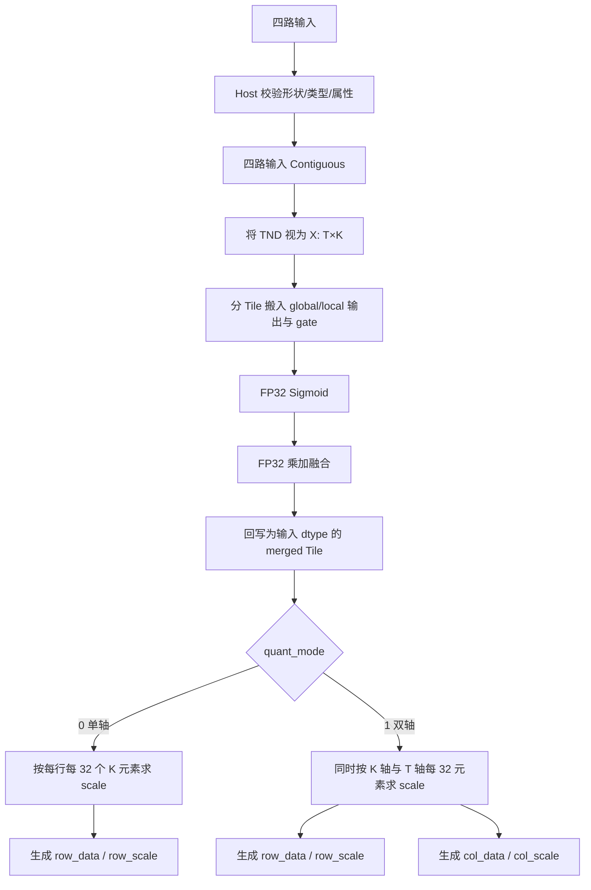
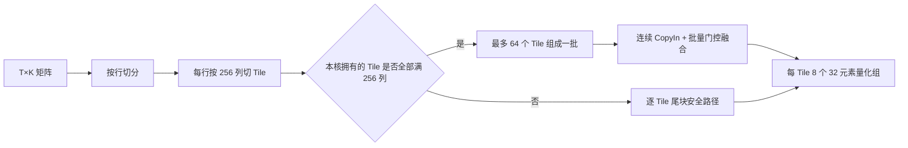
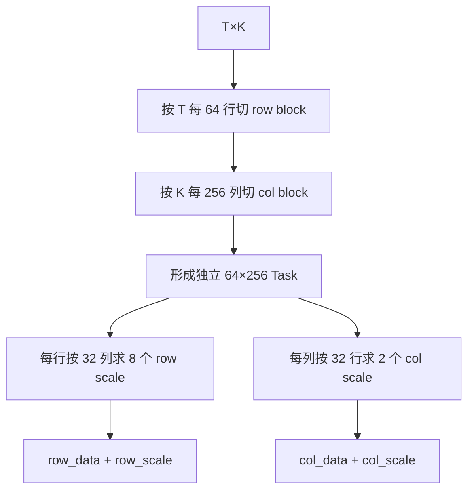
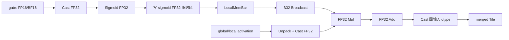
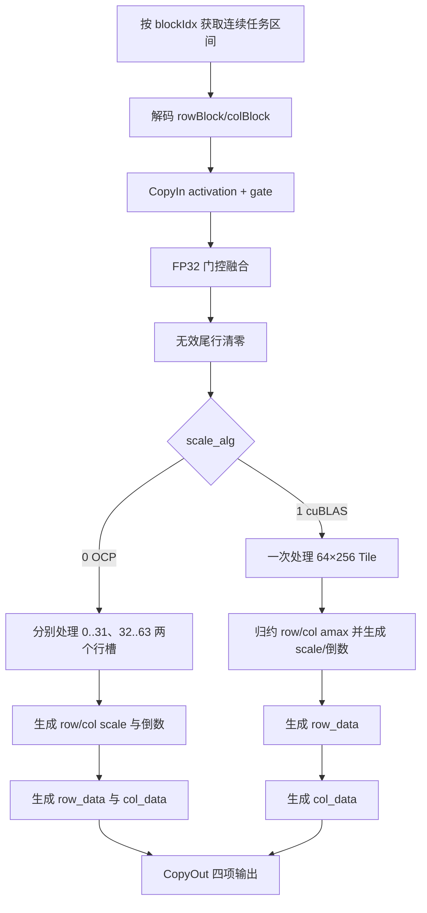
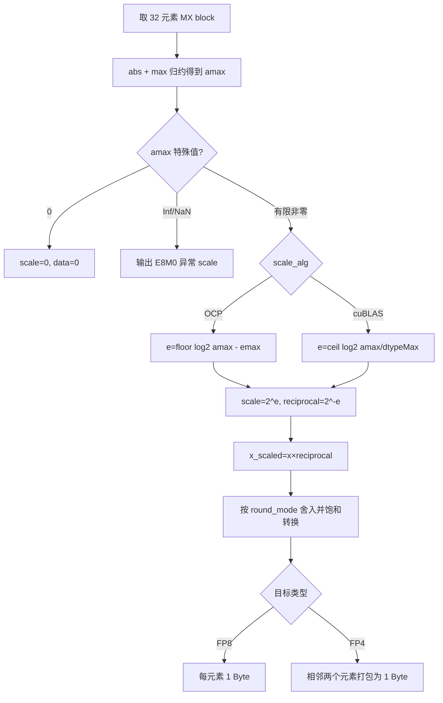

# ClaGateMxQuantWithDualAxis 算子详细设计说明书

| 版本 | 日期 | 作者 | 变更说明 |
|---|---|---|---|
| V1.0 | 2026-09-09 | 算子开发 | 基于当前 `cla_gate_mx_quant_with_dual_axis` 源码形成详细设计，覆盖单轴/双轴 Tiling、门控融合和 MX 量化流程 |

## 1 关联需求

### 1.1 功能目标

本算子面向 CLA（Cross-Layer Attention）场景，将 global/local 两路输出按照对应 gate logits 的 Sigmoid 权重融合，并对融合结果执行 MX（Microscaling）量化。

设输入张量形状为：

- `global_out`、`local_out`：`[T, N, D]`，数据类型为 FP16 或 BF16；
- `global_gate_logits`、`local_gate_logits`：`[T, N]`，类型与输出张量一致；
- `K = N × D`，其中 `1 ≤ N ≤ 128`，`D ∈ {128, 256}`，`T > 0`。

门控融合定义如下：

```text
global_weight[t,n] = sigmoid(global_gate_logits[t,n])
local_weight [t,n] = sigmoid(local_gate_logits [t,n])

merged[t,n,d] = global_out[t,n,d] × global_weight[t,n]
                + local_out[t,n,d] × local_weight[t,n]
```

量化阶段把 `[T,N,D]` 按逻辑视图展平为二维矩阵 `X[T,K]`：

```text
k = n × D + d
X[t,k] = merged[t,n,d]
```

支持两种量化模式：

- 单轴量化（`quant_mode=0`）：仅沿尾轴 K，以 32 个元素为一组计算 row scale 和 row data；
- 双轴量化（`quant_mode=1`）：在单轴结果基础上，再沿 T 轴以 32 个元素为一组计算 col scale 和 col data。

### 1.2 需求约束

| 项目 | 约束 |
|---|---|
| 输入布局 | 仅支持 TND，`layout=0` |
| 输入类型 | FP16、BF16，四个输入类型必须一致 |
| `D` | 128 或 256 |
| 目标类型 | 35：FP8 E5M2；36：FP8 E4M3FN；40：FP4 E2M1；41：FP4 E1M2 |
| scale 算法 | 0：OCP；1：cuBLAS 风格 |
| round mode | FP8 仅 `rint`；FP4 支持 `rint`、`floor`、`round` |
| FP4 限制 | FP4 仅支持 `scale_alg=0` |
| 空 Tensor | 当前实现不支持空输入 |
| 确定性 | 固定块内归约，无跨核原子累加，结果确定 |

## 2 接口实现设计

### 2.1 PTA 接口

逻辑接口如下：

```python
row_data, row_scale, col_data, col_scale = torch.ops.npu.cla_gate_mx_quant_with_dual_axis(
    global_out,
    local_out,
    global_gate_logits,
    local_gate_logits,
    dst_type=36,
    scale_alg=1,
    round_mode="rint",
    quant_mode=1,
    layout=0,
)
```

PTA/Meta 层需要完成输入维度、类型、属性值和组合关系校验，并推导输出形状。FP4 在框架侧无原生元素类型时，以 `uint8` 表示物理打包数据，一个字节保存两个 FP4 元素。

### 2.2 aclnn 接口

aclnn 路径接收四个输入和五个属性。四个输入在进入算子前分别经过 `Contiguous`，因此接口允许非连续 Tensor，Kernel 接收到的是连续存储。

属性顺序为：

```text
0 dst_type   : int64，默认 36
1 scale_alg  : int64，默认 1
2 round_mode : string，默认 "rint"
3 quant_mode : int64，默认 1
4 layout     : int64，默认 0
```

### 2.3 输出定义

令 `Gk = ceil(K / 64)`，`Gt = ceil(T / 64)`。E8M0 scale 在接口层将相邻两个 32 元素量化组组合到最后一维的两个槽位中。

| 输出 | 逻辑形状 | 含义 |
|---|---|---|
| `row_data` | `[T,K]` | 沿 K 轴量化后的数据；FP4 物理占用为 `T×K/2` 字节 |
| `row_scale` | `[T,Gk,2]` | K 轴每 32 元素一组的 E8M0 scale |
| `col_data` | `[T,K]` | 沿 T 轴量化后的数据；仅双轴模式有效 |
| `col_scale` | `[Gt,K,2]` | T 轴每 32 元素一组的 E8M0 scale；仅双轴模式有效 |

scale 槽位映射为：

```text
row_scale[t, q//2, q%2]  <=>  X[t, 32q : 32q+32]
col_scale[q//2, k, q%2]  <=>  X[32q : 32q+32, k]
```

单轴模式下，当前算子推导实现将 `col_data`、`col_scale` 置为空输出，内部空形状为 `[0]`；调用层应以“空输出”语义处理，不读取其内容。

### 2.4 HCCL C++ 接口

不涉及集合通信，不提供 HCCL 接口。

### 2.5 算子信息库与图模式

算子为纯计算算子，无状态、无通信。图模式下需要保留四输出语义，并允许编译器对输入执行连续化。`quant_mode` 决定后两项输出是否有效，不参与输入数目变化。

## 3 总体设计

### 3.1 总体计算流程



### 3.2 交付方式与交付件

交付方式为自定义算子源码交付。主要目录如下：

```text
cla_gate_mx_quant_with_dual_axis/
├── op_host/arch35/
│   ├── cla_gate_mx_quant_with_dual_axis_tiling_arch35.cpp
│   ├── cla_gate_mx_quant_with_dual_axis_tiling.h
│   └── cla_gate_mx_quant_with_dual_axis_tiling_key.h
├── op_kernel/
│   ├── cla_gate_mx_quant_with_dual_axis_apt.cpp
│   ├── cla_gate_mx_quant_common.h
│   ├── cla_gate_mx_quant_single_axis.h
│   ├── cla_gate_mx_quant_with_dual_axis_base.h
│   └── mx_quant/...
├── op_api/、op_graph/、op_proto/、op_plugin/
├── tests/
└── docs/
```

### 3.3 TilingKey 设计

TilingKey 由三部分组成：

```text
key = (mode, round_mode, scale_alg)
```

| 字段 | 值 | 说明 |
|---|---|---|
| mode | 0：ROTATE；1：BLOCK | 当前 Host 固定选择 BLOCK |
| round | 4：RINT；0：ROUND；1：FLOOR | 根据字符串属性映射 |
| scale alg | 0：OCP；1：cuBLAS | 根据属性映射 |

`quant_mode` 不编码进 TilingKey，由同一 Kernel 入口读取 TilingData 后运行时分支到单轴或双轴实现；输入/输出 dtype 则由算子编译模板选择。

### 3.4 TilingData

```cpp
struct ClaGateMxQuantWithDualAxisTilingData {
    int64_t usedCoreNum;
    int64_t dstType;
    int64_t activateLeft;
    int64_t dimM;          // T
    int64_t dimN;          // K=N*D
    int64_t numGroups;
    int64_t blockW;
    int64_t splitBlockH;
    int64_t dimNBlockNum;
    int64_t dimNTail;
    int64_t headNum;       // N
    int64_t headDim;       // D
    int64_t quantMode;
    int64_t rowTileNum;
    int64_t colTileNum;
    int64_t rowBlockSize;
    int64_t rowTailSize;
    int64_t colBlockSize;
    int64_t colTailSize;
    int64_t batchCount;
    int64_t batchSize;
};
```

公共参数：`BLOCK_W=256`、`BLOCK_H=64`，`dimNBlockNum=ceil(K/256)`，`dimNTail=K%256`，整除时尾宽记为 256。`activateLeft`、`numGroups` 为保留字段，当前分别取 1。`rowTileNum` 至 `batchSize` 是单轴专用字段；双轴 Kernel 使用 `splitBlockH`、`blockW`、`dimNBlockNum` 和 `dimNTail`，这些单轴专用字段在双轴模式下保持零初始化。

## 4 Tiling 详细设计

### 4.1 为什么单轴和双轴采用不同 Tile

单轴只需要在同一行的 K 方向每 32 个元素求最大值。一行中的不同 256 宽区间互不依赖，因此最小工作单元取 `1×256`，既能连续搬运，也无需保留 64 行数据。

双轴还需要在同一列的 T 方向每 32 行求最大值。为一次搬入同时产生 row 和 col 两套 scale，工作单元取 `64×256`：

- 64 行正好包含两个 32 行的 col 量化组；
- 256 列包含 8 个 32 列的 row 量化组；
- 256 宽也与向量计算和 UB 连续搬运粒度匹配。

### 4.2 单轴量化 Tiling

#### 4.2.1 切分规则

```text
rowBlockSize = 1
colBlockSize = 256
rowTileNum    = T
colTileNum    = ceil(K/256)
totalTiles    = T × colTileNum
```

每个 Tile 对应一行、最多 256 个连续 K 元素。Tile 编号按行优先展开：

```text
tileId = row × colTileNum + colBlock
row = tileId / colTileNum
colOffset = (tileId % colTileNum) × 256
```

多核采用连续、均衡分配：

```text
base = totalTiles / usedCoreNum
rem  = totalTiles % usedCoreNum
前 rem 个核各处理 base+1 个 Tile，其余核各处理 base 个 Tile。
```

#### 4.2.2 图示

以 `T=3, N=5, D=128` 为例，`K=640`：

```text
                     K 方向
            0          256         512       640
          ┌────────────┬────────────┬─────────┐
row 0     │ tile 0     │ tile 1     │ tile 2  │  宽 128
          ├────────────┼────────────┼─────────┤
row 1     │ tile 3     │ tile 4     │ tile 5  │  宽 128
          ├────────────┼────────────┼─────────┤
row 2     │ tile 6     │ tile 7     │ tile 8  │  宽 128
          └────────────┴────────────┴─────────┘
              256          256          128
```

每个 256 宽 Tile 内部再分成 8 个 32 元素 MX block；最后一个 128 宽 Tile 只有 4 个有效 MX block。



#### 4.2.3 批处理与尾块回退

Host 设置 `batchSize=64`，`batchCount=ceil(maxTilesPerCore/64)`。若某个核拥有的 Tile 全部是 256 满宽块，Kernel 可将连续 Tile 组成一批：

- activation 连续批量搬入；
- gate 按 Tile 顺序搬入；
- 对每个本地 Tile 完成融合和 row 量化；
- 一批最多 64 个 Tile，以控制 UB 占用。

批次允许跨越逻辑行边界。例如 `K=512` 时每行两个满宽 Tile，连续 Tile 的 activation 和相应 gate 序列仍可批处理。

若本核范围包含 K 方向尾块，Kernel 回退到逐 Tile 路径，显式使用 `calcCol` 限定有效宽度，避免批量路径跨行误读。由于 `D=256` 时 K 必为 256 的整数倍；尾宽主要出现在 `D=128` 且 N 为奇数时，此时尾宽为 128。

#### 4.2.4 单轴用核策略

当前实现根据输入字节量估算用核数：

```text
inputBytes = T × K × sizeof(input) = T × K × 2
coreHint   = floor(inputBytes / 4096 / 2)，最小为 1
usedCore   = min(platformCoreNum, coreHint)
```

因此极小输入会主动少用核，避免核启动开销；输入规模增大后逐步使用更多 AIV 核。

### 4.3 双轴量化 Tiling

#### 4.3.1 切分规则

```text
tileHeight    = splitBlockH = 64
tileWidth     = blockW = 256
rowSplitCount = ceil(T/64)
colSplitCount = dimNBlockNum = ceil(K/256)
totalTasks    = rowSplitCount × colSplitCount
usedCoreNum   = min(platformCoreNum, totalTasks)
```

线性任务号与二维 Tile 的映射为：

```text
taskId       = rowBlockIdx × colTileNum + colBlockIdx
rowOffset    = rowBlockIdx × 64
colOffset    = colBlockIdx × 256
calcRow      = min(64, T-rowOffset)
calcCol      = min(256, K-colOffset)
```

任务同样以连续区间均衡分配给各核。每个 Tile 完全独立地产生其覆盖区域的 row/col 数据和 scale，不需要跨核合并。

#### 4.3.2 二维切分图

以 `T=130, K=640` 为例，形成 `3×3=9` 个任务：

```text
                                K 方向
                   0             256            512       640
                ┌───────────────┬───────────────┬───────────┐
T  0..63        │ task 0        │ task 1        │ task 2    │
64 行           │ 64×256        │ 64×256        │ 64×128    │
                ├───────────────┼───────────────┼───────────┤
T 64..127       │ task 3        │ task 4        │ task 5    │
64 行           │ 64×256        │ 64×256        │ 64×128    │
                ├───────────────┼───────────────┼───────────┤
T 128..129      │ task 6        │ task 7        │ task 8    │
2 行有效        │ 2×256         │ 2×256         │ 2×128     │
补零到 64 行    │               │               │           │
                └───────────────┴───────────────┴───────────┘
```

单个 `64×256` Tile 内的量化组关系如下：

```text
Row axis：每一行横向分成 256/32 = 8 组

row r  [0..31][32..63] ... [224..255]  -> 8 个 row scale

Col axis：每一列纵向分成两个 32 行组

rows  0..31   -> col scale slot 0
rows 32..63   -> col scale slot 1
```



#### 4.3.3 尾块处理

- 行尾：`calcRow < 64` 时，融合完成后把无效行清零，再按 64 行规整路径计算；零值不会增大绝对值最大值；
- 列尾：`calcCol < 256` 时，搬运和写回只覆盖有效列，计算宽度按 64 对齐；
- MX group 尺寸固定为 32。因 `K=N×D` 且 D 为 128/256，K 总是 32 的整数倍，不存在半个 row MX group；
- T 不要求是 32 的整数倍，最后一个 col MX group 的无效行以零补齐。

### 4.4 单轴与双轴 Tiling 对比

| 项目 | 单轴 | 双轴 |
|---|---|---|
| Tile | `1×256` | `64×256` |
| 目标 | 只产生 K 轴 scale/data | 同时产生 K 轴和 T 轴 scale/data |
| 行方向组 | 不需要聚合多行 | 64 行包含两个 32 行组 |
| 列方向组 | 每 Tile 最多 8 个 32 列组 | 每行最多 8 组，且每列有 2 个 32 行组 |
| 用核 | 按输入字节量估算 | 不超过二维任务数 |
| 优化 | 满宽 Tile 最多 64 个批处理 | 每个二维 Tile 独立流水 |
| 尾块 | 含尾列的核回退逐 Tile | 行尾补零、列尾按有效宽度处理 |

## 5 Kernel 详细设计

### 5.1 Kernel 入口与模板分派

Kernel 为 AIV 实现。入口读取 TilingData，将 round mode 映射为编译期模板参数，并保存/恢复浮点溢出控制寄存器。运行时根据 `quantMode` 分派：

```cpp
if (tiling.quantMode == 0) {
    ClaGateMxQuantTailAxisBase<...> op;       // 单轴
    op.Init(...);
    op.Process();
} else {
    ClaGateMxQuantWithDualAxisBase<...> op;   // 双轴
    op.Init(...);
    op.Process();
}
```

### 5.2 门控融合实现

#### 5.2.1 Gate 与 activation 的映射

一个 256 列 Tile 覆盖的 head 数为：

```text
headsPerTile = 256 / D
D=256 时，每个 Tile 覆盖 1 个 head
D=128 时，每个 Tile 覆盖 2 个 head
```

`headStart=colOffset/D`。Kernel 只搬入当前 Tile 需要的 gate；`N=1` 时走连续搬运快速路径，其余情况按 `[T,N]` 的行跨度取数。

#### 5.2.2 精度路径

门控融合采用“Sigmoid 和乘加均在 FP32 完成，融合结果再回写为输入 dtype”的路径：

```cpp
for each row in tile:
    for each head covered by tile:
        gw = float(sigmoid(global_gate[row, head]))
        lw = float(sigmoid(local_gate [row, head]))

        for each vector fragment of this head:
            g = cast_fp32(global_out fragment)
            l = cast_fp32(local_out  fragment)
            y = g * gw + l * lw
            merged = cast_input_dtype(y)
```

FP32 Sigmoid 先写入 UB 临时区，执行 `VEC_STORE -> VEC_LOAD` 的 LocalMemBar 后，再以 B32 broadcast 方式加载。该屏障保证向量写入完成后才被后续加载；B32 广播避免将 FP32 权重按 B16 解释。activation 也先解包并转换成 FP32，再执行两次乘法和加法，从而避免 BF16/FP16 直接乘加带来的额外舍入误差。



### 5.3 UB Buffer 与流水设计

公共实现采用双缓冲队列，关键常量为：

```text
DB_BUFFER        = 2
BLOCK_SIZE       = 32
DOUBLE_BLOCK_SIZE= 64
ONCE_ROW_LEN     = 256
```

主要缓冲区如下：

| Buffer | 逻辑容量 | 用途 |
|---|---:|---|
| activation input queue | 双缓冲，每帧含 global/local 两个 `64×256` 输入区 | 搬入两路 activation |
| gate input queue | 双缓冲，每帧含 global/local、每 head 最多 64 个 gate | 搬入 gate |
| merged buffer | `64×256×sizeof(input)` | 保存融合结果 |
| sigmoid scratch | global/local 各 `headsPerTile×64×sizeof(float)` | FP32 Sigmoid 与广播中转 |
| row/col data queue | 双缓冲 | FP8/FP4 输出数据 |
| row scale buffer | 按 64 行、每行 scale block 分配 | row E8M0 scale |
| col scale buffer | 覆盖 256 列和两个 32 行槽位 | col E8M0 scale |
| reciprocal buffers | 与 row/col scale 对应 | 量化乘法使用的倒数 scale |

流水按 `CopyIn -> Merge -> Scale/Quant -> CopyOut` 组织；输入/输出队列双缓冲用于隐藏 GM/UB 搬运与向量计算延迟。单轴路径虽然复用公共类，但只产生 row 方向有效结果。

### 5.4 双轴 Kernel 流程



双轴路径的核心伪代码：

```cpp
for taskId in tasksOwnedByThisCore:
    rowOffset = (taskId / colTileNum) * 64
    colOffset = (taskId % colTileNum) * 256
    calcRow = min(64, T - rowOffset)
    calcCol = min(256, K - colOffset)

    tile = copy_in(global_out, local_out, gates,
                   rowOffset, colOffset, calcRow, calcCol)
    merged = cla_gate_merge_fp32(tile)
    zero_fill_rows(merged, calcRow, 64)

    if scale_alg == OCP:
        for slot in [0, 1]:             // 每槽 32 行
            compute_ocp_row_and_col_scale(merged[slot*32:(slot+1)*32, :])
        quantize_row(merged)
        quantize_col(merged)
    else:
        compute_cublas_row_and_col_scale(merged[0:64, :])
        quantize_row(merged)
        quantize_col(merged)

    copy_out(valid row/col data and scale)
```

### 5.5 单轴 Kernel 流程

```cpp
tiles = contiguous_tiles_owned_by_this_core()

if every tile in tiles is full_width_256:
    for batch in split(tiles, max_size=64):
        copy_in_contiguous_activation(batch)
        copy_in_gate_sequence(batch)
        for localTile in batch:
            merged = cla_gate_merge_fp32(localTile)
            row_scale, row_recip = compute_row_scale(merged)
            row_data = quantize_with_reciprocal(merged, row_recip)
            copy_out(row_data, row_scale)
else:
    for tile in tiles:
        calcCol = min(256, K-colOffset)
        copy_in_with_tail(tile, calcCol)
        merged = cla_gate_merge_fp32(tile)
        row_scale, row_recip = compute_row_scale(merged, calcCol)
        row_data = quantize_with_reciprocal(merged, row_recip, calcCol)
        copy_out_valid_region(row_data, row_scale)
```

单轴路径不执行 T 轴归约，也不写有效的 `col_data/col_scale`，减少计算量和 GM 带宽。

## 6 MX 量化算法详细设计

### 6.1 分组定义

量化组固定为 32 个元素。对融合矩阵 `X[T,K]`：

```text
Row block B_row(t,q) = X[t, 32q : 32q+32]
Col block B_col(q,k) = X[32q : 32q+32, k]
amax(B) = max(abs(x)), x∈B
```

每个 block 得到一个 E8M0 scale 和一个用于计算的 reciprocal scale：

```text
q_i = saturating_cast_dst(x_i × reciprocal, round_mode)
```

### 6.2 OCP scale 算法（scale_alg=0）

OCP 方式按目标格式的最大正规指数 `emax` 对齐：

```text
e          = floor(log2(amax)) - emax
scale      = 2^e
reciprocal = 2^(-e)
```

实际实现从浮点指数位构造 E8M0 scale，并为乘法阶段准备可直接加载的倒数。特殊值处理：

- `amax=0`：scale 置零，量化结果为零；
- 存在 Inf/NaN：生成 E8M0 NaN/异常标记，避免把异常误当普通有限值；
- FP16 输入在指数处理前进入 BF16/FP32 语义域，以统一特殊值判定。

双轴 OCP 按两个 32 行槽处理 `64×256` Tile：每一槽同时得到该 32 行范围内的 row scale 和 col scale；两个 col scale 分别写到输出最后一维的 slot 0、slot 1。

### 6.3 cuBLAS 风格 scale 算法（scale_alg=1）

cuBLAS 风格先用目标 dtype 的最大可表示值 `dtypeMax` 归一化：

```text
r          = amax / dtypeMax
e          = ceil(log2(r))
scale      = 2^e
reciprocal = 2^(-e)
```

实现通过 FP32 指数和尾数位判断 `ceil(log2(r))`，并使用预计算的 `1/dtypeMax`，避免逐元素通用除法。由于 `ceil(log2(amax/dtypeMax))` 与 OCP 的指数对齐规则不同，对于非 2 的幂的 `amax`，两种算法得到的 scale 可能不同，这是定义差异，不是精度故障。

当前 cuBLAS 路径仅用于 FP8。双轴时一次处理 `64×256` Tile，统一收集 row/col amax；单轴时使用 row-only 实现，依次经历“收集 amax -> 生成 scale/倒数 -> 量化数据”三个阶段。

### 6.4 scale 计算流图



### 6.5 完整量化伪代码

```python
def quantize_block(values, dst_type, scale_alg, round_mode):
    # values: 长度 32；尾部无效位置已经补 0
    amax = max(abs(v) for v in values)

    if amax == 0:
        return zeros(dst_type), e8m0_zero
    if is_inf_or_nan(amax):
        return convert_special(values, dst_type), e8m0_nan

    if scale_alg == OCP:
        exponent = floor(log2(amax)) - max_normal_exponent(dst_type)
    else:  # cuBLAS style
        exponent = ceil(log2(amax / dtype_max(dst_type)))

    scale = pow2(exponent)             # 输出为 E8M0 编码
    reciprocal = pow2(-exponent)       # UB 中用于乘法

    result = []
    for x in values:
        y = x * reciprocal
        result.append(saturating_round_cast(y, dst_type, round_mode))

    return pack_if_fp4(result), encode_e8m0(scale)
```

### 6.6 FP4 打包

FP8 每个逻辑元素占 1 字节；FP4 每两个相邻逻辑元素打包进 1 字节。逻辑索引和 scale 分组仍按未打包的 `[T,K]` 计算，只有 data 的 GM 地址和搬运长度按 `K/2` 字节折算。由于 D 是 128 或 256，K 必为偶数，不会出现单个 FP4 元素无法配对的情况。

## 7 精度、性能与异常设计

### 7.1 精度设计

1. Gate 的 Sigmoid 使用 FP32 计算；
2. global/local activation 转为 FP32 后执行乘法和加法；
3. 融合结果回写为原输入 dtype，再进入 MX 量化；
4. scale 归约以固定 32 元素组进行，避免不同核间归约顺序差异；
5. 行尾补零不改变有限有效数据的 `amax`，全零组仍走零 scale 语义；
6. OCP 与 cuBLAS 风格的 scale 定义不同，测试应分别使用对应标杆，不能直接比较二者 scale 是否一致。

特别地，`D=256` 时每个 256 宽 Tile 恰好覆盖一个 head；`D=128` 时覆盖两个 head。地址寄存器必须同时包含 row stride、head 偏移、head 内向量片段偏移，Sigmoid 权重必须按 B32 广播。若错误使用 B16 广播、遗漏向量片段偏移，或在低精度寄存器中直接乘加，都会在 `[T,N,D]=[1024,96,256]` 等大规模 shape 上累积为明显误差。当前实现已采用 FP32 中转和完整地址构造。

### 7.2 性能设计

- activation 和 gate 按 Tile 需要量搬入，避免读取无关 head；
- 双缓冲重叠搬运和计算；
- 双轴 `64×256` 一次复用融合结果产生两个方向输出，避免重复门控融合；
- 单轴满宽路径批量处理最多 64 个 Tile，降低逐 Tile 队列和搬运开销；
- 小规模单轴输入主动减少用核；双轴不启用多于任务数的核；
- 所有任务独立，无 workspace 中间归约和核间同步。

### 7.3 Workspace 设计

算子计算不需要自定义 GM workspace；Host 仅保留平台运行库要求的 workspace 大小。所有中间结果在各 AIV 核的 UB 内完成。

### 7.4 异常与边界检查

Host 应在生成 Tiling 前拒绝以下输入：

- 输入数量、维度或类型不匹配；
- gate 不是 `[T,N]`；
- activation 不是 `[T,N,D]`，或两路 shape 不一致；
- `N`、`D`、`dst_type`、`scale_alg`、`round_mode`、`quant_mode`、`layout` 越界；
- FP4 与 cuBLAS scale 算法组合；
- FP8 与非 `rint` 舍入组合；
- 空 Tensor 或整数乘法溢出风险。

### 7.5 训练、推理和 Batch

当前算子为前向量化算子，不包含反向实现，主要用于推理或训练中的量化前向路径。T 维可表示 token 总数，算子不单独解析 batch 维；上游可将 batch/sequence 合并到 T，只要内存布局符合 TND。

## 8 维测设计

### 8.1 功能与精度用例

建议至少覆盖：

| 类别 | 示例 shape / 属性 | 检查点 |
|---|---|---|
| 主场景 | `[1024,96,256]`，FP16/BF16，OCP/cuBLAS | 门控融合精度、满 Tile、多核分配 |
| 双轴行尾 | `[65,4,128]` | 第三个 32 行 col group、64 行 Tile 尾部补零 |
| 单轴列尾 | `[13,11,128]` | K=1408，最后 128 列回退路径 |
| 单轴满宽 | `[65,24,256]` | 批处理、跨行连续 Tile |
| 单 head | `N=1` | gate 连续搬运快速路径 |
| gate 饱和 | 大正值/大负值 logits | Sigmoid 接近 1/0 时的融合正确性 |
| 全零 | activation 全零 | zero scale 与 zero data |
| 特殊值 | Inf/NaN | E8M0 特殊值处理 |
| FP4 | E2M1/E1M2，三种合法 round mode | 两元素打包、饱和和舍入 |

### 8.2 Tiling 用例

Host UT 除属性合法性外，应断言以下字段：

- 单轴：`rowBlockSize=1`、`colBlockSize=256`、Tile 数、尾宽、`batchSize=64`、小输入用核数；
- 双轴：`splitBlockH=64`、`blockW=256`、`dimNBlockNum`、二维任务数、`dimNTail` 和 `usedCoreNum`；
- `quant_mode=0/1` 的分支；
- 非法 `layout`、非法 gate shape、空 Tensor；
- FP4/scale_alg 和 FP8/round_mode 的非法组合。

### 8.3 标杆计算

CPU 标杆应严格复现以下顺序：

```text
输入 dtype -> FP32 Sigmoid/融合 -> 回写输入 dtype
-> 按指定轴每 32 元素求 amax
-> 按指定 scale_alg 计算 E8M0 scale
-> 乘 reciprocal -> 指定 round_mode -> 目标格式饱和/打包
```

若标杆省略“融合后回写输入 dtype”这一步，会把 FP32 融合值直接送入量化，从而与 Kernel 产生可预期差异。

### 8.4 现有测试与一致性注意项

现有 ST 已覆盖 `[1024,96,256]`、BF16/FP16、OCP/cuBLAS、零值、gate 饱和以及部分尾块场景；单轴用例还覆盖 FP4 和 `N=1`。后续维护时应以当前源码接口为准：gate 当前定义为二维 `[T,N]`，旧用例或旧文档中出现的 `[T,N,1]`、SwiGLU 描述不属于本实现语义，应同步清理，避免测试和文档漂移。

## 9 资料与源码索引

| 内容 | 源码位置 |
|---|---|
| Host 校验与 Tiling | `op_host/arch35/cla_gate_mx_quant_with_dual_axis_tiling_arch35.cpp` |
| TilingData | `op_host/arch35/cla_gate_mx_quant_with_dual_axis_tiling.h` |
| TilingKey | `op_host/arch35/cla_gate_mx_quant_with_dual_axis_tiling_key.h` |
| Kernel 入口 | `op_kernel/cla_gate_mx_quant_with_dual_axis_apt.cpp` |
| 公共搬运、门控融合与 MX 基础函数 | `op_kernel/arch35/cla_gate_mx_quant_common.h` |
| 单轴实现 | `op_kernel/arch35/cla_gate_mx_quant_single_axis.h` |
| 双轴实现 | `op_kernel/arch35/cla_gate_mx_quant_with_dual_axis.h` |
| 接口定义 | `op_host/`、`op_api/`、`op_graph/`、`op_proto/`、`op_plugin/` |
| 用例 | `tests/` |

---

本文档描述的是 2026-09-09 当前源码实现。若后续改变 Tile 大小、TilingKey 编码、scale 算法或输出空 Tensor 约定，应同步修改接口推导、Host Tiling、Kernel、标杆与本文档。
