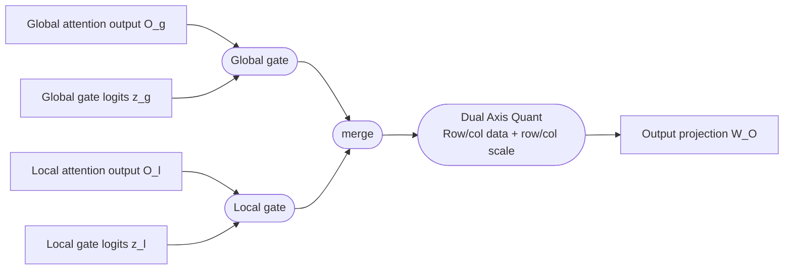
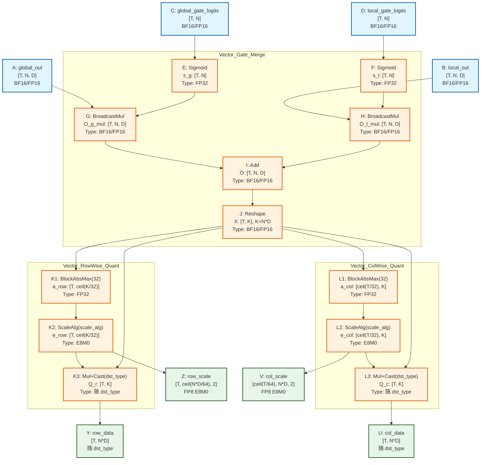

# cla_gate_mx_quant_dual_axis算子需求分析与设计说明书

<center><strong>修订记录</strong></center>

<div align="center">

| 日期 | 修订版本 | 修改描述 | 作者 |
| :---: | :---: | :---: | :---: |
| 2026-09-08 | 1.0 | 设计初稿 | 辛方x00499874 |

</div>

## 1. 需求描述

### 1.1 需求背景

#### 1.1.1 网络模型

Pangu V3 系列模型（50B / 505B / 1T）。

V3 代际模型采用 **Cross-Layer Attention（CLA）+ gated SWA** 结构。CLA 层包含 global attention 和 local attention 两个分支：

* 两个分支共享 Query；
* global 分支复用前面层的 KV latent，以减少 KV cache；
* local 分支使用当前层生成的 KV latent，并保留 512 token 的 sliding-window KV；
* 两个分支分别使用 head-wise gate，再逐 token、逐 head 融合；
* 融合结果进入输出投影 `W_O`；低精度训练时，输出投影输入需要转换为 MXFP8。

目标网络中每 8 层设置 1 个 CLA 层。

#### 1.1.2 应用场景

训练（Attention 阶段）前向：CLA + gated SWA 两分支 Attention 输出合并后、输出投影 `W_O` 之前的计算融合（CLA GATE + SWA GATE + QUANT），一次生成 row-wise 与 col-wise 两套 MXFP8 量化数据，供训练反向（需保留输入列方向数据）使用。

优化前的小算子组合：

```
global_out ── sigmoid(global_gate) ── mul ─┐
                                            ├─ add ─ reshape ─ MXFP8 quant ─ W_O
local_out  ── sigmoid(local_gate)  ── mul ─┘
```

未融合实现至少包含 2 个 sigmoid、2 个广播 Mul、1 个 Add 和 1 个动态量化算子，并会物化两路 gated attention 中间结果及 BF16 融合结果。融合目标：

1. 将 `sigmoid + broadcast Mul × 2 + Add + MXFP8 quant` 融合为一次算子下发；
2. 不在 HBM 中物化两路 gated attention 大张量和量化前的完整融合结果；
3. 双轴版本一次生成 row-wise 和 col-wise MXFP8 数据，供需要保留输入列方向数据的训练反向使用；推理等仅需 row-wise 输出的场景通过单轴模式（quant_mode=0）复用同一融合算子，跳过 col-wise 链路。

#### 1.1.3 业务目标

实现 CLA + GATE + QUANT 融合算子及其性能优化，支撑 Pangu V3 系列模型 A5 MXFP8 量化训练性能提升。性能不低于小算子组合，具体收益待拿到整网 Profiling 后进一步分析。

### 1.2 需求规格

#### 1.2.1 算子功能

##### 1.2.1.1 功能和原理

融合边界覆盖 CLA 两个 Attention 分支的输出合并及紧随其后的 MXFP8 双轴动态量化：



本次设计范围为训练正向、推理融合算子 `npu_cla_gate_mx_quant_with_dual_axis`：

- 融合两路 gate 和 attention output（`sigmoid + broadcast Mul × 2 + Add`）；
- 支持两种量化模式（由 `quant_mode` 参数选择）：
  - **双轴模式（quant_mode=1，默认）**：一次生成 row-wise（[1,32] block）及 col-wise（[32,1] block）两套量化数据，返回 `row_data`、`row_scale`、`col_data`、`col_scale`；
  - **单轴模式（quant_mode=0）**：仅生成 row-wise（[1,32] block）一套量化数据，返回 `row_data`、`row_scale`，`col_data`、`col_scale` 返回空 tensor，算子内部跳过 col-wise 量化链路。单轴模式面向推理等仅需 row-wise 输出的场景，避免 col-wise 量化与输出的额外计算和搬运开销。

##### 1.2.1.2 数学公式

记本 rank 上 token 数为 $T$，attention head 数为 $N$，value head dim 为 $D$，$K = N \times D$。

- **数学公式**

**输入为：**

$$
O_g, O_l \in \mathbb{R}^{T \times N \times D}, \qquad z_g, z_l \in \mathbb{R}^{T \times N}
$$

**两路 head-wise gate：**

$$
s_g = \sigma(z_g), \qquad s_l = \sigma(z_l)
$$

其中 $\sigma(x) = \dfrac{1}{1 + e^{-x}}$ 为 Sigmoid 函数。

**CLA gate 融合**（逐 token、逐 head）：

$$
O_{t,n,d} = s_{g,t,n} \cdot O_{g,t,n,d} + s_{l,t,n} \cdot O_{l,t,n,d}
$$

**量化前逻辑矩阵：**

$$
X = \operatorname{reshape}(O, [T, K]), \qquad K = N \times D
$$

**对任意长度为 32 的 block $b$，MXFP8 动态量化抽象表示为：**

$$
a_b = \max_{i \in b} |X_i|, \qquad e_b = \operatorname{ScaleAlg}(a_b, \text{scale\_alg}), \qquad Q_i = \operatorname{cast}_{\text{dst\_type}}\left( \frac{X_i}{e_b} \right)
$$

`ScaleAlg` 的指数选择、舍入、饱和、全零 block、NaN/Inf 行为必须与同版本 `npu_dynamic_mx_quant` 保持一致，不在融合算子中另定义一套量化规则。

* **Row-wise**（每个 [1,32] block 沿 K 方向共享 scale）：

$$
Q_r \in \mathrm{FP8}^{T \times K}, \qquad S_r \in \mathrm{E8M0}^{T \times \lceil K/64 \rceil \times 2}
$$

* **Col-wise**（每个 [32,1] block 沿 T 方向共享 scale，仅 quant_mode=1 双轴模式下计算）：

$$
Q_c \in \mathrm{FP8}^{T \times K}, \qquad S_c \in \mathrm{E8M0}^{\lceil T/64 \rceil \times K \times 2}
$$

> **量化模式说明（quant_mode）**：`quant_mode = 1`（默认）时按上述公式同时计算 Row-wise 与 Col-wise 两套量化输出；`quant_mode = 0`（单轴模式）时仅计算 Row-wise 一套量化输出，Col-wise 公式（$Q_c$、$S_c$）不执行，对应输出返回空 tensor。量化规则（ScaleAlg、block 归约、cast）在两种模式下完全一致。

> **输出数据类型说明（dst_type）**：上述公式以 E4M3 为例，cast 目标类型由 `dst_type` 决定（`float8_e5m2` / `float8_e4m3fn` / `float4_e2m1fn` / `float4_e1m2fn`，默认 `float8_e4m3fn`），舍入方式由 `round_mode` 决定（FP8 仅 `"rint"`，FP4 支持 `"rint"` / `"floor"` / `"round"`）；emax 取对应数据类型的最大正则数指数（E5M2=15、E4M3FN=8、E2M1=2、E1M2=0），具体指数选择/舍入规则仍以同版本 `npu_dynamic_mx_quant` 规格为准。

> **scale 输出布局说明**：scale 输出采用官方双轴量化算子的物理布局——每两个相邻 32 元素 block 的 E8M0 scale 组成一对，存于最后一维（shape 末维恒为 2），即 row-wise 每行 $\lceil K/32 \rceil$ 个 scale 打包为 $\lceil K/64 \rceil$ 对、col-wise 每列 $\lceil T/32 \rceil$ 个 scale 打包为 $\lceil T/64 \rceil$ 对；尾组不足两个时偶数 pad，pad 填充值为 0。因此 $S_r$ 逻辑维度为 $T \times \lceil K/32 \rceil$、物理 shape 为 $[T, \lceil K/64 \rceil, 2]$，$S_c$ 逻辑维度为 $\lceil T/32 \rceil \times K$、物理 shape 为 $[\lceil T/64 \rceil, K, 2]$。

- **参数信息**

pytorch 形式：

```
row_data, row_scale, col_data, col_scale = torch_npu.npu_cla_gate_mx_quant_with_dual_axis(
    global_out, local_out, global_gate_logits, local_gate_logits,
    dst_type=torch.float8_e4m3fn, round_mode="rint", scale_alg=1, quant_mode=1,
)
```

> `quant_mode=0`（单轴模式）时返回值 `col_data` / `col_scale` 为空 tensor（shape [0]），仅 `row_data` / `row_scale` 有效。

| 序号 | 参数 | 输入或输出 | layout/维度 | 数据类型 | 说明 |
| ---- | ---- | ---------- | ----------- | -------- | ---- |
| 1 | global_out | 输入 | TND [T,N,D] | BF16/FP16 | Global/CLA 分支 Attention 输出 |
| 2 | local_out | 输入 | TND [T,N,D] | BF16/FP16 | Local/SWA 分支 Attention 输出 |
| 3 | global_gate_logits | 输入 | TN [T,N] | 与输入一致 | Global gate 的 Sigmoid 前值 |
| 4 | local_gate_logits | 输入 | TN [T,N] | 与输入一致 | Local gate 的 Sigmoid 前值 |
| 5 | dst_type | 输入 | 标量 | enum | 量化输出数据类型：`float8_e5m2` / `float8_e4m3fn` / `float4_e2m1fn` / `float4_e1m2fn`，默认 `float8_e4m3fn`（aclnn 侧枚举：35=E5M2、36=E4M3FN、40=E2M1、41=E1M2）；FP4 输出时 K 必须可被 4 整除 |
| 6 | round_mode | 输入 | 标量 | string | 数据转换舍入模式，默认 `"rint"`；FP8 输出（E5M2/E4M3FN）仅支持 `{"rint"}`，FP4 输出（E2M1/E1M2）支持 `{"rint", "floor", "round"}` |
| 7 | scale_alg | 输入 | 标量 | int | 1：cuBLAS 兼容舍入方式；0：OCP MX 标准舍入方式；FP4 输出时仅支持 0 |
| 8 | quant_mode | 输入 | 标量 | int | 1（默认）：双轴量化，输出 row-wise + col-wise 两套数据；0：单轴量化，仅输出 row-wise 一套数据，col_data/col_scale 返回空 tensor |
| 9 | layout | 输入 | 标量 | int | 输入 tensor 的排布格式，默认 `0`（TND）；枚举映射：`0 = TND`（ND 存储，逻辑 T,N,D 排布） |
| 10 | row_data | 输出 | [T,N×D] | 随 dst_type | Row-wise 量化数据 |
| 11 | row_scale | 输出 | [T,ceil(N×D/64),2] | FP8 E8M0 | Row-wise scale，相邻两 32-block scale 两两打包（末维 2），尾组偶数 pad 填 0 |
| 12 | col_data | 输出 | [T,N×D] | 随 dst_type | Col-wise 量化数据，与 row_data 数值编码通常不同；quant_mode=0 时为空 tensor |
| 13 | col_scale | 输出 | [ceil(T/64),N×D,2] | FP8 E8M0 | Col-wise scale，相邻两 32-block scale 两两打包（末维 2），尾组偶数 pad 填 0；quant_mode=0 时为空 tensor |

##### 1.2.1.3 Golden实现

**npu 小算子拼接 golden**

```python
import torch
import torch_npu

def cla_gate(global_out, local_out, global_logits, local_logits):
    """两路 head-wise gate 融合：O = σ(z_g)⊙O_g + σ(z_l)⊙O_l

    sigmoid/mul/add 都在 FP32 中计算，最后再落回输入 dtype。
    """
    orig_dtype = global_out.dtype
    calc_dtype = torch.float32

    global_scale = torch.sigmoid(global_logits.to(calc_dtype)).unsqueeze(-1)
    local_scale = torch.sigmoid(local_logits.to(calc_dtype)).unsqueeze(-1)

    merged = (
        global_out.to(calc_dtype) * global_scale
        + local_out.to(calc_dtype) * local_scale
    ).to(orig_dtype)

    return merged


def cla_gate_mx_quant_dual_axis_golden(global_out, local_out, global_gate_logits,
                                       local_gate_logits,
                                       dst_type=torch.float8_e4m3fn,
                                       round_mode="rint", scale_alg=1,
                                       quant_mode=1, layout=0):
    """
    npu_cla_gate_mx_quant_with_dual_axis 的 golden 实现

    Args:
        global_out: [T, N, D], BF16/FP16, Global/CLA 分支 Attention 输出
        local_out:  [T, N, D], BF16/FP16, Local/SWA 分支 Attention 输出
        global_gate_logits: [T, N], 与输入同dtype, Global gate 的 Sigmoid 前值
        local_gate_logits:  [T, N], 与输入同dtype, Local gate 的 Sigmoid 前值
        dst_type: 标量, float8_e5m2 / float8_e4m3fn / float4_e2m1fn / float4_e1m2fn
        round_mode: 标量, "rint"(默认) / "floor" / "round"; FP8 仅支持 "rint"
        scale_alg: 标量, 1: cuBLAS 兼容舍入; 0: OCP MX 标准舍入; FP4 输出时仅支持 0
        quant_mode: 标量, 1: 双轴量化(row+col); 0: 单轴量化(仅 row-wise)
        layout: 标量, 0: TND（ND 存储，逻辑 T,N,D 排布；本 golden 仅支持 TND）

    Returns:
        row_data:  [T, N*D], 随 dst_type, row-wise 量化数据
        row_scale: [T, ceil(N*D/64), 2], FP8 E8M0, row-wise scale（两两打包，尾组 pad 0）
        col_data:  [T, N*D], 随 dst_type, col-wise 量化数据（quant_mode=0 时为空 tensor）
        col_scale: [ceil(T/64), N*D, 2], FP8 E8M0, col-wise scale（两两打包，尾组 pad 0；quant_mode=0 时为空 tensor）
    """
    if layout != 0:
        raise ValueError("golden 仅支持 layout=0（TND）")

    # cla_gate 内部已使用 FP32 计算，返回原始 dtype
    merged = cla_gate(global_out, local_out, global_gate_logits, local_gate_logits)
    merged = merged.reshape(merged.shape[0], -1)

    if quant_mode == 0:
        # 单轴模式：仅做 row-wise 量化，col 输出置空（与算子返回空 tensor 语义一致）
        row_data, row_scale = torch_npu.npu_dynamic_mx_quant(
            merged, dst_type=dst_type, round_mode=round_mode, scale_alg=scale_alg)
        empty = row_data.new_empty((0,))
        return row_data, row_scale, empty, empty

    return torch_npu.npu_dynamic_mx_quant_with_dual_axis(
        merged, dst_type=dst_type, round_mode=round_mode, scale_alg=scale_alg)
```

#### 1.2.2 客户需求

| 序号 | 需求标题 | 硬件平台 | 调用通路 | 性能需求 | 精度需求 | 确定性计算 | 是否支持非连续tensor |
| ---- | ----- | -------- | -------- | -------- | -------- | ---------- | -------------------- |
| 1 | CLA gate + MXFP8 双轴/单轴 融合算子 | A5 | 单算子、acl graph入图 | 是，性能相比小算子提升35% | 是，满足精度标准2.1 | 是 | 是 |


#### 1.2.3 需求规格分析

##### 1.2.3.1 场景分析

- **需要支持的模型**：Pangu V3 系列（50B / 505B / 1T），CLA + gated SWA 结构，目标网络每 8 层设置 1 个 CLA 层；算子涉及的网络配置参数为 attention headnum（N ∈ {64, 96, 128}）与 value head dim（D ∈ {128, 256}，含吸收/非吸收场景）。
- **推理、训练、RL 三种场景差异**：本需求涉及**训练前向**与**推理前向**两种场景。训练正向需要双轴（row-wise + col-wise）量化输出（quant_mode=1），供训练反向（需保留输入列方向数据）使用；推理场景仅需 row-wise 输出，通过单轴模式（quant_mode=0）跳过 col-wise 量化链路，节省计算与搬运开销，无需独立算子。RL 场景涉及，支持batch一致性，训推同算子，保证训推一致性。
- **并行策略影响**：TP/CP 切分影响本 rank 的 token 数 T（T 为动态维度）；算子本身为单卡局部 elementwise/块内归约计算，无跨 rank 通信，接口与精度不受 TP/DP/EP 数直接影响。


##### 1.2.3.2 客户网络规格

| 维度 | 客户网络规格 | 依据 |
| ---- | ------------ | ---- |
| T | 1~512,1k,2k,4k,8k,16k,32k | 训练场景本卡 token 数 |
| N（headnum） | 64 / 96 / 128 及TP切换后的值 | 网络典型 shape |
| D（headdim） | 128 / 256（非吸收）；128 / 256（吸收） | 网络典型 shape |
| K = N×D | 8K ~ 32K | 由 N、D 组合导出 |
| 输入数据类型 | BF16 / FP16 | 低精度训练 |
| 输出数据类型 | FP8 E4M3（data）/ FP8 E8M0（scale） | MXFP8 量化训练 |
| layout | TND（ND 存储） | 网络实际使用格式 |

##### 1.2.3.3 泛化规格

| 维度 | 泛化规格 | 依据 |
| ---- | -------- | ---- |
| 数据类型 | 输入 BF16/FP16；输出 dst_type ∈ {E5M2, E4M3FN, E2M1, E1M2}（默认 E4M3FN），scale 恒为 E8M0； | 对齐官方双轴量化接口 dstType 枚举 {35, 36, 40, 41} |
| N | 1~128 | 需求泛化规格 |
| D | 128/256 | 需求泛化规格 |
| T | 1~1M | 本 rank token 数随 TP/CP 与 batch 变化 |
| 量化 block | row-wise [1,32]、col-wise [32,1]，固定 32 | MXFP8 规范 |
| 量化模式 | quant_mode ∈ {0, 1}：1=双轴（默认）、0=单轴（仅 row-wise） | 训练反向需双轴、推理仅需单轴 |

#### 1.2.4 HCCL算子约束分析

不涉及。

## 2. 算子设计

### 2.1 算法原理

本算子为纯 Vector 融合算子，全链路无 Cube 计算，算法分两个阶段：

**阶段一：CLA gate 融合（逐元素/广播 Vector 计算）**

1. 对两路 gate logits $z_g, z_l \in \mathbb{R}^{T \times N}$ 分别计算 Sigmoid 得 $s_g = \sigma(z_g)$、$s_l = \sigma(z_l)$（为提升精度在 FP32 域计算 gate 值）；
2. $s_g$、$s_l$ 沿 D 维广播，分别与两路 Attention 输出 $O_g$、$O_l$ 相乘；
3. 两路加权结果逐元素相加，得到融合输出 $O$（该阶段全部在 UB 内完成，中间结果不物化到 HBM）；
4. $O$ 经 Reshape 得到量化前逻辑矩阵 $X = [T, K]$，$K = N \times D$（仅为逻辑视图变换，无数据搬移）。

**阶段二：MXFP8 动态量化（32 元素 block 内归约）**

由 `quant_mode` 决定量化模式（量化规则与同版本 `npu_dynamic_mx_quant` 保持一致）：

1. **Row-wise（两种模式均计算）**：每个 [1,32] block 沿 K 方向取绝对值最大值 $a_b = \max_{i \in b}|X_i|$，由 scale_alg 决定指数选择/舍入生成 E8M0 scale $e_b$，block 内缩放并按 round_mode 舍入 cast 至 dst_type（默认 E4M3），输出 $Q_r$（数据类型随 dst_type）、$S_r \in \mathrm{E8M0}^{T \times \lceil K/64 \rceil \times 2}$（相邻两 block 的 scale 两两打包，尾组偶数 pad 填 0）；
2. **Col-wise（仅 quant_mode=1 双轴模式计算）**：每个 [32,1] block 沿 T 方向取绝对值最大值，同样生成 E8M0 scale 并按 round_mode 舍入 cast 至 dst_type，输出 $Q_c$（数据类型随 dst_type）、$S_c \in \mathrm{E8M0}^{\lceil T/64 \rceil \times K \times 2}$（同样两两打包、偶数 pad）。col-wise 归约要求 T 方向 32 行数据同驻留，故双轴模式下核内按 T-block=64 分块处理（每块恰含 2 个 col-wise block，且与 col_scale 相邻两两打包的 pair 边界对齐）；单轴模式（quant_mode=0）下整段链路（含 col scale/data 输出搬运）跳过，row-wise 结果与双轴模式下逐比特一致。

归约严格限定在 32 元素 block 内（row-wise 沿 K、col-wise 沿 T），无跨轴全局归约、无 mm 切 K、无排序操作。

### 2.2 竞品分析

#### 2.2.1 接口分析

不涉及（无公开竞品接口定义资料）。

#### 2.2.2 实现分析

不涉及。

#### 2.2.3 竞分总结

不涉及

### 2.3 计算流程图

本算子为 Vector 类融合算子：两路 head-wise sigmoid gate 加权合并（CLA gate merge）后 reshape 为 [T, K]，根据 `quant_mode` 一次性生成 row-wise（[1,32] block）或 row-wise + col-wise（[32,1] block）低精度动态量化数据（数据类型随 dst_type，默认 FP8 E4M3）及 E8M0 scale。全链路仅涉及 Vector 计算，无 Cube 计算。

**通用计算流图（Mermaid）**：



**节点说明**

输入节点：

| 节点ID | 参数名 | 维度 | 数据类型 | 说明 |
|---|---|---|---|---|
| A | global_out | [T, N, D] | BF16 / FP16 | Global/CLA 分支 Attention 输出，对应公式 O_g |
| B | local_out | [T, N, D] | BF16 / FP16 | Local/SWA 分支 Attention 输出，对应公式 O_l |
| C | global_gate_logits | [T, N] | BF16 / FP16 | Global gate 的 Sigmoid 前值 z_g |
| D | local_gate_logits | [T, N] | BF16 / FP16 | Local gate 的 Sigmoid 前值 z_l |

计算节点（均为 Vector 计算）：

| 节点ID | 操作类型 | 结果变量 / 维度 / 类型 | 说明 |
|---|---|---|---|
| E | Sigmoid（Vector） | s_g：[T, N]，FP32 | s_g = σ(z_g)，为提升精度在 FP32 域计算 |
| F | Sigmoid（Vector） | s_l：[T, N]，FP32 | s_l = σ(z_l) |
| G | BroadcastMul（Vector） | O_g_mul：[T, N, D]，BF16/FP16 | s_g 沿 D 维广播乘 O_g |
| H | BroadcastMul（Vector） | O_l_mul：[T, N, D]，BF16/FP16 | s_l 沿 D 维广播乘 O_l |
| I | Add（Vector） | O：[T, N, D]，BF16/FP16 | 两路加权结果相加，即 CLA gate 融合输出 |
| J | Reshape（控制/视图操作） | X：[T, K]（K=N*D），BF16/FP16 | 仅改变逻辑视图，不产生数据搬移开销 |
| K1 | BlockAbsMax（Vector 归约） | a_row：[T, ceil(K/32)]，FP32 | 每个 [1,32] block 沿 K 方向取绝对值最大值 |
| K2 | ScaleAlg（Vector） | e_row：[T, ceil(K/32)]，E8M0 | 由 scale_alg 决定指数选择/舍入方式生成 E8M0 scale |
| K3 | Mul + Cast(dst_type)（Vector） | Q_r：[T, K]，随 dst_type | X / e_row 后按 round_mode 舍入 cast 到 dst_type（默认 E4M3）（row_data） |
| L1 | BlockAbsMax（Vector 归约） | a_col：[ceil(T/32), K]，FP32 | 每个 [32,1] block 沿 T 方向取绝对值最大值；需 T 方向 32 行数据同驻留；仅 quant_mode=1 执行 |
| L2 | ScaleAlg（Vector） | e_col：[ceil(T/32), K]，E8M0 | col-wise E8M0 scale（col_scale）；仅 quant_mode=1 执行 |
| L3 | Mul + Cast(dst_type)（Vector） | Q_c：[T, K]，随 dst_type | X / e_col 后按 round_mode 舍入 cast 到 dst_type（默认 E4M3）（col_data）；仅 quant_mode=1 执行 |

> 量化模式控制：`quant_mode` 为标量属性（非 tensor 节点），由 host 侧传入 Tiling 并下发核内分支。quant_mode=0（单轴）时 Vector_ColWise_Quant 子图（L1/L2/L3）及 col_data/col_scale 输出（U/V）、W1 分块暂存整段跳过；quant_mode=1（双轴，默认）时按全图执行。

> 本算子无矩阵运算，所有计算节点均为 Vector 计算，无 Cube 计算节点。

输出节点：

| 节点ID | 参数名 | 维度 | 数据类型 | 说明 |
|---|---|---|---|---|
| Y | row_data | [T, N*D] | 随 dst_type | Row-wise 量化数据（K3 输出 Q_r） |
| Z | row_scale | [T, ceil(N*D/64), 2] | FP8 E8M0 | Row-wise scale（K2 输出的 e_row 按相邻两 block 两两打包为末维 2，尾组偶数 pad 填 0） |
| U | col_data | [T, N*D] | 随 dst_type | Col-wise 量化数据（L3 输出 Q_c，与 row_data 数值编码通常不同）；quant_mode=0 时不产生 |
| V | col_scale | [ceil(T/64), N*D, 2] | FP8 E8M0 | Col-wise scale（L2 输出的 e_col 两两打包为末维 2，尾组偶数 pad 填 0）；quant_mode=0 时不产生 |

**数据流说明**

1. **Gate 融合阶段（Vector）**：C/D 两路 gate logits 分别经 Sigmoid（E/F）得到 s_g/s_l；A/B 两路 attention 输出分别与对应 gate 沿 D 维广播相乘（G/H），再逐元素相加得到融合输出 O（I）。该阶段全部在 UB 内融合完成，中间结果不物化到 HBM。
2. **视图变换**：O 经 Reshape（J）得到量化前逻辑矩阵 X=[T, K]，仅为逻辑视图变换。
3. **Row-wise 量化（Vector）**：X 的每个 [1,32] block 沿 K 方向做 32 元素绝对值最大归约（K1）→ 由 scale_alg 选择指数/舍入生成 E8M0 scale（K2）→ block 内除法并按 round_mode 舍入 cast 至 dst_type（默认 E4M3）（K3），输出 row_data（Y）与 row_scale（Z）。两种量化模式下均执行。
4. **Col-wise 量化（Vector，仅 quant_mode=1）**：X 的每个 [32,1] block 沿 T 方向做 32 元素绝对值最大归约（L1）→ 生成 E8M0 scale（L2）→ block 内除法并按 round_mode 舍入 cast 至 dst_type（L3），输出 col_data（U）与 col_scale（V）。col-wise 归约依赖 T 方向 32 行同驻留，故经 W1 分块暂存保障 block 边界不被拆分。quant_mode=0 时该段整段跳过。
5. **确定性**：归约严格限定在 32 元素 block 内（row-wise 沿 K、col-wise 沿 T），多核切分时不得拆分 block 边界；除 block 内归约外无跨轴全局归约、无排序，同尺寸输入多次执行输出逐比特一致。
6. **边界行为**：K 或 T 不整除 32 的尾块行为、全零 block 除零保护、饱和、NaN/Inf 处理与 `npu_dynamic_mx_quant` 同版本一致，不另定义。

### 2.4 接口设计

#### 2.4.1 PyTorch接口定义

**函数原型**

```
torch_npu.npu_cla_gate_mx_quant_with_dual_axis(global_out, local_out, global_gate_logits, local_gate_logits, *, dst_type=None, round_mode="rint", scale_alg=1, layout=0, quant_mode=1) -> (Tensor, Tensor, Tensor, Tensor)
```

**参数说明**

- **global_out**（`Tensor`）：必选参数，表示 Global/CLA 分支 Attention 输出。
  - 维度要求：`[T, N, D]`，其中 T 为本 rank token 数、N 为 attention head 数、D 为 value head dim；
  - 数据类型支持：`bfloat16`、`float16`
  - 数据格式要求为 ND（逻辑排布 TND）
  - 支持非连续 Tensor

- **local_out**（`Tensor`）：必选参数，表示 Local/SWA 分支 Attention 输出。
  - 维度要求：与 `global_out` 一致 `[T, N, D]`
  - 数据类型支持：`bfloat16`、`float16`，且与 `global_out` 数据类型一致
  - 数据格式要求为 ND（逻辑排布 TND）
  - 支持非连续 Tensor

- **global_gate_logits**（`Tensor`）：必选参数，表示 Global gate 的 Sigmoid 前值 z_g。
  - 维度要求：`[T, N]`
  - 数据类型支持：`bfloat16`、`float16`，与 `global_out` / `local_out` 数据类型一致
  - 数据格式要求为 ND
  - 支持非连续 Tensor

- **local_gate_logits**（`Tensor`）：必选参数，表示 Local gate 的 Sigmoid 前值 z_l。
  - 维度要求：`[T, N]`
  - 数据类型支持：`bfloat16`、`float16`，与 `global_out` / `local_out` 数据类型一致
  - 数据格式要求为 ND
  - 支持非连续 Tensor

- **\***：代表其之前的变量是位置相关，必须按照顺序输入；之后的变量是可选参数，位置无关，需要使用键值对赋值，不赋值会使用默认值。

- **dst_type**（`ScalarType`）：可选参数，指定量化输出数据类型。支持取值 `torch.float8_e5m2`、`torch.float8_e4m3fn`（默认）、`torch.float4_e2m1fn`、`torch.float4_e1m2fn`（torch 侧 dtype 名称以配套 torch_npu 版本为准）。当输出为 FP4 类型时，K=N×D 必须可被 4 整除（网络典型 shape K ∈ 8K~32K 均满足）。默认值为 `None`，传 `None` 时按 `torch.float8_e4m3fn` 处理。

- **round_mode**（`str`）：可选参数，表示量化数据转换的舍入模式。支持取值：`"rint"`（就近偶数舍入，默认）、`"floor"`、`"round"`；当 dst_type 为 FP8（E5M2/E4M3FN）时仅支持 `{"rint"}`，当 dst_type 为 FP4（E2M1/E1M2）时支持 `{"rint", "floor", "round"}`。默认值为 `"rint"`。

- **scale_alg**（`int`）：可选参数，量化 scale 指数选择/舍入方式。支持取值：`1`（cuBLAS 兼容舍入方式）、`0`（OCP MX 标准舍入方式）。默认值为 `1`；当 dst_type 为 FP4（E2M1/E1M2）时仅支持 `0`。

- **layout**（`int`）：可选参数，输入 tensor 的排布格式。默认值为 `0`（TND）。枚举映射：`0 = TND`（ND 存储，逻辑 T,N,D 排布）。

- **quant_mode**（`int`）：可选参数，量化模式。支持取值：`1`（双轴量化，默认，同时输出 row-wise 与 col-wise 两套量化数据）、`0`（单轴量化，仅输出 row-wise 一套量化数据）。默认值为 `1`。单轴模式下算子内部跳过 col-wise 量化链路，row_data / row_scale 与双轴模式逐比特一致。

**返回值说明**

- **row_data**（`Tensor`）：表示 Row-wise 量化数据。shape 为 `[T, N*D]`，按行方向 [1,32] block 量化，数据类型为 dst_type 指定的低精度类型（FP8 E5M2 / E4M3FN 或 FP4 E2M1 / E1M2），数据格式要求为 ND。不支持非连续 Tensor。两种量化模式下均有效。
- **row_scale**（`Tensor`）：表示 Row-wise 量化 scale。shape 为 `[T, ceil(N*D/64), 2]`（相邻两 32-block 的 scale 两两打包，尾组偶数 pad 填 0），数据类型为 FP8 E8M0，数据格式要求为 ND。不支持非连续 Tensor。两种量化模式下均有效。
- **col_data**（`Tensor`）：表示 Col-wise 量化数据。shape 为 `[T, N*D]`，按列方向 [32,1] block 量化（与 row_data 数值编码通常不同），数据类型与 row_data 一致，数据格式要求为 ND。不支持非连续 Tensor。仅 quant_mode=1 时有效；quant_mode=0 时返回空 tensor（shape [0]）。
- **col_scale**（`Tensor`）：表示 Col-wise 量化 scale。shape 为 `[ceil(T/64), N*D, 2]`（相邻两 32-block 的 scale 两两打包，尾组偶数 pad 填 0），数据类型为 FP8 E8M0，数据格式要求为 ND。不支持非连续 Tensor。仅 quant_mode=1 时有效；quant_mode=0 时返回空 tensor（shape [0]）。

**约束说明**

- 该接口支持图模式。
- 输入 shape 约束：`global_out` / `local_out` 为 `[T, N, D]`，`global_gate_logits` / `local_gate_logits` 为 `[T, N]`；T 为动态维度。
- 数据类型约束：四路输入数据类型必须一致（`bfloat16` / `float16`）；`row_data` / `col_data` 数据类型为 dst_type 指定的低精度类型，`row_scale` / `col_scale` 为 FP8 E8M0。
- FP4 约束：dst_type 为 FP4（E2M1/E1M2）时，K=N×D 必须可被 4 整除，且 scale_alg 仅支持 `0`。
- 量化 block 约束：row-wise 为 [1,32] block（沿 K=N*D 方向）、col-wise 为 [32,1] block（沿 T 方向）；K、T 不整除 32 时 scale 尾块行为与 `npu_dynamic_mx_quant` 同版本一致。
- scale 输出布局约束：row_scale 为 3 维 [T, ceil(N*D/64), 2]、col_scale 为 3 维 [ceil(T/64), N*D, 2]；相邻两 32-block 的 scale 两两打包存于末维，尾组不足两个时偶数 pad，pad 填充值为 0。
- 量化模式约束：quant_mode ∈ {0, 1}；quant_mode=0 时 col_data / col_scale 返回空 tensor，算子不写 col 输出；row_data / row_scale 在两种模式下逐比特一致。
- 特殊值处理：全零 block 除零保护、量化饱和、NaN/Inf 输入行为、ScaleAlg 指数选择/舍入规则与 `npu_dynamic_mx_quant` 同版本行为保持一致（本地知识库暂无该算子规格文档，需对照同版本官方规格确认）。
- 确定性计算：同尺寸输入多次执行输出必须逐比特一致。

#### 2.4.2 aclnn接口定义

每个算子分为两段式接口，必须先调用 "aclnnClaGateMxQuantWithDualAxisGetWorkspaceSize" 接口获取计算所需 workspace 大小以及包含了算子计算流程的执行器，再调用 "aclnnClaGateMxQuantWithDualAxis" 接口执行计算。

```cpp
aclnnStatus aclnnClaGateMxQuantWithDualAxisGetWorkspaceSize(
    const aclTensor *globalOut,
    const aclTensor *localOut,
    const aclTensor *globalGateLogits,
    const aclTensor *localGateLogits,
    char            *roundModeOptional,
    int64_t          scaleAlg,
    int64_t          dstType,
    int64_t          layout,
    int64_t          quantMode,
    const aclTensor *rowDataOut,
    const aclTensor *rowScaleOut,
    const aclTensor *colDataOut,
    const aclTensor *colScaleOut,
    uint64_t        *workspaceSize,
    aclOpExecutor   **executor)
```

```cpp
aclnnStatus aclnnClaGateMxQuantWithDualAxis(
    void *workspace,
    uint64_t workspaceSize,
    aclOpExecutor *executor,
    aclrtStream stream)
```

aclnnClaGateMxQuantWithDualAxisGetWorkspaceSize 参数说明：

| 参数名 | 输入/输出 | 描述 | 使用说明 | 数据类型 | 数据格式 | 维度(shape) | 非连续Tensor |
|--------|----------|------|----------|----------|----------|-------------|-------------|
| globalOut | 输入 | Global/CLA 分支 Attention 输出，对应公式中的 O_g | 必选；不支持空 Tensor；3 维 [T, N, D]，N 需 64 对齐，T 动态；支持 BF16/FP16，与 localOut 数据类型一致 | BF16、FLOAT16 | ND（逻辑 TND） | 3 | √ |
| localOut | 输入 | Local/SWA 分支 Attention 输出，对应公式中的 O_l | 必选；不支持空 Tensor；3 维 [T, N, D]，shape 与 globalOut 一致；支持 BF16/FP16 | BF16、FLOAT16 | ND（逻辑 TND） | 3 | √ |
| globalGateLogits | 输入 | Global gate 的 Sigmoid 前值 z_g | 必选；不支持空 Tensor；2 维 [T, N]，数据类型与两路输入一致 | BF16、FLOAT16 | ND | 2 | √ |
| localGateLogits | 输入 | Local gate 的 Sigmoid 前值 z_l | 必选；不支持空 Tensor；2 维 [T, N]，数据类型与两路输入一致 | BF16、FLOAT16 | ND | 2 | √ |
| scaleAlg | 输入 | 量化 scale 指数选择/舍入方式 | 必选；取值 1（cuBLAS 兼容舍入）或 0（OCP MX 标准舍入）；当 dstType 为 40/41（FP4）时仅支持 0；ACLNN 接口需显式传入，对应 torch 侧默认值为 1 | INT64 | - | - | - |
| dstType | 输入 | 指定量化输出数据类型（rowDataOut / colDataOut） | 必选；取值 {35: FLOAT8_E5M2, 36: FLOAT8_E4M3FN, 40: FLOAT4_E2M1, 41: FLOAT4_E1M2}；当 dstType 为 40/41 时 K=N*D 必须可被 4 整除；对应 torch 侧 dst_type，默认按 36（FLOAT8_E4M3FN）处理 | INT64 | - | - | - |
| roundModeOptional | 输入 | 量化数据转换的舍入模式 | 可选；取值范围：dstType 为 35/36（FP8）时仅支持 {"rint"}，dstType 为 40/41（FP4）时支持 {"rint", "floor", "round"}；传空指针时按 "rint" 处理；对应 torch 侧 round_mode，默认 "rint" | STRING | - | - | - |
| layout | 输入 | 输入 tensor 的排布格式 | 必选；取值 0 = TND（ND 存储）；对应 torch 侧默认值为 0 | INT64 | - | - | - |
| quantMode | 输入 | 量化模式 | 必选；取值 1（双轴量化）或 0（单轴量化，仅 row-wise）；对应 torch 侧默认值为 1 | INT64 | - | - | - |
| rowDataOut | 输出 | Row-wise 量化数据 Q_r | 预分配输出；2 维 [T, N*D]，数据类型由 dstType 决定，按行方向 [1,32] block 量化 | FLOAT8_E5M2、FLOAT8_E4M3FN、FLOAT4_E2M1、FLOAT4_E1M2 | ND | 2 | - |
| rowScaleOut | 输出 | Row-wise 量化 scale S_r | 预分配输出；3 维 [T, ceil(N*D/64), 2]（相邻两 32-block scale 两两打包，尾组偶数 pad 填 0），FP8 E8M0 | FLOAT8_E8M0 | ND | 3 | - |
| colDataOut | 输出 | Col-wise 量化数据 Q_c | quantMode=1 时预分配输出，2 维 [T, N*D]，数据类型与 rowDataOut 一致，按列方向 [32,1] block 量化（与 rowDataOut 数值编码通常不同）；quantMode=0 时传 nullptr，接口不访问该输出 | FLOAT8_E5M2、FLOAT8_E4M3FN、FLOAT4_E2M1、FLOAT4_E1M2 | ND | 2 | - |
| colScaleOut | 输出 | Col-wise 量化 scale S_c | quantMode=1 时预分配输出，3 维 [ceil(T/64), N*D, 2]（相邻两 32-block scale 两两打包，尾组偶数 pad 填 0），FP8 E8M0；quantMode=0 时传 nullptr，接口不访问该输出 | FLOAT8_E8M0 | ND | 3 | - |
| workspaceSize | 输出 | Device 侧申请的 workspace 大小 | 由接口回填，字节为单位 | - | - | - | - |
| executor | 输出 | 算子执行器，包含算子计算流程 | 由接口回填 | - | - | - | - |

aclnnClaGateMxQuantWithDualAxis 参数说明：

| 参数名 | 输入/输出 | 描述 | 使用说明 | 数据类型 | 数据格式 | 维度(shape) | 非连续Tensor |
|--------|----------|------|----------|----------|----------|-------------|-------------|
| workspace | 输入 | Device 侧申请的 workspace 内存地址 | 由 aclnnClaGateMxQuantWithDualAxisGetWorkspaceSize 返回 | - | - | - | - |
| workspaceSize | 输入 | Device 侧申请的 workspace 大小 | 由 aclnnClaGateMxQuantWithDualAxisGetWorkspaceSize 返回 | - | - | - | - |
| executor | 输入 | 算子执行器，包含算子计算流程 | 由 aclnnClaGateMxQuantWithDualAxisGetWorkspaceSize 返回 | - | - | - | - |
| stream | 输入 | 执行任务的 Stream | 调用方传入 | - | - | - | - |

**返回值说明**

aclnnStatus：返回状态码，具体参见 aclnn 返回码文档。

**约束说明**

- 确定性计算：aclnnClaGateMxQuantWithDualAxis 为确定性实现，同尺寸输入多次执行输出逐比特一致。
- 输入 shape 限制：`globalOut` / `localOut` 为 3 维 [T, N, D] 且 shape 一致；`globalGateLogits` / `localGateLogits` 为 2 维 [T, N]；N 需 64 对齐，T 动态；典型 N ∈ {64, 96, 128}，D ∈ {128, 256}。
- 输入值域限制：`scaleAlg ∈ {0, 1}`；`quantMode ∈ {0, 1}`；`layout = 0`（TND）；`dstType ∈ {35, 36, 40, 41}`（35: FLOAT8_E5M2, 36: FLOAT8_E4M3FN, 40: FLOAT4_E2M1, 41: FLOAT4_E1M2）；`roundModeOptional ∈ {"rint"}`（dstType 为 35/36 时）或 `{"rint", "floor", "round"}`（dstType 为 40/41 时），空指针按 "rint" 处理；`maxDtypeValue = 0`（预留）。
- 数据类型限制：四路输入必须为 BF16 或 FP16 且类型一致；`rowDataOut` / `colDataOut` 数据类型由 dstType 决定（FLOAT8_E5M2 / FLOAT8_E4M3FN / FLOAT4_E2M1 / FLOAT4_E1M2），须与预分配输出 tensor 属性一致；`rowScaleOut` / `colScaleOut` 为 FP8 E8M0。
- FP4 约束：dstType 为 40/41 时，K=N*D 必须可被 4 整除，且 scaleAlg 仅支持 0。
- scale 输出布局约束：rowScaleOut 为 3 维 [T, ceil(N*D/64), 2]、colScaleOut 为 3 维 [ceil(T/64), N*D, 2]；相邻两 32-block 的 scale 两两打包存于末维（rowScaleOut.shape[1] = ceil(ceil(N*D/32)/2)、colScaleOut.shape[0] = ceil(ceil(T/32)/2)），尾组不足两个时偶数 pad，pad 填充值为 0。
- torch 侧 `dst_type` / `round_mode` 参数在 ACLNN 接口中映射为 `dstType`（int64 枚举）/ `roundModeOptional`（char*）；`maxDtypeValue` 为预留参数，torch 侧不暴露，调用 aclnn 时固定传 0。
- 量化模式限制：quantMode=0（单轴）时 `colDataOut` / `colScaleOut` 必须传 nullptr，接口不校验、不访问 col 输出；quantMode=1（双轴）时 `colDataOut` / `colScaleOut` 必填。`rowDataOut` / `rowScaleOut` 两种模式下均必填，且单轴模式输出与双轴模式逐比特一致。
- 量化尾块行为（K 或 T 不整除 32）、全零 block 除零保护、饱和、NaN/Inf 处理与 `npu_dynamic_mx_quant` 同版本一致，不另定义。
- 是否支持空 tensor：否。

#### 2.4.3 C++接口定义

不涉及（非 HCCL 算子）。

#### 2.4.4 算子原型定义

| 字段分组 | 字段名 | 字段类型 | 字段类型范围 | 默认值 | 可选Format |
|---|---|---|---|---|---|
| INPUT | global_out | tensor | DT_BF16, DT_FLOAT16 | | ND |
| INPUT | local_out | tensor | DT_BF16, DT_FLOAT16 | | ND |
| INPUT | global_gate_logits | tensor | DT_BF16, DT_FLOAT16 | | ND |
| INPUT | local_gate_logits | tensor | DT_BF16, DT_FLOAT16 | | ND |
| OUTPUT | row_data | tensor | DT_FLOAT8_E5M2, DT_FLOAT8_E4M3, DT_FLOAT4_E2M1, DT_FLOAT4_E1M2（随 dst_type） | | ND |
| OUTPUT | row_scale | tensor | DT_FLOAT8_E8M0 | | ND |
| OUTPUT | col_data | tensor | DT_FLOAT8_E5M2, DT_FLOAT8_E4M3, DT_FLOAT4_E2M1, DT_FLOAT4_E1M2（随 dst_type） | | ND（quant_mode=0 时可选，不输出） |
| OUTPUT | col_scale | tensor | DT_FLOAT8_E8M0 | | ND（quant_mode=0 时可选，不输出） |
| ATTR | dst_type | int64 | {35, 36, 40, 41} | 36 | - |
| ATTR | round_mode | string | {"rint", "floor", "round"}（FP8 时仅 "rint"） | "rint" | - |
| ATTR | scale_alg | int64 | - | 1 | - |
| ATTR | layout | int64 | - | 0 | - |
| ATTR | quant_mode | int64 | - | 1 | - |

> 字段集合与 aclnn 参数表（扣除 workspace / workspaceSize / executor / stream）一一对应；`quant_mode=0` 时 col_data / col_scale 为可选输出（算子不下发 col 输出的写回）；`dst_type` / `round_mode` / `max_dtype_value` 为量化参数，torch 侧 `dst_type=None` / `round_mode` 缺省分别映射为枚举 36（FLOAT8_E4M3FN）/ "rint"，aclnn 侧需显式传入。

### 2.5 程序架构设计

不涉及（本算子无类似 FA 的 common 层处理）。

### 2.6 Tiling策略

#### 2.6.1 核间切分策略

**切分维度**: T_blocks（T 按 64 行成块）× K 切分（K = N×D 方向的 k-tile 分组），切分轴优先级 `axis_priority = ['T_blocks', 'K']`（仅双轴模式 quant_mode=1）。

> **T-block=64（而非 32）的原因**：col-wise [32,1] 归约仅要求 32 行同驻留，但 col_scale 输出按相邻两 32-block 的 scale 两两打包（末维 2，见 1.2.1.2 scale 输出布局说明）。T-block=64 时每个 T-block 恰含 2 个 col-wise block，其 scale 恰构成 col_scale 的一个完整 pair，可在 UB 内拼成 [K_tile, 2] 后按连续段一次写出，无跨任务拼对；若 T-block=32，每个内部 T-block 仅持有半对（1B、间隔 2B 的散布字节），需跨任务拼对或字节级散写/读改写，与无跨核同步、无原子操作的确定性约束冲突。64 = 2×32 同时保证 col-wise block 边界不跨任务（T 尾块为末位 pair 的唯一写者）。

> **单轴模式（quant_mode=0）切分说明**：单轴模式无 col-wise 归约，不再要求 T 方向 32 行同核驻留，T_blocks 约束解除，按 **行粒度=1（或小行组）× K-tile** 二维切分；K_tile 取 UB 预算允许的最大 **64 的倍数**（单轴下 merge+quant 可按 chunk 流水融合、量化前数据无需整 tile 驻留，K_tile 可放大至整行 K，实际上限为 K 的最大 2 幂因子）；总任务数不足核数时（如 decode batch=1、T=1）以 K 方向切分兜底补核。row-wise 归约仍严格限 [1,32] K 方向 block 内，K_tile 为 64 的倍数同时保证 row_scale 相邻打包 pair 不跨任务拆分；切分不拆分 block 边界，确定性约束不变。

**切分逻辑**:
```
num_tb   = ceil(T / 64)                    # T-block：恰含 2 个 col-wise [32,1] 量化 block，
                                           # 与 col_scale 末维 pair（两两打包）边界对齐
K_tile   = UB预算决定的 2 的幂（整除 K 且为 64 的倍数，见 2.6.2）
num_kt   = K / K_tile

# 主切分轴：T_blocks（外轴、逐 token/head 独立无依赖、保留 K 尾轴搬运连续性）
# 兜底轴：K（T_blocks 用不满核时启用；col-wise 归约仅依赖同 T-block 的 32 行，
#         K 切分不引入跨核归约，满足逐比特确定性约束）

# K 切分数 s 由 makespan 最优化确定（核间负载均衡）：
#   makespan(s) = ceil(num_tb * s / cores) * ceil(num_kt / s)，s ∈ [1, min(num_kt, cores)]
#   - 第 1 项：任务波数（任务交错分配，每波 cores 个）
#   - 第 2 项：每任务串行处理的 k-tile 数（任务内 strided 取 kt = s 的剩余类，核间差 <= 1）
# 该式同时覆盖两类场景：
#   A) T_blocks 用不满核（小 T）→ 增大 s 补核；
#   B) num_tb 略超核数（长 T）→ 增大 s 使任务数接近核数整数倍，消除尾波量化损失。

num_tasks = num_tb * s
for task in range(core_id, num_tasks, cores):     # 交错分配，负载均衡
    tb = task // s ; ks = task % s
    for kt in range(ks, num_kt, s):               # 任务内 k-tile strided 遍历
        处理 (T-block tb, k-tile kt) 的 [<=64, K_tile] 子块（见 2.6.2 主流程）
```

**负载均衡原则**：任务粒度 = (T-block, k-tile 剩余类)，任务间无依赖、工作量可精确均分；任务交错分配避免相邻核对同一 GM 行的访问热点；单任务内 k-tile 数差 ≤ 1。

**确定性约束**：row-wise 归约（K 方向 32-block）与 col-wise 归约（T 方向 32-block）均限定在 32 元素 block 内；T-block=64 恰含 2 个 col-wise block，block 边界与 col_scale pair 边界均完整落在切分边界内、不跨任务（T 尾块按实际行数归约），切分不拆分任何量化 block，无跨核归约、无原子操作 → 同尺寸输入多次执行输出逐比特一致。

#### 2.6.2 核内切分策略

**UB 切分逻辑，仅用于 vector 核**:
```
# K_tile 选取：K 的 2 的幂因子中满足 UB 预算的最大值（UB=256KB），且为 64 的倍数
# UB 预算 = 固定区(z/gate 缓冲、col scale、索引、输出 staging、掩码)
#          + max(merge 相位, quant 相位)        # 两相位复用同一大 workspace
#   merge 相位 ≈ 4 × [64, K_tile] BF16          # 两路输入 + 两路 gate 扩展
#   quant 相位 ≈ [64, K_tile] FP32（量化前数据整 tile 驻留）
#              + 2 × [4, K_tile] FP32（行分组缓冲）
#              + 8 × [2, K_tile] FP32 + 1 × [2, K_tile] INT32（目标 dtype 舍入 scratch，默认 E4M3，2 行 chunk 复用）
# 网络典型 shape（N∈{64,96,128}, D∈{128,256}）下 K_tile = 256
# （merge 相位 4×64×256×2B = 128KB 为主峰；quant 相位 ≈ 64KB + 26KB ≈ 90KB；
#  加固定区 ≈ 64KB 后总峰值 ≈ 192KB ≤ 256KB，余量约 64KB；
#  T-block=64 下 K_tile=256 已达 UB 上限——merge 相位随 K_tile 线性增长，
#  若需更大 K_tile 须回退 T-block=32 × K_tile=512 组合）
# K_tile 取 2 的幂且为 64 的倍数以保证：block 归约的整行连续分段、索引生成的移位实现、
# 32B 对齐、row_scale/col_scale 相邻两两打包 pair 不跨 tile 拆分
```

**单轴模式（quant_mode=0）UB 切分**：量化前数据 X 无需整 tile 驻留（无 col-wise 复用需求），merge 与 quant 可按 chunk 流水融合；行粒度 = 1（或小行组），K_tile 取 UB 允许的最大 64 倍数值（可放大至整行 K，上限为 K 的最大 2 幂因子，如 N=96×D=128 时 K=12288 的上限为 4096）；总任务数不足核数时以 K 切分兜底（见 2.6.1 单轴切分说明）。

**每一个核处理主流程**:
```
for 本核分得的每个 task:
    for 本任务分得的每个 k-tile (T-block tb, kt):
        1. 搬入：本 T-block 的 gate logits 行（[<=64, N]）与 og/ol 的 [行, K_tile] 切片
        2. gate 计算：sigmoid 得到两路 head-wise 门控（fp32 计算后舍回输入精度，
           与 golden 的 BF16/FP16 逐比特语义一致）
        3. 融合：按 head 段将门控扩展至 [行, K_tile]，两路加权合并为量化前数据 X
          （输入精度逐元素运算，不物化大张量到 HBM）
        4. row-wise 量化：X 转高精度；逐 32 元素 block 求绝对值最大值 → E8M0 scale
           （2 的幂，全零 block 保护）→ 逐 block 缩放 → 按 round_mode 舍入 cast 至 dst_type（默认 E4M3） → row 数据与 scale
        5. col-wise 量化（仅 quant_mode=1）：T-block 内按 32 行分 2 段，逐段沿 T 方向逐列求绝对值最大值
           （本 tile 恰好覆盖 2 个 [32,1] block，两段 scale 恰构成 col_scale 末维一个完整 pair，UB 内拼成 [K_tile, 2] 后连续写出）→ E8M0 scale → 逐列缩放 → 按 round_mode 舍入 cast 至 dst_type → col 数据与 scale
        6. 搬出：row 数据/scale（及 quant_mode=1 时的 col 数据/scale）写回 GM 对应切片
        # 量化阶段按 4 行分组遍历（平衡向量 pass 长度与 buffer 占用），
        # 舍入再按 2 行子块处理以复用有限 scratch（round_mode 为 "rint" 时走就近偶数舍入路径）
```

**边界处理**:

- 最后一核元素不足: 任务空间按 task 交错分配，尾核自然少分 1 个 task；T 尾块（rv = T mod 64 ≠ 0，rv 可 < 32）按实际行数 rv 完成全部计算与搬运（col-wise 归约对块内完整 32 行段逐段求最大值，尾段不足 32 行时按实际行数求最大值，与动态量化规格一致；尾块为末位 col_scale pair 的唯一写者，pad 半对由本任务补 0 后连续写出，无跨任务耦合）。
- 非对齐 Shape: K_tile 取 K 的最大 2 幂因子确保整除（D 为 2 的幂，最大 2 幂因子 ≥ 4096，候选集恒非空）；K 不整除 32 时 scale 尾块行为与同版本 `npu_dynamic_mx_quant` 保持一致（本算子不另定义）。

### 2.7 性能设计

**典型场景**：
- Pangu V3（50B/505B/1T）CLA + gated SWA 训练正向，Attention 两分支输出合并后、W_O 投影前的 MXFP8 双轴动态量化（单算子下发，替代 sigmoid×2 + 广播乘×2 + 加 + 动态量化的小算子组合）。
- 典型 shape：headnum N ∈ {64, 96, 128}，headdim D ∈ {128, 256}（K = N×D ∈ 8K~32K），T 为本 rank 动态 token 数（百~数千）。

**融合收益分析（搬运量模型）**：

本算子为搬运 bound，端到端耗时 ≈ HBM 搬运量 ÷ 有效带宽，因此融合收益直接以 HBM 流量对比衡量。记 K = N×D，TN = T×N，BF16 为 2 字节、FP8/E8M0 为 1 字节；假设 golden 小算子链中每个小算子的输入从 HBM 读、输出写 HBM（中间结果全部物化）。

| 方案 | HBM 流量（读+写） | 占比 |
|---|---|---|
| golden 小算子链：sigmoid×2（8TN）+ mul×2（8TK+4TN）+ add（6TK）+ quant（4TK+TK/16） | **18TK + TK/16 + 12TN** | 100% |
| 融合算子：读 4 路输入一次（4TK+4TN）+ 写输出（2TK+TK/16），中间结果全部驻留 UB | **6TK + TK/16 + 4TN** | ≈ 33.6% |

代入典型 shape（N=64、D=128，K=8192，TN = TK/128）：golden 链 ≈ 2324·TN 字节，融合算子 ≈ 780·TN 字节（T=4096 时约 609 MB → 204 MB，单调用省约 405 MB）；D=256 时结论一致（scale 项占比可忽略）。

- **搬运量降低约 66%**（融合算子流量 ≈ 小算子链的 1/3）。节省来源：消除小算子链中间物化的 12TK + 8TN——两路 mul 输出写（4TK）、add 读（4TK）、add 输出写 merged（2TK）、quant 读 merged（2TK），以及 sigmoid 输出 s_g/s_l 的写读（8TN）。
- **端到端加速约 3 倍**（搬运 bound 下耗时同比例下降，融合算子耗时 ≈ golden 链的 34%）。
- 单轴模式（quant_mode=0）收益更大：融合算子流量降为 5TK + TK/32 + 4TN，相对对应的小算子单轴链（17TK + TK/32 + 12TN）搬运量降低约 70%。


**性能优化建议**：

- Tiling 策略选择（核间）：T-block=64 为主切分轴、K 切分数按 makespan 最优化动态确定。为什么：T-block=64 使每个 T-block 恰含 2 个 col-wise [32,1] 量化 block，col_scale 相邻两块的 scale pair 完整归属同一任务，可按 [K_tile, 2] 连续段写出，无需跨任务拼对或字节级散写/读改写；col-wise 归约单遍完成、无需跨核归约或二次扫描。makespan 公式同时消除"用不满核"与"任务数非核数整数倍"两类波浪量化损失（换做法在本算子任务粒度下可差约 30%）。怎么做：host 侧按 `ceil(num_tb*s/cores)×ceil(num_kt/s)` 搜索最优 s，任务交错分配、任务内 k-tile strided 均分。
- 数据复用：量化前数据 X 的 [64, K_tile] 整 tile 驻留片上，row-wise 与 col-wise 两路量化复用同一份 X，避免二次从 HBM 加载（输入仅读一次、量化前结果不物化到 HBM）。为什么：本算子为访存密集型，X 读两遍将使 MTE2 流量翻倍；融合后单算子下发消除了小算子组合的中间结果 GM 往返。怎么做：merge/quant 两相位复用同一大 workspace，峰值占用取两相位较大者，使 K_tile 最大化。
- 算法级优化：gate 以输入精度（BF16/FP16）融合计算并与 golden 逐比特语义对齐，避免"高精度融合 + 量化前截断"的额外 cast 链；E8M0 scale 为 2 的幂，缩放/反缩放用精确幂次乘除实现。为什么：减少无效精度转换 pass，保证与同版本动态量化行为一致。

**硬件亲和设计**：

- SIMD 并行：沿 K 连续尾轴向量化（row block 归约、逐元素缩放均落在连续 32/整行分段上），利用向量处理器整段连续读写；T 方向归约采用"行循环 + 尾轴 SIMD 累加"组织，避免非尾轴规约的转置开销。为什么：输出最内层维度在输入物理布局中连续，沿该轴处理可最大化搬运与计算的有效带宽。
- 多核并行：任务在 (T-block, k-tile) 二维空间无依赖展开，交错分配规避 GM 访问热点；归约严格限 32 元素 block 内，无跨核通信。为什么：任务粒度小且均匀，核数利用率的波浪量化是唯一显著的并行度损失源，由 makespan 最优化消除。
- UB 容量利用：merge 与 quant 相位生命周期不重叠，共享同一 workspace；sigmoid 的 fp32 中间量临时借用量化前数据区（该时刻尚未写数）。为什么：相位复用把峰值 UB 从两相之和（≈872×K_tile 字节）降为两相较大者（512×K_tile 字节，merge 相位主导），256KB 预算下 K_tile=256 时峰值约 192KB、仍余约 64KB（可为进一步扩展固定区预留）；同时 T-block=64 使 T-block 总数较 32 行切分减半，直接减半每 T-block 的固定开销（索引生成、行循环、同步）次数。
- 单轴模式（quant_mode=0）优化：跳过 col-wise 归约、col 数据/scale 写回及 W1 分块暂存，HBM 写流量减少约一半（col_data 与 col_scale 不再写出），quant 相位 UB 占用下降（无需为 32 行同驻留保留整 tile），K_tile 可进一步取大（merge+quant 按 chunk 流水，可至整行 K）或行粒度可灵活选择（默认 1 行/小行组，小 T 时以 K 切分兜底补核）。

### 2.8 一致性设计

#### 2.8.1 确定性计算设计

默认采用确定性计算。归约严格限定在 32 元素 block 内（row-wise 沿 K 的 32-block、col-wise 沿 T 的 32-block），多核切分时不得拆分 block 边界（T-block=64 恰含 2 个 col-wise block，保证 col-wise block 边界与 col_scale pair 边界均完整落在切分边界内）；除 block 内归约外无跨轴全局归约、无 mm 切 K、无排序、无跨核归约、无原子操作。同尺寸输入多次执行输出逐比特一致。

#### 2.8.2 Batch一致性设计

训练前向、推理算子，默认支持 batch 一致性。任务按 (T-block, k-tile) 粒度在核间交错分配，各任务计算相互独立、无跨任务依赖，batch 内各样本计算路径不受其他样本影响。

#### 2.8.3 训推一致性设计

支持batch一致性，训推一致性表现为：同一输入下 quant_mode=0 的 row_data / row_scale 与 quant_mode=1 的对应输出逐比特一致。

### 2.9 验收标准

功能：需要满足精度标准2.1的 L2 标准，同精度 NPU 小算子作为标杆，高精度 CPU 小算子 FP64 作为 golden。
性能：相比小算子gloden，挑战性能提升1倍，保底要提升35%。

### 2.10 兼容性设计

- **硬件平台**： A5
- **接口兼容性**：新增算子不涉及

