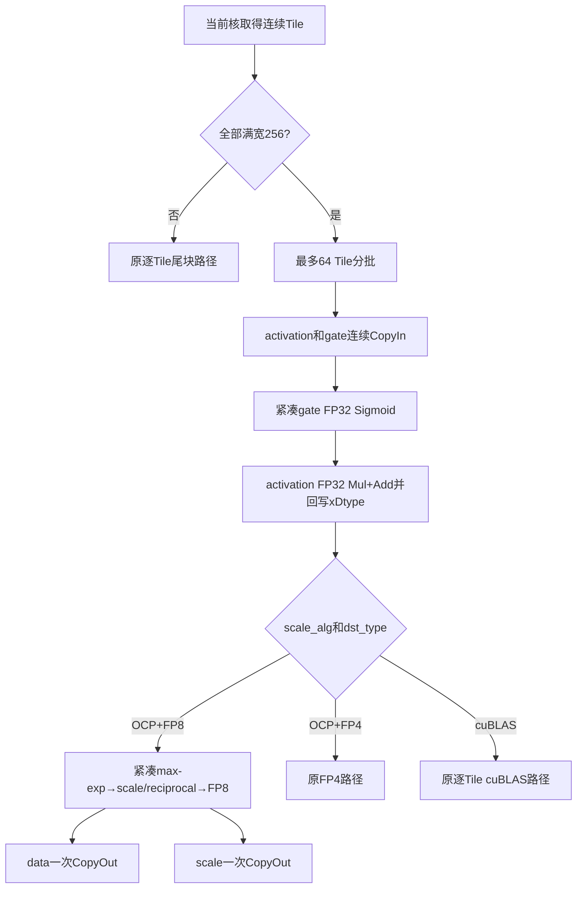

# ClaGateMxQuantWithDualAxis 单轴量化性能分析与优化记录

## 1 文档目的和结论

本文记录 `quant_mode=0` 单轴量化 Kernel 的性能问题、代码级原因、实际修改、被否决方案及真机验证结果。主要代码文件为：

```text
op_kernel/arch35/cla_gate_mx_quant_single_axis.h
op_kernel/arch35/cla_gate_mx_quant_common.h
```

目标 shape 为 `[T,N,D]=[1024,96,256]`、BF16 输入、E4M3 输出、`scale_alg=0`：

| 阶段 | 性能/us | 相对上一阶段 | 精度 |
|---|---:|---:|---|
| 原 msprof 报告 | 554.48 | - | 原报告结果 |
| edit 基线 | 545.224 | - | 通过 |
| 第一轮：融合和量化按批处理 | 404.188 | -25.87% | 四输出 100% |
| 第二轮：紧凑三阶段 OCP FP8 | 54.166 | -86.60% | 四输出 100%，内存全 OK |

`404.188 → 54.166 us` 是同一 TTK 真机路径下的直接对比。`554.48 us` 和拆分链数据来自原始 msprof HTML，采集方式不同，只用于观察趋势；最终严格对比需要重新生成同口径 msprof。

最终确认的主要瓶颈不是量化公式的浮点运算量，而是：

1. 批处理在量化前被打断，逐 Tile 重复进入 VF、管理队列和搬出结果；
2. 每行只有 8B scale，却在 UB 中使用 32B 对齐槽位；
3. reciprocal 每行只有 8 个有效 `uint16_t`，却按 16 个元素推进；
4. scale 逐行发出 8B MTE3 搬运，固定开销随 Tile 数线性增加；
5. gate 标量的 Sigmoid 曾被广播为整向量后重复计算。

最终满宽 OCP FP8 路径为：

```text
批量搬入和 FP32 门控融合
        ↓
阶段1：批量归约并紧凑保存 max-exp
        ↓
阶段2：批量生成紧凑 scale 和 reciprocal
        ↓
阶段3：批量完成 FP8 data 量化
        ↓
data 一次搬出 + scale 一次搬出
```

## 2 原始性能现象

### 2.1 原始报告

| Shape | 融合算子/us | 拆分链/us | DynamicMxQuant/us | 融合/拆分 |
|---|---:|---:|---:|---:|
| 512×128×256 | 365.87 | 161.94 | 22.09 | 2.26× |
| 1024×96×256 | 554.48 | 244.10 | 31.64 | 2.27× |
| 1024×128×256 | 727.74 | 332.70 | 42.94 | 2.19× |
| 2048×128×256 | 1451.21 | 647.87 | 92.49 | 2.24× |
| 4096×128×256 | 2914.08 | 1263.96 | 180.76 | 2.31× |

耗时随元素量近似线性增长，但斜率长期为拆分链的约 2.2～2.3 倍。这排除了单次 launch 开销，指向每个 Tile 都会重复发生的内部开销。

### 2.2 拆分链拆账

`1024×96×256` 的拆分链为：

| 阶段 | 性能/us |
|---|---:|
| Sigmoid | 7.847 |
| Mul | 146.322 |
| Add | 58.292 |
| DynamicMxQuant | 31.635 |
| 合计 | 244.097 |

独立 `DynamicMxQuant` 只占约 13%，但它使用大 UB Tile、紧凑 scale 和批量 CopyOut。CLA 旧实现虽然量化公式相同，执行粒度和中间布局不同，因此不能只按 FLOP 判断性能。

## 3 旧实现的问题

### 3.1 Tile 和数据规模

```text
ONCE_ROW_LEN = 256
BLOCK_SIZE   = 32
每 Tile 的 MX block 数 = 8
每 Tile row scale 有效数据 = 8×uint8 = 8B
每 Tile reciprocal 有效数据 = 8×uint16 = 16B
最大批次 = 64 Tile
```

BF16、64 Tile 时：

```text
merged:       64×256×2B = 32768B
FP8 row_data: 64×256×1B = 16384B
row_scale:    64×8×1B   =   512B 有效数据
reciprocal:   64×8×2B   =  1024B 有效数据
```

### 3.2 批处理在量化阶段被拆散

旧路径等价于：

```cpp
copy_in_and_merge(batch);
for (tile : batch) {
    rowScaleTensor = rowScaleQueue.AllocTensor();
    rowDataTensor = rowDataQueue.AllocTensor();
    ComputeRowScaleOcpSingleAxis(256, 1, ...);
    ComputeRowDataToFp8(256, 1, ...);
    rowScaleQueue.EnQue(rowScaleTensor);
    rowDataQueue.EnQue(rowDataTensor);
    CopyOutRowOnly(tile); // 256B data + 8B scale
}
```

64 Tile 会重复 64 次队列管理、scale 常量 `Duplicate`、VF 入口退出、256B data 搬运、8B scale 搬运及同步。有效数据量不变，但控制指令和 MTE3 命令数按 Tile 数增长。

### 3.3 scale/reciprocal 的旧 UB 布局

旧 scale 使用对齐 Store，每行 8B 有效数据占一个 32B 槽位：

```text
rowScale UB
row0 [8B有效][24B空洞]
row1 [8B有效][24B空洞]
...
```

reciprocal 按 `ROW_SCALE_RECIPROCAL_ROW_ELEMS=16` 个 `uint16_t` 推进，而每行只有 8 个有效值：

```text
row0 [8个有效][8个空洞]
row1 [8个有效][8个空洞]
...
```

64 行时，旧 scale 和 reciprocal 的物理跨度都是 2048B；有效数据分别只有 512B 和 1024B。

GM scale 必须连续，而 UB 每 8B 后有 24B 空洞。第一轮只能逐槽搬运：

```cpp
for (slot = 0; slot < tileCount; ++slot) {
    DataCopyPad(scaleGm + slot * 8, scaleUb + slot * 32, blockLen=8);
    if ((slot & 3) == 3) PipeBarrier<PIPE_MTE3>();
}
```

64 行需要 64 条 8B MTE3 和 16 次限流 barrier。短搬运的命令成本远大于 512B 数据本身。

### 3.4 Sigmoid 冗余

gate 是 `[T,N]` 标量。旧实现对每个标量先广播到整个 VF，再执行 `Exp/Add/Div`。数学上只需一次的标量 Sigmoid 占用整个向量 lane。该问题确定存在，但单独优化只改善约 1.7%，不是大 shape 的主瓶颈。

## 4 优化一：建立满宽批处理路径

### 4.1 启用条件和批次

`Process()` 检查当前核负责的所有 Tile：

```cpp
calcCol == tileRowLength_ // 256
```

全部满宽才进入 `ProcessBatchChunk()`；存在尾列则保留逐 Tile 安全路径。批大小由 TilingData 的 `batchSize` 给出，最大为 64：

```cpp
for (start = 0; start < loops; start += batchSize) {
    count = min(batchSize, loops - start);
    ProcessBatchChunk(firstBlock + start, count);
}
```

### 4.2 连续 CopyIn

`CopyInClaGateBatch()` 合并搬运：

```cpp
totalBytes = tileCount * 256 * sizeof(xDtype);
DataCopyPad(globalActivationUb, globalActivationGm + srcOffset, totalBytes);
DataCopyPad(localActivationUb,  localActivationGm  + srcOffset, totalBytes);

gateCount = tileCount * headsPerTileRow_;
DataCopyPad(globalGateUb, globalGateGm + gateOffset, gateCount*sizeof(xDtype));
DataCopyPad(localGateUb,  localGateGm  + gateOffset, gateCount*sizeof(xDtype));
```

批量搬入后，UB 地址使用本地 slot：

```text
activation UB = slot×256 + head×headSize + vf×64
gate UB       = slot×headsPerRow + head
```

`firstColTile` 只描述 GM 起点，不能再作为 UB 偏移。修正该语义后，跨 Tile/跨逻辑行批次不会读取错误 gate 或 activation。

### 4.3 第一轮批量量化

将多次 `blockCount=1` 改为批次级调用：

```cpp
ComputeRowScaleOcpSingleAxis(256, tileCount, mergedAddr, ...);
ComputeRowDataToFp8(256, tileCount, mergedAddr, ...);
```

row-data 由每行 256B 搬运改为一次：

```cpp
DataCopyPad(rowDataGm + offset, rowDataUb, tileCount * 256);
```

该轮把目标 shape 从 `545.224 us` 降到 `404.188 us`。但 scale 仍是 32B 槽位并逐行搬出，因而仍慢。

## 5 优化二：紧凑 Sigmoid 与 FP32 融合

`ComputeClaGateFullTileSingleAxis()` 先对紧凑 gate 数组计算 Sigmoid：

```cpp
gateCount = calcRows * headsPerRow;
gateVecLoops = ceil_div(gateCount, 64);
for (i = 0; i < gateVecLoops; ++i) {
    LoadAlign<DIST_UNPACK_B16>(gateReg, gateUb + i*64);
    gateF = Cast<float>(gateReg);
    sigmoid = 1.0f / (1.0f + exp(-gateF));
    StoreAlign(sigmoidFp32Ub + i*64, sigmoid);
}
```

融合时才对对应 head 使用 `DIST_BRC_B32`：

```cpp
LoadAlign<float, DIST_BRC_B32>(sigmoidF, sigmoidFp32Ub + localHead);
```

activation 的门控乘加保持 FP32：

```cpp
globalF = Cast<float>(globalActivation);
localF  = Cast<float>(localActivation);
outputF = globalF*globalSigmoidF + localF*localSigmoidF;
merged  = Cast<xDtype>(outputF);
```

曾尝试直接 BF16 乘加，小用例由 `11.707` 变为 `12.372 us`，前两路精度降到约 `98.13%/98.55%`，因此撤销。

## 6 优化三：OCP FP8 三阶段紧凑量化

仅用于 `scale_alg=0`、FP8 E4M3/E5M2、256 元素满宽批次。FP4、cuBLAS 和尾列不进入新路径。

入口：

```cpp
if constexpr (isFp4) {
    ComputeRowScaleOcpSingleAxis(...); // 原路径
    ComputeRowDataToFp4(...);
} else {
    maxExpAddr = colScaleReciprocalBuf_; // 单轴时复用为空闲 scratch
    ComputeRowScaleOcpFp8BatchCompact(...);
    ComputeRowDataToFp8Compact(...);
}
```

### 6.1 阶段1：归约并紧凑保存 max-exp

每轮处理一行 256 元素：

```cpp
LoadAlign<DIST_DINTLV_B16>(evenData, oddData, xAddr, 256);
evenExp = evenData & EXP_MASK;
oddExp  = oddData  & EXP_MASK;
expMax  = Max(evenExp, oddExp);
ReduceDataBlock<MAX>(expMax, expMax); // 产生8个32元素组的最大指数
```

FP16 输入先检查 FP16 Inf/NaN，再转换到 BF16 指数语义，保持旧实现特殊值规则。

关键是用 `UnalignRegForStore` 连续追加 8 个结果：

```cpp
Reg::UnalignRegForStore ureg;
for (row = 0; row < blockCount; ++row) {
    ...
    StoreUnAlign<uint16_t, POST_MODE_UPDATE>(maxExpAddr, expMax, ureg, 8);
}
StoreUnAlignPost(maxExpAddr, ureg, 0);
```

布局变为：

```text
[row0 block0..7][row1 block0..7] ... [rowB-1 block0..7]
```

早期使用普通 `Reg::UnalignReg` 做多轮流式 Store 会执行停滞。对照 `dynamic_mx_quant` 后改为 `UnalignRegForStore`，并在 `StoreUnAlignPost` 后结束当前 VEC scope。

### 6.2 阶段间同步

阶段1写 max-exp，阶段2立即读取同一 UB 区域，因此两个 VEC scope 间有一次：

```cpp
PipeBarrier<PIPE_V>();
```

这是每批一次的真实数据依赖，不是逐行限流。

### 6.3 阶段2：批量生成 scale/reciprocal

```cpp
totalScale = blockCount * 8;
scaleLoops = ceil_div(totalScale, 128);
```

64 行有 512 个 scale，只需 4 次 VF：

```cpp
validMask = UpdateMask<uint16_t>(totalScale);
LoadAlign(maxExp, maxExpAddr, 128);
infMask   = maxExp != EXP_MASK_BF16;
clampMask = maxExp <= outputDtypeMaxExp;
maxExp    = Select(outputDtypeMaxExp, maxExp, clampMask);

sharedExp = maxExp - outputDtypeMaxExp;
scale     = sharedExp >> SHR_NUM_FOR_BF16;
scale     = Select(scale, NAN_FOR_FP8_E8M0, infMask);

reciprocal = BF16_EXP_BIAS - sharedExp;
// 再处理 Inf/NaN、全零和特殊指数
```

scale 用 pack Store 直接形成连续字节：

```cpp
StoreAlign<uint16_t, POST_MODE_UPDATE, DIST_PACK_B16>(
    packedScaleAddr, scale, 64, validMask);
```

128 个 `uint16_t` 计算结果被 pack 为 128 个连续 E8M0 字节。reciprocal 也连续保存，不再按行补齐到 16 个元素：

```cpp
StoreAlign<uint16_t, POST_MODE_UPDATE>(
    rowScaleReciprocalAddr, reciprocal, 128, validMask);
```

### 6.4 阶段3：紧凑 reciprocal 驱动 FP8 量化

`ComputeRowDataToFp8Compact()` 保持原量化公式，只改变 reciprocal 地址更新量：

```cpp
// 旧：每行跨16个uint16_t
LoadAlign<uint16_t, DIST_E2B_B16>(scale, reciprocalAddr, 16);

// 新：连续消费8个uint16_t
LoadAlign<uint16_t, DIST_E2B_B16>(scale, reciprocalAddr, 8);
```

每轮为：

```text
加载256个xDtype
→ 8个reciprocal扩展到对应32元素组
→ 乘 reciprocal
→ 拆分/转换到FP32
→ 按round_mode饱和转换FP8
→ 合并四路FP8 lane
→ 连续Store 256B
```

量化公式、舍入和饱和转换均未改变，只改变 UB 布局和循环组织。

### 6.5 新旧布局和 UB 复用

64 行批次：

| 数据 | 旧物理跨度 | 新物理跨度 | 有效数据 |
|---|---:|---:|---:|
| max-exp scratch | 无批量区 | 1024B | 1024B |
| scale | 2048B | 512B | 512B |
| reciprocal | 2048B | 1024B | 1024B |
| FP8 data | 16384B | 16384B | 16384B |

```text
maxExp:     [row0 8×u16][row1 8×u16]...[row63 8×u16]
scale:      [row0 8×u8 ][row1 8×u8 ]...[row63 8×u8 ]
reciprocal: [row0 8×u16][row1 8×u16]...[row63 8×u16]
```

单轴模式不使用列轴 reciprocal，因此复用 `colScaleReciprocalBuf_` 作为 max-exp scratch，不新增 UB。该 Buffer 在 BF16/FP16、宽256时大小为 1024B，恰好覆盖最大批次 `64×8×2B`。

### 6.6 CopyOut 命令压缩

scale 在 UB 中已连续，因此可一次搬出：

```cpp
DataCopyPad(rowScaleGm_[rowScaleOutOffset],
            rowScaleLocal,
            blockLen = tileCount * 8);
```

row-data 同样一次搬出：

```cpp
DataCopyPad(rowDataGm_[rowDataOutOffset],
            rowDataLocal,
            blockLen = tileCount * 256);
```

64 行主要 CopyOut 命令数：

| 路径 | data | scale | scale限流barrier |
|---|---:|---:|---:|
| 原逐Tile | 64 | 64 | 依实现而定 |
| 第一轮 | 1 | 64 | 16 |
| 当前紧凑FP8 | 1 | 1 | 0（批末统一同步） |

这是 `404.188 → 54.166 us` 的主要来源。

## 7 最终执行流



## 8 与 dynamic_mx_quant 的代码级对应

| dynamic_mx_quant | CLA 当前实现 |
|---|---|
| `ComputeMaxExpOcpBf16/Half` | `ComputeRowScaleOcpFp8BatchCompact` 阶段1 |
| `UnalignRegForStore` 保存 max-exp | 相同 Store 类型和 8 元素更新长度 |
| `ComputeScaleOcp` 每次最多128 scale | `ComputeRowScaleOcpFp8BatchCompact` 阶段2 |
| scale `DIST_PACK_B16` | 相同 pack Store，得到连续E8M0字节 |
| reciprocal 连续 `uint16_t` | 取消每行32B补齐 |
| `ComputeData` 每256元素消费8 reciprocal | `ComputeRowDataToFp8Compact` 地址更新量8 |
| scale批量搬出 | 满宽连续单burst搬出 |

CLA 没有直接调用 `dynamic_mx_quant`，因为量化前还要做双输入门控融合，UB Buffer、模板参数和输出接口不同；复用的是其三阶段组织和中间布局。

## 9 未修改路径及原因

- **FP4**：涉及两元素打包和不同 data 地址折算，保留已验证路径；后续单独设计紧凑版本。
- **cuBLAS scale_alg=1**：包含 amax scratch 和 FP32 `ceil(log2(amax/dtypeMax))` 三阶段推进，直接扩大 `blockCount` 曾执行停滞，需要重新设计 batch-safe 地址。
- **尾列**：新阶段固定加载256元素、产生8 scale；尾列涉及 padding 和有效scale数，继续走原安全路径。
- **双轴**：还包含T轴32行归约和两槽col-scale输出，不共享本次row-only布局，未修改。

## 10 被否决或撤销的实验

| 实验 | 现象 | 结论 |
|---|---|---|
| BF16直接门控乘加 | 11.707→12.372 us，精度约98.13%/98.55% | 更慢且丢精度，撤销 |
| 普通`Reg::UnalignReg`流式保存max-exp | 执行停滞 | 使用`UnalignRegForStore` |
| 对32B scale槽位做sub-32B multi-burst压紧 | 源步长结果不可靠 | 在生产阶段直接生成紧凑布局 |
| cuBLAS仅扩大`blockCount` | 执行停滞 | 需重设amax scratch和地址推进 |
| fusion-only提前返回诊断 | TTK因缺少输出无法形成有效结果 | 不作为性能结论 |

## 11 真机验证

| 用例 | 性能/us | 精度 | 内存 |
|---|---:|---|---|
| BF16, 1024×96×256, E4M3, OCP | 54.166 | 四输出100% | 全OK |
| BF16, 65×24×256, E4M3, OCP | 6.074 | 四输出100% | 全OK |
| FP16, 24×11×128, E4M3, OCP尾块 | 8.401 | 四输出100% | 通过 |
| BF16, 65×1×128, E5M2, OCP尾块 | 12.703 | 四输出100% | 通过 |
| BF16, 65×24×256, E4M3, cuBLAS | 9.611 | 四输出100% | 通过 |
| FP16, 24×11×128, E2M1, FP4 | 8.455 | 四输出100% | 通过 |

目标大 shape 和 `65×24×256` 均使用单 case 独立运行并完整 PASS。

TTK 退出阶段偶发 `107002 context is empty` 是 Kernel 已返回后清理 context 的告警。全量脚本若在同一设备并发多个 case，曾触发 `rtCtxCreate/halSqCqAllocate` 资源竞争；回归应按 case 串行，不能把该框架资源失败记为算子失败。

## 12 复现方法

```bash
source /data/g00940185/CANN9.2.0/cann-9.2.0/set_env.sh
source /home/g00940185/work/CANN9.2.0/vendors/custom_transformer/bin/set_env.bash
export ASCEND_TOOLKIT_HOME=/data/g00940185/CANN9.2.0/cann-9.2.0
export ASCEND_OPP_PATH=/data/g00940185/CANN9.2.0/cann-9.2.0/opp
export ASCEND_AICPU_PATH=/data/g00940185/CANN9.2.0/cann-9.2.0
export ASCEND_HOME_PATH=/data/g00940185/CANN9.2.0/cann-9.2.0

cd /home/g00940185/work/ops-transformer/attention/cla_gate_mx_quant_with_dual_axis
TTK_TESTCASE=ClaGateMxQuantSingleAxis_bf16_T1024_N96_D256_e4m3fn_alg0_rint \
bash tests/st/arch35/run_ttk_kernel_single_axis.sh --device-whitelist=<健康设备号>
```

建议依次串行回归：满宽OCP小shape、目标大shape、FP16尾块、E5M2尾块、FP4、cuBLAS。

## 13 后续工作

1. 重新生成完整同口径 msprof HTML；
2. 为 cuBLAS 单轴设计 batch-safe amax scratch；
3. 为 FP4 单独设计紧凑 scale/reciprocal；
4. 搜索中等 shape 的 `batchSize/usedCoreNum` 组合；
5. 增加每核不足64 Tile、跨逻辑行、全零/Inf/NaN 专项用例。
