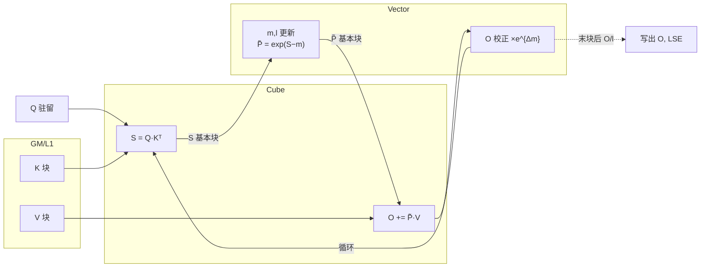
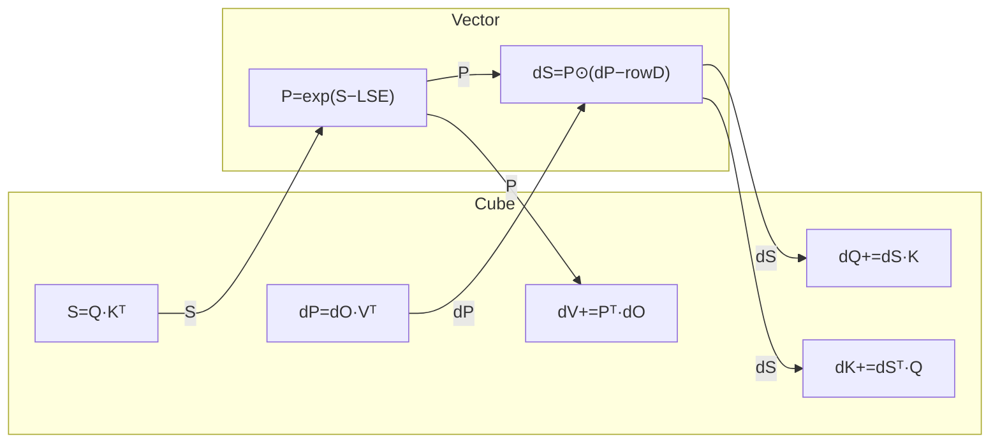
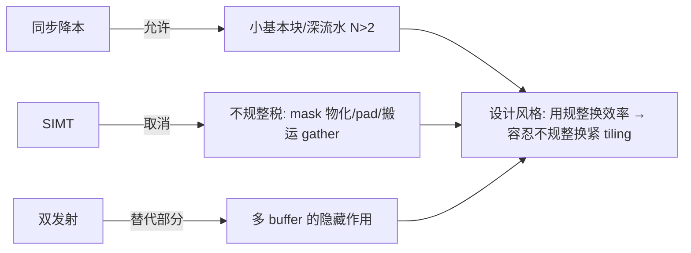
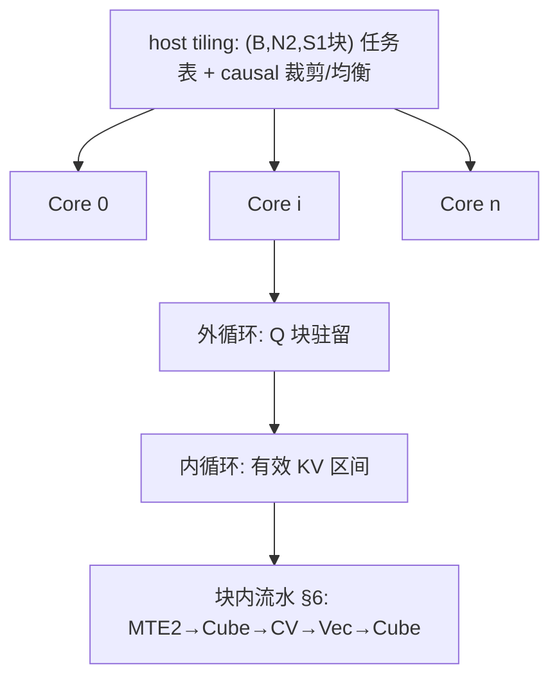
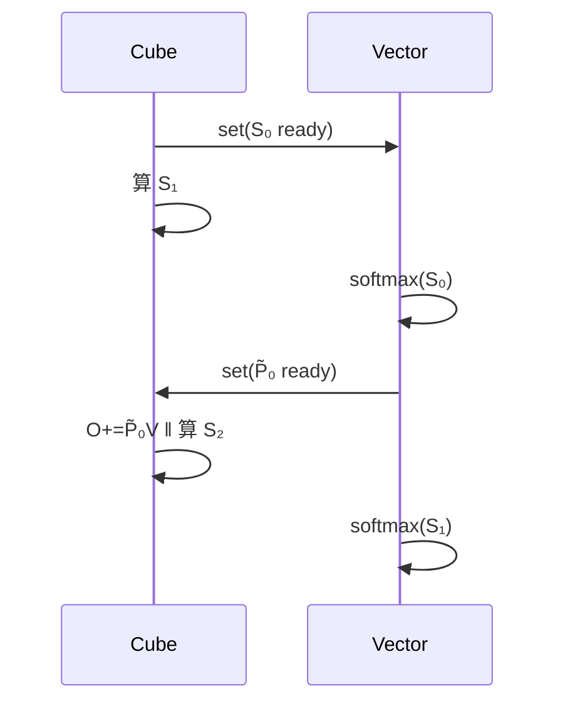

# Ascend FlashAttention @ arch35 (A5) 方案设计书

> 状态:代码导读版 v0.3—— 已按当前 arch35 FA/FAG 实现回填主干代码脉络与关键优化点;硬件白皮书中未能从本地 PDF 可靠抽取的数值仍保留 `【待补:…】`。
> 图例约定:Mermaid 画数据流/握手关系,ASCII 时间线画流水排布,表格收约束与对比。

---

## 0. 文档目的与范围

- 目的:梳理 FA(forward)与 FAG(backward)在 arch35 上的实现方案,作为代码阅读的"地图"。
- 范围:FA/FAG 核心计算流;tiling 与多核切分;核内流水与 N-Buffer;CV 交互与基本块;SIMT 的引入位置;双发射利用;循环序选择。
- 不展开:框架接入(aclnn/aclgraph)、host tiling 下发细节(后续单独成章)。

### 0.1 阅读代码问题清单(随读随勾)

- [x] A5 上 CV 物理形态:FA/FAG arch35 入口均使用 `KERNEL_TYPE_MIX_AIC_1_2`,代码按 1 个 AIC 对 2 个 AIV (`CV_RATIO`/`CV_CORE_RATIO`=2) 组织。
- [x] L0C 出口路径:MM 结果经 `Fixpipe` 出 L0C;FA 的 BMM1 固定到 UB 给 Vector,Vector 将 P 写 L1 给 BMM2;BMM2 按模板选择 UB 或 GM workspace。FAG 的 MM1/MM2 到 UB,MM3/4/5 可写 UB 或 GM。
- [x] CV 同步原语:使用 `CrossCoreSetFlag/WaitFlag` 与跨核 Buffer;FA 额外用 `__ssbuf__`+flag 15 传 `CVSharedParams`;事件 FIFO 深度仍需硬件资料确认。
- [x] 基本块实际尺寸与对齐:FA 常规 128x128,特化 128x256/128x512/64x128;FAG 常规 128x128,FP8 64x256,HIFLOAT8 512x512,D 模板 64/128/192/256/768。
- [~] SIMT 出现位置:当前 arch35 FA/FAG 源码未直接暴露 `SIMT` 命名;可确认 mask/sparse/tail 的分支在 Vector API 与 runInfo 中完成,底层 MicroAPI 是否映射 SIMT 待继续追 `vector_api/*` 或硬件资料。
- [ ] 双发射的指令对组合:当前 C++ 层未显式描述双发射配对,暂按编译器/微码优化处理,后续需看汇编或 profile。
- [x] FAG 外/内循环轴:dQ/dK/dV 不是单一路径,由 host 选 `BN2GS1S2`/`BN2`/`BN2S2`;main kernel 串起 MM1/2、Vec1~4、MM3/4/5,并通过 UB/GM workspace 与 post kernel 完成归约/转 dtype。
- [x] workspace 布局:FA 主要是 BMM2/Vec2 的 3-buffer GM workspace、dropmask workspace、16MB reserve;FAG 有 64KB reserve、dq/dk/dv FP32 workspace、dropmask bool、pre-SFMG、sink、deterministic workspace 等。

---

## 1. FA / FAG 计算流(算法层)

### 1.1 Forward 单次内循环的数据流(C/V 分工)



跨 CV 边界的张量只有 **S(C→V)** 和 **P̃(V→C)**,这是 FA 区别于纯 Cube 算子的全部难点(§5)。

### 1.2 Backward 单次内循环的数据流



| | Cube 次数 | CV 倒手张量 | 含义 |
|---|---|---|---|
| FWD | 2 | S, P̃ | Vector 占比高,藏 Vector 是主战场 |
| BWD | 5 | S, dP→dS | 更 Cube-bound,Vector 裕度大,但倒手翻倍 |

主线一句话:**让 Cube 不停转,Vector/MTE/同步全部藏进 Cube 影子里**。

---

## 2. A5 架构概览与 A2/A3 差异

### 2.2 决定设计的硬件变量表

| 变量 | A2/A3 参考 | A5 | 影响 |
|---|---|---|---|
| CV 形态/配比 | 1C:2V 分离 | 代码确认 `KERNEL_TYPE_MIX_AIC_1_2`,AIC:AIV=1:2 | 同步成本、基本块 |
| Cube:Vector 算力比 | 【填】 | 【待补】 | Vector 可隐藏性 |
| UB / L1 / L0A/B/C | 192K/512K/64K/64K/256K | 代码常量确认 L1=512K,L0A/B=64K,L0C=256K;UB 从 platform/compileInfo 读取 | tiling、N 上限 |
| L0C 出口 | →UB 随路 cast | `FixpipeParamsC310`/`Fixpipe`;FA BMM1→UB,BMM2→UB/GM;FAG MM3/4/5→UB/GM | P/dS/DQKV 倒手开销 |
| Vector 模型 | 纯 SIMD | C++ 层主要是 Vector API/MicroAPI;SIMT 映射待补 | §8 |
| 发射 | 单发射 | 双发射能力待从汇编/profile 确认 | §9 |
| HBM 带宽/核 | 【填】 | 【待补】 | MTE2 瓶颈位 |

### 2.3 约束瓦解图



---

## 3. 整体方案三层结构



核间(§4.1)定均衡,核内循环定驻留,块内流水定利用率。当前代码是 host 静态生成 `blockStarts/blockEnds`/sparse start idx,而 kernel 内 `GetNextValidIdx` 继续跳过无效块并适配 TND/swizzle/deterministic。

---

## 4. Tiling 策略

### 4.1 causal 下的块网格分类与负载

```
KV→  j0  j1  j2  j3            块类型:FULL=整块算, TPL=对角三角, SKIP=不算
Q↓ ┌────┬────┬────┬────┐       行负载 ∝ 行号 → 核间均衡:首尾行配对
i0 │TPL │SKIP│SKIP│SKIP│        (i0,i3)(i1,i2) 同核,各核 ≈ 等量 FULL
i1 │FULL│TPL │SKIP│SKIP│
i2 │FULL│FULL│TPL │SKIP│       TPL 块内 ~半算力浪费 → §8 SIMT 真三角
i3 │FULL│FULL│FULL│TPL │
```

### 4.2 (Br, Bc) 决定式

| 约束 | 公式(宏观) | 卡谁 |
|---|---|---|
| UB 容量 | N·(Br·Bc + 向量区) ≤ UB | Br 上限 |
| L0/L1 | Bc·D 驻留 + pingpong | Bc 上限 |
| Cube 利用率 | Br,Bc ≥ 分形对齐×若干 | 下限 |
| causal 浪费 | TPL 占比 ∝ Bc/S2 | Bc 别太大 |

当前 arch35 host 不是单纯 cost 枚举,而是先按 dtype/D/optional/sparse 走一组明确模板:
FA 常规 `S1xS2=128x128`;D>256 时 `S2=128`,FP32 把 S1 降到 64;D=64/Dv=64 且长 S2、无 optional 时会走 `128x256`;HIFLOAT8 可走 `128x512`;TND 常规 `128x128`。FAG 常规 `128x128`,FP32 且 D>256 为 `64x128`,FP8 为 `64x256`,HIFLOAT8 为 `512x512`。
D 模板统一按 64/128/192/256/768 对齐,RoPE/FAG 会把 D 模板推到 192。尾块、mask 与 sparse 由 kernel runInfo 和 Vector API 处理,是否用 SIMT 仍需下钻底层。

---

## 5. CV 交互与基本块大小

### 5.1 握手时序(pingpong 基本块)



### 5.2 基本块大小的两难

```
块过大:  C ████████░░░░░░░░ 等V      串行段长, L0C/UB 装不下
         V ░░░░░░░░████████
块合适:  C ██S0██S1██S2██   T_cube(块) ≈ T_vec(块)+T_sync → 双方满载
         V   ██s0██s1██s2
块过小:  C █s█s█s█s         同步/启动开销占比飙升, MMAD 形态差
```

准则:`T_cube ≈ T_vec + T_sync`(1C:2V 时单 V 吃半块)。当前代码里 `s1BaseSize/CV_RATIO` 是单个 AIV 处理的 S1 半块:

- FA S 路径:`FANoQuantBlockCube::IterateBmm1*` 用 `Fixpipe` 将 L0C 中的 QK 结果搬到 `bmm1Buffers`(UB double buffer),再用 cross-core flag 通知 AIV。
- FA P 路径:`FANoQuantBlockVecTrain::ProcessVec1*` 完成 PSE/mask/dropout/softmax,把 P cast 后 `DataCopy` 到 `l1PBuffers`(L1 3-buffer),再给 BMM2 读取。
- FA O 路径:BMM2 的 L0C 结果由 `GetC2Position` 选择写 UB 或 GM;D/Dv 大、FP32、部分 Dn/optional 场景会用 GM 3-buffer workspace,Vector2 再分块读回做 update/div/cast。
- FAG 路径:MM1(dY*V)和 MM2(Q*K)先到 UB;Vector 生成 dS/P 到 L1;MM3(dS*K)、MM4(dS*Q)、MM5(P*dY)按 `IS_DQ/DK/DV_WRITE_UB` 选择 UB 或 GM。

---

## 6. 核内流水排布

### 6.1 稳态流水时间线(forward,横轴=时间,行=硬件单元)

```
iter:        │←─── i ───→│←─── i+1 ──→│←─── i+2 ──→│
MTE2  K/V    │ ld(i+1)   │ ld(i+2)    │ ld(i+3)    │   预取提前一拍
Cube  QKᵀ    │ S(i)      │ S(i+1)     │ S(i+2)     │ ← 关键路径,无空泡=目标
Cube  PV     │ O(i-1)    │ O(i)       │ O(i+1)     │
Vector       │ sm(i-1)   │ sm(i)      │ sm(i+1)    │   全在 Cube 影子里
Vector 校正  │ corr(i-2) │ corr(i-1)  │ corr(i)    │   与 QKᵀ 无依赖,可并行
MTE3         │           │            │ 末块后写 O │
```

排布原则:① 预取一拍;② 关键路径只剩 Cube;③ O 校正与下一块 QKᵀ 解耦(A5 上交给编译器/微码调度,双发射待验证 §9);④ AscendC 落地 = TPipe+TQue/BufferPolicy,队列深度即 §7 的 N。事件 FIFO 是否允许更深抢跑仍需硬件资料或 profile 验证。

---

## 7. N-Buffer:N 由什么决定

### 7.1 N=2 够与不够的时间线对比

```
两侧均匀 → N=2 即满流水:        生产抖动(HBM拥塞/对角半空块) → N=2 断流:
P █A█B█A█B█A█B                P █A███B█A█B███A        ←时延抖
C  █A█B█A█B█A█                C  █A...█B█A...█        ←消费断流
                               N=3 用第三块缓冲吸收抖动:
                               P █A█B█C█A█B█C
                               C   █A█B█C█A█B   ←平滑
```

### 7.2 N 的四个下界

| 因素 | 规则 | 备注 |
|---|---|---|
| 容量 | N ≤ UB可用/单块 | 第一约束 |
| 时延比 | N ≈ ⌈T_prod/T_cons⌉+1 | Little's Law;抖动再 +1 |
| 事件深度 | N ≤ FIFO 深度 | 超出无收益 |
| 块大小权衡 | 大块小 N ↔ 小块大 N | A5 同步降本 → 偏后者 |

当前已确认的 N-buffer:

- FA:`bmm1Buffers` 为 UB DB;`l1PBuffers` 为 L1 3-buffer;`bmm2Buffers` 为 UB DB/Single;若 BMM2 写 GM 则 `bmm2ResGmBuffers` 为 3-buffer;D split 时 Vec2 也有 GM 3-buffer。
- FAG:`mm1ResBuf/mm2ResBuf` 为 UB pingpong;`dSL1Buf/pL1Buf` 是 L1 单块跨阶段复用;Cube 侧 Q/K/DY/V L1 根据 `IS_L1_REUSE/IS_L1_PRELOAD` 选 Single/DB/3-buffer;L0C 在 DKV resident 时可 3-buffer/DB/Single,否则 common L0C DB/Single。
- host workspace 也按 3-buffer/pingpong 思路分配:FA 用 `PING_PONG_VALUE=3`,FAG 对 splitAxis、deterministic、pre-SFMG 分别预留。

---

## 8. SIMT:新场景与 FA 中的落点

> 代码阅读结论:当前 arch35 C++ 层没有直接出现 `SIMT` 字样,能定位到的是 sparse/mask/tail 逻辑在 host tiling、kernel runInfo 和 `vector_api/*` 中被参数化。下面表格保留为继续追 MicroAPI/汇编时的检查点,不能直接当作源码已确认事实。

### 8.1 FA 计算流分工表(确定度递减)

| FA 环节 | A2/A3 SIMD 做法 | A5 SIMT 做法 | 收益 | 确定度 |
|---|---|---|---|---|
| causal+sink+SWA 组合 mask | 物化 mask 张量再乘 | `if(col>row) skip` 零物化 | 高 | ★★★ |
| 尾块/非对齐 seqlen | pad 到 16/32 | 真 ragged 边界 | 中高 | ★★★ |
| dropout | mask 物化 | philox 按位生成+分支 | 中 | ★★ |
| varlen/topk gather | 退化为搬运 | 直接寻址 | 高(稀疏FA) | ★★ |
| exp/scale/rowmax/rowsum | SIMD 高效 | 保留 SIMD | — | ★★★ |

### 8.2 形态:SIMD 主干 + SIMT 补丁

```
TPL 对角块内:   FULL 半区 → SIMD 整列扫
                三角边界 → SIMT 行长=f(row) 真三角,免半块算力浪费(§4.1)
```

【待补:SIMT 颗粒度与 SIMD↔SIMT 切换开销 → 决定"多碎才切"的边界;需要继续追 `attention/common/op_kernel/arch35/vector_api/*` 或 kernel 编译产物】

---

## 9. 双发射利用

> 代码阅读结论:当前 AscendC 源码未手写双发射指令对,更多是通过软件流水、buffer 深度和 Vector API/MicroAPI 交给编译器/微码调度。下面仍作为 profile/汇编阶段的验证清单。

```
槽0(主干)  │ exp(i)      │ scale(i)   │ rowsum(i)  │
槽1(独立流)│ rowmax(i+1) │ O校正(i-1) │ MTE2地址(i+2)│  ← 互不依赖即可同拍
```

候选指令对:exp‖rowmax(跨块)、O 校正‖标量地址计算、SIMD 主干‖SIMT mask 补丁、softmax‖dQ atomic 写出(BWD)。实现 = 软件流水(prologue/steady/epilogue);双发射的隐藏能力可换 N 降一档。【待补:同/异类型槽位组合限制】

---

## 10. FAG 循环序:外 KV 内 Q vs 外 Q 内 KV

### 10.1 累加方向决定一切

```
外KV内Q(标准):              外Q内KV:
  dK,dV 核内累加 ✓             dQ 核内累加 ✓
  dQ → atomic ×1 个张量        dK,dV → atomic ×2 个张量 ✗✗
```

| 维度 | 外 KV 内 Q | 外 Q 内 KV |
|---|---|---|
| atomic 流量 | 1 份 (dQ) ✓ | 2 份 (dK+dV) ✗ |
| 重算 S/P | 一次 | 一次 |
| 确定性 | dQ 序敏感 | dK/dV 序敏感 |
| causal 均衡 | 列负载 ∝ S2−j,对折配对 | 行负载 ∝ i |

**源码修正结论:当前实现不是固定单一"外 KV 内 Q"。** Host 先选 `splitAxis`,kernel 再按 `blockStarts/blockEnds` 或 swizzle/deterministic 索引遍历有效 `(B,N2,G,S1o,S2o)` 基本块:

- `BN2GS1S2`:通用路径,非 FP32 输出先把 DQ/DK/DV 写 FP32 GM workspace,最后 post kernel cast/归并。
- `BN2`:小 S、`n1==n2`、`d==d1<=256`、非 FP32/FP8、无 RoPE 等路径;可让部分 DQ/DK 写 UB,减少 GM workspace 与后处理。
- `BN2` multi-block:大于普通 BN2 但仍在约束内的场景,按 S1/S2 多基本块分段,DK/DV 在 S2 不变时累积,到边界再 `ProcessMulsAndCast`。
- `BN2S2`:TND/all-same 或 S2 远大于 S1 的路径,优先降低长 S2 场景下 DKV workspace/写回压力。

atomic/确定性不是单独拆双 kernel,而是在 `IterateMmDsQFixpout`/`IterateMmPDyFixpout`、`ProcessMulsAndCast`、`FlashAttentionScoreGradKernelDeter` 与 post 阶段中处理。后续要重点看同一 DK/DV 输出被多个 S1 块命中时的 `needAtomic` 条件和 deterministic workspace。

---

## 11. 开放优化清单

fixpipe 随路 scale/cast/transpose;exp2 替换 exp;ND→NZ 随路;对角半块 MMAD;LSE 策略;varlen;隔块延迟校正;D≥192 的 L0 切 K 累加。【持续追加】

## 12. 主线收束

A2/A3 = 同步贵+纯 SIMD → 用规整换效率;A5 三特性逐项瓦解约束(§2.3 图)→ 小基本块、深流水、不规整免物化。当前 FAG 源码主线不是固定单一循环序,而是由 host `splitAxis` 在 `BN2GS1S2/BN2/BN2S2` 间选路,再用 workspace/post/deterministic 处理输出冲突与 dtype。读码见常量即回填表格,预判被推翻则修正小节并记理由。

---

## 13. arch35 代码导读(当前实现)

这一节按“先找入口,再看流水,最后看特化”的顺序组织。建议阅读时不要一开始钻进 `vector_api` 或 `deter.h`;先把 host 选了哪个模板、kernel 每一拍在干什么弄清楚,细节再回填。

### 13.1 文件地图

| 模块 | 文件 | 先看什么 |
|---|---|---|
| FA kernel 入口 | `attention/flash_attention_score/op_kernel/arch35/flash_attention_score_entry_regbase.h` | `KERNEL_TYPE_MIX_AIC_1_2`,dtype 分发,dropmask adapter,`FlashAttentionScoreKernelTrain` |
| FA kernel 主循环 | `attention/flash_attention_score/op_kernel/arch35/flash_attention_score_kernel_train.h` | `Process`,4 个 `RunInfo`,3 个 pseudo loop drain,`GetS2LoopRange` |
| FA 公共 base | `attention/common/op_kernel/arch35/flash_attention_noquant_kernel_base.h` | `InitBaseAPI`,CV 参数传递,buffer 初始化,workspace 地址 |
| FA Cube | `attention/common/op_kernel/arch35/flash_attention_noquant_block_cube.h` | BMM1/BMM2 variants,L0/L1/L0C buffer selector,`GetC2Position` |
| FA Vector | `attention/common/op_kernel/arch35/flash_attention_noquant_block_vec_train.h` / `*_vec_base.h` | `ProcessVec1`,softmax/mask/dropout/P 写 L1;`ProcessVec2`,online O update |
| FA host tiling | `attention/flash_attention_score/op_host/arch35/*regbase*` | `CalcS1S2BasicBlock`,sparse split,`SetSplitCoreModeParam`,workspace |
| FAG 入口 | `attention/flash_attention_score_grad/op_kernel/arch35/flash_attention_score_grad_entry_regbase.h` | pre/main/post 三阶段,quant/HIFLOAT8/deterministic 分发 |
| FAG 主循环 | `attention/flash_attention_score_grad/op_kernel/arch35/flash_attention_score_grad_kernel.h` | MM1/MM2→Vec→MM3/4/5 的流水与 flags |
| FAG base/Cube/Vec | `flash_attention_score_grad_kernel_base.h`, `*_block_cube.h`, `*_block_vec.h` | splitAxis 影响 UB/GM 写回,L1 reuse/preload,L0C resident |
| FAG host tiling | `attention/flash_attention_score_grad/op_host/arch35/*regbase*` | `SetSplitAxis`,模板尺寸,workspace,deterministic/swizzle |
| FAG deterministic | `flash_attention_score_grad_kernel_deter.h`, `deter.h` | 只在读完普通路径后看;核心是确定性坐标枚举与归并 workspace |

### 13.2 FA 前向:入口到稳态流水

1. 入口 `flash_attention_score_regbase` 设置 `KERNEL_TYPE_MIX_AIC_1_2`。AIC 实例化 `FANoQuantBlockCube`,AIV 实例化 `FANoQuantBlockVecTrain`;另一侧都是 dummy。
2. AIV 在 `InitCubeVecSharedParams` 中从 tiling 填 `CVSharedParams`,subBlock0 通过 `__ssbuf__` 写给对应 AIC 并 set flag 15;AIC 在 `InitBaseAPI` wait flag 15 后读参数。
3. 主循环在 `FlashAttentionScoreKernelTrain::Process`。代码维护 4 份 `RunInfo`,用 `taskId` 做流水相位,实际 steady state 是:
   `BMM1(QK) -> Vec1(softmax/P) -> BMM2(PV) -> Vec2(O update)`。
4. 循环尾部加 3 个 pseudo loops,分别 drain `Vec1/BMM2/Vec2`,避免专门写 epilogue 分支。
5. `GetS2LoopRange` 按 sparse mode 裁剪每个 S1 外块的有效 S2 范围;支持 causal/right-down causal/band/prefix 等,并处理 drop/fp8 对齐。

### 13.3 FA 前向:关键数据路径

```text
AIC: Q,K -> BMM1 -> L0C --Fixpipe--> UB bmm1Buffers(DB)
                                     |
                                     v
AIV: wait UB -> PSE/Mask/Dropout/Softmax -> P cast -> L1 l1PBuffers(3-buffer)
                                     |
                                     v
AIC: wait L1 P + load V -> BMM2 -> L0C --Fixpipe--> UB bmm2Buffers 或 GM bmm2ResGmBuffers(3-buffer)
                                     |
                                     v
AIV: online update/correction/div/cast -> GM attentionOut
```

这里最重要的优化点:

- **1C:2V 拆 S1 半块**:`CV_RATIO=2`,单个 AIV 处理 `s1BaseSize/2` 行,所以 MM 结果 buffer 以 half-S1 为单位给 Vector。
- **P 走 L1 而不是 UB 回传**:Vector 将 P 写入 `l1PBuffers`,AIC 的 BMM2 直接从 L1 消费,这也是 L1 3-buffer 的核心意义。
- **BMM2 出口自适应**:`GetC2Position` 决定写 UB 还是 GM。D/Dv 小且 UB 足够时走 UB,大 D、FP32、部分 splitD/optional 场景走 GM,Vector2 再分块读回处理。
- **Q/K/V buffer selector**:Cube 侧按 dtype、D、S2、FP8、Dn/Nz 选择 L1/L0A/L0B/L0C 的 Single/DB/4-buffer。读 BMM1/BMM2 时先看这些 constexpr selector,否则容易迷路。
- **Q 复用**:典型 ND L0 split 路径中,同一 S1 外块的 `s2LoopCount==0` 装 Q,后续 S2 块复用 Q;K/V 随 S2 块更新。
- **online softmax/O update**:Vec1 维护 max/sum/exp,Vec2 用 `FlashUpdateNew/Last` 做 O 的历史校正与最终除法;单 S2 块满足条件时有 no-global-update 快路径。
- **optional 特化**:PSE、atten mask、dropout、sink、RoPE、FP8/HIFLOAT8、Dn/Nz/ND 都在模板参数上分支,主线先按 noquant ND 读。

### 13.4 FA host tiling 与多核均衡

host 侧先解析 layout/dtype/optional/sparse,再给 kernel 生成模板 key 与任务表:

- `CalcS1S2BasicBlock`:决定 S1/S2 模板。常规 `128x128`;长 S2 简洁路径可 `128x256`;HIFLOAT8 可 `128x512`;D>256 降 S2 到 128,FP32 还会降 S1 到 64。
- `CalcDBasicBlock/CalcDVBasicBlock`:D/Dv 向 64/128/192/256/768 桶对齐,D>256 统一落到 768 模板。
- `SetSplitCoreModeParam`:非 TND 大 S、causal/band/all-mask/no-mask 等场景会按 L2/mask/dropmask 阈值选择 split-core mode,避免长 S2 下单核负载不均。
- `SetSparseStartIdx`:对 prefix/band/causal 等 sparse 有效块做静态均衡,用 `blockStarts/blockEnds` 或 sparse start idx 分配给 AIC。
- `PostTiling`:blockDim 用 `CalcTschBlockDim(coreNum*2,aicNum,aivNum)`,对应 1C:2V;dropmask adapter 需要时走 AIV-only blockDim。
- workspace:FA 默认加 `WORK_SPACE_RESERVE_SIZE=16MB`;当 BMM2/Vec2 需要 GM buffer 时按 AIC 维度分配 3 份 pingpong。

### 13.5 FAG 反向:三阶段与主流水

FAG 入口同样是 `KERNEL_TYPE_MIX_AIC_1_2`,但执行阶段更多:

1. **pre**:`FlashAttentionScoreGradS1S2BNGS1S2PreRegbase` 清/准备 DQDKDV workspace 或处理 dropmask/sink;若 `enablePreSfmg`,走 `FlashAttentionScoreGradPresfmgRegbase` 预计算 softmax grad 相关数据。HIFLOAT8/FP8 强制走 quant pre。
2. **main**:`FlashAttentionScoreGradKernel` 或 deterministic/quant 变体。普通 main 的 steady state 是:
   `MM1(dY*V) + MM2(Q*K) -> Vec1/Vec2/Vec3/Vec4 -> MM3(dS*K), MM4(dS*Q), MM5(P*dY) -> Vec5/6 cast/muls`。
3. **post**:非 FP32 输出或 sink/rope 等路径会把 FP32 workspace cast/归并到最终 `dq/dk/dv/dqRope/dkRope/dsink`。

主循环关键同步在 `flash_attention_score_grad_common.h`:

- `SYNC_C1_TO_V2_FLAG[2]` / `SYNC_C2_TO_V2_FLAG[2]`:MM1/MM2 结果给 Vec2。
- `SYNC_V3_TO_C3_FLAG` / `SYNC_V4_TO_C5_FLAG`:dS/P 从 UB 写 L1 后,MM3/MM5 才能读。
- `SYNC_C3_TO_V5_FLAG`, `SYNC_C4_TO_V6_FLAG`, `SYNC_C4_TO_V3_FLAG`, `SYNC_C5_TO_V4_FLAG`:DQ/DK/DV 的 MM 结果与 Vector cast/muls 之间同步。
- `SYNC_DETER_FIX_FLAG` 等:UB 写回/确定性路径的防踩踏同步。

### 13.6 FAG splitAxis 与 workspace

`SetSplitAxis` 是读 FAG 的入口之一,它决定后面代码形态:

- `BN2`:S1/S2 都不大、`n1==n2`、D/Dv 相等且 `d<=256`、非 FP32/FP8/HIFLOAT8、无 RoPE、tail 清爽时命中。优点是 DQ/DK 中间结果更容易留在 UB,workspace 小。
- `BN2` multi-block:BN 规模较大、S1/S2 在限制内且仍满足 BN2 条件时命中。多 S1/S2 基本块会让 DK/DV 在同一输出上累加,代码用 `isNextS2IdxNoChange/isLastS1Outer` 控制何时 cast/write。
- `BN2S2`:TND/all-same 或 S2 比 S1 大很多的路径,且非 sparse/deterministic/FP32/FP8/RoPE。重点优化长 S2 下 DKV 的局部性。
- `BN2GS1S2`:兜底通用路径,workspace 最大,但覆盖 optional/sparse/dtype 更广。

workspace 读法:

- FP32 输入:main 可直接把 dq/dk/dv workspace 指向输出 GM。
- 非 FP32:通常先写 FP32 workspace,post 再 cast 到输出 dtype。
- `splitAxis==BN2S2`:DQ workspace 按完整 Q,DK/DV 按 `s2Inner*sfmgdInner*CORE_LIST_NUM` 分块。
- `isBn2MultiBlk`:DQ/DK/DV 都按 core-list 局部分块预留。
- `dropoutIsDivisibleBy8==0`:额外 bool dropmask workspace。
- `enablePreSfmg`:额外 softmax grad workspace。
- deterministic:旧方案有 `deterGmOffset/deterWorkSpaceOffset`;新 dense/band + BN2S2 有额外 DKV deterministic buffer。

### 13.7 FAG Cube/Vector 优化点

- **五个 MM 的 L0C 复用**:当 `IS_DKV_RESIDENT_L0C` 成立时,MM1/MM2/MM3 共用 L0C buffer,DK/DV 分别驻留 L0C,公式见 `IS_DKV_RESIDENT_L0C`:最大临时 MM 结果 + DK + DV 不超过 256KB。
- **D=192,Dv=128 特判**:`isDkvL0CResidentForD192Dv128` 单独开 special L0C buffer,避免一般路径容量判断过保守。
- **L1 reuse/preload**:`GET_IS_L1_REUSE` 和 `GET_IS_L1_PRELOAD` 决定 Q/K/DY/V 的 L1 策略;非 FP32、D<=256、非老 deterministic 更容易复用/预取。
- **preloadArgs**:Cube 可提前搬下一块 Query/DY/RoPE,主循环在 `SetRunInfo` 时准备下一块 offset。
- **Vector 分段**:`ProcessVec1` 做 softmax grad front 或读 pre-SFMG;`ProcessVec2` 做 PSE/mask/simple softmax;`ProcessVec3` 生成 dS 并写 L1;`ProcessVec4` 生成 P 并写 L1;`ProcessMulsAndCast` 处理 DQ/DK/DV 的 scale/cast/write。
- **FP8/HIFLOAT8**:走 quant block,额外有 dequant、`dsAmaxWorkSpaceGm`、`vScaleDsWorkSpaceOffset` 等缩放统计。
- **确定性**:不要先读公式,先看 `FlashAttentionScoreGradKernelDeter` 如何复用普通 Vec/Cube block,再看 `deter.h` 的 dense/causal/band/TND 坐标生成。

### 13.8 建议阅读顺序

1. 用一个 no optional、FP16/BF16、BNSD/BSND、D<=128 的前向 case 跟 `flash_attention_score_entry_regbase.h -> flash_attention_score_kernel_train.h -> noquant_block_cube/vec_base`。
2. 再看 FA host 的 `CalcS1S2BasicBlock` 和 `GetTilingKey`,把实际 case 对应到模板 key。
3. 加入 causal/band/prefix mask,只看 `GetS2LoopRange` 和 host sparse split,暂时不钻 Vector API。
4. 看 D>256/FP32/FP8/HIFLOAT8,重点观察 BMM2 何时写 GM、splitD 怎么让 Vec2 分块读回。
5. 反向先读普通 `FlashAttentionScoreGradKernel::Process`,把 MM1~5 和 Vec1~6 对齐到 §13.5。
6. 回 host 看 `SetSplitAxis` 与 workspace,分别挑 BN2、BN2S2、BN2GS1S2 case 对照主循环分支。
7. 最后读 deterministic 与 quant:它们复用了大量普通 block,先抓额外 workspace/flag/scale,再看坐标或量化细节。

### 13.9 后续深挖 TODO

- 从白皮书或 profile 补 A5 UB 容量、Cube/Vector 算力比、同步事件 FIFO、双发射槽位限制。
- 跟进 `vector_api/*` 中 mask/dropout/softmax 是否有 SIMT 映射,以及尾块 ragged 是否真实免 pad。
- 对 `GetC2Position` 各条件做 case 表,列出 BMM2 写 UB/GM 的边界。
- 对 FAG 的 `needAtomic` 条件和 deterministic workspace 画一张输出冲突/归并图。
- 用 2~3 个真实 shape 记录 tiling key、blockDim、workspace offset,作为调试索引。
