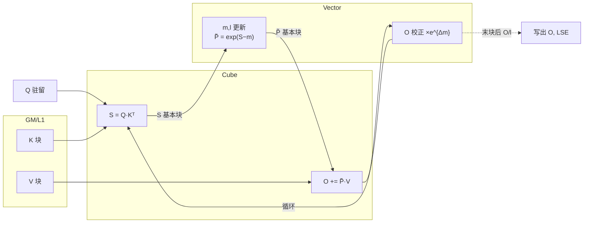
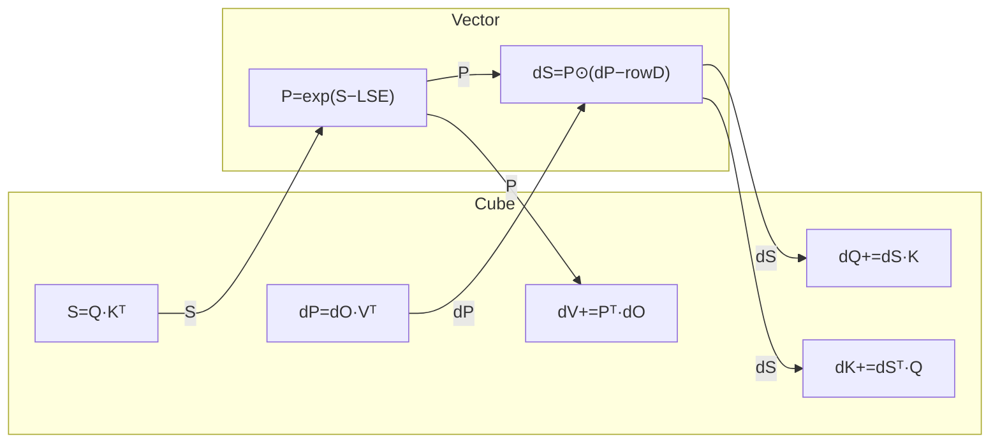
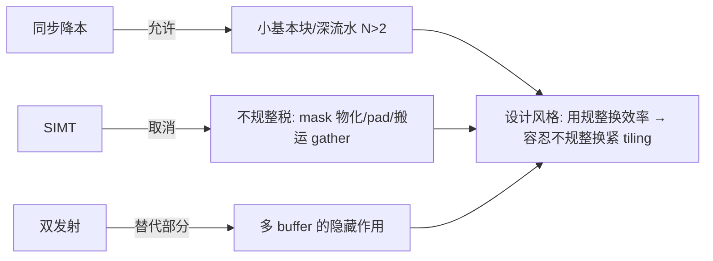
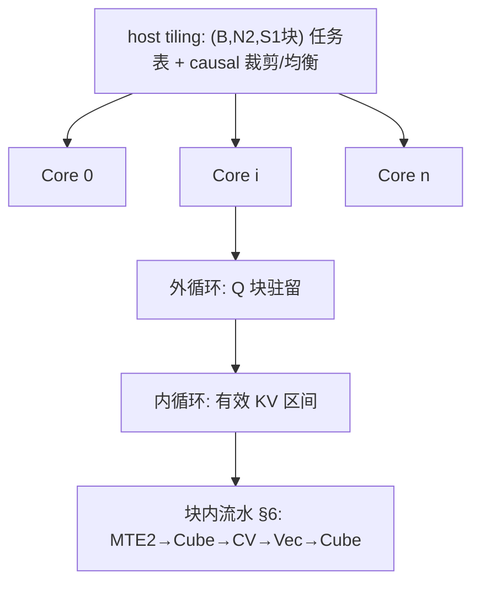
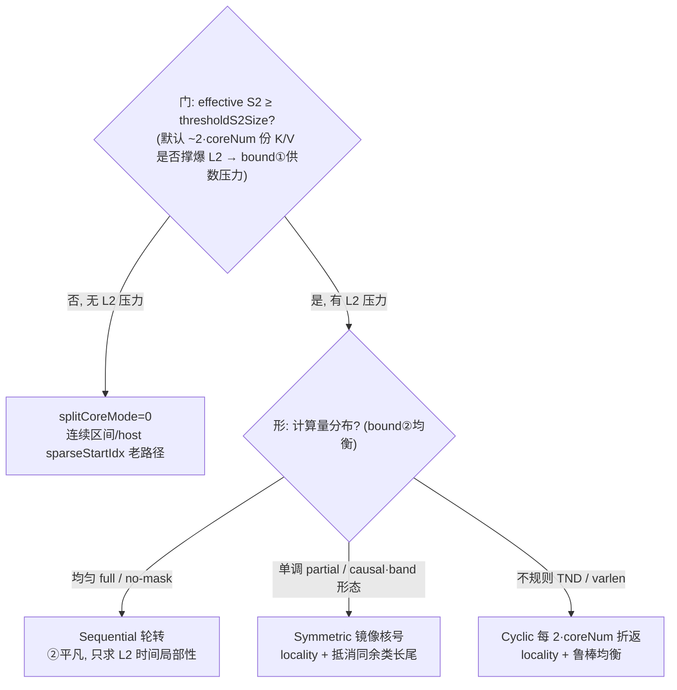
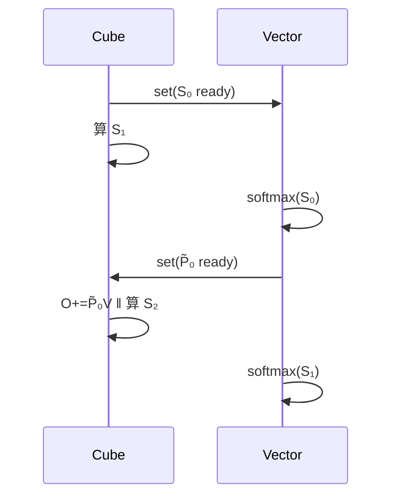
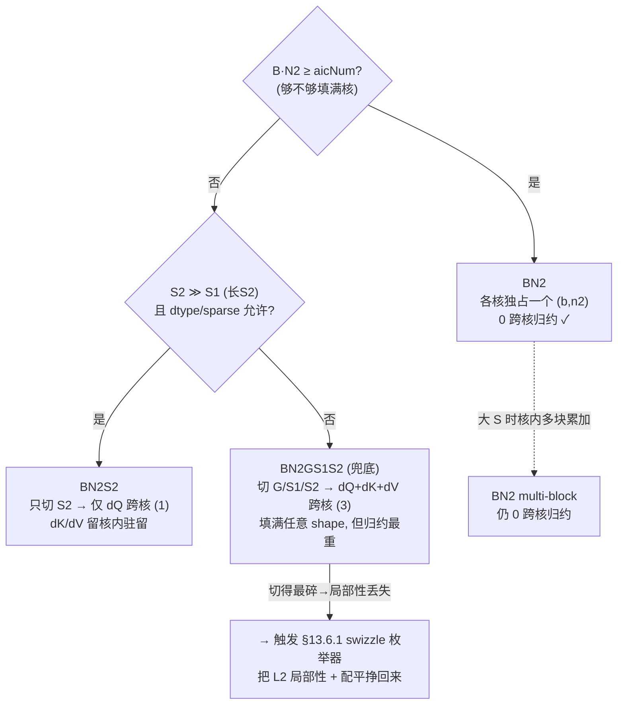

# Ascend FlashAttention @ arch35 (A5) 方案设计书

> 状态:梳理版 v1.3 —— 含 v1.2 的代码导读细化(§13 四段式读码框架 + FA/FAG 分阶段表 + §13.12 待吃透清单 + 2-Die/L2 亲和提为 §4.3.7),本轮再补 L2 微架构:(1) 新增 §2.6「L2 微架构:Bank / Sector / 交织 / hint / CMO」,把多 Bank 分布式、512B Line + 128B Sector、低位/高位/高位异或交织(含 bank conflict 取舍)、L2 hint(allocate/non-allocate/victim)、CMO(Prefetch/Writeback/Invalid/Flush)写成正式一节,并和 §2.5(3) 的 L2 复用、§4.3 splitCoreMode、§4.3.7 的 2-Die 亲和接上;(2) §2.4 增 L2 hint/CMO 旋钮行;(3) §14 新增 Track B7(L2 bank conflict / Sector / hint profiling),§13.11/§13.12 加 L2 行为观测与 hint/CMO 待查项。结论分级沿用 §0.3。
> 图例约定:Mermaid 画数据流/握手关系,ASCII 时间线画流水排布,表格收约束与对比。

---

## 0. 文档目的与范围

- 目的:梳理 FA(forward)与 FAG(backward)在 arch35 上的实现方案,作为代码阅读的"地图"。
- 范围:FA/FAG 核心计算流;tiling 与多核切分;核内流水与 N-Buffer;CV 交互与基本块;SIMT 的引入位置;双发射利用;循环序选择。
- 不展开:框架接入(aclnn/aclgraph)、完整性能数据、汇编级 VF lowering、真实 shape profile 结论。

### 0.1 阅读代码问题清单(随读随勾)

- [x] A5 上 CV 物理形态:FA/FAG arch35 入口均使用 `KERNEL_TYPE_MIX_AIC_1_2`,代码按 1 个 AIC 对 2 个 AIV (`CV_RATIO`/`CV_CORE_RATIO`=2) 组织。
- [x] L0C 出口路径:MM 结果经 `Fixpipe` 出 L0C;FA 的 BMM1 固定到 UB 给 Vector,Vector 将 P 写 L1 给 BMM2;BMM2 按模板选择 UB 或 GM workspace。FAG 的 MM1/MM2 到 UB,MM3/4/5 可写 UB 或 GM。
- [x] CV 同步原语:使用 `CrossCoreSetFlag/WaitFlag` 与跨核 Buffer;FA 额外用 `__ssbuf__`+flag 15 传 `CVSharedParams`;事件 FIFO 深度仍需硬件资料确认。
- [x] 基本块实际尺寸与对齐:FA 常规 128x128,特化 128x256/128x512/64x128;FAG 常规 128x128,FP8 64x256,HIFLOAT8 512x512,D 模板 64/128/192/256/768。
- [~] SIMT 出现位置:白皮书确认 A5 支持 SIMD/SIMT 混合编程,VF 可选择 SIMD 或 SIMT;当前 arch35 FA/FAG 源码未直接暴露 `SIMT` 命名,需继续追 `vf/*`、`vector_api/*` 的编译产物/profile。
- [~] 双发射的指令对组合:白皮书确认 Vector Core 是双发射 Register-Based SIMD 并具备乱序执行能力;当前 C++ 层未显式描述槽位组合,仍需汇编/profile。
- [x] FAG 外/内循环轴:dQ/dK/dV 不是单一路径,由 host 选 `BN2GS1S2`/`BN2`/`BN2S2`;main kernel 串起 MM1/2、Vec1~4、MM3/4/5,并通过 UB/GM workspace 与 post kernel 完成归约/转 dtype。
- [x] workspace 布局:FA 主要是 BMM2/Vec2 的 3-buffer GM workspace、dropmask workspace、16MB reserve;FAG 有 64KB reserve、dq/dk/dv FP32 workspace、dropmask bool、pre-SFMG、sink、deterministic workspace 等。
- [x] 分核 L2 阈值判据:FA 前向 `splitCoreMode` 由 `CalcThresholdForS2Size`/`IsUseSplitCoreMode` 按 L2 阈值开关,判据、触发方向、PREFIX 归属与无上界回退结论已回填到 §4.3;实算锚见 §2.5。

### 0.2 一页式阅读路线

本文现在按四层组织,建议不要从头线性精读;先按目标选路径:

| 你想解决什么 | 先读 | 再读 | 产出 |
|---|---|---|---|
| 快速知道 A5 为什么适合 FA | §2.2 硬件变量表 + §2.4 设计亲和表 + §2.5 量化 | `ascend_950_whitepaper_hardware_notes.md` §0~§7 | 硬件事实、设计选择、关键比值的对应 |
| 看懂 FA 前向代码主线 | §13.1~§13.4 | §5~§7 | BMM1/Vec1/BMM2/Vec2 数据路径和 buffer 图 |
| 看懂 FA 多核调度 | §4.3 | §13.4,§13.11-A | `splitCoreMode` 的门/形/路径展开 |
| 看懂 FAG 反向代码主线 | §13.5~§13.7 | §10 | pre/main/post、MM1~5、Vec1~6、splitAxis |
| 判断哪些结论还不能信死 | §13.10 + §14 | §8/§9 | profile/汇编/实测 TODO |
| 想引用白皮书硬件信息 | `ascend_950_whitepaper_hardware_notes.md` | §2.2/§2.4/§2.5/§2.6 | 带页码的硬件依据 |

### 0.3 结论分级

为了防止把白皮书事实、源码事实和性能推断混在一起,本文默认采用三档:

| 标记 | 含义 | 例子 |
|---|---|---|
| 白皮书确认 | 硬件能力、容量、规格可由白皮书直接支撑 | 1C:2V、UB/L1/L0 容量、SIMD/SIMT、双发、NDDMA |
| 源码确认 | C++/tiling/kernel 中已定位实现方式 | `KERNEL_TYPE_MIX_AIC_1_2`,P 写 L1,`GetC2Position`,`splitAxis` |
| 待 profile/汇编 | 白皮书和源码都不能给出最终执行形态或数值 | VF 是否落 SIMT、双发槽位组合、CrossCore event FIFO、单核有效带宽 |

后文若写"待证",通常指第三档,不是硬件不存在。§2.5 的量化结论属于"白皮书数 + 一阶模型推导",落在前两档与第三档之间:输入数是白皮书确认的,但要落到真实 MFU 仍需 profile 校准。

---

## 1. FA / FAG 计算流(算法层)

### 1.1 Forward 单次内循环的数据流(C/V 分工)



跨 CV 边界的张量只有 **S(C→V)** 和 **P̃(V→C)**,这是 FA 区别于纯 Cube 算子的全部难点(§5)。

### 1.2 Backward 单次内循环的数据流



| | Cube 次数 | CV 倒手张量 | 含义 |
|---|---|---|---|
| FWD | 2 | S, P̃ | Vector 占比高,藏 Vector 是主战场 |
| BWD | 5 | S, dP→dS | 更 Cube-bound,Vector 裕度大,但倒手翻倍 |

主线一句话:**让 Cube 不停转,Vector/MTE/同步全部藏进 Cube 影子里**。

---

## 2. A5 架构概览与 A2/A3 差异

### 2.1 概览

A5(arch35/DAV_3510)对 FA 设计的影响集中在三件事:CV 物理形态(1C:2V mix 核)、L0C 出口与缓存层级、以及 Vector/发射模型。下表把"白皮书硬件事实"和"源码使用方式"并列,后续小节(§4–§9)都在这张表的约束下展开。白皮书页码索引见 `ascend_950_whitepaper_hardware_notes.md`。

### 2.2 决定设计的硬件变量表

| 变量 | A2/A3 参考 | A5 | 影响 |
|---|---|---|---|
| CV 形态/配比 | 1C:2V 分离 | 白皮书:每个 AI 子系统=1 Cube Core + 2 Vector Core;完整规格 36 个 AI 子系统。代码:`KERNEL_TYPE_MIX_AIC_1_2`,AIC:AIV=1:2 | 同步成本、基本块 |
| Cube:Vector 算力比 | 旧架构待对照 | 白皮书峰值表:BF16/FP16 维度 Cube:Vector 约 8:1;注意这是峰值 FLOPS 比,不能直接等同 softmax/mask/dropout 耗时比(见 §2.5) | Vector 可隐藏性 |
| UB / L1 / L0A/B/C | 192K/512K/64K/64K/256K | 白皮书:UB 512KB,L1 512KB,L0A/B 64KB,L0C 256KB per AI Core;host 仍从 platform/compileInfo 读取 | tiling、N 上限 |
| L2 / Cache | 旧架构待对照 | 白皮书:L2 up to 128MB,512B Cache Line,4*128B Sector,支持 Cache Hint/CMO/按 Way 驻留;2 Die UMA 但 L2 有局部亲和性 | splitCoreMode、K/V 复用 |
| L0C 出口 | →UB 随路 cast | 白皮书:L0C→UB 支持随路量化和排布转换;代码:`FixpipeParamsC310`/`Fixpipe`,FA BMM1→UB,BMM2→UB/GM,FAG MM3/4/5→UB/GM | P/dS/DQKV 倒手开销 |
| Vector 模型 | 纯 SIMD | 白皮书:以 SIMD 为主、SIMT 为辅;VF 可选择 SIMD/SIMT 并快速切换;针对 Softmax/GELU 优化微架构,UB↔ALU 间引入 RegFile;源码映射需看编译产物 | §8 |
| 发射 | 单发射 | 白皮书:双发射 Register-Based SIMD + 乱序执行;具体槽位组合仍需汇编/profile | §9 |
| 片上内存带宽 | 旧架构待对照 | 白皮书:950PR 最高 128GB/1.6TB/s;950DT 最高 144GB/4TB/s;单核有效带宽仍需 profile | MTE2 瓶颈位 |
| 调度/同步 | set/wait flag 为主 | 白皮书:BufferID 同步、STARS2.0、128K 单比特同步标志、ns 级 HSCB 调度、Group/Die 亲和调度;当前 FA/FAG 代码仍主要用 CrossCore flag/BufferPolicy | 流水复杂度、任务发射 |

### 2.3 约束瓦解图



#### A：同步降本 → 使能小块与深流水

CV 握手本身就是一笔同步成本：

`Cube set S-ready → Vector wait → softmax → set P-ready → Cube wait → PV`

当 `T_sync` 固定时，单块效率近似为：

```text
T_compute / (T_compute + T_sync)
```

因此同步越贵，越需要大块来摊薄同步开销。A2/A3 的 C/V 分离更远，`T_sync` 高，只能倾向大块、浅流水。A5 通过 `1C:2V mix` 近邻部署、L1↔UB 直连 CV 通道、BufferID/STARS2.0 ns 级同步，把同步成本压低，使小块的同步占比可接受。小块能装下更多在飞数据，才给深流水 `N > 2` 留出空间。

所以这条关系是：**同步降本先放松块大小下限，随后才使能更深流水。**

#### B：SIMT → 移除不规整税

“不规整税”主要来自 SIMD 面对不规则形状时的三类额外成本：

1. **mask 物化**：causal/band/sink mask 需要先生成 `[Br, Bc]` 的 `0/-inf` 张量再参与计算；SIMT 可用分支直接跳过。
2. **pad 空算**：尾块/非对齐 seqlen 需要补齐到 16/32；SIMT 可按真实边界处理 ragged。
3. **gather 搬运**：sparse/topk 在 SIMD 上难做逐 lane 独立寻址，常退化成先搬连续；SIMT 可逐线程直接寻址。

硬件层面的 SIMD/SIMT 混合与 VF 能力已确认，但当前 FA 是否真实 lower 到 SIMT、尾块是否真正免 pad，还需要反汇编或 profile 验证。因此这条更准确地说是：**硬件提供了取消不规整税的能力，源码层面尚需实证落地程度。**

#### C：双发射 → 替代部分多 buffer 隐藏作用

多 buffer 的核心作用是藏生产-消费延迟：消费者处理 buffer `i` 时，生产者填充 `i+1`。双发射提供了另一种藏延迟方式：同一 Vector 核内可并行发射互不依赖的指令流，例如：

```text
exp(i) || rowmax(i+1)
O 校正 || 地址计算
```

因此，双发射能覆盖的一部分延迟，就不必再完全依赖额外 buffer 深度来隐藏。同等吞吐下，`N-buffer` 深度有机会下降一档，从而节省 UB/L1 容量。

所以这不是完全替代，而是：**双发射与多 buffer 都是藏延迟手段，二者存在部分置换关系。**

#### R：三者合流 → 设计风格翻转

A2/A3 的策略是 **用规整换效率**：同步贵、SIMD 罚不规整，所以倾向大块、对齐、pad、mask 物化、对角块整块计算。机器被规整地喂饱，但代价是接受空算和冗余搬运。

A5 的策略转向 **容忍不规整以换取紧 tiling**：同步便宜、SIMT 能处理不规则、双发射可部分替代深 buffer，于是可以让 SKIP 块真跳过、TPL 对角块按真实三角计算、尾块 ragged、sparse 直接寻址、splitCoreMode 按有效块重排。

最终变化是：

```text
A2/A3：规整优先，接受浪费
A5：紧 tiling 优先，减少废活
```

### 2.4 设计决策 ↔ 硬件亲和 对照(本书主索引)

这张表是全书的"为什么"主索引:每个设计选择都钉到**驱动它的那条 A5 硬件属性**,以及它在治哪个 bound。读后续章节时遇到一个具体写法,先回这张表问一句"它贴的是哪条硬件特性"。读法:左→右 = 现象→机制→根因;能算成数的在 §2.5。

| 设计选择 | 贴的 A5 硬件亲和(为什么必须这样) | 在治的 bound | 详见 |
|---|---|---|---|
| 1C:2V mix 核 + 单 AIV 吃 S1 半块(`CV_RATIO=2`) | 白皮书确认物理形态就是 1C+2V,且 Vector 微架构**专为 Softmax/GELU 优化、UB↔ALU 间加 RegFile 减依赖气泡**——softmax 能藏进 Cube 影子,既靠 2 个 AIV 分担,也靠这条微架构。峰值 8:1 是矩阵 FLOPS 比,不含 exp 等特殊函数吞吐(§2.5) | Vector 隐藏(藏进 Cube 影子) | §2.5 §5.2 §13.3 |
| P 经 **L1** 回传 BMM2,不走 UB 回传 | 白皮书:支持 Cube L1 Buffer 与 Vector UB 的直接 CV 通路,且明确说这条通路**就是为 FlashAttention 的带宽瓶颈而加**;代码中 P 落 `l1PBuffers` 供 BMM2 读 | CV 同步次数 + UB/L1 容量 | §5.2 §13.3 |
| BMM1 出 L0C→UB;BMM2 出 L0C→**UB/GM 自适应**(`GetC2Position`) | L0C 仅 256K,大 D/FP32 时一次放不下整块 O,必须落 GM 3-buffer 流式读回;小 D 留 UB 省一次 GM 往返 | L0C 容量 ↔ GM 带宽 | §5.2 §13.3 |
| 基本块 128×128(及 128×256/512、64×128 特化) | L0A/L0B/L0C 容量 + 16×16/16×32 分形对齐;128 是 MMAD 利用率与 L0 容量的平衡点,长 S2/低 D 才放大到 256/512 | L0 容量 + MMAD 利用率 | §4.2 §13.4 |
| L1 P 3-buffer、各 TQue N-buffer(`PING_PONG_VALUE=3`) | 用 L1/UB 余量换流水深度,吸收 HBM 拥塞/对角半空块的时延抖动(Little's Law) | 容量 ↔ 时延比 | §7 |
| splitCoreMode **strided 轮转** | 白皮书确认 L2 up to 128MB、服务 AIC/AIV、支持局部亲和与 Cache Hint;strided 让多核同一时刻聚在滑动窗口的 K/V 上,避免连续分核把 K/V 工作集铺满 L2 → 回片上内存(定量见 §2.5) | bound① Memory 带宽 | §2.5 §4.3.3 |
| Symmetric 镜像核号 / Cyclic 折返 | 多核并行 wall-clock=最慢核;causal 三角、varlen 不规则各造一种长尾 | bound② 并行长尾 | §4.3.4 §4.3.5 |
| splitCoreMode 由 **L2 阈值**门控(`CalcThresholdForS2Size`) | 只有默认 ~2·coreNum 份 K/V 撑爆 L2 时,重排减少活跃份数才有收益;没压力就别扰动局部性。阈值数量级 ≈ 几千 S2(§2.5 实算) | bound① 触发条件 | §2.5 §4.3.1 |
| FAG 外 KV 内 Q + host 选 `splitAxis` | atomic 流量(dQ 一份 vs dKV 两份)、DKV workspace 容量、长 S2 局部性三者权衡;不同 shape 走不同轴 | atomic 带宽 + workspace 容量 | §10 §13.6 |
| FAG `IS_DKV_RESIDENT_L0C` 把 DK/DV 钉 L0C 累加 | L0C 256K 够放"最大临时 MM 结果 + DK + DV"时,免 DK/DV 反复 GM 往返 | L0C 容量 ↔ GM 带宽 | §13.7 |
| 低精度模板阶梯(FP8/HiF8/MXFP8 块、HIFLOAT8 512×512) | 白皮书:Cube 原生 HiF8/MXFP8/FP8(=2× FP16 算力)、MXFP4(=4×);更高算力要求更大基本块喂满 Cube,故 dtype 决定 block size。但低精度主要买吞吐,不改 memory-bound 交叉点(§2.5) | Cube 吞吐 + L0 喂数 | §2.5 §4.2 §13.7 |
| Fixpipe 随路 cast/scale(出 L0C 顺手转 dtype) | 白皮书:L0C→UB 支持随路量化(FP32/INT32→BF16/FP16/FP8/INT8)与 NZ→ND/DN 排布转换;省一整段 Vector elementwise | 利用 fixpipe 随路 → 省 Vector | §11 §5.2 |
| mask/tail 走 `vf/*`·`vector_api/*` 分支(硬件具备 SIMT,VF 映射待证) | 白皮书确认 SIMD/SIMT 混合编程,VF 可选 SIMD/SIMT;不规则控制流、gather/scatter 是 SIMT 目标场景。当前代码中哪些 VF 落到 SIMT 需汇编/profile | 取消不规整税(待证 §14-B) | §8 |
| NDDMA/多维搬运可降低 layout 税 | 白皮书确认 NDDMA 可做最多 5 维重排,并把细粒度读聚合为 128B 读(与 L2 的 128B Sector 对齐);当前 FA/FAG 代码仍需定位具体 DataCopy/NDDMA lowering | 搬运+排布转换开销 | §11 §14-B |
| BufferID 同步是硬件新能力 | 白皮书确认 BufferID 同步比 set/wait flag 更内聚;当前 FA/FAG 源码仍以 CrossCore flag 与 BufferPolicy 为主 | 同步复杂度 | §7 §14-B |
| L2 hint / CMO 是"留位/预取"旋钮 | 白皮书确认 L2 hint(allocate/non-allocate/victim)与 CMO(Prefetch/Writeback/Invalid/Flush);可把 K/V 标 allocate 留 L2、一次性输出标 non-allocate 不污染 L2,在 splitCoreMode 之上再细调 K/V 复用 | L2 复用质量(§4.3 之上一层) | §2.6 §14-B7 |

一句话串起来:**§2.2 列硬件常量 → §2.3 说这些常量松了哪些约束 → §2.4 把每个设计选择钉回某条常量/约束 → §2.5 把能算的钉成数 → §4~§13 是这些选择的代码展开。** 任何一处看不懂"为什么这么写",顺着"详见"回到对应小节,再回到本表确认它贴的硬件属性。

### 2.5 硬件数 → 关键比值(把亲和算成数)

> 数据口径:950PR BF16,取白皮书数(Cube 432 TFLOPS、Vector 54 TFLOPS、片上内存 1.6TB/s、L2 128MB、L0C 256KB,见 `whitepaper_notes` §3.2/§6;DT 把算力/带宽各放大,交叉点结论不变)。下面是**一阶模型**:输入数是白皮书确认的,绝对值要落到真实 MFU 仍需 profile 校准(§14-B);但比值和量级足以解释 §2.4 的几条设计为什么必然。

**(1) FA 前向的 roofline 交叉点 ≈ S>540。** 单个 (B,N) head:计算量 ≈ 4·S²·D FLOPs(QKᵀ + PV 两个 matmul),HBM 一遍字节 ≈ 4·S·D·`dtype`(读 Q/K/V + 写 O)。算术强度

```
AI = 4·S²·D / (4·S·D·dtypeBytes) = S / dtypeBytes      (FLOP/byte)
```

ridge = 峰值算力 / 带宽。BF16:432e12 / 1.6e12 ≈ **270 FLOP/byte**。compute-bound 条件 `AI > ridge` ⇒ `S/2 > 270` ⇒ **S > 540**。也就是说:**短序列(S≲540)FA 前向是 memory-bound,长序列才 compute-bound**——这正是 arch35 把所有重火力(splitCoreMode、L2 复用、低精度)都压在长 S/长 S2 上的根因。

**(2) 为什么低精度不挪动这个交叉点(只买吞吐)。** 设 `dtypeBytes = d`,则峰值算力 ∝ 1/d(白皮书:FP8=2× FP16、MXFP4=4×,正好对应 d 从 2→1→0.5),ridge = (432·2/d)/1.6 = 540/d;而 AI = S/d。compute-bound 条件 `S/d > 540/d` ⇒ **S > 540,与 d 无关**。结论:**FP8/MXFP4 让你算得快,但 memory-bound 的边界仍在 S≈540**——短 S 即便换 FP8 也还是 memory-bound。所以 §2.4 的低精度模板行,本质是"长 S 下提吞吐",不是"把短 S 救出 memory-bound"。

**(3) 多核重取如何威胁 roofline → splitCoreMode 的定量根。** 上面 (1) 假设 K/V 从 HBM 只读一遍。但默认连续分核下,~`n2Num`(≈2·coreNum)个核各自从 HBM 取自己那份 K/V,K/V 的 HBM 字节最坏放大 ~`n2Num`×,有效 AI 同比例下掉,足以把工作点从 compute-bound 一侧拖回 memory-bound。`splitCoreMode` 的 strided 轮转让多核同一时刻聚在一个滑动窗口的 K/V 上 → 这份 K/V 在 128MB L2 里取一次喂多核 → HBM 只见 K/V ~一遍 → AI 保住。**这就是 §4.3 那条张力轴的量化根:不是"分核更均衡"那么模糊,而是"保住 roofline 的 compute-bound 一侧"。**

**(4) L2 阈值的实算锚 ≈ 几千 S2。** §4.3.1 的 `thresholdS2Size = l2Remain / (n2Num·(D+Dv)·dtypeBytes)`,代入 L2≈128MB(扣 Q/mask 后取 l2Remain~100MB 量级)、n2Num≈64(2·32 AIC)、D+Dv=256、BF16:

```
thresholdS2 ≈ 100e6 / (64 · 256 · 2) ≈ 3.0e3 tokens
```

即 **S2 要到几千量级,默认 K/V 工作集才撑爆 L2、splitCoreMode 才开**;S2=8192 时默认工作集 ≈ 64·8192·256·2 ≈ 268MB > 128MB,确实放不下,需要重排。这把 §4.3.1 的"长 S2 才开"从定性变成一个可对账的数(精确值随 B·N2、mask 扣减变化,数量级稳定)。

**(5) Cube↔Vector tile 周期预算(2 AIV 够不够藏 softmax)。** 一个 128×128 前向 tile:Cube ≈ 2 个 128³ matmul ≈ **4.2M MAC**;Vector softmax ≈ 16K 个 exp + ~48K 简单 elementwise(rowmax/rowsum/校正)。藏 softmax 的判别式是

```
T_vec(半 tile, 含 exp) ≤ T_cube(tile) / 2     ← 因 1 AIC 喂 2 AIV,各吃半 tile
```

raw op 数上 Cube MAC(4.2M)比 Vector op(~64K)多 ~65×,即使 Vector 矩阵吞吐只有 Cube 的 1/8、且 exp 是多周期特殊函数,2 个 AIV 仍**大概率**有裕度藏住 softmax——**除非 exp/特殊函数吞吐成为瓶颈**。而 Vector 的 exp/特殊函数有效吞吐白皮书没给(只给了矩阵类峰值),所以这条判别式缺的就一个常量,它正是 §14-B5 的 profile 目标:测出 Vector softmax tile 实际周期,代入即可判定 2 AIV 是裕度还是刚好卡住。

> 把 (1)~(5) 连起来:**A5 为 FA 做的每一件事(1C:2V + softmax 微架构、CV 直连通路、128MB L2、低精度阶梯)都在围绕同一目标——在"长 S 才 compute-bound"这个前提下,既把 Cube 喂满(L2 复用保 AI、低精度提吞吐),又把 Vector 藏住(2 AIV + RegFile + 双发)。** §4 起的所有代码细节都是这句话的展开。

### 2.6 L2 微架构:Bank / Sector / 交织 / hint / CMO

> 白皮书确认。§2.5(3)/§4.3 把 L2 当成"K/V 中间数据的复用缓冲"来用,但只用了它的**容量**(128MB)。这一节补 L2 的**微架构**,因为 Bank/Sector/交织/hint/CMO 决定了"复用窗口落进 L2 之后,带宽能不能真吃满、会不会被病态访问拍死",是 §4.3 strided 复用与 §14-B profiling 的下一层细节。

**定位:中间数据复用缓冲,不是首读缓存。** L2 缓存的是 AIC/AIV 会**重复使用**的输入/输出/中间数据,省掉反复回片上内存(HBM)的大开销。这正是 splitCoreMode 想吃的东西:K/V 被多个 Q 块重复消费,钉在 L2 里一次取多次用。

**(A) 多 Bank 分布式 + 512B Line + 128B Sector。**

| 机制 | 含义 | 对 FA 的意义 |
|---|---|---|
| 多 Bank 分布式,每 Bank 可同时读写 | 128MB 切成很多独立 Bank,多核访存打到不同 Bank 上并行;总带宽 ≈ 单 Bank 带宽 × Bank 数(理想) | L2 并行度的来源;若多核访问挤到同一 Bank 就排队(bank conflict),并行归零 |
| Cache Line 512B | L2 管理/替换的基本单位,一整条 512B 进出与做替换决策 | 大块连续 Q/K/V/O 搬运天然按 512B 走,利用率高 |
| 128B Sector Cache(512B Line 内分 4×128B 扇区) | 一条 Line 内可**按 128B 扇区**搬运/管理有效性,128B/256B 访问更高效 | 与 NDDMA"细粒度读聚合为 128B"(§2.4)正好对齐:尾块/非对齐/ND-NZ 这类不满 512B 的访问不必拉满整条 Line,省带宽 |

**(B) Bank 交织:低位 vs 高位 vs 高位异或(这是 A5 L2 的关键设计)。**

"用地址的哪几位选 Bank"决定连续/跨步访问会不会撞同一个 Bank。地址里**低位变化快、高位变化慢**:

- **低位交织**:用低位选 Bank,地址按交织粒度递增就轮换 Bank(发牌式)。对**连续顺序访问(stream)**极友好——一段连续读均匀铺满所有 Bank,带宽拉满。弱点:对**固定大跨步**敏感,若 stride 恰好 = `Bank数 × 交织粒度` 的倍数,每次访问落同一 Bank → 严重冲突(经典:二维数组按列扫,行跨步踩中 Bank 周期)。
- **高位交织**:用高位选 Bank,一整块连续地址属于同一 Bank。适合把不同数据结构隔离到不同 Bank;但对连续访问极差——顺序扫一大段长时间待在一个 Bank,其它 Bank 全闲,并行度丢失。
- **谁更容易冲突,取决于访问模式**,不能一概而论:

| | 连续顺序访问(stream) | 固定大跨步访问(strided) |
|---|---|---|
| 低位交织 | 几乎不冲突(均匀铺满)✓ | 跨步踩中周期时严重冲突 ✗ |
| 高位交织 | 全程挤一个 Bank,等于不并行 ✗ | 反而可能错开(看具体跨步) |

对 NPU 这种以**大块连续张量搬运**为主的负载,**低位交织是默认**(stream 友好),代价是要处理"病态 stride"。

**白皮书"512B 低位交织 + 高位异或交织"的真正含义 = 低位打底 + 高位 XOR 扰动**:基础是 512B 粒度低位交织(保 stream 带宽);但纯低位交织会被病态 stride 周期性拍死,于是选 Bank 时把低位**异或上若干高位**:

```
bank = low_bits XOR (some_high_bits)
```

病态 stride 冲突的根因是"低位 bank 字段周期性重复";高位在跨步时是变化的,异或进来等于给 Bank 号加一个随步长变化的扰动,把原本共振到同一 Bank 的访问重新散开,同时几乎不损害顺序访问的均匀性(顺序访问时高位变化慢,扰动小,仍均匀铺满)。所以"交织算法升级"= **低位拿满连续带宽,高位 XOR 补掉病态 stride 冲突**,两头都要。

落到 FA:大块连续的 Q/K/V/O 搬运吃低位交织的 stream 带宽;那些 stride 固定、可能踩雷的访问(某些 mask/index/transpose)靠高位 XOR 避开 Bank 冲突。真实冲突率仍需 profile per-bank 带宽均衡度才能定。

**(C) L2 hint:allocate / non-allocate / victim —— 给复用数据"留位"的抓手。**
程序员给数据打 hint 告诉硬件"以后还用不用":下一 Task 还要用的(如 Task0 输出 = Task1 输入)标 **allocate**,留在 L2;短期不用的一次性输出标 **non-allocate**,直接写回 Global Memory、**不 allocate 进 L2**,从而不把别人短期要用的数据挤出去(victim)。对 FA 这是 §4.3"保住 K/V 局部性"之外更细的旋钮:把 K/V 标"要复用、留 L2",把一次性中间输出标 non-allocate,主动保护 L2 里值钱的复用数据(白皮书 Cache Hint / 按 Way 驻留即此)。

**(D) CMO(走 SDMA):Prefetch / Writeback / Invalid / Flush。**
对 L2 的主动管理动作,时机与作用范围可调:Prefetch 提前把要用的数据拉进 L2(藏延迟);Writeback 提前写回脏数据(腾空间/降后续写压力);Invalid 标 Line 失效;Flush 强制写回并清。这给了一条**手动 prefetch K/V、手动管 L2 占用**的路子,是后续调优 splitCoreMode 时能动的旋钮。

**(E) 2-Die UMA 一致性 + 局部亲和(与 §4.3.7 接口)。**
跨 Die 可访问 L2、硬件维护 2 Die 一致性(软件不感知),但 L2 有**局部亲和**:本 Die 访问比跨 Die 走 D2D 快。所以 §4.3.7 的结论是——源码的 strided 重排已把逻辑窗口整理成 L2 友好,但这窗口能否落成**本地 Die 内** L2 复用,取决于物理落核/STARS Die Group 调度。

**这一节给 §14-B 的 profiling 增量(并入 B1/B6 一起看):**

- per-bank 带宽均衡度 / bank conflict 率 → 判断是不是某些 stride 踩中交织周期(高位 XOR 是否真的把它散开了)。
- 128B Sector 命中 vs 512B Line 命中 → 判断尾块/非对齐访问是否吃到了 Sector Cache 的省带宽。
- L2 hit 按 allocate/non-allocate 拆分(若算子用了 hint)→ 判断 K/V 是否真留在了 L2、一次性输出是否真没污染 L2。
- L2 hit 按 Die/核拆分(= B6)→ 判断复用窗口是否被跨 Die 拆开。

---

## 3. 整体方案三层结构



核间(§4.1/§4.3)定均衡,核内循环定驻留,块内流水定利用率。当前代码是 host 静态生成 `blockStarts/blockEnds`/sparse start idx,而 kernel 内 `GetNextValidIdx` 继续跳过无效块并适配 TND/swizzle/deterministic。

---

## 4. Tiling 策略

### 4.1 causal 下的块网格分类与负载

```
KV→  j0  j1  j2  j3            块类型:FULL=整块算, TPL=对角三角, SKIP=不算
Q↓ ┌────┬────┬────┬────┐       行负载 ∝ 行号 → 核间均衡:首尾行配对
i0 │TPL │SKIP│SKIP│SKIP│        (i0,i3)(i1,i2) 同核,各核 ≈ 等量 FULL
i1 │FULL│TPL │SKIP│SKIP│
i2 │FULL│FULL│TPL │SKIP│       TPL 块内 ~半算力浪费 → §8 SIMT 真三角
i3 │FULL│FULL│FULL│TPL │
```

> 注:图中"首尾行配对 (i0,i3)(i1,i2)"画的是 causal 负载均衡的**理想效果**(把最重和最轻配到同核)。arch35 代码并不做这种逐行首尾配对,而是用 §4.3.4 的"上半 N 正向 + 下半 N 镜像核号"来**近似**它;两者目标一致,机制不同。

### 4.2 (Br, Bc) 决定式

| 约束 | 公式(宏观) | 卡谁 |
|---|---|---|
| UB 容量 | N·(Br·Bc + 向量区) ≤ UB | Br 上限 |
| L0/L1 | Bc·D 驻留 + pingpong | Bc 上限 |
| Cube 利用率 | Br,Bc ≥ 分形对齐×若干 | 下限 |
| causal 浪费 | TPL 占比 ∝ Bc/S2 | Bc 别太大 |

当前 arch35 host 不是单纯 cost 枚举,而是先按 dtype/D/optional/sparse 走一组明确模板:
FA 常规 `S1xS2=128x128`;D>256 时 `S2=128`,FP32 把 S1 降到 64;D=64/Dv=64 且长 S2、无 optional 时会走 `128x256`;HIFLOAT8 可走 `128x512`;TND 常规 `128x128`。FAG 常规 `128x128`,FP32 且 D>256 为 `64x128`,FP8 为 `64x256`,HIFLOAT8 为 `512x512`。
D 模板统一按 64/128/192/256/768 对齐,RoPE/FAG 会把 D 模板推到 192。尾块、mask 与 sparse 由 kernel runInfo、FA forward 的 `vf/*` 和 FAG 的 `vector_api/*` 处理;是否映射成硬件 SIMT 仍需下钻编译产物或 profile(见 §14 Track B)。


#### 4.2.1 A5 FA 基本块尺寸:为什么 128x128 是平衡点

`128x128` 不是魔数,而是两类约束夹出来的结果:

- **上界:** L0A/L0B 容量,尤其是 L1->L0 双缓冲要求。
- **下界:** MMAD 固定开销需要足够大的 tile 体积来摊薄。

在 FP16/BF16、`D=128` 的常规口径下,`128x128` 已经把 MMAD 利用率拉到接近稳态,同时 L0A/L0B 双缓冲刚好塞满 64KB。再小利用率掉得明显,再大则很快撞 L0A/L0B 容量。

##### 4.2.1.1 容量上界

设输出基本块为 `[Br, Bc] = [S1_block, S2_block]`,收缩维为 `K`。FA 的 BMM1 中通常 `K = D`。输入元素字节为 `dt_in`,L0C 累加为 FP32,所以 `dt_acc = 4`。

单缓冲占用:

```text
L0A = Br * K  * dt_in
L0B = K  * Bc * dt_in
L0C = Br * Bc * dt_acc
```

如果希望 L1->L0 搬运与 Cube 计算重叠,L0A/L0B 至少需要双缓冲:

```text
2 * Br * K  * dt_in <= 64KB
2 * K  * Bc * dt_in <= 64KB
    Br * Bc * 4     <= 256KB
```

代入常规 FP16/BF16、`Br=Bc=128`、`K=D=128`、`dt_in=2`:

```text
L0A: 2 * 128 * 128 * 2 = 65536 B = 64KB
L0B: 2 * 128 * 128 * 2 = 65536 B = 64KB
L0C:     128 * 128 * 4 = 65536 B = 64KB <= 256KB
```

因此在这个口径下,真正卡住基本块继续放大的主要是 **L0A/L0B 的 64KB 双缓冲容量**,不是 L0C。L0C 只占 1/4,余量可以留给输出累加、多 buffer 或其他流水需求。

如果尝试把常规方块直接放到 `256x256`,L0A/L0B 会按边长放大,双缓冲容量会明显超出 64KB;除非切 K、减少 buffering 或换特殊实现,否则不可行。

##### 4.2.1.2 利用率下界

Cube/MMAD 以分形块为基本粒度。对 FP16/BF16,可用一阶模型近似:

```text
cube_work ~= (M / 16) * (N / 16) * (K / 16)
eta ~= cube_work / (cube_work + overhead)
```

其中 `overhead` 包括指令发射、阵列 fill/drain、同步和必须被隐藏的 L0 装载等近似固定成本。由于 `cube_work` 随 tile 体积增长,固定开销占比会随块变大而快速下降。

数量级对比:

```text
64x64x64      -> 4 * 4 * 4   = 64
128x128x128   -> 8 * 8 * 8   = 512
256x256x256   -> 16 * 16 * 16 = 4096
```

从 `64` 到 `128` 的提升会显著摊薄固定开销;从 `128` 继续放大,利用率收益趋于饱和,但 L0A/L0B 容量很快成为硬上界。因此 `128` 可以理解为: **已经足够大到接近稳态,又仍能在常规 FP16/BF16、D=128 场景下保留 L0 双缓冲的最小高效块。**

##### 4.2.1.3. 特化尺寸如何从公式变化出来

同一组公式也能解释多数特化的方向。

FP32 且高 D: 64x128,而不是 128x64

严格按当前 FA basic tiling 代码,FP32 并不是所有 D 都降到 `64x128`:当 `D<=256` 时仍可走 `128x128`;当 `D>256`、D 模板升到更大的高 D 路径时,FP32 才把 S1 block 降到 64,同时保持 S2 block 为 128。

只看 BMM1 的 L0 容量,`64x128` 和 `128x64` 都像是“把一条边砍半”的候选。但 FA 的 S1/S2 两轴并不对称:

- `S2` 是 online softmax 的内循环流式轴。把 `S2` 从 128 降到 64,会让每个 S1 block 的 S2 loop 次数翻倍,带来更多 CV 同步、softmax update、BMM2/O 校正和 K/V 搬运。
- `S1` 是外层行块/任务轴。把 `S1` 从 128 降到 64,主要是任务数变多、每个任务的行状态变小,不会增加单行需要流过的 S2 分片数量。
- BMM2 里 `S2 block` 同时是 `P @ V` 的 K 维。保持 `S2=128` 比 `S2=64` 更容易摊薄 BMM2 的固定开销,也更贴合当前 Vec1->L1P->Cube 的实现快路径。

因此当前实现选择的是:**优先保住 S2=128,把容量/状态压力压到 S1 侧**,得到 `64x128`,而不是 `128x64`。

用简化容量式看 FP32 的压力来源:FP32 输入 `dt_in=4`。若仍取 `Br=128,K=128`:

```text
2 * 128 * 128 * 4 = 128KB > 64KB
```

L0A 双缓冲放不下。把 `Br` 降到 64:

```text
2 * 64 * 128 * 4 = 64KB
```

这说明“至少要缩一边”是容量压力的结果;而“缩 S1、不缩 S2”是 FA 流水和 kernel 模板共同决定的性能选择。

低 D: 128x256

当 `D=K=64` 且输入为 FP16/BF16 时,L0A 变小:

```text
2 * 128 * 64 * 2 = 32KB
```

这给 S2 方向留出空间。把 `Bc` 放大到 256:

```text
2 * 64 * 256 * 2 = 64KB
```

因此低 D 场景可以用更大的 S2 block 来减少 S2 loop 次数、摊薄同步和调度开销。

##### 4.2.1.4. HIFLOAT8 / FP8: 128x512 或 128x256

源码事实上存在这类特化:

- `HIFLOAT8` 且无 optional 输入时,FA tiling 会设为 `128x512`。
- `FLOAT8_E5M2/E4M3FN` 等 FP8 分支可走 `128x256`。

但这里要谨慎:如果简单套用 `K=128`、`dt_in=1`、L0B 双缓冲 64KB:

```text
2 * 128 * 512 * 1 = 128KB > 64KB
```

所以 `128x512` **不能只用“FP8 字节减半”解释完**。更稳妥的表述是:FP8/HIFLOAT8 提供了容量和吞吐红利,使更大的 S2 block 成为可能;但 `128x512` 的完整成立还依赖该分支的专用约束和实现策略,例如无 optional、D 范围受限、专用 VF/Cube 路径、buffer 策略变化或 K 方向处理方式。若 `K=64`,则:

```text
2 * 64 * 512 * 1 = 64KB
```

这时 `128x512` 可由 L0B 双缓冲容量直接解释。若 `K=128`,则需要结合具体 kernel 实现进一步确认。

##### 4.2.1.5 D > 256

当 `K=D` 增大到 256 时,即使 FP16/BF16:

```text
2 * 128 * 256 * 2 = 128KB > 64KB
```

L0A 双缓冲已经放不下。因此高 D 场景不能继续放大 S2 block,需要回到更保守的 S1/S2 模板;FP32 下还会进一步把 S1 降到 64。

##### 4.2.1.6 证据分级

- **硬证据:** L0A/L0B 64KB、L0C 256KB、FP16 16x16 / FP8 16x32 分形粒度、FA tiling 中的 `128x128`、`128x256`、`128x512`、`64x128` 特化。
- **强解释:** `2 * Br * K * dt_in <= 64KB` 与 `2 * K * Bc * dt_in <= 64KB` 能直接解释常规 `128x128`、低 D `128x256`,并解释 FP32/高 D 场景“需要缩一边”的容量压力;至于缩成 `64x128` 而不是 `128x64`,还需要结合 FA 的 S2 内循环代价和当前 kernel 模板。
- **待实证:** MMAD 固定 overhead 的精确 cycle 数、利用率膝点精确位置、HIFLOAT8 `128x512` 在 `K=128` 下的完整容量/流水解释,需要结合反汇编、profile 或更细的微架构资料确认。

##### 4.2.1.7 可引用的短句

`128x128` 是 L0 容量上界和 MMAD 利用率下界的交点:在 FP16/BF16、`D=128` 下,L0A/L0B 双缓冲刚好各占满 64KB,而 tile 体积已经足够摊薄 MMAD 固定开销。低 D、FP32、FP8/HIFLOAT8 等特化,本质上是在同一组公式里改变 `K`、`dt_in` 或 buffer/流水策略后得到的新平衡点。

### 4.3 多核分核策略:三种调度与各自规避的 bound

> 读码校正版。**适用范围**:本节只描述 FA 前向 train kernel 的 `splitCoreMode==1` 路径,核心在 `attention/flash_attention_score/op_kernel/arch35/flash_attention_score_kernel_train.h::Process`。FAG 反向不走这套,而是另一套 `splitAxis`(BN2/BN2S2/BN2GS1S2,见 §13.6)。`SetSparseStartIdx` 是另一条 sparse 静态均衡路径,主要服务 `splitCoreMode==0` 时的 `[multiCoreInnerOffset,multiCoreInnerLimit)` 分配,不要和本节的新分核混成同一件事。

**两层心智模型(先建立这个,再看下面的代码细节)**:这套机制是"门 + 形"两层决策,分别对应两个正交的 bound——



- **门(§4.3.1)= bound①**:`CalcThresholdForS2Size` 估算"默认调度下 ~2·coreNum 份 K/V 是否撑爆 L2",撑爆才打开 `splitCoreMode`。**注意方向**:是 effective S2 *大* 到有 L2 压力才开,不是 S2 小才开。这里的 effective S2 不是统一变量:ALL/NO_MASK 用 `S2`,LEFT_UP 用 `min(S1,S2)`,RIGHT_DOWN 要求 `S1<=S2` 后用 `S2`,TND 用每个 batch 的 actual length。例外是 non-TND `NO_MASK + HIFLOAT8`,代码直接打开新分核。
- **形(§4.3.3–4.3.5)= bound②**:门打开后,按计算量分布选三种 dispatch 之一。三种 dispatch **都跑在"门已开"之下**,共享降低活跃 K/V 份数(吃 L2)这一目标;区别只在额外要不要处理负载长尾。
- 所以 **Sequential 不是"只治①、不治②",而是②平凡(均匀)的退化情形**:无长尾可治,于是只剩纯局部性。Symmetric/Cyclic 是在同一个门下,额外叠加均衡。
- **但 bound② 不只这三种 shape 在治**:门没开(`splitCoreMode==0`)时,`SetSparseStartIdx` 用 host 静态估算给每个 core 划连续有效区间,本身也是一种负载均衡;`PREFIX/PREFIX_COMPRESS` 即走这条老路径而非本节三种 dispatch。换句话说,"形"层只是 bound② 的**一部分**实现,不是全部(对照见 §4.3.6 第 4 行)。这也是为什么上面 mermaid 的 OFF 分支不等于"完全不均衡"。

#### 4.3.0 第一性原理:只动 task 顺序,不动块内计算

单个 S1/S2 block 内部的 BMM1、Softmax/Mask/Dropout、BMM2 流水没有因为这套分核改变。变化点只有一个:`multiCoreInnerIdx` 被重新映射成 `realCoreInnerIdx`,再由 `ComputeAxisIdx(realCoreInnerIdx)` 还原到 `(B,N2,G,S1Outer)` 逻辑任务。

代码里的真实结构不是三个互斥 kernel,而是:

```cpp
if splitCoreMode == 1:
    if layout == TND:
        // 只走 Forward-Reverse Cyclic
        dispatch_tnd_by_forward_reverse_cycle()
    else:
        // 同一个 kernel 内按顺序串三段
        dispatch_partial_forward()
        dispatch_partial_reverse()
        dispatch_full_forward()
else:
    // 老路径:当前 core 处理 host 给定的连续区间
    for realCoreInnerIdx in [multiCoreInnerOffset, multiCoreInnerLimit):
        RunOneTask(realCoreInnerIdx)
```

其中 `RunOneTask(realCoreInnerIdx)` 仍是:

```cpp
ComputeAxisIdx(realCoreInnerIdx)
GetAttentionOffset()
GetS2LoopRange()
for s2LoopCount in current S2 range:
    Bmm1(Q, K)
    Vec1(softmax/mask/dropout)
    Bmm2(P, V)
    Vec2(output/lse/update)
```

#### 4.3.1 host 侧何时打开 `splitCoreMode`

`CalcThresholdForS2Size` 先估算 L2 剩余空间:

```cpp
l2Remain = l2CacheSize
l2Remain -= attentionMaskSize
l2Remain -= dropMaskSize

actualUsedCoreNum = coreNum
n1Num = min(2 * actualUsedCoreNum, B * N2 * G)
n2Num = min(2 * actualUsedCoreNum, B * N2)

l2Remain -= n1Num * D * S1 * dtypeSize      // Q 占用
thresholdS2Size = l2Remain / (n2Num * (D + Dv) * dtypeSize)
```

注意触发方向:代码不是 “S2 小才打开”,而是当代码选定的 effective S2 达到或超过阈值时打开,因为这表示默认多核并发下的 K/V 工作集已经有较强 L2 压力,需要通过任务重排减少同一时刻活跃的 K/V 份数。代入白皮书 L2=128MB 的实算锚见 §2.5(4):阈值数量级 ≈ 几千 S2,即 S2 要到几千 token 默认工作集才撑爆 128MB L2。

非 TND 的实际开关:

```cpp
LEFT_UP_CAUSAL:
    use = min(S1, S2) >= thresholdS2Size
    firstFullLoadS1OuterIdx = ceil(min(S1, S2) / s1BasicBlock) - 1

RIGHT_DOWN_CAUSAL:
    use = (S1 <= S2) && (S2 >= thresholdS2Size)
    firstFullLoadS1OuterIdx = s1OuterSize - 1

ALL_MASK:
    use = S2 >= thresholdS2Size
    firstFullLoadS1OuterIdx = -1

NO_MASK:
    if no attenMask or full pre/next tokens:
        use ALL_MASK 判据, firstFullLoadS1OuterIdx = -1
    else if preTokens >= S1 && nextTokens == 0:
        use LEFT_UP_CAUSAL 判据, firstFullLoadS1OuterIdx = ceil(min(S1, S2) / s1BasicBlock) - 1
    else if dtype == HIFLOAT8:
        use = true, firstFullLoadS1OuterIdx = -1

BAND:
    full 覆盖时按 ALL_MASK
    left-up causal 形态按 LEFT_UP_CAUSAL
    right-down causal 形态按 RIGHT_DOWN_CAUSAL
    不含无效行的 band 按 ALL_MASK
```

TND / varlen override 更保守:对 batch 逐个看实际长度,`LEFT_UP_CAUSAL` 用 `min(actualS1, actualS2) > thresholdS2Size`,其他支持形态用 `actualS2 > thresholdS2Size`;命中后只设置 `splitCoreMode=SQ_MULTI_CORE_FIRST`,kernel 侧直接走 cyclic,不使用 non-TND 的 partial/full 三段。

两个容易混淆的边界:

- `PREFIX/PREFIX_COMPRESS` 当前不在 `SetSplitCoreModeParam()` 的新分核分支里。它们会在 sparse 解析和 `SetSparseStartIdx` 中被处理,但不是 §4.3.3–4.3.5 的 Sequential/Symmetric/Cyclic dispatch。
- non-TND `NO_MASK + HIFLOAT8` 是特例:代码没有调用 `IsUseSplitCoreMode`,而是直接 `firstFullLoadS1OuterIdx=-1` 并打开 `SQ_MULTI_CORE_FIRST`。
- 读码能确定:当前 host 只实现了**下界触发**,没有实现 "S2 过大则关闭 splitCoreMode" 的上界回退。一旦满足上述条件,`SetSplitCoreModeParam()` 就会把 `splitCoreMode` 置为 `SQ_MULTI_CORE_FIRST`。至于 S2 极大时 L2 命中收益衰减到什么程度,源码无法定量,需要 profile L2 hit、MTE/HBM、AIC/AIV 利用率曲线确认。

#### 4.3.2 公共映射 helper

non-TND 下:

```cpp
partialLen = firstFullLoadS1OuterIdx + 1

CalcRealTimes(relativePos, length):
    base = length / coreNum
    remain = length % coreNum
    return base + (relativePos < remain ? 1 : 0)

CalcRealCoreIdx(relativePos, times, offsetCoreIdx, isPartial):
    linear = times * coreNum + relativePos

    if isPartial && firstFullLoadS1OuterIdx != -1:
        nIdx = linear / partialLen
        s1oIdx = linear % partialLen
    else:
        fullLenPerN = s1OuterSize - partialLen
        nIdx = linear / fullLenPerN
        s1oIdx = linear % fullLenPerN

    return nIdx * s1OuterSize + s1oIdx + offsetCoreIdx
```

TND 下:

```cpp
CalcRealCoreIdxVarlen(calcLoops, phase, cycleCoreNums):
    if phase == 0:
        return calcLoops * cycleCoreNums + aicIdx
    else:
        return calcLoops * cycleCoreNums + (cycleCoreNums - aicIdx - 1)
```

#### 4.3.3 Sequential:full 区顺序轮转,主治 L2 工作集压力

Sequential 对应 non-TND 的 full 段。若 `firstFullLoadS1OuterIdx == -1`,整个任务空间都是 full 段;若存在 partial 区,则只处理每个 N/B/G 内 `partialLen` 之后的剩余 S1Outer。

```cpp
SequentialFullPart():
    totalN = B * N2 * G
    partialLen = firstFullLoadS1OuterIdx + 1

    if firstFullLoadS1OuterIdx == -1:
        fullLen = totalN * s1OuterSize
        fullOffset = 0
    else:
        fullLen = totalN * (s1OuterSize - partialLen)
        fullOffset = partialLen

    myCount = CalcRealTimes(aicIdx, fullLen)

    for t in [0, myCount):
        realCoreInnerIdx = CalcRealCoreIdx(
            relativePos = aicIdx,
            times = t,
            offsetCoreIdx = fullOffset,
            isPartial = false)
        RunOneTask(realCoreInnerIdx)
```

和 arch22 风格的 “每核拿一个连续区间” 相比,这里所有 core 在同一个 `t` 上取的是相邻的一维任务:

```cpp
linear = t * coreNum + aicIdx
nIdx = linear / fullLenPerN
s1oIdx = linear % fullLenPerN
```

因此同一时刻的活跃 K/V 份数大约是 `ceil(coreNum / fullLenPerN)` 个 N2/B 分片,而不是每个 core 长时间钉在各自的远端 N2/B 分片。它的优化目标是把多核访问压成滑动窗口,提高 K/V 在 L2 上的时间命中率。

活跃 K/V 份数对比(strided 轮转 vs arch22 连续块;cell = 该核此刻读哪份 K/V,例 coreNum=4, fullLenPerN=2):

```
Strided(splitCoreMode):           Contiguous(arch22):
        t0    t1                          t0    t1
core0 | KV0 | KV2                  core0 | KV0 | KV0
core1 | KV0 | KV2                  core1 | KV1 | KV1
core2 | KV1 | KV3                  core2 | KV2 | KV2
core3 | KV1 | KV3                  core3 | KV3 | KV3
       └每刻 2 份, 滑动┘                 └─ 4 份长期同时驻留 ─┘
   活跃≈ceil(coreNum/fullLenPerN)        活跃≈min(coreNum, totalN)
```

#### 4.3.4 Symmetric:partial 区上半 N 正向、下半 N 镜像核号

Symmetric 只用于 non-TND 的 partial 段。代码没有显式执行 `s1OuterIdx -> partialLen - 1 - s1OuterIdx` 的逐行反转,而是把 `totalN = B*N2*G` 切成上下两半,再让下半 N 使用相对当前 core 的镜像 residue。

```cpp
SymmetricPartialPart():
    totalN = B * N2 * G
    halfN = ceil(totalN / 2)
    partialLen = firstFullLoadS1OuterIdx + 1

    forwardLen = halfN * partialLen
    reverseLen = (totalN - halfN) * partialLen

    halfNCoreIdx = (forwardLen - 1) % coreNum
    relativePosReverse = (halfNCoreIdx - aicIdx + coreNum) % coreNum

    forwardCount = CalcRealTimes(aicIdx, forwardLen)
    reverseCount = CalcRealTimes(relativePosReverse, reverseLen)

    // 上半 N:正向
    for t in [0, forwardCount):
        realCoreInnerIdx = CalcRealCoreIdx(
            relativePos = aicIdx,
            times = t,
            offsetCoreIdx = 0,
            isPartial = true)
        RunOneTask(realCoreInnerIdx)

    // 下半 N:镜像 core residue
    for t in [0, reverseCount):
        realCoreInnerIdx = CalcRealCoreIdx(
            relativePos = relativePosReverse,
            times = t,
            offsetCoreIdx = halfN * s1OuterSize,
            isPartial = true)
        RunOneTask(realCoreInnerIdx)
```

这个镜像是 “核号/同余类镜像”,不是严格的 “每一行首尾配对”。直观上想达到的效果是 “某核在上半 N 拿到的轻档,在下半 N 用镜像 residue 补一个重档”,从而把同余类长尾对消;但代码用的是 residue 级镜像,只是这一理想配对的近似(§4.1 那张图里的"首尾行配对"画的是理想效果,不是这里的实现机制)。当 `partialLen` 不是 `coreNum` 的整数倍时,残差由 `CalcRealTimes` 的 `relativePos < remain` 分支分给前若干 residue;`relativePosReverse` 会把 lower-N 区域的残差方向反过来,抵消一部分由同余类造成的长尾。均衡质量与 `partialLen % coreNum` 有关,但代码没有额外 gcd 级修正。

full 段随后仍按 Sequential 处理,所以 non-TND `splitCoreMode==1` 的真实顺序是:

```cpp
partial forward -> partial reverse -> full forward
```

#### 4.3.5 Forward-Reverse Cyclic:TND 每 `2*coreNum` 局部折返

TND / varlen 场景中,`realCoreInnerIdx` 到真实 batch/S1 的映射依赖 actual seq len,不是固定矩形。因此 kernel 放弃 partial/full 切段,直接按 `2 * coreNum` 做正反循环。

```cpp
ForwardReverseCyclicForTnd():
    cycleCoreNums = coreNum * 2
    fullCycles = totalSize / cycleCoreNums
    remain = totalSize % cycleCoreNums

    myCount = fullCycles * 2

    if remain >= aicIdx + 1:
        myCount += 1

        if remain > coreNum &&
           (aicIdx + 1) > cycleCoreNums - remain:
            myCount += 1

    for i in [0, myCount):
        calcLoops = i >> 1
        phase = i & 1

        realCoreInnerIdx = CalcRealCoreIdxVarlen(
            calcLoops, phase, cycleCoreNums)
        RunOneTask(realCoreInnerIdx)
```

展开后,每个完整 cycle:

```text
phase 0: core0->t0, core1->t1, ..., core(coreNum-1)->t(coreNum-1)
phase 1: core0->t(2*coreNum-1), core1->t(2*coreNum-2), ..., core(coreNum-1)->t(coreNum)
```

这里 `cycleCoreNums = coreNum * 2` 是 TND 映射的折返周期。它和 arch35 的 1C:2V block 组织共享同一个 “2” 的形态,但语义不是 AIC/AIV 配对本身:kernel 中 `aicIdx` 仍按 AIC 维度分核,AIV 侧通过 `aivIdx >> 1` 映射到同一个 `aicIdx`;host 的 `CalcTschBlockDim(coreNum*2,aicNum,aivNum)` 是为了发出 1C:2V 所需 block 数。

#### 4.3.6 四条路径的优化边界(三种新分核 + 老路径对照)

前三行是 `splitCoreMode==1` 的三种 dispatch(本节主体);第 4 行是 `splitCoreMode==0` 老路径,仅作对照,**不属于**本节三种新分核——列在一起是为了让"bound② 不只三种 shape 在治"这一点能一眼看全。

| 分核片段 | 代码入口 | 计算量假设 | 主要收益 | 代价/边界 |
|---|---|---|---|---|
| Sequential full | non-TND full 段,或 `firstFullLoadS1OuterIdx=-1` 的全量段 | 每个 task 的 S2 范围接近一致 | 降低同一时刻活跃 K/V 份数,提高 L2 时间局部性 | 只解决供数压力,不解决 sparse partial 长尾 |
| Symmetric partial | non-TND partial forward/reverse 段 | partial 区负载随 S1Outer 具有方向性 | lower-N 镜像 residue 抵消同余类长尾 | 不是精确逐行首尾配对;残差只靠 `CalcRealTimes` 自然摊 |
| Forward-Reverse Cyclic | TND splitCoreMode | varlen 映射不规则 | 每 `2*coreNum` 局部折返,避免全程系统性偏重 | 更频繁切换逻辑位置;K/V L2 命中收益需 profile 定量 |
| SetSparseStartIdx 老路径(对照) | `splitCoreMode==0` 的 sparse 静态均衡,含 PREFIX/PREFIX_COMPRESS | sparse 有效块可在 host 静态估算 | 给每个 core 划连续有效区间 | 不使用本节三种 `realCoreInnerIdx` 重映射 |

代码层能确定的是调度形态和触发条件;“Cyclic 丢多少 L2 局部性、换回多少均衡” 不是源码能推出的数值结论,需要 profile 的 L2 hit、MTE/HBM、AIC/AIV 利用率来量化。

#### 4.3.7 2-Die/L2 亲和:源码能证到哪一层

白皮书说 "2-Die UMA,但 L2 有局部亲和性" 之后,`splitCoreMode` 要拆成两层看:

```text
算子源码能控制:  逻辑 aicIdx -> realCoreInnerIdx -> (B,N2,G,S1o) 的顺序
调度/硬件决定:  逻辑 aicIdx -> 物理 AI Core -> 所属 AI Die / 本地 L2 亲和区
```

源码**已经证实**第一层:它在制造 K/V 的 L2 时间局部性。

- host 的 `CalcThresholdForS2Size` 直接拿 platform `l2CacheSize` 做容量账,先扣 attenMask/dropMask,再扣 Q,最后用 `thresholdS2Size = l2Remain / (n2Num * (D + Dv) * dtypeSize)` 算 K/V 能容纳的 S2 上限。这里 `n1Num/n2Num = min(2*actualUsedCoreNum, ...)`,注释也写了"假设所有核计算的 N 都不同"和"判断是否能同时存下不同 N 的两轮计算的数据量"。也就是说,host 估的是**默认并发会同时拉进多少份 Q/K/V 工作集**。
- kernel 的 `CalcRealCoreIdx` 用 `linear = times * coreNum + relativePos`,让同一拍的相邻 logical AIC 处理相邻的一维 task;`ComputeAxisIdx` 再把这个一维 task 解成 non-TND 的 `(bo,n2o,go,s1o)`,且顺序是 `s1o` 最快、`G` 次之、`N2` 再次之、`B` 最慢。因此 full 段里相邻 logical AIC 优先覆盖同一 `(B,N2,G)` 下不同 `S1o`;若跨到相邻 `G`,在 GQA/MQA 场景里仍可能共享同一 `(B,N2)` 的 K/V。
- TND 走 `CalcRealCoreIdxVarlen`:一个周期内先正序 `aicIdx`,再倒序 `2*coreNum-aicIdx-1`,目的也是把不规则 varlen task 的访问窗口限制在局部折返区间,而不是让每个 core 长时间钉在远端连续区间。

源码**没有证实**第二层:它没有显式按 Die 建 Group。

- `PostTiling` 只调用 `CalcTschBlockDim(coreNum*2,aicNum,aivNum)` 来发出 1C:2V 所需 block 数;kernel base 里 AIC 用 `GetBlockIdx()` 得到 `aicIdx`,AIV 用 `GetBlockIdx() >> 1` 映射回配对 AIC。这些都是 logical block/core id。
- 当前 FA kernel C++ 中没有 `dieId/groupId/STARS group` 之类字段,也没有"把一组复用同一 K/V 的 logical aicIdx 固定放在同一 Die"的显式代码。`multiCoreIdxMod3` 是流水/buffer 的 modulo-3 标记,不是 Die 亲和标记。
- 因此,白皮书里的 STARS Die Group 亲和更像是**运行时/调度层能提供的能力**:如果 TSCH/STARS 把连续 logical AIC 区间映射到同一 Die,那么上面的 strided 复用窗口就会自然落在本地 L2;如果物理落核把同一个 K/V 复用窗口拆到两个 Die,同一份 K/V 可能在两个 Die 的 L2 各自填充,或者经远端 L2/UMA/D2D 访问,收益就会打折。

一个小例子能说明这个边界。假设 full 段 `coreNum=64, s1OuterSize=8, G=1`,同一拍:

```text
logical aic 0..7   -> 同一 (B,N2=0) 的 8 个 S1o,读同一份 K/V0
logical aic 8..15  -> 同一 (B,N2=1) 的 8 个 S1o,读同一份 K/V1
...
```

如果物理映射是 `0..31` 在 Die0、`32..63` 在 Die1,那每个 K/V 复用组完整落在一个 Die 内,本地 L2 亲和最好;如果物理映射是奇偶交错到两个 Die,则 `aic0..7` 这个 K/V0 组会被拆开,本来一份本地 L2 热数据会变成跨 Die 或双 Die 各自填充。源码无法告诉我们实际是哪一种,只能通过 profile/调度信息验证。

所以这条注的准确表述是:FA 源码的 `splitCoreMode` 已经把逻辑任务顺序整理成 L2 友好的 K/V 滑动窗口;2-Die 亲和决定这个逻辑窗口能不能落成本地 Die 内的 L2 复用。后续若要闭环,需要在一个大 coreNum shape 上同时记录 `(aicIdx, realCoreInnerIdx, bo,n2o,go,s1o)` 和 profiler 的 per-Die/per-core L2 hit、MTE/HBM 流量(§14-B6)。L2 本身的 Bank/Sector/交织/hint/CMO 机制见 §2.6。

#### 4.3.8 与 arch22 / FAG 的关系

arch22 常规 FA 分核更接近:

```cpp
offset = blockIdx * splitFactorSize
limit = offset + splitFactorSize
for realCoreInnerIdx in [offset, limit):
    RunOneTask(realCoreInnerIdx)
```

arch22 也有 L1Reuse/IBShare/TSCM 等优化,但它们主要围绕右矩阵 K/V 在核内或成对任务里的搬入复用。arch35 这套 `splitCoreMode` 是跨 core 的任务重排,目标是 L2 亲和与 sparse/varlen 负载均衡。它依赖 DAV_3510 regbase kernel、AIC/AIV 1:2 发块、`multiCoreIdxMod3`/L1P 3-buffer 等流水假设,不是能直接搬回 arch22 的独立算法片段。

FAG 的 `splitAxis` 也在 locality 和 balance 之间取舍,但粒度是反向计算里的 BN2/BN2S2/BN2GS1S2 轴选择、workspace 归约和后处理策略,不是 FA 前向这里的 `realCoreInnerIdx` 重映射。因此二者只能做设计动机类比(同样是"门+形":先判 L2/workspace 压力,再选轴),不能建立 Sequential/Symmetric/Cyclic 到 BN2/BN2S2/BN2GS1S2 的一一映射。

---

## 5. CV 交互与基本块大小

### 5.1 握手时序(pingpong 基本块)



### 5.2 基本块大小的两难

```
块过大:  C ████████░░░░░░░░ 等V      串行段长, L0C/UB 装不下
         V ░░░░░░░░████████
块合适:  C ██S0██S1██S2██   T_cube(块) ≈ T_vec(块)+T_sync → 双方满载
         V   ██s0██s1██s2
块过小:  C █s█s█s█s         同步/启动开销占比飙升, MMAD 形态差
```

准则:`T_cube ≈ T_vec + T_sync`(1C:2V 时单 V 吃半块)。当前代码里 `s1BaseSize/CV_RATIO` 是单个 AIV 处理的 S1 半块:

- FA S 路径:`FANoQuantBlockCube::IterateBmm1*` 用 `Fixpipe` 将 L0C 中的 QK 结果搬到 `bmm1Buffers`(UB double buffer),再用 cross-core flag 通知 AIV。
- FA P 路径:`FANoQuantBlockVecTrain::ProcessVec1*` 完成 PSE/mask/dropout/softmax,把 P cast 后 `DataCopy` 到 `l1PBuffers`(L1 3-buffer),再给 BMM2 读取。
- FA O 路径:BMM2 的 L0C 结果由 `GetC2Position` 选择写 UB 或 GM;D/Dv 大、FP32、部分 Dn/optional 场景会用 GM 3-buffer workspace,Vector2 再分块读回做 update/div/cast。
- FAG 路径:MM1(dY*V)和 MM2(Q*K)先到 UB;Vector 生成 dS/P 到 L1;MM3(dS*K)、MM4(dS*Q)、MM5(P*dY)按 `IS_DQ/DK/DV_WRITE_UB` 选择 UB 或 GM。

---

## 6. 核内流水排布

### 6.1 稳态流水时间线(forward,横轴=时间,行=硬件单元)

```
iter:        │←─── i ───→│←─── i+1 ──→│←─── i+2 ──→│
MTE2  K/V    │ ld(i+1)   │ ld(i+2)    │ ld(i+3)    │   预取提前一拍
Cube  QKᵀ    │ S(i)      │ S(i+1)     │ S(i+2)     │ ← 关键路径,无空泡=目标
Cube  PV     │ O(i-1)    │ O(i)       │ O(i+1)     │
Vector       │ sm(i-1)   │ sm(i)      │ sm(i+1)    │   全在 Cube 影子里
Vector 校正  │ corr(i-2) │ corr(i-1)  │ corr(i)    │   与 QKᵀ 无依赖,可并行
MTE3         │           │            │ 末块后写 O │
```

排布原则:① 预取一拍;② 关键路径只剩 Cube;③ O 校正与下一块 QKᵀ 解耦(A5 白皮书确认 Vector 侧具备双发射 Register-Based SIMD,但具体源码是否触发双发仍需汇编/profile §9);④ AscendC 落地 = TPipe+TQue/BufferPolicy,队列深度即 §7 的 N。白皮书确认 STARS 有大量同步标志位、并新增 BufferID 同步机制,但 AI Core 内部 CrossCore 事件 FIFO 深度仍未给出。

---

## 7. N-Buffer:N 由什么决定

### 7.1 N=2 够与不够的时间线对比

```
两侧均匀 → N=2 即满流水:        生产抖动(HBM拥塞/对角半空块) → N=2 断流:
P █A█B█A█B█A█B                P █A███B█A█B███A        ←时延抖
C  █A█B█A█B█A█                C  █A...█B█A...█        ←消费断流
                               N=3 用第三块缓冲吸收抖动:
                               P █A█B█C█A█B█C
                               C   █A█B█C█A█B   ←平滑
```

### 7.2 N 的四个下界

| 因素 | 规则 | 备注 |
|---|---|---|
| 容量 | N ≤ UB可用/单块 | 第一约束 |
| 时延比 | N ≈ ⌈T_prod/T_cons⌉+1 | Little's Law;抖动再 +1 |
| 事件深度 | N ≤ FIFO 深度 | 超出无收益 |
| 块大小权衡 | 大块小 N ↔ 小块大 N | A5 同步降本 → 偏后者 |

当前已确认的 N-buffer:

- 白皮书容量上界:UB=512KB,L1=512KB,L0A=64KB,L0B=64KB,L0C=256KB per AI Core;因此本文中 UB/L1/L0C buffer 策略可按这些真实容量理解,不再借 UT fake hardware 值。

- FA:`bmm1Buffers` 为 UB DB;`l1PBuffers` 为 L1 3-buffer;`bmm2Buffers` 为 UB DB/Single;若 BMM2 写 GM 则 `bmm2ResGmBuffers` 为 3-buffer;D split 时 Vec2 也有 GM 3-buffer。
- FAG:`mm1ResBuf/mm2ResBuf` 为 UB pingpong;`dSL1Buf/pL1Buf` 是 L1 单块跨阶段复用;Cube 侧 Q/K/DY/V L1 根据 `IS_L1_REUSE/IS_L1_PRELOAD` 选 Single/DB/3-buffer;L0C 在 DKV resident 时可 3-buffer/DB/Single,否则 common L0C DB/Single。
- host workspace 也按 3-buffer/pingpong 思路分配:FA 用 `PING_PONG_VALUE=3`,FAG 对 splitAxis、deterministic、pre-SFMG 分别预留。
- 仍不能由白皮书闭环的点:CrossCore event FIFO 深度、BufferID 是否被当前 FA/FAG lowering 使用、不同 queue 深度下的实际空泡,都需要编译产物或 profile(§14 Track B/C)。

---

## 8. SIMT:新场景与 FA 中的落点

> 白皮书结论:A5 硬件明确支持 SIMD/SIMT 混合编程,以 SIMD 为主、SIMT 为辅;SIMT 面向离散访问、复杂分支等不规则场景;Vector Function(VF) 可选择 SIMD 或 SIMT 实现并快速切换。
> 代码阅读结论:当前 arch35 C++ 层没有直接出现 `SIMT` 字样,能定位到的是 sparse/mask/tail 逻辑在 host tiling、kernel runInfo、FA forward 的 `attention/common/op_kernel/arch35/vf/*`、FAG 的 `attention/flash_attention_score_grad/op_kernel/arch35/vector_api/*` 中被参数化,并大量使用 `__simd_vf__`、`MicroAPI::MaskReg`、`UpdateMask/CreateMask`。下面表格保留为继续追 MicroAPI/汇编时的检查点:硬件能力已确认,具体 VF 是否落到 SIMT 仍待证(下钻动作见 §14 Track B)。

### 8.1 FA 计算流分工表(确定度递减)

| FA 环节 | A2/A3 SIMD 做法 | A5 SIMT 做法 | 收益 | 确定度 |
|---|---|---|---|---|
| causal+sink+SWA 组合 mask | 物化 mask 张量再乘 | `if(col>row) skip` 零物化 | 高 | ★★★ |
| 尾块/非对齐 seqlen | pad 到 16/32 | 真 ragged 边界 | 中高 | ★★★ |
| dropout | mask 物化 | philox 按位生成+分支 | 中 | ★★ |
| varlen/topk gather | 退化为搬运 | 直接寻址 | 高(稀疏FA) | ★★ |
| exp/scale/rowmax/rowsum | SIMD 高效 | 保留 SIMD | — | ★★★ |

### 8.2 形态:SIMD 主干 + SIMT 补丁

```
TPL 对角块内:   FULL 半区 → SIMD 整列扫
                三角边界 → SIMT 行长=f(row) 真三角,免半块算力浪费(§4.1)
```

【待补:SIMT 颗粒度与 SIMD↔SIMT 切换开销 → 决定"多碎才切"的边界;FA forward 先追 `attention/common/op_kernel/arch35/vf/*`,FAG 先追 `attention/flash_attention_score_grad/op_kernel/arch35/vector_api/*`,硬件映射需要 kernel 编译产物/profile(见 §14 Track B)】

---

## 9. 双发射利用

> 白皮书结论:Vector Core 是双发射 Register-Based SIMD 架构,SIMD 侧具备双发 ALU 指令与乱序执行能力。
> 代码阅读结论:当前 AscendC 源码未手写双发射指令对,更多是通过软件流水、buffer 深度和 Vector API/MicroAPI 交给编译器/微码调度。下面仍作为 profile/汇编阶段的验证清单。

```
槽0(主干)  │ exp(i)      │ scale(i)   │ rowsum(i)  │
槽1(独立流)│ rowmax(i+1) │ O校正(i-1) │ MTE2地址(i+2)│  ← 互不依赖即可同拍
```

候选指令对:exp‖rowmax(跨块)、O 校正‖标量地址计算、SIMD 主干‖SIMT mask 补丁、softmax‖dQ atomic 写出(BWD)。实现 = 软件流水(prologue/steady/epilogue);双发射的隐藏能力可换 N 降一档。【待补:具体槽位类型/组合限制、当前 VF 是否被编译成双发】

---

## 10. FAG 循环序:外 KV 内 Q vs 外 Q 内 KV

### 10.1 累加方向决定一切

```
外KV内Q(标准):              外Q内KV:
  dK,dV 核内累加 ✓             dQ 核内累加 ✓
  dQ → atomic ×1 个张量        dK,dV → atomic ×2 个张量 ✗✗
```

| 维度 | 外 KV 内 Q | 外 Q 内 KV |
|---|---|---|
| atomic 流量 | 1 份 (dQ) ✓ | 2 份 (dK+dV) ✗ |
| 重算 S/P | 一次 | 一次 |
| 确定性 | dQ 序敏感 | dK/dV 序敏感 |
| causal 均衡 | 列负载 ∝ S2−j,对折配对 | 行负载 ∝ i |

**源码修正结论:当前实现不是固定单一"外 KV 内 Q"。** Host 先选 `splitAxis`,kernel 再按 `blockStarts/blockEnds` 或 swizzle/deterministic 索引遍历有效 `(B,N2,G,S1o,S2o)` 基本块:

- `BN2GS1S2`:通用路径,非 FP32 输出先把 DQ/DK/DV 写 FP32 GM workspace,最后 post kernel cast/归并。
- `BN2`:小 S、`n1==n2`、`d==d1<=256`、非 FP32/FP8、无 RoPE 等路径;可让部分 DQ/DK 写 UB,减少 GM workspace 与后处理。
- `BN2` multi-block:大于普通 BN2 但仍在约束内的场景,按 S1/S2 多基本块分段,DK/DV 在 S2 不变时累积,到边界再 `ProcessMulsAndCast`。
- `BN2S2`:TND/all-same 或 S2 远大于 S1 的路径,优先降低长 S2 场景下 DKV workspace/写回压力。

atomic/确定性不是单独拆双 kernel,而是在 `IterateMmDsQFixpout`/`IterateMmPDyFixpout`、`ProcessMulsAndCast`、`FlashAttentionScoreGradKernelDeter` 与 post 阶段中处理。后续要重点看同一 DK/DV 输出被多个 S1 块命中时的 `needAtomic` 条件和 deterministic workspace。

---

### 10.2 外 KV 内 Q vs 外 Q 内 KV:输出累加带宽的定量对账

> 接 §10.1 的定性结论(外 KV → dQ atomic 1 份;外 Q → dK/dV atomic 2 份)。这里把它算成闭式:**计算量两序完全相同,差距 100% 落在输出累加带宽,而且砸在 profiling 已认定的 FixPipe bound 上。** 口径沿用 §2.5;实算与对账见随附脚本 `roofline_mfu.py`(理论上限)与 `traffic_gap.py`(工程流量 + profiling 校准)。

**记号:** S1 切 M=S1/Br 块、S2 切 Nn=S2/Bc 块,块 128×128;`dt`=输入字节(BF16=2),`dt_acc`=FP32 累加/workspace=4;`vr`=有效比(causal≈0.5)。

#### (1) 驻留 vs 不驻留:单个输出的省量 ~512×

任一输出两种命运:**驻留**(L0C/UB 累加,只写一遍,流量 ∝ 输出尺寸 ∝ S)vs **不驻留**(每个贡献块 atomic / 写 FP32 partial,流量 ∝ 贡献体积 ∝ S²)。以 dK 为例:

```
不驻留 / 驻留 = [2·dt_acc·(M·S2·D)] / [dt_out·(S2·D)] = 2·M·(dt_acc/dt_out)
            = 2·(S/Br)·(4/2)  ─代 S=16384,Br=128→  ≈ 512×
```

**把一个输出钉成驻留,省掉它自己 ~500 倍搬运量。** 但三输出不能同时驻留(dQ 沿 S2 归约、dK/dV 沿 (G,S1) 归约,两类轴正交;整张 S1×S2 网格远超 L0C 256K/UB 512K)。所以必须流式扫一个轴,**由内层循环索引的那个输出只能不驻留**。循环序 = 选"把 512× 的便宜给谁"。

规则:**外层循环变量索引的输出 → 驻留;内层索引的 → 不驻留。** 外 KV 内 Q:dK/dV(S2 索引)驻留、dQ(S1 索引)不驻留;外 Q 内 KV 反之。

#### (2) 两序输出流量的闭式比值

只数主导(不驻留 ∝ S²)项,每 head full grid:

```
外KV内Q  不驻留 = dQ      : T_KV = 2·dt_acc · S1·S2·D/Bc · vr
外Q内KV  不驻留 = dK+dV   : T_Q  = 2·dt_acc · S1·S2·(D+Dv)/Br · vr

T_Q / T_KV = (Bc/Br)·(1 + Dv/D)
```

- 方块 128×128、D=Dv=256 → **2.0×**
- D=192/Dv=128 特判 → (1+128/192) ≈ **1.67×**
- 只要 Dv>0 恒 >1 → **外 KV 在输出带宽上恒优**。

GQA 里 G 在比值中约掉(dQ 也带 N1=N2·G 个 head),只整体放大不改谁赢。驻留写(∝S)是不驻留(∝S²)的 ~0.4% 零头,可忽略;输入再取两序对称(各把内层 2 张量再取 S/B 次),不是区分点。

#### (3) FixPipe 对账(profiling: B=1,N2=2,S=16384,causal,BF16)

`traffic_gap.py` 用该 case 反推出 FixPipe 有效带宽 **3.41 TB/s**,然后扫 splitAxis:

| splitAxis | 跨核张量 | FixPipe 写出体积 | bottleneck | 可达 MFU 上限 |
|---|---|---|---|---|
| BN2GS1S2(实跑) | 3 | dQ+dK+dV partial ≈ **51.5 GB** | FixPipe | **84.3%**(实测 82.4%,重叠 98%)|
| BN2S2 | 1 | dQ partial ≈ 17.2 GB | MAC | 93.2% |
| BN2 | 0 | 三者驻留写一遍 ≈ 0.34 GB | MAC | 93.2% |

**读法:** 本 shape `B·N2=2 ≪ 32` 且 `S1=S2`(切不出长 S2)→ 既填不满、又走不了 BN2/BN2S2 → 被迫 BN2GS1S2 → 3 张量全 partial → FixPipe 写出 51.5 GB / 3.41 TB/s ≈ 15.1ms 成为 floor → 可达上限 84%、实测 82%。把它换成大 `B·N2` 走 BN2,FixPipe 塌到 0.34 GB,floor 回到 MAC(13.7ms)→ 上限 ~93%。**一档 splitAxis ≈ +10 pts MFU**,这正是当前实现选"外 KV 内 Q / dK·dV 驻留"的定量理由——它把 512× 的驻留红利发给了 2 张量侧(dK/dV),只让 dQ 这 1 张量吃 partial。

#### (4) 工具链接口

- `roofline_mfu.py`:给定 shape → FLOPs / 算术强度(计算访存比)/ ridge / bound 判定 / **理论 MFU 上限**(compute-bound=100%;memory-bound=AI/ridge)/ 最短耗时。这是"绝对天花板"。
- `traffic_gap.py`:给定 shape + split(loop order / kv_fused / split_axis)→ 各 pipe **工程流量** → 用一份真实 profiling 反推有效带宽(校准)→ 预测任意自定义 shape 的 per-pipe 时间、bottleneck、**可达 MFU 上限**;再喂入该 shape 的 profiling → 输出 **gap(实现离可达上限差多少、差在哪条 pipe、还有多少重叠余量)**。

> 非循环性:per-pipe 流量(shape+split 决定)、bottleneck 判定、"完美重叠 floor=max(per-pipe)" 都是真值/可达下界;`overlap_eff=floor/实测` 是描述量,只读"还有多少重叠余量",不参与预测 floor。要把 floor 当预测用,需在 3~5 个 shape 上验证 per-pipe 预测值与实测一致(§14-B5/B 协议)。

## 11. 开放优化清单

fixpipe 随路 scale/cast/transpose;exp2 替换 exp;ND→NZ 随路;对角半块 MMAD;LSE 策略;varlen;隔块延迟校正;D≥192 的 L0 切 K 累加。【持续追加】

## 12. 主线收束

A2/A3 = 同步贵+纯 SIMD → 用规整换效率;A5 三特性逐项瓦解约束(§2.3 图)→ 小基本块、深流水、不规整免物化。当前 FAG 源码主线不是固定单一循环序,而是由 host `splitAxis` 在 `BN2GS1S2/BN2/BN2S2` 间选路,再用 workspace/post/deterministic 处理输出冲突与 dtype。读码见常量即回填表格,预判被推翻则修正小节并记理由。

---

## 13. arch35 代码导读(当前实现)

这一节按"先找入口,再看流水,最后看特化"的顺序组织。建议阅读时不要一开始钻进 `vector_api` 或 `deter.h`;先把 host 选了哪个模板、kernel 每一拍在干什么弄清楚,细节再回填。

### 13.0 四段式读码框架

arch35 的 FA/FAG 都可以先按四段读,不要被模板参数和 optional 分支带偏:

| 阶段 | 代码回答的问题 | 先看哪些符号 | 读完应得到什么 |
|---|---|---|---|
| Host tiling | 这个 shape 用多大的 S1/S2/D 基本块、多少 core、哪条 split 路径、需要多少 workspace | FA:`CalcS1S2BasicBlock`,`SetSplitCoreModeParam`,`SetSparseStartIdx`;FAG:`SetSplitAxis`,`GetS1S2TemplateType`,`GetWorkspaceSize` | tiling key、blockDim、blockStarts/blockEnds、workspace offset |
| Entry dispatch | AIC/AIV 各实例化哪个 kernel block,走 noquant/quant/deter 哪个模板 | `*_entry_regbase.h`,`KERNEL_TYPE_MIX_AIC_1_2` | 1 个 AIC 配 2 个 AIV 的执行拓扑,以及 dtype/optional 对模板的影响 |
| Base init | GM/UB/L1/L0C buffer 怎么分配,CV 参数怎么传,shared params 怎么落到各核 | `InitBaseAPI`,`InitMMResBuf`,`InitCubeVecSharedParams`,`__ssbuf__` | `ConstInfo/RunInfo/CVSharedParams` 的来源,buffer 深度与同步方向 |
| Process pipeline | 每一拍 Cube/Vector 分别在做什么,哪些 stage 需要 drain 或 post | FA:`FlashAttentionScoreKernelTrain::Process`;FAG:`FlashAttentionScoreGradKernel::Process` | BMM/Vec 的稳态时间线、sync flag、UB/L1/GM 数据路径 |

把白皮书指标贴到代码时,优先看这几个入口:

| 白皮书事实 | 代码落点 | 读码意义 |
|---|---|---|
| 每 AI Core 1 Cube + 2 Vector | `KERNEL_TYPE_MIX_AIC_1_2`,`CV_RATIO/CV_CORE_RATIO=2`,`aivIdx >> 1`,`subBlockIdx` | 为什么 FA/FAG 都按 half-S1 给两个 AIV 分活,且 blockDim 通常按 `coreNum*2` 算 |
| UB=512KB,L1=512KB,L0A/B=64KB,L0C=256KB | `InitMMResBuf`,`GetC2Position`,`IS_DKV_RESIDENT_L0C`,各类 `BufferSelector` | 解释 N-buffer、P 走 L1、BMM2 写 UB/GM、FAG DKV L0C resident |
| L2 up to 128MB + 片上内存带宽 | FA host `CalcThresholdForS2Size`/`SetSplitCoreModeParam` | 解释为什么大 S2 时宁愿重排多核遍历,去换 K/V 的 L2 复用(L2 微架构见 §2.6) |
| Register-Based SIMD、SIMD/SIMT、双发射 | FA `vf/*`,FAG `vector_api/*`,`__simd_vf__`,`MicroAPI::MaskReg` | 解释 mask/dropout/tail 可能的硬件落点,但 C++ 层不能闭环 lowering |
| NDDMA/BufferID/STARS2.0 | `DataCopy`,跨核 buffer flag,workspace 读写 | 白皮书能解释能力边界,当前代码是否触发具体硬件路径仍需编译产物/profile |

### 13.1 文件地图

| 模块 | 文件 | 先看什么 |
|---|---|---|
| FA kernel 入口 | `attention/flash_attention_score/op_kernel/arch35/flash_attention_score_entry_regbase.h` | `KERNEL_TYPE_MIX_AIC_1_2`,dtype 分发,dropmask adapter,`FlashAttentionScoreKernelTrain` |
| FA kernel 主循环 | `attention/flash_attention_score/op_kernel/arch35/flash_attention_score_kernel_train.h` | `Process`,4 个 `RunInfo`,3 个 pseudo loop drain,`GetS2LoopRange` |
| FA 公共 base | `attention/common/op_kernel/arch35/flash_attention_noquant_kernel_base.h` | `InitBaseAPI`,CV 参数传递,buffer 初始化,workspace 地址 |
| FA Cube | `attention/common/op_kernel/arch35/flash_attention_noquant_block_cube.h` | BMM1/BMM2 variants,L0/L1/L0C buffer selector,`GetC2Position` |
| FA Vector | `attention/common/op_kernel/arch35/flash_attention_noquant_block_vec_train.h` / `*_vec_base.h` | `ProcessVec1`,softmax/mask/dropout/P 写 L1;`ProcessVec2`,online O update |
| FA host tiling | `attention/flash_attention_score/op_host/arch35/*regbase*` | `CalcS1S2BasicBlock`,sparse split,`SetSplitCoreModeParam`,workspace |
| FAG 入口 | `attention/flash_attention_score_grad/op_kernel/arch35/flash_attention_score_grad_entry_regbase.h` | pre/main/post 三阶段,quant/HIFLOAT8/deterministic 分发 |
| FAG 主循环 | `attention/flash_attention_score_grad/op_kernel/arch35/flash_attention_score_grad_kernel.h` | MM1/MM2→Vec→MM3/4/5 的流水与 flags |
| FAG base/Cube/Vec | `flash_attention_score_grad_kernel_base.h`, `*_block_cube.h`, `*_block_vec.h` | splitAxis 影响 UB/GM 写回,L1 reuse/preload,L0C resident |
| FAG host tiling | `attention/flash_attention_score_grad/op_host/arch35/*regbase*` | `SetSplitAxis`,模板尺寸,workspace,deterministic/swizzle |
| FAG deterministic | `flash_attention_score_grad_kernel_deter.h`, `deter.h` | 只在读完普通路径后看;核心是确定性坐标枚举与归并 workspace |

### 13.2 FA 前向:入口到稳态流水

**Host 侧先决定"这个 kernel 怎么跑":**

```text
FlashAttentionScoreTilingRegbase
  -> AnalyzeDtype/Layout/Optional/Sparse
  -> CalcS1S2BasicBlock / CalcDBasicBlock / CalcDVBasicBlock
  -> CalcTotalSize / SetMultiCoreParamsRegbase
  -> SetSplitCoreModeParam 或 SetSparseStartIdx
  -> GetTilingKey / GetWorkspaceSize / PostTiling
  -> tilingData + workspace + blockDim
```

这一步输出的是 kernel 的"剧本":S1/S2/D 模板、`splitCoreMode`、`multiCoreInnerOffset/Limit` 或 `blockStarts/blockEnds`、dropmask/GM pingpong workspace、以及 `CalcTschBlockDim(coreNum*2,aicNum,aivNum)` 这种 1C:2V blockDim。

**Entry/Base 侧把剧本分发给 AIC/AIV:**

```text
flash_attention_score_regbase
  -> KERNEL_TYPE_MIX_AIC_1_2
  -> AIC: FANoQuantBlockCube / quant cube / dummy vec
  -> AIV: FANoQuantBlockVecTrain / quant vec / dummy cube
  -> InitBaseAPI
       AIV subBlock0: InitCubeVecSharedParams -> __ssbuf__ -> flag 15
       AIC: wait flag 15 -> read CVSharedParams
       both: init ConstInfo, GM tensors, UB/L1/GM buffers
```

这里最容易漏的是 `__ssbuf__` 传参:很多 `sharedParams` 不是 AIC 自己从 tilingData 重新算,而是 AIV subBlock0 填好后发给配对 AIC。读到 AIC 侧 `sharedParams` 字段时,要反查 `InitCubeVecSharedParams`。

**Process 稳态流水在 `FlashAttentionScoreKernelTrain::Process`:**

| 相位 | 条件 | AIC 动作 | AIV 动作 | 对应数据 |
|---|---|---|---|---|
| 当前 task | `notLastThreeLoop` | `SetRunInfo` 后 `IterateBmm1` | 无 | Q/K -> S,写 `bmm1Buffers` |
| task-1 | `taskId>0 && notLastTwoLoop` | 无 | `ProcessVec1` | S -> mask/PSE/dropout/softmax -> P,写 `l1PBuffers` |
| task-2 | `taskId>1 && notLast` | `IterateBmm2` | 无 | P/V -> O partial,写 `bmm2Buffers` 或 `bmm2ResGmBuffers` |
| task-3 | `taskId>2` | 无 | `ProcessVec2` | O online update/div/cast,写 GM output |
| 伪循环 | 末尾额外 3 次 | 不再产生新 BMM1 | 依次 drain Vec1/BMM2/Vec2 | 避免单独 epilogue 分支 |

代码用 4 份 `RunInfo` 做环形索引:`runInfo[taskId & 3]` 是新 BMM1,`runInfo[(taskId+3)&3]` 给 Vec1,`runInfo[(taskId+2)&3]` 给 BMM2,`runInfo[(taskId+1)&3]` 给 Vec2。这个索引关系读顺了,整个前向主循环就不绕了。

**S2 内循环与 sparse 裁剪:**

- 外层 `multiCoreInnerIdx` 先映射到真实 `(B,N2,G,S1o)`。`splitCoreMode==1` 时还有 Sequential/Symmetric/Cyclic 三种 `realCoreInnerIdx` 映射;否则直接用 host 给的连续区间。
- `GetS2LoopRange` 再为这个 S1 外块裁剪 `s2LineStartIdx/s2LineEndIdx`,支持 causal/right-down causal/band/prefix 等 sparse mode。
- `s2LoopLimit = ceil((end-start)/s2BaseSize)-1`;若得到 `-1`,说明这个 S1 块没有有效 S2 基本块,主流水跳过。
- FP8 会把 `s2LineStartIdx` 向 128 对齐,invalid-line high precision 场景会保底一个 128 范围,这类边角最好最后再看。

### 13.3 FA 前向:关键数据路径

```text
AIC: Q,K -> BMM1 -> L0C --Fixpipe--> UB bmm1Buffers(DB)
                                     |
                                     v
AIV: wait UB -> PSE/Mask/Dropout/Softmax -> P cast -> L1 l1PBuffers(3-buffer)
                                     |
                                     v
AIC: wait L1 P + load V -> BMM2 -> L0C --Fixpipe--> UB bmm2Buffers 或 GM bmm2ResGmBuffers(3-buffer)
                                     |
                                     v
AIV: online update/correction/div/cast -> GM attentionOut
```

**前向 buffer/sync 速查:**

| Buffer | 物理层级/深度 | 生产者 -> 消费者 | 里面是什么 | 为什么这么放 |
|---|---|---|---|---|
| `bmm1Buffers` | UB DB,`CROSS_CORE_SYNC_BOTH` | AIC BMM1 -> AIV Vec1 | S=QK^T 的 half-S1 结果 | S 是 C->V 的主跨界张量,UB 容量足够承接 128x128/half-S1 |
| `l1PBuffers` | L1 3-buffer,`CROSS_CORE_SYNC_FORWARD` | AIV Vec1 -> AIC BMM2 | softmax 后的 P/Ptilde | P 马上被 BMM2 当矩阵输入消费,L1 更贴 Cube 读路径,3-buffer 吸收时延抖动 |
| `bmm2Buffers` | UB DB 或 Single | AIC BMM2 -> AIV Vec2 | O partial | D/Dv 小且模板允许时省 GM 往返 |
| `bmm2ResGmBuffers` | GM 3-buffer workspace | AIC BMM2 -> AIV Vec2 | O partial 分块 | 大 D/FP32/optional 导致 UB 不够或路径复杂时,用 GM pingpong 解耦 |
| `__ssbuf__` + flag 15 | 特殊共享区 | AIV subBlock0 -> AIC | `CVSharedParams` | AIC 读到的 shared params 很多来自 AIV 预处理,不是自己独立算 |

**BMM2 写 UB/GM 的源码边界已经能初步整理:**

| 条件 | `GetC2Position` 结果 | 含义 |
|---|---|---|
| `optionalDn` 或 `isMlaNoQuant` | UB/VECCALC | 这些路径强制让 Vector 侧直接处理 |
| `dTemplateType<=Aligned128` | UB/VECCALC | D 小,UB 承载 O partial 成本可控 |
| `ubOutCondition && dTemplateType<=Aligned192` | UB/VECCALC | D=192 只有在下方 `UbOutCondition` 返回 true 时走 UB |
| `ubOutCondition && isMlaFullQuant` | UB/VECCALC | MLA fullquant 特化 |
| `isNdS2Size256` | UB/VECCALC | ND + S2=256 特化 |
| 其他 | GM | 走 `bmm2ResGmBuffers`,Vec2 分块读回 |

`UbOutCondition` 的主逻辑是:FP8/INT8+RoPE、FP8/INT8 只带 attenMask、无 optional 且非 S2Base64 或 FP32 时返回 true。这个表已经够做第一版导读,但还没覆盖所有量化/MLA/Dn 组合的典型 shape,后面 Track A1 再补 case 表。

这里最重要的优化点:

- **1C:2V 拆 S1 半块**:`CV_RATIO=2`,单个 AIV 处理 `s1BaseSize/2` 行,所以 MM 结果 buffer 以 half-S1 为单位给 Vector。
- **P 走 L1 而不是 UB 回传**:Vector 将 P 写入 `l1PBuffers`,AIC 的 BMM2 直接从 L1 消费,这也是 L1 3-buffer 的核心意义。
- **BMM2 出口自适应**:`GetC2Position` 决定写 UB 还是 GM。D/Dv 小且 UB 足够时走 UB,大 D、FP32、部分 splitD/optional 场景走 GM,Vector2 再分块读回处理。
- **Q/K/V buffer selector**:Cube 侧按 dtype、D、S2、FP8、Dn/Nz 选择 L1/L0A/L0B/L0C 的 Single/DB/4-buffer。读 BMM1/BMM2 时先看这些 constexpr selector,否则容易迷路。
- **Q 复用**:典型 ND L0 split 路径中,同一 S1 外块的 `s2LoopCount==0` 装 Q,后续 S2 块复用 Q;K/V 随 S2 块更新。
- **online softmax/O update**:Vec1 维护 max/sum/exp,Vec2 用 `FlashUpdateNew/Last` 做 O 的历史校正与最终除法;单 S2 块满足条件时有 no-global-update 快路径。
- **optional 特化**:PSE、atten mask、dropout、sink、RoPE、FP8/HIFLOAT8、Dn/Nz/ND 都在模板参数上分支,主线先按 noquant ND 读。

### 13.4 FA host tiling 与多核均衡

host 侧先解析 layout/dtype/optional/sparse,再给 kernel 生成模板 key 与任务表(概念层的"为什么"见 §4.3):

| Host 产物 | 主要来源 | Kernel 消费点 | 读码提示 |
|---|---|---|---|
| `s1BaseSize/s2BaseSize` | `CalcS1S2BasicBlock` | `Process` 的 S1/S2 外内循环、`GetS2LoopRange` | 先确认模板尺寸,否则后面所有 offset 都看不懂 |
| `dTemplateType/dVTemplateType` | `CalcDBasicBlock/CalcDVBasicBlock` | Cube BMM selector、Vector D split、`GetC2Position` | D>256 会跳到 768 模板,通常触发更复杂的 GM/分块路径 |
| `splitCoreMode/firstFullLoadS1OuterIdx` | `SetSplitCoreModeParam` | `Process` 中 `CalcRealCoreIdx` 三种 dispatch | 这是 L2 复用策略的开关,不是普通 sparse start idx |
| `multiCoreInnerOffset/Limit` 或 sparse start | `SetSparseStartIdx`/multi-core params | `Process` 外层 `multiCoreInnerIdx` | `splitCoreMode==0` 时使用,控制每个 core 的连续有效块 |
| workspace offset | `GetWorkspaceSize`/`PostTiling` | base init 的 GM tensor 切分 | BMM2 GM 3-buffer、dropmask adapter、reserve 都从这里来 |
| `blockDim` | `PostTiling` | kernel launch | 常规按 1C:2V 算,dropmask adapter 有 AIV-only 例外 |

- `CalcS1S2BasicBlock`:决定 S1/S2 模板。常规 `128x128`;长 S2 简洁路径可 `128x256`;HIFLOAT8 可 `128x512`;D>256 降 S2 到 128,FP32 还会降 S1 到 64。
- `CalcDBasicBlock/CalcDVBasicBlock`:D/Dv 向 64/128/192/256/768 桶对齐,D>256 统一落到 768 模板。
- `SetSplitCoreModeParam`:非 TND 大 S、causal/band/all-mask/no-mask 等场景会按 L2/mask/dropmask 阈值决定是否打开 `splitCoreMode==1`(对应 §4.3 的 Sequential/Symmetric/Cyclic 三种 dispatch)。**这是 `splitCoreMode==1` 路径**。
- `SetSparseStartIdx`:**另一条路径,服务 `splitCoreMode==0`**。对 prefix/band/causal 等 sparse 有效块做静态均衡,用 `blockStarts/blockEnds` 或 sparse start idx 给每个 core 划定连续区间 `[multiCoreInnerOffset, multiCoreInnerLimit)`。它与上面的新分核是互斥的两套机制,不要混为一谈(§4.3 顶部已说明)。
- `PostTiling`:blockDim 用 `CalcTschBlockDim(coreNum*2,aicNum,aivNum)`,对应 1C:2V;dropmask adapter 需要时走 AIV-only blockDim。
- workspace:FA 默认加 `WORK_SPACE_RESERVE_SIZE=16MB`;当 BMM2/Vec2 需要 GM buffer 时按 AIC 维度分配 3 份 pingpong。

### 13.5 FAG 反向:三阶段与主流水

FAG 的 host 侧比 FA 更关键,因为它决定主循环是哪一种输出冲突模型:

```text
FlashAttentionScoreGradTilingNormalRegbase
  -> Analyze shape/layout/dtype/optional/sparse/deterministic
  -> SetSplitAxis(BN2 / BN2S2 / BN2GS1S2,附带 isBn2MultiBlk)
  -> GetS1S2TemplateType / GetDTemplateType / GetWorkspaceSize
  -> 判断 enablePreSfmg、dropmask workspace、sink/RoPE/deterministic workspace
  -> tilingData + blockStarts/blockEnds + workspace offset
```

Entry 同样使用 `KERNEL_TYPE_MIX_AIC_1_2`,但有 pre/main/post 三段:

| 阶段 | 入口分支 | 作用 | 什么时候重点看 |
|---|---|---|---|
| pre | `FlashAttentionScoreGradS1S2BNGS1S2PreRegbase` / `FlashAttentionScoreGradPresfmgRegbase` / quant pre | 清 workspace、准备 dropmask/sink,或预计算 softmax grad 相关数据 | 非 FP32 输出、dropmask 非 8 对齐、sink、`enablePreSfmg`、FP8/HIFLOAT8 |
| main | `FlashAttentionScoreGradKernel` / `FlashAttentionScoreGradKernelDeter` / quant main | 反向主体流水:重算 QK/P,生成 dS,计算 DQ/DK/DV | 先读普通 main,再看 deter/quant 如何复用或替换 |
| post | `FlashAttentionScoreGradS1S2BNGS1S2PostRegbase` / quant post | FP32 workspace cast/归并到最终输出,处理 RoPE/sink/deterministic 结果 | 输出 dtype 非 FP32 或有额外输出冲突时 |

普通 main 的核心在 `FlashAttentionScoreGradKernel::Process`,可以按下面这张表读:

| 阶段 | 触发条件/相位 | AIC 动作 | AIV 动作 | 中间结果 |
|---|---|---|---|---|
| MM1 | 当前 block | `IterateMmDyV` | 无 | `dY * V` -> `mm1ResBuf` |
| MM2 | 当前 block | `IterateMmQK` | 无 | `Q * K` -> `mm2ResBuf` |
| Vec1 | `taskId>0 && !enablePreSfmg` | 无 | `ProcessVec1` | softmax grad 前半;若 `enablePreSfmg` 则由 pre/main workspace 代替 |
| CopyMaxSum | 当前 block | 无 | `CopyMaxSum` | 读 max/sum double buffer,为 softmax 重算准备 |
| Vec2 | `taskId>0`,等待 MM1/MM2 | 无 | `ProcessVec2` | PSE/attenMask/simpleSoftmax,重构 P/softmax 相关量 |
| Vec3 | Vec2 后 | 无 | `ProcessVec3` | dropout/cast/ND2NZ,生成 dS 并写 `dSL1Buf` |
| Vec4 | Vec2 后 | 无 | `ProcessVec4` | 生成 P 并写 `pL1Buf` |
| MM3 | 等 `dSL1Buf` | `IterateMmDsK` | 可接 `ProcessMulsAndCast<DQ>` | `dS * K` -> DQ 或 DQ workspace |
| MM4 | 等 `dSL1Buf` | `IterateMmDsQ` | 可接 `ProcessMulsAndCast<DK>` | `dS^T * Q` -> DK 或 DK workspace |
| MM5 | 等 `pL1Buf` | `IterateMmPDy` | 可接 `ProcessMulsAndCast<DV>` | `P^T * dY` -> DV 或 DV workspace |

这张表只是主干。真正读代码时要同时看 `SPLIT_AXIS`:

- `BN2 && !IS_BN2_MULTIBLK`:DQ/DK/DV 更容易走 UB 结果后立刻 `ProcessMulsAndCast`,workspace 小,分支最多。
- `BN2 && IS_BN2_MULTIBLK`:同一 DK/DV 输出可能被多个 S1/S2 基本块连续命中,代码用 `isNextS2IdxNoChange/isLastS1Outer` 决定何时累加、何时写回。
- `BN2S2`:长 S2 优化路径,DK/DV 有 L0C/UB 驻留机会,但同步条件更细。
- `BN2GS1S2`:通用兜底,更多依赖 FP32 GM workspace + post。

主循环关键同步在 `flash_attention_score_grad_common.h`:

| Sync flag | 方向 | 保护什么 |
|---|---|---|
| `SYNC_C1_TO_V2_FLAG[2]` / `SYNC_C2_TO_V2_FLAG[2]` | AIC -> AIV | MM1/MM2 结果给 Vec2 |
| `SYNC_V3_TO_C3_FLAG` | AIV -> AIC | dS 从 UB 写 L1 完成后,MM3 才读 |
| `SYNC_V4_TO_C5_FLAG` | AIV -> AIC | P 从 UB 写 L1 完成后,MM5 才读 |
| `SYNC_C3_TO_V5_FLAG` | AIC -> AIV | DQ MM 结果给 Vector scale/cast |
| `SYNC_C4_TO_V6_FLAG` | AIC -> AIV | DK MM 结果给 Vector scale/cast |
| `SYNC_C4_TO_V3_FLAG` / `SYNC_C5_TO_V4_FLAG` | AIC -> AIV | 复用 UB/L1 buffer 前防止 Vec3/Vec4 踩写 |
| `SYNC_DETER_FIX_FLAG` 等 | 双向/特化 | deterministic 或 UB fixpipe 写回路径的防踩踏 |

### 13.6 FAG splitAxis 与 workspace

`SetSplitAxis` 是读 FAG 的入口之一,它决定后面代码形态:

| 路径 | 近似命中条件(以源码为准) | 主要收益 | 主要排除项 |
|---|---|---|---|
| `BN2` | `s1/s2<=BN2_MAX_S`,`n1==n2`,`d==d1<=256`,非 FP32/FP8/HIFLOAT8,无 RoPE,tail 清爽 | 中间结果更容易留 UB,少写 GM workspace | TND 且 D>128、dropout 非 8 对齐会退回;multi-block 条件命中时仍归 `BN2` 大类 |
| `BN2` multi-block | BN 规模足够大,S1/S2 超出普通 BN2 但不超过 multi-block 上限,仍满足 `n1==n2,d<=256,非 FP32/FP8/HIFLOAT8,无 RoPE` | 扩大 BN2 覆盖范围,按多个 S1/S2 基本块累加 DK/DV | TND、PREFIX/PREFIX_COMPRESS、dropout 非 8 对齐、RoPE |
| `BN2S2` | TND,或 all-same 且非 deter,或非 TND 中 `s1<s2` 且 `s2-s1>=BN2_MAX_S` 且非 sparse/deter;同时要求 D<=上限、`n1==n2`、非 FP32/FP8/HIFLOAT8、无 RoPE | 长 S2 下减少 DKV workspace/写回压力 | FP32/FP8/HIFLOAT8、RoPE、`n1!=n2`;非 TND 长 S2 还排 sparse/deter |
| `BN2GS1S2` | 兜底 | optional/dtype/layout 覆盖最广 | workspace 和 post 压力最大 |

可以把 `SetSplitAxis` 简化成下面的读码顺序:

```text
isBn2 = small S + n1==n2 + d==d1<=256 + non-fp32/fp8/hifloat8 + no rope + clean tail
isBn2MultiBlk = bn/sparse limits + larger S within multi-block bound + same dtype/layout constraints
isBn2 = isBn2 || isBn2MultiBlk
if BN2 path hits but TND D>128 or dropout tail bad: drop BN2 and restore deterministic flag
bn2S2RouteLimit = no rope + d<=256 + n1==n2 + non-fp32/fp8/hifloat8
                   + (TND or (all-same && !deter) or long-S2-not-TND-without-sparse/deter)
splitAxis = BN2 if isBn2 else BN2S2 if bn2S2RouteLimit else BN2GS1S2
```

- `BN2`:S1/S2 都不大、`n1==n2`、D/Dv 相等且 `d<=256`、非 FP32/FP8/HIFLOAT8、无 RoPE、tail 清爽时命中。优点是 DQ/DK 中间结果更容易留在 UB,workspace 小。
- `BN2` multi-block:BN 规模较大、S1/S2 在限制内且仍满足 BN2 条件时命中。多 S1/S2 基本块会让 DK/DV 在同一输出上累加,代码用 `isNextS2IdxNoChange/isLastS1Outer` 控制何时 cast/write。
- `BN2S2`:TND、all-same 非 deterministic、或非 TND 长 S2 非 sparse/deterministic 的路径。重点优化长 S2 下 DKV 的局部性。
- `BN2GS1S2`:兜底通用路径,workspace 最大,但覆盖 optional/sparse/dtype 更广。

与白皮书指标的关系:这些分支本质是在 UB/L1/L0C 512K/512K/256K 的容量约束内,尽量把 DQ/DK/DV 的临时累加留在片上;一旦 dtype、D、sparse、RoPE 或 deterministic 让输出冲突/容量变复杂,就退到 GM workspace + post。

workspace 读法:

- FP32 输入:main 可直接把 dq/dk/dv workspace 指向输出 GM。
- 非 FP32:通常先写 FP32 workspace,post 再 cast 到输出 dtype。
- `splitAxis==BN2S2`:DQ workspace 按完整 Q,DK/DV 按 `s2Inner*sfmgdInner*CORE_LIST_NUM` 分块。
- `isBn2MultiBlk`:DQ/DK/DV 都按 core-list 局部分块预留。
- `dropoutIsDivisibleBy8==0`:额外 bool dropmask workspace。
- `enablePreSfmg`:额外 softmax grad workspace。
- deterministic:旧方案有 `deterGmOffset/deterWorkSpaceOffset`;新 dense/band + BN2S2 有额外 DKV deterministic buffer。

### 13.6.1 FAG 分核枚举器:`GetNextValidIdx`

这一小节只讲 `flash_attention_score_grad_kernel_base.h` 里的任务枚举,不是 §13.6 的 `splitAxis` 选择。`splitAxis` 决定走 BN2/BN2S2/BN2GS1S2 哪条大路径;`GetNextValidIdx` 决定在 BN2GS1S2/TND-swizzle 这类 `(B,N2,G,S1o,S2o)` 基本块空间里,当前 AIC 下一拍该算哪一块。

主循环里它有两个输入坐标:

- `blockInnerIdx`:普通线性分核的真实全局块号,来自 host 写好的 `blockStarts/blockEnds[cBlockIdx]`。
- `curLoopIdx`:连续 swizzle 分核的逻辑轮次,每个 AIC 用 `cBlockIdx` 从同一个轮次里抽自己的列/块。

主循环关系可以先简化成:

```text
blockInnerIdx = NextValid(runInfos[0], taskId=0, blockStarts[cBlockIdx], loop=0)

while true:
    isLastLoop = (blockInnerIdx == END)
    if !isLastLoop:
        nextIdx = NextValid(nextRunInfo, taskId+1, blockInnerIdx+1, curLoopIdx+1)
        SetRunInfo(curRunInfo, nextRunInfo, taskId, blockInnerIdx, nextIdx)

        if isSplitByBlockIdx or IS_TND_SWIZZLE:
            curLoopIdx += 1
        else:
            blockInnerIdx += 1

    ... run current task and drain previous task ...

    if blockInnerIdx == END:
        break
    taskId += 1
    blockInnerIdx = nextIdx
```

注意一个容易误读的点:swizzle 专用 dense/causal 路径常返回 `0` 表示"还有任务",结束才返回 `-1`;真正的 `(b,n2,g,s1o,s2o,s2CvBegin,s2CvEnd)` 已经写进 `runInfo`。普通线性路径返回的才是可再次 decode 的全局块号。

入口分派可抽象为:

```text
function NextValid(runInfo, taskId, blockInnerIdx, loop):
    if IS_TND_SWIZZLE:
        if sparseType == DENSE:
            return NextTndDense(runInfo, loop)
        if sparseType == CASUAL:      # 源码拼写是 CASUAL,语义是 causal
            return NextTndCausal(runInfo, loop)
        return NextTndBand(runInfo, loop)

    if !isSplitByBlockIdx:
        return LinearScanAndFilter(runInfo, taskId, blockInnerIdx)

    if !IS_TND and DETER_SPARSE_TYPE == NO_DETER:
        return NextNonTndSwizzle(runInfo, loop)

    return END
```

| 路径 | 触发条件 | 枚举方式 | 主要目的 | 返回值语义 |
|---|---|---|---|---|
| 普通线性 scan | `!IS_TND_SWIZZLE && !isSplitByBlockIdx` | 从 `blockStarts[cBlockIdx]` 到 `blockEnds[cBlockIdx]` 顺序扫 | 复用 host 的粗分核,用 `IsValid` 跳过 sparse/mask 无效块 | 真实线性块号或 `-1` |
| 非 TND swizzle | `isSplitByBlockIdx && !IS_TND && NO_DETER` | `curLoopIdx` + `cBlockIdx` 反算坐标;dense/causal 有专门宏块 swizzle,band/兜底走压缩 valid-space | 大 invalid block 或 L2 压力大时,让每核按连续 valid 块取活,减少空扫并改善局部性 | dense/causal 专用返回 `0/-1`;兜底返回线性块号/`-1` |
| TND dense swizzle | `IS_TND_SWIZZLE && DENSE` | 先按 batch prefix 定位 batch,再把同一 `loop` 的 S2/N2G 维按 AIC stride 展开 | varlen batch 下避免按最大 S 空转,同时让各核取不同 S2/N2G 列 | `loopIdx` 或 `-1` |
| TND causal swizzle | `IS_TND_SWIZZLE && CASUAL` | 把 causal 三角形塞进成对 N2G 的镜像矩形,再映射回真实三角 | 对三角 workload 做负载配平,减少无效半区 | `loopIdx` 或 `-1` |
| TND band swizzle | `IS_TND_SWIZZLE && band/prefix-like sparse` | 维护内部 `bandLoopIdx`,在 band envelope 中产候选再用 band 谓词过滤 | 对带状稀疏只枚举近似有效带,跳过大面积空白 | `loopIdx` 或 `-1` |

host 侧开关可以先按三层理解:

```text
enableSwizzle =
    (CheckExceedL2Cache() or CheckIsLargeInvalidBlk())
    and blockOuter == aicNum

isSplitByBlockIdx(non-TND) =
    enableSwizzle
    and layout != TND
    and splitAxis == BN2GS1S2
    and s1Inner*s1CvRatio == s2Inner*s2CvRatio
    and sparseType != UNSUPPORTED
    # deterministic 还会额外要求 b*n2 偶数、g==1、S1 足够大、deterSparseType 可支持;
    # 但当前 base 这段 GetNextValidIdx 只接 NO_DETER,deterministic 主要去 deter kernel 看坐标。

isTndSwizzle =
    enableSwizzle
    and layout == TND
    and template/sparse support cond
    and b < TND_SWIZZLE_PREFIX_NUM
    and no zero sequence / no tailZero batch
```

所以 `GetNextValidIdx` 末尾那个 `return -1` 不宜理解成"漏实现";更准确地说,host/template 正常情况下不应该把不支持的 `isSplitByBlockIdx + TND/deterministic` 组合送到这个 base 普通枚举器。

普通线性 scan 的核心是"先 decode,再用 sparse 规则过滤":

```text
function LinearScanAndFilter(runInfo, taskId, idx):
    end = blockEnds[cBlockIdx]
    while idx < end:
        if IsValidAndFillRunInfo(runInfo, taskId, idx):
            return idx
        idx += 1
    return END
```

非 TND 的线性块 decode 顺序是 `s1o` 最快、`s2o` 次之、再到 `g/n2/b`:

```text
function DecodeNonTnd(idx):
    local = idx % (s1Outer * s2Outer)
    s2o = local / s1Outer
    s1o = local % s1Outer

    tmp = idx / (s1Outer * s2Outer)
    g   = tmp % G
    n2  = (tmp / G) % N2
    b   = tmp / (N2 * G)
    return (b, n2, g, s1o, s2o)
```

`IsValid` 的简化判据:

```text
function IsValidAndFillRunInfo(runInfo, taskId, idx):
    (b,n2,g,s1o,s2o) = Decode(idx)
    s2Block = [s2o * CUBE_BASEN, min((s2o+1) * CUBE_BASEN, actualS2)]

    if no attention mask:
        fill runInfo
        return true

    if sparseMode in {RIGHT_DOWN_CAUSAL, PREFIX, PREFIX_COMPRESS}:
        # CheckIsValidBlock / CheckIsValidBlockForDeter
        s2End = causal_or_prefix_right_boundary(s1o, actualS1, actualS2, prefixN)
        valid = (s2Block.left < s2End)
    else:
        # 一般 causal/band:按 token 窗口给当前 S1 块算 S2 有效区间
        sparseLeft  = floor64(max(CUBE_BASEM * s1o - s1Token, 0))
        sparseRight = min(align64(min(CUBE_BASEM * (s1o+1), actualS1) + s2Token), actualS2)
        valid = overlap(s2Block, [sparseLeft, sparseRight))

    if valid:
        fill runInfo and tail s2CvBegin/s2CvEnd
    return valid
```

TND 的 `IsValidForTND` 多一步:每个 batch 的 `S1/S2` 都可能不同,所以要用 `GetSeqQlenKvlenByBidx` 和 TND prefix 先定位实际 batch,再用该 batch 的 `s1OuterTmp/s2OuterTmp` decode。`BN2S2` 路径还有一个特殊计数:如果某个 S2 column 整列无效,会通过 `curS2InvalidTotalNum` 让循环保留一个"结构性有效"点,避免 BN2S2 后续按列累加/flush 的边界被打乱。这个点后续读 BN2S2 atomic/flush 时要一起看。

非 TND swizzle 由 `SetSwizzleConstInfo` 先把几种形状的常量算好:

```text
enableDenseSwizzle  = no mask or sparseType==DENSE, and S1/S2 outer large enough
enableCausalSwizzle = causal mask, S1==S2, and S1 outer large enough
continuousBlockNum  = min(maxValidBBLen, SWIZZLE_CONTINUOUS_BLOCK_NUM) for dense/causal
```

非 TND swizzle 的通用映射:

```text
function NextNonTndSwizzle(runInfo, loop):
    if enableDenseSwizzle:
        return NextMacroDenseSwizzle(runInfo)
    if enableCausalSwizzle:
        return NextMacroCausalSwizzle(runInfo)

    group = loop / continuousBlockNum
    inner = loop % continuousBlockNum
    global = aicCoreNum * continuousBlockNum * group
             + cBlockIdx * continuousBlockNum
             + inner

    bn2g = global / totalPerBatchNum
    if bn2g >= B * N2 * G:
        return END

    local = global % totalPerBatchNum
    (s1o,s2o) = DecodeCompressedValidSpace(local, sparseType)
    fill runInfo with bn2g and (s1o,s2o)
    return linearIndex(bn2g, s1o, s2o)
```

`DecodeCompressedValidSpace` 的三个形态:

```text
DENSE:
    s2o = local / s1Outer
    s1o = local % s1Outer

CAUSAL:
    if RIGHT_DOWN and S1 < S2:
        # 前面有一段 full rectangle,后面才是三角
        if local < s1Outer * (s2Outer - s1Outer + 1):
            decode as rectangle
        else:
            inverse_triangular(local - rectangleNum)
    else:
        inverse_triangular(local)

BAND:
    # SetSwizzleConstInfo 已把有效带压成三段:
    # 1) rising triangle, 2) middle rectangle/diagonal strip, 3) falling triangle
    decode by {s2FirstBlockNum, s2SecondBlockNum, firstValidColBlockNum,
               firstValidRowBlockNum, actualS1Outer, mGap, nGap}
    shift back by (mGap,nGap)
```

`NextMacroDenseSwizzle` 和 `NextMacroCausalSwizzle` 是更强的局部性版本,不用 `curLoopIdx` 直接当全局号,而是用内部 `swizzleLoopIdx` 逐个宏块推进:

```text
function NextMacroDenseSwizzle(runInfo):
    while true:
        bn2g      = swizzleLoopIdx / batchTotalRound
        localLoop = swizzleLoopIdx % batchTotalRound
        swizzleLoopIdx += 1
        if bn2g >= B*N2*G:
            return END

        (macroS1, macroS2, innerLoop) = decompose_dense_macro_tile(localLoop)
        (localS1, localS2, outOfTile) =
            LocalIdxDense(innerLoop, macro_m_size, macro_n_size)
        if outOfTile:
            continue

        s1o = macroS1 * M_SWIZZLE_BLOCK_SIZE + localS1
        s2o = macroS2 * N_SWIZZLE_BLOCK_SIZE + localS2
        if in_range(s1o,s2o):
            fill runInfo
            return ALIVE        # 源码返回 0
```

```text
function NextMacroCausalSwizzle(runInfo):
    while true:
        bn2g      = swizzleLoopIdx / batchTotalRound
        localLoop = swizzleLoopIdx % batchTotalRound
        swizzleLoopIdx += 1
        if bn2g >= B*N2*G:
            return END

        if localLoop in leftTotalRound:
            # 用求根公式定位第几个 causal macro column
            macroS2 = inverse_macro_triangle(localLoop)
            if in diagonal macro:
                (localS1,localS2) = LocalIdxTriangular(...)
                macroS1 = macroS2
            else:
                (localS1,localS2) = LocalIdxDense(...)
                macroS1 = macroS2 + lower_rectangle_offset
        else:
            # 右下 tail macro 仍是三角
            (macroS1,macroS2) = tail_macro
            (localS1,localS2) = LocalIdxTriangular(...)

        if in_range(s1o,s2o):
            fill runInfo
            return ALIVE        # 源码返回 0
```

`LocalIdxDense/Triangular` 的公共思想是把每个宏块内的 `continuousBlockNum` 个连续任务按 AIC 交错:

```text
global = aicCoreNum * continuousBlockNum * (loop / continuousBlockNum)
         + cBlockIdx * continuousBlockNum
         + loop % continuousBlockNum

Dense:      localS1 = global % m, localS2 = global / m
Triangular: localS2 = inverse_triangular(global), localS1 = global - prefix(localS2)
```

TND dense swizzle 的关键是 batch prefix + S2/N2G stride:

```text
function NextTndDense(runInfo, loop):
    for b in 0..B-1:
        if loop >= tndS2BlockPrefixSum[b+1]:
            continue

        (actualS1, actualS2) = GetSeqQlenKvlenByBidx(b)
        s1Outer = ceil(actualS1 / CUBE_BASEM)
        s2Outer = ceil(actualS2 / CUBE_BASEN)

        delta = loop - tndS2BlockPrefixSum[b] + deltaCnt
        if delta < 0:
            deltaCnt += -delta
            delta = 0

        s1o = delta % s1Outer
        packedS2N2G = (delta / s1Outer) * aicCoreNum + cBlockIdx
        if packedS2N2G >= s2Outer * N2 * G:
            continue        # 这个 core 在该轮轮空

        n2g = packedS2N2G / s2Outer
        s2o = packedS2N2G % s2Outer
        fill runInfo with b, n2=n2g/G, g=n2g%G, s1o, s2o, actual sizes
        return loop
    return END
```

TND causal swizzle 的核心是"两个 N2G group 拼成一个镜像矩形",再把矩形里的点映射回 causal 三角:

```text
function NextTndCausal(runInfo, loop):
    halfN2G = (N2 * G) / 2
    locate batch by tndS2BlockPrefixSum
    compute actual s1Outer/s2Outer

    if LEFT_UP and s1Outer < s2Outer:
        s2Outer = s1Outer       # 去掉天然无效列
    if RIGHT_DOWN and s1Outer > s2Outer:
        s1Outer = s2Outer

    if RIGHT_DOWN:
        envelopeS1 = s1Outer
        envelopeS2 = 2*s2Outer - s1Outer + 1
    else:
        envelopeS1 = 2*s1Outer - s2Outer + 1
        envelopeS2 = s2Outer

    delta = corrected(loop - batchPrefix + deltaCnt)
    s1 = delta % envelopeS1
    packed = (delta / envelopeS1) * aicCoreNum + cBlockIdx
    if packed >= envelopeS2 * halfN2G:
        skip current batch/round

    pair = packed / envelopeS2
    s2   = packed % envelopeS2

    if RIGHT_DOWN:
        if point in mirrored half:
            n2g = 2*pair + 1
            (s1,s2) = mirror_right_down_point(s1,s2)
        else:
            n2g = 2*pair
    else:
        if point in direct shifted half:
            n2g = 2*pair + 1
            s1 = s1 - shift
        else:
            n2g = 2*pair
            (s1,s2) = mirror_left_up_point(s1,s2)

    fill runInfo
    return loop or END
```

这里还需要后续确认一处 host 约束:`halfN2G = n2G >> 1` 暗示 TND causal swizzle 以成对 N2G 做镜像配平。源码里 kernel 直接右移,我还没有把所有 host 侧约束完全闭环到"保证 n2G 为偶数/或奇数如何处理"这一点;后续可以沿 `isTndSwizzle` 与 tiling key 条件继续追。

TND band swizzle 更像"候选 envelope + 最终 band 谓词":

```text
function NextTndBand(runInfo, loop):
    preBlock  = min(ceil(preTokens  / CUBE_BASEM) + 1, s1Outer)
    nextBlock = min(ceil(nextTokens / CUBE_BASEN) + 1, s2Outer)

    while true:
        locate batch by internal bandLoopIdx
        delta = corrected(bandLoopIdx - batchPrefix + deltaCnt)
        bandLoopIdx += 1

        if preBlock + nextBlock <= s1Outer:
            incWidth = nextBlock - 1
            eqWidth  = min(s2Outer - nextBlock + 1,
                           s1Outer + 2 - preBlock - nextBlock)
            decWidth = max(0, min(preBlock + s2Outer - s1Outer - 1,
                                  preBlock + nextBlock - 2))
            maxValidLen = preBlock + nextBlock - 1

            if decWidth == 0 or cannot_diagonal_splice:
                # 按 S2 column 枚举,每列最多 maxValidLen 个 S1
                candidate = decode_column_envelope(delta, maxValidLen, inc/eq/dec)
            else:
                # 把下降段斜向拼接,减少后半段空洞
                candidate = decode_diagonal_spliced_envelope(delta)
        else:
            # band 比 S1 还宽,退化为近似矩形
            candidate = decode_wide_band_rectangle(delta)

        (s1o,s2o,n2g) = candidate
        if s1o,s2o out of real range:
            continue
        if s1o - s2o >= preBlock:
            continue
        if s2o - s1o >= nextBlock:
            continue

        fill runInfo
        return loop
```

所以这几种分核可以用一句话区分:

- 普通 scan:host 已经把每核范围切好,kernel 只负责顺序跳过无效块。
- 非 TND swizzle:kernel 把全局 valid-space 压缩后按 `AIC * continuousBlockNum` 交错,减少空扫并强化连续块局部性。
- TND dense:按 batch prefix 避免 varlen 空转,按 S2/N2G 维 stride 给每个 AIC 发列。
- TND causal:用 N2G 成对镜像把三角形摊平成更均衡的矩形 envelope。
- TND band:先在带状 envelope 里找候选,再用真实 band 谓词过滤。

和 §4.3 的 L2/Die 亲和关系:这些 FAG swizzle 代码没有显式 Die id 或 STARS group id,源码能证明的是"同一轮按 `cBlockIdx` stride 消费 S2/N2G,且 dense/causal 会尽量让每核拿连续 valid 块";至于满芯片时这些消费核是否被调度到同一 AI Die、是否真的吃到本 Die L2 复用,要看运行时 core-to-Die 映射/profile,不能只靠这段 kernel C++ 写死结论。


### 13.6.2 FAG 分核选择的根因 + 各路径优势场景(带硬件实算)

> 本节补 §13.6/§13.6.1 的"为什么"。先给 splitAxis 选择的**根因决策链**(`B·N2 vs aicNum` → 谁跨核归约 → fixpipe 压力),再给每条 splitAxis 与每个枚举器一个**小例子 + 硬件账**,让"哪种 shape 该走哪条、为什么"一眼可判。硬件口径沿用 §2.5(950 BF16:Cube 432 TFLOPS、aicNum=32、L2 128MB、L0C 256KB),profiling 锚用前文那个 `B=1,N2=2,S=16384,causal,BF16` 的反向 case(MFU 82% / HFU 88% / **fixpipe 97.7% 是 bound**)。结论分级沿用 §0.3。

#### 13.6.2.0 一句话总纲

反向分核是**两级决策**,别混在一起看:

- **splitAxis(§13.6)定"并行度 + 谁跨核归约(atomic/workspace)"** —— 由 `B·N2 vs aicNum` 驱动。
- **枚举器(§13.6.1)定"在选定切法里怎么跳无效块 + 保 L2 局部性 + 配平"** —— 由稀疏几何 + L2 压力驱动,且**只有当 splitAxis 切到最碎(BN2GS1S2/TND)、局部性丢了,才需要 swizzle 挣回来**。

#### 13.6.2.1 根因决策链:为什么是这条 splitAxis

**先记住三个输出的归约轴(这决定切谁会引发跨核归约):**

```text
dV[s2] = Σ_{g,s1} P·dO     → 归约轴 = (G, S1)
dK[s2] = Σ_{g,s1} dS·Q     → 归约轴 = (G, S1)
dQ[s1] = Σ_{s2}   dS·K     → 归约轴 = S2
```

规则:**切到哪个归约轴跨核,哪个输出就要跨核归约(atomic 或 FP32 workspace + post)。** 切 S2 → dQ 跨核;切 G/S1 → dK/dV 跨核。跨核归约 = 读-改-写 HBM/L2 的 FP32 中间量,直接砸 FixPipe/MTE3。

**决策链(`B·N2 vs aicNum` 是第一变量,因为它决定要不要细切):**



更细版(每条路径标注**填核率 / 跨核归约张量数 / MFU 量级**,底部 profiling 对账栏):

<svg width="100%" viewBox="0 0 760 588" role="img" xmlns="http://www.w3.org/2000/svg">
<title>FAG splitAxis 决策树:填核率 → 跨核归约张量数 → bound/MFU</title>
<desc>由 B·N2 vs aicNum 与是否长 S2 决定走 BN2/BN2S2/BN2GS1S2,标注每条路径的跨核归约张量数与 MFU 量级,底部对账 profiling case。</desc>
<defs><marker id="ar" viewBox="0 0 10 10" refX="8" refY="5" markerWidth="6" markerHeight="6" orient="auto-start-reverse"><path d="M2 1L8 5L2 9" fill="none" stroke="#9C9A92" stroke-width="1.4" stroke-linecap="round" stroke-linejoin="round"/></marker></defs>
<rect x="30" y="12" width="700" height="26" rx="6" fill="#EAE8E0"/>
<text x="380" y="29" text-anchor="middle" font-size="13" font-weight="500" fill="#3D3D3A">FAG splitAxis 决策树:填核率 → 跨核归约张量数 → bound / MFU</text>
<line x1="332" y1="96" x2="160" y2="146" stroke="#9C9A92" stroke-width="1" marker-end="url(#ar)"/>
<line x1="428" y1="96" x2="558" y2="144" stroke="#9C9A92" stroke-width="1" marker-end="url(#ar)"/>
<line x1="505" y1="192" x2="448" y2="248" stroke="#9C9A92" stroke-width="1" marker-end="url(#ar)"/>
<line x1="618" y1="192" x2="645" y2="248" stroke="#9C9A92" stroke-width="1" marker-end="url(#ar)"/>
<rect x="270" y="52" width="220" height="44" rx="8" fill="#EAE8E0" stroke="#888780" stroke-width="0.6"/>
<text x="380" y="73" text-anchor="middle" font-size="13" font-weight="500" fill="#3D3D3A">B·N2 ≥ aicNum ?</text>
<text x="380" y="88" text-anchor="middle" font-size="11" fill="#6B6A64">够不够填满核</text>
<rect x="233" y="108" width="24" height="17" rx="8" fill="#EAE8E0"/><text x="245" y="120" text-anchor="middle" font-size="11" fill="#3D3D3A">是</text>
<rect x="494" y="108" width="24" height="17" rx="8" fill="#EAE8E0"/><text x="506" y="120" text-anchor="middle" font-size="11" fill="#3D3D3A">否</text>
<rect x="30" y="148" width="252" height="118" rx="8" fill="#E7F2D8" stroke="#639922" stroke-width="0.6"/>
<text x="46" y="171" font-size="13" font-weight="500" fill="#27500A">BN2</text>
<rect x="212" y="156" width="58" height="20" rx="10" fill="#C0DD97"/><text x="241" y="170" text-anchor="middle" font-size="11" fill="#27500A">跨核 0</text>
<text x="46" y="196" font-size="12" fill="#3B6D11">切 B,N2 · 各核独占 (b,n2)</text>
<text x="46" y="216" font-size="12" fill="#3B6D11">近 MAC-bound · MFU ~93%↑</text>
<text x="46" y="236" font-size="12" fill="#3B6D11">条件:B·N2 ≥ aicNum</text>
<text x="46" y="256" font-size="12" fill="#3B6D11">0 跨核 → FixPipe 只写一遍</text>
<rect x="40" y="276" width="232" height="26" rx="6" fill="#F2F8E8" stroke="#639922" stroke-width="0.6" stroke-dasharray="4 3"/>
<text x="46" y="293" font-size="11" fill="#3B6D11">BN2 multi-block:大 S 核内累加,仍 0 跨核</text>
<rect x="440" y="146" width="240" height="44" rx="8" fill="#EAE8E0" stroke="#888780" stroke-width="0.6"/>
<text x="560" y="167" text-anchor="middle" font-size="12.5" font-weight="500" fill="#3D3D3A">长 S2 (S2 ≫ S1) ?</text>
<text x="560" y="183" text-anchor="middle" font-size="11" fill="#6B6A64">且 dtype/sparse 允许</text>
<rect x="443" y="220" width="24" height="17" rx="8" fill="#EAE8E0"/><text x="455" y="232" text-anchor="middle" font-size="11" fill="#3D3D3A">是</text>
<rect x="633" y="220" width="24" height="17" rx="8" fill="#EAE8E0"/><text x="645" y="232" text-anchor="middle" font-size="11" fill="#3D3D3A">否</text>
<rect x="350" y="250" width="186" height="112" rx="8" fill="#FBEFD9" stroke="#BA7517" stroke-width="0.6"/>
<text x="364" y="273" font-size="13" font-weight="500" fill="#633806">BN2S2</text>
<rect x="470" y="258" width="52" height="20" rx="10" fill="#FAC775"/><text x="496" y="272" text-anchor="middle" font-size="11" fill="#633806">跨核 1</text>
<text x="364" y="297" font-size="11.5" fill="#854F0B">切 B,N2,S2</text>
<text x="364" y="315" font-size="11.5" fill="#854F0B">仅 dQ 跨核;dK/dV 核内</text>
<text x="364" y="333" font-size="11.5" fill="#854F0B">长 S2 填核 · fixpipe 轻</text>
<text x="364" y="351" font-size="11.5" fill="#854F0B">MFU 量级:中高</text>
<rect x="555" y="250" width="195" height="128" rx="8" fill="#FAEAE3" stroke="#D85A30" stroke-width="0.6"/>
<text x="569" y="273" font-size="12" font-weight="500" fill="#712B13">BN2GS1S2(兜底)</text>
<rect x="688" y="258" width="52" height="20" rx="10" fill="#F5C4B3"/><text x="714" y="272" text-anchor="middle" font-size="11" fill="#712B13">跨核 3</text>
<text x="569" y="297" font-size="11.5" fill="#993C1D">切 G,S1,S2</text>
<text x="569" y="315" font-size="11.5" fill="#993C1D">dQ+dK+dV 全跨核</text>
<text x="569" y="333" font-size="11.5" fill="#993C1D">fixpipe-bound</text>
<text x="569" y="351" font-size="11.5" fill="#993C1D">MFU 82%(实测)</text>
<text x="569" y="369" font-size="11.5" fill="#993C1D">→ 触发 swizzle 枚举器</text>
<rect x="30" y="400" width="700" height="172" rx="8" fill="#F4F2EC" stroke="#B4B2A9" stroke-width="0.6"/>
<text x="46" y="424" font-size="12.5" font-weight="500" fill="#3D3D3A">对账(profiling:B=1, N2=2, S=16384, causal, BF16)</text>
<text x="46" y="450" font-size="12" fill="#3D3D3A">B·N2 = 2 ≪ aicNum=32  →  填核率:  BN2 6%  |  BN2·G 50%  |  BN2GS1S2 100%</text>
<text x="46" y="476" font-size="12" fill="#993C1D">→ 必走 BN2GS1S2 → 3 张量跨核(dQ 256MB FP32 ws + post + atomic)→ FixPipe 97.7% → MFU 82%</text>
<text x="46" y="502" font-size="12" fill="#27500A">反推:若 B·N2 ≥ 32 → 走 BN2 → 0 跨核归约 → 瓶颈回 MAC → MFU 天花板 ~93%</text>
<text x="46" y="530" font-size="12" font-weight="500" fill="#3D3D3A">一档 splitAxis(BN2 ↔ BN2GS1S2)≈ 10+ 个点 MFU</text>
<text x="46" y="555" font-size="11" fill="#6B6A64">跨核归约张量数 = 砸 FixPipe 的根因;0 → 近算力上限,3 → 输出搬运 bound</text>
</svg>

**把这条链钉到 profiling(根因②的闭环):**

```text
B·N2 = 1·2 = 2 ≪ aicNum = 32
  → BN2 只能填 2/32 = 6% 核;BN2G 也只 16/32 = 50% → 必须 BN2GS1S2
  → 切了 G/S1/S2 → dQ+dK+dV 全跨核归约(FP32 workspace + post + atomic)
  → dQ FP32 workspace 就 B·N1·S·D·4 = 256MB, 加上逐块 atomic 累加
  → 砸 FixPipe/MTE3 → 实测 fixpipe_ratio = 0.977 是 bound, MFU 卡在 82%
```

**反推收益量级(为什么 splitAxis 选对很值钱):** 同样的算法,若 shape 是 `B=16,N2=2`(`B·N2=32`),BN2 直接填满、**0 跨核归约** → FixPipe 不再被 atomic 喂爆 → 瓶颈从 FixPipe 回到 MAC。按该 case 的 `mac_time=13670us` 估,MAC-bound 天花板 MFU `= 5.497e12/(13670e-6·432e12) ≈ 93%`。**即一档 splitAxis(BN2 vs BN2GS1S2)≈ 82%→93%,~10+ 个点 MFU。** 这就是 §13.6 那张 splitAxis 表背后的硬件价值。

#### 13.6.2.2 splitAxis 四路:小例子 + 硬件账

口径 `aicNum=8`(便于画),看每条的填核与跨核归约:

**BN2 —— `B·N2 ≥ aicNum` 时的最优,0 跨核归约。**

```text
例: B=2, N2=8 → 16 个 (b,n2) 独立单元, aicNum=8
  core c 独占 2 个 (b,n2): 该核内做完整 G·S1·S2 → dQ/dK/dV 全在核内归约
  ┌ (b0,n2_0..7) ┐ ┌ (b1,n2_0..7) ┐   16 单元 / 8 核 = 每核 2 单元, 0 atomic
硬件账: 0 跨核归约 → FixPipe 只搬"写一遍"的 dQ/dK/dV
        → 不被 atomic 喂爆 → 最有机会逼近 MAC-bound(~93% 那档天花板)
优势场景: 大 batch / 多 KV 头(B·N2 ≥ 32), 短中 S。
```

**BN2 multi-block —— BN2 的延伸,大 S 仍 0 跨核归约。**

```text
例: B·N2 ≥ aicNum 但 S 较大, 单 (b,n2) 跨多个 S1/S2 基本块
  核内沿 S2 不变时累加 DK/DV(IS_DKV_RESIDENT_L0C, ≤256KB), 到边界 ProcessMulsAndCast 写回
硬件账: DK/DV 在 L0C 驻留累加、写一遍 → 仍 0 跨核归约, 把 BN2 的好处带到大 S。
优势场景: B·N2 够、但 S 超出普通 BN2 单块。
```

**BN2S2 —— 小 B·N2 但长 S2,只让 dQ 跨核(1 个),省下 dK/dV。**

```text
例: B=1, N2=2, S1=2048, S2=32768(长 S2), aicNum=8
  B·N2=2 填不满 → 切长 S2: 2·⌈S2/chunk⌉ ≫ 8, 填满
  只切了 S2 → dQ 跨核归约(1); G/S1 没切 → dK/dV 看得到全部 S1, 核内归约 ✓
硬件账: 只 1 个张量(dQ)进 FP32 workspace, dK/dV 留核内
        vs 若走 BN2GS1S2 还要切 S1 → dK/dV 也跨核(再多 2 个张量的 workspace+post)
        长 S2 下这一步省掉 ~2/3 的跨核归约写回流量。
优势场景: 长 S2(S2≫S1)、TND/all-same、非 FP32/FP8、无 RoPE、n1==n2。
```

**BN2GS1S2 —— 兜底,填满任意 shape,代价是 3 个输出全跨核。**

```text
例: B=1, N2=2, S1=S2=16384, causal, BF16(就是 profiling 那个)
  B·N2=2, B·N2·G=16 都 <32 → 只能切到 G/S1/S2 才填满 32 核
  3 个输出全跨核 → FP32 workspace(dQ 256MB+...) + post 归并 + atomic
硬件账: 跨核归约最重 → FixPipe/MTE3 被喂爆(实测 97.7% bound, MFU 82%)
        所以这条路径"一定"要配 §13.6.1 的 swizzle 枚举器(下节)把局部性挣回来。
优势场景: 小 B·N2 且 S1≈S2(切不出长 S2),或 dtype/sparse/RoPE 把前几条都排除时。
```

对照表(跨核归约张量数 = 砸 FixPipe 的根因):

| splitAxis | 切的轴 | 跨核归约张量数 | 并行度 | bound / MFU 量级 | 何时选 |
|---|---|---|---|---|---|
| BN2 | B,N2 | **0** | B·N2 | 近 MAC-bound / **~93%↑** | `B·N2 ≥ aicNum` |
| BN2 multi | B,N2(+核内多块) | **0** | B·N2 | 同 BN2 | 同上但 S 大 |
| BN2S2 | B,N2,S2 | **1**(dQ) | B·N2·⌈S2/chunk⌉ | fixpipe 轻 / 中高 | `B·N2<aicNum` 且长 S2 |
| BN2GS1S2 | B,N2,G,S1,S2 | **3**(dQ+dK+dV) | 最大 | **fixpipe-bound / 82%(实测)** | 兜底/小 B·N2 且 S1≈S2 |

> **回填 §13.6:** 把上面的 `跨核归约张量数` 与 `bound / MFU 量级` 两列加到 §13.6 那张 `SetSplitAxis` 命中表(原表头 `| 路径 | 近似命中条件 | 主要收益 | 主要排除项 |`),即可让那张"命中条件/收益/排除项"表直接带上"切这条会让几个输出跨核、对应 MFU 落在哪档"的硬件账。建议插在 `主要收益` 左侧:`| 路径 | 跨核归约张量数 | bound/MFU 量级 | 近似命中条件 | 主要收益 | 主要排除项 |`,数值同上(BN2=0/~93%↑、BN2 multi=0/同 BN2、BN2S2=1/中高、BN2GS1S2=3/82% 实测)。

#### 13.6.2.3 枚举器五路(§13.6.1):小例子 + 硬件账

**关键嵌套关系(先建立这个):** splitAxis 越粗(BN2),每核天然独占连续 K/V → 局部性自带,**不需要 swizzle**;splitAxis 切到最碎(BN2GS1S2/TND),各核散落在 `(B,N2,G,S1o,S2o)` 网格里 → 不管的话 K/V 重取 + 空扫 + 失衡。所以 **swizzle 枚举器是"细切之后挣回局部性与配平"的补偿**。下面伪代码细节见 §13.6.1,这里只给小例子和硬件账。

**① 普通线性 scan —— host 已粗切,kernel 只顺序跳无效块。**

```text
例: causal, core0 拿 host 给的 [0,8), 顺序扫, IsValid 跳上三角
  idx:    0  1  2  3  4  5  6  7
  causal: ✓  ✓  ·  ✓  ✓  ·  ·  ✓   (·=无效, 空扫)
硬件账: 无 swizzle 开销, 但 causal 下 ~一半是无效块的空扫(decode+IsValid 几 cycle/块)
优势场景: 无效区小 / 无 L2 压力 —— 越简单越省。
```

**② 非 TND dense swizzle —— 压缩 valid-space + AIC stride,造 L2 滑动窗口。**

```text
例: coreNum=4, 有效块 v0..v7, continuousBlockNum=2
  round0: core0→[v0,v1] core1→[v2,v3] core2→[v4,v5] core3→[v6,v7]
  每核拿 2 个"连续有效块" → 同一时刻 4 核聚在相邻 K/V 上(滑动窗口)
硬件账: 活跃 K/V 工作集 ≈ coreNum·continuousBlockNum·tile ≪ 128MB L2 → L2 命中拉满
        (同前向 splitCoreMode 的 bound① 机制, 见 §4.3.3 / §2.5(3))
优势场景: dense/no-mask + 大 invalid 或 L2 压力。
```

**③ 非 TND causal macro swizzle —— 宏块 + 三角配平,L2 局部性更强。**

```text
例: 4×4 宏块 causal 网格(M_SWIZZLE×N_SWIZZLE 一组), 对角宏块走三角内交错
  macroS2: 0    1    2    3
  macroS1 ┌────┬────┬────┬────┐
     0    │ △  │    │    │    │   △=对角宏块(三角内 LocalIdxTriangular)
     1    │ ▦  │ △  │    │    │   ▦=满宏块(LocalIdxDense)
     2    │ ▦  │ ▦  │ △  │    │   空=SKIP
     3    │ ▦  │ ▦  │ ▦  │ △  │
硬件账: 一个宏块的 K/V 在 L2 里被一批核连续吃完再换 → 宏块尺寸贴 §2.6 的 512B Line/128B Sector
        比逐块 swizzle 命中率更高; 三角内交错免掉对角块的半区空算(§4.1 TPL)
优势场景: causal + S1==S2 + S 够大。
```

**④ TND dense swizzle —— batch prefix 免按最大 S 空转。**

```text
例: 3 个 batch 的 S2 块长 = [2, 4, 2]
  按最大 S pad:  4×3 = 12 块(其中 4 块全空, 陪着长序列空算)
  TND prefix 枚举: 2+4+2 = 8 个真实块 → 省 (12-8)/12 = 33%
硬件账: 省掉的就是 pad 空算; 一般地省 ≈ 1 − avg_len/max_len 的算力
        (varlen 越参差省越多, 这正是 TND 存在的根本收益)
优势场景: varlen dense, 序列长度差异大。
```

**⑤ TND causal swizzle —— 成对 N2G 镜像把三角摊成矩形。**

```text
例: 两个 N2G group 拼镜像矩形, 再映回各自的 causal 三角
  group A (正放三角) ◣  +  group B (倒放三角) ◥  →  拼成满矩形 ▦
  envelopeS1×envelopeS2 矩形里每个点配平地发给核, 再反映射回真实 (s1,s2)
硬件账: causal 三角 ≈ 半个矩形; 成对镜像后无效半区被另一半填满
        → 有效率从 ~50% 提到接近 100%, 近 2× 于"按矩形空扫"
优势场景: varlen causal(N2G 成对, 见 §13.6.1 的 halfN2G 约束)。
```

**⑥ TND band swizzle —— 只枚举带状 envelope,跳过大片空白。**

```text
例: 滑窗 band 宽 w=2(块), S=8 块
  full 矩形: 8×8 = 64 块;  band 只有对角附近 ≈ w·S = 2·8 = 16 块
  只枚举 band → 省 (64−16)/64 = 75%
硬件账: 带宽 w ≪ S 时, 计算量从 ~S² 降到 ~w·S → 省 ≈ 1 − w/S, 即 S/w× 加速
        (sliding-window attention 的 band 越窄收益越大)
优势场景: band / sliding-window / prefix 类稀疏(varlen)。
```

#### 13.6.2.4 总表:shape regime → 选哪条 + 为什么

| shape regime | splitAxis | 枚举器 | 硬件根因(一句话) |
|---|---|---|---|
| 大 B·N2(≥aicNum), 短中 S | BN2 | scan(无效区小)| 够填核 → 0 跨核归约 → 最接近 MAC-bound |
| 大 B·N2, 大 S | BN2 multi | scan | 核内多块累加, 仍 0 跨核归约 |
| 小 B·N2, 长 S2(S2≫S1) | BN2S2 | scan/swizzle | 切长 S2 填核, 只 dQ 跨核, dK/dV 留核内 |
| 小 B·N2, S1≈S2, dense | BN2GS1S2 | 非TND dense swizzle | 必须细切 → 用 swizzle 挣回 L2 局部性 |
| 小 B·N2, S1≈S2, causal | BN2GS1S2 | 非TND causal macro | 细切 + 三角配平 + 宏块 L2(就是 profiling 那个) |
| varlen dense | TND/BN2S2 | TND dense | batch prefix 免最大 S 空转, 省 1−avg/max |
| varlen causal | TND | TND causal | 成对 N2G 镜像, 三角→矩形, 近 2× |
| varlen band/滑窗 | TND | TND band | 只枚举 band, 省 1−w/S |
| FP32/FP8/HIFLOAT8/RoPE/复杂 sparse | BN2GS1S2 | 按 sparse 选 | dtype/optional 把前几条排除, 兜底 |

**一句话收口:`B·N2 vs aicNum` 决定 splitAxis(粗→无跨核归约→近 MAC-bound;细→3 个输出跨核→fixpipe-bound),稀疏几何 + L2 压力决定枚举器(scan 省事 / dense swizzle 保 L2 / causal macro 配平+局部性 / TND 三兄弟分别治 varlen 的空转、三角、带状)。profiling 那个 case 落在"小 B·N2 + causal + 细切"格子里,所以必走 BN2GS1S2 + causal macro swizzle,也因此被 dQ/dK/dV 跨核归约钉成 fixpipe-bound、MFU 82%——而把它换成大 B·N2 走 BN2,理论可上探 ~93%。**

### 13.7 FAG Cube/Vector 优化点

- **五个 MM 的 L0C 复用**:当 `IS_DKV_RESIDENT_L0C` 成立时,MM1/MM2/MM3 共用 L0C buffer,DK/DV 分别驻留 L0C,公式见 `IS_DKV_RESIDENT_L0C`:最大临时 MM 结果 + DK + DV 不超过 256KB。
- **D=192,Dv=128 特判**:`isDkvL0CResidentForD192Dv128` 单独开 special L0C buffer,避免一般路径容量判断过保守。
- **L1 reuse/preload**:`GET_IS_L1_REUSE` 和 `GET_IS_L1_PRELOAD` 决定 Q/K/DY/V 的 L1 策略;非 FP32、D<=256、非老 deterministic 更容易复用/预取。
- **preloadArgs**:Cube 可提前搬下一块 Query/DY/RoPE,主循环在 `SetRunInfo` 时准备下一块 offset。
- **Vector 分段**:`ProcessVec1` 做 softmax grad front 或读 pre-SFMG;`ProcessVec2` 做 PSE/mask/simple softmax;`ProcessVec3` 生成 dS 并写 L1;`ProcessVec4` 生成 P 并写 L1;`ProcessMulsAndCast` 处理 DQ/DK/DV 的 scale/cast/write。
- **FP8/HIFLOAT8**:走 quant block,额外有 dequant、`dsAmaxWorkSpaceGm`、`vScaleDsWorkSpaceOffset` 等缩放统计。
- **确定性**:不要先读公式,先看 `FlashAttentionScoreGradKernelDeter` 如何复用普通 Vec/Cube block,再看 `deter.h` 的 dense/causal/band/TND 坐标生成。

### 13.8 建议阅读顺序

1. 用一个 no optional、FP16/BF16、BNSD/BSND、D<=128 的前向 case 跟 `flash_attention_score_entry_regbase.h -> flash_attention_score_kernel_train.h -> noquant_block_cube/vec_base`。
2. 再看 FA host 的 `CalcS1S2BasicBlock` 和 `GetTilingKey`,把实际 case 对应到模板 key。
3. 加入 causal/band/prefix mask,只看 `GetS2LoopRange` 和 host sparse split,暂时不钻 Vector API。
4. 看 D>256/FP32/FP8/HIFLOAT8,重点观察 BMM2 何时写 GM、splitD 怎么让 Vec2 分块读回。
5. 反向先读普通 `FlashAttentionScoreGradKernel::Process`,把 MM1~5 和 Vec1~6 对齐到 §13.5。
6. 回 host 看 `SetSplitAxis` 与 workspace,分别挑 BN2、BN2S2、BN2GS1S2 case 对照主循环分支。
7. 如果 case 命中 BN2GS1S2/TND swizzle,读 §13.6.1 的 `GetNextValidIdx` 枚举器,先确认当前 AIC 的 `(B,N2,G,S1o,S2o)` 坐标怎么生成。
8. 最后读 deterministic 与 quant:它们复用了大量普通 block,先抓额外 workspace/flag/scale,再看坐标或量化细节。
9. 读到不确定处先放进 §13.12,不要在主线里硬下结论;能靠代码闭环的再移到 §14 Track A。

### 13.9 后续深挖 TODO

> 本节是分散的"还想看"清单;按动作分类的统一总账见 §14,本节仅保留代码定位线索。

- 白皮书已补 A5 UB/L1/L0/L2 容量、Cube/Vector 峰值算力比、SIMD/SIMT 和双发射硬件能力;剩余是 CrossCore event FIFO 深度、双发具体槽位组合、VF lowering 与 profile 量化。
- 跟进 FA forward 的 `vf/*` 与 FAG 的 `vector_api/*` 中 mask/dropout/softmax 是否有硬件 SIMT 映射,以及尾块 ragged 是否真实免 pad。
- 对 `GetC2Position` 各条件做 case 表,列出 BMM2 写 UB/GM 的边界;公式已定位到 `UbOutCondition`/`GetC2Position`。
- 对 FAG 的 `needAtomic` 条件和 deterministic workspace 画一张输出冲突/归并图;`needAtomic` 主条件已能由 `flash_attention_score_grad_block_cube.h` 继续闭环。
- 用 2~3 个真实 shape 记录 tiling key、blockDim、workspace offset,作为调试索引(操作见 §13.11)。

### 13.10 还需要看代码才能知道什么(问题分层)

> 这是"每个问题当前到哪一步"的状态表;"你接下来做什么"的动作总账见 §14。

| 问题 | 当前结论 | 还需要什么 |
|---|---|---|
| FA `splitCoreMode` L2 阈值 | 源码已确认:`CalcThresholdForS2Size` 扣除 mask/dropmask/Q 后算 K/V 可容纳的 effective S2;`IsUseSplitCoreMode` 按 LEFT_UP/RIGHT_DOWN/ALL/TND 判定 | 只剩 profile:量化不同 S2 下 L2 hit 与 MTE/HBM 收益 |
| S2 太大是否回退 | 源码已确认:无上界回退,命中下界后保持 `splitCoreMode==1`;`NO_MASK+HIFLOAT8` 有直接打开特例 | profile 看收益是否衰减 |
| `PREFIX/PREFIX_COMPRESS` 是否进新分核 | 源码已确认:不进 `SetSplitCoreModeParam` 三种 dispatch,走 sparse parse/`SetSparseStartIdx`/`GetS2LoopRange` | 若讲 prefix 性能,单独读 sparse start idx 分配 |
| BMM2 写 UB 还是 GM | 代码可完全闭环:`UbOutCondition`+`GetC2Position` 已给出 D、optional、FP8/INT8/RoPE、S1/S2 模板、MLA/Dn 边界 | 整理 case 表即可,不需硬件资料 |
| FAG `splitAxis` 四路选择 | 代码可完全闭环:`SetSplitAxis` 已给出 BN2、BN2 multi、BN2S2、BN2GS1S2 的 dtype/layout/sparse/shape/deterministic 条件 | 补伪代码和典型 shape 对照 |
| FAG `needAtomic` | 代码可继续闭环:DQ/DK/DV 的 `needAtomic` 主条件在 block cube;取决于 `SPLIT_AXIS`、BN2 multi、DKV 是否 L0C resident、S2 是否连续命中同一输出 | 画输出冲突/归并图;deterministic workspace 再读 deter/post |
| FA/FAG mask/dropout/tail 底层形态 | 白皮书确认硬件支持 SIMD/SIMT,VF 可选 SIMD/SIMT;C++ 能定位 `__simd_vf__`、`MicroAPI::MaskReg`、`UpdateMask/CreateMask` 与 unaligned/tail 分支 | 当前 VF 是否真落 SIMT、是否免 pad,需编译产物或 profile |
| 双发射槽位组合 | 白皮书确认双发射 Register-Based SIMD + 乱序执行;C++ 只看到软件流水、buffer 深度和独立计算流,无手写双发射配对 | 需汇编/profile 看具体槽位组合和是否触发 |
| 同步事件 FIFO 深度 | 白皮书确认 BufferID 同步、STARS 同步标志规模;C++ 可确认 `CrossCoreSetFlag/WaitFlag`、`__ssbuf__` flag 15、部分 flag id 约定;仍推不出 AI Core 内部事件 FIFO 深度 | 需更细硬件资料或压力测试 |
| A5 UB/L1/L0/L2 容量与带宽 | 白皮书已确认 UB=512KB,L1=512KB,L0A/B=64KB,L0C=256KB,L2 up to 128MB,片上内存 PR 1.6TB/s、DT 4TB/s;源码从 platform/compileInfo 读取并消费这些值 | 单核/单算子有效带宽、L2 hit 收益仍需 profile |
| 真实 shape 的 tiling key/blockDim/workspace offset | 源码能解释字段含义,具体落点依赖输入 layout/dtype/optional/sparse 与平台 compileInfo | 跑 2~3 个 shape 或读 UT 日志回填 |

### 13.11 动手导读操作(怎么把设计↔代码↔硬件接起来)

读懂静态结构后,用下面三类操作把"§2.4 的设计意图"和"实际代码/硬件行为"对上。

**操作 A — 单 shape 全链路走读(最高优先,一次打通 host→kernel→§4.3 模型)。**
选一个干净 shape,例如 `B=2, N2=8, G=1, S1=S2=8192, D=Dv=128, BF16, LEFT_UP_CAUSAL`。
1. host:在 `SetSplitCoreModeParam`/`CalcThresholdForS2Size` 落断点或打印,记下 `thresholdS2Size`、`splitCoreMode`、`firstFullLoadS1OuterIdx`、`s1/s2BasicBlock`、`blockDim`、各 workspace offset。
2. 对照 §4.3.1 判据:确认这个 shape 是否命中下界、走 partial+full 三段还是 cyclic。
3. kernel:在 `ComputeAxisIdx`/`Process` 打印每个 `aicIdx` 拿到的 `realCoreInnerIdx` 序列,核对是否等于 §4.3.3–4.3.5 的展开(尤其 Symmetric 的镜像 residue)。
4. 把这一组数填进 §14 Track D 的索引表 —— 之后所有调试都以它为锚。

**操作 B — 定向 grep/trace 配方(快速定位某个判据,不必通读)。**
- 分核开关:搜 `splitCoreMode`、`SQ_MULTI_CORE_FIRST`、`firstFullLoadS1OuterIdx` 的赋值点 → 落到 §4.3.1。
- BMM2 出口:搜 `GetC2Position`、`UbOutCondition` → 把每个 return 分支整理成 §13.9 的 case 表。
- FAG 轴:搜 `SetSplitAxis`、`SPLIT_AXIS`、`isBn2MultiBlk` → 对照 §13.6。
- atomic:搜 `needAtomic`、`SetAtomicAdd`、`AtomicAdd` → 画 §13.10 的输出冲突图。
- L0C 驻留:搜 `IS_DKV_RESIDENT_L0C`、`isDkvL0CResidentForD192Dv128` → 核对 §13.7 的 256K 容量式。
- SIMT 线索:搜 `__simd_vf__`、`MicroAPI::MaskReg`、`UpdateMask`、`CreateMask` → 标记 §8 的待证点。
- L2 行为:profile 时按 §2.6 末的清单看 L2 hit、per-bank 带宽均衡、Sector 命中,定位是 stride 共振还是跨 Die 折损。

**操作 C — 把一条数据路径"贴回硬件"(验证 §2.4 的某一行)。**
任取 §2.4 一行,例如"P 经 L1 回传":在 §13.3 数据路径图上标出它经过的物理层级(L0C→UB→cast→L1→BMM2 读),数一数 CV 同步次数和占用的 buffer;再设想"若走 UB 回传"会多几次同步——这就把"为什么贴 L1"从文字变成可核对的层级账。每核对一行,在 §2.4 对应行后面加一个 ✔(已贴实)或保留待 profile 标记。

### 13.12 当前还没完全吃透/建议讨论

下面这些不是阻塞读码主线的问题,但不建议在文档里过早写死。后续可以按"能读代码闭环"和"必须 profile/汇编"拆开推进。

| 点 | 当前理解 | 不确定处 | 建议下一步 |
|---|---|---|---|
| `GetC2Position` 完整 case 表 | 主干条件已经能整理:小 D/部分 D192/ND S2=256/MLA/Dn 走 UB,否则 GM | 量化、MLA、Dn、optional 组合很多,还没有按真实 shape 展开 | Track A1:把每个 constexpr 分支整理成 shape 表 |
| FA `splitCoreMode` 的满芯片收益 | 源码实现了下界触发和三种 dispatch,白皮书 L2=128MB 支撑"复用 K/V"的方向 | 2-Die UMA 下同一 K/V 是否跨 Die 被多个 core 消费,源码看不到 | Track B6:profile L2 hit 按 Die/核拆分 |
| Vector VF 是否真落 SIMT | 白皮书确认 VF 可 SIMD/SIMT 快速切换,源码能看到 `__simd_vf__`/mask API | C++ 层看不到最终 lowering,不能证明尾块/稀疏是真 ragged 免 pad | Track B3:反汇编或 profile tail/mask case |
| 双发射利用 | 白皮书确认 Register-Based SIMD 双发和乱序执行;代码有足够独立流与软件流水 | 具体槽位组合、特殊函数 exp 吞吐、是否真双发都未知 | Track B4/B5:看汇编 IPC 和 tile timeline |
| CrossCore event FIFO 深度 | 代码有大量 `CrossCoreSetFlag/WaitFlag`;白皮书给了 BufferID/STARS 能力 | FIFO 深度、flag 压力与 N-buffer 最优值无法从源码/白皮书读出 | 硬件资料或压力 microbench |
| FAG `needAtomic` 与 deterministic | 能定位到普通/deter/post 路径,也能看出 splitAxis 影响输出冲突 | 还没画出 DQ/DK/DV 每个 splitAxis 下谁会多核写同一输出 | Track A3/A7:先画输出冲突图,再读 deter workspace |
| `enablePreSfmg` 的收益边界 | base 侧 D>128 且 tiling 开关才真正启用,pre kernel 会预处理 softmax grad | host 为什么在具体 shape 上打开、预处理节省多少主流水时间还没量化 | 用 D=128/192/256 三组 shape 对比 timeline |
| NDDMA 是否参与关键搬运 | 白皮书支持最多 5 维重排和细粒度读聚合;源码大量 `DataCopy`/ND2NZ | 当前 FA/FAG 哪些 `DataCopy` lower 到 NDDMA 看不到 | 编译产物或 profiler 的 DMA 指标 |
| D=192/Dv=128 FAG 特判 | 代码里有独立 L0C resident special,容量直觉与 L0C=256KB 对得上 | 还没把精确容量式和各 MM 临时大小写成表 | Track A4:按 dtype/模板列容量账 |
| L2 hint/CMO 是否被算子用上 | 白皮书给了 allocate/non-allocate/victim 和 Prefetch/Writeback/Invalid/Flush(§2.6) | 当前 FA/FAG C++ 是否对 K/V 标 allocate、对一次性输出标 non-allocate 还没定位 | 搜 cache hint/CMO 相关 API;否则归 profile 调优旋钮 |

## 14. 待办总账(按动作分类)

> 把全文散落的 `【待补】`、§13.9 TODO、§13.10 分层、§2.4 待证行,统一收成四条**动作轨**。判断标准是"做这件事需要什么能力":能不能只靠读代码闭环 / 必须跑 profile 或看汇编 / 必须拿到硬件资料 / 必须跑真实 shape。每条标"做完回填到哪节",形成读码—回填闭环。

### Track A — 精读代码即可闭环(不需任何外部资料,优先做)

| # | 要确认什么 | 在哪做(文件/符号) | 做完回填 |
|---|---|---|---|
| A1 | BMM2 写 UB/GM 的完整边界 case 表 | `flash_attention_noquant_block_cube.h`:`UbOutCondition`/`GetC2Position` 每个 return | §13.9 / §5.2 |
| A2 | FAG `splitAxis` 四路(BN2 / BN2-multi / BN2S2 / BN2GS1S2)命中条件伪代码 | host `SetSplitAxis` | §13.6 |
| A3 | FAG `needAtomic` 输出冲突/归并图(DQ/DK/DV 何时 atomic) | `flash_attention_score_grad_block_cube.h`:`needAtomic` + `SPLIT_AXIS` + DKV L0C resident + S2 连续命中 | §10 / §13.10 |
| A4 | `IS_DKV_RESIDENT_L0C` 的 256K 容量式闭环 + D192/Dv128 特判 | block cube:`IS_DKV_RESIDENT_L0C`、`isDkvL0CResidentForD192Dv128` | §13.7 |
| A5 | Symmetric 镜像在 `partialLen % coreNum ≠ 0` 时的残差均衡度 | trace `CalcRealTimes`/`relativePosReverse`(可纸面推演,不必跑) | §4.3.4 |
| A6 | PREFIX/PREFIX_COMPRESS 的 sparse start idx 分配逻辑 | host `SetSparseStartIdx` + `GetS2LoopRange` | §4.3.6 补充 / §13.4 |
| A7 | deterministic 路径如何复用普通 block + 归并 workspace 布局 | `FlashAttentionScoreGradKernelDeter`、`deter.h`、post 阶段 | §13.6 / §13.7 |
| A8 | FAG `GetNextValidIdx` 的 host 开关闭环,尤其 TND causal swizzle 的 N2G 成对约束 | kernel base:`GetNextValidIdx*`;host:`enableSwizzle`、`isSplitByBlockIdx`、`isTndSwizzle` | §13.6.1 |

### Track B — 必须 Profile / 看汇编(代码推不出数值,需要跑)

| # | 要回答什么 | 测什么指标 | 做完回填 |
|---|---|---|---|
| B1 | splitCoreMode 在不同 S2 的实际收益曲线;S2 极大时是否衰减(无上界回退的代价) | L2 hit、MTE2/HBM 流量、AIC/AIV 利用率,按 S2 扫 | §4.3.1 / §4.3.6 |
| B2 | Cyclic 丢多少 L2 局部性、换回多少均衡 | TND case 的 L2 hit + 各核 wall-clock 离散度 | §4.3.5 / §4.3.6 |
| B3 | `vf/*`·`vector_api/*` 的 mask/dropout/tail 是否真映射硬件 SIMT、尾块是否真免 pad | 反汇编 kernel,看 mask/分支指令;或 profile 看 pad 开销 | §8 / §2.4 末行 |
| B4 | 双发射槽位是否真并发、同/异类型组合限制 | 反汇编看发射对;profile 看 IPC | §9 |
| B5 | 稳态流水是否真无 Cube 空泡 + 2 AIV 是否够藏 softmax(§6.1 时间线 / §2.5(5) tile 周期预算是否成立) | profile timeline 看 Cube 占空比;单独测一个 128×128 tile 的 Vector softmax 实际周期(含 exp),代回 §2.5(5) 判别式 | §6.1 / §2.5 / §5.2 |
| B6 | splitCoreMode 在满芯片(2-Die)下 strided 复用是否被跨 Die L2 折损 | 大 coreNum case 的 L2 hit 按 Die 拆分;看同一 K/V 的消费核是否跨 Die | §4.3.6 / §2.5(3) |
| B7 | L2 微架构是否拖后腿:bank conflict / Sector 命中 / hint 是否生效 | per-bank 带宽均衡度、128B Sector vs 512B Line 命中、按 allocate/non-allocate 拆 L2 hit(清单见 §2.6 末) | §2.6 / §4.3.3 |

### Track C — 硬件资料 / 白皮书(已补项与剩余缺口)

| # | 状态 | 影响哪节 |
|---|---|---|
| C1 | 已由白皮书补:Cube:Vector 峰值算力约 8:1(BF16/FP16 口径);注意不能直接等同 FA 耗时比,tile 周期预算见 §2.5(5) | §2.2 / §2.4 / §2.5 / §5.2 |
| C2 | 已由白皮书补容量:UB 512KB,L1 512KB,L0A/B 64KB,L0C 256KB,L2 up to 128MB;带宽层面只补到单芯片片上内存 PR 1.6TB/s、DT 4TB/s | §2.2 / §2.5 / §4.2 / §7 |
| C3 | 仍缺:AI Core 内部 CrossCore event FIFO 深度。白皮书只补了 BufferID 与 STARS 同步标志规模,不能替代 FIFO 深度 | §6.1 / §7.2(N≤FIFO) |
| C4 | 部分补:单芯片片上内存带宽已知;单核/单算子有效 HBM 或 MTE 带宽需 profile(§2.5 的 roofline 绝对值依赖它) | §2.2 / §2.5 / §4.3 |
| C5 | 部分补:白皮书确认双发射 Register-Based SIMD + 乱序执行;具体槽位类型/组合硬约束仍需汇编/profile 或更细资料 | §9 |
| C6 | 已由白皮书补:SIMD/SIMT 混合编程、VF 可选 SIMD/SIMT 并快速切换;源码 VF lowering 仍在 Track B | §8 |
| C7 | 已由白皮书补:NDDMA 最多 5 维重排、细粒度读聚合到 128B 读(对齐 L2 128B Sector);当前 FA/FAG 具体 lowering 仍在 Track B/A | §11 / §14-B |
| C8 | 仍缺:Vector 的 exp/特殊函数有效吞吐(白皮书只给矩阵类峰值)。这是 §2.5(5) tile 周期预算唯一缺的常量,缺它就判不定 2 AIV 是裕度还是刚好卡住 | §2.5 / §5.2 → 实测在 §14-B5 |
| C9 | 仍缺:2-Die UMA 下跨 Die L2 访问的相对代价 / Die 亲和性强度。决定 splitCoreMode 满芯片扩展时 strided 复用收益是否被跨 Die 折损 | §4.3 / §14-B6 |

### Track D — 实测索引(跑 2~3 个真实 shape,作为调试锚)

| shape 描述 | tilingKey | splitCoreMode / splitAxis | blockDim | workspace offset 要点 |
|---|---|---|---|---|
| (待填)FA 典型 causal | | | | |
| (待填)FA 长 S2 / D>256 | | | | |
| (待填)FAG BN2S2 长 S2 | | | | |

> 操作见 §13.11-A;每跑通一个 shape,这张表 + §2.4 对应行的 ✔ 一起更新。

### 14.1 推进顺序建议

1. **先清 Track A**(纯读码,投入产出最高,且能把 §13.9 几张 case 表/冲突图补完)。
2. **同时起 Track D 的第 1 个 shape**(操作 §13.11-A),它是后面所有 profile 的载体。
3. **再上 Track B**:有了 Track D 的 shape,profile 才有对象;B1/B2 直接决定 §4.3 张力轴的实际刻度。
4. **Track C 随手积累**:拿到白皮书/平台值就回填 §2.2,顺带复核 §2.4 里依赖容量的那几行。
5. 每完成一项,回到 §2.4 主索引确认"这条设计↔硬件亲和"是否已从"文字"升级为"实测/汇编佐证",并打 ✔。
