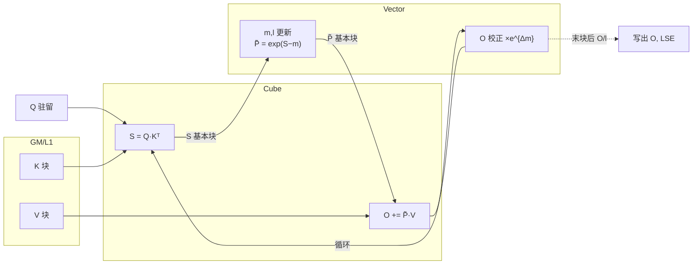
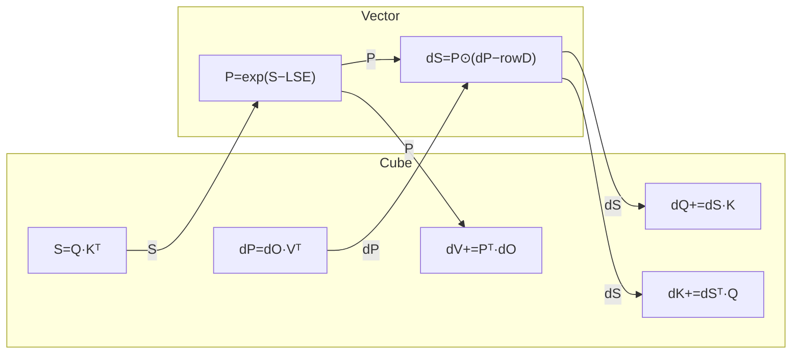
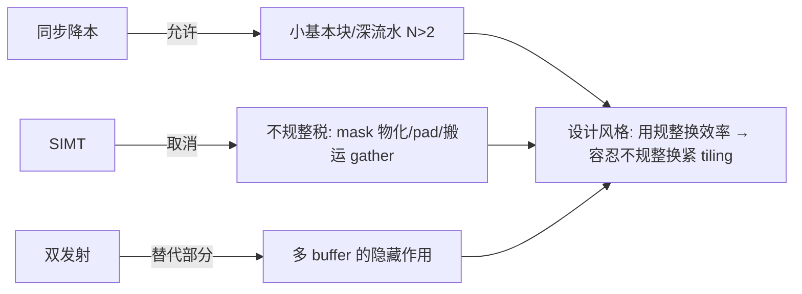
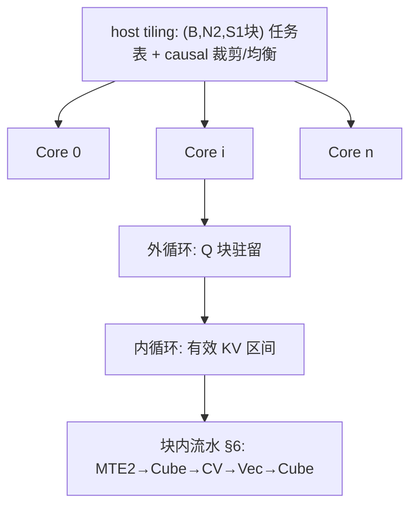
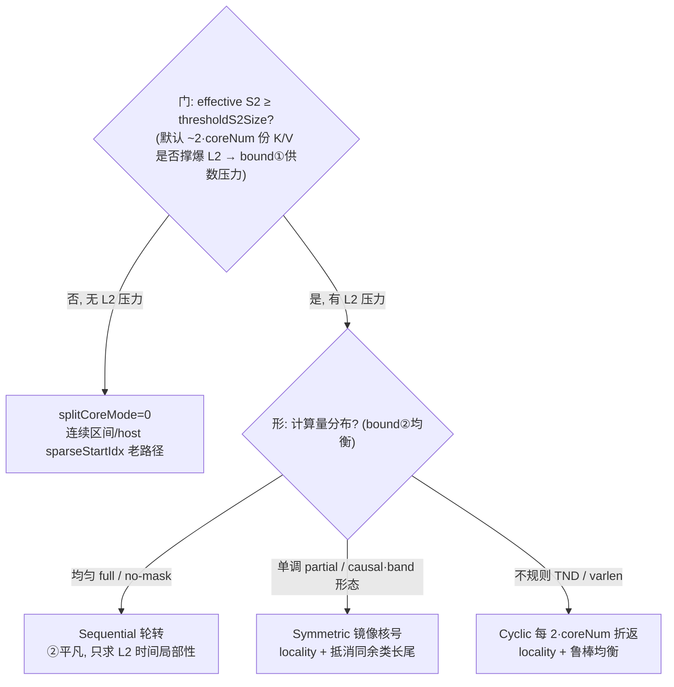
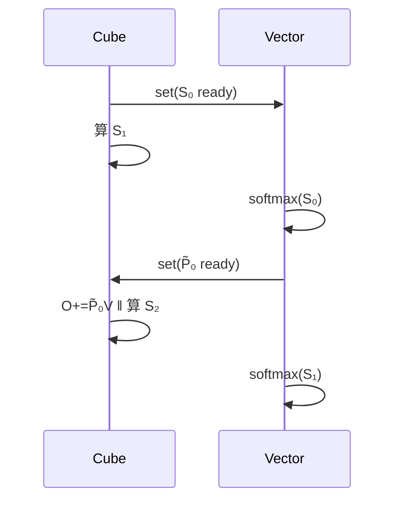

# Ascend FlashAttention @ arch35 (A5) 方案设计书

> 状态:梳理版 v0.8 —— 在 v0.6/v0.7 基础上做"设计↔硬件亲和"对齐与待办收口:(1) 新增 §2.4「设计决策 ↔ 硬件亲和 对照」,把每个设计选择显式 match 到驱动它的 A5 硬件属性和它在治的 bound;(2) 新增 §13.11「动手导读操作」,给单 shape 全链路走读 + 定向 grep/trace 配方;(3) 新增 §14「待办总账」,把全文散落的待办统一成 精读 / Profile·汇编 / 硬件资料 / 实测 四轨,每条标明在哪做、做完回填到哪;(4) 并入 codex v0.6 的 §2.2 fake-hardware 提醒、§8 `__simd_vf__` 线索、§13.9 定位与 §13.10 问题分层表;(5) 保留 §4.1↔§4.3.4 的"理想配对 vs 同余类镜像"caveat。硬件数值类 `【待补:…】` 仍待 §14 Track C/D 回填。
> 图例约定:Mermaid 画数据流/握手关系,ASCII 时间线画流水排布,表格收约束与对比。

---

## 0. 文档目的与范围

- 目的:梳理 FA(forward)与 FAG(backward)在 arch35 上的实现方案,作为代码阅读的"地图"。
- 范围:FA/FAG 核心计算流;tiling 与多核切分;核内流水与 N-Buffer;CV 交互与基本块;SIMT 的引入位置;双发射利用;循环序选择。
- 不展开:框架接入(aclnn/aclgraph)、host tiling 下发细节(后续单独成章)。

### 0.1 阅读代码问题清单(随读随勾)

- [x] A5 上 CV 物理形态:FA/FAG arch35 入口均使用 `KERNEL_TYPE_MIX_AIC_1_2`,代码按 1 个 AIC 对 2 个 AIV (`CV_RATIO`/`CV_CORE_RATIO`=2) 组织。
- [x] L0C 出口路径:MM 结果经 `Fixpipe` 出 L0C;FA 的 BMM1 固定到 UB 给 Vector,Vector 将 P 写 L1 给 BMM2;BMM2 按模板选择 UB 或 GM workspace。FAG 的 MM1/MM2 到 UB,MM3/4/5 可写 UB 或 GM。
- [x] CV 同步原语:使用 `CrossCoreSetFlag/WaitFlag` 与跨核 Buffer;FA 额外用 `__ssbuf__`+flag 15 传 `CVSharedParams`;事件 FIFO 深度仍需硬件资料确认。
- [x] 基本块实际尺寸与对齐:FA 常规 128x128,特化 128x256/128x512/64x128;FAG 常规 128x128,FP8 64x256,HIFLOAT8 512x512,D 模板 64/128/192/256/768。
- [~] SIMT 出现位置:当前 arch35 FA/FAG 源码未直接暴露 `SIMT` 命名;可确认 mask/sparse/tail 的分支在 Vector API 与 runInfo 中完成,底层 MicroAPI 是否映射 SIMT 待继续追 `vector_api/*` 或硬件资料。
- [ ] 双发射的指令对组合:当前 C++ 层未显式描述双发射配对,暂按编译器/微码优化处理,后续需看汇编或 profile。
- [x] FAG 外/内循环轴:dQ/dK/dV 不是单一路径,由 host 选 `BN2GS1S2`/`BN2`/`BN2S2`;main kernel 串起 MM1/2、Vec1~4、MM3/4/5,并通过 UB/GM workspace 与 post kernel 完成归约/转 dtype。
- [x] workspace 布局:FA 主要是 BMM2/Vec2 的 3-buffer GM workspace、dropmask workspace、16MB reserve;FAG 有 64KB reserve、dq/dk/dv FP32 workspace、dropmask bool、pre-SFMG、sink、deterministic workspace 等。
- [x] 分核 L2 阈值判据:FA 前向 `splitCoreMode` 由 `CalcThresholdForS2Size`/`IsUseSplitCoreMode` 按 L2 阈值开关,判据、触发方向、PREFIX 归属与无上界回退结论已回填到 §4.3。

---

## 1. FA / FAG 计算流(算法层)

### 1.1 Forward 单次内循环的数据流(C/V 分工)



跨 CV 边界的张量只有 **S(C→V)** 和 **P̃(V→C)**,这是 FA 区别于纯 Cube 算子的全部难点(§5)。

### 1.2 Backward 单次内循环的数据流



| | Cube 次数 | CV 倒手张量 | 含义 |
|---|---|---|---|
| FWD | 2 | S, P̃ | Vector 占比高,藏 Vector 是主战场 |
| BWD | 5 | S, dP→dS | 更 Cube-bound,Vector 裕度大,但倒手翻倍 |

主线一句话:**让 Cube 不停转,Vector/MTE/同步全部藏进 Cube 影子里**。

---

## 2. A5 架构概览与 A2/A3 差异

### 2.1 概览

A5(arch35/DAV_3510)对 FA 设计的影响集中在三件事:CV 物理形态(1C:2V mix 核)、L0C 出口与缓存层级、以及 Vector/发射模型。下表把"决定设计的变量"与已读码确认值/待补值并列,后续小节(§4–§9)都在这张表的约束下展开。

### 2.2 决定设计的硬件变量表

| 变量 | A2/A3 参考 | A5 | 影响 |
|---|---|---|---|
| CV 形态/配比 | 1C:2V 分离 | 代码确认 `KERNEL_TYPE_MIX_AIC_1_2`,AIC:AIV=1:2 | 同步成本、基本块 |
| Cube:Vector 算力比 | 【填】 | 【待补】 | Vector 可隐藏性 |
| UB / L1 / L0A/B/C | 192K/512K/64K/64K/256K | host 从 platform/compileInfo 读取;UT/fake hardware 里存在不同 L1/L0C/L2 配置,本文不把某个测试值当成 A5 定论(真实值见 §14 Track C) | tiling、N 上限 |
| L0C 出口 | →UB 随路 cast | `FixpipeParamsC310`/`Fixpipe`;FA BMM1→UB,BMM2→UB/GM;FAG MM3/4/5→UB/GM | P/dS/DQKV 倒手开销 |
| Vector 模型 | 纯 SIMD | C++ 层主要是 Vector API/MicroAPI;SIMT 映射待补 | §8 |
| 发射 | 单发射 | 双发射能力待从汇编/profile 确认 | §9 |
| HBM 带宽/核 | 【填】 | 【待补】 | MTE2 瓶颈位 |

### 2.3 约束瓦解图



### 2.4 设计决策 ↔ 硬件亲和 对照(本书主索引)

这张表是全书的"为什么"主索引:每个设计选择都钉到**驱动它的那条 A5 硬件属性**,以及它在治哪个 bound。读后续章节时遇到一个具体写法,先回这张表问一句"它贴的是哪条硬件特性"。读法:左→右 = 现象→机制→根因。

| 设计选择 | 贴的 A5 硬件亲和(为什么必须这样) | 在治的 bound | 详见 |
|---|---|---|---|
| 1C:2V mix 核 + 单 AIV 吃 S1 半块(`CV_RATIO=2`) | AIV 单核吞吐≈AIC 一半,2 个 AIV 才追平 1 个 AIC 的 S 产出速率;半块粒度让 Vector 周期≈Cube 周期 | Vector 隐藏(藏进 Cube 影子) | §5.2 §13.3 |
| P 经 **L1** 回传 BMM2,不走 UB 回传 | L1 容量/带宽够驻留 P 且 BMM2 的左/右矩阵本就从 L1/L0 取;走 UB 回传要多一次 CV 同步 + 占 UB | CV 同步次数 + UB 容量 | §5.2 §13.3 |
| BMM1 出 L0C→UB;BMM2 出 L0C→**UB/GM 自适应**(`GetC2Position`) | L0C 仅 256K,大 D/FP32 时一次放不下整块 O,必须落 GM 3-buffer 流式读回;小 D 留 UB 省一次 GM 往返 | L0C 容量 ↔ GM 带宽 | §5.2 §13.3 |
| 基本块 128×128(及 128×256/512、64×128 特化) | L0A/L0B/L0C 容量 + 16×16/16×32 分形对齐;128 是 MMAD 利用率与 L0 容量的平衡点,长 S2/低 D 才放大到 256/512 | L0 容量 + MMAD 利用率 | §4.2 §13.4 |
| L1 P 3-buffer、各 TQue N-buffer(`PING_PONG_VALUE=3`) | 用 L1/UB 余量换流水深度,吸收 HBM 拥塞/对角半空块的时延抖动(Little's Law) | 容量 ↔ 时延比 | §7 |
| splitCoreMode **strided 轮转** | L2 跨核共享:strided 让多核同一时刻聚在滑动窗口的 K/V 上,L2 取一次喂 coreNum 核;否则连续分核把 K/V 工作集铺满 L2 → 回 HBM | bound① HBM/核 带宽 | §4.3.3 |
| Symmetric 镜像核号 / Cyclic 折返 | 多核并行 wall-clock=最慢核;causal 三角、varlen 不规则各造一种长尾 | bound② 并行长尾 | §4.3.4 §4.3.5 |
| splitCoreMode 由 **L2 阈值**门控(`CalcThresholdForS2Size`) | 只有默认 ~2·coreNum 份 K/V 撑爆 L2 时,重排减少活跃份数才有收益;没压力就别扰动局部性 | bound① 触发条件 | §4.3.1 |
| FAG 外 KV 内 Q + host 选 `splitAxis` | atomic 流量(dQ 一份 vs dKV 两份)、DKV workspace 容量、长 S2 局部性三者权衡;不同 shape 走不同轴 | atomic 带宽 + workspace 容量 | §10 §13.6 |
| FAG `IS_DKV_RESIDENT_L0C` 把 DK/DV 钉 L0C 累加 | L0C 256K 够放"最大临时 MM 结果 + DK + DV"时,免 DK/DV 反复 GM 往返 | L0C 容量 ↔ GM 带宽 | §13.7 |
| Fixpipe 随路 cast/scale(出 L0C 顺手转 dtype) | Fixpipe 单元在 L0C→下游路径上自带 cast/quant 能力,省一整段 Vector elementwise | 利用 fixpipe 随路 → 省 Vector | §11 §5.2 |
| mask/tail 走 `vf/*`·`vector_api/*` 分支(疑似 SIMT) | 若 Vector 具 SIMT 形态,组合 mask/ragged 尾块可零物化、免 pad;A2/A3 纯 SIMD 只能物化 mask | 取消不规整税(待证 §14-B) | §8 |

一句话串起来:**§2.2 列硬件常量 → §2.3 说这些常量松了哪些约束 → §2.4 把每个设计选择钉回某条常量/约束 → §4~§13 是这些选择的代码展开。** 任何一处看不懂"为什么这么写",顺着"详见"回到对应小节,再回到本表确认它贴的硬件属性。

---

## 3. 整体方案三层结构



核间(§4.1/§4.3)定均衡,核内循环定驻留,块内流水定利用率。当前代码是 host 静态生成 `blockStarts/blockEnds`/sparse start idx,而 kernel 内 `GetNextValidIdx` 继续跳过无效块并适配 TND/swizzle/deterministic。

---

## 4. Tiling 策略

### 4.1 causal 下的块网格分类与负载

```
KV→  j0  j1  j2  j3            块类型:FULL=整块算, TPL=对角三角, SKIP=不算
Q↓ ┌────┬────┬────┬────┐       行负载 ∝ 行号 → 核间均衡:首尾行配对
i0 │TPL │SKIP│SKIP│SKIP│        (i0,i3)(i1,i2) 同核,各核 ≈ 等量 FULL
i1 │FULL│TPL │SKIP│SKIP│
i2 │FULL│FULL│TPL │SKIP│       TPL 块内 ~半算力浪费 → §8 SIMT 真三角
i3 │FULL│FULL│FULL│TPL │
```

> 注:图中"首尾行配对 (i0,i3)(i1,i2)"画的是 causal 负载均衡的**理想效果**(把最重和最轻配到同核)。arch35 代码并不做这种逐行首尾配对,而是用 §4.3.4 的"上半 N 正向 + 下半 N 镜像核号"来**近似**它;两者目标一致,机制不同。

### 4.2 (Br, Bc) 决定式

| 约束 | 公式(宏观) | 卡谁 |
|---|---|---|
| UB 容量 | N·(Br·Bc + 向量区) ≤ UB | Br 上限 |
| L0/L1 | Bc·D 驻留 + pingpong | Bc 上限 |
| Cube 利用率 | Br,Bc ≥ 分形对齐×若干 | 下限 |
| causal 浪费 | TPL 占比 ∝ Bc/S2 | Bc 别太大 |

当前 arch35 host 不是单纯 cost 枚举,而是先按 dtype/D/optional/sparse 走一组明确模板:
FA 常规 `S1xS2=128x128`;D>256 时 `S2=128`,FP32 把 S1 降到 64;D=64/Dv=64 且长 S2、无 optional 时会走 `128x256`;HIFLOAT8 可走 `128x512`;TND 常规 `128x128`。FAG 常规 `128x128`,FP32 且 D>256 为 `64x128`,FP8 为 `64x256`,HIFLOAT8 为 `512x512`。
D 模板统一按 64/128/192/256/768 对齐,RoPE/FAG 会把 D 模板推到 192。尾块、mask 与 sparse 由 kernel runInfo、FA forward 的 `vf/*` 和 FAG 的 `vector_api/*` 处理;是否映射成硬件 SIMT 仍需下钻编译产物或 profile(见 §14 Track B)。

### 4.3 多核分核策略:三种调度与各自规避的 bound

> 读码校正版。**适用范围**:本节只描述 FA 前向 train kernel 的 `splitCoreMode==1` 路径,核心在 `attention/flash_attention_score/op_kernel/arch35/flash_attention_score_kernel_train.h::Process`。FAG 反向不走这套,而是另一套 `splitAxis`(BN2/BN2S2/BN2GS1S2,见 §13.6)。`SetSparseStartIdx` 是另一条 sparse 静态均衡路径,主要服务 `splitCoreMode==0` 时的 `[multiCoreInnerOffset,multiCoreInnerLimit)` 分配,不要和本节的新分核混成同一件事。

**两层心智模型(先建立这个,再看下面的代码细节)**:这套机制是"门 + 形"两层决策,分别对应两个正交的 bound——



- **门(§4.3.1)= bound①**:`CalcThresholdForS2Size` 估算"默认调度下 ~2·coreNum 份 K/V 是否撑爆 L2",撑爆才打开 `splitCoreMode`。**注意方向**:是 effective S2 *大* 到有 L2 压力才开,不是 S2 小才开。这里的 effective S2 不是统一变量:ALL/NO_MASK 用 `S2`,LEFT_UP 用 `min(S1,S2)`,RIGHT_DOWN 要求 `S1<=S2` 后用 `S2`,TND 用每个 batch 的 actual length。例外是 non-TND `NO_MASK + HIFLOAT8`,代码直接打开新分核。
- **形(§4.3.3–4.3.5)= bound②**:门打开后,按计算量分布选三种 dispatch 之一。三种 dispatch **都跑在"门已开"之下**,共享降低活跃 K/V 份数(吃 L2)这一目标;区别只在额外要不要处理负载长尾。
- 所以 **Sequential 不是"只治①、不治②",而是②平凡(均匀)的退化情形**:无长尾可治,于是只剩纯局部性。Symmetric/Cyclic 是在同一个门下,额外叠加均衡。
- **但 bound② 不只这三种 shape 在治**:门没开(`splitCoreMode==0`)时,`SetSparseStartIdx` 用 host 静态估算给每个 core 划连续有效区间,本身也是一种负载均衡;`PREFIX/PREFIX_COMPRESS` 即走这条老路径而非本节三种 dispatch。换句话说,"形"层只是 bound② 的**一部分**实现,不是全部(对照见 §4.3.6 第 4 行)。这也是为什么上面 mermaid 的 OFF 分支不等于"完全不均衡"。

#### 4.3.0 第一性原理:只动 task 顺序,不动块内计算

单个 S1/S2 block 内部的 BMM1、Softmax/Mask/Dropout、BMM2 流水没有因为这套分核改变。变化点只有一个:`multiCoreInnerIdx` 被重新映射成 `realCoreInnerIdx`,再由 `ComputeAxisIdx(realCoreInnerIdx)` 还原到 `(B,N2,G,S1Outer)` 逻辑任务。

代码里的真实结构不是三个互斥 kernel,而是:

```cpp
if splitCoreMode == 1:
    if layout == TND:
        // 只走 Forward-Reverse Cyclic
        dispatch_tnd_by_forward_reverse_cycle()
    else:
        // 同一个 kernel 内按顺序串三段
        dispatch_partial_forward()
        dispatch_partial_reverse()
        dispatch_full_forward()
else:
    // 老路径:当前 core 处理 host 给定的连续区间
    for realCoreInnerIdx in [multiCoreInnerOffset, multiCoreInnerLimit):
        RunOneTask(realCoreInnerIdx)
```

其中 `RunOneTask(realCoreInnerIdx)` 仍是:

```cpp
ComputeAxisIdx(realCoreInnerIdx)
GetAttentionOffset()
GetS2LoopRange()
for s2LoopCount in current S2 range:
    Bmm1(Q, K)
    Vec1(softmax/mask/dropout)
    Bmm2(P, V)
    Vec2(output/lse/update)
```

#### 4.3.1 host 侧何时打开 `splitCoreMode`

`CalcThresholdForS2Size` 先估算 L2 剩余空间:

```cpp
l2Remain = l2CacheSize
l2Remain -= attentionMaskSize
l2Remain -= dropMaskSize

actualUsedCoreNum = coreNum
n1Num = min(2 * actualUsedCoreNum, B * N2 * G)
n2Num = min(2 * actualUsedCoreNum, B * N2)

l2Remain -= n1Num * D * S1 * dtypeSize      // Q 占用
thresholdS2Size = l2Remain / (n2Num * (D + Dv) * dtypeSize)
```

注意触发方向:代码不是 “S2 小才打开”,而是当代码选定的 effective S2 达到或超过阈值时打开,因为这表示默认多核并发下的 K/V 工作集已经有较强 L2 压力,需要通过任务重排减少同一时刻活跃的 K/V 份数。

非 TND 的实际开关:

```cpp
LEFT_UP_CAUSAL:
    use = min(S1, S2) >= thresholdS2Size
    firstFullLoadS1OuterIdx = ceil(min(S1, S2) / s1BasicBlock) - 1

RIGHT_DOWN_CAUSAL:
    use = (S1 <= S2) && (S2 >= thresholdS2Size)
    firstFullLoadS1OuterIdx = s1OuterSize - 1

ALL_MASK:
    use = S2 >= thresholdS2Size
    firstFullLoadS1OuterIdx = -1

NO_MASK:
    if no attenMask or full pre/next tokens:
        use ALL_MASK 判据, firstFullLoadS1OuterIdx = -1
    else if preTokens >= S1 && nextTokens == 0:
        use LEFT_UP_CAUSAL 判据, firstFullLoadS1OuterIdx = ceil(min(S1, S2) / s1BasicBlock) - 1
    else if dtype == HIFLOAT8:
        use = true, firstFullLoadS1OuterIdx = -1

BAND:
    full 覆盖时按 ALL_MASK
    left-up causal 形态按 LEFT_UP_CAUSAL
    right-down causal 形态按 RIGHT_DOWN_CAUSAL
    不含无效行的 band 按 ALL_MASK
```

TND / varlen override 更保守:对 batch 逐个看实际长度,`LEFT_UP_CAUSAL` 用 `min(actualS1, actualS2) > thresholdS2Size`,其他支持形态用 `actualS2 > thresholdS2Size`;命中后只设置 `splitCoreMode=SQ_MULTI_CORE_FIRST`,kernel 侧直接走 cyclic,不使用 non-TND 的 partial/full 三段。

两个容易混淆的边界:

- `PREFIX/PREFIX_COMPRESS` 当前不在 `SetSplitCoreModeParam()` 的新分核分支里。它们会在 sparse 解析和 `SetSparseStartIdx` 中被处理,但不是 §4.3.3–4.3.5 的 Sequential/Symmetric/Cyclic dispatch。
- non-TND `NO_MASK + HIFLOAT8` 是特例:代码没有调用 `IsUseSplitCoreMode`,而是直接 `firstFullLoadS1OuterIdx=-1` 并打开 `SQ_MULTI_CORE_FIRST`。
- 读码能确定:当前 host 只实现了**下界触发**,没有实现 "S2 过大则关闭 splitCoreMode" 的上界回退。一旦满足上述条件,`SetSplitCoreModeParam()` 就会把 `splitCoreMode` 置为 `SQ_MULTI_CORE_FIRST`。至于 S2 极大时 L2 命中收益衰减到什么程度,源码无法定量,需要 profile L2 hit、MTE/HBM、AIC/AIV 利用率曲线确认。

#### 4.3.2 公共映射 helper

non-TND 下:

```cpp
partialLen = firstFullLoadS1OuterIdx + 1

CalcRealTimes(relativePos, length):
    base = length / coreNum
    remain = length % coreNum
    return base + (relativePos < remain ? 1 : 0)

CalcRealCoreIdx(relativePos, times, offsetCoreIdx, isPartial):
    linear = times * coreNum + relativePos

    if isPartial && firstFullLoadS1OuterIdx != -1:
        nIdx = linear / partialLen
        s1oIdx = linear % partialLen
    else:
        fullLenPerN = s1OuterSize - partialLen
        nIdx = linear / fullLenPerN
        s1oIdx = linear % fullLenPerN

    return nIdx * s1OuterSize + s1oIdx + offsetCoreIdx
```

TND 下:

```cpp
CalcRealCoreIdxVarlen(calcLoops, phase, cycleCoreNums):
    if phase == 0:
        return calcLoops * cycleCoreNums + aicIdx
    else:
        return calcLoops * cycleCoreNums + (cycleCoreNums - aicIdx - 1)
```

#### 4.3.3 Sequential:full 区顺序轮转,主治 L2 工作集压力

Sequential 对应 non-TND 的 full 段。若 `firstFullLoadS1OuterIdx == -1`,整个任务空间都是 full 段;若存在 partial 区,则只处理每个 N/B/G 内 `partialLen` 之后的剩余 S1Outer。

```cpp
SequentialFullPart():
    totalN = B * N2 * G
    partialLen = firstFullLoadS1OuterIdx + 1

    if firstFullLoadS1OuterIdx == -1:
        fullLen = totalN * s1OuterSize
        fullOffset = 0
    else:
        fullLen = totalN * (s1OuterSize - partialLen)
        fullOffset = partialLen

    myCount = CalcRealTimes(aicIdx, fullLen)

    for t in [0, myCount):
        realCoreInnerIdx = CalcRealCoreIdx(
            relativePos = aicIdx,
            times = t,
            offsetCoreIdx = fullOffset,
            isPartial = false)
        RunOneTask(realCoreInnerIdx)
```

和 arch22 风格的 “每核拿一个连续区间” 相比,这里所有 core 在同一个 `t` 上取的是相邻的一维任务:

```cpp
linear = t * coreNum + aicIdx
nIdx = linear / fullLenPerN
s1oIdx = linear % fullLenPerN
```

因此同一时刻的活跃 K/V 份数大约是 `ceil(coreNum / fullLenPerN)` 个 N2/B 分片,而不是每个 core 长时间钉在各自的远端 N2/B 分片。它的优化目标是把多核访问压成滑动窗口,提高 K/V 在 L2 上的时间命中率。

活跃 K/V 份数对比(strided 轮转 vs arch22 连续块;cell = 该核此刻读哪份 K/V,例 coreNum=4, fullLenPerN=2):

```
Strided(splitCoreMode):           Contiguous(arch22):
        t0    t1                          t0    t1
core0 | KV0 | KV2                  core0 | KV0 | KV0
core1 | KV0 | KV2                  core1 | KV1 | KV1
core2 | KV1 | KV3                  core2 | KV2 | KV2
core3 | KV1 | KV3                  core3 | KV3 | KV3
       └每刻 2 份, 滑动┘                 └─ 4 份长期同时驻留 ─┘
   活跃≈ceil(coreNum/fullLenPerN)        活跃≈min(coreNum, totalN)
```

#### 4.3.4 Symmetric:partial 区上半 N 正向、下半 N 镜像核号

Symmetric 只用于 non-TND 的 partial 段。代码没有显式执行 `s1OuterIdx -> partialLen - 1 - s1OuterIdx` 的逐行反转,而是把 `totalN = B*N2*G` 切成上下两半,再让下半 N 使用相对当前 core 的镜像 residue。

```cpp
SymmetricPartialPart():
    totalN = B * N2 * G
    halfN = ceil(totalN / 2)
    partialLen = firstFullLoadS1OuterIdx + 1

    forwardLen = halfN * partialLen
    reverseLen = (totalN - halfN) * partialLen

    halfNCoreIdx = (forwardLen - 1) % coreNum
    relativePosReverse = (halfNCoreIdx - aicIdx + coreNum) % coreNum

    forwardCount = CalcRealTimes(aicIdx, forwardLen)
    reverseCount = CalcRealTimes(relativePosReverse, reverseLen)

    // 上半 N:正向
    for t in [0, forwardCount):
        realCoreInnerIdx = CalcRealCoreIdx(
            relativePos = aicIdx,
            times = t,
            offsetCoreIdx = 0,
            isPartial = true)
        RunOneTask(realCoreInnerIdx)

    // 下半 N:镜像 core residue
    for t in [0, reverseCount):
        realCoreInnerIdx = CalcRealCoreIdx(
            relativePos = relativePosReverse,
            times = t,
            offsetCoreIdx = halfN * s1OuterSize,
            isPartial = true)
        RunOneTask(realCoreInnerIdx)
```

这个镜像是 “核号/同余类镜像”,不是严格的 “每一行首尾配对”。直观上想达到的效果是 “某核在上半 N 拿到的轻档,在下半 N 用镜像 residue 补一个重档”,从而把同余类长尾对消;但代码用的是 residue 级镜像,只是这一理想配对的近似(§4.1 那张图里的"首尾行配对"画的是理想效果,不是这里的实现机制)。当 `partialLen` 不是 `coreNum` 的整数倍时,残差由 `CalcRealTimes` 的 `relativePos < remain` 分支分给前若干 residue;`relativePosReverse` 会把 lower-N 区域的残差方向反过来,抵消一部分由同余类造成的长尾。均衡质量与 `partialLen % coreNum` 有关,但代码没有额外 gcd 级修正。

full 段随后仍按 Sequential 处理,所以 non-TND `splitCoreMode==1` 的真实顺序是:

```cpp
partial forward -> partial reverse -> full forward
```

#### 4.3.5 Forward-Reverse Cyclic:TND 每 `2*coreNum` 局部折返

TND / varlen 场景中,`realCoreInnerIdx` 到真实 batch/S1 的映射依赖 actual seq len,不是固定矩形。因此 kernel 放弃 partial/full 切段,直接按 `2 * coreNum` 做正反循环。

```cpp
ForwardReverseCyclicForTnd():
    cycleCoreNums = coreNum * 2
    fullCycles = totalSize / cycleCoreNums
    remain = totalSize % cycleCoreNums

    myCount = fullCycles * 2

    if remain >= aicIdx + 1:
        myCount += 1

        if remain > coreNum &&
           (aicIdx + 1) > cycleCoreNums - remain:
            myCount += 1

    for i in [0, myCount):
        calcLoops = i >> 1
        phase = i & 1

        realCoreInnerIdx = CalcRealCoreIdxVarlen(
            calcLoops, phase, cycleCoreNums)
        RunOneTask(realCoreInnerIdx)
```

展开后,每个完整 cycle:

```text
phase 0: core0->t0, core1->t1, ..., core(coreNum-1)->t(coreNum-1)
phase 1: core0->t(2*coreNum-1), core1->t(2*coreNum-2), ..., core(coreNum-1)->t(coreNum)
```

这里 `cycleCoreNums = coreNum * 2` 是 TND 映射的折返周期。它和 arch35 的 1C:2V block 组织共享同一个 “2” 的形态,但语义不是 AIC/AIV 配对本身:kernel 中 `aicIdx` 仍按 AIC 维度分核,AIV 侧通过 `aivIdx >> 1` 映射到同一个 `aicIdx`;host 的 `CalcTschBlockDim(coreNum*2,aicNum,aivNum)` 是为了发出 1C:2V 所需 block 数。

#### 4.3.6 四条路径的优化边界(三种新分核 + 老路径对照)

前三行是 `splitCoreMode==1` 的三种 dispatch(本节主体);第 4 行是 `splitCoreMode==0` 老路径,仅作对照,**不属于**本节三种新分核——列在一起是为了让"bound② 不只三种 shape 在治"这一点能一眼看全。

| 分核片段 | 代码入口 | 计算量假设 | 主要收益 | 代价/边界 |
|---|---|---|---|---|
| Sequential full | non-TND full 段,或 `firstFullLoadS1OuterIdx=-1` 的全量段 | 每个 task 的 S2 范围接近一致 | 降低同一时刻活跃 K/V 份数,提高 L2 时间局部性 | 只解决供数压力,不解决 sparse partial 长尾 |
| Symmetric partial | non-TND partial forward/reverse 段 | partial 区负载随 S1Outer 具有方向性 | lower-N 镜像 residue 抵消同余类长尾 | 不是精确逐行首尾配对;残差只靠 `CalcRealTimes` 自然摊 |
| Forward-Reverse Cyclic | TND splitCoreMode | varlen 映射不规则 | 每 `2*coreNum` 局部折返,避免全程系统性偏重 | 更频繁切换逻辑位置;K/V L2 命中收益需 profile 定量 |
| SetSparseStartIdx 老路径(对照) | `splitCoreMode==0` 的 sparse 静态均衡,含 PREFIX/PREFIX_COMPRESS | sparse 有效块可在 host 静态估算 | 给每个 core 划连续有效区间 | 不使用本节三种 `realCoreInnerIdx` 重映射 |

代码层能确定的是调度形态和触发条件;“Cyclic 丢多少 L2 局部性、换回多少均衡” 不是源码能推出的数值结论,需要 profile 的 L2 hit、MTE/HBM、AIC/AIV 利用率来量化。

#### 4.3.7 与 arch22 / FAG 的关系

arch22 常规 FA 分核更接近:

```cpp
offset = blockIdx * splitFactorSize
limit = offset + splitFactorSize
for realCoreInnerIdx in [offset, limit):
    RunOneTask(realCoreInnerIdx)
```

arch22 也有 L1Reuse/IBShare/TSCM 等优化,但它们主要围绕右矩阵 K/V 在核内或成对任务里的搬入复用。arch35 这套 `splitCoreMode` 是跨 core 的任务重排,目标是 L2 亲和与 sparse/varlen 负载均衡。它依赖 DAV_3510 regbase kernel、AIC/AIV 1:2 发块、`multiCoreIdxMod3`/L1P 3-buffer 等流水假设,不是能直接搬回 arch22 的独立算法片段。

FAG 的 `splitAxis` 也在 locality 和 balance 之间取舍,但粒度是反向计算里的 BN2/BN2S2/BN2GS1S2 轴选择、workspace 归约和后处理策略,不是 FA 前向这里的 `realCoreInnerIdx` 重映射。因此二者只能做设计动机类比(同样是"门+形":先判 L2/workspace 压力,再选轴),不能建立 Sequential/Symmetric/Cyclic 到 BN2/BN2S2/BN2GS1S2 的一一映射。

---

## 5. CV 交互与基本块大小

### 5.1 握手时序(pingpong 基本块)



### 5.2 基本块大小的两难

```
块过大:  C ████████░░░░░░░░ 等V      串行段长, L0C/UB 装不下
         V ░░░░░░░░████████
块合适:  C ██S0██S1██S2██   T_cube(块) ≈ T_vec(块)+T_sync → 双方满载
         V   ██s0██s1██s2
块过小:  C █s█s█s█s         同步/启动开销占比飙升, MMAD 形态差
```

准则:`T_cube ≈ T_vec + T_sync`(1C:2V 时单 V 吃半块)。当前代码里 `s1BaseSize/CV_RATIO` 是单个 AIV 处理的 S1 半块:

- FA S 路径:`FANoQuantBlockCube::IterateBmm1*` 用 `Fixpipe` 将 L0C 中的 QK 结果搬到 `bmm1Buffers`(UB double buffer),再用 cross-core flag 通知 AIV。
- FA P 路径:`FANoQuantBlockVecTrain::ProcessVec1*` 完成 PSE/mask/dropout/softmax,把 P cast 后 `DataCopy` 到 `l1PBuffers`(L1 3-buffer),再给 BMM2 读取。
- FA O 路径:BMM2 的 L0C 结果由 `GetC2Position` 选择写 UB 或 GM;D/Dv 大、FP32、部分 Dn/optional 场景会用 GM 3-buffer workspace,Vector2 再分块读回做 update/div/cast。
- FAG 路径:MM1(dY*V)和 MM2(Q*K)先到 UB;Vector 生成 dS/P 到 L1;MM3(dS*K)、MM4(dS*Q)、MM5(P*dY)按 `IS_DQ/DK/DV_WRITE_UB` 选择 UB 或 GM。

---

## 6. 核内流水排布

### 6.1 稳态流水时间线(forward,横轴=时间,行=硬件单元)

```
iter:        │←─── i ───→│←─── i+1 ──→│←─── i+2 ──→│
MTE2  K/V    │ ld(i+1)   │ ld(i+2)    │ ld(i+3)    │   预取提前一拍
Cube  QKᵀ    │ S(i)      │ S(i+1)     │ S(i+2)     │ ← 关键路径,无空泡=目标
Cube  PV     │ O(i-1)    │ O(i)       │ O(i+1)     │
Vector       │ sm(i-1)   │ sm(i)      │ sm(i+1)    │   全在 Cube 影子里
Vector 校正  │ corr(i-2) │ corr(i-1)  │ corr(i)    │   与 QKᵀ 无依赖,可并行
MTE3         │           │            │ 末块后写 O │
```

排布原则:① 预取一拍;② 关键路径只剩 Cube;③ O 校正与下一块 QKᵀ 解耦(A5 上交给编译器/微码调度,双发射待验证 §9);④ AscendC 落地 = TPipe+TQue/BufferPolicy,队列深度即 §7 的 N。事件 FIFO 是否允许更深抢跑仍需硬件资料或 profile 验证。

---

## 7. N-Buffer:N 由什么决定

### 7.1 N=2 够与不够的时间线对比

```
两侧均匀 → N=2 即满流水:        生产抖动(HBM拥塞/对角半空块) → N=2 断流:
P █A█B█A█B█A█B                P █A███B█A█B███A        ←时延抖
C  █A█B█A█B█A█                C  █A...█B█A...█        ←消费断流
                               N=3 用第三块缓冲吸收抖动:
                               P █A█B█C█A█B█C
                               C   █A█B█C█A█B   ←平滑
```

### 7.2 N 的四个下界

| 因素 | 规则 | 备注 |
|---|---|---|
| 容量 | N ≤ UB可用/单块 | 第一约束 |
| 时延比 | N ≈ ⌈T_prod/T_cons⌉+1 | Little's Law;抖动再 +1 |
| 事件深度 | N ≤ FIFO 深度 | 超出无收益 |
| 块大小权衡 | 大块小 N ↔ 小块大 N | A5 同步降本 → 偏后者 |

当前已确认的 N-buffer:

- FA:`bmm1Buffers` 为 UB DB;`l1PBuffers` 为 L1 3-buffer;`bmm2Buffers` 为 UB DB/Single;若 BMM2 写 GM 则 `bmm2ResGmBuffers` 为 3-buffer;D split 时 Vec2 也有 GM 3-buffer。
- FAG:`mm1ResBuf/mm2ResBuf` 为 UB pingpong;`dSL1Buf/pL1Buf` 是 L1 单块跨阶段复用;Cube 侧 Q/K/DY/V L1 根据 `IS_L1_REUSE/IS_L1_PRELOAD` 选 Single/DB/3-buffer;L0C 在 DKV resident 时可 3-buffer/DB/Single,否则 common L0C DB/Single。
- host workspace 也按 3-buffer/pingpong 思路分配:FA 用 `PING_PONG_VALUE=3`,FAG 对 splitAxis、deterministic、pre-SFMG 分别预留。

---

## 8. SIMT:新场景与 FA 中的落点

> 代码阅读结论:当前 arch35 C++ 层没有直接出现 `SIMT` 字样,能定位到的是 sparse/mask/tail 逻辑在 host tiling、kernel runInfo、FA forward 的 `attention/common/op_kernel/arch35/vf/*`、FAG 的 `attention/flash_attention_score_grad/op_kernel/arch35/vector_api/*` 中被参数化,并大量使用 `__simd_vf__`、`MicroAPI::MaskReg`、`UpdateMask/CreateMask`。下面表格保留为继续追 MicroAPI/汇编时的检查点,不能直接当作源码已确认的硬件 SIMT 事实(下钻动作见 §14 Track B)。

### 8.1 FA 计算流分工表(确定度递减)

| FA 环节 | A2/A3 SIMD 做法 | A5 SIMT 做法 | 收益 | 确定度 |
|---|---|---|---|---|
| causal+sink+SWA 组合 mask | 物化 mask 张量再乘 | `if(col>row) skip` 零物化 | 高 | ★★★ |
| 尾块/非对齐 seqlen | pad 到 16/32 | 真 ragged 边界 | 中高 | ★★★ |
| dropout | mask 物化 | philox 按位生成+分支 | 中 | ★★ |
| varlen/topk gather | 退化为搬运 | 直接寻址 | 高(稀疏FA) | ★★ |
| exp/scale/rowmax/rowsum | SIMD 高效 | 保留 SIMD | — | ★★★ |

### 8.2 形态:SIMD 主干 + SIMT 补丁

```
TPL 对角块内:   FULL 半区 → SIMD 整列扫
                三角边界 → SIMT 行长=f(row) 真三角,免半块算力浪费(§4.1)
```

【待补:SIMT 颗粒度与 SIMD↔SIMT 切换开销 → 决定"多碎才切"的边界;FA forward 先追 `attention/common/op_kernel/arch35/vf/*`,FAG 先追 `attention/flash_attention_score_grad/op_kernel/arch35/vector_api/*`,硬件映射需要 kernel 编译产物/profile(见 §14 Track B)】

---

## 9. 双发射利用

> 代码阅读结论:当前 AscendC 源码未手写双发射指令对,更多是通过软件流水、buffer 深度和 Vector API/MicroAPI 交给编译器/微码调度。下面仍作为 profile/汇编阶段的验证清单。

```
槽0(主干)  │ exp(i)      │ scale(i)   │ rowsum(i)  │
槽1(独立流)│ rowmax(i+1) │ O校正(i-1) │ MTE2地址(i+2)│  ← 互不依赖即可同拍
```

候选指令对:exp‖rowmax(跨块)、O 校正‖标量地址计算、SIMD 主干‖SIMT mask 补丁、softmax‖dQ atomic 写出(BWD)。实现 = 软件流水(prologue/steady/epilogue);双发射的隐藏能力可换 N 降一档。【待补:同/异类型槽位组合限制】

---

## 10. FAG 循环序:外 KV 内 Q vs 外 Q 内 KV

### 10.1 累加方向决定一切

```
外KV内Q(标准):              外Q内KV:
  dK,dV 核内累加 ✓             dQ 核内累加 ✓
  dQ → atomic ×1 个张量        dK,dV → atomic ×2 个张量 ✗✗
```

| 维度 | 外 KV 内 Q | 外 Q 内 KV |
|---|---|---|
| atomic 流量 | 1 份 (dQ) ✓ | 2 份 (dK+dV) ✗ |
| 重算 S/P | 一次 | 一次 |
| 确定性 | dQ 序敏感 | dK/dV 序敏感 |
| causal 均衡 | 列负载 ∝ S2−j,对折配对 | 行负载 ∝ i |

**源码修正结论:当前实现不是固定单一"外 KV 内 Q"。** Host 先选 `splitAxis`,kernel 再按 `blockStarts/blockEnds` 或 swizzle/deterministic 索引遍历有效 `(B,N2,G,S1o,S2o)` 基本块:

- `BN2GS1S2`:通用路径,非 FP32 输出先把 DQ/DK/DV 写 FP32 GM workspace,最后 post kernel cast/归并。
- `BN2`:小 S、`n1==n2`、`d==d1<=256`、非 FP32/FP8、无 RoPE 等路径;可让部分 DQ/DK 写 UB,减少 GM workspace 与后处理。
- `BN2` multi-block:大于普通 BN2 但仍在约束内的场景,按 S1/S2 多基本块分段,DK/DV 在 S2 不变时累积,到边界再 `ProcessMulsAndCast`。
- `BN2S2`:TND/all-same 或 S2 远大于 S1 的路径,优先降低长 S2 场景下 DKV workspace/写回压力。

atomic/确定性不是单独拆双 kernel,而是在 `IterateMmDsQFixpout`/`IterateMmPDyFixpout`、`ProcessMulsAndCast`、`FlashAttentionScoreGradKernelDeter` 与 post 阶段中处理。后续要重点看同一 DK/DV 输出被多个 S1 块命中时的 `needAtomic` 条件和 deterministic workspace。

---

## 11. 开放优化清单

fixpipe 随路 scale/cast/transpose;exp2 替换 exp;ND→NZ 随路;对角半块 MMAD;LSE 策略;varlen;隔块延迟校正;D≥192 的 L0 切 K 累加。【持续追加】

## 12. 主线收束

A2/A3 = 同步贵+纯 SIMD → 用规整换效率;A5 三特性逐项瓦解约束(§2.3 图)→ 小基本块、深流水、不规整免物化。当前 FAG 源码主线不是固定单一循环序,而是由 host `splitAxis` 在 `BN2GS1S2/BN2/BN2S2` 间选路,再用 workspace/post/deterministic 处理输出冲突与 dtype。读码见常量即回填表格,预判被推翻则修正小节并记理由。

---

## 13. arch35 代码导读(当前实现)

这一节按"先找入口,再看流水,最后看特化"的顺序组织。建议阅读时不要一开始钻进 `vector_api` 或 `deter.h`;先把 host 选了哪个模板、kernel 每一拍在干什么弄清楚,细节再回填。

### 13.1 文件地图

| 模块 | 文件 | 先看什么 |
|---|---|---|
| FA kernel 入口 | `attention/flash_attention_score/op_kernel/arch35/flash_attention_score_entry_regbase.h` | `KERNEL_TYPE_MIX_AIC_1_2`,dtype 分发,dropmask adapter,`FlashAttentionScoreKernelTrain` |
| FA kernel 主循环 | `attention/flash_attention_score/op_kernel/arch35/flash_attention_score_kernel_train.h` | `Process`,4 个 `RunInfo`,3 个 pseudo loop drain,`GetS2LoopRange` |
| FA 公共 base | `attention/common/op_kernel/arch35/flash_attention_noquant_kernel_base.h` | `InitBaseAPI`,CV 参数传递,buffer 初始化,workspace 地址 |
| FA Cube | `attention/common/op_kernel/arch35/flash_attention_noquant_block_cube.h` | BMM1/BMM2 variants,L0/L1/L0C buffer selector,`GetC2Position` |
| FA Vector | `attention/common/op_kernel/arch35/flash_attention_noquant_block_vec_train.h` / `*_vec_base.h` | `ProcessVec1`,softmax/mask/dropout/P 写 L1;`ProcessVec2`,online O update |
| FA host tiling | `attention/flash_attention_score/op_host/arch35/*regbase*` | `CalcS1S2BasicBlock`,sparse split,`SetSplitCoreModeParam`,workspace |
| FAG 入口 | `attention/flash_attention_score_grad/op_kernel/arch35/flash_attention_score_grad_entry_regbase.h` | pre/main/post 三阶段,quant/HIFLOAT8/deterministic 分发 |
| FAG 主循环 | `attention/flash_attention_score_grad/op_kernel/arch35/flash_attention_score_grad_kernel.h` | MM1/MM2→Vec→MM3/4/5 的流水与 flags |
| FAG base/Cube/Vec | `flash_attention_score_grad_kernel_base.h`, `*_block_cube.h`, `*_block_vec.h` | splitAxis 影响 UB/GM 写回,L1 reuse/preload,L0C resident |
| FAG host tiling | `attention/flash_attention_score_grad/op_host/arch35/*regbase*` | `SetSplitAxis`,模板尺寸,workspace,deterministic/swizzle |
| FAG deterministic | `flash_attention_score_grad_kernel_deter.h`, `deter.h` | 只在读完普通路径后看;核心是确定性坐标枚举与归并 workspace |

### 13.2 FA 前向:入口到稳态流水

1. 入口 `flash_attention_score_regbase` 设置 `KERNEL_TYPE_MIX_AIC_1_2`。AIC 实例化 `FANoQuantBlockCube`,AIV 实例化 `FANoQuantBlockVecTrain`;另一侧都是 dummy。
2. AIV 在 `InitCubeVecSharedParams` 中从 tiling 填 `CVSharedParams`,subBlock0 通过 `__ssbuf__` 写给对应 AIC 并 set flag 15;AIC 在 `InitBaseAPI` wait flag 15 后读参数。
3. 主循环在 `FlashAttentionScoreKernelTrain::Process`。代码维护 4 份 `RunInfo`,用 `taskId` 做流水相位,实际 steady state 是:
   `BMM1(QK) -> Vec1(softmax/P) -> BMM2(PV) -> Vec2(O update)`。
4. 循环尾部加 3 个 pseudo loops,分别 drain `Vec1/BMM2/Vec2`,避免专门写 epilogue 分支。
5. `GetS2LoopRange` 按 sparse mode 裁剪每个 S1 外块的有效 S2 范围;支持 causal/right-down causal/band/prefix 等,并处理 drop/fp8 对齐。

### 13.3 FA 前向:关键数据路径

```text
AIC: Q,K -> BMM1 -> L0C --Fixpipe--> UB bmm1Buffers(DB)
                                     |
                                     v
AIV: wait UB -> PSE/Mask/Dropout/Softmax -> P cast -> L1 l1PBuffers(3-buffer)
                                     |
                                     v
AIC: wait L1 P + load V -> BMM2 -> L0C --Fixpipe--> UB bmm2Buffers 或 GM bmm2ResGmBuffers(3-buffer)
                                     |
                                     v
AIV: online update/correction/div/cast -> GM attentionOut
```

这里最重要的优化点:

- **1C:2V 拆 S1 半块**:`CV_RATIO=2`,单个 AIV 处理 `s1BaseSize/2` 行,所以 MM 结果 buffer 以 half-S1 为单位给 Vector。
- **P 走 L1 而不是 UB 回传**:Vector 将 P 写入 `l1PBuffers`,AIC 的 BMM2 直接从 L1 消费,这也是 L1 3-buffer 的核心意义。
- **BMM2 出口自适应**:`GetC2Position` 决定写 UB 还是 GM。D/Dv 小且 UB 足够时走 UB,大 D、FP32、部分 splitD/optional 场景走 GM,Vector2 再分块读回处理。
- **Q/K/V buffer selector**:Cube 侧按 dtype、D、S2、FP8、Dn/Nz 选择 L1/L0A/L0B/L0C 的 Single/DB/4-buffer。读 BMM1/BMM2 时先看这些 constexpr selector,否则容易迷路。
- **Q 复用**:典型 ND L0 split 路径中,同一 S1 外块的 `s2LoopCount==0` 装 Q,后续 S2 块复用 Q;K/V 随 S2 块更新。
- **online softmax/O update**:Vec1 维护 max/sum/exp,Vec2 用 `FlashUpdateNew/Last` 做 O 的历史校正与最终除法;单 S2 块满足条件时有 no-global-update 快路径。
- **optional 特化**:PSE、atten mask、dropout、sink、RoPE、FP8/HIFLOAT8、Dn/Nz/ND 都在模板参数上分支,主线先按 noquant ND 读。

### 13.4 FA host tiling 与多核均衡

host 侧先解析 layout/dtype/optional/sparse,再给 kernel 生成模板 key 与任务表(概念层的"为什么"见 §4.3):

- `CalcS1S2BasicBlock`:决定 S1/S2 模板。常规 `128x128`;长 S2 简洁路径可 `128x256`;HIFLOAT8 可 `128x512`;D>256 降 S2 到 128,FP32 还会降 S1 到 64。
- `CalcDBasicBlock/CalcDVBasicBlock`:D/Dv 向 64/128/192/256/768 桶对齐,D>256 统一落到 768 模板。
- `SetSplitCoreModeParam`:非 TND 大 S、causal/band/all-mask/no-mask 等场景会按 L2/mask/dropmask 阈值决定是否打开 `splitCoreMode==1`(对应 §4.3 的 Sequential/Symmetric/Cyclic 三种 dispatch)。**这是 `splitCoreMode==1` 路径**。
- `SetSparseStartIdx`:**另一条路径,服务 `splitCoreMode==0`**。对 prefix/band/causal 等 sparse 有效块做静态均衡,用 `blockStarts/blockEnds` 或 sparse start idx 给每个 core 划定连续区间 `[multiCoreInnerOffset, multiCoreInnerLimit)`。它与上面的新分核是互斥的两套机制,不要混为一谈(§4.3 顶部已说明)。
- `PostTiling`:blockDim 用 `CalcTschBlockDim(coreNum*2,aicNum,aivNum)`,对应 1C:2V;dropmask adapter 需要时走 AIV-only blockDim。
- workspace:FA 默认加 `WORK_SPACE_RESERVE_SIZE=16MB`;当 BMM2/Vec2 需要 GM buffer 时按 AIC 维度分配 3 份 pingpong。

### 13.5 FAG 反向:三阶段与主流水

FAG 入口同样是 `KERNEL_TYPE_MIX_AIC_1_2`,但执行阶段更多:

1. **pre**:`FlashAttentionScoreGradS1S2BNGS1S2PreRegbase` 清/准备 DQDKDV workspace 或处理 dropmask/sink;若 `enablePreSfmg`,走 `FlashAttentionScoreGradPresfmgRegbase` 预计算 softmax grad 相关数据。HIFLOAT8/FP8 强制走 quant pre。
2. **main**:`FlashAttentionScoreGradKernel` 或 deterministic/quant 变体。普通 main 的 steady state 是:
   `MM1(dY*V) + MM2(Q*K) -> Vec1/Vec2/Vec3/Vec4 -> MM3(dS*K), MM4(dS*Q), MM5(P*dY) -> Vec5/6 cast/muls`。
3. **post**:非 FP32 输出或 sink/rope 等路径会把 FP32 workspace cast/归并到最终 `dq/dk/dv/dqRope/dkRope/dsink`。

主循环关键同步在 `flash_attention_score_grad_common.h`:

- `SYNC_C1_TO_V2_FLAG[2]` / `SYNC_C2_TO_V2_FLAG[2]`:MM1/MM2 结果给 Vec2。
- `SYNC_V3_TO_C3_FLAG` / `SYNC_V4_TO_C5_FLAG`:dS/P 从 UB 写 L1 后,MM3/MM5 才能读。
- `SYNC_C3_TO_V5_FLAG`, `SYNC_C4_TO_V6_FLAG`, `SYNC_C4_TO_V3_FLAG`, `SYNC_C5_TO_V4_FLAG`:DQ/DK/DV 的 MM 结果与 Vector cast/muls 之间同步。
- `SYNC_DETER_FIX_FLAG` 等:UB 写回/确定性路径的防踩踏同步。

### 13.6 FAG splitAxis 与 workspace

`SetSplitAxis` 是读 FAG 的入口之一,它决定后面代码形态:

- `BN2`:S1/S2 都不大、`n1==n2`、D/Dv 相等且 `d<=256`、非 FP32/FP8/HIFLOAT8、无 RoPE、tail 清爽时命中。优点是 DQ/DK 中间结果更容易留在 UB,workspace 小。
- `BN2` multi-block:BN 规模较大、S1/S2 在限制内且仍满足 BN2 条件时命中。多 S1/S2 基本块会让 DK/DV 在同一输出上累加,代码用 `isNextS2IdxNoChange/isLastS1Outer` 控制何时 cast/write。
- `BN2S2`:TND/all-same 或 S2 比 S1 大很多的路径,且非 sparse/deterministic/FP32/FP8/RoPE。重点优化长 S2 下 DKV 的局部性。
- `BN2GS1S2`:兜底通用路径,workspace 最大,但覆盖 optional/sparse/dtype 更广。

workspace 读法:

- FP32 输入:main 可直接把 dq/dk/dv workspace 指向输出 GM。
- 非 FP32:通常先写 FP32 workspace,post 再 cast 到输出 dtype。
- `splitAxis==BN2S2`:DQ workspace 按完整 Q,DK/DV 按 `s2Inner*sfmgdInner*CORE_LIST_NUM` 分块。
- `isBn2MultiBlk`:DQ/DK/DV 都按 core-list 局部分块预留。
- `dropoutIsDivisibleBy8==0`:额外 bool dropmask workspace。
- `enablePreSfmg`:额外 softmax grad workspace。
- deterministic:旧方案有 `deterGmOffset/deterWorkSpaceOffset`;新 dense/band + BN2S2 有额外 DKV deterministic buffer。

### 13.7 FAG Cube/Vector 优化点

- **五个 MM 的 L0C 复用**:当 `IS_DKV_RESIDENT_L0C` 成立时,MM1/MM2/MM3 共用 L0C buffer,DK/DV 分别驻留 L0C,公式见 `IS_DKV_RESIDENT_L0C`:最大临时 MM 结果 + DK + DV 不超过 256KB。
- **D=192,Dv=128 特判**:`isDkvL0CResidentForD192Dv128` 单独开 special L0C buffer,避免一般路径容量判断过保守。
- **L1 reuse/preload**:`GET_IS_L1_REUSE` 和 `GET_IS_L1_PRELOAD` 决定 Q/K/DY/V 的 L1 策略;非 FP32、D<=256、非老 deterministic 更容易复用/预取。
- **preloadArgs**:Cube 可提前搬下一块 Query/DY/RoPE,主循环在 `SetRunInfo` 时准备下一块 offset。
- **Vector 分段**:`ProcessVec1` 做 softmax grad front 或读 pre-SFMG;`ProcessVec2` 做 PSE/mask/simple softmax;`ProcessVec3` 生成 dS 并写 L1;`ProcessVec4` 生成 P 并写 L1;`ProcessMulsAndCast` 处理 DQ/DK/DV 的 scale/cast/write。
- **FP8/HIFLOAT8**:走 quant block,额外有 dequant、`dsAmaxWorkSpaceGm`、`vScaleDsWorkSpaceOffset` 等缩放统计。
- **确定性**:不要先读公式,先看 `FlashAttentionScoreGradKernelDeter` 如何复用普通 Vec/Cube block,再看 `deter.h` 的 dense/causal/band/TND 坐标生成。

### 13.8 建议阅读顺序

1. 用一个 no optional、FP16/BF16、BNSD/BSND、D<=128 的前向 case 跟 `flash_attention_score_entry_regbase.h -> flash_attention_score_kernel_train.h -> noquant_block_cube/vec_base`。
2. 再看 FA host 的 `CalcS1S2BasicBlock` 和 `GetTilingKey`,把实际 case 对应到模板 key。
3. 加入 causal/band/prefix mask,只看 `GetS2LoopRange` 和 host sparse split,暂时不钻 Vector API。
4. 看 D>256/FP32/FP8/HIFLOAT8,重点观察 BMM2 何时写 GM、splitD 怎么让 Vec2 分块读回。
5. 反向先读普通 `FlashAttentionScoreGradKernel::Process`,把 MM1~5 和 Vec1~6 对齐到 §13.5。
6. 回 host 看 `SetSplitAxis` 与 workspace,分别挑 BN2、BN2S2、BN2GS1S2 case 对照主循环分支。
7. 最后读 deterministic 与 quant:它们复用了大量普通 block,先抓额外 workspace/flag/scale,再看坐标或量化细节。

### 13.9 后续深挖 TODO

> 本节是分散的"还想看"清单;按动作分类的统一总账见 §14,本节仅保留代码定位线索。

- 从白皮书或 profile 补 A5 UB 容量、Cube/Vector 算力比、同步事件 FIFO、双发射槽位限制。
- 跟进 FA forward 的 `vf/*` 与 FAG 的 `vector_api/*` 中 mask/dropout/softmax 是否有硬件 SIMT 映射,以及尾块 ragged 是否真实免 pad。
- 对 `GetC2Position` 各条件做 case 表,列出 BMM2 写 UB/GM 的边界;公式已定位到 `UbOutCondition`/`GetC2Position`。
- 对 FAG 的 `needAtomic` 条件和 deterministic workspace 画一张输出冲突/归并图;`needAtomic` 主条件已能由 `flash_attention_score_grad_block_cube.h` 继续闭环。
- 用 2~3 个真实 shape 记录 tiling key、blockDim、workspace offset,作为调试索引(操作见 §13.11)。

### 13.10 还需要看代码才能知道什么(问题分层)

> 这是"每个问题当前到哪一步"的状态表;"你接下来做什么"的动作总账见 §14。

| 问题 | 当前结论 | 还需要什么 |
|---|---|---|
| FA `splitCoreMode` L2 阈值 | 源码已确认:`CalcThresholdForS2Size` 扣除 mask/dropmask/Q 后算 K/V 可容纳的 effective S2;`IsUseSplitCoreMode` 按 LEFT_UP/RIGHT_DOWN/ALL/TND 判定 | 只剩 profile:量化不同 S2 下 L2 hit 与 MTE/HBM 收益 |
| S2 太大是否回退 | 源码已确认:无上界回退,命中下界后保持 `splitCoreMode==1`;`NO_MASK+HIFLOAT8` 有直接打开特例 | profile 看收益是否衰减 |
| `PREFIX/PREFIX_COMPRESS` 是否进新分核 | 源码已确认:不进 `SetSplitCoreModeParam` 三种 dispatch,走 sparse parse/`SetSparseStartIdx`/`GetS2LoopRange` | 若讲 prefix 性能,单独读 sparse start idx 分配 |
| BMM2 写 UB 还是 GM | 代码可完全闭环:`UbOutCondition`+`GetC2Position` 已给出 D、optional、FP8/INT8/RoPE、S1/S2 模板、MLA/Dn 边界 | 整理 case 表即可,不需硬件资料 |
| FAG `splitAxis` 三路选择 | 代码可完全闭环:`SetSplitAxis` 已给出 BN2、BN2 multi、BN2S2、BN2GS1S2 的 dtype/layout/sparse/shape/deterministic 条件 | 补伪代码和典型 shape 对照 |
| FAG `needAtomic` | 代码可继续闭环:DQ/DK/DV 的 `needAtomic` 主条件在 block cube;取决于 `SPLIT_AXIS`、BN2 multi、DKV 是否 L0C resident、S2 是否连续命中同一输出 | 画输出冲突/归并图;deterministic workspace 再读 deter/post |
| FA/FAG mask/dropout/tail 底层形态 | C++ 能定位 `__simd_vf__`、`MicroAPI::MaskReg`、`UpdateMask/CreateMask` 与 unaligned/tail 分支 | 是否真硬件 SIMT、是否免 pad,需编译产物或 profile |
| 双发射槽位组合 | C++ 只看到软件流水、buffer 深度和独立计算流,无手写双发射配对 | 需汇编、profile 或硬件资料 |
| 同步事件 FIFO 深度 | C++ 可确认 `CrossCoreSetFlag/WaitFlag`、`__ssbuf__` flag 15、部分 flag id 约定;推不出 FIFO 深度 | 需硬件资料或压力测试 |
| A5 UB/L1/L0/L2 容量与带宽 | host 从 platform/compileInfo 读取;UT fake hardware 有多组配置,源码只能确认读取路径与 tiling 如何消费 | 真实容量/带宽以目标平台、白皮书或 profile 为准 |
| 真实 shape 的 tiling key/blockDim/workspace offset | 源码能解释字段含义,具体落点依赖输入 layout/dtype/optional/sparse 与平台 compileInfo | 跑 2~3 个 shape 或读 UT 日志回填 |

### 13.11 动手导读操作(怎么把设计↔代码↔硬件接起来)

读懂静态结构后,用下面三类操作把"§2.4 的设计意图"和"实际代码/硬件行为"对上。

**操作 A — 单 shape 全链路走读(最高优先,一次打通 host→kernel→§4.3 模型)。**
选一个干净 shape,例如 `B=2, N2=8, G=1, S1=S2=8192, D=Dv=128, BF16, LEFT_UP_CAUSAL`。
1. host:在 `SetSplitCoreModeParam`/`CalcThresholdForS2Size` 落断点或打印,记下 `thresholdS2Size`、`splitCoreMode`、`firstFullLoadS1OuterIdx`、`s1/s2BasicBlock`、`blockDim`、各 workspace offset。
2. 对照 §4.3.1 判据:确认这个 shape 是否命中下界、走 partial+full 三段还是 cyclic。
3. kernel:在 `ComputeAxisIdx`/`Process` 打印每个 `aicIdx` 拿到的 `realCoreInnerIdx` 序列,核对是否等于 §4.3.3–4.3.5 的展开(尤其 Symmetric 的镜像 residue)。
4. 把这一组数填进 §14 Track D 的索引表 —— 之后所有调试都以它为锚。

**操作 B — 定向 grep/trace 配方(快速定位某个判据,不必通读)。**
- 分核开关:搜 `splitCoreMode`、`SQ_MULTI_CORE_FIRST`、`firstFullLoadS1OuterIdx` 的赋值点 → 落到 §4.3.1。
- BMM2 出口:搜 `GetC2Position`、`UbOutCondition` → 把每个 return 分支整理成 §13.9 的 case 表。
- FAG 轴:搜 `SetSplitAxis`、`SPLIT_AXIS`、`isBn2MultiBlk` → 对照 §13.6。
- atomic:搜 `needAtomic`、`SetAtomicAdd`、`AtomicAdd` → 画 §13.10 的输出冲突图。
- L0C 驻留:搜 `IS_DKV_RESIDENT_L0C`、`isDkvL0CResidentForD192Dv128` → 核对 §13.7 的 256K 容量式。
- SIMT 线索:搜 `__simd_vf__`、`MicroAPI::MaskReg`、`UpdateMask`、`CreateMask` → 标记 §8 的待证点。

**操作 C — 把一条数据路径"贴回硬件"(验证 §2.4 的某一行)。**
任取 §2.4 一行,例如"P 经 L1 回传":在 §13.3 数据路径图上标出它经过的物理层级(L0C→UB→cast→L1→BMM2 读),数一数 CV 同步次数和占用的 buffer;再设想"若走 UB 回传"会多几次同步——这就把"为什么贴 L1"从文字变成可核对的层级账。每核对一行,在 §2.4 对应行后面加一个 ✔(已贴实)或保留待 profile 标记。

---

## 14. 待办总账(按动作分类)

> 把全文散落的 `【待补】`、§13.9 TODO、§13.10 分层、§2.4 待证行,统一收成四条**动作轨**。判断标准是"做这件事需要什么能力":能不能只靠读代码闭环 / 必须跑 profile 或看汇编 / 必须拿到硬件资料 / 必须跑真实 shape。每条标"做完回填到哪节",形成读码—回填闭环。

### Track A — 精读代码即可闭环(不需任何外部资料,优先做)

| # | 要确认什么 | 在哪做(文件/符号) | 做完回填 |
|---|---|---|---|
| A1 | BMM2 写 UB/GM 的完整边界 case 表 | `flash_attention_noquant_block_cube.h`:`UbOutCondition`/`GetC2Position` 每个 return | §13.9 / §5.2 |
| A2 | FAG `splitAxis` 四路(BN2 / BN2-multi / BN2S2 / BN2GS1S2)命中条件伪代码 | host `SetSplitAxis` | §13.6 |
| A3 | FAG `needAtomic` 输出冲突/归并图(DQ/DK/DV 何时 atomic) | `flash_attention_score_grad_block_cube.h`:`needAtomic` + `SPLIT_AXIS` + DKV L0C resident + S2 连续命中 | §10 / §13.10 |
| A4 | `IS_DKV_RESIDENT_L0C` 的 256K 容量式闭环 + D192/Dv128 特判 | block cube:`IS_DKV_RESIDENT_L0C`、`isDkvL0CResidentForD192Dv128` | §13.7 |
| A5 | Symmetric 镜像在 `partialLen % coreNum ≠ 0` 时的残差均衡度 | trace `CalcRealTimes`/`relativePosReverse`(可纸面推演,不必跑) | §4.3.4 |
| A6 | PREFIX/PREFIX_COMPRESS 的 sparse start idx 分配逻辑 | host `SetSparseStartIdx` + `GetS2LoopRange` | §4.3.6 补充 / §13.4 |
| A7 | deterministic 路径如何复用普通 block + 归并 workspace 布局 | `FlashAttentionScoreGradKernelDeter`、`deter.h`、post 阶段 | §13.6 / §13.7 |

### Track B — 必须 Profile / 看汇编(代码推不出数值,需要跑)

| # | 要回答什么 | 测什么指标 | 做完回填 |
|---|---|---|---|
| B1 | splitCoreMode 在不同 S2 的实际收益曲线;S2 极大时是否衰减(无上界回退的代价) | L2 hit、MTE2/HBM 流量、AIC/AIV 利用率,按 S2 扫 | §4.3.1 / §4.3.6 |
| B2 | Cyclic 丢多少 L2 局部性、换回多少均衡 | TND case 的 L2 hit + 各核 wall-clock 离散度 | §4.3.5 / §4.3.6 |
| B3 | `vf/*`·`vector_api/*` 的 mask/dropout/tail 是否真映射硬件 SIMT、尾块是否真免 pad | 反汇编 kernel,看 mask/分支指令;或 profile 看 pad 开销 | §8 / §2.4 末行 |
| B4 | 双发射槽位是否真并发、同/异类型组合限制 | 反汇编看发射对;profile 看 IPC | §9 |
| B5 | 稳态流水是否真无 Cube 空泡(§6.1 时间线是否成立) | profile timeline,看 Cube 占空比 | §6.1 |

### Track C — 必须硬件资料 / 白皮书(外部输入)

| # | 缺的数 | 影响哪节 |
|---|---|---|
| C1 | Cube : Vector 算力比 | §2.2 / §2.4(1C:2V 为何=2)/ §5.2 |
| C2 | A5 真实 UB / L1 / L0A/B/C / L2 容量与带宽(别用 UT fake hardware 值) | §2.2 / §4.2(块大小)/ §7(N) |
| C3 | 同步事件 FIFO 深度 | §6.1 / §7.2(N≤FIFO)|
| C4 | HBM 带宽/核 | §2.2 / §4.3(L2↔HBM 权衡)|
| C5 | 双发射槽位类型/组合硬约束(若汇编看不全) | §9 |

### Track D — 实测索引(跑 2~3 个真实 shape,作为调试锚)

| shape 描述 | tilingKey | splitCoreMode / splitAxis | blockDim | workspace offset 要点 |
|---|---|---|---|---|
| (待填)FA 典型 causal | | | | |
| (待填)FA 长 S2 / D>256 | | | | |
| (待填)FAG BN2S2 长 S2 | | | | |

> 操作见 §13.11-A;每跑通一个 shape,这张表 + §2.4 对应行的 ✔ 一起更新。

### 14.1 推进顺序建议

1. **先清 Track A**(纯读码,投入产出最高,且能把 §13.9 几张 case 表/冲突图补完)。
2. **同时起 Track D 的第 1 个 shape**(操作 §13.11-A),它是后面所有 profile 的载体。
3. **再上 Track B**:有了 Track D 的 shape,profile 才有对象;B1/B2 直接决定 §4.3 张力轴的实际刻度。
4. **Track C 随手积累**:拿到白皮书/平台值就回填 §2.2,顺带复核 §2.4 里依赖容量的那几行。
5. 每完成一项,回到 §2.4 主索引确认"这条设计↔硬件亲和"是否已从"文字"升级为"实测/汇编佐证",并打 ✔。