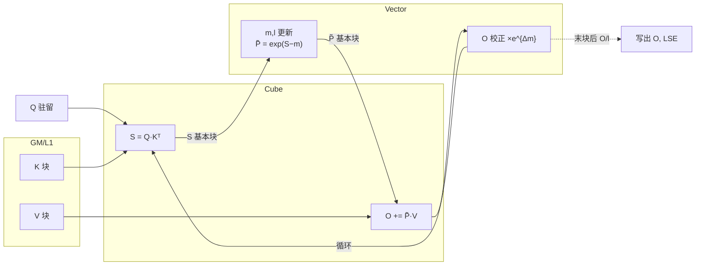
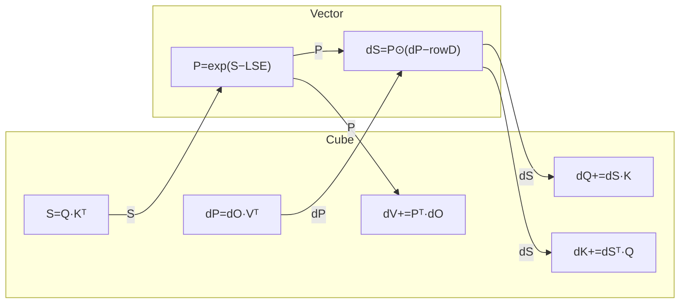
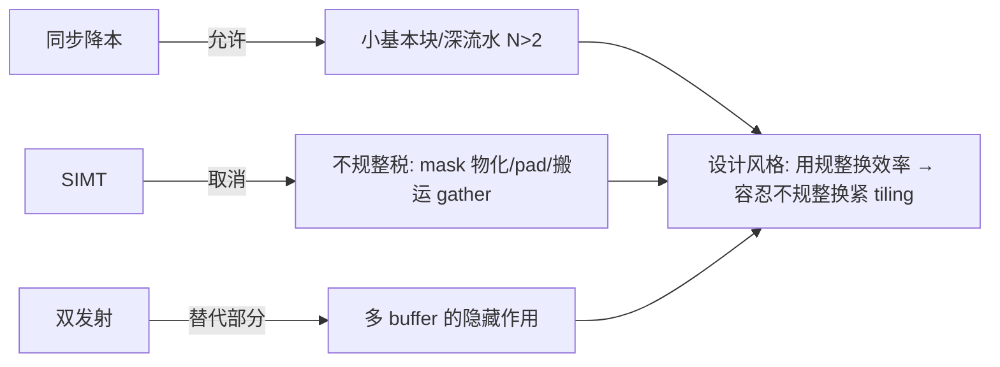
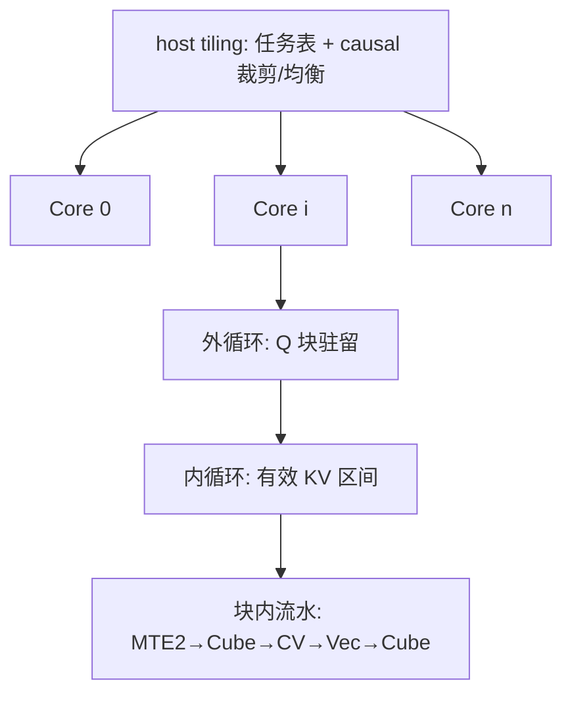
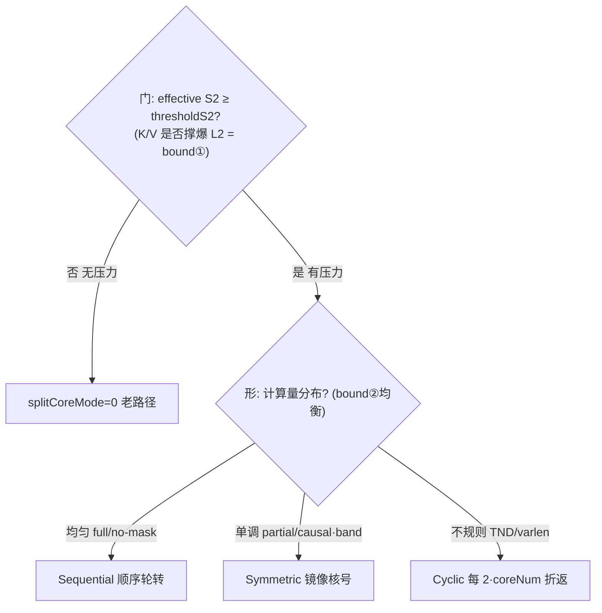

# 昇腾 FlashAttention @ arch35 (A5) 方案设计书

> 状态:重构版 v2.0 —— 在 v1.3 基础上按"三个出发点(硬件 / shape / 算法)"重组全书,新增**算法特征篇**、**shape 特征篇**、**FA/FAG 对称的实测闭环篇**;分核代码统一改成**算法骨架伪代码**(细节由 Python 脚本承载),性能建模方法移入附录。原文核心内容全部保留。
> 全书读法:每节先给"一句话(从特征出发)",再走"现象 → 机制 → 根因 → 数"四级阶梯;能信死的标白皮书/源码确认,要 profile 的标待证。

---
<a id="sec-front"></a>
## 文档信息与基线常量(前置)

> 本节集中钉死全书的**版本、术语、记号、基线常量、运行示例 shape**。后文任何数值/缩写/符号默认引用本节;个别小节若改用别的 shape 或口径,必须就地标注。

<a id="sec-front-version"></a>
### 版本历史

| 版本 | 日期 | 作者 | 主要变更 |
|---|---|---|---|
| v1.3 | —(待填) | —(待填) | 初版,按机制组织 |
| v2.0 | —(待填) | —(待填) | 按"三个出发点(硬件/shape/算法)"重组;新增算法特征篇、shape 特征篇、FA·FAG 对称实测闭环篇;分核改算法骨架伪代码;建模方法移入附录 A |
| v2.1 | —(待填) | —(待填) | 新增 §5.6(MM 输出 UB/GM)、§6.4.1·§7.4.1·§7.5.1(分核硬件账 + 三层对齐)、§7.3 循环序详版、§12 输出型 MM 对比;新增附录 B(代码级走读);补本前置节(术语/记号/基线/断链修正) |

<a id="sec-front-glossary"></a>
### 术语表(缩写)

| 类别 | 术语 | 含义 |
|---|---|---|
| 核 | AIC / AIV | AI Cube 核 / AI Vector 核;A5 一个 AI 子系统 = 1 AIC + 2 AIV(`KERNEL_TYPE_MIX_AIC_1_2`) |
| 核 | Cube / Vector | 矩阵乘单元 / 向量(SIMD)单元 |
| 管线 | MTE2 | 输入搬运管线(GM/L2 → 片上 读) |
| 管线 | MTE3 / FixPipe | 输出搬运 / 定点流水(L0C → UB/GM 写,随路 cast/scale/transpose) |
| 管线 | MAC | 矩阵乘累加吞吐;亦指 Cube 实现算力档 |
| 缓冲 | UB / L1 / L0A / L0B / L0C | 片上各级缓冲:Unified Buffer / L1 / 矩阵输入 A / 输入 B / 累加输出 C |
| 缓冲 | L2 | 二级缓存(128MB),中间数据复用缓冲,非首读缓存 |
| 缓冲 | N-Buffer / DB | N 级缓冲 / Double Buffer |
| 算法 | FA / FAG | FlashAttention 前向 / 反向(grad) |
| 算法 | CV | Cube↔Vector 交互(倒手 / 握手) |
| 算法 | LSE | log-sum-exp,前后向接口标量列(= 在线 softmax 的 `m+log(l)`) |
| 算法 | GQA | 分组查询注意力,`G = N1/N2` |
| 指令 | SIMD / SIMT | 单指令多数据 / 单指令多线程(VF 可切换);MMAD = 矩阵乘加指令 |
| 分核 | splitCoreMode | FA 前向多核任务重排(门 + 形:Sequential/Symmetric/Cyclic) |
| 分核 | splitAxis | FAG 反向切轴策略(BN2 / BN2S2 / BN2GS1S2) |
| 分核 | swizzle 枚举器 | FAG 细切后挣回 L2 局部性的有效块遍历器(`GetNextValidIdx`) |
| 分核 | atomic / partial / workspace | 跨核归约的累加 / FP32 中间量 / GM 暂存 |
| 建模 | roofline / ridge | 屋顶线模型 / 脊点(= 峰值算力 / 带宽,**须标哪条带宽**) |
| 建模 | AI | 算术强度 = FLOPs / 访存字节(区分理想 AI / 工程 AI) |
| 建模 | MFU / HFU | 模型 / 硬件 FLOPs 利用率 |
| 建模 | η | 带宽实现效率(校准量 ≈ 0.70) |
| shape | causal / band / SWA / sink / prefix | 各 mask 几何;TND = varlen 打包布局 |
| dtype | BF16/FP16/FP8/HIFLOAT8/MXFP4 | 数据类型档(决定吞吐,不挪 memory-bound 交叉点) |

<a id="sec-front-notation"></a>
### 记号表(符号)

| 符号 | 含义 | 典型值 |
|---|---|---|
| `B` | batch | — |
| `N1 / N2 / G` | query head 数 / kv head 数 / GQA 组 `G=N1/N2` | — |
| `S1 / S2` | query / key 序列长(prefill `S1=S2`) | — |
| `D / Dv` | QK 头维 / V 头维 | — |
| `Br / Bc` | 基本块的 S1 / S2 边 | 128 |
| `M / Nn` | S1 块数 `=⌈S1/Br⌉` / S2 块数 `=⌈S2/Bc⌉` | — |
| `dt / dt_in` | 输入字节宽 | BF16=2 |
| `dt_acc` | 累加字节宽(L0C FP32) | 4 |
| `dt_out` | 输出字节宽 | BF16=2 |
| `vr` | 有效块比(causal) | ≈0.5 |
| `η` | 带宽实现效率(校准量) | ≈0.70 |
| `ridge` | 脊点 `= 峰值算力 / 带宽` | 见基线表 |
| `AI` | 算术强度 `= FLOPs / 访存字节` | — |
| `aicNum` | AI Cube 核数 | 32 |
| `thresholdS2` | splitCoreMode 开门的 effective S2 阈值 | 几千 token |

<a id="sec-front-baseline"></a>
### 基线常量表

**(a) 硬件常量(白皮书确认;本书两档同算力,差异在带宽)**

| 常量 | 950PR | 950DT | 备注 |
|---|---|---|---|
| Cube 峰值(BF16) | 432 TFLOPS | 432 TFLOPS | =13.5×32 |
| Vector 峰值 | 54 TFLOPS | 54 TFLOPS | — |
| Cube:Vector 峰值比 | 8:1 | 8:1 | 矩阵峰值比,**不含 exp 吞吐** |
| HBM 容量 / 带宽 | 128GB / **1.6 TB/s** | 144GB / **4 TB/s** | — |
| L2 容量 | 128 MB | 128 MB | 512B Line / 4×128B Sector |
| L2 带宽 | 待对照 | **~16 TB/s** | — |
| UB / L1 | 512KB / 512KB | 同 | per AI Core |
| L0A / L0B / L0C | 64 / 64 / 256 KB | 同 | per AI Core |
| aicNum | 32 | 32 | — |
| CV 配比 | 1C:2V | 1C:2V | `KERNEL_TYPE_MIX_AIC_1_2` |

**(b) 校准量(950DT,两份真实 profiling 反推 —— 描述量,跨 shape 慎用)**

| 校准量 | 值 | 含义 |
|---|---|---|
| MAC 实现算力 | ≈ **403 TFLOPS** | =93%×432,compute-bound 现实天花板 |
| η(带宽实现效率) | ≈ **0.70** | — |
| MTE2 L2 档带宽 | ≈ **11.1 TB/s** | =η·16(DT) |
| MTE2 HBM 档带宽 | ≈ **2.8 TB/s** | =η·4(DT) |
| FixPipe 实现带宽 | ≈ **3.41 TB/s** | FP32 workspace 写 |

**(c) 派生 ridge(务必标带宽口径,避免 PR/DT 混淆)**

| ridge | 值 | = 峰值/带宽 | 口径 | 用在 |
|---|---|---|---|---|
| HBM 峰值(PR) | 270 | 432/1.6 | PR 峰值 | §2.5(1) 交叉点 |
| HBM 峰值(DT) | 108 | 432/4 | DT 峰值 | §8 理想 roofline |
| HBM 实现(DT) | 154 | 432/2.8 | DT η·4 | §9 工程判 bound |
| FixPipe(DT) | 127 | 432/3.41 | DT 实现 | §7.4.1 / §11 输出侧 |
| L2(容量判据) | 128MB | — | 不是 ridge,是**工作集 vs 容量** | §6.4.1 / §7.5.1 |

> 口径约定:§2.5(1) 的 ridge 270 是 **PR**;§8 起的 108 / 154 是 **DT**。两档结论(交叉点位置、谁 bound)一致,绝对值随带宽缩放。

<a id="sec-front-shape"></a>
### 运行示例 shape(全书数值默认)

```text
B=1, N1=16, N2=2 (G=8), S1=S2=16384, D=Dv=256, BF16, causal, 950DT
→ D+Dv = 512;单份 K/V = S2·(D+Dv)·dt = 16384·512·2 ≈ 16.8 MB
→ causal FLOPs:前向 2.199 TFLOP / 后向 5.497 TFLOP(2.5×)
```

除非小节显式标注,所有"16.8MB / 268MB / 51.5GB / 输出 AI / MFU"等数值都按本 shape(`D+Dv=512`)。

<a id="sec-toc"></a>
## 目录

- [文档信息与基线常量(前置)](#sec-front)
  - [版本历史](#sec-front-version) · [术语表](#sec-front-glossary) · [记号表](#sec-front-notation) · [基线常量表](#sec-front-baseline) · [运行示例 shape](#sec-front-shape)
- [第零篇 导读](#sec-part0)
  - [0.1 文档目的与范围](#sec-0-1)
  - [0.2 三要素总览](#sec-0-2)
  - [0.3 一页式阅读路线](#sec-0-3)
  - [0.4 结论分级](#sec-0-4)
  - [0.5 全书约定:通俗化模板](#sec-0-5)
- [第一篇 三个出发点(特征层)](#sec-part1)
  - [1. 算法特征:FA 为什么长这样](#sec-1)
    - [1.1 FA / FAG 计算流](#sec-1-1) · [1.2 online softmax](#sec-1-2) · [1.3 LSE 接口](#sec-1-3) · [1.4 后向重算](#sec-1-4) · [1.5 三个归约轴](#sec-1-5)
  - [2. 硬件特征:A5 松了哪些约束](#sec-2)
    - [2.1 概览](#sec-2-1) · [2.2 硬件变量表](#sec-2-2) · [2.3 约束瓦解](#sec-2-3) · [2.4 设计↔亲和](#sec-2-4) · [2.5 关键比值](#sec-2-5) · [2.6 L2 微架构](#sec-2-6)
  - [3. shape 特征](#sec-3)
    - [3.1 shape 主表](#sec-3-1) · [3.2 各轴详解](#sec-3-2) · [3.3 prefill vs decode](#sec-3-3)
- [第二篇 机制展开](#sec-part2)
  - [4. FA vs FAG 算力密度与瓶颈位对比](#sec-4)
  - [5. 公共机制](#sec-5)
    - [5.1 三层结构](#sec-5-1) · [5.2 基本块尺寸](#sec-5-2) · [5.3 CV 握手](#sec-5-3) · [5.4 流水 + N-Buffer](#sec-5-4) · [5.5 SIMT/双发](#sec-5-5) · [5.6 MM 输出 UB/GM](#sec-5-6)
  - [6. FA 前向机制](#sec-6)
    - [6.1 藏 softmax](#sec-6-1) · [6.2 基本块 + 数据路径](#sec-6-2) · [6.3 causal 网格](#sec-6-3) · [6.4 splitCoreMode](#sec-6-4) · [6.4.1 dispatch 硬件账](#sec-6-4-1)
  - [7. FAG 反向机制](#sec-7)
    - [7.1 算力密度](#sec-7-1) · [7.2 基本块 + 数据路径](#sec-7-2) · [7.3 循环序](#sec-7-3) · [7.4 splitAxis 选择](#sec-7-4) · [7.4.1 splitAxis 硬件账 + 三层对齐](#sec-7-4-1) · [7.5 枚举器](#sec-7-5) · [7.5.1 枚举器硬件账](#sec-7-5-1)
- [第三篇 性能建模与实测闭环](#sec-part3)
  - [8. 理想 roofline 与绝对上限](#sec-8)
  - [9. 理想 AI vs 工程 AI](#sec-9)
  - [10. FA 前向实测闭环](#sec-10)
    - [10.1 现象](#sec-10-1) · [10.2 根因链](#sec-10-2) · [10.3 硬件账](#sec-10-3) · [10.4 优化 delta](#sec-10-4)
  - [11. FAG 反向实测闭环](#sec-11)
    - [11.1 现象](#sec-11-1) · [11.2 根因链](#sec-11-2) · [11.3 硬件账 + 决策树](#sec-11-3) · [11.4 优化 delta](#sec-11-4)
  - [12. FA vs FAG 对比差异(收口)](#sec-12)
- [第四篇 代码导读](#sec-part4)
  - [13. 四段式读码框架](#sec-13) · [14. 文件地图](#sec-14) · [15. FA 前向走读](#sec-15) · [16. FAG 反向走读](#sec-16) · [17. FAG Cube/Vec 优化点](#sec-17) · [18. 阅读顺序 + 动手](#sec-18)
- [第五篇 待办与开放问题](#sec-part5)
  - [19. 开放优化清单](#sec-19) · [20. 还需 profile/汇编的点](#sec-20) · [21. 待办总账](#sec-21) · [22. 主线收束](#sec-22)
- [附录 A. 性能建模方法与可信度边界](#sec-appendix-a)
  - [A.1 三层口径](#sec-a-1) · [A.2 校准常数](#sec-a-2) · [A.3 L2 两档模型](#sec-a-3) · [A.4 单一带宽/争抢](#sec-a-4) · [A.5 业界对应](#sec-a-5)
- [附录 B. 代码级展开](#sec-appendix-b)
  - [B.1 FA splitCoreMode 代码级](#sec-b-1)
    - [B.1.1 何时打开](#sec-b-1-1) · [B.1.2 映射 helper](#sec-b-1-2) · [B.1.3 Sequential](#sec-b-1-3) · [B.1.4 Symmetric](#sec-b-1-4) · [B.1.5 Cyclic](#sec-b-1-5) · [B.1.6 四路边界](#sec-b-1-6)
  - [B.2 FA BMM2 写 UB/GM 数据路径](#sec-b-2)
  - [B.3 FAG SetSplitAxis + workspace](#sec-b-3)
  - [B.4 FAG 枚举器 GetNextValidIdx](#sec-b-4)
    - [B.4.1 线性 scan](#sec-b-4-1) · [B.4.2 非 TND swizzle](#sec-b-4-2) · [B.4.3 TND swizzle](#sec-b-4-3)

<a id="sec-part0"></a>
## 第零篇 导读

<a id="sec-0-1"></a>
### 0.1 文档目的与范围

- 目的:梳理 FA(forward)与 FAG(backward)在 arch35 上的实现方案,作为代码阅读的"地图",并把每个优化钉回它的出发点。
- 范围:FA/FAG 核心计算流;tiling 与多核切分;核内流水与 N-Buffer;CV 交互与基本块;SIMT 的引入位置;循环序与 splitAxis;roofline/MFU 建模与实测闭环。
- 不展开:框架接入(aclnn/aclgraph)、汇编级 VF lowering、decode(S1=1)场景(见 §3.3)。

<a id="sec-0-2"></a>
### 0.2 三要素总览:一切优化的出发点

本书的核心观点:**FA/FAG 上每一个优化,都是在回答"某一类特征逼着我们必须这么做"。** 这些特征只有三类——

| 出发点 | 是什么 | 它逼出什么 | 详见 |
|---|---|---|---|
| **算法特征** | FA 算法本身的结构(online softmax 单趟、LSE 接口、后向重算、三个归约轴) | CV 倒手、循环序、splitAxis、atomic 的存在理由 | 第一篇 §1 |
| **硬件特征** | A5 的物理形态(1C:2V、容量阶梯、L2 128MB、SIMD/SIMT、双发) | 基本块大小、P 走 L1、splitCoreMode、低精度模板 | 第一篇 §2 |
| **shape 特征** | 具体输入形状(S 大小、B·N2、S1 vs S2、mask 几何、D、dtype、varlen) | 走哪条 split、哪侧 bound、哪个枚举器 | 第一篇 §3 |

这三类特征是**正交的三根脊椎**:硬件决定"机器擅长什么"(§2.4 主索引),算法决定"任务必须怎么算"(§1),shape 决定"这一次该走哪条路"(§3.1 主表)。后面所有篇章都是这三根脊椎的展开。**读到任何一处看不懂"为什么这么写",先回这张表问一句:它贴的是哪一类特征?**

<a id="sec-0-3"></a>
### 0.3 一页式阅读路线

| 你想解决什么 | 先读 | 再读 |
|---|---|---|
| 为什么 FA 算法长这样 | §1(算法特征) | §6.1 / §7.1(算力密度) |
| 为什么 A5 适合 FA | §2.2 + §2.4 + §2.5 | L2 微架构 §2.6 |
| 我的 shape 该走哪条优化 | §3.1 shape 主表 | §6.4 / §7.4 / §7.5(优势场景) |
| 看懂 FA 前向主线 | §6 + §15 | §10(前向实测闭环) |
| 看懂 FAG 反向主线 | §7 + §16 | §11(反向实测闭环) |
| roofline/MFU 怎么算、准不准 | §8 + §9 | §10 / §11 / 附录 A |
| 哪些结论还不能信死 | §0.4 + §20 + §21 | — |

<a id="sec-0-4"></a>
### 0.4 结论分级

为防止把白皮书事实、源码事实、性能推断混在一起,全书三档:

| 标记 | 含义 | 例子 |
|---|---|---|
| 白皮书确认 | 硬件能力/容量/规格可由白皮书直接支撑 | 1C:2V、容量阶梯、L2 128MB、SIMD/SIMT、双发 |
| 源码确认 | C++/tiling/kernel 已定位实现方式 | `KERNEL_TYPE_MIX_AIC_1_2`、P 写 L1、`splitAxis` |
| 待 profile/汇编 | 白皮书和源码都给不出最终执行形态或数值 | VF 是否落 SIMT、双发槽位、单核有效带宽、L2 hit 收益 |

§8~§11 的建模:**per-pipe 流量、bottleneck 判定、完美重叠 floor 是真值/可达下界**;有效带宽 η、L2 命中档、争抢量是**从 profiling 反推的校准量**(附录 A 给可信度边界)。

<a id="sec-0-5"></a>
### 0.5 全书约定:通俗化模板

为了让"为什么"一眼可读,每个主要小节遵守两条约定:

1. **一句话(从特征出发)**:小节开头用一句话点题——
   > 因为〔硬件/shape/算法〕有〔X 特征〕,naive 地做会〔Y 代价〕,所以〔优化 Z〕,省〔数/量级〕。
2. **四级阶梯**:正文按 **现象 → 机制 → 根因 → 数** 推进。现象/机制是源码可闭环的(可信死),根因贴到硬件/算法特征,数里的绝对值多为一阶估算或 profiling 校准(标清待证)。

---

<a id="sec-part1"></a>
## 第一篇 三个出发点(特征层)

<a id="sec-1"></a>
## 1. 算法特征:FA 为什么长这样

> **一句话:** 因为 softmax 要"先看完一整行才能归一化"(算法特征),而一整行 `[S1,S2]` 在片上放不下(硬件容量),所以必须**流式分块 + 在线缩放**,这一步把 S/P̃ 反复推过 Cube↔Vector 边界——FA 区别于纯矩阵乘的全部难点都源于此。

本章是全书的算法根。后面 §6/§7 的机制、§10/§11 的瓶颈,追到底都落在这四条算法特征上。

<a id="sec-1-1"></a>
### 1.1 FA / FAG 计算流(C/V 分工)

**前向单次内循环:**



跨 CV 边界的张量只有 **S(C→V)** 和 **P̃(V→C)**。

**反向单次内循环:**



| | Cube 次数 | CV 倒手张量 | 含义 |
|---|---|---|---|
| FWD | 2 | S, P̃ | Vector 占比高,藏 Vector 是主战场 |
| BWD | 5 | S, dP→dS | 更 Cube-bound,Vector 裕度大,但倒手翻倍 |

主线一句话:**让 Cube 不停转,Vector/MTE/同步全部藏进 Cube 影子里。**

<a id="sec-1-2"></a>
### 1.2 算法特征①:online softmax = 单趟 + 数值缩放

> **一句话:** softmax 要拿整行的 max 才能稳定地 exp,但整行放不下,所以维护"跑动的 max/sum",每来一个 K/V 块就把旧结果重新缩放一次。

- **现象:** 标准 softmax 是 `exp(Sᵢ − max(S)) / Σ exp(Sⱼ − max(S))`,需要先扫一遍整行求 max(否则 `exp` 溢出),再扫一遍求和。一整行是 `[S1, S2]`,S2=16384 时单 head 就 256M 元素,UB(512KB)根本放不下。
- **机制(online/flash):** 把 S2 切块流式过。维护行级跑动量 `m`(当前最大)、`l`(当前指数和)。每来一个 K/V 块:算出局部 `m_new = max(m, rowmax(块))`,用 `e^{m − m_new}` 把已累加的 `O` 和 `l` 缩放到新基准,再累加本块贡献。块扫完,`O` 已经是归一化前的正确加权和,最后除以 `l`。
- **根因(为什么这逼出 CV 倒手):** softmax 是**行全局**操作(要看完整行才能定 max/sum),但我们**按列流式**喂数。于是每个 S 块必须先过 Vector 做在线 softmax、产出 P̃,再回 Cube 做 P̃·V——**§5 那整套 C→V→C 握手的存在理由就是这一句**:不是工程偏好,是 online softmax 的算法结构强制的。
- **数:** 单趟扫完,访存量从"物化整张 P(∝S²)"降到"只过 S 块 + 维护 O/l(∝S)";代价是每次 m 更新要一次 `O` 校正(§6.1 时间线里那条 `corr`)。

<a id="sec-1-3"></a>
### 1.3 算法特征②:LSE 是前后向的接口

> **一句话:** 前向只把每行的 `LSE = m + log(l)`(一个 `O(S)` 的标量列)存下来,后向靠它一句 `P = exp(S − LSE)` 就能重算注意力权重,不必存整张 `O(S²)` 的 P。

- **现象:** 后向要用到前向的 softmax 结果 P。最直接的办法是前向把 P 存到 HBM,后向读回——但 P 是 `[S1, S2]`,`O(S²)`,存不起。
- **机制:** 前向每行额外写一个标量 `LSE`(log-sum-exp,= 在线 softmax 的 `m + log(l)`),只占 `O(S1)`。后向重算 `S = Q·Kᵀ` 后,直接 `P = exp(S − LSE)` 还原权重,无需重跑 max 追踪。
- **根因:** 这就是"前向为什么要多写一个 LSE 输出"的原因(§6 数据路径里 O 旁边那个 LSE),也是前后向唯一的桥。它把后向对前向的依赖从 `O(S²)` 压成 `O(S)`。
- **数:** 多存一列 `B·N1·S1` 的 LSE(零头),换掉 `B·N1·S1·S2` 的 P 存储。

<a id="sec-1-4"></a>
### 1.4 算法特征③:后向是"重算"不是"存储"

> **一句话:** 存整张注意力矩阵 `O(S²)` 不可行,所以后向干脆从 Q/K/V + LSE **重算** S 和 P,这就是后向比前向多出 3 次矩阵乘、FLOPs 是前向 2.5× 的来源。

- **现象:** 反向需要 S、P、dP、dS 才能算 dQ/dK/dV。
- **机制:** 后向不存这些中间量,而是重算:`S=Q·Kᵀ`(MM)→ `P=exp(S−LSE)`(Vec)→ `dP=dO·Vᵀ`(MM)→ `dS=P⊙(dP−rowD)`(Vec)→ `dQ=dS·K`、`dK=dSᵀ·Q`、`dV=Pᵀ·dO`(3 个 MM)。
- **根因:** 这就是 §1.1 那张表里"BWD Cube 5 次 / FWD 2 次"的来历;也是"后向更 Cube-bound、Vector 裕度反而大"的来历——重算把计算量堆到了 Cube 侧。
- **数:** 前向 ≈ `2·S²·(D+Dv)`,后向 ≈ `2·S²·(3D+2Dv)`,方块 D=Dv 时正好 **2.5×**。这条比值是 §8/§11 一切 FA vs FAG 差异的起点。

<a id="sec-1-5"></a>
### 1.5 算法特征④:三个归约轴决定后向所有分核

> **一句话:** 后向三个输出沿**正交的轴**累加(dQ 沿 S2;dK/dV 沿 G,S1),切到哪个归约轴跨核,哪个输出就被迫跨核归约、砸 FixPipe——§7 循环序、splitAxis、atomic 全从这三行推出来。

把这三行记死,后向就不绕了:

```text
dV[s2] = Σ_{g,s1} P·dO     → 归约轴 = (G, S1)
dK[s2] = Σ_{g,s1} dS·Q     → 归约轴 = (G, S1)
dQ[s1] = Σ_{s2}   dS·K     → 归约轴 = S2
```

- **规则:** 一个输出沿它的归约轴累加;若把这条轴切到多个核,该输出就要**跨核归约**(atomic 累加,或写 FP32 partial workspace + post 归并)。跨核归约 = 反复读改写 HBM/L2 的 FP32 中间量 → 直接砸 FixPipe/MTE3。
- **根因:** dQ 的归约轴(S2)与 dK/dV 的归约轴(G,S1)**正交**,所以三者不可能同时驻留(整张 S1×S2 网格远超 L0C/UB);必须流式扫一个轴,被内层索引的那个输出只能不驻留。**循环序(§7.3)= 选把"驻留只写一遍"的便宜发给谁;splitAxis(§7.4)= 选切哪条轴 → 决定几个输出跨核。**
- **数:** 跨核归约张量数 = {0,1,3} 直接对应 MFU 量级 {~93%, 中高, 82%}(§11 给实测对账)。

---

<a id="sec-2"></a>
## 2. 硬件特征:A5 松了哪些约束

> **一句话:** A5 把"同步贵、SIMD 罚不规整、单发"这三道老约束逐项松开(硬件特征),于是设计风格从 A2/A3 的"用规整换效率"翻转成"容忍不规整换紧 tiling"。

<a id="sec-2-1"></a>
### 2.1 概览与 A2/A3 差异

A5(arch35/DAV_3510)对 FA 的影响集中在三件事:CV 物理形态(1C:2V mix 核)、L0C 出口与缓存层级、Vector/发射模型。下面 §2.2 把"白皮书硬件事实"和"源码使用方式"并列,后续机制章都在这张表的约束下展开。

<a id="sec-2-2"></a>
### 2.2 决定设计的硬件变量表

| 变量 | A2/A3 参考 | A5 | 影响 |
|---|---|---|---|
| CV 形态/配比 | 1C:2V 分离 | 每个 AI 子系统 = 1 Cube + 2 Vector;代码 `KERNEL_TYPE_MIX_AIC_1_2`,AIC:AIV=1:2 | 同步成本、基本块 |
| Cube:Vector 算力比 | 待对照 | 峰值约 8:1(BF16/FP16 矩阵 FLOPS 比,**不等于** softmax 耗时比,见 §2.5) | Vector 可隐藏性 |
| UB/L1/L0A/B/C | 192K/512K/64K/64K/256K | **UB 512KB,L1 512KB,L0A/B 64KB,L0C 256KB** per AI Core | tiling、N 上限 |
| L2 / Cache | 待对照 | **L2 up to 128MB,512B Line,4×128B Sector,Cache Hint/CMO/按 Way 驻留;2-Die UMA 但 L2 有局部亲和** | splitCoreMode、K/V 复用 |
| L0C 出口 | →UB 随路 cast | L0C→UB 支持随路量化和排布转换;FA BMM1→UB,BMM2→UB/GM,FAG MM3/4/5→UB/GM | P/dS/DQKV 倒手开销 |
| Vector 模型 | 纯 SIMD | SIMD 为主、SIMT 为辅;VF 可选 SIMD/SIMT 快速切换;Softmax/GELU 微架构优化,UB↔ALU 间加 RegFile | §10 |
| 发射 | 单发射 | 双发射 Register-Based SIMD + 乱序;槽位组合待汇编/profile | §11 |
| 片上内存带宽 | 待对照 | 950PR 128GB/**1.6TB/s**;950DT 144GB/**4TB/s**;**DT L2 ~16TB/s**;单核有效带宽待 profile | MTE2 瓶颈位 |
| 调度/同步 | set/wait flag | BufferID 同步、STARS2.0、128K 单比特同步标志、ns 级 HSCB、Group/Die 亲和;当前代码仍主用 CrossCore flag | 流水复杂度 |

<a id="sec-2-3"></a>
### 2.3 约束瓦解图



- **A 同步降本 → 使能小块深流水:** CV 握手有固定成本 `T_sync`,单块效率 ≈ `T_compute/(T_compute+T_sync)`。A5 用 1C:2V 近邻 + L1↔UB 直连 + ns 级同步把 `T_sync` 压低,于是小块也划算,小块才装得下更多在飞数据 → 深流水 `N>2`。
- **B SIMT → 移除不规整税:** mask 物化、pad 空算、gather 退化搬运三类成本,SIMT 用分支/逐 lane 寻址直接免掉(硬件已确认,源码 lowering 待证 §10)。
- **C 双发射 → 替代部分多 buffer:** 同核并发发射互不依赖的指令流(`exp(i) ‖ rowmax(i+1)`),能藏的延迟就不必全靠 buffer 深度,`N` 有机会降一档省 UB/L1。
- **R 合流:** A2/A3 规整优先(大块、对齐、pad、mask 物化)接受浪费;A5 紧 tiling 优先(SKIP 真跳、对角真三角、ragged 尾块、sparse 直接寻址、splitCoreMode 重排)减少废活。

<a id="sec-2-4"></a>
### 2.4 设计决策 ↔ 硬件亲和 对照(硬件脊椎)

这张表是"硬件特征"这根脊椎:每个设计选择钉到驱动它的那条 A5 硬件属性。读后续遇到具体写法,先回这查"它贴的是哪条硬件特性"。

| 设计选择 | 贴的 A5 硬件亲和 | 在治的 bound | 详见 |
|---|---|---|---|
| 1C:2V mix + 单 AIV 吃 S1 半块 | 物理形态 1C+2V,Vector 专为 Softmax/GELU 优化、加 RegFile 减气泡;8:1 是矩阵峰值比不含 exp 吞吐 | Vector 隐藏 | §6.1 §7 |
| P 经 **L1** 回传 BMM2,不走 UB | L1↔UB 直接 CV 通路,白皮书明说为 FA 带宽瓶颈而加;P 落 `l1PBuffers` 供 BMM2 读 | CV 同步 + 容量 | §6.2 |
| BMM2 出 L0C→UB/GM 自适应(`GetC2Position`) | L0C 仅 256K,大 D/FP32 放不下整块 O 必落 GM 流式 | L0C ↔ GM 带宽 | §6.2 |
| 基本块 128×128(及特化) | L0A/B/C 容量 + 16×16 分形对齐;128 是利用率与容量平衡点 | L0 容量 + MMAD | §5.2 |
| L1 P 3-buffer、各 TQue N-buffer | 用 L1/UB 余量换流水深度吸收抖动(Little's Law) | 容量 ↔ 时延 | §5.4 |
| splitCoreMode strided 轮转 | L2 128MB 服务 AIC/AIV、支持局部亲和;strided 让多核聚在滑动窗口避免铺满 L2 | bound① Memory 带宽 | §6.4 §10 |
| Symmetric 镜像 / Cyclic 折返 | 多核 wall-clock=最慢核;causal/varlen 各造一种长尾 | bound② 并行长尾 | §6.4 |
| splitCoreMode 由 L2 阈值门控 | 只有 ~2·coreNum 份 K/V 撑爆 L2 时重排才有收益 | bound① 触发 | §2.5 §6.4 |
| FAG 外 KV 内 Q + host 选 splitAxis | atomic 流量、DKV workspace、长 S2 局部性三者权衡 | atomic 带宽 + 容量 | §7 |
| FAG DK/DV 钉 L0C 累加 | L0C 256K 够放"最大临时 + DK + DV"时免反复 GM 往返 | L0C ↔ GM | §7.2 §17 |
| 低精度模板阶梯 | Cube 原生 HiF8/FP8(2× FP16)、MXFP4(4×);更高算力要更大块喂满,但不挪 memory-bound 交叉点 | Cube 吞吐 + L0 | §5.2 §8 |
| Fixpipe 随路 cast/scale | L0C→UB 随路量化 + 排布转换,省一段 Vector elementwise | 省 Vector | §6.2 |
| mask/tail 走 `vf/vector_api` | SIMD/SIMT 混合,不规则控制流/gather 是 SIMT 目标(lowering 待证) | 取消不规整税 | §5.5 §10 |
| L2 hint / CMO 旋钮 | allocate/non-allocate/victim + Prefetch/Writeback/Invalid/Flush,在 splitCoreMode 之上细调 K/V 复用 | L2 复用质量 | §2.6 |

一句话串起来:**§2.2 列硬件常量 → §2.3 说松了哪些约束 → §2.4 把每个设计钉回某条常量 → §2.5 把能算的钉成数 → 后面是这些选择的展开。**

<a id="sec-2-5"></a>
### 2.5 硬件数 → 关键比值(把亲和算成数)

> 口径:950PR BF16(Cube 432 TFLOPS、Vector 54 TFLOPS、片上内存 1.6TB/s、L2 128MB、L0C 256KB;DT 把算力/带宽各放大,交叉点结论不变)。下面是**一阶模型**:输入数白皮书确认,绝对值落到真实 MFU 仍需 profile 校准(§8~§11)。数值口径以前置《基线常量表(c)》为准:本节 ridge 270 为 PR,§8 起 108/154 为 DT。

**(1) FA 前向 roofline 交叉点 ≈ S>540。** 单 head 计算量 ≈ `4·S²·D`,理想一遍访存 ≈ `4·S·D·dt`,算术强度 `AI = S/dt`。BF16 ridge = 432e12/1.6e12 ≈ 270 FLOP/byte。compute-bound 条件 `S/2 > 270` ⇒ **S>540**。短序列 memory-bound,长序列才 compute-bound——这是 A5 把重火力(splitCoreMode、L2 复用、低精度)全压在长 S 的根因。

**(2) 低精度不挪交叉点(只买吞吐)。** 设 `dt=d`,峰值算力 ∝ 1/d,ridge=540/d,AI=S/d,compute-bound 条件 `S>540` **与 d 无关**。FP8/MXFP4 让你算得快,但 memory-bound 边界仍在 S≈540。

**(3) 多核重取威胁 roofline → splitCoreMode 的定量根。** (1) 假设 K/V 只读一遍。但默认连续分核下 ~`n2Num`(≈2·coreNum)个核各取自己那份 K/V,HBM 字节最坏放大 ~`n2Num`×,有效 AI 同比下掉,足以把工作点从 compute-bound 拖回 memory-bound。splitCoreMode 让多核同拍聚在一个滑动窗口的 K/V 上 → 在 L2 取一次喂多核 → HBM 只见 ~一遍 → AI 保住。**这就是 §6.4 那条张力轴的量化根。**

**(4) L2 阈值实算锚 ≈ 一两千 S2。** `thresholdS2 = l2Remain / (n2Num·(D+Dv)·dt)`,代入 L2≈128MB、l2Remain~100MB、n2Num≈64、D+Dv=512、BF16:`≈ 100e6/(64·512·2) ≈ 1.5e3 tokens`。即 S2 到约一两千,默认工作集就开始撑爆 L2、splitCoreMode 才开;运行示例 S2=16384(≫阈值)时,未融合默认工作集 ≈ `min(aicNum,B·N1)·S2·(D+Dv)·dt = 16·16384·512·2 ≈ 268MB > 128MB`,确实放不下(同 §10.2)。(注:阈值公式按 kv 并发份数 `n2Num` 计,268MB 按 query-head 重取份数 `min(aicNum,B·N1)` 计——两种计数都指向同一结论:运行示例远超 L2。)

**(5) 2 AIV 够不够藏 softmax。** 一个 128×128 前向 tile:Cube ≈ 4.2M MAC;Vector softmax ≈ 16K exp + ~48K elementwise。判别式 `T_vec(半 tile,含 exp) ≤ T_cube(tile)/2`。raw op 数 Cube 比 Vector 多 ~65×,即使 Vector 矩阵吞吐 1/8、exp 多周期,2 AIV 仍**大概率**有裕度——**除非 exp 吞吐成瓶颈**,而 exp 有效吞吐白皮书没给,这是 §21-B5的 profile 目标。

> 连起来:**A5 为 FA 做的每件事都在围绕同一目标——在"长 S 才 compute-bound"的前提下,既把 Cube 喂满(L2 复用保 AI、低精度提吞吐),又把 Vector 藏住(2 AIV + RegFile + 双发)。**

<a id="sec-2-6"></a>
### 2.6 L2 微架构:Bank / Sector / 交织 / hint / CMO

> **一句话:** §2.5(3)/§6.4 只用了 L2 的**容量**(128MB),但 Bank/Sector/交织/hint/CMO 决定"复用窗口落进 L2 后带宽能不能吃满、会不会被病态访问拍死"——这是 splitCoreMode 之下的一层细节。

**定位:中间数据复用缓冲,不是首读缓存。** L2 缓存 AIC/AIV 会**重复使用**的数据,省掉反复回 HBM。K/V 被多个 Q 块重复消费,钉在 L2 一次取多次用——这正是 splitCoreMode 想吃的。

**(A) 多 Bank + 512B Line + 128B Sector。** 128MB 切多 Bank,多核打到不同 Bank 并行(挤同 Bank 则 bank conflict);512B Line 是替换单位;一条 Line 内分 4×128B Sector,可按 128B 搬运/管有效性,与 NDDMA"细粒度读聚合为 128B"对齐,尾块/非对齐访问不必拉满整条 Line。

**(B) Bank 交织:低位 + 高位 XOR。** 低位交织对连续 stream 极友好(均匀铺满),但对病态 stride 周期性撞同一 Bank。白皮书的"512B 低位交织 + 高位异或":`bank = low_bits XOR some_high_bits`——低位拿满连续带宽,高位 XOR 给跨步加一个随步长变化的扰动,把共振到同一 Bank 的访问散开,几乎不损顺序访问。落到 FA:大块连续 Q/K/V/O 吃低位 stream 带宽;固定 stride 的 mask/index/transpose 靠高位 XOR 避雷。真实冲突率需 profile per-bank 均衡度。

**(C) L2 hint:allocate / non-allocate / victim。** 下一 Task 还要用的标 allocate 留 L2;一次性输出标 non-allocate 直接写回 GM 不污染 L2(不挤掉别人的复用数据)。FA:把 K/V 标 allocate 留 L2,一次性中间输出标 non-allocate。

**(D) CMO(走 SDMA):Prefetch / Writeback / Invalid / Flush。** 手动 prefetch K/V、手动管 L2 占用,是调优 splitCoreMode 时能动的旋钮。

**(E) 2-Die UMA + 局部亲和。** 跨 Die 可访问 L2、硬件维护一致性,但本 Die 访问比跨 Die 快。所以 §6.4 的结论:源码 strided 重排已把逻辑窗口整理成 L2 友好,但能否落成**本地 Die 内** L2 复用,取决于物理落核/STARS 调度(待 profile §21-B6)。

---

<a id="sec-3"></a>
## 3. shape 特征:不同 shape 在 A5 上走哪条优化

> **一句话:** 同一套 FA 代码,换个 shape 就该走不同优化——因为是 shape(S 大小、B·N2、S1 vs S2、mask 几何、D、dtype、varlen)决定了这一次落在哪侧 bound、能不能填满核、切哪条轴。这根"shape 脊椎"和 §2.4 的"硬件脊椎"平级。

<a id="sec-3-1"></a>
### 3.1 shape regime → 优化 主表

| shape 特征 | 触发的判断 | 决定什么 | 详见 |
|---|---|---|---|
| S 绝对大小 | vs roofline ridge | memory- 还是 compute-bound | §2.5(1) §8 |
| **B·N2 vs aicNum** | 够不够填满 32 核 | splitAxis 粗细 / 跨核归约张量数 | §7.4 §11 |
| S1 vs S2 | 哪个长 | 循环序 + 是否走 BN2S2 | §7.3 §7.4 |
| mask 几何(causal/band/sink/SWA) | 有效块形状 | skip / 哪个 swizzle 枚举器 | §7.5 |
| D / Dv 桶 | 64/128/192/256/768 | 基本块模板 + L0 容量 | §5.2 |
| dtype | 字节宽 | 吞吐档(**不挪 memory-bound 交叉点**) | §2.5(2) |
| varlen | 序列长度参差 | TND 三兄弟枚举器 | §7.5 |

<a id="sec-3-2"></a>
### 3.2 shape 各轴详解

> **一句话(贯穿):** 每条 shape 轴都在回答一个二选一,选错就把算子推到错误的 bound 或填不满核。

- **S 绝对大小 → 哪侧 bound:** S≲540(PR)memory-bound,长 S 才 compute-bound(§2.5(1))。这决定"值不值得上 L2 复用/低精度"——短 S 上了也救不回来。
- **B·N2 vs aicNum → 填核与跨核归约:** 这是后向 splitAxis 的第一变量。`B·N2 ≥ 32` 时 BN2 直接独占核、0 跨核归约;`B·N2 < 32` 必须细切到 G/S1/S2 才填满,细切就引发跨核归约(§7.4)。
- **S1 vs S2 → 循环序/BN2S2:** 长 S2 给"外 KV 内 Q + BN2S2"机会(只 dQ 跨核);S1≈S2 切不出长 S2,被迫 BN2GS1S2。
- **mask 几何 → skip/swizzle:** causal 下三角 ~一半空块;band/滑窗只有对角附近有效;sink/prefix 各自的有效带。几何决定用哪个枚举器跳无效块、怎么配平(§7.5)。
- **D/Dv 桶 → 基本块模板:** D 向 64/128/192/256/768 对齐,大 D 撑爆 L0A/B 双缓冲就得缩边(§5.2)。
- **dtype → 吞吐档:** 字节宽决定峰值算力档,但**不挪交叉点**——短 S 换 FP8 仍 memory-bound。
- **varlen → TND:** 长度参差用 TND 按真实长度枚举,免按最大 S 空转。

<a id="sec-3-3"></a>
### 3.3 prefill vs decode:范围声明

> **一句话:** 本书聚焦 prefill(S1=S2 大);decode(S1=1)是另一个世界,不在本书展开。

decode 的 shape 特征是 `S1=1`:计算量塌到 `O(S)`、算术强度 ≈ 1、**铁定 memory-bound**,瓶颈是 KV-cache 搬运而非 Cube 利用率;MLA/低秩 KV、rolling buffer 主导。它和 §2.5(1)"长 S 才 compute-bound"的结论完全不同——**别把本书的 prefill 结论套到 decode**。decode 另册处理。

---

<a id="sec-part2"></a>
## 第二篇 机制展开(FA 前向 / FAG 反向)

> 本篇先讲 FA/FAG **为什么机制不同**(§4 算力密度),再把两边**共用的原理统一说**(§5),最后分别展开 **FA 前向专属**(§6)和 **FAG 反向专属**(§7)。所有分核都用算法骨架伪代码,细节由 Python 脚本承载。

<a id="sec-4"></a>
## 4. FA vs FAG 算力密度与瓶颈位对比

> **一句话:** 因为前向只有 2 次矩阵乘、Vector 占比高(算法特征),后向有 5 次、Cube 占比高,所以两边的"主战场"完全不同——前向是"把 Vector 藏进 Cube 影子",后向是"把 Cube 喂满、控制输出归约"。后面 §6/§7 的机制差异都源于这一条。

| | Cube 次数 | FLOPs(相对) | 算力密度 | 主战场 | 典型瓶颈位(实测) |
|---|---|---|---|---|---|
| FA 前向 | 2(QKᵀ, P̃V) | 1× | 低,Vector 占比高 | 藏 softmax(2 AIV + RegFile + 双发) | 输入侧 MTE2(K/V 重取),§10 |
| FAG 反向 | 5(QKᵀ, dOVᵀ, dS·K, dSᵀ·Q, Pᵀ·dO) | 2.5× | 高,Cube-bound | 喂满 Cube + 控制 3 输出的跨核归约 | 输出侧 FixPipe(跨核归约),§11 |

- **现象:** 同一个 shape,前向实测 MFU 65.5%(MTE2-bound),后向 82%(FixPipe-bound)。
- **根因:** 算力密度差(§1.4 的 2.5×)把后向推成 Cube-bound,于是后向的痛点不在"算得动算不动",而在"3 个输出怎么不互相挤爆 FixPipe"(§1.5 三归约轴);前向算力密度低,Vector 容易藏,痛点回到"K/V 怎么不反复从 HBM 重取"(§2.5(3))。
- **数:** 前向 ridge 一侧、后向另一侧的完整对账分别在 §10、§11,差异收口在 §12。

<a id="sec-5"></a>
## 5. 公共机制(FA/FAG 共用原理)

<a id="sec-5-1"></a>
### 5.1 整体三层结构



核间定均衡(§6.4 / §7.4),核内循环定驻留(§7.3),块内流水定利用率(§5.4)。host 静态生成任务表,kernel 内枚举器跳无效块并适配 TND/swizzle/deterministic。

<a id="sec-5-2"></a>
### 5.2 基本块尺寸原理:L0 容量上界 ↔ MMAD 利用率下界

> **一句话:** 因为 L0A/B 只有 64KB(硬件容量)、MMAD 有固定开销要摊薄(硬件特征),`128×128` 正好是"容量放得下双缓冲"与"利用率接近稳态"的交点。

- **现象:** FA 常规走 `128×128`,大 D/FP32/低 D/FP8 各有特化。
- **机制(容量上界):** 输出块 `[Br,Bc]`、收缩维 K、输入字节 `dt_in`、L0C 累加 FP32(`dt_acc=4`),双缓冲要求:

```text
2·Br·K·dt_in ≤ 64KB     (L0A)
2·K·Bc·dt_in ≤ 64KB     (L0B)
Br·Bc·4      ≤ 256KB    (L0C)
```

代入 BF16、`Br=Bc=K=128`:L0A/L0B 各 64KB(刚好),L0C 64KB(仅 1/4 余量)。**卡住放大的是 L0A/L0B 双缓冲容量。**

- **机制(利用率下界):** `cube_work ≈ (M/16)(N/16)(K/16)`,固定开销占比随块体积下降。`64→128` 显著摊薄(64→512),`128→256` 收益饱和但容量超界。
- **根因 → 特化方向(同一组公式改 K/dt_in):**
  - **FP32 高 D → 64×128:** `dt_in=4` 让 `2·128·128·4=128KB>64KB`,必须缩一边;缩 S1(任务轴)不缩 S2(softmax 内循环流式轴,降它会翻倍 CV 同步)→ `64×128` 而非 `128×64`。
  - **低 D → 128×256:** `D=64` 时 `2·128·64·2=32KB`,S2 方向有余 → 放大 Bc 减少 S2 loop。
  - **FP8/HIFLOAT8 → 128×512/256:** 字节减半给更大 S2 红利,但完整成立还依赖专用约束(无 optional、K 方向处理),不能只用"字节减半"解释。
  - **D>256 → 缩 S2:** `2·128·256·2=128KB>64KB`,回保守模板。
- **数(证据分级):** 硬证据=64KB/256KB 容量 + 各特化尺寸;强解释=上面容量式直接解释常规与低 D;待实证=MMAD 固定 overhead 精确 cycle、HIFLOAT8 `128×512` 在 K=128 下的完整解释。

<a id="sec-5-3"></a>
### 5.3 CV 握手准则:T_cube ≈ T_vec + T_sync

> **一句话:** CV 倒手有固定同步成本,块太大串行段长、块太小同步占比飙升,所以基本块要卡在"Cube 算一块的时间 ≈ Vector 算半块 + 一次同步"。

```text
块过大:  C ████████░░░░░░░░ 等V      串行段长, L0C/UB 装不下
块合适:  C ██S0██S1██S2██   T_cube(块)≈T_vec(块)+T_sync → 双方满载
块过小:  C █s█s█s█s         同步/启动占比飙升, MMAD 形态差
```

准则 `T_cube ≈ T_vec + T_sync`(1C:2V 时单 V 吃半块,`s1BaseSize/CV_RATIO`)。FA 与 FAG 的 CV 倒手张量不同(FA:S/P̃ 2 次;FAG:S/dP→dS 5 MM 串接),这是 §4 算力密度差的具体落点——详见 §6.2 / §7.2。

<a id="sec-5-4"></a>
### 5.4 核内流水原理 + N-Buffer 四下界

**稳态流水(前向,目标=关键路径只剩 Cube):**

```text
iter:        │←─── i ───→│←─── i+1 ──→│
MTE2  K/V    │ ld(i+1)   │ ld(i+2)    │   预取提前一拍
Cube  QKᵀ    │ S(i)      │ S(i+1)     │ ← 关键路径,无空泡=目标
Cube  PV     │ O(i-1)    │ O(i)       │
Vector       │ sm(i-1)   │ sm(i)      │   藏进 Cube 影子
Vector 校正  │ corr(i-2) │ corr(i-1)  │   与 QKᵀ 无依赖,可并行
```

原则:①预取一拍;②关键路径只剩 Cube;③O 校正与下一块 QKᵀ 解耦;④落地 = TPipe+TQue,队列深度即 N。

**N 的四个下界:**

| 因素 | 规则 | 备注 |
|---|---|---|
| 容量 | N ≤ UB可用/单块 | 第一约束 |
| 时延比 | N ≈ ⌈T_prod/T_cons⌉+1 | Little's Law;抖动再 +1 |
| 事件深度 | N ≤ FIFO 深度 | 超出无收益(深度待 profile) |
| 块大小权衡 | 大块小 N ↔ 小块大 N | A5 同步降本 → 偏后者 |

> **一句话(为什么深流水):** 生产抖动(HBM 拥塞、对角半空块)会让 N=2 断流;第三块缓冲吸收抖动 → N=3 平滑。容量上界用真实 UB/L1=512KB / L0C=256KB 理解。

<a id="sec-5-5"></a>
### 5.5 SIMT 与双发射

- **SIMT(取消不规整税,硬件确认 / lowering 待证):** mask 物化→分支跳过、pad 空算→ragged 边界、gather 退化→逐 lane 寻址。当前 C++ 层未直接出现 `SIMT`,能定位 `__simd_vf__`/`MicroAPI::MaskReg`/`UpdateMask`;是否真落 SIMT 待汇编/profile(§10)。
- **双发射(藏延迟,硬件确认 / 槽位待证):** 同核并发发射互不依赖指令流(`exp(i) ‖ rowmax(i+1)`、`O 校正 ‖ 地址计算`)。能藏的延迟换 N 降一档。具体槽位组合待汇编/profile(§11)。

<a id="sec-5-6"></a>
### 5.6 MM 输出去向:UB 还是 GM(分数型 vs 输出型)

> **一句话:** 一个 MM 的输出落 UB 还是 GM,看头维 D 在它里面是"被收缩掉的轴"还是"输出的自由轴"——D 被收缩的(分数型)输出恒小、恒驻 UB;D 是自由轴的(输出型)输出随 D/Dv 涨,大 D 才落 GM。FA/FAG 都守这条,只是各自的"输出型 MM"不同。

- **机制:** 矩阵乘 `C[M,N]=Σ_K A[M,K]·B[K,N]`,收缩维 K 在 MAC 阵列内累加掉、**不进输出 buffer**;输出只随 M、N 涨,K 大只压输入(L0A/L0B)。
- **两类 MM:**
  - **分数型(D=收缩轴):** 输出 `[Br,Bc]`,与 D 无关,恒 `128·128·4=64KB` → **恒驻 UB**。
  - **输出型(D=自由轴):** 输出含头维,随 D/Dv 涨 → **大 D 落 GM**。

| MM | 算的是 | 输出 [M,N] | 收缩维 | D 角色 | 输出去向 |
|---|---|---|---|---|---|
| FA BMM1 | S=Q·Kᵀ | [Br,Bc] | D | 收缩 | 分数型 → 恒 UB |
| FA **BMM2** | O=P̃·V | **[Br,Dv]** | Bc | **自由** | 输出型 → **大 Dv 落 GM** |
| FAG MM1 | dP=dO·Vᵀ | [Br,Bc] | Dv | 收缩 | 分数型 → 恒 UB |
| FAG MM2 | S=Q·Kᵀ | [Br,Bc] | D | 收缩 | 分数型 → 恒 UB |
| FAG **MM3/4/5** | dQ/dK/dV | **[·,D/Dv]** | Bc/Br | **自由** | 输出型 → **大 D 落 GM** |

- **注(两处去向不同的触发):** FA BMM2 与 FAG MM3/4/5 **都有 UB/GM 两种去向**,但落 GM 的原因不完全相同——FA BMM2 是单任务内的容量/路径 staging(GM 3-buffer 暂存最终 O);FAG MM3/4/5 还多了"跨核归约写 FP32 partial workspace + post"(§7.4/§11)和"非 FP32 输出"两条,**跨核归约即便容量够也要落 GM**。详见 §6.2 / §7.2。

<a id="sec-6"></a>
## 6. FA 前向机制

> **一句话:** 前向算力密度低(2 MM),Cube 容易空,所以前向的全部功夫是"把 Vector 藏住 + 让 K/V 在 L2 复用别反复打 HBM"——前者靠 2 AIV+RegFile,后者靠 splitCoreMode。

<a id="sec-6-1"></a>
### 6.1 FA 算力密度落点:藏 softmax

前向一个 128×128 tile,Cube ~4.2M MAC、Vector softmax ~64K op,raw 比 ~65×;1C:2V 让单 AIV 吃半块(`CV_RATIO=2`)。判别式 `T_vec(半 tile,含 exp) ≤ T_cube/2`(§2.5(5))。**结论:大概率藏得住,除非 exp 吞吐成瓶颈**——这是前向唯一悬而未决的算力账,profile 目标见 §21-B5。

<a id="sec-6-2"></a>
### 6.2 FA 基本块模板 + 数据路径

**数据路径(S/P̃ 倒手,P 走 L1):**

```text
AIC: Q,K → BMM1 → L0C --Fixpipe--> UB bmm1Buffers(DB)
AIV: PSE/Mask/Dropout/Softmax → P cast → L1 l1PBuffers(3-buffer)
AIC: BMM2(P,V) → L0C --Fixpipe--> UB bmm2Buffers 或 GM bmm2ResGmBuffers(3-buffer)
AIV: online update/校正/div/cast → GM attentionOut + LSE
```

| Buffer | 层级/深度 | 生产→消费 | 为什么这么放 |
|---|---|---|---|
| `bmm1Buffers` | UB DB | AIC BMM1→AIV Vec1 | S 是 C→V 主跨界张量,UB 承接 half-S1 |
| `l1PBuffers` | L1 3-buffer | AIV Vec1→AIC BMM2 | **P 走 L1 更贴 Cube 读路径**(§2.4),3-buffer 吸收抖动 |
| `bmm2Buffers` | UB DB/Single | AIC BMM2→AIV Vec2 | O partial;**O=[Br,Dv] 是输出型(§5.6),Dv 小才放得下 UB** |
| `bmm2ResGmBuffers` | GM 3-buffer | AIC BMM2→AIV Vec2 | **大 Dv/FP32/optional 时 O 撑出 UB/L0C → GM 暂存,Vec2 分块读回 rescale/div** |

模板:常规 `128×128`;长 S2 简洁路径 `128×256`;HIFLOAT8 `128×512`;D>256 降 S2,FP32 降 S1 到 64(推导见 §5.2)。其中 **BMM1(S=Q·Kᵀ)是分数型、输出 [Br,Bc] 与 D 无关 → 恒驻 UB(bmm1Buffers);BMM2(O=P̃·V)是输出型、Dv 是自由轴**,由 `GetC2Position` 按 D/optional/FP8/MLA 边界在 UB / GM 3-buffer 间选(大 Dv/FP32 落 GM),细节口径见 §5.6 与 Track A1。

<a id="sec-6-3"></a>
### 6.3 FA causal 网格分类与负载

```text
KV→  j0  j1  j2  j3      FULL=整块算, TPL=对角三角, SKIP=不算
Q↓ ┌────┬────┬────┬────┐  行负载 ∝ 行号
i0 │TPL │SKIP│SKIP│SKIP│  核间均衡: arch35 用"上半正向+下半镜像核号"
i1 │FULL│TPL │SKIP│SKIP│  近似"首尾行配对"(§6.4 Symmetric)
i2 │FULL│FULL│TPL │SKIP│
i3 │FULL│FULL│FULL│TPL │  TPL 块内~半算力浪费 → SIMT 真三角(§5.5)
```

<a id="sec-6-4"></a>
### 6.4 FA 多核分核 splitCoreMode(门 + 形)

> **一句话:** 因为长 S2 时 ~2·coreNum 份 K/V 撑爆 128MB L2(shape×硬件),连续分核会把 K/V 反复打 HBM、有效 AI 塌缩(§2.5(3)),所以**门**判 L2 压力是否够大、**形**按计算量分布选三种轮转之一,把多核压成滑动窗口让 K/V 在 L2 取一次喂多核。

**两层心智模型(门 + 形,对应两个正交 bound):**



**第一性原理:只动 task 顺序,不动块内计算。** `multiCoreInnerIdx → realCoreInnerIdx → (B,N2,G,S1o)`,块内 BMM1/Softmax/BMM2 流水不变。

**门(bound①):** `CalcThresholdForS2Size` 扣 mask/dropmask/Q 后算 K/V 可容纳的 effective S2;**方向是 effective S2 大到有 L2 压力才开**(不是 S2 小才开)。effective S2 随 mask 取值:ALL/NO_MASK 用 S2,LEFT_UP 用 min(S1,S2),RIGHT_DOWN 要求 S1≤S2 后用 S2,TND 用每 batch 实际长度。当前只实现**下界触发,无上界回退**;S2 极大时收益是否衰减待 profile。

**形(bound②)骨架伪代码:**

```text
# 三种 dispatch 都跑在"门已开"之下, 共享"降活跃 K/V 份数吃 L2"目标, 区别在要不要治长尾
SequentialFull():                 # full 段顺序轮转
    for t in my_rounds(aicIdx, fullLen):
        idx = times*coreNum + aicIdx        # 相邻核取相邻一维 task → 活跃 K/V 压成滑动窗口
        RunOneTask(decode(idx))

SymmetricPartial():               # partial 段: 上半 N 正向 + 下半 N 镜像核号
    for t in forward_rounds:  RunOneTask(forward(aicIdx, t))
    for t in reverse_rounds:  RunOneTask(reverse(mirror(aicIdx), t))   # residue 镜像抵消同余类长尾
    # 真实顺序: partial forward → partial reverse → full forward

CyclicTND():                      # TND: 每 2·coreNum 正反折返
    for i in my_count:
        phase = i & 1
        idx = (i>>1)*2coreNum + (aicIdx if phase==0 else 2coreNum-1-aicIdx)
        RunOneTask(idx)
```

**活跃 K/V 份数对比(strided vs 连续,coreNum=4, fullLenPerN=2):**

```text
Strided(splitCoreMode):     Contiguous(arch22):
core0 | KV0 | KV2           core0 | KV0 | KV0
core1 | KV0 | KV2           core1 | KV1 | KV1
core2 | KV1 | KV3           core2 | KV2 | KV2
core3 | KV1 | KV3           core3 | KV3 | KV3
 └每刻 2 份, 滑动┘            └─ 4 份长期同时驻留 ─┘
```

**三种 dispatch 的优势场景(请对照 §3.1 shape 主表):**

| dispatch | 优势场景(形) | 治的 bound |
|---|---|---|
| Sequential | 计算量均匀(full / no-mask),无长尾 | ① L2 时间局部性(②平凡) |
| Symmetric | 单调负载(partial / causal·band 形态) | ① + ② 镜像 residue 抵消同余类长尾 |
| Forward-Reverse Cyclic | 不规则 varlen / TND | ① + ② 局部折返保鲁棒均衡 |

> 注:门没开(`splitCoreMode==0`)时,老路径 `SetSparseStartIdx` 给每核划连续有效区间,也是一种 bound② 均衡(PREFIX/PREFIX_COMPRESS 走这条)。"形"只是 bound② 的一部分实现。

**2-Die / L2 亲和边界:** 源码 strided 重排已把逻辑窗口整理成 L2 友好;但能否落成本地 Die 内 L2 复用,取决于 `logical aicIdx → 物理 AI Core → AI Die` 的运行时映射(源码看不到,待 profile §21-B6)。L2 微架构见 §2.6。

<a id="sec-6-4-1"></a>
### 6.4.1 三种 dispatch 的硬件账(为什么各治一种 bound)

> **一句话:** 门(开不开)由 L2 工作集决定(§2.5);形(选哪种)由"计算量分布"决定——均匀只需保 L2(Sequential),单调要额外抵消长尾(Symmetric),不规则要鲁棒摊匀(Cyclic)。三者共享同一个 L2 目标,区别在多治不治负载长尾。

**公共硬件单位:** 单份 K/V(一个 head 的整列)= `S2·(D+Dv)·dt`,S2=16384/D=Dv=256/BF16 → **16.8 MB**。L2 = 128MB → 最多并发驻留 ~7.6 份 K/V。

**① Sequential —— 治 bound①(L2 工作集)。**
- 机制:strided 轮转 `idx = times·coreNum + aicIdx`,相邻核同拍取相邻一维 task。
- 硬件账:活跃 K/V 份数从连续分核的 `min(coreNum, totalN)`(≈ n2Num,默认 ~2·coreNum)压到 `≈ ceil(coreNum/fullLenPerN)`(几份)。代入:连续 ≈ 64 份 × 16.8MB ≈ **1074 MB ≫ 128MB**(撑爆 → 重取打 HBM);strided ≈ 2~7 份 × 16.8MB ≈ **34~118 MB ≤ 128MB**(命中 → K/V 在 L2 取一次喂多核)。
- 根因:这正是 §2.5(3) 的量化落地——把活跃份数压进 L2 容量,保住有效 AI 不塌缩。均匀负载下 bound② 平凡(无长尾),所以只剩这一件事。

**② Symmetric —— 在保 L2 之上,额外治 bound②(causal 单调长尾)。**
- 机制:partial 区行负载随 S1Outer **单调**(§6.3:行 i 的有效 KV ∝ i);连续分核会让某些核全拿轻档、某些全拿重档。上半 N 正向 + 下半 N 用镜像 residue 配平。
- 硬件账:wall-clock = 最慢核。三角负载下连续分核的"最重核/最轻核" ≈ `(N)/(1)`,wall-clock 被最重核拖到 ~2× 均值(其余核空等)。镜像后每核 ≈ `(轻档 + 重档)/2 ≈ 均值` → wall-clock 逼近理想 → 多核利用率从 ~50% 抬到接近 100%。
- 根因:这是"用核号镜像近似首尾行配对"(§6.3 注),抵消同余类长尾;残差由 `partialLen % coreNum` 决定,无 gcd 级修正(待 §21-A5 纸面推演)。

**③ Forward-Reverse Cyclic —— 保 L2 + 治 varlen 不规则长尾。**
- 机制:TND varlen 映射不规则,放弃 partial/full 切段,每 `2·coreNum` 正反折返(phase0 正序 aicIdx,phase1 倒序 `2coreNum-1-aicIdx`)。
- 硬件账:varlen 下连续分核可能让某核连拿长序列(重)、某核连拿短序列(轻)→ 系统性长尾。折返让每核一个周期内既吃正向位置又吃反向位置 → 负载摊匀。**代价:** 更频繁切逻辑位置 → L2 局部性可能降一档(用局部性换均衡),这个 tradeoff 的实际刻度源码推不出,待 profile(§21-B2)。
- 根因:`2·coreNum` 折返周期与 1C:2V 的"2"同形但语义不同(那是 AIC/AIV 配块),这里纯是均衡折返周期。

**一句话收口三者:** 都先靠 strided/折返把活跃 K/V 压进 128MB L2(bound①),Sequential 到此为止(均匀无长尾);Symmetric/Cyclic 再分别用镜像/折返抵消 causal 单调长尾、varlen 不规则长尾(bound②)。

<a id="sec-7"></a>
## 7. FAG 反向机制

> **一句话:** 后向算力密度高(5 MM、Cube-bound),Cube 不愁喂满,真正的痛点是 §1.5 那三个正交归约轴——切哪条轴跨核,哪个输出就跨核归约、砸 FixPipe;所以后向机制围绕"选最粗的能填满核的切法,把驻留红利发给多张量侧"。

<a id="sec-7-1"></a>
### 7.1 FAG 算力密度落点

后向 5 次 MM、FLOPs 2.5×(§1.4),Cube 占比高,Vector 裕度反而大,但 CV 倒手翻倍(S/dP→dS,5 MM 串接 + 中间 dS/P 经 L1)。所以后向不像前向那样担心"藏不藏得住 Vector",而是担心"5 个 MM 的输出和 workspace 怎么不互相挤"。

<a id="sec-7-2"></a>
### 7.2 FAG 基本块模板 + 数据路径

**数据路径(三阶段 + 五 MM 串接):**

```text
pre:  清 workspace / 预处理 softmax grad / dropmask·sink
main: MM1(dY·V)→UB ; MM2(Q·K)→UB   # 分数型: 输出 [Br,Bc] 与 D 无关, 恒驻 UB(§5.6)
      Vec(生成 dS→L1, P→L1)
      MM3(dS·K)=DQ ; MM4(dSᵀ·Q)=DK ; MM5(Pᵀ·dY)=DV   # 输出型: [·,D/Dv] 随 D 涨 → UB 或 FP32 GM workspace
post: FP32 workspace cast/归并到输出 dtype, 处理 RoPE/sink/deterministic
```

模板:常规 `128×128`,FP32 且 D>256 为 `64×128`,FP8 `64×256`,HIFLOAT8 `512×512`(推导同 §5.2)。

**MM3/4/5 是输出型(§5.6),落 GM 有三条触发(与 FA BMM2 的区别在后两条):**
1. **容量:** 大 D 让 `IS_DKV_RESIDENT_L0C`(最大临时 MM + DK + DV ≤ 256KB)失败 → dK/dV 退 GM。D=Dv=256 时 dK+dV 就 `128KB+128KB=256KB` 占满 L0C,再叠当拍临时结果即溢出。
2. **跨核归约(常为主因):** splitAxis 切到输出的归约轴(§1.5/§7.4),该输出被迫写 FP32 partial workspace、post 归并——**即便单核容量够,跨核也要落 GM**(对账见 §11)。
3. **dtype:** 非 FP32 输出先写 FP32 workspace,post 再 cast。

对照 FA:FA BMM2 落 GM 几乎只是①类(单任务容量/路径);FAG MM3/4/5 多了②③,且②跨核归约往往是它落 GM 的主导原因——这也是后向 FixPipe-bound 的根(§11)。

<a id="sec-7-3"></a>
### 7.3 循环序:外 KV 内 Q vs 外 Q 内 KV

> **一句话:** 因为三个输出沿正交轴归约(§1.5)、整张 `S1×S2` 网格放不下 L0C,所以必须流式扫一条轴,只能让一部分输出驻留。循环序选的就是:**把驻留(写一遍,∝S)发给谁,让谁去吃不驻留(逐块写,∝S²)的贵账**。两种循环序计算量完全相同、输入再取近似对称,主要差距落在输出累加。

```text
外 KV 内 Q(标准): 外层 S2 / 内层 S1    dK,dV 驻留 ✓   dQ → 不驻留(1 张量)
外 Q 内 KV:       外层 S1 / 内层 S2    dQ 驻留 ✓      dK,dV → 不驻留(2 张量) ✗
```

**驻留规则:** 一个输出能驻留,当且仅当它的归约轴是内层循环轴。对固定的外层 index,内层循环扫完后,该输出的求和就完整了,可以在 L0C/UB 里就地累加、最后写一遍;反之,归约轴落在外层的输出,完整求和要跨越外层多轮甚至跨核,L0C 既装不下全部、也活不过外层,只能每块写一次 partial(atomic 或 FP32 workspace + post)。

代回 §1.5 的三条归约轴:`dQ` 沿 `S2` 归约,`dK/dV` 沿 `G,S1` 归约:

| 循环序 | 内层轴 | 归约轴=内层 → 驻留 | 归约轴=外层 → 不驻留 |
|---|---|---|---|
| 外 KV 内 Q | `S1` | `dK,dV`(沿 `S1`) ✓ | `dQ`(沿 `S2`) ✗ |
| 外 Q 内 KV | `S2` | `dQ`(沿 `S2`) ✓ | `dK,dV`(沿 `S1`) ✗ |

**数据搬运量:三类拆开对比**

口径:`S1=S2=S`,`Br=Bc`,输入 `dt_in=2`,累加 `dt_acc=4`,输出 `dt_out=2`,causal 有效比 `vr≈0.5`;示例取 `S=16384,Br=Bc=128,D=Dv=256`。

| 搬运类别 | 外 KV 内 Q(标准) | 外 Q 内 KV | 谁优 |
|---|---|---|---|
| 输入再取(MTE2 读) | `Q+dO` 取 `Nn` 次:`Nn·S1·(D+Dv)·dt_in` | `K+V` 取 `M` 次:`M·S2·(D+Dv)·dt_in` | 方块下对称(`M=Nn`,都是再取 2 张量) |
| 重算 S/P | 一次 | 一次 | 对称 |
| 驻留写出(∝S,便宜) | `dK+dV` 写一遍 `≈ S2·(D+Dv)·dt_out ≈ 16.8 MB` | `dQ` 写一遍 `≈ S1·D·dt_out ≈ 8.4 MB` | 都是零头 |
| 不驻留累加(∝S²,贵) | `dQ` 一张:`2·dt_acc·S1·S2·D/Bc·vr ≈ 2.15 GB` | `dK+dV` 两张:`2·dt_acc·S1·S2·(D+Dv)/Br·vr ≈ 4.3 GB` | 外 KV 内 Q(1 张 vs 2 张) |

不驻留累加里的 `2` 是 read-modify-write:atomic 读+写,或 partial 写 + post 读。它按每个 `(s1,s2)` 贡献块落一次 FP32,所以是 `∝S²`;驻留写出只在完整归约后写一次,所以是 `∝S`。两者量级比:

```text
不驻留 / 驻留 = 2 · (S/Br) · (dt_acc/dt_out)
              ≈ 2 · (16384/128) · (4/2)
              ≈ 512×
```

所以把一个输出钉成驻留,大约省它自己 500 倍搬运。

**差距闭式:** 区分点只剩谁去吃 `∝S²` 的不驻留账。两序不驻留量之比为:

```text
外Q内KV不驻留量 / 外KV内Q不驻留量
  = (Bc/Br) · (1 + Dv/D)
```

方块且 `D=Dv` 时约 `2×`;`D=192,Dv=128` 时约 `1.67×`;只要 `Dv>0` 就恒大于 1。也就是说,外 KV 内 Q 只让 1 张量(`dQ`)吃 S² 账,外 Q 内 KV 让 2 张量(`dK,dV`)吃,所以外 KV 内 Q 的输出累加带宽恒少一半左右。GQA 里 `G` 在两序都给 `dQ` 带上 `N1=N2·G` 份,比值里约掉,只整体放大、不改变谁赢。

**驻留难度:容量账和收益是反向的**

外 KV 内 Q 虽然搬运更优,但驻留更难,因为它要同时钉住 2 张输出。驻留要在 L0C(256KB)里用 FP32 就地累加:

| 循环序 | 要驻留的输出(FP32,单块) | 占用 | 难度 |
|---|---|---|---|
| 外 KV 内 Q | `dK[Bc,D] + dV[Bc,Dv]` | `Bc·(D+Dv)·dt_acc = 128·512·4 = 256KB` | 紧;简化容量已满 L0C,还要看当拍 MM 临时结果 |
| 外 Q 内 KV | `dQ[Br,D]` | `Br·D·dt_acc = 128·256·4 = 128KB` | 宽松,只驻留 1 张量 |

所以两个维度是反向的:外 KV 内 Q 收益大(只 1 张不驻留)、但驻留难(2 张要挤进 256KB);外 Q 内 KV 容量松(只 1 张驻留)、但收益小(2 张不驻留)。

**净权衡 + 条件回退**

因为不驻留是 `∝S²`,驻留写出是 `∝S`,长序列下 `S²` 项压倒一切。决定胜负的是不驻留张量个数,不是输入(近似对称)、不是计算(相同)、也不是驻留写出(零头)。外 KV 内 Q 把不驻留张量从 2 降到 1,代价是更紧的 L0C;只要 `dK/dV` 能驻留,这笔交易就划算。

但外 KV 内 Q 的 `dK/dV` 驻留是有条件的,由 `IS_DKV_RESIDENT_L0C` 把门:需要 `最大临时 MM + DK + DV <= 256KB`。一旦 D 大、FP32 或模板路径让 L0C 装不下,`dK/dV` 也会被迫写 GM workspace,驻留红利失效。驻留能不能成还取决于归约轴是否被多核切开:如果 `dK/dV` 的归约轴 `G/S1` 跨核,即便单核能驻留也要跨核归约。

这就接到 §7.4 的 `splitAxis` 和 §11.3 的跨核归约对账:循环序选"单核内谁驻留",`splitAxis` 选"切哪条轴让谁跨核",两层叠起来才是后向真实的输出带宽账。当前实现也不是固定单一循环序,而是 host 选 `splitAxis` 后由 kernel 按枚举器遍历有效块,atomic/确定性在 `IterateMm*Fixpout` / `ProcessMulsAndCast` / post 处理。

<a id="sec-7-4"></a>
### 7.4 splitAxis 选择(骨架伪代码 + 优势场景)

> **一句话:** `B·N2 vs aicNum` 是第一变量——够填核就走最粗的 BN2(0 跨核归约、近 MAC-bound);填不满才被迫细切,细切就让输出跨核归约、砸 FixPipe。

```text
# 骨架: 越往下切得越碎, 跨核归约张量越多
isBn2 = (B·N2 大致够填核) and n1==n2 and d<=256 and 非FP32/FP8/HIFLOAT8 and 无RoPE and tail清爽
isBn2MultiBlk = isBn2 条件 + S 较大(核内多块累加)
bn2S2 = 无RoPE and d<=256 and n1==n2 and 非FP32/FP8/HIFLOAT8
        and (TND or all-same非deter or 非TND长S2非sparse/deter)

splitAxis = BN2        if isBn2 or isBn2MultiBlk
          = BN2S2      elif bn2S2
          = BN2GS1S2   else                     # 兜底
```

**四路优势场景(请对照 §3.1):**

| splitAxis | 切的轴 | 跨核归约张量数 | 优势场景 | bound / MFU 量级 |
|---|---|---|---|---|
| BN2 | B,N2 | **0** | `B·N2 ≥ aicNum`,短中 S | 近 MAC-bound / **~93%↑** |
| BN2 multi-block | B,N2(+核内多块) | **0** | B·N2 够 + S 大 | 同 BN2 |
| BN2S2 | B,N2,S2 | **1**(dQ) | 小 B·N2 + 长 S2(S2≫S1),非 FP32/FP8,无 RoPE | fixpipe 轻 / 中高 |
| BN2GS1S2 | B,N2,G,S1,S2 | **3**(dQ+dK+dV) | 小 B·N2 且 S1≈S2,或 dtype/sparse/RoPE 排除前几条 | fixpipe-bound / **82%(实测)** |

根因(跨核归约张量数 = 砸 FixPipe 的根):切 S2→dQ 跨核;切 G/S1→dK/dV 跨核。BN2 一条轴都不切到归约轴 → 0 跨核;BN2GS1S2 全切 → 3 张量全 partial。完整对账见 §11。

<a id="sec-7-4-1"></a>
### 7.4.1 splitAxis 的硬件账:为什么切得越碎越砸 FixPipe(输出 AI vs FixPipe ridge)

> **一句话:** splitAxis 切到哪个归约轴(§1.5:dQ 沿 S2、dK/dV 沿 G,S1),那个输出就跨核归约、写 FP32 partial;跨核张量数越多,FixPipe 写出体积越大、输出 AI 越低——一旦低于 FixPipe ridge 127 就 FixPipe-bound。这和 §6.4.1 / §7.5.1 是同一套"需求 vs lane 容量"账,只是换到了输出写这条 lane。

**硬件单位:** FixPipe 实现带宽 ≈ 3.41 TB/s → **FixPipe ridge = 432 / 3.41 ≈ 127 FLOP/byte**。输出 AI = `FLOPs / FixPipe 写出字节`;`输出 AI < 127` → FixPipe-bound,否则瓶颈回 MAC(~93%)。口径同 §11(B=1,N2=2,S=16384,causal,FLOPs 5.497 TFLOP)。

| splitAxis | 硬件账(跨核张量数 → FixPipe 体积 → 输出 AI vs ridge 127) | 落点/优势场景 |
|---|---|---|
| BN2 | 0 跨核 → 驻留写一遍 ≈ **0.34 GB** → 输出 AI ≈ **16000 ≫ 127** → 远离 FixPipe → **MAC-bound ~93%** | `B·N2 ≥ aicNum`,短中 S |
| BN2 multi-block | 同 BN2(0 跨核,核内多块累加,DK/DV 钉 L0C ≤256KB) | B·N2 够 + S 大 |
| BN2S2 | 1 跨核(dQ)→ dQ partial ≈ **17.2 GB** → 输出 AI ≈ **320 > 127** → 仍 **MAC-bound 93.2%** | 小 B·N2 + 长 S2(S2≫S1) |
| BN2GS1S2 | 3 跨核(dQ+dK+dV)→ partial ≈ **51.5 GB** → 输出 AI ≈ **107 < 127** → **FixPipe-bound 84.3%(实测 82%)** | 小 B·N2 且 S1≈S2 / dtype·sparse·RoPE 排除前几条 |

**根因链(算法 → 硬件):** §1.5 三归约轴正交 → 切 S2 让 dQ 跨核、切 G/S1 让 dK/dV 跨核;跨核 = 写 ∝S² 的 FP32 partial(驻留只写 ∝S 一遍,差 ~512×,§7.3)→ 跨核张量数 {0,1,3} 直接决定 FixPipe 体积 {0.34, 17.2, 51.5} GB → 输出 AI {16000, 320, 107} 跨过 ridge 127 → bound 落在 {MAC, MAC, FixPipe}。**所以"一档 splitAxis ≈ +10 pts MFU"不是经验值,是输出 AI 跨过 FixPipe ridge 的结果。**

#### 三层对齐(FA dispatch / FAG splitAxis / FAG 枚举器一眼平行对照)

三层分核虽各治不同 bound,但都是**同一套账:某条 lane 的需求 vs 该 lane 的容量/ridge,谁先越界谁 bound。**

| 层 | 治哪条 lane | 需求量 | 容量 / ridge | 越界判据 | 详见 |
|---|---|---|---|---|---|
| FA dispatch | 输入 L2/HBM | 活跃 K/V 份数 × 16.8MB | L2 **128MB** | 份数压进 L2 → 命中,否则打 HBM | §6.4.1 |
| **FAG splitAxis** | **输出 FixPipe** | **跨核张量数 → partial 体积** | **FixPipe ridge 127** | **输出 AI < 127 → FixPipe-bound** | 本节 |
| FAG 枚举器 | 输入 L2/HBM | 活跃列跨度 × 128KB | L2 **128MB** | 列跨度压进 L2 → 命中,否则打 HBM | §7.5.1 |

**收口:** FA dispatch 和 FAG 枚举器治**输入侧**(K/V 重取能否落 L2,判据 = L2 容量 128MB),FAG splitAxis 治**输出侧**(归约 partial 会不会写爆 FixPipe,判据 = FixPipe ridge 127)。**所以 §12 那句"前向堵在进、后向堵在出",在分核这一层就已经被这三张账决定了**——前向只有输入侧一层(splitCoreMode 把 K/V 喂进 L2),后向是输入(枚举器保 L2)+ 输出(splitAxis 减 FixPipe partial)两层叠加,而输出侧那层(3 输出型 MM 跨核,§5.6/§12)才是它 82% 的真正天花板。

<a id="sec-7-5"></a>
### 7.5 分核枚举器 GetNextValidIdx(骨架伪代码 + 优势场景)

> **一句话:** splitAxis 越粗(BN2)每核天然独占连续 K/V、局部性自带,不用 swizzle;切到最碎(BN2GS1S2/TND)各核散落网格,**swizzle 枚举器就是"细切之后挣回局部性与配平"的补偿**。

```text
# 入口分派骨架
NextValid(runInfo, loop):
    if IS_TND_SWIZZLE:   return NextTnd{Dense|Causal|Band}(...)   # varlen 三兄弟
    if !isSplitByBlockIdx: return LinearScanAndFilter(...)        # host 已粗切, 顺序跳无效块
    if 非TND and NO_DETER:  return NextNonTndSwizzle(...)         # dense/causal macro swizzle
    return END

# 公共思想: 把每宏块内 continuousBlockNum 个连续任务按 AIC 交错
global = aicCoreNum*continuousBlockNum*(loop/cbn) + cBlockIdx*cbn + loop%cbn
```

**六路优势场景(请对照 §3.1 mask 几何 / varlen):**

| 枚举器 | 优势场景 | 主要收益(数/量级) |
|---|---|---|
| 普通线性 scan | 无效区小 / 无 L2 压力 | 最省事,只顺序跳无效块 |
| 非TND dense swizzle | dense / no-mask + 大 invalid 或 L2 压力 | 压成 L2 滑动窗口,活跃 K/V ≈ coreNum·cbn·tile ≪ 128MB |
| 非TND causal macro swizzle | causal + S1==S2 + S 够大 | 宏块 L2(贴 512B Line/128B Sector)+ 三角内交错免对角半区空算 |
| TND dense swizzle | varlen dense,长度参差 | batch prefix 免最大 S 空转,省 ≈ 1−avg/max |
| TND causal swizzle | varlen causal,N2G 成对 | 三角→镜像矩形,有效率 50%→~100%,近 **2×** |
| TND band swizzle | band / 滑窗 / prefix(varlen) | 只枚举 band envelope,省 ≈ 1−w/S,即 S/w× |

> 这些枚举器没有显式 Die id;源码能证"同轮按 cBlockIdx stride 消费 S2/N2G、dense/causal 尽量让每核拿连续 valid 块",至于满芯片是否落同一 Die 吃本地 L2,待 profile(§21-B6)。完整伪代码(供 Python 承载)与 mask 谓词细节,留作脚本实现的对象;本节只给骨架与优势场景。

---

<a id="sec-7-5-1"></a>
### 7.5.1 枚举器的硬件账:为什么 swizzle 能保 L2(结合活跃列工作集)

> **一句话:** splitAxis 切到最碎(BN2GS1S2/TND)后各核散落在 `(S1o,S2o)` 网格,**普通 scan 让各核读分散的 K/V 列、活跃工作集铺满 L2 → 重取打 HBM**;swizzle 把各核挤到相邻列形成"滑动窗口",活跃工作集压进 L2 → 命中。枚举器治的就是细切之后丢掉的 L2 局部性。

**硬件单位:** 一个 S2 列块的 K/V = `Bc·(D+Dv)·dt` = 128·512·2 ≈ **128 KB**。活跃 K/V 工作集 ≈ `活跃列跨度 × coreNum × 128KB`。L2 = 128MB。

**活跃列跨度实测(toy coreNum=4,见 §17 工具图):** 线性 scan ≈ **10.85**,dense swizzle ≈ **1.71**,causal macro ≈ **3.56** —— **swizzle 把活跃列跨度压 ~6×,工作集同比压 ~6×。**

| 枚举器 | 硬件账(活跃工作集 / 节省) | 落点 |
|---|---|---|
| 普通线性 scan | 各核散在三角不同列 → 活跃列跨度大(~10.85)→ 工作集可达 `coreNum × 分散列 × 128KB`,大 shape 易 **>128MB 撑爆**(这正是"无效区大或 L2 压力大才需 swizzle"的根) | 无效区小/无 L2 压力时用 |
| 非TND dense swizzle | 相邻核挤同列 + cbn 连续块 + 整体滑动 → 活跃列跨度 ~`coreNum·cbn`(~1.71)→ 工作集 ≈ `coreNum·cbn·128KB` ≈ **8 MB ≪ 128MB**,深度命中 | dense + 大 invalid/L2 压力 |
| 非TND causal macro | 宏块内一批核吃完再换 → 宏块尺寸贴 §2.6 的 512B Line/128B Sector → 命中率比逐块更高;三角内交错免对角半区空算(§6.3 TPL ~半算力浪费) | causal + S1==S2 + S 大 |
| TND dense | batch prefix 按真实长度枚举,免按最大 S pad 空算 → 省 ≈ **1 − avg_len/max_len**(varlen 越参差省越多) | varlen dense |
| TND causal | 成对 N2G 镜像把 causal 三角拼成满矩形 → 有效率从 ~50% 抬到 ~100% → 近 **2×** | varlen causal |
| TND band | 只枚举对角附近 band envelope(宽 w 块)→ 计算量从 ~S² 降到 ~w·S → 省 ≈ **1 − w/S**,即 **S/w×** 加速 | band/滑窗/prefix |

**两层关系收口:** splitAxis(§7.4)选"切哪条轴 → 几个输出跨核归约"(治 FixPipe/§11);枚举器(本节)选"在选定切法里怎么遍历 → 活跃 K/V 工作集能否落 L2"(治 MTE2/重取)。**前者是输出侧带宽,后者是输入侧带宽**——细切让两者同时变差(3 输出跨核 + 各核散列),所以 BN2GS1S2/TND 才必须配 swizzle 把输入侧的 L2 局部性挣回来,这也是为什么 §11 那个 case 是"BN2GS1S2 + causal macro swizzle"成对出现。

<a id="sec-part3"></a>
## 第三篇 性能建模与实测闭环(roofline → 工程 → 实测)

> 本篇先给"绝对天花板"(§8 理想 roofline),再点破它为什么乐观(§9 理想 vs 工程 AI),然后用**完全相同的四段结构**分别对 FA 前向(§10)和 FAG 反向(§11)做实测闭环,最后收口两者差异(§12)。建模口径与可信度边界见附录 A。

<a id="sec-8"></a>
## 8. 理想 roofline 与绝对上限

> **一句话:** roofline 用"K/V 只读一遍"的理想访存算出绝对天花板——长 S 一侧恒 compute-bound、MFU 上限 100%;但这只是上界,真实重取会把它打塌(§9)。

- **机制:** `AI = FLOPs / 理想一遍访存`,`ridge = 峰值算力 / 带宽`;`AI > ridge` 则 compute-bound,MFU 上限 100%;否则 memory-bound,上限 `= AI/ridge`。
- **数(950DT BF16,峰值 432 TFLOPS,HBM 4TB/s,ridge≈108):** FA 前向理想 AI 7282、FAG 反向 11703,都 ≫ ridge → 理想都判 compute-bound、上限 100%。decode(S1=1)理想 AI≈8 < ridge → memory-bound(§3.3,不展开)。
- **承载:** `roofline_mfu.py` 给定 shape → FLOPs / AI / ridge / bound / 理论 MFU 上限 / 最短耗时。这是绝对上界,不是工作点。

<a id="sec-9"></a>
## 9. 理想 AI vs 工程 AI:roofline 为什么乐观

> **一句话:** roofline 假设 K/V 只读一遍,但真实实现要重取(前向每个 S1 外块再取一次 K/V),重取把**工程 AI 打塌**到远低于理想值,跌破"实现带宽 ridge"→ 工作点其实是 memory-bound。这就是"roofline 说 compute、实测却 bandwidth"的根。

| | 理想 AI(一遍访存) | 工程 AI(真实重取/L2 级) | 实现带宽 ridge | 真实 bound |
|---|---|---|---|---|
| FA 前向 | 7282 | **127** | 154(=峰值/(η·HBM=2.8T)) | memory(MTE2) |
| FAG 反向 | 11703 | 319 | 154 | compute(其输入 AI 不是瓶颈,瓶颈在输出 FixPipe,见 §11) |

- **机制:** 工程 AI = `FLOPs / 真实重取读流量`;判 bound 要用**实现带宽** η·HBM(默认未融合/打 HBM,η≈0.70)算的 ridge,而非峰值 ridge。
- **根因:** FA 前向理想 7282 ≫ ridge 看似 compute-bound,但重取把它打到 127 < 实现 ridge 154 → 实际 memory-bound,上限 82%。**"roofline 乐观"= 它假设了一遍访存。**
- **数/承载:** `traffic_gap.py` 给出工程流量、per-pipe 时间、bottleneck、可达 MFU 上限,并区分 MTE2 走 L2 档(η·16≈11T)还是 HBM 档(η·4≈2.8T);片上 CV 中间量(S/P/dS 走 UB/L1)不计入 GM 带宽预算。

<a id="sec-10"></a>
## 10. FA 前向实测闭环

> **一句话:** 前向 65.5% 的 MFU 不是算力不够,是**未融合时每个 query head 各自重取 K/V、打到 HBM 把 MTE2 钉死**(shape×算法×硬件);一旦让 K/V 落 L2(splitCoreMode/GQA 融合),MTE2 塌到 MAC 以下 → 回 compute-bound,天花板 82%→~93%。

**口径:** profiling `B=1, N1=16, N2=2(G=8), S1=S2=16384, D=Dv=256, BF16, causal`,950DT。

<a id="sec-10-1"></a>
### 10.1 现象

实测 Duration **7771us**,causal FLOPs 2.199 TFLOP → MFU **65.5%**;profiler:`mte2_ratio 0.801`(MTE2 是瓶颈)、`mac_ratio 0.702`、cube_util 0.98、vec idle 0.20。**瓶颈 pipe = MTE2(输入侧 K/V 重取)。**

<a id="sec-10-2"></a>
### 10.2 根因链(shape / 算法 / 硬件特征 → 为什么 MTE2-bound)

```text
算法特征: online softmax 内循环要把每个 S1 外块对全部 S2 的 K/V 再取一遍(§1.2)
  + shape: 未融合时 N1=16 个 query head 各自重取 K/V → 重取量 ×M×N1
  + 硬件: 默认工作集 ≈ min(aic, B·N1)·S2·(D+Dv)·dt ≈ 268MB > 128MB L2 → 打到 HBM
  → MTE2 读流量 17.3GB / 实现 HBM 带宽 2.8T ≈ 6.2ms 成为 floor → MTE2-bound
```

<a id="sec-10-3"></a>
### 10.3 硬件账(未融合打 HBM vs 融合落 L2)

| 配置 | MTE2 读流量 | K/V 工作集 | MTE2 走哪档 | MTE2 时间 | bottleneck | 可达 MFU 上限 |
|---|---|---|---|---|---|---|
| 未融合(实跑) | 17.3 GB | 34MB(数据)但无局部性 | **HBM-spill 2.8T** | 6225us | MTE2 | **81.8%** |
| 融合 GQA→落 L2 | 2.28 GB(/G) | 34MB ≤ 128MB + 有局部性 | **L2-resident 11.1T** | 205us | MAC | **93.2%** |

> 注:融合同时降两件事——重取**体积** /G(K/V 在 G 个 query head 间共享),和把重取**带宽**从 HBM 2.8T 换成 L2 11.1T。两者叠加把 MTE2 从 6.2ms 砸到 0.2ms,塌到 MAC(5.46ms)以下。

<a id="sec-10-4"></a>
### 10.4 优化方向 + MFU delta

- **现状(未融合):** MTE2-bound,可达 82%,实测 65.5%(差额 = 重叠/调度,重叠效率 ~80%)。
- **抓手:** splitCoreMode strided 复用(§6.4)+ GQA K/V 融合,让重取命中 L2。
- **delta:** 82% → ~93%(回到 MAC-bound;93% 是 MAC 实现效率 403/432 的天花板,比 roofline 理想 100% 更诚实)。**前向的优化全在"把 K/V 喂进 L2",这就是 §6.4 splitCoreMode 存在的全部理由。**

<a id="sec-11"></a>
## 11. FAG 反向实测闭环

> **一句话:** 后向 82% 的 MFU 卡在 FixPipe,根因是 `B·N2=2 ≪ aicNum=32` 填不满核(shape)、被迫切到 G/S1/S2,把三个正交归约轴全切了(算法 §1.5)→ dQ/dK/dV 全跨核归约、FP32 partial 写爆 FixPipe;换成大 B·N2 走 BN2、0 跨核归约,可上探 ~93%。

**口径:** 同 §10 的 shape,反向。

<a id="sec-11-1"></a>
### 11.1 现象

实测 Duration **15453us**,causal FLOPs 5.497 TFLOP → MFU **82.4%**;profiler:`fixpipe_ratio 0.977`(FixPipe 是瓶颈)、`mac_ratio 0.885`、cube_util 0.988。**瓶颈 pipe = FixPipe(输出侧跨核归约)。**

<a id="sec-11-2"></a>
### 11.2 根因链(B·N2 vs aicNum → 谁跨核归约)

```text
shape: B·N2 = 1·2 = 2 ≪ aicNum = 32 → BN2 只填 6% 核, BN2·G 也只 50% → 必须 BN2GS1S2
  + 算法(§1.5): 切了 G/S1/S2 → dQ(沿S2)+dK/dV(沿G,S1)全部跨核归约
  + 硬件: dQ FP32 workspace 就 B·N1·S·D·4 = 256MB, 逐块 atomic 累加
  → 砸 FixPipe/MTE3 → fixpipe_ratio 0.977 是 bound, MFU 卡 82%
```

<a id="sec-11-3"></a>
### 11.3 硬件账 + SVG 决策树 + 输出累加带宽闭式对账

**决策树(填核率 → 跨核归约张量数 → bound/MFU):**

<svg width="100%" viewBox="0 0 760 470" role="img" xmlns="http://www.w3.org/2000/svg">
<title>FAG splitAxis 决策树</title>
<defs><marker id="ar" viewBox="0 0 10 10" refX="8" refY="5" markerWidth="6" markerHeight="6" orient="auto-start-reverse"><path d="M2 1L8 5L2 9" fill="none" stroke="#9C9A92" stroke-width="1.4" stroke-linecap="round" stroke-linejoin="round"/></marker></defs>
<rect x="30" y="12" width="700" height="26" rx="6" fill="#EAE8E0"/>
<text x="380" y="29" text-anchor="middle" font-size="13" font-weight="500" fill="#3D3D3A">FAG splitAxis 决策树:填核率 → 跨核归约张量数 → bound / MFU</text>
<line x1="332" y1="96" x2="160" y2="146" stroke="#9C9A92" stroke-width="1" marker-end="url(#ar)"/>
<line x1="428" y1="96" x2="558" y2="144" stroke="#9C9A92" stroke-width="1" marker-end="url(#ar)"/>
<line x1="505" y1="192" x2="448" y2="248" stroke="#9C9A92" stroke-width="1" marker-end="url(#ar)"/>
<line x1="618" y1="192" x2="645" y2="248" stroke="#9C9A92" stroke-width="1" marker-end="url(#ar)"/>
<rect x="270" y="52" width="220" height="44" rx="8" fill="#EAE8E0" stroke="#888780" stroke-width="0.6"/>
<text x="380" y="73" text-anchor="middle" font-size="13" font-weight="500" fill="#3D3D3A">B·N2 ≥ aicNum ?</text>
<text x="380" y="88" text-anchor="middle" font-size="11" fill="#6B6A64">够不够填满核</text>
<rect x="233" y="108" width="24" height="17" rx="8" fill="#EAE8E0"/><text x="245" y="120" text-anchor="middle" font-size="11" fill="#3D3D3A">是</text>
<rect x="494" y="108" width="24" height="17" rx="8" fill="#EAE8E0"/><text x="506" y="120" text-anchor="middle" font-size="11" fill="#3D3D3A">否</text>
<rect x="30" y="148" width="252" height="96" rx="8" fill="#E7F2D8" stroke="#639922" stroke-width="0.6"/>
<text x="46" y="171" font-size="13" font-weight="500" fill="#27500A">BN2 / BN2 multi</text>
<rect x="212" y="156" width="58" height="20" rx="10" fill="#C0DD97"/><text x="241" y="170" text-anchor="middle" font-size="11" fill="#27500A">跨核 0</text>
<text x="46" y="196" font-size="12" fill="#3B6D11">各核独占 (b,n2) · 0 跨核归约</text>
<text x="46" y="216" font-size="12" fill="#3B6D11">近 MAC-bound · MFU ~93%↑</text>
<text x="46" y="236" font-size="12" fill="#3B6D11">条件:B·N2 ≥ aicNum</text>
<rect x="440" y="146" width="240" height="44" rx="8" fill="#EAE8E0" stroke="#888780" stroke-width="0.6"/>
<text x="560" y="167" text-anchor="middle" font-size="12.5" font-weight="500" fill="#3D3D3A">长 S2 (S2 ≫ S1) ?</text>
<text x="560" y="183" text-anchor="middle" font-size="11" fill="#6B6A64">且 dtype/sparse 允许</text>
<rect x="443" y="220" width="24" height="17" rx="8" fill="#EAE8E0"/><text x="455" y="232" text-anchor="middle" font-size="11" fill="#3D3D3A">是</text>
<rect x="633" y="220" width="24" height="17" rx="8" fill="#EAE8E0"/><text x="645" y="232" text-anchor="middle" font-size="11" fill="#3D3D3A">否</text>
<rect x="350" y="250" width="186" height="96" rx="8" fill="#FBEFD9" stroke="#BA7517" stroke-width="0.6"/>
<text x="364" y="273" font-size="13" font-weight="500" fill="#633806">BN2S2</text>
<rect x="470" y="258" width="52" height="20" rx="10" fill="#FAC775"/><text x="496" y="272" text-anchor="middle" font-size="11" fill="#633806">跨核 1</text>
<text x="364" y="297" font-size="11.5" fill="#854F0B">只 dQ 跨核;dK/dV 核内驻留</text>
<text x="364" y="317" font-size="11.5" fill="#854F0B">长 S2 填核 · fixpipe 轻</text>
<text x="364" y="337" font-size="11.5" fill="#854F0B">MFU 量级:中高</text>
<rect x="555" y="250" width="195" height="112" rx="8" fill="#FAEAE3" stroke="#D85A30" stroke-width="0.6"/>
<text x="569" y="273" font-size="12" font-weight="500" fill="#712B13">BN2GS1S2(兜底)</text>
<rect x="688" y="258" width="52" height="20" rx="10" fill="#F5C4B3"/><text x="714" y="272" text-anchor="middle" font-size="11" fill="#712B13">跨核 3</text>
<text x="569" y="297" font-size="11.5" fill="#993C1D">dQ+dK+dV 全跨核</text>
<text x="569" y="317" font-size="11.5" fill="#993C1D">fixpipe-bound · MFU 82%(实测)</text>
<text x="569" y="337" font-size="11.5" fill="#993C1D">→ 触发 swizzle 枚举器(§7.5)</text>
<rect x="30" y="376" width="700" height="84" rx="8" fill="#F4F2EC" stroke="#B4B2A9" stroke-width="0.6"/>
<text x="46" y="400" font-size="12" fill="#3D3D3A">对账:B·N2=2≪32 → 填核 BN2 6% / BN2·G 50% / BN2GS1S2 100% → 必走 BN2GS1S2</text>
<text x="46" y="424" font-size="12" fill="#993C1D">→ 3 张量跨核(dQ 256MB FP32 ws + post + atomic)→ FixPipe 97.7% → MFU 82%</text>
<text x="46" y="448" font-size="12" fill="#27500A">反推:若 B·N2 ≥ 32 → BN2 → 0 跨核 → 回 MAC-bound → ~93%。一档 splitAxis ≈ +10 pts</text>
</svg>

**输出累加带宽闭式对账(外 KV 内 Q vs 外 Q 内 KV):** 只数不驻留(∝S²)主导项,每 head full grid:

```text
外KV内Q 不驻留 = dQ    : T_KV = 2·dt_acc·S1·S2·D/Bc·vr
外Q内KV 不驻留 = dK+dV : T_Q  = 2·dt_acc·S1·S2·(D+Dv)/Br·vr
T_Q / T_KV = (Bc/Br)·(1 + Dv/D)
```

方块 D=Dv → **2.0×**;D=192/Dv=128 → ≈ **1.67×**;只要 Dv>0 恒 >1 → **外 KV 在输出带宽上恒优**。GQA 里 G 约掉不改谁赢。

**FixPipe 对账(traffic_gap 反推有效带宽 3.41 TB/s,扫 splitAxis):**

| splitAxis | 跨核张量 | FixPipe 写出 | bottleneck | 可达 MFU 上限 |
|---|---|---|---|---|
| BN2GS1S2(实跑) | 3 | dQ+dK+dV partial ≈ **51.5 GB** | FixPipe | **84.3%**(实测 82.4%,重叠 98%)|
| BN2S2 | 1 | dQ partial ≈ 17.2 GB | MAC | 93.2% |
| BN2 | 0 | 驻留写一遍 ≈ 0.34 GB | MAC | 93.2% |

<a id="sec-11-4"></a>
### 11.4 优化方向 + MFU delta

- **现状(BN2GS1S2):** FixPipe-bound,可达 84.3%,实测 82.4%(重叠 98%,几乎到顶)。
- **抓手:** 若 shape 允许(大 B·N2)走 BN2,0 跨核归约;长 S2 走 BN2S2,只 dQ 跨核。
- **delta:** BN2GS1S2 82% → BN2 ~93%(回到 MAC-bound,floor=mac_time 13.7ms)。**一档 splitAxis ≈ +10 pts MFU**——这就是 §7.4 那张选择表背后的硬件价值。

<a id="sec-12"></a>
## 12. FA vs FAG 对比差异(收口)

> **一句话:** 前向被**输入侧 MTE2(K/V 重取)**钉住,后向被**输出侧 FixPipe(跨核归约)**钉住——同一套硬件瓶颈位完全相反,根因是 §1.4 的算力密度差(2.5×):它不只让后向 Cube-bound,更把**输出型 MM 从 1 个(O)涨到 3 个(dQ/dK/dV)**,输出侧自然变重。

| 维度 | FA 前向 | FAG 反向 |
|---|---|---|
| 算力密度 | 低(2 MM,Vector 占比高) | 高(5 MM,2.5× FLOPs,Cube-bound) |
| MM 构成(§5.6) | 1 分数型(S) + **1 输出型(O)** | 2 分数型(dP,S) + **3 输出型(dQ,dK,dV)** |
| 输出型 MM 个数 | **1** | **3** |
| 输出落 GM 的触发 | 主要容量(大 Dv);O 多数留 UB | 容量 + **跨核归约(常主因)** + 非 FP32 dtype |
| GM 输出流量量级 | ~O(S)(O 写一遍,轻) | ~O(S²)×partial,**51.5 GB**(BN2GS1S2) |
| 瓶颈 pipe | **MTE2(输入侧)** | **FixPipe(输出侧)** |
| 实测 MFU | 65.5% | 82.4% |
| 根因特征 | 重取 K/V 打 HBM(shape 未融合 + 算法 §1.2) | 3 输出型 MM 全跨核 partial(shape B·N2 + 算法 §1.5) |
| 第一变量 | K/V 工作集 vs L2 | B·N2 vs aicNum |
| 优化抓手 | splitCoreMode/融合 → K/V 落 L2 | 选粗 splitAxis(BN2)→ 0 跨核归约 |
| 优化后上限 | 82% → ~93% | 82% → ~93%(换 BN2) |

**为什么瓶颈位相反(结构性原因):** 2.5× 算力密度差不是一句空话,它的具体后果是**输出型 MM 从 1 个涨到 3 个**(§5.6)——而瓶颈卡在进还是出,正由"输出型 MM 个数 × 是否跨核"决定。

- **前向(输出侧轻 → 卡在进):** 只有 1 个输出型 MM,O 一份、online 累加、多数留 UB(大 Dv 才落 GM,且是写一遍的最终输出),GM 输出流量 ∝ S、很轻 → 输出侧不卡。于是瓶颈落回输入侧:Cube 算力密度低容易空,谁喂不上 K/V 谁卡 → **MTE2**。
- **后向(输出侧重 → 卡在出):** 有 3 个输出型 MM,每个还可能 partial(跨核)、写 FP32 workspace、post cast;B·N2 填不满核时三者全跨核 → GM 输出流量 ∝ S²×3、量级 **51.5 GB** → 输出侧重到把 **FixPipe** 压成瓶颈。输入侧反而不缺(工程 AI 319 > ridge)。

**两边都是带宽 bound,一个堵在进、一个堵在出;而"堵在出"的轻重,本质由输出型 MM 的个数 × 跨核归约决定。** 对应优化也对称:前向把进的 K/V 塞进 L2(降输入重取),后向把出的(3 个输出型 MM 的)跨核归约张量数从 3 降到 0(降输出 partial)。

> 共同的元结论:**arch35 上 FA/FAG 的天花板几乎都不是算力,而是带宽落在哪条 pipe;而落哪条 pipe,前向看"输入 K/V 重取能否进 L2"、后向看"几个输出型 MM 被迫跨核 partial"。选对 split(前向 splitCoreMode 进 L2 / 后向 splitAxis 减跨核)≈ 10+ pts MFU。** 这把第一篇的算力密度(§1.4)、第二篇的 MM 输出去向(§5.6)、第三篇的实测(§10/§11)连成一条线。

<a id="sec-part4"></a>
## 第四篇 代码导读(只讲怎么读 C++,分核策略已在第二篇)

> 分核策略(splitCoreMode / splitAxis / 枚举器)的"为什么"在 §6.4/§7.4/§7.5,"多少 MFU"在 §10/§11。本篇只讲怎么把代码读顺:先找入口,再看流水,最后看特化。

<a id="sec-13"></a>
## 13. 四段式读码框架

arch35 FA/FAG 都先按四段读,别被模板参数和 optional 分支带偏:

| 阶段 | 代码回答的问题 | 先看哪些符号 | 读完应得到 |
|---|---|---|---|
| Host tiling | 这个 shape 用多大基本块、多少 core、哪条 split、多少 workspace | FA:`CalcS1S2BasicBlock`,`SetSplitCoreModeParam`,`SetSparseStartIdx`;FAG:`SetSplitAxis`,`GetS1S2TemplateType`,`GetWorkspaceSize` | tiling key、blockDim、blockStarts/Ends、workspace offset |
| Entry dispatch | AIC/AIV 各实例化哪个 kernel,走 noquant/quant/deter 哪个模板 | `*_entry_regbase.h`,`KERNEL_TYPE_MIX_AIC_1_2` | 1 AIC 配 2 AIV 拓扑 + dtype/optional 对模板影响 |
| Base init | GM/UB/L1/L0C buffer 怎么分,CV 参数怎么传 | `InitBaseAPI`,`InitMMResBuf`,`InitCubeVecSharedParams`,`__ssbuf__` | ConstInfo/RunInfo/CVSharedParams 来源,buffer 深度与同步方向 |
| Process pipeline | 每拍 Cube/Vector 在做什么,哪些 stage 要 drain/post | FA:`...KernelTrain::Process`;FAG:`...GradKernel::Process` | BMM/Vec 稳态时间线、sync flag、数据路径 |

白皮书事实贴代码的入口:1C+2V→`KERNEL_TYPE_MIX_AIC_1_2`/`aivIdx>>1`;容量→`InitMMResBuf`/`GetC2Position`/`IS_DKV_RESIDENT_L0C`;L2 128MB→`CalcThresholdForS2Size`;SIMD/SIMT/双发→`vf/*`/`vector_api/*`/`__simd_vf__`(C++ 不能闭环 lowering)。

<a id="sec-14"></a>
## 14. 文件地图

| 模块 | 文件 | 先看什么 |
|---|---|---|
| FA 入口 | `flash_attention_score_entry_regbase.h` | `KERNEL_TYPE_MIX_AIC_1_2`,dtype 分发,`KernelTrain` |
| FA 主循环 | `flash_attention_score_kernel_train.h` | `Process`,4 个 `RunInfo`,3 个 pseudo loop drain,`GetS2LoopRange` |
| FA 公共 base | `flash_attention_noquant_kernel_base.h` | `InitBaseAPI`,CV 参数,buffer/workspace |
| FA Cube/Vec | `..._block_cube.h` / `..._block_vec_train.h` | BMM1/2 variants,`GetC2Position`;`ProcessVec1/2` |
| FA host | `op_host/arch35/*regbase*` | `CalcS1S2BasicBlock`,`SetSplitCoreModeParam`,workspace |
| FAG 入口 | `flash_attention_score_grad_entry_regbase.h` | pre/main/post 三段,quant/deter 分发 |
| FAG 主循环 | `flash_attention_score_grad_kernel.h` | MM1/2→Vec→MM3/4/5 流水与 flags |
| FAG base/Cube/Vec | `..._kernel_base.h`/`..._block_cube.h`/`..._block_vec.h` | splitAxis 影响 UB/GM 写回,L1 reuse/preload,L0C resident |
| FAG host | `op_host/arch35/*regbase*` | `SetSplitAxis`,模板,workspace,deterministic/swizzle |
| FAG deterministic | `..._kernel_deter.h`/`deter.h` | 读完普通路径再看;确定性坐标枚举与归并 |

<a id="sec-15"></a>
## 15. FA 前向代码走读

**Host → Entry → Process:** host(`...TilingRegbase`)输出"剧本"(S1/S2/D 模板、splitCoreMode、offset、1C:2V blockDim);entry 按 `KERNEL_TYPE_MIX_AIC_1_2` 分发 AIC/AIV;`InitBaseAPI` 里 AIV subBlock0 填好 `CVSharedParams` 经 `__ssbuf__`+flag 15 发给 AIC(读 AIC 侧 sharedParams 要反查 `InitCubeVecSharedParams`)。

**Process 稳态(4 份 RunInfo 环形索引):**

| 相位 | AIC | AIV | 数据 |
|---|---|---|---|
| 当前 task | `IterateBmm1` | — | Q/K→S 写 bmm1Buffers |
| task-1 | — | `ProcessVec1` | S→mask/softmax→P 写 l1PBuffers |
| task-2 | `IterateBmm2` | — | P/V→O partial |
| task-3 | — | `ProcessVec2` | O update/div/cast→GM + LSE |

末尾 3 次伪循环 drain Vec1/BMM2/Vec2,避免单独 epilogue。`GetS2LoopRange` 按 sparse 裁剪 `s2LineStart/End`,`s2LoopLimit=-1` 则该 S1 块无有效 S2 跳过。数据路径与 buffer 速查见 §6.2。

<a id="sec-16"></a>
## 16. FAG 反向代码走读

**三阶段(pre/main/post):** pre 清 workspace/预处理 softmax grad;main 重算 QK/P、生成 dS、算 DQ/DK/DV;post 把 FP32 workspace cast/归并到输出。普通 main `...GradKernel::Process` 串 MM1/2→Vec1-4→MM3/4/5,关键同步在 `flash_attention_score_grad_common.h`(`SYNC_C*_TO_V*`/`SYNC_V*_TO_C*`)。

读时同时看 `SPLIT_AXIS`(机制见 §7.4):BN2 易走 UB+`ProcessMulsAndCast`;BN2 multi 用 `isNextS2IdxNoChange/isLastS1Outer` 控累加/写回;BN2GS1S2 依赖 FP32 GM workspace + post。**workspace 布局:** FP32 输入可直指输出 GM;非 FP32 先写 FP32 workspace post 再 cast;BN2S2 的 DK/DV 按 `s2Inner*...` 分块;dropmask 非 8 对齐/`enablePreSfmg`/deterministic 各有额外 workspace。

<a id="sec-17"></a>
## 17. FAG Cube/Vector 优化点

- **五 MM 的 L0C 复用:** `IS_DKV_RESIDENT_L0C` 成立时 MM1/2/3 共用 L0C,DK/DV 驻留(最大临时 + DK + DV ≤ 256KB);D=192/Dv=128 有 `isDkvL0CResidentForD192Dv128` special。
- **L1 reuse/preload:** `GET_IS_L1_REUSE/PRELOAD` 决定 Q/K/DY/V 的 L1 策略;非 FP32、D≤256、非老 deter 更易复用。
- **Vector 分段:** Vec1 softmax grad front/读 pre-SFMG;Vec2 PSE/mask/simple softmax;Vec3 生成 dS 写 L1;Vec4 生成 P 写 L1;`ProcessMulsAndCast` 处理 DQ/DK/DV 的 scale/cast/write。
- **量化/确定性:** FP8/HIFLOAT8 走 quant block(dequant、`dsAmax`、`vScale`);确定性先看 `...KernelDeter` 如何复用普通 block,再看 `deter.h` 坐标生成。

<a id="sec-18"></a>
## 18. 建议阅读顺序 + 动手导读操作

**阅读顺序:** ①no-optional/BF16/D≤128 前向跟主线 → ②FA host `CalcS1S2BasicBlock`/`GetTilingKey` 对模板 → ③加 causal/band 只看 `GetS2LoopRange` → ④D>256/FP32/FP8 看 BMM2 何时写 GM → ⑤反向读普通 `Process` 对齐 §16 → ⑥host `SetSplitAxis`+workspace 挑三种 splitAxis case → ⑦命中 swizzle 读枚举器骨架(§7.5)→ ⑧最后读 deterministic/quant。

**动手操作(把设计↔代码↔硬件接起来):**
- **A 单 shape 全链路走读:** 选 `B=2,N2=8,G=1,S1=S2=8192,D=128,LEFT_UP_CAUSAL`,host 打印 `thresholdS2/splitCoreMode/firstFullLoadS1OuterIdx/blockDim/workspace`,对照 §6.4 判据;kernel 打印每个 aicIdx 的 `realCoreInnerIdx` 序列,核对 §6.4 展开。填进 §21 Track D 当锚。
- **B 定向 grep:** 分核开关→`splitCoreMode/SQ_MULTI_CORE_FIRST`;BMM2 出口→`GetC2Position/UbOutCondition`;FAG 轴→`SetSplitAxis/SPLIT_AXIS`;atomic→`needAtomic/SetAtomicAdd`;L0C 驻留→`IS_DKV_RESIDENT_L0C`;SIMT→`__simd_vf__/MaskReg`;L2→按 §2.6 末清单看 hit/bank/Sector。
- **C 贴回硬件:** 任取 §2.4 一行(如"P 经 L1 回传"),在 §6.2 路径图标出物理层级、数 CV 同步次数、设想"若走 UB"会多几次同步,把文字变成可核对的层级账。

---

<a id="sec-part5"></a>
## 第五篇 待办与开放问题

<a id="sec-19"></a>
## 19. 开放优化清单

fixpipe 随路 scale/cast/transpose;exp2 替换 exp;ND→NZ 随路;对角半块 MMAD;LSE 策略;varlen;隔块延迟校正;D≥192 的 L0 切 K 累加;L2 hint/CMO 主动 prefetch K/V。【持续追加】

<a id="sec-20"></a>
## 20. 还需 profile/汇编才能定的点

| 问题 | 当前结论 | 还需要什么 |
|---|---|---|
| FA splitCoreMode L2 阈值 | 源码确认 `CalcThresholdForS2Size`/`IsUseSplitCoreMode` | profile:不同 S2 的 L2 hit/HBM 收益曲线 |
| S2 太大是否回退 | 源码确认无上界回退 | profile 看收益衰减 |
| BMM2 写 UB/GM | 代码可闭环(`UbOutCondition`/`GetC2Position`) | 整理 case 表 |
| FAG splitAxis/needAtomic | 代码可闭环(`SetSplitAxis`/`needAtomic`+SPLIT_AXIS) | 补伪代码 + 输出冲突图 |
| mask/dropout/tail 是否真 SIMT、免 pad | 白皮书确认 SIMD/SIMT,C++ 定位 `__simd_vf__`/MaskReg | 反汇编/profile |
| 双发槽位组合 | 白皮书确认双发+乱序 | 汇编/profile IPC |
| CrossCore event FIFO 深度 | 白皮书给 BufferID/STARS,推不出 FIFO 深度 | 硬件资料/压测 |
| 单核有效带宽 / L2 hit 收益 | 白皮书给单芯片带宽 | profile(§2.5 绝对值依赖它) |
| 2 AIV 是否够藏 softmax | §2.5(5) 判别式缺 exp 吞吐常量 | profile 单 tile softmax 周期 |
| Vector exp/特殊函数吞吐 | 白皮书只给矩阵峰值 | profile(§14-B5) |

<a id="sec-21"></a>
## 21. 待办总账(按动作分类)

**Track A — 精读代码即可闭环(优先):** A1 BMM2 写 UB/GM case 表;A2 splitAxis 四路命中伪代码;A3 needAtomic 输出冲突图;A4 `IS_DKV_RESIDENT_L0C` 容量式+D192 特判;A5 Symmetric 残差均衡度;A6 PREFIX sparse start idx;A7 deterministic 复用+归并;A8 `GetNextValidIdx` host 开关+TND causal N2G 成对约束。

**Track B — 必须 profile/汇编:** B1 splitCoreMode 各 S2 收益曲线;B2 Cyclic 丢多少 L2 换多少均衡;B3 mask/tail 是否真 SIMT;B4 双发槽位;B5 稳态无 Cube 空泡 + 2 AIV 藏 softmax(单 tile softmax 周期代回 §2.5(5));B6 2-Die strided 复用是否跨 Die 折损;B7 L2 bank conflict/Sector/hint(清单见 §2.6 末)。

**Track C — 硬件资料/白皮书:** 已补 8:1 算力比、容量阶梯、SIMD/SIMT、双发、NDDMA;仍缺 CrossCore FIFO 深度、单核有效带宽、exp 吞吐、跨 Die L2 代价。

**Track D — 实测索引(跑 2~3 shape 当锚):** FA 典型 causal / FA 长 S2·D>256 / FAG BN2S2 长 S2,各记 tilingKey/split/blockDim/workspace。操作见 §18-A。

**推进顺序:** 先清 Track A(纯读码)+ 起 Track D 第 1 个 shape → 再上 Track B(B1/B2 决定 §6.4 张力轴刻度)→ Track C 随手积累回填 §2.2。

<a id="sec-22"></a>
## 22. 主线收束

A2/A3 = 同步贵 + 纯 SIMD → 用规整换效率(大块、pad、mask 物化)。A5 三特性逐项瓦解约束(§2.3)→ 小块、深流水、不规整免物化。FA/FAG 的天花板几乎都不是算力而是带宽落在哪条 pipe:前向堵在进(MTE2/K/V 重取→ splitCoreMode 进 L2),后向堵在出(FixPipe/跨核归约→ splitAxis 减跨核),选对 split ≈ 10+ pts MFU(§12)。读码见常量即回填表格,预判被推翻则修正小节并记理由。

---

<a id="sec-appendix-a"></a>
## 附录 A. 性能建模方法与可信度边界

> 把 §8~§11 用的建模口径、校准常数、可信度边界集中在此;承载脚本 `roofline_mfu.py` / `traffic_gap.py` / `fit_bw.py`。**目的:让工程计算与实测尽量契合,并讲清哪些是真值、哪些是校准量。**

<a id="sec-a-1"></a>
### A.1 三层口径

- **理论上限(roofline_mfu):** FLOPs / 理想一遍访存 → AI → 绝对 MFU 上限。**只读"算法天花板",必高估。**
- **工程流量(traffic_gap):** 真实重取的 per-pipe 流量(MTE2 读 / FixPipe 写 / MAC),片上 CV 中间量(S/P/dS 走 UB/L1)**不计入 GM 预算**。`floor = max(per-pipe time)`、bottleneck、`可达 MFU 上限` 是**真值/可达下界**。
- **校准量:** 有效带宽/算力由一份 profiling 反推(下表),是**描述量**,跨 shape 用要谨慎。

<a id="sec-a-2"></a>
### A.2 校准常数(来自两个真实 profiling)

| 量 | 值 | 来源 / 含义 |
|---|---|---|
| MAC 实现算力 | ≈ 403 TFLOPS | /峰值 432 = 93%,即 compute-bound 现实天花板 |
| MTE2 实现效率 η | ≈ 0.70 | L2 档 ≈ η·16=11.1T,HBM 档 ≈ η·4=2.8T |
| FixPipe 实现带宽 | ≈ 3.41 TB/s | FP32 workspace 写(256MB>L2,走 HBM 写档) |

<a id="sec-a-3"></a>
### A.3 L2 命中两档模型(为什么需要)

不建模 L2 就没法跨 shape 预测,因为 swizzle/融合的全部收益就是让重取落 L2。判据:`K/V 工作集 ≤ 128MB 且有局部性(融合/swizzle)` → L2-resident(η·16);否则 HBM-spill(η·4)。实例见 §10.3(前向未融合 2.8T → 融合 11.1T)。**边界:** L2 档的 η 暂借 HBM 档(缺一个"K/V 真落 L2"的 profiling 独立校准),当**场景带**看,不当精确点。

<a id="sec-a-4"></a>
### A.4 单一线性带宽够不够 / 争抢能不能建(fit_bw)

- **模式1(有 pipe 占空比):** 每条 pipe 过原点线性回归 `pipe_time=traffic/BW` → BW + **R²**。R²≈1 说明单常数带宽够;R² 低/残差随流量增大 → 非线性或争抢。
- **模式2(只有耗时):** 拟合有效带宽方便,但**争抢/L2-miss 会被吸收成"看起来更低的有效带宽",无法单独识别**。要分离争抢,带宽必须**独立给定**(微基准/模式1),再回归 `实测/独立预测 vs co-load(双流水并发度)`:斜率>0 = 争抢随并发上升。合成验证可复原注入的 30% 争抢。
- **方法学结论:** 单一线性带宽是一阶近似;FA/FAG 里 MAC 与访存常"齐载",光有耗时分不清争抢和低带宽——**这与业界一致:优先测可达带宽(已折叠饱和争抢),别过度解析建模争抢。**

<a id="sec-a-5"></a>
### A.5 与业界做法的对应

- **测量派(最实用):** 多级 Hierarchical Roofline(Nsight Compute + Empirical Roofline Toolkit)用硬件计数器读每级 L1/L2/HBM 实际字节算每级 AI;"L2 命中"是测出来的,带宽用实测可达带宽——这正是本工具的 η。Ascend 侧对应 msprof L2 命中计数器,可替掉 A.3 的工作集 proxy。
- **预测派:** reuse-distance 解析缓存模型(Nugteren 2014《A Detailed GPU Cache Model Based on Reuse Distance Theory》等),从访问 trace 的 reuse-distance 分布预测 L1/L2 命中率,误差 ~2–5%。
- **周期级仿真(最准最慢):** GPGPU-Sim/Accel-Sim/gem5,完整建命中/miss+MSHR+总线争抢,慢 1e4–1e5 倍。
- **争抢:** Roofline 故意假设单瓶颈+完美重叠,不建跨 pipe 总线争抢;要建需周期级仿真或排队模型,务实做法是测 per-pipe 占空比+把总线当共享预算。

---

<a id="sec-appendix-b"></a>
## 附录 B. 代码级展开:从旧版迁入的四块读码账

> 正文只保留机制主线;本附录承载代码级细节,用于把 §6/§7 的设计结论回扣到源码。B.1 对应 FA 前向 `splitCoreMode`;B.2 对应 FA BMM2/Vec2 数据路径;B.3 对应 FAG host `SetSplitAxis` 与 workspace;B.4 对应 FAG kernel `GetNextValidIdx` 枚举器。

<a id="sec-b-1"></a>
### B.1 FA `splitCoreMode` 代码级展开

**适用范围:** 本节只描述 FA 前向 train kernel 的 `splitCoreMode==1` 路径,核心在 `attention/flash_attention_score/op_kernel/arch35/flash_attention_score_kernel_train.h::Process`。FAG 反向不走这套,而是另一套 `splitAxis`。`SetSparseStartIdx` 是 `splitCoreMode==0` 时的 sparse 静态均衡路径,不要和这里的三种 dispatch 混成同一件事。

<a id="sec-b-1-1"></a>
#### B.1.1 host 侧何时打开 `splitCoreMode`

`CalcThresholdForS2Size` 先估算 L2 剩余空间:

```cpp
l2Remain = l2CacheSize
l2Remain -= attentionMaskSize
l2Remain -= dropMaskSize

actualUsedCoreNum = coreNum
n1Num = min(2 * actualUsedCoreNum, B * N2 * G)
n2Num = min(2 * actualUsedCoreNum, B * N2)

l2Remain -= n1Num * D * S1 * dtypeSize      // Q 占用
thresholdS2Size = l2Remain / (n2Num * (D + Dv) * dtypeSize)
```

触发方向是:effective S2 **大到**达到/超过阈值时打开。原因是默认多核并发下的 K/V 工作集已经有 L2 压力,需要通过任务重排减少同一时刻活跃的 K/V 份数。代入 128MB L2 的实算锚,阈值通常是几千 S2 token。

非 TND 的实际开关:

```cpp
LEFT_UP_CAUSAL:
    use = min(S1, S2) >= thresholdS2Size
    firstFullLoadS1OuterIdx = ceil(min(S1, S2) / s1BasicBlock) - 1

RIGHT_DOWN_CAUSAL:
    use = (S1 <= S2) && (S2 >= thresholdS2Size)
    firstFullLoadS1OuterIdx = s1OuterSize - 1

ALL_MASK:
    use = S2 >= thresholdS2Size
    firstFullLoadS1OuterIdx = -1

NO_MASK:
    if no attenMask or full pre/next tokens:
        use ALL_MASK 判据, firstFullLoadS1OuterIdx = -1
    else if preTokens >= S1 && nextTokens == 0:
        use LEFT_UP_CAUSAL 判据, firstFullLoadS1OuterIdx = ceil(min(S1, S2) / s1BasicBlock) - 1
    else if dtype == HIFLOAT8:
        use = true, firstFullLoadS1OuterIdx = -1

BAND:
    full 覆盖时按 ALL_MASK
    left-up causal 形态按 LEFT_UP_CAUSAL
    right-down causal 形态按 RIGHT_DOWN_CAUSAL
    不含无效行的 band 按 ALL_MASK
```

TND / varlen override 更保守:对 batch 逐个看实际长度,`LEFT_UP_CAUSAL` 用 `min(actualS1, actualS2) > thresholdS2Size`,其他支持形态用 `actualS2 > thresholdS2Size`;命中后只设置 `splitCoreMode=SQ_MULTI_CORE_FIRST`,kernel 侧直接走 cyclic,不使用 non-TND 的 partial/full 三段。

容易混淆的边界:

- `PREFIX/PREFIX_COMPRESS` 当前不在 `SetSplitCoreModeParam()` 的新分核分支里。它们会在 sparse 解析和 `SetSparseStartIdx` 中被处理。
- non-TND `NO_MASK + HIFLOAT8` 是特例:代码没有调用 `IsUseSplitCoreMode`,而是直接 `firstFullLoadS1OuterIdx=-1` 并打开 `SQ_MULTI_CORE_FIRST`。
- 当前 host 只实现了下界触发,没有实现 "S2 过大则关闭 splitCoreMode" 的上界回退。S2 极大时收益是否衰减,需要 profile L2 hit、MTE/HBM、AIC/AIV 利用率曲线确认。

<a id="sec-b-1-2"></a>
#### B.1.2 公共映射 helper

non-TND 下:

```cpp
partialLen = firstFullLoadS1OuterIdx + 1

CalcRealTimes(relativePos, length):
    base = length / coreNum
    remain = length % coreNum
    return base + (relativePos < remain ? 1 : 0)

CalcRealCoreIdx(relativePos, times, offsetCoreIdx, isPartial):
    linear = times * coreNum + relativePos

    if isPartial && firstFullLoadS1OuterIdx != -1:
        nIdx = linear / partialLen
        s1oIdx = linear % partialLen
    else:
        fullLenPerN = s1OuterSize - partialLen
        nIdx = linear / fullLenPerN
        s1oIdx = linear % fullLenPerN

    return nIdx * s1OuterSize + s1oIdx + offsetCoreIdx
```

TND 下:

```cpp
CalcRealCoreIdxVarlen(calcLoops, phase, cycleCoreNums):
    if phase == 0:
        return calcLoops * cycleCoreNums + aicIdx
    else:
        return calcLoops * cycleCoreNums + (cycleCoreNums - aicIdx - 1)
```

<a id="sec-b-1-3"></a>
#### B.1.3 Sequential:full 区顺序轮转

Sequential 对应 non-TND 的 full 段。若 `firstFullLoadS1OuterIdx == -1`,整个任务空间都是 full 段;若存在 partial 区,则只处理每个 N/B/G 内 `partialLen` 之后的剩余 S1Outer。

```cpp
SequentialFullPart():
    totalN = B * N2 * G
    partialLen = firstFullLoadS1OuterIdx + 1

    if firstFullLoadS1OuterIdx == -1:
        fullLen = totalN * s1OuterSize
        fullOffset = 0
    else:
        fullLen = totalN * (s1OuterSize - partialLen)
        fullOffset = partialLen

    myCount = CalcRealTimes(aicIdx, fullLen)

    for t in [0, myCount):
        realCoreInnerIdx = CalcRealCoreIdx(
            relativePos = aicIdx,
            times = t,
            offsetCoreIdx = fullOffset,
            isPartial = false)
        RunOneTask(realCoreInnerIdx)
```

和 arch22 风格的"每核拿一个连续区间"相比,这里所有 core 在同一个 `t` 上取相邻的一维任务:

```cpp
linear = t * coreNum + aicIdx
nIdx = linear / fullLenPerN
s1oIdx = linear % fullLenPerN
```

因此同一时刻活跃 K/V 份数约为 `ceil(coreNum / fullLenPerN)`,而不是每个 core 长时间钉在各自的远端 N2/B 分片。它的目标是把多核访问压成滑动窗口,提高 K/V 在 L2 上的时间命中率。

```text
Strided(splitCoreMode):           Contiguous(arch22):
        t0    t1                          t0    t1
core0 | KV0 | KV2                  core0 | KV0 | KV0
core1 | KV0 | KV2                  core1 | KV1 | KV1
core2 | KV1 | KV3                  core2 | KV2 | KV2
core3 | KV1 | KV3                  core3 | KV3 | KV3
       └每刻 2 份, 滑动┘                 └─ 4 份长期同时驻留 ─┘
   活跃≈ceil(coreNum/fullLenPerN)        活跃≈min(coreNum,totalN)
```

<a id="sec-b-1-4"></a>
#### B.1.4 Symmetric:partial 区上半 N 正向、下半 N 镜像核号

Symmetric 只用于 non-TND 的 partial 段。代码没有显式执行 `s1OuterIdx -> partialLen - 1 - s1OuterIdx` 的逐行反转,而是把 `totalN = B*N2*G` 切成上下两半,再让下半 N 使用相对当前 core 的镜像 residue。

```cpp
SymmetricPartialPart():
    totalN = B * N2 * G
    halfN = ceil(totalN / 2)
    partialLen = firstFullLoadS1OuterIdx + 1

    forwardLen = halfN * partialLen
    reverseLen = (totalN - halfN) * partialLen

    halfNCoreIdx = (forwardLen - 1) % coreNum
    relativePosReverse = (halfNCoreIdx - aicIdx + coreNum) % coreNum

    forwardCount = CalcRealTimes(aicIdx, forwardLen)
    reverseCount = CalcRealTimes(relativePosReverse, reverseLen)

    // 上半 N:正向
    for t in [0, forwardCount):
        realCoreInnerIdx = CalcRealCoreIdx(
            relativePos = aicIdx,
            times = t,
            offsetCoreIdx = 0,
            isPartial = true)
        RunOneTask(realCoreInnerIdx)

    // 下半 N:镜像 core residue
    for t in [0, reverseCount):
        realCoreInnerIdx = CalcRealCoreIdx(
            relativePos = relativePosReverse,
            times = t,
            offsetCoreIdx = halfN * s1OuterSize,
            isPartial = true)
        RunOneTask(realCoreInnerIdx)
```

这个镜像是"核号/同余类镜像",不是严格的"每一行首尾配对"。直观目标是:某核在上半 N 拿到的轻档,在下半 N 用镜像 residue 补一个重档,从而把同余类长尾对消。当 `partialLen` 不是 `coreNum` 的整数倍时,残差由 `CalcRealTimes` 的 `relativePos < remain` 分支分给前若干 residue;`relativePosReverse` 会把 lower-N 区域的残差方向反过来。

non-TND `splitCoreMode==1` 的真实顺序是:

```cpp
partial forward -> partial reverse -> full forward
```

<a id="sec-b-1-5"></a>
#### B.1.5 Forward-Reverse Cyclic:TND 每 `2*coreNum` 局部折返

TND / varlen 场景中,`realCoreInnerIdx` 到真实 batch/S1 的映射依赖 actual seq len,不是固定矩形。因此 kernel 放弃 partial/full 切段,直接按 `2 * coreNum` 做正反循环。

```cpp
ForwardReverseCyclicForTnd():
    cycleCoreNums = coreNum * 2
    fullCycles = totalSize / cycleCoreNums
    remain = totalSize % cycleCoreNums

    myCount = fullCycles * 2

    if remain >= aicIdx + 1:
        myCount += 1

        if remain > coreNum &&
           (aicIdx + 1) > cycleCoreNums - remain:
            myCount += 1

    for i in [0, myCount):
        calcLoops = i >> 1
        phase = i & 1

        realCoreInnerIdx = CalcRealCoreIdxVarlen(
            calcLoops, phase, cycleCoreNums)
        RunOneTask(realCoreInnerIdx)
```

展开后,每个完整 cycle:

```text
phase 0: core0->t0, core1->t1, ..., core(coreNum-1)->t(coreNum-1)
phase 1: core0->t(2*coreNum-1), core1->t(2*coreNum-2), ..., core(coreNum-1)->t(coreNum)
```

这里 `cycleCoreNums = coreNum * 2` 是 TND 映射的折返周期。它和 arch35 的 1C:2V block 组织共享同一个"2"的形态,但语义不是 AIC/AIV 配对本身:kernel 中 `aicIdx` 仍按 AIC 维度分核,AIV 侧通过 `aivIdx >> 1` 映射到同一个 `aicIdx`;host 的 `CalcTschBlockDim(coreNum*2,aicNum,aivNum)` 是为了发出 1C:2V 所需 block 数。

<a id="sec-b-1-6"></a>
#### B.1.6 四条路径边界与 2-Die/L2 亲和

| 分核片段 | 代码入口 | 计算量假设 | 主要收益 | 代价/边界 |
|---|---|---|---|---|
| Sequential full | non-TND full 段,或 `firstFullLoadS1OuterIdx=-1` 的全量段 | 每个 task 的 S2 范围接近一致 | 降低同一时刻活跃 K/V 份数,提高 L2 时间局部性 | 只解决供数压力,不解决 sparse partial 长尾 |
| Symmetric partial | non-TND partial forward/reverse 段 | partial 区负载随 S1Outer 具有方向性 | lower-N 镜像 residue 抵消同余类长尾 | 不是精确逐行首尾配对;残差只靠 `CalcRealTimes` 自然摊 |
| Forward-Reverse Cyclic | TND splitCoreMode | varlen 映射不规则 | 每 `2*coreNum` 局部折返,避免全程系统性偏重 | 更频繁切换逻辑位置;K/V L2 命中收益需 profile 定量 |
| SetSparseStartIdx 老路径 | `splitCoreMode==0` 的 sparse 静态均衡,含 PREFIX/PREFIX_COMPRESS | sparse 有效块可在 host 静态估算 | 给每个 core 划连续有效区间 | 不使用三种 `realCoreInnerIdx` 重映射 |

源码能控制的是:

```text
逻辑 aicIdx -> realCoreInnerIdx -> (B,N2,G,S1o) 的顺序
```

运行时/硬件决定的是:

```text
逻辑 aicIdx -> 物理 AI Core -> 所属 AI Die / 本地 L2 亲和区
```

所以 FA 源码能证到"逻辑任务顺序已经整理成 L2 友好的 K/V 滑动窗口";但能不能落成本地 Die 内 L2 复用,取决于 TSCH/STARS 的 logical core 到物理 Die 映射。若同一个 K/V 复用窗口被拆到两个 Die,同一份 K/V 可能在两个 Die 的 L2 各自填充,或者经远端 L2/UMA/D2D 访问,收益会打折。

<a id="sec-b-2"></a>
### B.2 FA 前向 BMM2 写 UB/GM 与 GM 3-buffer 数据路径

FA 前向关键路径:

```text
AIC: Q,K -> BMM1 -> L0C --Fixpipe--> UB bmm1Buffers(DB)
                                     |
                                     v
AIV: wait UB -> PSE/Mask/Dropout/Softmax -> P cast -> L1 l1PBuffers(3-buffer)
                                     |
                                     v
AIC: wait L1 P + load V -> BMM2 -> L0C --Fixpipe--> UB bmm2Buffers 或 GM bmm2ResGmBuffers(3-buffer)
                                     |
                                     v
AIV: online update/correction/div/cast -> GM attentionOut
```

前向 buffer/sync 速查:

| Buffer | 物理层级/深度 | 生产者 -> 消费者 | 里面是什么 | 为什么这么放 |
|---|---|---|---|---|
| `bmm1Buffers` | UB DB,`CROSS_CORE_SYNC_BOTH` | AIC BMM1 -> AIV Vec1 | S=QK^T 的 half-S1 结果 | S 是 C->V 的主跨界张量,UB 容量足够承接 128x128/half-S1 |
| `l1PBuffers` | L1 3-buffer,`CROSS_CORE_SYNC_FORWARD` | AIV Vec1 -> AIC BMM2 | softmax 后的 P/Ptilde | P 马上被 BMM2 当矩阵输入消费,L1 更贴 Cube 读路径,3-buffer 吸收时延抖动 |
| `bmm2Buffers` | UB DB 或 Single | AIC BMM2 -> AIV Vec2 | O partial | D/Dv 小且模板允许时省 GM 往返 |
| `bmm2ResGmBuffers` | GM 3-buffer workspace | AIC BMM2 -> AIV Vec2 | O partial 分块 | 大 D/FP32/optional 导致 UB 不够或路径复杂时,用 GM pingpong 解耦 |
| `__ssbuf__` + flag 15 | 特殊共享区 | AIV subBlock0 -> AIC | `CVSharedParams` | AIC 读到的 shared params 很多来自 AIV 预处理,不是自己独立算 |

BMM2 写 UB/GM 的源码边界:

| 条件 | `GetC2Position` 结果 | 含义 |
|---|---|---|
| `optionalDn` 或 `isMlaNoQuant` | UB/VECCALC | 这些路径强制让 Vector 侧直接处理 |
| `dTemplateType<=Aligned128` | UB/VECCALC | D 小,UB 承载 O partial 成本可控 |
| `ubOutCondition && dTemplateType<=Aligned192` | UB/VECCALC | D=192 只有在下方 `UbOutCondition` 返回 true 时走 UB |
| `ubOutCondition && isMlaFullQuant` | UB/VECCALC | MLA fullquant 特化 |
| `isNdS2Size256` | UB/VECCALC | ND + S2=256 特化 |
| 其他 | GM | 走 `bmm2ResGmBuffers`,Vec2 分块读回 |

`UbOutCondition` 的主逻辑是:FP8/INT8+RoPE、FP8/INT8 只带 attenMask、无 optional 且非 S2Base64 或 FP32 时返回 true。这个表是第一版导读边界;若要完全闭环,还需把量化/MLA/Dn 组合按真实 shape 展开成 case 表。

关键读码点:

- **1C:2V 拆 S1 半块:** `CV_RATIO=2`,单个 AIV 处理 `s1BaseSize/2` 行,所以 MM 结果 buffer 以 half-S1 为单位给 Vector。
- **P 走 L1 而不是 UB 回传:** Vector 将 P 写入 `l1PBuffers`,AIC 的 BMM2 直接从 L1 消费,这也是 L1 3-buffer 的核心意义。
- **BMM2 出口自适应:** `GetC2Position` 决定写 UB 还是 GM。D/Dv 小且 UB 足够时走 UB;大 D、FP32、部分 splitD/optional 场景走 GM,Vector2 再分块读回处理。
- **Q/K/V buffer selector:** Cube 侧按 dtype、D、S2、FP8、Dn/Nz 选择 L1/L0A/L0B/L0C 的 Single/DB/4-buffer。读 BMM1/BMM2 时先看这些 constexpr selector。
- **Q 复用:** 典型 ND L0 split 路径中,同一 S1 外块的 `s2LoopCount==0` 装 Q,后续 S2 块复用 Q;K/V 随 S2 块更新。
- **online softmax/O update:** Vec1 维护 max/sum/exp,Vec2 用 `FlashUpdateNew/Last` 做 O 的历史校正与最终除法;单 S2 块满足条件时有 no-global-update 快路径。
- **workspace:** FA 默认加 `WORK_SPACE_RESERVE_SIZE=16MB`;当 BMM2/Vec2 需要 GM buffer 时按 AIC 维度分配 3 份 pingpong。

<a id="sec-b-3"></a>
### B.3 FAG `SetSplitAxis` 命中条件与 workspace 布局

`SetSplitAxis` 是读 FAG 的入口之一,它决定后面代码形态:

| 路径 | 近似命中条件(以源码为准) | 主要收益 | 主要排除项 |
|---|---|---|---|
| `BN2` | `s1/s2<=BN2_MAX_S`,`n1==n2`,`d==d1<=256`,非 FP32/FP8/HIFLOAT8,无 RoPE,tail 清爽 | 中间结果更容易留 UB,少写 GM workspace | TND 且 D>128、dropout 非 8 对齐会退回;multi-block 条件命中时仍归 `BN2` 大类 |
| `BN2` multi-block | BN 规模足够大,S1/S2 超出普通 BN2 但不超过 multi-block 上限,仍满足 `n1==n2,d<=256,非 FP32/FP8/HIFLOAT8,无 RoPE` | 扩大 BN2 覆盖范围,按多个 S1/S2 基本块累加 DK/DV | TND、PREFIX/PREFIX_COMPRESS、dropout 非 8 对齐、RoPE |
| `BN2S2` | TND,或 all-same 且非 deter,或非 TND 中 `s1<s2` 且 `s2-s1>=BN2_MAX_S` 且非 sparse/deter;同时要求 D<=上限、`n1==n2`、非 FP32/FP8/HIFLOAT8、无 RoPE | 长 S2 下减少 DKV workspace/写回压力 | FP32/FP8/HIFLOAT8、RoPE、`n1!=n2`;非 TND 长 S2 还排 sparse/deter |
| `BN2GS1S2` | 兜底 | optional/dtype/layout 覆盖最广 | workspace 和 post 压力最大 |

简化读码顺序:

```text
isBn2 = small S + n1==n2 + d==d1<=256 + non-fp32/fp8/hifloat8 + no rope + clean tail
isBn2MultiBlk = bn/sparse limits + larger S within multi-block bound + same dtype/layout constraints
isBn2 = isBn2 || isBn2MultiBlk
if BN2 path hits but TND D>128 or dropout tail bad:
    drop BN2 and restore deterministic flag

bn2S2RouteLimit = no rope + d<=256 + n1==n2 + non-fp32/fp8/hifloat8
                   + (TND or (all-same && !deter) or long-S2-not-TND-without-sparse/deter)

splitAxis = BN2 if isBn2 else BN2S2 if bn2S2RouteLimit else BN2GS1S2
```

路径解释:

- `BN2`:S1/S2 都不大、`n1==n2`、D/Dv 相等且 `d<=256`、非 FP32/FP8/HIFLOAT8、无 RoPE、tail 清爽时命中。优点是 DQ/DK 中间结果更容易留在 UB,workspace 小。
- `BN2` multi-block:BN 规模较大、S1/S2 在限制内且仍满足 BN2 条件时命中。多 S1/S2 基本块会让 DK/DV 在同一输出上累加,代码用 `isNextS2IdxNoChange/isLastS1Outer` 控制何时 cast/write。
- `BN2S2`:TND、all-same 非 deterministic、或非 TND 长 S2 非 sparse/deterministic 的路径。重点优化长 S2 下 DKV 的局部性。
- `BN2GS1S2`:兜底通用路径,workspace 最大,但覆盖 optional/sparse/dtype 更广。

与硬件容量的关系:这些分支本质是在 UB/L1/L0C 512K/512K/256K 的容量约束内,尽量把 DQ/DK/DV 的临时累加留在片上;一旦 dtype、D、sparse、RoPE 或 deterministic 让输出冲突/容量变复杂,就退到 GM workspace + post。

workspace 读法:

- FP32 输入:main 可直接把 dq/dk/dv workspace 指向输出 GM。
- 非 FP32:通常先写 FP32 workspace,post 再 cast 到输出 dtype。
- `splitAxis==BN2S2`:DQ workspace 按完整 Q,DK/DV 按 `s2Inner*sfmgdInner*CORE_LIST_NUM` 分块。
- `isBn2MultiBlk`:DQ/DK/DV 都按 core-list 局部分块预留。
- `dropoutIsDivisibleBy8==0`:额外 bool dropmask workspace。
- `enablePreSfmg`:额外 softmax grad workspace。
- deterministic:旧方案有 `deterGmOffset/deterWorkSpaceOffset`;新 dense/band + BN2S2 有额外 DKV deterministic buffer。

<a id="sec-b-4"></a>
### B.4 FAG 分核枚举器 `GetNextValidIdx`

本节只讲 `flash_attention_score_grad_kernel_base.h` 里的任务枚举,不是 B.3 的 `splitAxis` 选择。`splitAxis` 决定走 BN2/BN2S2/BN2GS1S2 哪条大路径;`GetNextValidIdx` 决定在 BN2GS1S2/TND-swizzle 这类 `(B,N2,G,S1o,S2o)` 基本块空间里,当前 AIC 下一拍该算哪一块。

主循环里它有两个输入坐标:

- `blockInnerIdx`:普通线性分核的真实全局块号,来自 host 写好的 `blockStarts/blockEnds[cBlockIdx]`。
- `curLoopIdx`:连续 swizzle 分核的逻辑轮次,每个 AIC 用 `cBlockIdx` 从同一个轮次里抽自己的列/块。

主循环关系:

```text
blockInnerIdx = NextValid(runInfos[0], taskId=0, blockStarts[cBlockIdx], loop=0)

while true:
    isLastLoop = (blockInnerIdx == END)
    if !isLastLoop:
        nextIdx = NextValid(nextRunInfo, taskId+1, blockInnerIdx+1, curLoopIdx+1)
        SetRunInfo(curRunInfo, nextRunInfo, taskId, blockInnerIdx, nextIdx)

        if isSplitByBlockIdx or IS_TND_SWIZZLE:
            curLoopIdx += 1
        else:
            blockInnerIdx += 1

    ... run current task and drain previous task ...

    if blockInnerIdx == END:
        break
    taskId += 1
    blockInnerIdx = nextIdx
```

注意:swizzle 专用 dense/causal 路径常返回 `0` 表示"还有任务",结束才返回 `-1`;真正的 `(b,n2,g,s1o,s2o,s2CvBegin,s2CvEnd)` 已经写进 `runInfo`。普通线性路径返回的才是可再次 decode 的全局块号。

入口分派:

```text
function NextValid(runInfo, taskId, blockInnerIdx, loop):
    if IS_TND_SWIZZLE:
        if sparseType == DENSE:
            return NextTndDense(runInfo, loop)
        if sparseType == CASUAL:      # 源码拼写是 CASUAL,语义是 causal
            return NextTndCausal(runInfo, loop)
        return NextTndBand(runInfo, loop)

    if !isSplitByBlockIdx:
        return LinearScanAndFilter(runInfo, taskId, blockInnerIdx)

    if !IS_TND and DETER_SPARSE_TYPE == NO_DETER:
        return NextNonTndSwizzle(runInfo, loop)

    return END
```

| 路径 | 触发条件 | 枚举方式 | 主要目的 | 返回值语义 |
|---|---|---|---|---|
| 普通线性 scan | `!IS_TND_SWIZZLE && !isSplitByBlockIdx` | 从 `blockStarts[cBlockIdx]` 到 `blockEnds[cBlockIdx]` 顺序扫 | 复用 host 的粗分核,用 `IsValid` 跳过 sparse/mask 无效块 | 真实线性块号或 `-1` |
| 非 TND swizzle | `isSplitByBlockIdx && !IS_TND && NO_DETER` | `curLoopIdx` + `cBlockIdx` 反算坐标;dense/causal 有专门宏块 swizzle,band/兜底走压缩 valid-space | 大 invalid block 或 L2 压力大时,让每核按连续 valid 块取活,减少空扫并改善局部性 | dense/causal 专用返回 `0/-1`;兜底返回线性块号/`-1` |
| TND dense swizzle | `IS_TND_SWIZZLE && DENSE` | 先按 batch prefix 定位 batch,再把同一 `loop` 的 S2/N2G 维按 AIC stride 展开 | varlen batch 下避免按最大 S 空转,同时让各核取不同 S2/N2G 列 | `loopIdx` 或 `-1` |
| TND causal swizzle | `IS_TND_SWIZZLE && CASUAL` | 把 causal 三角形塞进成对 N2G 的镜像矩形,再映射回真实三角 | 对三角 workload 做负载配平,减少无效半区 | `loopIdx` 或 `-1` |
| TND band swizzle | `IS_TND_SWIZZLE && band/prefix-like sparse` | 维护内部 `bandLoopIdx`,在 band envelope 中产候选再用 band 谓词过滤 | 对带状稀疏只枚举近似有效带,跳过大面积空白 | `loopIdx` 或 `-1` |

host 侧开关可以按三层理解:

```text
enableSwizzle =
    (CheckExceedL2Cache() or CheckIsLargeInvalidBlk())
    and blockOuter == aicNum

isSplitByBlockIdx(non-TND) =
    enableSwizzle
    and layout != TND
    and splitAxis == BN2GS1S2
    and s1Inner*s1CvRatio == s2Inner*s2CvRatio
    and sparseType != UNSUPPORTED
    # deterministic 还会额外要求 b*n2 偶数、g==1、S1 足够大、deterSparseType 可支持;
    # 但 base 这段 GetNextValidIdx 只接 NO_DETER,deterministic 主要去 deter kernel 看坐标。

isTndSwizzle =
    enableSwizzle
    and layout == TND
    and template/sparse support cond
    and b < TND_SWIZZLE_PREFIX_NUM
    and no zero sequence / no tailZero batch
```

因此 `GetNextValidIdx` 末尾的 `return -1` 不宜理解成"漏实现";正常情况下 host/template 不应该把不支持的 `isSplitByBlockIdx + TND/deterministic` 组合送到这个 base 普通枚举器。

<a id="sec-b-4-1"></a>
#### B.4.1 普通线性 scan

```text
function LinearScanAndFilter(runInfo, taskId, idx):
    end = blockEnds[cBlockIdx]
    while idx < end:
        if IsValidAndFillRunInfo(runInfo, taskId, idx):
            return idx
        idx += 1
    return END
```

非 TND 的线性块 decode 顺序是 `s1o` 最快、`s2o` 次之、再到 `g/n2/b`:

```text
function DecodeNonTnd(idx):
    local = idx % (s1Outer * s2Outer)
    s2o = local / s1Outer
    s1o = local % s1Outer

    tmp = idx / (s1Outer * s2Outer)
    g   = tmp % G
    n2  = (tmp / G) % N2
    b   = tmp / (N2 * G)
    return (b, n2, g, s1o, s2o)
```

`IsValid` 的简化判据:

```text
function IsValidAndFillRunInfo(runInfo, taskId, idx):
    (b,n2,g,s1o,s2o) = Decode(idx)
    s2Block = [s2o * CUBE_BASEN, min((s2o+1) * CUBE_BASEN, actualS2)]

    if no attention mask:
        fill runInfo
        return true

    if sparseMode in {RIGHT_DOWN_CAUSAL, PREFIX, PREFIX_COMPRESS}:
        s2End = causal_or_prefix_right_boundary(s1o, actualS1, actualS2, prefixN)
        valid = (s2Block.left < s2End)
    else:
        sparseLeft  = floor64(max(CUBE_BASEM * s1o - s1Token, 0))
        sparseRight = min(align64(min(CUBE_BASEM * (s1o+1), actualS1) + s2Token), actualS2)
        valid = overlap(s2Block, [sparseLeft, sparseRight))

    if valid:
        fill runInfo and tail s2CvBegin/s2CvEnd
    return valid
```

TND 的 `IsValidForTND` 多一步:每个 batch 的 `S1/S2` 都可能不同,所以要用 `GetSeqQlenKvlenByBidx` 和 TND prefix 先定位实际 batch,再用该 batch 的 `s1OuterTmp/s2OuterTmp` decode。`BN2S2` 路径还有一个特殊计数:如果某个 S2 column 整列无效,会通过 `curS2InvalidTotalNum` 让循环保留一个"结构性有效"点,避免 BN2S2 后续按列累加/flush 的边界被打乱。

<a id="sec-b-4-2"></a>
#### B.4.2 非 TND swizzle

`SetSwizzleConstInfo` 先把几种形状的常量算好:

```text
enableDenseSwizzle  = no mask or sparseType==DENSE, and S1/S2 outer large enough
enableCausalSwizzle = causal mask, S1==S2, and S1 outer large enough
continuousBlockNum  = min(maxValidBBLen, SWIZZLE_CONTINUOUS_BLOCK_NUM) for dense/causal
```

通用映射:

```text
function NextNonTndSwizzle(runInfo, loop):
    if enableDenseSwizzle:
        return NextMacroDenseSwizzle(runInfo)
    if enableCausalSwizzle:
        return NextMacroCausalSwizzle(runInfo)

    group = loop / continuousBlockNum
    inner = loop % continuousBlockNum
    global = aicCoreNum * continuousBlockNum * group
             + cBlockIdx * continuousBlockNum
             + inner

    bn2g = global / totalPerBatchNum
    if bn2g >= B * N2 * G:
        return END

    local = global % totalPerBatchNum
    (s1o,s2o) = DecodeCompressedValidSpace(local, sparseType)
    fill runInfo with bn2g and (s1o,s2o)
    return linearIndex(bn2g, s1o, s2o)
```

`DecodeCompressedValidSpace` 的三个形态:

```text
DENSE:
    s2o = local / s1Outer
    s1o = local % s1Outer

CAUSAL:
    if RIGHT_DOWN and S1 < S2:
        # 前面有一段 full rectangle,后面才是三角
        if local < s1Outer * (s2Outer - s1Outer + 1):
            decode as rectangle
        else:
            inverse_triangular(local - rectangleNum)
    else:
        inverse_triangular(local)

BAND:
    # SetSwizzleConstInfo 已把有效带压成三段:
    # 1) rising triangle, 2) middle rectangle/diagonal strip, 3) falling triangle
    decode by {s2FirstBlockNum, s2SecondBlockNum, firstValidColBlockNum,
               firstValidRowBlockNum, actualS1Outer, mGap, nGap}
    shift back by (mGap,nGap)
```

`NextMacroDenseSwizzle` 和 `NextMacroCausalSwizzle` 是更强的局部性版本,不用 `curLoopIdx` 直接当全局号,而是用内部 `swizzleLoopIdx` 逐个宏块推进:

```text
function NextMacroDenseSwizzle(runInfo):
    while true:
        bn2g      = swizzleLoopIdx / batchTotalRound
        localLoop = swizzleLoopIdx % batchTotalRound
        swizzleLoopIdx += 1
        if bn2g >= B*N2*G:
            return END

        (macroS1, macroS2, innerLoop) = decompose_dense_macro_tile(localLoop)
        (localS1, localS2, outOfTile) =
            LocalIdxDense(innerLoop, macro_m_size, macro_n_size)
        if outOfTile:
            continue

        s1o = macroS1 * M_SWIZZLE_BLOCK_SIZE + localS1
        s2o = macroS2 * N_SWIZZLE_BLOCK_SIZE + localS2
        if in_range(s1o,s2o):
            fill runInfo
            return ALIVE        # 源码返回 0
```

```text
function NextMacroCausalSwizzle(runInfo):
    while true:
        bn2g      = swizzleLoopIdx / batchTotalRound
        localLoop = swizzleLoopIdx % batchTotalRound
        swizzleLoopIdx += 1
        if bn2g >= B*N2*G:
            return END

        if localLoop in leftTotalRound:
            # 用求根公式定位第几个 causal macro column
            macroS2 = inverse_macro_triangle(localLoop)
            if in diagonal macro:
                (localS1,localS2) = LocalIdxTriangular(...)
                macroS1 = macroS2
            else:
                (localS1,localS2) = LocalIdxDense(...)
                macroS1 = macroS2 + lower_rectangle_offset
        else:
            # 右下 tail macro 仍是三角
            (macroS1,macroS2) = tail_macro
            (localS1,localS2) = LocalIdxTriangular(...)

        if in_range(s1o,s2o):
            fill runInfo
            return ALIVE        # 源码返回 0
```

`LocalIdxDense/Triangular` 的公共思想是把每个宏块内的 `continuousBlockNum` 个连续任务按 AIC 交错:

```text
global = aicCoreNum * continuousBlockNum * (loop / continuousBlockNum)
         + cBlockIdx * continuousBlockNum
         + loop % continuousBlockNum

Dense:      localS1 = global % m, localS2 = global / m
Triangular: localS2 = inverse_triangular(global), localS1 = global - prefix(localS2)
```

<a id="sec-b-4-3"></a>
#### B.4.3 TND dense / causal / band swizzle

TND dense swizzle 的关键是 batch prefix + S2/N2G stride:

```text
function NextTndDense(runInfo, loop):
    for b in 0..B-1:
        if loop >= tndS2BlockPrefixSum[b+1]:
            continue

        (actualS1, actualS2) = GetSeqQlenKvlenByBidx(b)
        s1Outer = ceil(actualS1 / CUBE_BASEM)
        s2Outer = ceil(actualS2 / CUBE_BASEN)

        delta = loop - tndS2BlockPrefixSum[b] + deltaCnt
        if delta < 0:
            deltaCnt += -delta
            delta = 0

        s1o = delta % s1Outer
        packedS2N2G = (delta / s1Outer) * aicCoreNum + cBlockIdx
        if packedS2N2G >= s2Outer * N2 * G:
            continue        # 这个 core 在该轮轮空

        n2g = packedS2N2G / s2Outer
        s2o = packedS2N2G % s2Outer
        fill runInfo with b, n2=n2g/G, g=n2g%G, s1o, s2o, actual sizes
        return loop
    return END
```

TND causal swizzle 的核心是"两个 N2G group 拼成一个镜像矩形",再把矩形里的点映射回 causal 三角:

```text
function NextTndCausal(runInfo, loop):
    halfN2G = (N2 * G) / 2
    locate batch by tndS2BlockPrefixSum
    compute actual s1Outer/s2Outer

    if LEFT_UP and s1Outer < s2Outer:
        s2Outer = s1Outer       # 去掉天然无效列
    if RIGHT_DOWN and s1Outer > s2Outer:
        s1Outer = s2Outer

    if RIGHT_DOWN:
        envelopeS1 = s1Outer
        envelopeS2 = 2*s2Outer - s1Outer + 1
    else:
        envelopeS1 = 2*s1Outer - s2Outer + 1
        envelopeS2 = s2Outer

    delta = corrected(loop - batchPrefix + deltaCnt)
    s1 = delta % envelopeS1
    packed = (delta / envelopeS1) * aicCoreNum + cBlockIdx
    if packed >= envelopeS2 * halfN2G:
        skip current batch/round

    pair = packed / envelopeS2
    s2   = packed % envelopeS2

    if RIGHT_DOWN:
        if point in mirrored half:
            n2g = 2*pair + 1
            (s1,s2) = mirror_right_down_point(s1,s2)
        else:
            n2g = 2*pair
    else:
        if point in direct shifted half:
            n2g = 2*pair + 1
            s1 = s1 - shift
        else:
            n2g = 2*pair
            (s1,s2) = mirror_left_up_point(s1,s2)

    fill runInfo
    return loop or END
```

这里还有一个待闭环 host 约束:`halfN2G = n2G >> 1` 暗示 TND causal swizzle 以成对 N2G 做镜像配平。kernel 直接右移,需要继续沿 `isTndSwizzle` 与 tiling key 条件确认 host 是否保证 n2G 为偶数,或奇数如何处理。

TND band swizzle 更像"候选 envelope + 最终 band 谓词":

```text
function NextTndBand(runInfo, loop):
    preBlock  = min(ceil(preTokens  / CUBE_BASEM) + 1, s1Outer)
    nextBlock = min(ceil(nextTokens / CUBE_BASEN) + 1, s2Outer)

    while true:
        locate batch by internal bandLoopIdx
        delta = corrected(bandLoopIdx - batchPrefix + deltaCnt)
        bandLoopIdx += 1

        if preBlock + nextBlock <= s1Outer:
            incWidth = nextBlock - 1
            eqWidth  = min(s2Outer - nextBlock + 1,
                           s1Outer + 2 - preBlock - nextBlock)
            decWidth = max(0, min(preBlock + s2Outer - s1Outer - 1,
                                  preBlock + nextBlock - 2))
            maxValidLen = preBlock + nextBlock - 1

            if decWidth == 0 or cannot_diagonal_splice:
                # 按 S2 column 枚举,每列最多 maxValidLen 个 S1
                candidate = decode_column_envelope(delta, maxValidLen, inc/eq/dec)
            else:
                # 把下降段斜向拼接,减少后半段空洞
                candidate = decode_diagonal_spliced_envelope(delta)
        else:
            # band 比 S1 还宽,退化为近似矩形
            candidate = decode_wide_band_rectangle(delta)

        (s1o,s2o,n2g) = candidate
        if s1o,s2o out of real range:
            continue
        if s1o - s2o >= preBlock:
            continue
        if s2o - s1o >= nextBlock:
            continue

        fill runInfo
        return loop
```

几种分核一句话区分:

- 普通 scan:host 已经把每核范围切好,kernel 只负责顺序跳过无效块。
- 非 TND swizzle:kernel 把全局 valid-space 压缩后按 `AIC * continuousBlockNum` 交错,减少空扫并强化连续块局部性。
- TND dense:按 batch prefix 避免 varlen 空转,按 S2/N2G 维 stride 给每个 AIC 发列。
- TND causal:用 N2G 成对镜像把三角形摊平成更均衡的矩形 envelope。
- TND band:先在带状 envelope 里找候选,再用真实 band 谓词过滤。

和 FA `splitCoreMode` 的 L2/Die 亲和边界类似:这些 FAG swizzle 代码没有显式 Die id 或 STARS group id,源码能证明的是"同一轮按 `cBlockIdx` stride 消费 S2/N2G,且 dense/causal 会尽量让每核拿连续 valid 块";至于满芯片时这些消费核是否被调度到同一 AI Die、是否真的吃到本 Die L2 复用,要看运行时 core-to-Die 映射/profile,不能只靠 kernel C++ 下结论。
