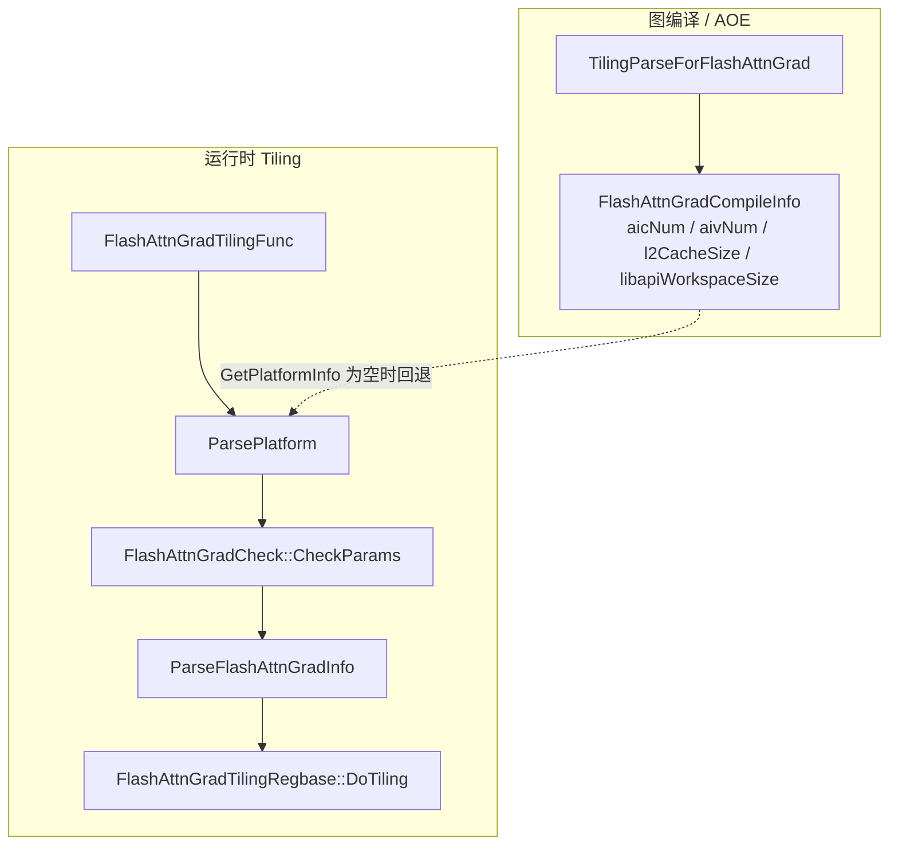
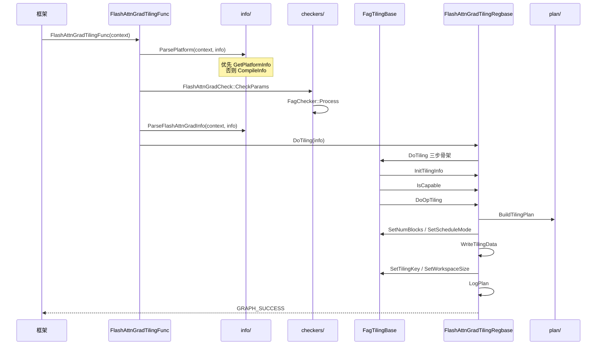
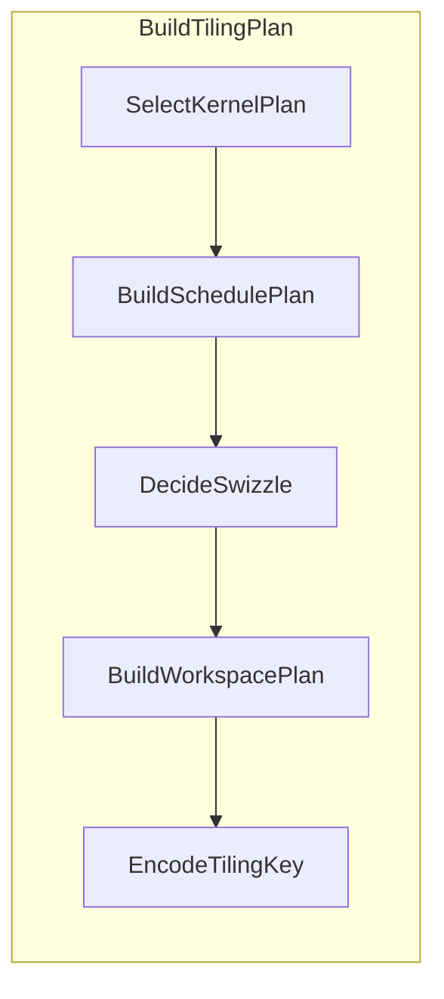

# FlashAttnGrad Host Tiling 调用流程

> 对照实现，不是设计草案。设计决策见 [FlashAttnGrad_Tiling架构设计.md](./FlashAttnGrad_Tiling架构设计.md)。
>
> 源码根：`attention/flash_attn_grad/op_host/`。分层目录：`info/`、`checkers/`、`plan/`、`base/`；薄入口在 `flash_attn_grad_tiling.cpp`。

---

## 1. 两段生命周期

框架通过 `IMPL_OP_OPTILING(FlashAttnGrad)` 挂两个回调：

| 时机 | 回调 | 文件 |
| --- | --- | --- |
| 图编译 / AOE | `TilingParseForFlashAttnGrad` | `flash_attn_grad_tiling.cpp` |
| 运行时 Tiling | `FlashAttnGradTilingFunc` | 同上 |



入口不做业务判断，只串四步：平台 → 校验 → 解析轴 → 模板类。

```
FlashAttnGradTilingFunc(context)
  ├─ ParsePlatform(context, info)
  ├─ FlashAttnGradCheck::CheckParams(context)
  ├─ ParseFlashAttnGradInfo(context, info)
  └─ FlashAttnGradTilingRegbase(context).DoTiling(info)
```

校验发生在 `ParseFlashAttnGradInfo` **之前**，所以 checker 读的是 `gert::TilingContext`，不是 `FagParsedInfo`。

---

## 2. 编译期：`TilingParseForFlashAttnGrad`

```
TilingParseForFlashAttnGrad(TilingParseContext)
  ├─ GetCompiledInfo<FlashAttnGradCompileInfo>()
  ├─ GetPlatformInfo()
  │    为空 → OP_LOGW，直接 GRAPH_SUCCESS（不填字段）
  └─ PlatformAscendC(platformInfo)
       ├─ GetCoreNumAiv()  → compileInfo->aivNum
       ├─ GetCoreNumAic()  → compileInfo->aicNum
       ├─ GetLibApiWorkSpaceSize()
       └─ GetCoreMemSize(L2) → compileInfo->l2CacheSize
```

图模式下 Tiling 阶段经常拿不到 `PlatformInfo`。`ParsePlatform` 会回退这份 CompileInfo。AOE / 单算子场景 parse 阶段没有 platform 不报错；两路都空才在运行时失败。

---

## 3. 运行时总链（函数级）



---

## 4. `ParsePlatform`（`info/flash_attn_grad_tiling_info_parser.cpp`）

```
ParsePlatform(context, info)
  ├─ context->GetPlatformInfo()
  │    为空
  │      ├─ GetCompileInfo() → FlashAttnGradCompileInfo
  │      ├─ 两路都空 → GRAPH_PARAM_INVALID
  │      └─ 填 aivNum / aicNum / libapiWorkspaceSize / l2CacheSize
  └─ 非空
       ├─ PlatformAscendC(platformInfo)
       ├─ GetCoreNumAiv / GetCoreNumAic
       ├─ GetCoreMemSize(L2)
       └─ GetLibApiWorkSpaceSize
  ├─ aicNum==0 或 aivNum==0 → GRAPH_PARAM_INVALID
  └─ GetWorkspaceSizes(1)==nullptr → GRAPH_PARAM_INVALID
```

SOC 是否 regbase **不在这里判**，下沉到 `FlashAttnGradTilingRegbase::IsCapable()`。

---

## 5. 校验：`CheckParams` → 7 个 `Check`

```
FlashAttnGradCheck::CheckParams          checkers/flash_attn_grad_tiling_check.cpp
  └─ FagChecker::FagChecker()           构造时按固定顺序 emplace
  └─ FagChecker::Process(context)
       ├─ 建 FagCheckCtx（context / opName）
       └─ for checker in checkers_:
            checker->Check(ctx)          失败则 OP_LOGE("%s check failed") 并返回
```

顺序不能调：Deterministic 最先；InputExistence 必须在所有解引用 shape 的 checker 之前；AttrRange 是唯一读属性的地方，Mask / Layout / Shape 依赖它填好的 `FagCheckCtx`。

| 顺序 | 类 | `Name()` | 做什么 |
| --- | --- | --- | --- |
| 1 | `FagDeterministicChecker` | `Deterministic` | D2：`GetDeterministic()==1` → 拒绝 |
| 2 | `FagInputExistenceChecker` | `InputExistence` | 必选 q/k/v/dout/attn_out/softmax_lse 的 shape 都能拿到 |
| 3 | `FagDtypeChecker` | `Dtype` | q/k/v/dout/attn_out 与 dq/dk/dv 同 dtype |
| 4 | `FagAttrRangeChecker` | `AttrRange` | 读属性进 ctx，做单参数范围校验 |
| 5 | `FagMaskChecker` | `Mask` | mask_mode × attn_mask × win_left/right |
| 6 | `FagLayoutChecker` | `Layout` | layout_q / layout_kv / layout_out 三者相同 |
| 7 | `FagShapeChecker` | `Shape` | 维数、B/S/N/D、softmax_lse、cu_seqlens |

基类：`FagBaseChecker::Check` / `Name`（`checkers/fag_base_checker.h`）。

---

## 6. `ParseFlashAttnGradInfo`（`info/`）

```
ParseFlashAttnGradInfo(context, info)
  ├─ ParseAttrs
  │    GetAttrs(): softmax_scale / mask_mode / max_seqlen_q/kv / layout_q
  │    layoutQ=="TND"  → layout=LAYOUT_TND, isTnd
  │    layoutQ=="BNSD" → isBnsd
  ├─ ParseShapes
  │    TND:  s1/s2 来自 max_seqlen 或 dim0；n1/n2/d/dv 来自 dim1/2；
  │          b = cu_seqlens_q.dim0 - 1（没有则 b=1）
  │    BNSD: [B,N,S,D]
  │    BSND: [B,S,N,D]
  │    n2<=0 或 n1 % n2 != 0 → GRAPH_PARAM_INVALID
  │    g = n1 / n2
  ├─ OptionalInputExists(SEQUSED_Q / SEQUSED_KV) → hasSeqused
  ├─ HasAttenMask(maskMode)
  │    仅 mask_mode∈{3,4} 且 ATTN_MASK 真有 tensor 才为 true
  ├─ OptionalInputExists(SINKS) → hasSinks   只打日志，不占 tilingkey（D4）
  └─ FillLayoutView
       BSND: viewD0=B, viewD2=N, coefB0=1, coefN0=0, coefN2=1
       BNSD: viewD0=B*N, viewD2=1, coefB0=N, coefN0=1, coefN2=0
       Q 侧用 N1，KV 侧用 N2（GQA）
```

`IsEmptyShape(info)` 此时不算。它只在最后 `LogPlan` 里调用，不改变分核与 workspace。

辅助函数（匿名命名空间）：`OptionalInputExists`、`HasAttenMask`、`FillLayoutView`、`ParseAttrs`、`ParseShapes`。

---

## 7. `DoTiling` 三步骨架（`base/`）

```
FagTilingBase::DoTiling(info)                      base/flash_attn_grad_tiling_base.h（inline）
  ├─ InitTilingInfo(info)                          FlashAttnGradTilingRegbase::  info_ = &info
  ├─ IsCapable()
  │    IsRegbaseSocVersion(context_)                非 DAV_3510 → GRAPH_PARAM_INVALID
  └─ DoOpTiling()
```

返回值语义（给将来多模板 fallback 用）：

| 返回值 | 含义 |
| --- | --- |
| `GRAPH_SUCCESS` | 成功，不必再试 |
| `GRAPH_PARAM_INVALID` | 本类不接，应试下一个模板类 |
| `GRAPH_FAILED` | 真失败，中止整个 tiling |

今天只有 `FlashAttnGradTilingRegbase` 一个类，入口直接构造，没有注册表循环。`GRAPH_PARAM_INVALID` 没有下一个可试。

---

## 8. `DoOpTiling` + `BuildTilingPlan`

```
FlashAttnGradTilingRegbase::DoOpTiling
  ├─ BuildTilingPlan(context, info, plan, trace)    plan/flash_attn_grad_tiling_plan.cpp
  ├─ SetNumBlocks(plan.schedule.blockDim)          → context->SetBlockDim
  ├─ tmpl==TMPL_BN2GS1S2
  │    SetScheduleMode(BATCH_MODE)               pre/post 用 sync_all，非满片必须 batch
  ├─ WriteTilingData(info)
  ├─ SetTilingKey(plan.tilingKey)
  ├─ SetWorkspaceSize(plan.workspace.totalSize)
  └─ LogPlan(context, info, plan, trace)
       含 IsEmptyShape（只打日志）+ route 淘汰原因
```

`BuildTilingPlan` 内部顺序不可调换：route 产出 `tmpl`，schedule 要用它区分 fusedOuter；schedule 产出 `usedCube`，swizzle 要用它判断是否满片。



```
BuildTilingPlan
  ├─ SelectKernelPlan → plan.kernel + trace
  ├─ BuildSchedulePlan → plan.schedule（除 swizzle）
  ├─ DecideSwizzle     → plan.schedule.swizzle + trace.swizzleReject
  ├─ BuildWorkspacePlan → plan.workspace
  └─ EncodeTilingKey   → plan.tilingKey
```

---

### 8.1 `SelectKernelPlan`（`plan/flash_attn_grad_tiling_route.cpp`）

按 `kRoutes[]` 从上到下试，先 `feasible` 再 `prefer`，命中即停。未命中的写入 `FagRouteTrace::Reject(name, reason)`。

| 行 | name | tmpl | `isBn2MultiBlk` | feasible | prefer |
| --- | --- | --- | --- | --- | --- |
| 1 | `BN2_single` | `TMPL_BN2` (1) | 0 | `Feasible_Bn2Single` | `Prefer_Always` |
| 2 | `BN2_multiblk` | `TMPL_BN2` (1) | 1 | `Feasible_Bn2MultiBlk` | `Prefer_Bn2BnGate` |
| 3 | `BN2S2_reserved` | `TMPL_RESERVED_BN2S2` (3) | 0 | `Feasible_Never` | — |
| 4 | `GS1S2` | `TMPL_BN2GS1S2` (0) | 0 | `Feasible_Always` | `Prefer_Always` |

谓词：

```
Bn2FamilyFeasible   !TND && n1==n2 && d<=128
Feasible_Bn2Single   family && s1<=128 && s2<=128
Feasible_Bn2MultiBlk family && maskMode==0 && S 落在 (128,640] && d==dv
Prefer_Bn2BnGate     BN>=256，或 BN>=128 且 S1/S2 对齐 128
```

命中后：

```
SelectDBucket(context, info, plan)
  D > 192 → GRAPH_PARAM_INVALID
  dAlign  = d<=64 ? 64 : (d<=128 ? 128 : 192)
  dvAlign = dv<=128 ? 128 : 192
  dAlign==64 → dvAlign 强制 128
```

兜底：没有任何行命中 → `GRAPH_FAILED`（末行恒可行，正常走不到）。`tmpl` 不是 0/1 → `GRAPH_FAILED`（D5：host 永不发出 template=2/3）。

---

### 8.2 `BuildSchedulePlan`（`plan/flash_attn_grad_tiling_schedule.cpp`）

```
BuildSchedulePlan(context, info, kernel, schedule)
  ├─ FagS1S2Outer(s1, s2, s1Outer, s2Outer)     plan/flash_attn_grad_block_outer.h
  │    FagCvInner(s1, 64, 2) / FagCvInner(s2, 128, 1)
  │    FagCeilDiv
  ├─ useActualCores = !isTnd && maskMode==0 && !hasSeqused
  ├─ usedCube = aicNum
  │    若 useActualCores:
  │      FagUsedCubeCores(tmpl==BN2, b, n2, g, s1Outer, s2Outer, aicNum)
  │        fusedOuter = BN2 ? b*n2*g : b*n2*g*s1Outer*s2Outer
  │        FagDenseBlockOuter(fusedOuter, aicNum)
  └─ blockDim = CalcTschBlockDim(usedCube * 2, aicNum, aivNum)
       返回 0 → GRAPH_PARAM_INVALID
```

`FagS1S2Outer` / `FagUsedCubeCores` 必须与 AICPU `InitFagBaseDims` / `DoFagDenseSplit` / `DoFagBn2DenseSplit` 同公式。sparse / TND / seqused 不缩核（全片启动，禁止少发）。

---

### 8.3 `DecideSwizzle`（`plan/flash_attn_grad_tiling_swizzle.cpp`）

默认 `schedule.swizzle = 0`。任一拒绝写 `trace.swizzleReject` 并 return；权威实现在 host，Python `decide_swizzle()` 是镜像。

```
DecideSwizzle(info, kernel, schedule, trace)
  tmpl != BN2GS1S2     → "not-bn2gs1s2"
  layout == TND        → "tnd-layout"
  usedCube != aicNum   → "partial-chip"
  l2CacheSize == 0     → "unknown-l2"
  网格退化             → "degenerate-grid"
  s2Outer > s1Outer    → "s2-dominant"
  liveBytes <= 阈值     → "working-set-fits"
       S1 占优：1.25×L2（5*l2/4）；否则 2×L2
  fusedHeads*s2Outer < 2*cores → "too-few-columns"
  全过 → swizzle=1, swizzleReject="accepted"
```

---

### 8.4 `BuildWorkspacePlan`（`plan/flash_attn_grad_tiling_workspace.cpp`）

必须与 kernel `make_ptr` 切分一致：

```
[0, libapi)                                      系统预留
[+libapi]  dq   B*S1*N1*D   fp32
[+...]     dk   B*S2*N2*D   fp32
[+...]     dv   B*S2*N2*Dv  fp32
```

GQA 下 dq 跟 N1，dk/dv 跟 N2（同一 KV head 的 G 个 Q head 会 atomicAdd 到同一块）。

---

### 8.5 `EncodeTilingKey`（`plan/flash_attn_grad_tiling_key.cpp`）

```
bit[1:0]  tmpl            0=BN2GS1S2, 1=BN2
bit2      layout           0=非TND, 1=TND（BNSD 不占位）
bit3      hasAttenMask
bit4      swizzle          仅 template=0 时可能为 1
bit[6:5]  dAlign           0=64, 1=128, 2=192
bit7      dvAlign          0=128, 1=192
bit8      isBn2MultiBlk
```

合法组合的真源在 `op_kernel/flash_attn_grad.py` 的 `FlashAttnGradTilingKey.is_valid()`。host 产出非法组合 → 运行期找不到二进制。

---

## 9. 写回 context

`SetNumBlocks` / `SetTilingKey` / `SetWorkspaceSize` / `SetScheduleMode` 在 `FagTilingBase`，子类不直接碰 context（`WriteTilingData` 除外，codegen 结构体只在 force-include 的 cpp 里可见）。

```
WriteTilingData(info)
  tilingData = context->GetTilingData<FlashAttnGradTilingData>()
  nullptr → GRAPH_FAILED     等价于 Tmp 与 py dataclass 漂移
  逐字段拷贝 FagParsedInfo
  scaleValue==0 → 1/sqrt(d)
```

两份互不相干的声明：

1. `op_kernel/flash_attn_grad.py` 的 dataclass → codegen `FlashAttnGradTilingData`（本文件 force-include，真正写入）
2. `flash_attn_grad_tiling.h` 的 `FlashAttnGradTilingDataTmp` → 只给 `REGISTER_TILING_DATA_CLASS` 分配容量

`regbase.cpp` 里 `static_assert` 钉死 size=136、`scaleValue`@56、`gSize`@64、`coefN2`@128。

`LogPlan` 打两行：plan 摘要（含 `IsEmptyShape`）+ `route: chosen=... swizzle=... aicNum=... l2CacheSize=...`，再逐条 rejected。

---

## 10. 数据流

```
TilingContext ──读──► ParsePlatform / Check / ParseFlashAttnGradInfo
                              │
                              ▼
                        FagParsedInfo          策略层只读，不回写
                              │
              ┌───────────────┼───────────────┐
              ▼               ▼               ▼
        FagKernelPlan  FagSchedulePlan  FagWorkspacePlan
              │               │               │
              └───────┬───────┘               │
                      ▼                     │
                 tilingKey                  │
                      │                     │
                      ▼                     ▼
         SetTilingKey / SetBlockDim / SetWorkspaceSize / WriteTilingData
                      │
                      ▼
              框架按 tilingkey 找 pypto kernel
              kernel 读 codegen TilingData
              AICPU metadata 用同一套 block_outer 公式做分核区间
```

L4（route / schedule / swizzle / workspace / key）不回写 `FagParsedInfo`，也不直接 `SetBlockDim`。写回只发生在 `FagTilingBase` 四个封装和 `WriteTilingData`。

---

## 11. 目录与函数对照

| 层 | 目录 | 入口函数 |
| --- | --- | --- |
| L0 | `flash_attn_grad_tiling.cpp` | `FlashAttnGradTilingFunc` / `TilingParseForFlashAttnGrad` |
| L1 | `info/flash_attn_grad_tiling_info.h` | 索引常量 + `FagParsedInfo` / 各 Plan POD |
| L2 | `info/flash_attn_grad_tiling_info_parser.*` | `ParsePlatform` / `ParseFlashAttnGradInfo` / `IsEmptyShape` |
| L3 | `checkers/` | `FlashAttnGradCheck::CheckParams` → `FagChecker::Process` |
| L4 | `plan/` | `SelectKernelPlan` / `BuildSchedulePlan` / `DecideSwizzle` / `BuildWorkspacePlan` / `EncodeTilingKey` |
| L4 编排 | `plan/flash_attn_grad_tiling_plan.cpp` | `BuildTilingPlan` |
| L5 | `base/` | `FagTilingBase::DoTiling` / `FlashAttnGradTilingRegbase::DoOpTiling` |
