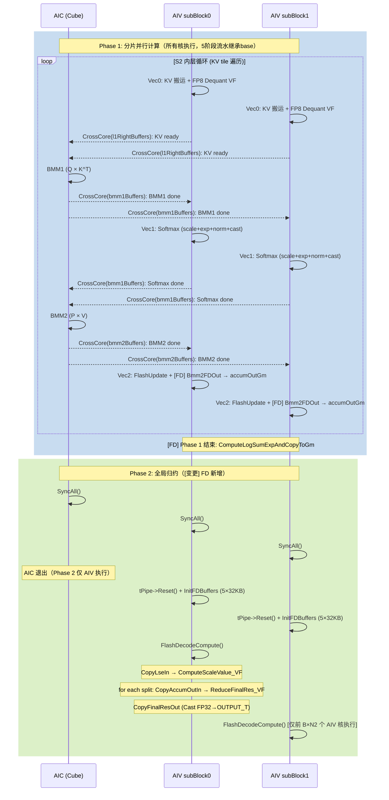

# QSFAP算子 Flash Decode 详细设计说明书

<center>**修订记录**</center>
<div align="center">

| 日期 | 修订版本 | 修改描述 | 作者 |
| :---: | :---: | :---: | :---: |
| 2026-04-16 | 1.0 | 新增 Flash Decode (FD) 多核 S2 轴并行加速特性详细设计 | Claude (a5_fa_detailed_design Skill) |

</div>

# 1 关联需求

| **需求编号** | 需求标题 | 需求链接 | 概要设计链接 | 修订版本 |
| :---: | --- | --- | --- | :---: |
| 待补充 | Flash Decode 多核 S2 轴并行加速 | 待补充 | kv_quant_sparse_flash_attention_pioneer_需求概设.md | 1.0 |

---

# 2 接口实现设计

## 2.1 PTA 接口实现

不涉及。FD 特性通过 TilingKey 模板参数 `isFd` 控制，不新增/修改 PTA 接口参数。

**变更表：**

| **需求编号** | 需求标题 | 变化点 |
| --- | --- | --- |
| 无 | 无 | PTA 接口无变化 |

## 2.2 aclnn 接口实现

不涉及。aclnn 接口无变化。

**变更表：**

| **需求编号** | 需求标题 | 变化点 |
| --- | --- | --- |
| 无 | 无 | aclnn 接口无变化 |

## 2.3 算子信息库

不涉及。OpDef 无变化（`isFd` 模板参数已在 TilingKey 中预留声明）。

**变更表：**

| **需求编号** | 需求标题 | 变化点 |
| --- | --- | --- |
| 无 | 无 | OpDef 无变化 |

## 2.4 图模式设计

不涉及。

---

# 3 总体设计

## 3.1 交付方式

| 类型 | 描述 | 备注 |
| --- | --- | --- |
| 交付内容 | CANN 包算子适配 | attention/kv_quant_sparse_flash_attention_pioneer/ |
| 代码承载 | ops-transformer/attention/kv_quant_sparse_flash_attention_pioneer/ | arch35 版本 |
| 期望交付时间 | 待确认 | |

## 3.2 交付件汇总

| **序号** | **交付件** | **是否需要** | **涉及变动** | **备注** |
| :---: | --- | :---: | :---: | --- |
| 01 | pta接口适配 | 否 | 否 | 无变化 |
| 02 | pta接口文档 | 否 | 否 | 无变化 |
| 03 | aclnn接口适配 | 否 | 否 | 无变化 |
| 04 | aclnn接口文档 | 否 | 否 | 无变化 |
| 05 | GE图模式适配 | 否 | 否 | 可选 |
| 06 | AclGraph图模式适配 | 否 | 否 | 可选 |
| 07 | 算子原型 | 否 | 否 | 可选 |
| 08 | OpDef定义（信息库） | 是 | 否 | 必选，无需修改 |
| 09 | 算子tiling函数 | 是 | 是 | 必选，TilingKey 中 isFd 位需使能 |
| 10 | 算子kernel实现 | 是 | 是 | 必选，新增 FD 分支（核心改动） |
| 11 | 算子二进制配置 | 是 | 否 | 必选 |
| 12 | 算子inferShape/inferDataType | 否 | 否 | 可选 |
| 13 | 图融合pass | 否 | 否 | 可选 |

## 3.3 TilingKey 设计

QSFA-Pioneer 使用标准 FA TilingKey 模板参数系统：

```cpp
template <typename Q_T, typename KV_T, typename T, typename OUTPUT_T,
          bool hasSink, bool isFd, bool isPa,
          QSFA_LAYOUT LAYOUT_T, QSFA_LAYOUT KV_LAYOUT_T,
          QSFATemplateMode TEMPLATE_MODE>
```

其中 `isFd` 已作为编译期模板参数预留，在 `kv_quant_sparse_flash_attention_pioneer_common.h` 的 `CUBE_BLOCK_TRAITS_CONST_FIELDS` 中定义：

```cpp
X(isFd, bool, false)
```

TilingKey 中 `FLASH_DECODE` 布尔位已声明（`ASCENDC_TPL_BOOL_DECL(FLASH_DECODE, 0, 1)`），FD 适配时需：

1. 在 tiling 侧 `IsFlashDecode()` 判定逻辑中设置 `FLASH_DECODE=1`
2. 确保新的 TilingKey 组合被加入有效模板列表

## 3.4 模板列表

| 规格 | 应用场景 | 模板 | 核间切分 | 核内切分 | 备注 |
| --- | --- | --- | --- | --- | --- |
| QSFAP（base） | 推理 Prefill/Decode | kv_quant_sparse_flash_attention_pioneer | B×N2×S1 动态均衡 | s1Base=64, s2Base=128 | 现有功能 |
| QSFAP（FD） | 推理 Decode 长序列 | kv_quant_sparse_flash_attention_pioneer | 每个(B,S1)分splitKVNum个核 | s1Base=64, s2Base=128 | **[变更] 新增 Flash Decode 特性** |

## 3.5 代码结构设计

| 目录 | 内容 | 变化点 | **需求编号** | 需求标题 |
| --- | --- | --- | --- | --- |
| op_host/kv_quant_sparse_flash_attention_pioneer_tiling.h | TilingData 结构体定义 | 无变化（splitKVParams 已存在） | | |
| op_host/kv_quant_sparse_flash_attention_pioneer_tiling.cpp | Tiling 逻辑 | **[变更]** IsFlashDecode 判定 + TilingKey FLASH_DECODE 位设置 | 待补充 | Flash Decode |
| op_kernel/util_regbase.h | 公共结构体定义 | **[变更]** ConstInfo 新增 splitKVNum/sInnerLoopSize/fdS2Start/fdS2End；RunParamStr 新增 flashDecodeS2Idx/actualSInnerLoopSize | 待补充 | Flash Decode |
| op_kernel/kv_quant_sparse_flash_attention_pioneer_kernel_mla.h | Kernel 主类 | **[变更]** InitCalcParamsEach 新增 `if constexpr (isFd)` 分核分支 + Process 末尾 Phase 2 归约调用 | 待补充 | Flash Decode |
| op_kernel/kv_quant_sparse_flash_attention_pioneer_service_vector_mla.h | Vector 服务类 | **[变更]** 新增 GM 变量 + InitFDBuffers/FlashDecodeCompute/CombineSplitKVRes + Bmm2FDOut/ComputeLogSumExpAndCopyToGm | 待补充 | Flash Decode |
| op_kernel/kv_quant_sparse_flash_attention_pioneer_common.h | 公共常量和枚举 | 无变化（isFd 模板参数已预留） | | |
| op_kernel/kv_quant_sparse_flash_attention_pioneer_template_tiling_key.h | 模板参数组合 | **[变更]** 新增 isFd=true 的 TilingKey 组合 | 待补充 | Flash Decode |
| attention_pioneer/op_kernel/common/arch35/vf/vf_flash_decode.h | FD 归约 VF 函数 | **引用**（无需修改，已在 reference 中实现） | | |

---

# 4 模板设计

## 4.1 kv_quant_sparse_flash_attention_pioneer 计算模板

### 4.1.1 计算流程图

#### 1. 流水阶段表

**Phase 1：分片并行计算（与 base 流水完全一致，FD 仅修改 Vec2 输出去向）**

| 阶段 | 名称 | 执行核 | 计算内容 | 输入来源 | 输出去向 |
|------|------|--------|---------|---------|---------|
| Vec0 | KV 搬运+反量化 | AIV | sparse indices 索引 → GM KV 搬运 → FP8 dequant VF → L1 | GM(KV_FP8, sparseIndices, blockTable) | L1(KV_BF16) |
| C1(BMM1) | Q×K^T | AIC | MatmulK: Q_tile × K_tile^T → S_tile | L0A(Q from L1), L0B(K from L1) | UB(bmm1Buffers, FP32) |
| Vec1(Softmax) | Scale+Softmax+Cast | AIV | scale → RowMax → Sub → Exp → RowSum → Div → Cast → L1 | UB(bmm1Buffers, FP32) | L1(P_BF16) |
| C2(BMM2) | P×V | AIC | MatmulN: P_tile × V_tile → O_tile | L0A(P from L1), L0B(V from L1) | UB(bmm2Buffers, FP32) |
| Vec2(Update) | FlashUpdate+输出 | AIV | Online rescale 累积更新 | UB(bmm2Buffers, FP32) | **base**: GM(attentionOut) / **[FD]**: GM(workspace: accumOut) |

**Phase 2：全局归约（[变更] FD 新增，仅 AIV 执行）**

| 阶段 | 名称 | 执行核 | 计算内容 | 输入来源 | 输出去向 |
|------|------|--------|---------|---------|---------|
| FD-Barrier | SyncAll | AIC+AIV | 全核屏障同步，确保所有 Phase 1 写入完成 | - | - |
| FD-Init | 缓冲区重置 | AIV | tPipe->Reset() + 分配 5×32KB UB 缓冲区 | - | UB |
| FD-CopyLse | LSE 加载 | AIV | 从 GM 加载所有分片的 softmaxMax/softmaxSum | softmaxFDMaxGm, softmaxFDSumGm | UB |
| FD-Scale | 归一化权重计算 | AIV | ComputeScaleValue_VF: globalMax → exp(max_k - globalMax) × sum_k → totalSum → scale[k] | UB(LSE data) | UB(lseTmpBuff) |
| FD-Reduce | 加权求和 | AIV | ReduceFinalRes_VF: dst = Σ scale[k] × accumOut[k] | accumOutGm → UB | UB(FDResOutputQue) |
| FD-CopyOut | 结果输出 | AIV | Cast(FP32→OUTPUT_T) + DataCopy → attentionOutGm | UB(FDResOutputQue) | attentionOutGm |

**CV 比例**：不变，AIC:AIV = 1:2（CV_RATIO = 2）

#### 2. 同步事件矩阵

**Phase 1 同步（与 base 一致，完全继承，通过 BuffersPolicy 自动管理）：**

| 同步点 | Buffer 类型 | 发送方 | 接收方 | 语义 |
|--------|------------|--------|--------|------|
| l1RightBuffers | L1, CROSS_CORE_SYNC_FORWARD, 3buff | AIV(Vec0写) | AIC(BMM1/BMM2读) | KV 搬运完成 → Cube 可使用 |
| bmm1Buffers | UB, CROSS_CORE_SYNC_BOTH, DB | AIC(BMM1写) ↔ AIV(Vec1读) | 双向 | BMM1 结果传递 + 释放 |
| bmm2Buffers | UB, CROSS_CORE_SYNC_BOTH, SingleBuf | AIC(BMM2写) ↔ AIV(Vec2读) | 双向 | BMM2 结果传递 + 释放 |

**Phase 2 新增同步（[变更]）：**

| 同步点 | 类型 | 发送方 | 接收方 | 语义 |
|--------|------|--------|--------|------|
| **[变更] SyncAll()** | 全核屏障 | 所有 AIC+AIV | 所有 AIC+AIV | Phase 1 → Phase 2 过渡 |

#### 3. 流水时序图



### 4.1.2 Tiling 实现设计

#### 4.1.2.1 TilingData 设计

**完整 TilingData 代码（无变更，Tiling 结构已预留 FD 字段）：**

```cpp
BEGIN_TILING_DATA_DEF(KvQuantSparseFlashAttentionSplitKVParamsMla)
TILING_DATA_FIELD_DEF(uint32_t, s2)             // S2 切分份数（splitKVNum）
TILING_DATA_FIELD_DEF(uint32_t, accumOutSize)   // FD workspace accumOut 区域元素数
TILING_DATA_FIELD_DEF(uint32_t, logSumExpSize)  // FD workspace LSE 区域元素数
END_TILING_DATA_DEF
```

**TilingData 字段说明表：**

| 字段 | 类型 | 功能描述 | 变更描述 | 需求编号 |
| --- | --- | --- | --- | --- |
| splitKVParams.s2 | uint32_t | S2 轴切分份数（splitKVNum），FD 模式下 = aicNum / (B × S1) | 无变化，Tiling 侧已支持 | |
| splitKVParams.accumOutSize | uint32_t | FD workspace accumOut 区域大小（元素数） | 无变化，Tiling 侧已支持 | |
| splitKVParams.logSumExpSize | uint32_t | FD workspace LSE 区域大小（元素数） | 无变化，Tiling 侧已支持 | |

**变更表：**

| **需求编号** | 需求标题 | 变化点 |
| --- | --- | --- |
| 无 | 无 | TilingData 结构无变化；TilingKey 中需设置 FLASH_DECODE=1 |

#### 4.1.2.2 核间 tiling 策略和数据地址偏移计算

**[变更] 新增 IsFlashDecode 判定函数：**

```cpp
bool QSFAPMlaTiling::IsFlashDecode(uint32_t coreNum)
{
    constexpr float FD_BN_RATIO = 0.4F;
    constexpr int64_t FD_SEQ_THRESHOLD_BASE = 256;
    constexpr int64_t FD_SEQ_THRESHOLD_GQA = 2048;
    constexpr uint32_t FD_GSIZE_LIMIT = 128;

    uint32_t bs1 = sfaaInfo_->bSize * sfaaInfo_->s1Size;
    int64_t maxActualseqKV = sfaaInfo_->maxActualseq;
    uint32_t gSize = sfaaInfo_->gSize;

    // 1. S2 不够长时不开启 FD
    if (maxActualseqKV < FD_SEQ_THRESHOLD_BASE) return false;

    // 2. GQA（gSize > 1）：核利用率不足且 S2 足够长
    if ((bs1 < FD_BN_RATIO * coreNum) && (maxActualseqKV >= FD_SEQ_THRESHOLD_GQA)) return true;

    return false;
}
```

**[变更] SplitBalanced 中 splitKVNum 计算：**

```cpp
if (IsFlashDecode(aicNum_)) {
    splitKVFlag_ = true;
    uint32_t bs1 = sfaaInfo_->bSize * sfaaInfo_->s1Size;
    splitNum = aicNum_ / bs1;
    constexpr int64_t kvSplitLimit = 128;
    int64_t maxActualseqKV = sfaaInfo_->maxActualseq;
    // 确保每片 S2 >= kvSplitLimit
    while (((maxActualseqKV / splitNum) < kvSplitLimit) && (splitNum > 1)) {
        splitNum--;
    }
    if (splitNum <= 1) {
        splitNum = 1;
        splitKVFlag_ = false;
    }
}
```

**非 FD 模式（base，继承不变）：** `kvSplitPart_ = splitNum = 1`

**基本块参数（与 base 一致，无变化）：**

| 参数 | 值 | 说明 |
|------|---|------|
| s1BaseSize | 64 | Query tile 行数 |
| s2BaseSize | 128 | KV tile 列数 |
| dSize (Q) | 576 | Q head dim (nope512 + rope64) |
| dSizeV | 512 | V head dim / 输出 head dim |
| dSizeVInput | 672 | KV input dim (656→672 对齐) |

#### 4.1.2.3 核内 tiling 策略和数据地址偏移计算

与 base 一致，无变化。核内 S2 循环按 s2BaseSize=128 切分，每轮处理一个 KV tile。

FD 模式下，每个核的 S2 循环范围由 `fdS2Start ~ fdS2End` 限定（见 4.1.4 FD 分核逻辑）。

### 4.1.3 Buffer 设计

#### 4.1.3.1 UB 空间的分配

**Phase 1 UB 分配（与 base 一致，继承不修改）：**

| UB | Position | 块大小 | BUF_NUM | 数据类型 | 总大小 | 备注 |
| --- | --- | --- | --- | --- | --- | --- |
| bmm1Buffers | CROSS_CORE_SYNC_BOTH | s1BaseSize/CV_RATIO × s2BaseSize × sizeof(T) = 32 × 128 × 4 = **16 KB** | DB(×2) | FP32 | **32 KB** | AIC写/AIV读 |
| bmm2Buffers | CROSS_CORE_SYNC_BOTH | s1BaseSize/CV_RATIO × dSizeV × sizeof(T) = 32 × 512 × 4 = **64 KB** | 1 (Single) | FP32 | **64 KB** | AIC写/AIV读 |
| stage0InQue | VECIN | dSizeVInput × 16 × sizeof(KV_T) = 672 × 16 × 1 = **10.5 KB** | 2 | KV_T(FP8) | **21 KB** | Vec0 KV 输入 |
| stage0OutQue | VECOUT | 576 × 17 × sizeof(Q_T) = 576 × 17 × 2 = **19.1 KB** | 2 | Q_T(BF16) | **38.3 KB** | Vec0 dequant 输出 |
| stage1OutQue[0] | VECOUT | vec1Srcstride × s2BaseSize × sizeof(Q_T) = 33 × 128 × 2 = **8.25 KB** | 1 | Q_T(BF16) | **8.25 KB** | Vec1 softmax→L1 |
| stage1OutQue[1] | VECOUT | 同上 = **8.25 KB** | 1 | Q_T(BF16) | **8.25 KB** | Vec1 pingpong |
| stage2OutBuf | TBuf | s1BaseSize/CV_RATIO × dTemplateAlign64 × sizeof(T) = 32 × 512 × 4 = **64 KB** | 1 | FP32 | **64 KB** | Vec2 累积结果 |
| softmaxMaxBuf[0,1] | TBuf | 256 B × 2 = **512 B** | 2 | FP32 | **512 B** | softmax max |
| softmaxSumBuf[0,1] | TBuf | 256 B × 2 = **512 B** | 2 | FP32 | **512 B** | softmax sum |
| softmaxExpBuf[0,1] | TBuf | 256 B × 2 = **512 B** | 2 | FP32 | **512 B** | softmax exp |
| commonTBuf | TBuf | **512 B** | 1 | FP32 | **512 B** | 通用临时空间 |

**Phase 1 UB 汇总**：
- CrossCore 部分（ubBufferManager）：16K × 2 + 64K = **96 KB**
- AIV 独占部分（InitLocalBuffer）：softmax 6×256B(1.5KB) + commonTBuf(0.5KB) + stage0InQue(21KB) + stage0OutQue(38.3KB) + stage1OutQue(16.5KB) + stage2OutBuf(64KB) ≈ **141.8 KB**
- **Phase 1 UB 总计 ≈ 237.8 KB**

**Phase 2 UB 分配（[变更] FD 新增，tPipe->Reset() 后重新分配）：**

| UB | Position | 块大小 | BUF_NUM | 数据类型 | 总大小 | 备注 |
| --- | --- | --- | --- | --- | --- | --- |
| lseTmpBuff | TBuf | **32 KB** | 1 | FP32 | **32 KB** | 归约临时空间+最终 scale 结果 |
| softmaxMaxInputQue | VECIN | **32 KB** | 1 | FP32 | **32 KB** | 加载各分片 softmaxMax |
| softmaxSumInputQue | VECIN | **32 KB** | 1 | FP32 | **32 KB** | 加载各分片 softmaxSum |
| accumOutInputQue | VECIN | **32 KB** | 1 | FP32 | **32 KB** | 加载各分片 accumOut |
| FDResOutputQue | VECOUT | **32 KB** | 1 | FP32/OUTPUT_T | **32 KB** | 最终归约结果输出 |

**Phase 2 UB 总计**：5 × 32 KB = **160 KB**

> Phase 1 和 Phase 2 的 UB 分时复用（tPipe->Reset() 释放后重新分配），不叠加。

#### 4.1.3.2 workspace 的分配

**base workspace（与 base 共享，无变化）：**

| WorkSpace | 块大小 | BUF_NUM | 数据类型 | 大小 | 备注 |
| --- | --- | --- | --- | --- | --- |
| mmRes | 单核 UB 区域 × usedCoreNum | 1 | uint8_t | 动态 | BMM1/BMM2/Vec2 中间结果 |

**FD workspace（[变更] 新增三块 GM 区域）：**

| WorkSpace | 块大小计算 | BUF_NUM | 数据类型 | 大小 | 备注 |
| --- | --- | --- | --- | --- | --- |
| accumOut | aicNum × 2 × n2Size × mBaseSize × dSizeV × sizeof(float) = aicNum × 2 × 1 × 64 × 512 × 4 | 1 | FP32 | aicNum × **256 KB** | 各分片 attention 中间结果 |
| softmaxFDMax | 2 × aicNum × 2 × n2Size × mBaseSize × 8 × sizeof(float) | 1 | FP32 | aicNum × **8 KB** | 各分片 softmax max |
| softmaxFDSum | 同 softmaxFDMax | 1 | FP32 | aicNum × **8 KB** | 各分片 softmax sum |

**FD workspace 总计**：aicNum × (256 KB + 8 KB + 8 KB) = aicNum × **272 KB**

#### 4.1.3.3 L1\L0 的分配

**L1（数据预加载层，与 base 一致，无变化）：**

| Buffer | 块大小 | BUF_NUM | 数据类型 | 大小 | 备注 |
| --- | --- | --- | --- | --- | --- |
| l1RightBuffers | max(576, 512) × 128 × sizeof(Q_T) = 576 × 128 × 2 = **144 KB** | 3(triple) | Q_T(BF16) | 144 KB × 3 = **432 KB** | Vec0写/AIC读, CROSS_CORE_SYNC_FORWARD |

L1 初始化大小：524,288 B = **512 KB**

**L0A / L0B / L0C（由 Matmul 库管理，与 base 一致）：**

| Buffer | 块大小 | BUF_NUM | 数据类型 | 大小 | 备注 |
| --- | --- | --- | --- | --- | --- |
| L0A (mmL0ABuffers) | **16 KB** | DB(×2) | — | **32 KB** | Matmul 库管理 |
| L0B (mmL0BBuffers) | **32 KB** | DB(×2) | — | **64 KB** | Matmul 库管理 |
| L0C (mmL0CBuffers) | **128 KB** | DB(×2) | — | **256 KB** | Matmul 库管理 |

**Phase 2 无 L1/L0 使用**（归约计算全在 UB 中完成）。

##### 【必填】硬件容量约束校验汇总

| 存储层级 | 硬件容量 | 代码初始化 | 实际使用 | 使用率 | 特性影响 | 校验结果 |
|---------|---------|-----------|---------|-------|---------|---------|
| **UB** | 248 KB | Phase1: 各Queue分配; Phase2: Reset后重分配 | Phase1: 237.8 KB; Phase2: 160 KB | Phase1: 95.9%; Phase2: 64.5% | Phase2 新增 160KB（Reset 后独占，与 Phase1 分时复用） | ✅通过 ⚠️ Phase1 接近上限 |
| **L1** | 1 MB | 512 KB | 432 KB | 84.4% | 无变化（FD 不影响 L1） | ✅通过 |
| **L0A** | 64 KB | 64 KB | ≤64 KB | ≤100% | 无变化 | ✅通过 |
| **L0B** | 64 KB | 64 KB | ≤64 KB | ≤100% | 无变化 | ✅通过 |
| **L0C** | 256 KB | 256 KB | ≤256 KB | ≤100% | 无变化 | ✅通过 |
| **Workspace** | GM | 动态计算 | aicNum × 272 KB | — | **[变更] FD 新增**：accumOut + softmaxFDMax + softmaxFDSum | ✅通过 |

### 4.1.4 Kernel 设计

#### 顶层调度伪代码

**Process()：**

```cpp
Process() {
    // 初始化同步（needInit 时清零输出）
    if (sharedParams.needInit) {
        SyncAll<false>();
    }

    // Phase 1: 分片并行计算
    if (aicIdx < usedCoreNum) {
        ProcessMainLoop();
    }

    // [变更] FD Phase 2: 全局归约
    if constexpr (isFd) {
        SyncAll();  // 全核屏障，AIC+AIV 均参与（包括空闲核）
        if ASCEND_IS_AIV {
            vecBlock.InitFDBuffers(constInfo);       // Reset UB，分配 5×32KB
            vecBlock.FlashDecodeCompute(constInfo, keyGm, actualSeqKvlenAddr);
        }
    }
}
```

> **关键设计决策**：SyncAll() 放在 `if constexpr (isFd)` 内、`ASCEND_IS_AIV` 判断之前，确保 AIC 也参与屏障。空闲核（aicIdx >= usedCoreNum）跳过 ProcessMainLoop 后仍执行 SyncAll。

**ProcessMainLoop() — 三层循环结构（与 base 一致）：**

```cpp
ProcessMainLoop() {
    // 第1层：BN 循环（batch × N2 groups，核间分配）
    for (bnIdx = bN2Start; bnIdx < bN2End; bnIdx++) {
        ComputeParamBatch(...);       // 获取 actualS1/S2
        ComputeS1LoopInfo(...);       // 计算 S1 循环范围

        // 第2层：S1G 循环（Query tile + PRELOAD_NUM 排空）
        for (gS1Index = gs1LoopStart; gS1Index < gs1LoopEnd + PRELOAD_NUM; gS1Index++) {
            ComputeParamS1(...);
            ComputeS2LoopInfo(...);
            // [FD 影响]: S2 循环范围限制在 [fdS2Start, fdS2End)

            if constexpr (hasSink) {
                runParam.s2LoopEndIdx += 1;  // s2LoopCount=0 为 Sink 迭代
            }
            s2LoopLimit = runParam.s2LoopEndIdx - 1;

            // 第3层：S2 循环（KV 块，最内层）
            for (s2LoopCount = 0; s2LoopCount <= s2LoopLimit; s2LoopCount++) {
                // taskId % 3 三任务流水调度
                if (notLastTwoLoop) {
                    if IS_AIC: cubeBlock.IterateBmm1(...);   // 任务槽0: Cube
                    if IS_AIV: vecBlock.ProcessVec0(...);     // 任务槽0: KV 预加载
                }
                if (taskId > 0 && notLast) {
                    if IS_AIV: vecBlock.ProcessVec1(...);     // 任务槽1: Softmax
                    if IS_AIC: cubeBlock.IterateBmm2(...);   // 任务槽1: BMM2
                }
                if (taskId > 1) {
                    if IS_AIV: vecBlock.ProcessVec2(...);     // 任务槽2: FlashUpdate
                    // [FD]: ProcessVec2 内部调用 Bmm2FDOut 而非 Bmm2DataCopyOut
                }
                ++taskId;
            }
        }

        // [变更] FD Phase 1 完成后写入 softmax statistics 到 workspace
        if constexpr (isFd) {
            if IS_AIV: vecBlock.ComputeLogSumExpAndCopyToGm(...);
        }
    }
}
```

#### FD 分核逻辑（InitCalcParamsEach 中的 `if constexpr (isFd)` 分支）

```cpp
// [变更] FD 分核：固定核数非均匀切分
if constexpr (isFd) {
    constInfo.splitKVNum = tilingData->splitKVParams.s2;

    // 计算总的 (B, S1) 基本块数
    uint32_t totalS1 = 0;
    for (uint32_t bIdx = 0; bIdx < constInfo.bSize; bIdx++) {
        totalS1 += GetBalanceActualSeqLengths(actualSeqLengthsQGm, bIdx);
    }
    uint32_t actualCoreNums = totalS1 * constInfo.splitKVNum;

    if (aicIdx >= actualCoreNums) {
        usedCoreNum = actualCoreNums;
        return;  // 空闲核，但仍参与后续 SyncAll
    }
    usedCoreNum = actualCoreNums;

    // 核索引解码
    uint32_t s1BlockIdx = aicIdx / constInfo.splitKVNum;
    constInfo.flashDecodeS2Idx = aicIdx % constInfo.splitKVNum;

    // 从 s1BlockIdx 反解 (boIdx, s1Idx)
    uint32_t accumS1 = 0;
    for (uint32_t bIdx = 0; bIdx < constInfo.bSize; bIdx++) {
        uint32_t actBatchS1 = GetBalanceActualSeqLengths(actualSeqLengthsQGm, bIdx);
        if (s1BlockIdx < accumS1 + actBatchS1) {
            boIdx = bIdx;
            s1Idx = s1BlockIdx - accumS1;
            break;
        }
        accumS1 += actBatchS1;
    }

    // 计算 S2 分片范围
    uint32_t effectiveS2Size = actBatchS2;
    if constexpr (hasSink) {
        effectiveS2Size += constInfo.s2BaseSize;  // sink 块计入
    }
    constInfo.sInnerLoopSize = CeilDiv(effectiveS2Size, constInfo.splitKVNum);
    constInfo.fdS2Start = constInfo.sInnerLoopSize * constInfo.flashDecodeS2Idx;
    constInfo.fdS2End = min(constInfo.fdS2Start + constInfo.sInnerLoopSize, effectiveS2Size);
}
```

#### 各流水阶段伪代码

**Vec0 阶段（KV 搬运+反量化，与 base 一致）：**

```cpp
ProcessVec0(outputL1, runInfo, constInfo) {
    outputL1.WaitCrossCore();  // 等待上一轮 BMM2 释放 L1

    if constexpr (hasSink) && s2LoopCount == 0:
        直接 SetCrossCore() 返回;  // sink 由 Cube 侧处理

    ProcessSparseKv(outputL1, runInfo, constInfo):
        // subBlock 分工
        while (s2 < s2End && !meetEnd):
            AllocTensor(stage0InQue);
            // 内层循环：每次填满 16 行
            GetRealCmpS2Idx(token0, token1);  // 从 GM 读 sparse_indices
            CopyInKvSparse(kvInUb, token0, token1);  // GM→UB (672B/行)
            DequantKv(kvDequantOutUb, kvInUb);  // FP8→FP32→×scale→BF16
            CopyOutKvUb2L1(outputL1, kvDequantOutUb);  // UB→L1 NZ格式

    outputL1.SetCrossCore();  // 通知 AIC KV ready
}
```

**BMM1 阶段（Q×K^T，与 base 一致）：**

```cpp
IterateBmm1QSFA(outputBuf, inputRightBuf, runInfo, constInfo) {
    // 1. 首次 S2 循环加载 Q 到 L1
    if (s2LoopCount == 0):
        CopyToL1Nd2Nz(l1QBuffers, queryGm[offset], mRealSize, dSize=576);
    // 2. 等待 Vec0 完成 KV 搬运
    inputRightBuf.WaitCrossCore();
    // 3. MatmulK: Q[M,576] × K^T[576,s2] → S[M,s2] (float)
    MatmulK<Q_T, Q_T, float, 64, 128, 128>(l1QBuffers, inputRightBuf, mm1ResL0C);
    // 4. Fixpipe L0C → UB (dualDstCtl=1, 按 M/2 拆分到两个 subBlock)
    Fixpipe(outputBuf, mm1ResL0C, nSize=128, mSize=mRealSize);
    // 5. 通知 Vec1
    outputBuf.SetCrossCore();
}
```

**Vec1 阶段（Softmax，与 base 一致）：**

```cpp
ProcessVec1(outputBuf, bmm1ResBuf, runInfo, constInfo) {
    bmm1ResBuf.WaitCrossCore();  // 等待 BMM1 结果

    // Softmax VF 路由（6 条路径）
    ProcessVec1Vf(bmm1ResBuf, softmaxMax, softmaxSum, softmaxExp,
                  s2RealSize, isUpdate=s2LoopCount>0);
    // 内部完成：Muls(scale) → RowMax → Sub → Exp → RowSum → Div → Cast(FP32→BF16) → ND2NZ

    bmm1ResBuf.SetCrossCore();  // 释放 BMM1 UB

    // DataCopy Cast 结果 → L1（BMM2 左矩阵 P）
    DataCopy(outputBuf[s2BaseSize * dSizeV], stage1OutQue, ...);
    outputBuf.SetCrossCore();  // 通知 AIC BMM2 左矩阵就绪

    if (s2LoopCount != 0):
        QSFAUpdateExpSumAndExpMax();  // 更新 Online Softmax 状态
}
```

**BMM2 阶段（P×V，与 base 一致）：**

```cpp
IterateBmm2QSFA(outputBuf, inputLeftBuffers, inputRightBuf, runInfo, constInfo) {
    inputRightBuf.WaitCrossCore();  // 等待 Vec1 完成
    // MatmulN: P[M,s2] × V[s2,512] → O[M,512] (float)
    MatmulN<Q_T, Q_T, float, 64, 128, 128>(inputRightBuf[rope_offset],
                                             inputRightBuf[nope_offset], mm2ResL0C);
    inputRightBuf.SetCrossCore();  // 释放 KV L1
    // Fixpipe L0C → UB (dualDstCtl=1)
    Fixpipe(outputBuf, mm2ResL0C, nSize=512, mSize=mRealSize);
    outputBuf.SetCrossCore();  // 通知 Vec2
}
```

**Vec2 阶段（FlashUpdate + CopyOut，[变更] FD 分支）：**

```cpp
ProcessVec2(bmm2ResBuf, runInfo, constInfo) {
    bmm2ResBuf.WaitCrossCore();  // 等待 BMM2 结果
    WaitFlag<MTE3_V>(mte3ToVId[0]);  // 等待上一轮输出搬运完成

    // Flash Update（与 base 一致）
    if (s2LoopCount == 0):
        DataCopy(vec2ResUb, mmRes);  // 首次：直接拷贝
    elif (s2LoopCount < s2LoopLimit):
        FlashUpdateNew(vec2ResUb, mmRes, expMax);  // 中间：dst = pre * expMax + cur
    else:
        FlashUpdateLastNew(vec2ResUb, mmRes, expMax, expSum);  // 末次：含除法

    bmm2ResBuf.SetCrossCore();  // 释放 BMM2 UB

    // [变更] 输出分支
    if (s2LoopCount == s2LoopLimit):
        if constexpr (!isFd) {
            // base 模式：直接输出到 attentionOutGm
            Bmm2DataCopyOut(attentionOutGm, vec2ResUb);
            // Cast(float→OUTPUT_T) + DataCopyPad → GM
        } else {
            // [变更] FD 模式：输出到 workspace accumOutGm（保持 FP32，不做 Cast）
            Bmm2FDOut(accumOutGm, vec2ResUb);
            // DataCopy FP32 → accumOutGm[splitKVIdx * offset]
        }

    SetFlag<MTE3_V>(mte3ToVId[0]);
}

// [变更] FD Phase 1 结束后，写入 softmax statistics
ComputeLogSumExpAndCopyToGm() {
    // 将当前核的 softmax max/sum 从 UB 写入 workspace GM
    DataCopy(softmaxFDMaxGm[lseOffset], softmaxMaxBuf, ...);
    DataCopy(softmaxFDSumGm[lseOffset], softmaxSumBuf, ...);
}
```

#### FD Phase 2 归约调用序列

```cpp
// [变更] FD Phase 2 入口
FlashDecodeCompute(constInfo, keyGm, actualSeqKvlenAddr) {
    // 仅前 B × N2 个 AIV 核执行归约
    bIdx = aivIdx / constInfo.n2Size;
    n2Idx = aivIdx % constInfo.n2Size;
    if (aivIdx >= constInfo.bSize * constInfo.n2Size) return;

    // 获取当前 batch 实际 KV 长度
    GetActualSeqLenKV(..., actualSeqLen);
    actualCombineLoopSize = CeilDiv(actualSeqLen, constInfo.sInnerLoopSize);

    CombineSplitKVRes(constInfo, attenOutOffset, bIdx, n2Idx);
}

CombineSplitKVRes(constInfo, attenOutOffset, bIdx, n2Idx) {
    // G 轴分片处理（适应 32KB UB 容量约束）
    gSplitSize = min(32K / (32B × splitKVNum), 32K / (4B × dSizeV), gSize);

    for (gOffset = 0; gOffset < gSize; gOffset += gSplitSize) {
        dealGSize = min(gSplitSize, gSize - gOffset);

        // Step 1: 加载所有分片的 max/sum
        CopyLseIn(softmaxMaxInputQue, softmaxSumInputQue, splitKVNum, dealGSize);

        // Step 2: 计算归约权重 scale[k]
        // globalMax = max(max_0, ..., max_{splitKVNum-1})
        // scale[k] = exp(max_k - globalMax) × sum_k / totalSum
        ComputeScaleValue_VF(lseTmpBuff, softmaxMaxInputQue, softmaxSumInputQue,
                             splitKVNum, dealRowCount);

        // Step 3: 逐分片加权求和
        for (k = 0; k < actualCombineLoopSize; k++) {
            CopyAccumOutIn(accumOutInputQue, k, dealGSize);
            if (k == 0):
                ReduceFinalRes_0_VF(FDResOutputQue, accumOutInputQue, lseTmpBuff, ...);
            else:
                ReduceFinalRes_Rest_VF(FDResOutputQue, accumOutInputQue, lseTmpBuff, k, ...);
        }

        // Step 4: Cast FP32 → OUTPUT_T + CopyOut 到 attentionOutGm
        CopyFinalResOut(FDResOutputQue, attentionOutGm, attenOutOffset, dealGSize);
    }
}
```

#### A5 VF 函数设计

**Phase 1 VF 函数（与 base 一致，继承不修改）：**

| VF 函数 | 文件 | 用途 |
|---------|------|------|
| AntiquantVFImplFp8D448 | vf/ 相关文件 | Vec0: KV FP8 反量化 |
| ProcessVec1Vf (6 条路径) | vf/vf_mul_sel_softmaxflashv2_cast_nz_qsfa.h | Vec1: Softmax 全流程 |
| FlashUpdateNew / FlashUpdateLastNew / LastDivNew | vf/vf_flashupdate_new_qsfa.h | Vec2: Flash Update |
| QSFAUpdateExpSumAndExpMax | vf/vf_mul_sel_softmaxflashv2_cast_nz_qsfa.h | Vec1: Online Softmax 状态更新 |

**Phase 2 FD 归约 VF 函数（[变更] 引用 attention_pioneer 已有实现）：**

| VF 函数 | 来源 | 用途 | MicroAPI 序列 | RegTensor 需求 |
|---------|------|------|--------------|---------------|
| ComputeScaleValue_VF | vf/vf_flash_decode.h | 计算归约权重 scale[k] | Load(max)→Max→Sub→Exp→Load(sum)→Mul→Sum→Rcp→Mul→Store | 5 个 |
| ReduceFinalRes_0_VF | vf/vf_flash_decode.h | 首片：dst = scale[0] × accumOut[0] | Load(accumOut)→Load(scale)→Mul→Store | 3 个 |
| ReduceFinalRes_Rest_VF | vf/vf_flash_decode.h | 后续片：dst += scale[k] × accumOut[k] | Load(dst)→Load(accumOut)→Load(scale)→Mul→Add→Store | 4 个 |

**VF 函数参数适配说明**：
- `dLoops = dSizeV / 64 = 512 / 64 = 8`（每次 VF 处理 64 个 FP32 元素）
- ComputeScaleValue_VF 按 g≤8 / 8<g≤16 分档（ComputeScaleValue_8_VF / ComputeScaleValue_16_VF）
- 所有 FD 归约 VF 函数寄存器需求 ≤5 个，远小于 256 上限，无溢出风险

#### 【新增】同步正确性检查

| 检查项 | 检查内容 | 检查结果 | 风险等级 | 备注/修复方案 |
|--------|---------|---------|---------|--------------|
| 配对完整性 | Set/Wait 1:1 配对 | ✅通过 | 高 | Phase 1 继承 BuffersPolicy 自动管理；Phase 2 SyncAll 无需手动配对 |
| 循环依赖 | 依赖图无环 | ✅通过 | 高 | Phase 1 单向流水 Vec0→BMM1→Vec1→BMM2→Vec2；Phase 2 SyncAll→单核归约，无反向依赖 |
| CrossCore 访问序 | 读写同步完整 | ✅通过 | 高 | Phase 1 继承 base；Phase 2 无 CrossCore Buffer（归约在单 AIV 核内完成） |
| 事件 ID 冲突 | ID 无冲突 | ✅通过 | 中 | 继承 base 事件 ID；FD 不新增手动 SetFlag/WaitFlag |
| Ping-Pong 隔离 | 奇偶事件分离 | ✅通过 | 中 | 继承 base DB/3buff 机制 |
| **空闲核 SyncAll** | 所有核参与屏障 | ✅通过 | 高 | SyncAll 放在 ProcessMainLoop 之外，空闲核仍执行 |
| **综合判定** | **全部通过方可编码** | **✅通过** | — | 关键点：SyncAll 位置正确性已确认 |

### 4.1.5 异常场景设计

| 场景 | 处理方式 | FD 特殊处理 |
|------|----------|------------|
| actualSeqKV = 0 | tiling 侧不启用 FD，走非 FD 路径 | N/A |
| actualSeqKV < 256 | IsFlashDecode 判定为 false | N/A |
| FD 尾片 S2 < s2BaseSize | `actualSInnerLoopSize` 动态裁剪 | s2RealSize 按实际值处理 |
| 分片起始超出 actualSeqKV | `actualSInnerLoopSize = 0`，核直接 return | Phase 2 中 actualCombineLoopSize 自动排除空分片 |
| sparseIndices 中有 -1 token | 现有 sparse 搬运逻辑 `token < 0` 跳过 | FD 不影响此逻辑 |
| B × splitKVNum > aicNum | tiling 侧调整 splitKVNum ≤ aicNum/bs1 | N/A（tiling 侧保证） |
| 空闲核未参与 SyncAll | Process 中 SyncAll 放在 ProcessMainLoop 之外 | **关键保护点** |
| gSize > 128 | IsFlashDecode 返回 false | 避免 Phase 2 workspace 过大 |
| hasSink + FD | effectiveS2Size += s2BaseSize(128) | sink 块计入 S2 总长度参与切分 |

### 4.1.6 支持确定性计算设计

**本模板不涉及确定性计算问题。**

- kv_quant_sparse_flash_attention_pioneer 是前向推理算子，不涉及梯度累加
- **Phase 1**：各核处理不同 S2 分片，无竞争写入（accumOut 按核索引偏移写入独立区域）
- **Phase 2**：每个 (b, n2) 只有一个 AIV 核执行归约（`aivIdx = bIdx × N2 + n2Idx`），不存在多核写同一地址
- Online Softmax 的分片归约通过 LogSumExp 数学等价保证数值一致性

**结论**：FD 模式满足确定性计算要求。

### 4.1.7 精度分析及设计

#### 完整精度链条表

**Phase 1（与 base 一致）：**

| 计算步骤 | 输入 dtype | 计算 dtype | 是否需 Cast | 精度说明 |
|----------|------------|------------|-------------|----------|
| KV 搬运 | FP8_E4M3(1B) | — | — | GM → UB |
| KV Dequant (VF) | FP8 | FP32 | FP8→FP32(Cast) → ×Scale → FP32→BF16(Cast) | AntiquantVFImplFp8D448 |
| KV UB→L1 | BF16 | — | — | NZ 格式搬运 |
| BMM1 (Q×K^T) | Q:BF16, K:BF16 | FP32 | Cube 自动升精 | Cube 输出 FP32 |
| Softmax Scale | FP32 | FP32 | 否 | × scaleValue |
| Softmax RowMax | FP32 | FP32 | 否 | VF 实现 |
| Softmax Sub+Exp | FP32 | FP32 | 否 | 先减 max 再 exp，避免 Inf |
| Softmax RowSum | FP32 | FP32 | 否 | VF 实现 |
| Softmax Normalize | FP32 | FP32 | 否 | ×(1/sum) |
| Cast P | FP32 → BF16 | — | 显式降精度 | BMM2 输入要求 |
| BMM2 (P×V) | P:BF16, V:BF16 | FP32 | Cube 自动升精 | Cube 输出 FP32 |
| FlashUpdate | FP32 | FP32 | 否 | old × exp_factor + new |
| Last Div | FP32 | FP32 | 否 | 最终除以 sum |
| **[base] Output Cast** | FP32 → BF16 | — | 显式降精度 | 直接输出 |
| **[FD] Bmm2FDOut** | FP32 | FP32 | 否 | 写入 workspace，不做 Cast |

**Phase 2 归约精度链（[变更] FD 新增）：**

| 计算步骤 | 输入 dtype | 计算 dtype | 是否需 Cast | 精度说明 |
|----------|------------|------------|-------------|----------|
| 加载 accumOut | FP32(GM) | FP32 | 否 | 各分片 attention 中间结果 |
| 加载 softmaxMax/Sum | FP32(GM) | FP32 | 否 | 各分片统计量 |
| globalMax 计算 | FP32 | FP32 | 否 | max(各分片 max) |
| rescale 计算 | FP32 | FP32 | 否 | exp(max_k - globalMax) × sum_k |
| 归一化 scale | FP32 | FP32 | 否 | rescale_k / totalSum |
| 加权求和 | FP32 | FP32 | 否 | Σ scale_k × accumOut_k |
| **[FD] Output Cast** | FP32 → OUTPUT_T(BF16) | — | 显式降精度 | 最终降精度 |

#### Online Softmax 精度说明

- m(max) 和 l(sum) 统计量：全程 **FP32**，不存在精度截断
- rescale 因子 `exp(m_old - m_new)`：**FP32** 计算
- Phase 2 归约权重 `exp(max_k - globalMax) × sum_k / totalSum`：全 **FP32** 链路
- FD 归约精度损失主要来自 Phase 1 的 BF16 截断（Cast P for BMM2），与 base 一致

#### 升降精度节点标注

| 节点 | 类型 | 说明 |
|------|------|------|
| KV 反量化 | 显式 Cast | FP8_E4M3 → FP32 → BF16 |
| BMM1 输出 | Cube 自动升精 | BF16 → FP32 |
| Vec1 输出 (P) | 显式 Cast | FP32 → BF16 |
| BMM2 输出 | Cube 自动升精 | BF16 → FP32 |
| Vec2 输出（非FD） | 显式 Cast | FP32 → BF16 |
| **[FD] Phase 2 归约输出** | 显式 Cast | FP32 → OUTPUT_T(BF16) |

#### 精度验收标准

| 输入 dtype | atol | rtol | 说明 |
|------------|------|------|------|
| BF16 | 2e-2 | 1e-2 | FD 结果对比非 FD 结果 |
| FP16 | 1e-3 | 1e-3 | FD 结果对比非 FD 结果 |

### 4.1.8 性能分析及设计

#### 瓶颈类型判断

**Memory Bound**。QSFA-Pioneer 已有 KV FP8 反量化开销（FP8→BF16 数据量翻倍），Vec0 的 GM→UB 搬运和 UB→L1 搬运是主要带宽消耗。BMM1/BMM2 的 Cube 计算相对较快（s1BaseSize=64, s2BaseSize=128, dSizeV=512）。FD 适配不改变瓶颈类型。

#### Bubble 分析

**Phase 1 Bubble（与 base 一致）：**

3 任务槽流水时序：
```
taskId:    0          1          2          3          4       ...
AIC:    BMM1[0]    BMM1[1]    BMM1[2]    BMM1[3]    (排空)
                   BMM2[0]    BMM2[1]    BMM2[2]    BMM2[3]
AIV:    Vec0[0]    Vec0[1]    Vec0[2]    Vec0[3]    (排空)
                   Vec1[0]    Vec1[1]    Vec1[2]    Vec1[3]
                              Vec2[0]    Vec2[1]    Vec2[2]
```

Vec0 阶段（KV FP8 反量化 + 离散稀疏搬运）耗时较长，可能成为流水瓶颈。此为 base 已知特性。

**FD 对 Phase 1 的影响**：每个分片的 S2 循环次数减少，流水排空（PRELOAD_NUM=2）的相对开销增大。tiling 侧通过 `kvSplitLimit=256` 保护每片最小 S2 长度。

**Phase 2 Bubble（无流水，顺序执行）：**
```
CopyLseIn → ComputeScaleValue_VF → [for each split: CopyAccumOutIn → ReduceFinalRes_VF] → CopyFinalResOut
```
典型场景（G=1, splitKVNum=4~8）Phase 2 总耗时约占 kernel 时间的 5%~10%。

#### Preload / Double Buffer 方案

**Phase 1（继承 base，无变化）：**

| 优化措施 | 状态 | 说明 |
|---------|------|------|
| L1 3-Buffer Preload | ✅启用 | l1RightBuffers 3buff |
| UB bmm1 Double Buffer | ✅启用 | bmm1Buffers DB |
| UB bmm2 Single Buffer | 单 Buffer | dSizeV=512 导致 buffer 较大 |
| Vec0 Double Buffer | ✅启用 | stage0InQue/stage0OutQue 各 2 buffer |
| stage1OutQue Ping-Pong | ✅启用 | 2 份 stage1OutQue |

**Phase 2（无 Double Buffer）**：归约计算量较小，不需要 Double Buffer。

#### A5 VF 函数性能分析

| VF 函数 | RegTensor 数量 | 循环内 MicroAPI 序列 | 性能评估 |
|---------|---------------|---------------------|---------|
| ComputeScaleValue_VF | 5 | Load→Max→Sub→Exp→Mul→Sum→Div | 寄存器充裕，无溢出风险 |
| ReduceFinalRes_0_VF | 3 | Load→Mul→Store | 极轻量 |
| ReduceFinalRes_Rest_VF | 4 | Load→Mul→Add→Store | 极轻量 |

所有 Phase 2 VF 函数寄存器需求均远小于 256 上限，性能受限于 GM 搬运延迟而非计算。

### 4.1.9 训推一致性设计

不涉及。FD 适配仅影响推理 Decode 场景，不涉及训练。

---

# 5 维测设计

| 维度 | 内容 | 备注 |
|------|------|------|
| 可测试性 | FD 模式需新增 UT/ATK 测试用例：(1) S2 轴切分正确性；(2) Phase 2 归约精度；(3) 各 splitKVNum 值下的功能正确性；(4) 尾片和空分片处理 | 与 base UT 共用框架 |
| 可观察性 | Phase 1 各核 accumOut/softmaxMax/softmaxSum 可通过 DumpTensor 输出对比 golden；Phase 2 归约结果可与非 FD 模式输出对比 | |
| 可维护性 | FD 特性通过 `if constexpr (isFd)` 编译期分支隔离，非活跃分支在编译时消除，不影响 base 代码执行路径和性能 | |

---

# 6 资料设计

不涉及。

---

# 附录：代码生成任务拆分表

| 任务编号 | 文件 | 生成内容 | 依赖任务 | 对应文档节 |
|---------|------|---------|---------|-----------|
| T1 | `op_kernel/util_regbase.h` | ConstInfo 新增 splitKVNum/sInnerLoopSize/fdS2Start/fdS2End 字段；RunParamStr 新增 flashDecodeS2Idx/actualSInnerLoopSize | 无 | 3.5, 4.1.2.2 |
| T2 | `op_kernel/kv_quant_sparse_flash_attention_pioneer_kernel_mla.h` | InitCalcParamsEach 新增 `if constexpr (isFd)` 分核分支 + Process 末尾 Phase 2 归约调用（SyncAll + InitFDBuffers + FlashDecodeCompute） | T1 | 4.1.4 |
| T3 | `op_kernel/kv_quant_sparse_flash_attention_pioneer_service_vector_mla.h` | 新增 GM 变量（accumOutGm/softmaxFDMaxGm/softmaxFDSumGm）+ InitFDBuffers/FlashDecodeCompute/CombineSplitKVRes 方法 + Bmm2FDOut/ComputeLogSumExpAndCopyToGm 分支 | T2 | 4.1.4 |
| T4 | `op_host/kv_quant_sparse_flash_attention_pioneer_tiling.cpp` | IsFlashDecode 判定 + TilingKey FLASH_DECODE 位设置 + splitKVNum 计算 | 无 | 3.3, 4.1.2.2 |
| T5 | `op_kernel/kv_quant_sparse_flash_attention_pioneer_template_tiling_key.h` | 新增 isFd=true 的 TilingKey 组合 | 无 | 3.3 |
| T5-A5 | `attention_pioneer/op_kernel/common/arch35/vf/vf_flash_decode.h` | **引用**（无需修改，FD 归约 VF 函数已在 reference 中完整实现） | 无 | 4.1.4 |

> 注：T5-A5 仅引用 reference 中已有实现，不生成新代码。如需适配 QSFA-Pioneer 的特定 dSizeV/gSize 参数，可创建 `vf/vf_flash_decode_qsfa.h` 封装层。
