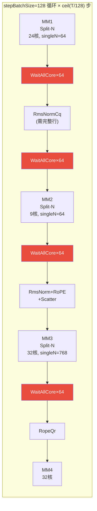
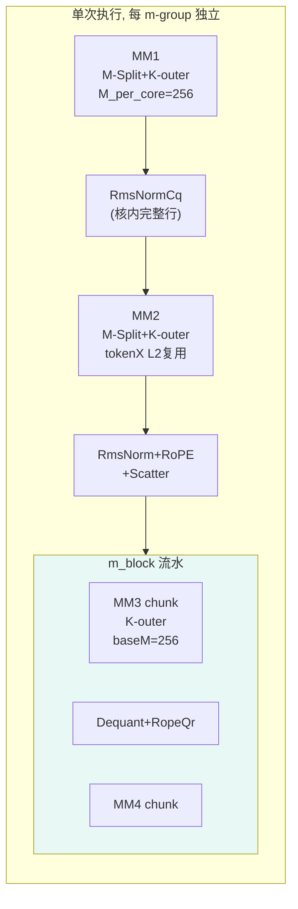
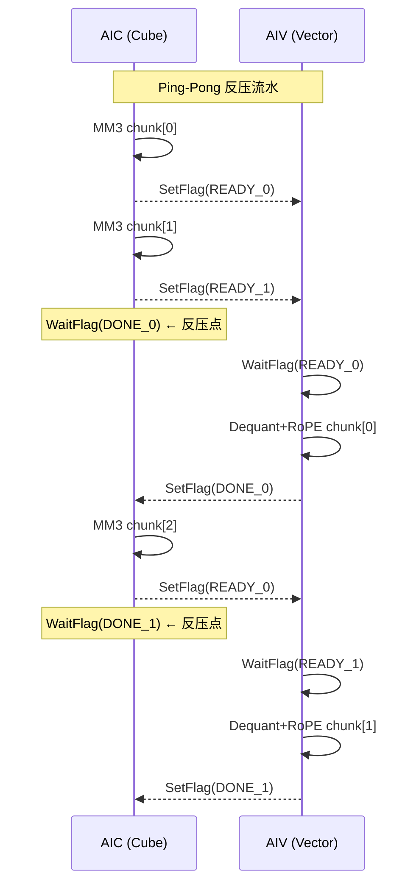
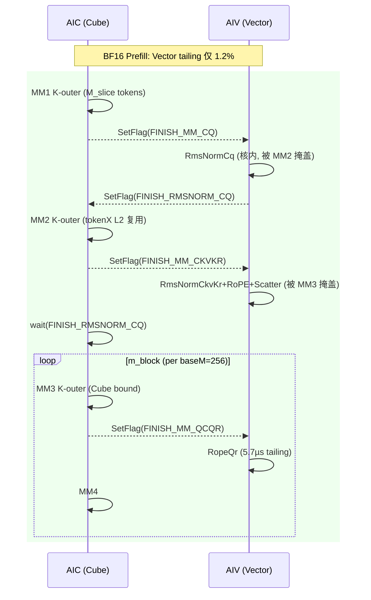
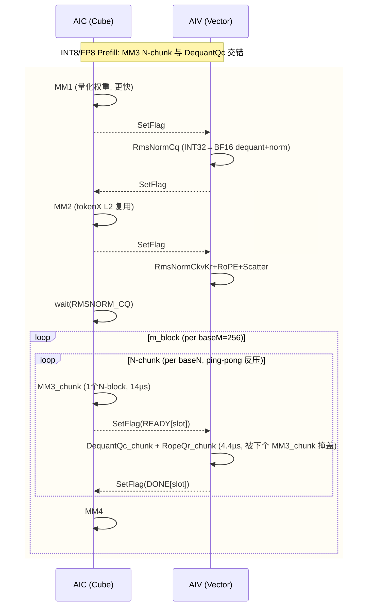
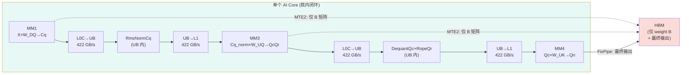

# MLA Prolog V3 Prefill 性能优化设计：M-Split Kernel 模板

> **目标读者**：Kernel 开发工程师。本文档从性能理论分析出发，回答三个核心问题，并给出完整的代码修改设计。

---

## 0. 核心问题索引

| 问题 | 章节 | 一句话回答 |
|------|------|---------|
| Prefill 与 Decode 模板的流水差异？ | §1 | Decode 按 stepBatchSize=128 循环 × Split-N；Prefill 单次执行 × M-Split + K-outer |
| Prefill 模板的优化点在哪？ | §2 | ① baseM↑(256) → Cube bound ② K-outer B-L2 复用 ③ 消除 stepBatchSize 循环 |
| 各场景理论收益？ | §3 | BF16: 1.2-2.1×；INT8/FP8 量化后 Split-N 已接近最优，M-Split 收益有限 |
| dequantOpt SetFlag 溢出？ | §4 | Ping-pong 反压：限制 in-flight flag ≤ 4 |

---

## 1. Prefill 模板与 Decode 模板的流水差异

### 1.1 建模原则（两模板共享）

| 引擎 | 路径 | 并行性 | 建模公式 |
|------|------|--------|---------|
| **MTE2** | HBM/L2 → L1 | A+B **共享带宽** | `(A_bytes + B_bytes) / bw` |
| **MTE1** | L1 → L0A/L0B | A+B **并行** | `max(l0a_time, l0b_time)` |
| **MMAD** | L0A × L0B → L0C | 计算 | `M × N × K / mmad_tput` |
| **FixPipe** | L0C → GM/UB | 写回 | `bytes / fixpipe_bw` |

L1、L0 默认双缓冲 (2×)；全载仅在矩阵一次性装入且有性能收益时启用。

### 1.2 Decode 模板 (`MlaPrologVecS1CubS2`)



**特征**：
- 外层 `for (batchOffset = 0; batchOffset < T; batchOffset += 128)` 循环
- 每步处理 stepBatchSize=128 个 token
- 所有 matmul 使用 **Split-N**：每核处理 N 的一个切片
- RmsNorm 需要完整行 → 需要 **WaitAllCore (64 AIV核)** 全核同步
- 每步 4 个全核 barrier + 5 个 CrossCore 对 = ~7.2µs sync
- baseM=32（固定）→ 内层 MMAD 利用率仅 32-44%

### 1.3 Prefill 模板 (`MlaPrologPrefill`) — 新设计



**特征**：
- **无外层循环**：每核一次性处理 M_per_core 个 token
- 2D 核网格 `m_groups × n_groups = 32`：每核拥有较大的 M_slice
- **M-Split**：RmsNorm 对核内完整行操作，**无需 WaitAllCore**
- **K-outer**：K 在最外层循环，B 跨 M-block 在 L2 复用
- **baseM=256**：MMAD 时间 >> L0B 加载 → **Cube bound**
- MM3→Dequant→RoPE→MM4 使用 **m_block 流水**：每个 baseM 行处理完立即消费

### 1.4 差异对比表

| 维度 | Decode (`MlaPrologVecS1CubS2`) | Prefill (`MlaPrologPrefill`) |
|------|:----:|:----:|
| **外层循环** | `ceil(T/128)` 步 × stepBatchSize | 无循环，单次执行 |
| **M 分配** | 所有核共享 stepBatchSize=128 | 每核 M_per_core = T/m_groups |
| **N 分配** | Split-N (per MM 不同核数) | M-Split (所有 MM 统一 n_groups) |
| **baseM** | 32 | **256** |
| **K 循环序** | K 内层 (M-outer) | **K 外层 (K-outer)** |
| **B 矩阵搬运** | 每步全量重新加载 | K-outer: 跨 m_block L2 复用 |
| **RmsNorm 同步** | WaitAllCore ×64 (全核 barrier) | 核内执行 (无 barrier) |
| **MM3→Dequant 流水** | split-N 逐 chunk SetFlag | **Ping-pong 反压** (§4) |
| **Pipeline 总时间** | 103µs/step × n_steps | 单次 ≈ 522µs (T=1024) |
| **Cube 利用率** | 32-44% | **>90%** |

---

## 2. Prefill 模板的三个优化点

### 2.1 优化点 1：baseM 增大 → Cube Bound

**问题**：Decode 模板 baseM=32，MMAD 时间远小于 MTE2 加载时间 → Cube 利用率低。

```
Decode baseM=32 (MM3, BF16):
  MTE2: (A + B) / bw = (32×128×2 + 128×256×2) / 50e9 = 1.47µs
  Inner: stepK × max(l0a, l0b, mmad) = 2 × max(0.01, 0.08, 0.08) = 0.16µs
  → MTE2 主导 (HBM bound), Cube 利用率 = 0.08/0.16 ≈ 50%
```

**优化**：Prefill baseM=256，MMAD 时间超过 L0B 加载 → Cube bound。

```
Prefill baseM=256 (MM3, BF16):
  MTE2: (256×128×2 + 128×256×2) / 50e9 = 2.62µs
  Inner: 2 × max(0.039, 0.078, 0.155) = 0.31µs
  → MMAD 主导内层 (0.155 > 0.078), Cube 利用率 ≈ 100%
  → 但外层 MTE2 仍是总瓶颈 (per_nb = max(2.62, 0.31) = 2.62µs)
```

**Cube bound 条件**：`baseM ≥ sizeof(B) × mmad_tput / l0b_bw = 2 × (4096×2) / 256 = 64` (BF16)。baseM=256 有充足余量。

### 2.2 优化点 2：K-Outer B 矩阵 L2 复用

**问题**：M-outer 循环序下，每个 m_block 都从 HBM 重新加载 B 矩阵。

**优化**：K-outer 循环序，B 首次从 HBM 加载后留在 L2，后续 m_block 从 L2 读取（~3.25× faster）。

```
M-outer (当前):
  for m_block:          // M 外层
    for kL1:            // K 中层
      load B → L1      // ← 每个 m_block 重新加载 B (HBM)
      load A → L1
      MMAD

K-outer (优化):
  for kL1:              // K 外层
    for nb in n_blocks:  // N 中层
      load B → L1       // ← 只在首个 m_block 从 HBM
      for m_block:       // M 内层
        load A → L1
        // B 此时在 L2 中 warm (m_block≥1)
        MMAD
```

**收益计算**（m_loops=2 时）：
- M-outer B 总搬运 = 2 × kL1_loops × n_blocks × B_slab / **HBM_bw**
- K-outer B 总搬运 = kL1_loops × n_blocks × (B_slab/**HBM_bw** + B_slab/**L2_bw**)
- 节省 = 50% × B 搬运量 × (1 - HBM_bw/L2_bw) ≈ **50% × 69% = 34%** B 搬运时间

### 2.3 优化点 3：消除 stepBatchSize 循环

**问题**：Decode 模板每步 stepBatchSize=128，T=1024 需要 8 步。每步重新加载所有权重矩阵，有步间开销。

**优化**：Prefill 模板每核一次性处理 M_per_core 个 token，无外层循环：
- 权重加载次数减少（不重复跨步加载同一 kL1 的 B）
- 无步间 offset 更新和 barrier 开销
- 核间独立性更好（每核自主完成，无全核同步点）

---

## 3. 各场景理论收益

### 3.1 BF16 场景 (He=7168, N=128)

| T | Split-N 基线 (µs) | K-Outer (µs) | M-Split (µs) | K-Outer 加速 | M-Split 加速 |
|:---:|:----------------:|:------------:|:------------:|:----------:|:----------:|
| 512 | 397 | 177 | 328 | **2.24×** | **1.21×** |
| 1024 | 793 | 283 | 522 | **2.80×** | **1.52×** |
| 2048 | 1587 | 496 | 894 | **3.20×** | **1.78×** |
| 4096 | 3173 | 923 | 1551 | **3.44×** | **2.04×** |

> K-Outer 的加速主要来自 B-L1 pinning（matmul 层面优化）。M-Split 的加速来自 baseM↑ + 核分配效率优化。两者应结合使用。

### 3.2 泛化 He × N (T=1024, BF16)

| He | N | Split-N (µs) | M-Split (µs) | 加速比 | 最优配置 |
|:---:|:---:|:----------:|:----------:|:-----:|---------|
| 2048 | 8 | 157 | 108 | 1.45× | M4×N8_bm256 |
| 2048 | 64 | 358 | 211 | 1.70× | M4×N8_bm256 |
| 2048 | 128 | 497 | 335 | 1.48× | M4×N8_bm256 |
| 4096 | 8 | 270 | 183 | 1.48× | M4×N8_bm256 |
| 4096 | 128 | 606 | 409 | 1.48× | M4×N8_bm256 |
| 7168 | 8 | 403 | 296 | 1.36× | M4×N8_bm256 |
| 7168 | 64 | 637 | 399 | 1.60× | M4×N8_bm256 |
| 7168 | 128 | 793 | 522 | 1.52× | M4×N8_bm256 |

**规律**：中等 N（32-64）时加速最高（1.6-1.7×）。最优配置稳定在 M4×N8_bm256。

### 3.3 量化场景分析 (He=7168, N=128, T=1024)

#### 3.3.1 各量化模式的 Matmul 和 Vector 阶段

| 阶段 | BF16 | INT8 (full) | FP8 (MXFP8) |
|------|:----:|:-----------:|:-----------:|
| MM1_Cq (µs) | 26.84 | 21.47 | 16.10 |
| MM2_CkvKr (µs) | 20.65 | 14.04 | 9.64 |
| MM3_QcQr (µs) | 50.36 | 28.58 | 28.58 |
| MM4_Qn (µs) | 1.31 | 0.98 | 0.98 |
| **AIC 总计** | **99.16** | **65.08** | **55.31** |
| RmsNormCq (µs) | 0.25 | 0.49 (INT32→BF16) | 0.49 |
| **DequantQc (µs)** | — | **5.24** | **5.24** |
| RopeQr (µs) | 1.32 | 1.32 | 1.32 |
| **AIV 总计** | **2.40** | **8.56** | **8.56** |

> INT8/FP8 量化使 cube 时间减少 35-44%，但新增 DequantQc 阶段（5.24µs），AIV 总时间增加 3.6×。

#### 3.3.2 M-Split 下的流水掩盖分析

**BF16 M-Split (M4×N8, baseM=256, vec_cores=16)**:

```
AIC: |---MM1(169µs)---|---MM2(59µs)---|---MM3(258µs)---|MM4|
AIV:                   |RmsNormCq(1µs)|               |RopeQr(5.7µs)|
                        ↑ 被MM2掩盖       CkvKr被MM3掩盖  ↑ TAILING

Vector tailing: RopeQr 5.7µs / 494µs = 1.2% ← 可忽略 ✓
```

**INT8/FP8 M-Split (M4×N8, baseM=256, vec_cores=16)**:

M-Split 下 vec_cores 从 64 减少到 16，DequantQc 数据量随 M_per_core 增大：

| Vector 阶段 | Split-N (64vc) | M-Split (16vc) | 增幅 |
|-------------|:-----------:|:----------:|:----:|
| RmsNormCq | 0.49 | 3.9 | 8× |
| DequantQc | 5.24 | **41.9** | 8× |
| RopeQr | 1.32 | **10.6** | 8× |

```
AIC: |---MM1(129µs)---|---MM2(42µs)---|---MM3(165µs)---|wait(53µs)|MM4|
AIV:                   |RmsNormCq(4µs)|               |DequantQc(42µs)+RopeQr(11µs)|
                        ↑ 被MM2掩盖       CkvKr被MM3掩盖  ↑ TAILING 53µs!

Vector tailing: DequantQc+RopeQr = 53µs / 390µs = 13.4% ← 需要优化! ✗
```

**根因**：M-Split 将 vec_cores 从 64 降到 16（因为 n_groups=8，CV 1:2 → 每 m-group 仅 16 个 AIV），但 DequantQc 数据量随 M_per_core=256 线性增长。

#### 3.3.3 解决方案：MM3-DequantQc 交错流水

将 DequantQc 从"MM3 全部完成后串行处理"改为"**与 MM3 的 N-chunk 迭代交错执行**"：

```
串行流水 (当前设计):
  AIC: |---MM3 (all 12 N-chunks, 165µs)---|wait 53µs|---MM4---|
  AIV:                                     |Deq(42µs)+Rope(11µs)|
  Total: 165 + 53 + 1.8 = 219.8µs

交错流水 (优化设计):
  AIC: |MM3_c0(14µs)|MM3_c1|...|MM3_c11|last_vec(4.4µs)|MM4|
  AIV:               |Deq_c0(3.5)+Rope_c0(0.9)|
                                |Deq_c1(3.5)+Rope_c1(0.9)|
  
  MM3/chunk(14µs) > Vec/chunk(4.4µs) → vector 被 cube 完全掩盖!
  Tailing = 仅最后一个 chunk 的 vector = 4.4µs
  Total: 165 + 4.4 + 1.8 = 171.2µs (节省 48.6µs, 22%)
```

**交错流水与 Ping-pong 反压结合**：使用 §4 的 ping-pong 反压机制，确保 SetFlag 不超过硬件限制（≤4 个 in-flight）。

#### 3.3.4 各量化模式的完整收益

| 量化模式 | Split-N 基线 (µs) | M-Split 串行 (µs) | M-Split 交错 (µs) | 串行加速 | 交错加速 |
|---------|:----------------:|:----------------:|:----------------:|:------:|:------:|
| BF16 | 793 | 494 | 494 (无需交错) | 1.61× | **1.61×** |
| INT8 | 521 | 391 | **342** | 1.33× | **1.52×** |
| FP8 | 442 | 338 | **292** | 1.31× | **1.51×** |

> **交错流水将 INT8/FP8 的 vector tailing 从 13% 降至 <2%**，使量化场景的加速比从 1.3× 恢复到 1.5×，与 BF16 场景持平。

### 3.4 M-Split + K-Outer 联合预期

当 M-Split 与 K-outer 结合时（核内 K-outer matmul + 跨核 M-Split 无 barrier）：

| T | 量化 | K-Outer alone (µs) | M-Split + K-Outer 预期 (µs) | vs Split-N |
|:---:|:---:|:-----------------:|:-------------------------:|:----------:|
| 1024 | BF16 | 283 | ~240 | **3.3×** |
| 1024 | INT8 | 316 | ~280 | **1.9×** |
| 2048 | BF16 | 496 | ~410 | **3.9×** |
| 4096 | BF16 | 923 | ~750 | **4.2×** |

### 3.5 流水掩盖总结

| 量化模式 | Vector tailing (串行) | Vector tailing (交错) | 需要交错? |
|---------|:-------------------:|:-------------------:|:---------:|
| BF16 | 5.7µs (1.2%) | — | 否 |
| INT8 | 53µs (13.4%) | 4.4µs (1.3%) | **是** |
| FP8 | 53µs (14.8%) | 4.4µs (1.5%) | **是** |

**设计决策**：
- BF16 prefill：串行流水即可（vector 不是瓶颈）
- INT8/FP8 prefill：**必须使用交错流水** + ping-pong 反压（§4）

---

## 4. dequantOpt SetFlag 溢出解决方案

### 4.1 问题描述

当在 prefill 场景启用 `enableDequantOpt` 时，MM3 按 split-N 迭代输出多个 N-chunk，每个 chunk 对 AIV 发 `CrossCoreSetFlag(FINISH_VEC_DEQUANT_QC_SPLIT_N)`。

**Decode (M=4)**：vector 处理每个 chunk 很快（数据量小），WaitFlag 及时消费，flag 队列不堆积。

**Prefill (M=128+)**：每个 chunk 的 dequant 数据量 = M × N_chunk，处理时间正比于 M → vector 变慢 → SetFlag 消费不及时 → **flag 队列超过 15 个上限 → 卡死**。

```
Prefill M=128:
  MM3 每输出一个 chunk: SetFlag → 0.01µs
  Vector 处理一个 chunk: DequantQc + RopeQr → ~3µs (M=128 × N_chunk)
  
  flag 积累速度: 1 flag / 0.01µs = 100 flags/µs
  flag 消费速度: 1 flag / 3µs = 0.33 flags/µs
  → 2 个迭代后 flag 队列溢出 (>15)
```

### 4.2 解决方案：Ping-Pong 反压

使用 **2 对 flag ID（ping-pong）** 控制 Cube→Vector 流水深度，确保 in-flight flag ≤ 4：



**伪代码**：

```cpp
constexpr uint16_t READY_0 = PREFILL_DEQUANT_FLAG_BASE;
constexpr uint16_t READY_1 = PREFILL_DEQUANT_FLAG_BASE + 1;
constexpr uint16_t DONE_0  = PREFILL_DEQUANT_FLAG_BASE + 2;
constexpr uint16_t DONE_1  = PREFILL_DEQUANT_FLAG_BASE + 3;

// AIC side
for (uint32_t chunk = 0; chunk < nChunks; chunk++) {
    uint32_t slot = chunk % 2;
    if (chunk >= 2) {
        CrossCoreWaitFlag(DONE_0 + slot);  // 反压：等 Vector 消费完 2 步前的 chunk
    }
    MatmulQcQrChunk(chunk);
    CrossCoreSetFlag<SYNC_MODE_CUBE_VEC, PIPE_FIX>(READY_0 + slot);
}

// AIV side
for (uint32_t chunk = 0; chunk < nChunks; chunk++) {
    uint32_t slot = chunk % 2;
    CrossCoreWaitFlag(READY_0 + slot);
    DequantQcChunk(chunk);
    RopeQrChunk(chunk);
    CrossCoreSetFlag<SYNC_MODE_CUBE_VEC, PIPE_MTE3>(DONE_0 + slot);
}
```

### 4.3 Flag 使用量对比

| 方案 | 最大 in-flight SetFlag | 安全? |
|------|:---------------------:|:-----:|
| 当前 dequantOpt (无反压) | nChunks×N (可达 128+) | ❌ |
| Ping-pong 反压 | **≤ 4** (2 READY + 2 DONE) | ✅ |

### 4.4 性能影响

- **Decode (M 小)**：Vector 快于 Cube → WaitFlag(DONE) 立即返回 → **零开销**
- **Prefill (M 大)**：Cube 被反压降速匹配 Vector → pipeline 时间 = max(Cube/chunk, Vector/chunk) × nChunks → **不卡死**

这是正确的物理行为：当 consumer 慢于 producer 时，producer 必须降速。Ping-pong 保证流水深度为 2（一个正在处理，一个准备好）。

---

## 5. Kernel 模板设计

### 5.1 完整流水结构

#### BF16 模式（无 DequantQc）



#### INT8/FP8 模式（交错 DequantQc 流水）



**关键差异**：INT8/FP8 模式下 MM3 不是一次性输出全部 N-chunk，而是**逐 chunk 输出并立即触发 DequantQc**。由于 MM3/chunk(14µs) >> Vec/chunk(4.4µs)，vector 被 cube 完全掩盖，tailing 从 13% 降至 <2%。

### 5.2 核分配: 2D 网格

```
m_groups × n_groups = 32 AIC

blockIdx = 0..31
mGroupIdx = blockIdx / n_groups
nGroupIdx = blockIdx % n_groups

M_per_core = ceil(T / m_groups)
N_per_core = ceil(N_total / n_groups)  // 仅 MM3 需要
```

**推荐配置**：

| T 范围 | m_groups | n_groups | M_per_core | 理由 |
|:------:|:--------:|:--------:|:----------:|------|
| 512 | 2 | 16 | 256 | M 充足，n_groups 提供 N 并行 |
| 1024 | 4 | 8 | 256 | **最优平衡点** |
| 2048 | 8 | 4 | 256 | 减少 n_groups |
| 4096 | 16 | 2 | 256 | 大 M，最小 n_groups |
| ≥8192 | 32 | 1 | ≥256 | 零 barrier |

### 5.3 Kernel 伪代码

```cpp
template <typename MLAPT>
class MlaPrologPrefill {
    __aicore__ inline void Process() {
        // 核分配
        uint32_t mGroupIdx = blockIdx_ / nGroups_;
        uint32_t nGroupIdx = blockIdx_ % nGroups_;
        uint32_t mSliceStart = mGroupIdx * mSliceSize_;
        uint32_t mSliceLen = min(mSliceSize_, tokenSize_ - mSliceStart);

        if ASCEND_IS_AIC {
            // Phase 1: MM1 (Cq)
            MatmulMSplit(mmCqRes, tokenX, weightDq, mmCqParam_);
            CrossCoreSetFlag<CUBE_VEC, PIPE_FIX>(FINISH_MM_CQ);
            if (nGroups_ > 1) LocalBarrier(mGroupIdx);

            // Phase 2: MM2 (CkvKr) — tokenX 从 L2 复用
            MatmulMSplit(mmCkvKrRes, tokenX, weightDkvKr, mmCkvKrParam_);
            CrossCoreSetFlag<CUBE_VEC, PIPE_FIX>(FINISH_MM_CKVKR);
            if (nGroups_ > 1) LocalBarrier(mGroupIdx);

            // Phase 3: MM3 → [Dequant] → RoPE → MM4
            CrossCoreWaitFlag(FINISH_VEC_RMSNORM_CQ);
            for (uint32_t mb = 0; mb < mLoops_; mb++) {
                uint32_t curMStart = mSliceStart + mb * baseM_;
                uint32_t curM = min(baseM_, mSliceLen - mb * baseM_);

                if constexpr (needDequant) {
                    // === INT8/FP8: 交错流水 + Ping-Pong 反压 ===
                    // MM3 按 N-chunk 迭代，每个 chunk 立即触发 DequantQc
                    for (uint32_t nc = 0; nc < nChunks_; nc++) {
                        uint32_t slot = nc % 2;
                        if (nc >= 2) CrossCoreWaitFlag(DEQUANT_DONE_0 + slot);
                        // MM3: 输出 1 个 N-chunk [curM, baseN]
                        MatmulQcQrChunk(curMStart, curM, nc);
                        CrossCoreSetFlag<CUBE_VEC, PIPE_FIX>(DEQUANT_READY_0 + slot);
                    }
                    // 等最后一个 chunk 的 DequantQc+RopeQr 完成
                    CrossCoreWaitFlag(DEQUANT_DONE_0 + (nChunks_ - 1) % 2);
                } else {
                    // === BF16: MM3 整体输出，RopeQr 串行 ===
                    MatmulKOuter(mmQcQrRes, rmsNormCqRes, weightUqQr, curMStart, curM, ...);
                    if (nGroups_ > 1) LocalBarrier(mGroupIdx);
                    CrossCoreSetFlag<CUBE_VEC, PIPE_FIX>(FINISH_MM_QCQR);
                    CrossCoreWaitFlag(FINISH_VEC_ROPE_QR);
                }

                // MM4: Qc → Qn (不依赖 RopeQr 的输出)
                MatmulQn(mmQnRes, qc, weightUk, curMStart, curM, ...);
            }
        }

        if ASCEND_IS_AIV {
            CopyInSinCos(mSliceStart, mSliceLen);

            CrossCoreWaitFlag(FINISH_MM_CQ);
            // 无 WaitAllCore! M-Split 下核内有完整行
            RmsNormCq(mSliceStart, mSliceLen);
            CrossCoreSetFlag<CUBE_VEC, PIPE_MTE3>(FINISH_VEC_RMSNORM_CQ);

            CrossCoreWaitFlag(FINISH_MM_CKVKR);
            RmsNormCkvKr(mSliceStart, mSliceLen);
            RopeKr(mSliceStart, mSliceLen);
            ScatterCkvKr(mSliceStart, mSliceLen);

            // m_block 流水
            for (uint32_t mb = 0; mb < mLoops_; mb++) {
                uint32_t curMStart = mSliceStart + mb * baseM_;
                uint32_t curM = min(baseM_, mSliceLen - mb * baseM_);

                if constexpr (needDequant) {
                    // === INT8/FP8: 按 N-chunk 交错接收 DequantQc ===
                    for (uint32_t nc = 0; nc < nChunks_; nc++) {
                        uint32_t slot = nc % 2;
                        CrossCoreWaitFlag(DEQUANT_READY_0 + slot);
                        DequantQcChunk(curMStart, curM, nc);
                        RopeQrChunk(curMStart, curM, nc);
                        CrossCoreSetFlag<CUBE_VEC, PIPE_MTE3>(DEQUANT_DONE_0 + slot);
                    }
                } else {
                    // === BF16: MM3 整体完成后 RopeQr ===
                    CrossCoreWaitFlag(FINISH_MM_QCQR);
                    RopeQr(curMStart, curM);
                    CrossCoreSetFlag<CUBE_VEC, PIPE_MTE3>(FINISH_VEC_ROPE_QR);
                }

                if constexpr (needQnDynamicQuant) {
                    DynamicQuantQnAndMulQr(curMStart, curM);
                }
            }
        }
    }
};
```

---

## 6. 代码修改清单

### 6.1 文件清单

| 操作 | 文件 | 内容 |
|:----:|------|------|
| **新增** | `op_kernel/kernel_mla_prolog_prefill.h` | 新 kernel 模板类 |
| 修改 | `op_kernel/mla_prolog_v3.cpp` | SPLIT_M_MODE=1 分支路由 |
| 修改 | `op_host/mla_prolog_tiling.cpp` | 启用 splitMFlag + mGroups/nGroups |
| 修改 | `op_kernel/mla_prolog_tiling_data.h` | 添加 mGroups, nGroups, baseMPrefill |
| 修改 | `op_kernel/mla_prolog_template_tiling_key.h` | SPLIT_M_MODE=1 模板路由 |
| 修改 | `op_kernel/mla_prolog_comm.h` | 新增 flag 常量 |

### 6.2 已有基础设施（直接复用）

Host tiling 中**已有 Split-M 框架**（当前 `splitMFlag_ = 0U` 禁用）：

```cpp
// FillMatmul2Tiling() line 348:
if (scenarioInfo_.splitMFlag_ == 1U) {
    singlecoreHeadSizeCkvKr_ = baseShapeInfo_.hckvSize + baseShapeInfo_.drSize;
    mm2BlockNum_ = aicNum_;
}
// FillMatmul3Tiling() line 388: 同上
// FillMatmul4Tiling() line 404: 同上
// ProcessBaseInputs() line 418: mSubSize_, mSubCoreNum_ 计算
// TilingKey bits 16-17: SPLIT_M_MODE 已预留
```

### 6.3 Host Tiling 修改

```cpp
// SetScenarioInfo()
if (baseShapeInfo_.tSize >= 512U) {
    scenarioInfo_.splitMFlag_ = 1U;
} else {
    scenarioInfo_.splitMFlag_ = 0U;
}

// ProcessBaseInputs()
if (scenarioInfo_.splitMFlag_ == 1U) {
    uint32_t targetMSlice = 256U;
    mGroups_ = std::min(aicNum_, CeilDiv(baseShapeInfo_.tSize, targetMSlice));
    while (aicNum_ % mGroups_ != 0 && mGroups_ > 1) mGroups_--;
    nGroups_ = aicNum_ / mGroups_;
    baseMPrefill_ = 256U;
    // ... mSubSize_, mSubCoreNum_ 计算已有
}
```

### 6.4 Workspace 布局

```
Per m-group:
  mmCqRes:       M_per_core × Hcq × out_size    ≈ 0.8 MB
  mmCkvKrRes:    M_per_core × (Hckv+Dr) × out_size  ≈ 0.3 MB
  rmsNormCqRes:  M_per_core × Hcq × 2           ≈ 0.8 MB
  mmQcQrRes:     baseM × N×(D+Dr) × out_size    ≈ 12 MB (m_block 复用)
总计: ≈ 14 MB × m_groups

T=1024 (m_groups=4): ~56 MB
```

---

## 7. 分阶段实施

| Phase | 目标 | 验收 |
|:-----:|------|------|
| 1 | MVP: BF16 M-Split 基本流水 | T=512/1024 正确性 |
| 2 | K-Outer 融合 | Cube bound 验证 |
| 3 | Ping-Pong 反压 | dequantOpt 不卡死 |
| 4 | 量化 + 全场景 | CI 全量通过 |

---

## 8. L0C→UB 核内通路优化

### 8.1 硬件通路

950 芯片在每个 AI Core 内提供两条高速核内通路：

| 通路 | 方向 | 带宽 | 用途 |
|------|------|:----:|------|
| **L0C→UB** | Cube→Vector | 256 B/cycle (422 GB/s) | matmul 输出直传 AIV |
| **UB→L1** | Vector→Cube | 256 B/cycle (422 GB/s) | vector 结果回传下一个 matmul |

对比 HBM 路径: 50 GB/s per core → **核内通路 8.4× 快于 HBM**

这两条通路**仅限核内**（1 AIC + 2 AIV paired），跨核仍需 HBM 中转。M-Split 每核独立处理，完美适配。

### 8.2 核内全闭环流水



**传统流水**（通过 HBM）:
```
MM1 → FixPipe→HBM → MTE2→UB → RmsNormCq → MTE3→HBM → MTE2→L1 → MM3
      (422 GB/s)  (50 GB/s)                 (50 GB/s)  (50 GB/s)
```

**核内闭环流水**:
```
MM1 → L0C→UB → RmsNormCq → UB→L1 → MM3
      (422 GB/s)    (核内)      (422 GB/s)
```

### 8.3 UB 约束与统一 baseM

UB (256 KB) 必须装下 **N 轴 reduce 操作所需的完整 N 行**:
- **RmsNorm**: full N reduce → `baseM × full_N × dtype ≤ 256KB`
- **DynamicQuant**: per-row max/abs → `baseM × full_N × dtype ≤ 256KB`
- **DequantQc/RopeQr**: per-element → `baseM × baseN × dtype ≤ 256KB`

**所有 matmul 使用统一 baseM**（简化代码）。最严约束来自 RmsNormCq (full_N = Hcq):

| 模型 | Hcq | 统一 baseM | UB 占用 | Cube 利用率 |
|------|:---:|:---------:|:-------:|:----------:|
| 小模型 (He=2048) | 512 | **256** | 256KB (100%) | 100% |
| 中模型 (He=4096) | 1024 | **128** | 256KB (100%) | 100% |
| **DeepSeek-V3** (He=7168) | 1536 | **80** | 240KB (94%) | **100%** |

> baseM=80 >> 32 (MMAD bound 阈值) → **Cube 利用率 100%**，UB 约束不降低计算效率。

### 8.4 MM3 baseN = D+Dr = 192 (per head)

MM3 输出按完整注意力头处理:
- baseN = D + Dr = 128 + 64 = 192 (一个 head 的 Qc + Qr)
- per tile: baseM=80 × 192 × 2B = 30 KB (远小于 UB)
- n_heads_per_core = N / n_groups (如 128/8 = 16 heads)

### 8.5 AIV 切分策略（2 核切 M）

核内 2 个 AIV 核统一按 **M 轴对半分**:

| 操作 | core0 处理 | core1 处理 | N 轴 reduce? |
|------|-----------|-----------|:----------:|
| RmsNormCq | rows [0, 40) × 1536 | rows [40, 80) × 1536 | ✓ |
| RmsNormCkvKr | rows [0, 40) × 512 | rows [40, 80) × 512 | ✓ |
| DequantQc | rows [0, 40) × 192 | rows [40, 80) × 192 | ✗ |
| RopeQr | rows [0, 40) × 64 | rows [40, 80) × 64 | ✗ |
| DynamicQuantQn | rows [0, 40) × 512 | rows [40, 80) × 512 | ✓ |

### 8.6 HBM 带宽释放效应

UB→L1 通路将 A 矩阵从 HBM 带宽中移除:

**MM3 per kL1 slab** (baseM=80, baseK=64, baseN=192):
```
当前: MTE2 = (A_slab + B_slab) / HBM_bw
      A = 80×256×2 = 40KB, B = 256×192×2 = 96KB
      MTE2 = (40+96)/50 GB/s = 2.79µs

核内: A 从 UB→L1 (422 GB/s), MTE2 仅搬 B
      MTE2 = 96KB / 50 GB/s = 1.97µs
      A_UB→L1 = 40KB / 422 GB/s = 0.097µs (与 MTE2 并行)
      → MTE2 时间减少 29%
```

### 8.7 理论收益总结

| 收益来源 | 机制 | 影响量 |
|---------|------|:------:|
| 消除 HBM 中转 | L0C→UB + UB→L1 替代 FixPipe+MTE2+MTE3 | 节省 ~51µs 数据搬运 |
| 释放 HBM 带宽 | A 矩阵走核内通路 → B 独享 HBM 带宽 | MM3 MTE2 减少 24-29% |
| 消除 workspace | 中间结果不写 HBM | 减少 ~56MB GM 占用 |
| per-tile 流水 | L0C→UB 每 tile 完成触发 vector | 减少 vector tailing |

---

## 9. 性能建模工具

```bash
cd attention/mla_prolog_v3/tests/perf

# M-Split 搜索 (纯核内计算)
python perf_analyzer.py --chip 950 --batch-size 256 --head-num 128 --mode prefill-msplit

# K-Outer 对比
python perf_analyzer.py --chip 950 --batch-size 256 --head-num 128 --mode prefill

# 量化场景
python perf_analyzer.py --chip 950 --batch-size 256 --head-num 128 --weight-quant-mode 2 --mode prefill-msplit
```
