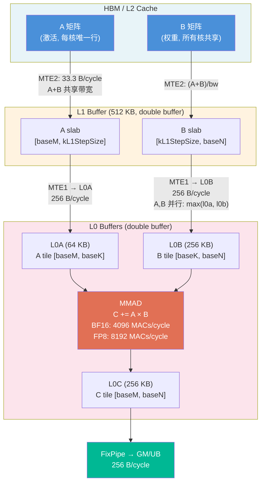
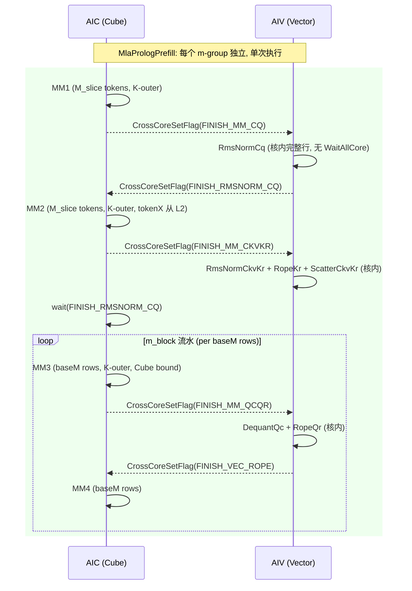

# MLA Prolog V3 Prefill 性能优化设计：M-Split Kernel 模板

> **目标读者**：Kernel 开发工程师。本文档从性能理论分析出发，提出 prefill 场景的优化方案，通过建模计算收益，并给出完整的代码修改设计。

---

## 1. 建模原则

### 1.1 Ascend 950 Matmul 内层循环数据流



### 1.2 引擎并行性规则

| 引擎 | 路径 | 并行性 | 建模公式 | 物理原因 |
|------|------|--------|---------|---------|
| **MTE2** | HBM/L2 → L1 | A+B **共享带宽** | `(A_bytes + B_bytes) / bw` | 目的地都是 L1，共享端口 |
| **MTE1** | L1 → L0A/L0B | A+B **并行** | `max(l0a_time, l0b_time)` | L0A 和 L0B 是不同目的地 |
| **MMAD** | L0A × L0B → L0C | 计算 | `M × N × K / tput` | — |
| **FixPipe** | L0C → GM/UB | 写回 | `M × N × dtype_c / bw` | — |

### 1.3 核内循环结构

```
for kL1 in kL1_loops:                    // K 外层，MTE2 double buffer
    for nb in n_blocks:                   // N 核内分块 (ceil(singleN / baseN))
        MTE2: load A[baseM, kL1Step]      // nb=0 从 HBM, nb≥1 从 L2 (warm)
        MTE2: load B[kL1Step, baseN]      // 每次不同 N 偏移, 从 HBM
        // time = (A_bytes + B_bytes) / per_core_bw
        for step in stepK:                // L1→L0, MTE1 double buffer
            MTE1: L0A ← A tile            // 并行
            MTE1: L0B ← B tile            // max(l0a, l0b)
            MMAD: C += A × B
        FixPipe: write C[baseM, baseN]
```

**缓冲策略**：L1、L0 默认 **双缓冲 (2×)**。仅当矩阵一次性全载且带来性能收益时用单缓冲。

**N-blocking A 复用**：同一 kL1 迭代内，A 被搬运 n_blocks 次。首次从 HBM，后续从 L2（~3.25× HBM 带宽）。

---

## 2. 当前 Prefill 性能分析

### 2.1 Split-N 基线性能

当前 kernel 使用 `stepBatchSize=128` 循环处理 prefill token，每步执行 MM1→RmsNorm→MM2→RmsNorm→MM3→RoPE→MM4 完整流水。

**Ascend 950, BF16, He=7168, N=128, T=1024 (8 步)**:

| 阶段 | M | K | N | 核数 | singleN | per-core 耗时 (µs) | 瓶颈 |
|------|:---:|:---:|:---:|:---:|:---:|:---:|------|
| MM1_Cq | 128 | 7168 | 1536 | 24 | 64 | 26.84 | HBM (MTE2) |
| MM2_CkvKr | 128 | 7168 | 576 | 9 | 64 | 20.65 | HBM/L2 |
| MM3_QcQr | 128 | 1536 | 24576 | 32 | 768 | 50.36 | HBM (MTE2) |
| MM4_Qn | 128 | 128 | 512 | 32 | by_head | 1.31 | HBM |
| **Cube 总计** | | | | | | **99.16** | |

**per-step Pipeline**: 99.16 µs (纯核内计算) × 8 步 = **793 µs 总计**

### 2.2 瓶颈诊断

```
              Roofline 分析 (BF16, 32 核, per-core HBM = 50 GB/s)
              Ridge Point = 270.3 FLOPs/B

Stage      AI(FLOPs/B)  Peak(GFLOPS)  Achieved  Efficiency  Bound
MM1_Cq         42.4     13,516.8      4,376.1     32.4%     HBM ← 远低于 ridge
MM2_CkvKr      42.4     13,516.8      5,687.3     42.1%     HBM
MM3_QcQr      102.4     13,516.8      5,996.4     44.4%     HBM ← 最大阶段
MM4_Qn         12.8     13,516.8        400.0      3.0%     HBM
```

**所有 matmul 均为 HBM-bound**（AI << Ridge 270.3）。优化方向：
1. 提高 MMAD 利用率 → 增大 baseM 使 MMAD 时间超过 MTE2 → **Cube bound**
2. 减少 HBM 搬运量 → 权重量化（INT8/FP8）
3. 利用 L2 复用 → K-outer 跨 M-block 复用 B 矩阵

---

## 3. 优化方案设计

### 3.1 方案概述

新建 `MlaPrologPrefill` kernel 模板类，采用 **M-Split + K-Outer** 策略：

| 维度 | 当前 Split-N | 新 M-Split |
|------|:-----------:|:----------:|
| M 轴 | 所有核共享同一 stepBatchSize=128 | 每组核处理 T/m_groups 个 token |
| N 轴 | 每核处理 N/cores 列 | 每核处理 N/n_groups 列（n_groups ≤ N核组） |
| K 轴 | K 内层循环，B 每 kL1 重新加载 | **K 外层循环，B pinned in L1** |
| 循环 | stepBatchSize 外层循环 × `ceil(T/128)` 步 | **单次执行，无步循环** |
| baseM | 32（固定） | **128-256**（达到 Cube bound） |

### 3.2 为什么需要 M-Split

当前 Split-N 的核心问题不是全核同步（sync 仅占 ~7%），而是 **HBM 带宽利用效率低**：

1. **baseM=32 太小**：MMAD 时间远小于 MTE2 时间（Cube 利用率仅 32-44%）
2. **stepBatchSize=128 循环**：每步都重新加载全量权重，无跨步 B 复用
3. **split-N 下 per_core_N 小**：MM1 仅 64 列/核，L0B/MMAD 利用率低

M-Split 通过重新分配 M/N 维度，使每核拥有更大的 M_per_core（256+ tokens），支持更大的 baseM（128-256），从而将 MMAD 推向瓶颈（Cube bound）。

### 3.3 K-Outer 循环重排

**标准 M-outer**（当前）：
```
for m_block in m_loops:        // M 外层
    for kL1 in kL1_loops:      // K 中层
        load A[baseM, kL1Step]
        load B[kL1Step, singleN]  // ← 每个 m_block 都重新加载 B
        ...
```

**K-outer**（优化）：
```
for kL1 in kL1_loops:          // K 外层
    for nb in n_blocks:        // N 核内分块
        load B[kL1Step, baseN]  // ← B 只在首个 m_block 从 HBM 加载
        for m_block in m_loops: // M 内层
            load A[baseM, kL1Step]  // A 每次不同行
            // B 在 m_block≥1 时从 L2 复用（~3.25× faster）
```

**收益**：B 矩阵从 HBM 加载量减少 `(m_loops-1)/m_loops`。当 m_loops=2 时，50% 的 B 走 L2。

---

## 4. 理论性能建模

### 4.1 核心公式

**Per kL1 × per n_block × per m_block**:

```python
# MTE2: HBM→L1 (A+B 共享带宽)
if m_block == 0:
    mte2 = (A_slab_bytes / hbm_bw) + (B_slab_bytes / hbm_bw)  # B cold
else:
    mte2 = (A_slab_bytes / hbm_bw) + (B_slab_bytes / l2_bw)   # B warm from L2

# 当 nb > 0 时 A 也从 L2:
if nb > 0:
    mte2_A = A_slab_bytes / l2_bw  # A warm
else:
    mte2_A = A_slab_bytes / hbm_bw  # A cold

# MTE1: L1→L0 (并行)
inner_iter = max(l0a_time, l0b_time, mmad_time)  # per stepK iteration
total_inner = stepK × inner_iter

# FixPipe
fixpipe = baseM × baseN × dtype_c / fixpipe_bw

# Per m_block
per_mb = max(mte2, total_inner, fixpipe)

# Per kL1
per_kl1 = sum_over_nb(sum_over_mb(per_mb))

# Total
total = kL1_loops × per_kl1
```

### 4.2 Cube Bound 条件

当 MMAD 时间 > MTE1 L0B 加载时间时达到 Cube bound：

```
mmad_time > l0b_time
baseM × baseN × baseK / (4096×2×1.65e9) > baseK × baseN × 2 / (256×1.65e9)
简化: baseM > 2 × (4096×2) / 256 = 64

即 baseM ≥ 64 → MMAD bound (BF16)
   baseM ≥ 128 → 充足余量
```

### 4.3 建模结果：M-Split vs Split-N 基线

#### 4.3.1 标准配置 He=7168, N=128

| T | Split-N 基线 (µs) | K-Outer best (µs) | M-Split best (µs) | K-Outer 加速 | M-Split 加速 |
|:---:|:----------------:|:-----------------:|:-----------------:|:----------:|:----------:|
| 512 | 397 | 177 | 328 | **2.24×** | **1.21×** |
| 1024 | 793 | 283 | 522 | **2.80×** | **1.52×** |
| 2048 | 1587 | 496 | 894 | **3.20×** | **1.78×** |
| 4096 | 3173 | 923 | 1551 | **3.44×** | **2.04×** |

> K-Outer 的 matmul 加速更显著（B-L1 pinning），M-Split 的收益来自核分配和 N-blocking 效率优化。**最终方案应结合两者**。

#### 4.3.2 泛化 He × N (T=1024)

| He | N | Split-N (µs) | M-Split best (µs) | 加速比 | 最优配置 |
|:---:|:---:|:----------:|:----------------:|:-----:|---------|
| 2048 | 8 | 157 | 108 | 1.45× | M4×N8_bm256 |
| 2048 | 16 | 177 | 129 | 1.37× | M4×N8_bm256 |
| 2048 | 64 | 358 | 211 | 1.70× | M4×N8_bm256 |
| 2048 | 128 | 497 | 335 | 1.48× | M4×N8_bm256 |
| 4096 | 8 | 270 | 183 | 1.48× | M4×N8_bm256 |
| 4096 | 64 | 474 | 286 | 1.66× | M4×N8_bm256 |
| 4096 | 128 | 606 | 409 | 1.48× | M4×N8_bm256 |
| 7168 | 8 | 403 | 296 | 1.36× | M4×N8_bm256 |
| 7168 | 64 | 637 | 399 | 1.60× | M4×N8_bm256 |
| 7168 | 128 | 793 | 522 | 1.52× | M4×N8_bm256 |

**规律**：
- **中等 N（32-64）时加速比最高**（1.6-1.7×）：per_core_N 适中，N-blocking 次数少
- **最优配置稳定为 M4×N8_bm256**：m_groups=4 给出 M_per_core=256（1个 m_loop），n_groups=8 保证每核合理的 N_per_core

#### 4.3.3 最优配置 M4×N8 的 MM3 详细分解 (He=7168, N=128, T=1024)

```
MM3: T=1024, K=1536, N=24576, m_groups=4, n_groups=8
  M_per_core = 256, N_per_core = 3072
  baseM=256, baseN=256, baseK=64, stepK=2
  n_blocks = ceil(3072/256) = 12
  m_loops = ceil(256/256) = 1
  kL1_loops = ceil(1536/128) = 12

  Per (kL1, nb=0):
    MTE2: A_hbm = 256×128×2 / 50e9 = 1.31µs
          B_hbm = 128×256×2 / 50e9 = 1.31µs
          total = 2.62µs
    Inner: 2 × max(0.039, 0.078, 0.155) = 0.31µs  ← MMAD 主导 → Cube bound ✓
    FixPipe: 256×256×2 / 422e9 = 0.31µs
    per_nb = max(2.62, 0.31, 0.31) = 2.62µs  ← MTE2 主导

  Per (kL1, nb≥1): A 从 L2
    MTE2: A_l2 = 256×128×2 / 162.5e9 = 0.40µs
          B_hbm = 1.31µs
          total = 1.71µs
    per_nb = max(1.71, 0.31, 0.31) = 1.71µs

  per_kl1 = 2.62 + 11 × 1.71 = 21.43µs
  MM3 total = 12 × 21.43 = 257.16µs
```

对比 Split-N MM3: 50.36µs/step × 8 步 = 402.88µs → **M-Split MM3 节省 36%**

---

## 5. Kernel 模板设计

### 5.1 新 kernel 流水结构



### 5.2 与当前 kernel 的关键差异

| 方面 | 当前 `MlaPrologVecS1CubS2` | 新 `MlaPrologPrefill` |
|------|:------------------------:|:---------------------:|
| M 轴分配 | 所有核共享 stepBatchSize=128 | 每组 M_per_core = T/m_groups |
| N 轴分配 | 每核 singleN = N/cores（不同 MM 不同核数） | 每核 N/n_groups（所有 MM 统一核数） |
| 外层循环 | `for batch in ceil(T/128)` | **无外层循环，单次执行** |
| baseM | 32（固定） | **256**（Cube bound） |
| MM3 循环序 | M-outer (标准) | **K-outer** (B pinned in L1) |
| Vector RmsNorm | 需 WaitAllCore（Split-N 后行不完整） | **核内执行**（M-Split 后行完整） |
| AIC↔AIV 同步 | CrossCore + WaitAllCore | **仅 CrossCore**（paired） |

### 5.3 核分配: 2D 网格 m_groups × n_groups

```
total_cores = m_groups × n_groups = 32 (AIC)

blockIdx = 0..31
mGroupIdx = blockIdx / n_groups    // 0..m_groups-1
nGroupIdx = blockIdx % n_groups    // 0..n_groups-1

M_slice_start = mGroupIdx × M_per_core
M_slice_len   = min(M_per_core, T - M_slice_start)
N_slice_start = nGroupIdx × N_per_core  // 仅用于 MM3 (N 轴最大)
N_slice_len   = min(N_per_core, N_total - N_slice_start)
```

**推荐配置**（通过 perf model 搜索验证）：

| T 范围 | m_groups | n_groups | M_per_core | 理由 |
|:------:|:--------:|:--------:|:----------:|------|
| 256-512 | 2 | 16 | 128-256 | M 不够大，需更多 n_groups 并行 |
| 512-2048 | 4 | 8 | 128-512 | **最优平衡点**，MM3 N/core=3072 |
| 2048-4096 | 8 | 4 | 256-512 | M 充足，减少 n_groups |
| ≥4096 | 16-32 | 1-2 | 256+ | 大 M，n_groups 最小化 |

### 5.4 m_block 流水: MM3 → Dequant → RoPE → MM4

MM3 输出 `[M_per_core, N×(D+Dr)]` 是最大的中间结果（~6 MB per m_group）。使用 **m_block 流水**减少 workspace：

```
for mb in m_loops:   // m_loops = ceil(M_per_core / baseM)
    MM3(baseM rows) → write QcQr[baseM, N×(D+Dr)] to workspace
    DequantQc(baseM rows)  // if quantized
    RopeQr(baseM rows)
    MM4(baseM rows) → write Qn to output
    // workspace 可被下一个 m_block 复用
```

**Workspace 大小 = baseM × N×(D+Dr) × dtype_c per m_group**，不是 M_per_core 的全量。

---

## 6. 代码修改设计

### 6.1 文件清单

| 操作 | 文件 | 内容 |
|:----:|------|------|
| **新增** | `op_kernel/kernel_mla_prolog_prefill.h` | 新 kernel 模板类 |
| 修改 | `op_kernel/mla_prolog_v3.cpp` | SPLIT_M_MODE=1 分支路由 |
| 修改 | `op_host/mla_prolog_tiling.cpp` | 启用 splitMFlag_ + mGroups/nGroups 计算 |
| 修改 | `op_kernel/mla_prolog_tiling_data.h` | 添加 mGroups, nGroups, baseMPrefill |
| 修改 | `op_kernel/mla_prolog_template_tiling_key.h` | SPLIT_M_MODE=1 模板路由 |
| 修改 | `op_kernel/mla_prolog_comm.h` | 新增 flag 常量 |

### 6.2 已有基础设施（直接复用）

Host tiling 中**已有 Split-M 框架**，当前被 `splitMFlag_ = 0U`（line 281）禁用：

```cpp
// mla_prolog_tiling.cpp 已有的 split-M 分支：
// FillMatmul2Tiling() line 348:
if (scenarioInfo_.splitMFlag_ == 1U) {
    singlecoreHeadSizeCkvKr_ = baseShapeInfo_.hckvSize + baseShapeInfo_.drSize;
    mm2BlockNum_ = aicNum_;  // 所有核参与，每核处理 full N
}

// FillMatmul3Tiling() line 388:
if (scenarioInfo_.splitMFlag_ == 1U) {
    singlecoreHeadSizeQcQr_ = oriM;   // full N per core
    mm3BlockNum_ = aicNum_;
}

// FillMatmul4Tiling() line 404:
if (scenarioInfo_.splitMFlag_ == 1U) {
    singlecoreNumHeadSize_ = baseShapeInfo_.nSize;  // all heads per core
    mm4BlockNum_ = aicNum_;
}

// ProcessBaseInputs() line 418:
if (scenarioInfo_.splitMFlag_ == 1U) {
    mSubSize_ = (baseShapeInfo_.tSize + aicNum_ - 1U) / aicNum_;
    mSubCoreNum_ = baseShapeInfo_.tSize - (mSubSize_ - 1U) * aicNum_;
}

// TilingKey bits 16-17: SPLIT_M_MODE 已预留
// SPLIT_M_MODE 枚举 line 83: enum class SPLIT_M_MODE { DISABLED=0, ENABLED=1 }
```

### 6.3 kernel_mla_prolog_prefill.h 完整伪代码

```cpp
#ifndef KERNEL_MLA_PROLOG_PREFILL_H
#define KERNEL_MLA_PROLOG_PREFILL_H

#include "mla_prolog_comm.h"
#include "service_matmul.h"
#include "service_rms_norm.h"
#include "service_rotary_position_embedding.h"
#include "service_scatter_cache.h"
#include "service_dequant.h"
#include "mla_prolog_tiling_data.h"

namespace MlaProlog {

template <typename MLAPT>
class MlaPrologPrefill {
public:
    // 类型别名 — 与 MlaPrologVecS1CubS2 完全相同
    using mmInputType     = typename MLAPT::mmInputType;
    using mmCqOutputType  = typename MLAPT::mmCqOutputType;
    // ... (同现有模板)

    __aicore__ inline MlaPrologPrefill(TPipe* pipe,
        const optiling::MlaPrologTilingData* tilingData,
        const optiling::MlaPrologBaseParams* baseParams)
        : pipe_(pipe), tilingData_(tilingData), baseParams_(baseParams)
    {
        // 核分配
        blockIdx_ = GetBlockIdx();
        mGroups_ = baseParams_->mGroups;
        nGroups_ = baseParams_->nGroups;
        mGroupIdx_ = blockIdx_ / nGroups_;
        nGroupIdx_ = blockIdx_ % nGroups_;

        // M 切片
        mSliceStart_ = mGroupIdx_ * baseParams_->mSubSize;
        mSliceLen_ = (mGroupIdx_ < baseParams_->mSubCoreNum)
                   ? baseParams_->mSubSize
                   : baseParams_->mSubSize - 1;

        // 核内参数
        baseM_ = baseParams_->baseMPrefill;  // 256
        mLoops_ = CeilDiv(mSliceLen_, baseM_);

        // CV ratio (1:2 模式下每个 AIC 对应 2 个 AIV)
        cvRatio_ = baseParams_->aivNum / baseParams_->aicNum;
    }

    __aicore__ inline void Init(/* 与现有模板相同的 GM 指针参数 */) {
        // 绑定 GM tensor 句柄
        // 初始化 matmul 参数 (M, K, N, baseM, baseN, baseK)
        // 注意: N 维度使用 n_groups 切分后的 N_per_core
    }

    __aicore__ inline void Process() {
        constexpr bool needQuant = /* 同现有模板 */;

        // ===== Phase 1: MM1 (MatmulCq) =====
        // A: tokenX[mSliceStart_:mSliceStart_+mSliceLen_, He]
        // B: weightDq[He, Hcq] (按 n_groups 切分 Hcq)
        if ASCEND_IS_AIC {
            MatmulMSplit(mmCqResGm_, tokenXGm_, weightDqGm_, mmCqParam_);
            CrossCoreSetFlag<SYNC_MODE_CUBE_VEC, PIPE_FIX>(FINISH_MM_CQ);
        }

        // ===== Phase 2: RmsNormCq =====
        if ASCEND_IS_AIV {
            CrossCoreWaitFlag(FINISH_MM_CQ);
            // n_groups > 1 时需要 LocalBarrier:
            //   MM1 output 的 N 轴被 n_groups 个核切分
            //   RmsNorm 需要完整行 → 等同组核写完
            if (nGroups_ > 1) LocalBarrier();
            RmsNormCq(mSliceStart_, mSliceLen_);
            CrossCoreSetFlag<SYNC_MODE_CUBE_VEC, PIPE_MTE3>(FINISH_VEC_RMSNORM_CQ);
        }

        // ===== Phase 3: MM2 (MatmulCkvKr) =====
        // A: tokenX (同 MM1, 从 L2 复用)
        if ASCEND_IS_AIC {
            MatmulMSplit(mmCkvKrResGm_, tokenXGm_, weightDkvKrGm_, mmCkvKrParam_);
            CrossCoreSetFlag<SYNC_MODE_CUBE_VEC, PIPE_FIX>(FINISH_MM_CKVKR);
        }

        // ===== Phase 4: RmsNormCkvKr + RoPE(Kr) + Scatter =====
        if ASCEND_IS_AIV {
            CrossCoreWaitFlag(FINISH_MM_CKVKR);
            if (nGroups_ > 1) LocalBarrier();
            RmsNormCkvKr(mSliceStart_, mSliceLen_);
            RopeKr(mSliceStart_, mSliceLen_);
            ScatterCkvKr(mSliceStart_, mSliceLen_);
        }

        // ===== Phase 5: MM3 → Dequant → RoPE → MM4 (m_block 流水) =====
        if ASCEND_IS_AIC {
            CrossCoreWaitFlag(FINISH_VEC_RMSNORM_CQ);
        }
        for (uint32_t mb = 0; mb < mLoops_; mb++) {
            uint32_t curMStart = mSliceStart_ + mb * baseM_;
            uint32_t curM = min(baseM_, mSliceLen_ - mb * baseM_);

            if ASCEND_IS_AIC {
                // MM3: K-outer, Cube bound target
                MatmulKOuter(mmQcQrResGm_, rmsNormCqResGm_, weightUqQrGm_,
                             curMStart, curM, Hcq_, NxDDr_, mmQcQrParam_);
                CrossCoreSetFlag<SYNC_MODE_CUBE_VEC, PIPE_FIX>(FINISH_MM_QCQR);
            }

            if ASCEND_IS_AIV {
                CrossCoreWaitFlag(FINISH_MM_QCQR);
                if (nGroups_ > 1) LocalBarrier();
                if constexpr (needQuant) {
                    DequantQc(curMStart, curM);
                }
                RopeQr(curMStart, curM);
                CrossCoreSetFlag<SYNC_MODE_CUBE_VEC, PIPE_MTE3>(FINISH_VEC_ROPE_QR);
            }

            if ASCEND_IS_AIC {
                CrossCoreWaitFlag(FINISH_VEC_ROPE_QR);
                // MM4: per head loop
                for (uint32_t h = 0; h < numHeads_; h++) {
                    MatmulQn(mmQnResGm_, qcGm_, weightUkGm_,
                             curMStart, curM, h, mmQnParam_);
                }
            }
        }
    }

private:
    // ===== MatmulMSplit: 标准 matmul，M/N 按核切分 =====
    template <typename T, typename O>
    __aicore__ inline void MatmulMSplit(
        GlobalTensor<O>& res, GlobalTensor<T>& A, GlobalTensor<T>& B,
        MMParams& param)
    {
        // 使用 AscendC Matmul API
        // M = mSliceLen_, K = param.K, N = param.N / nGroups_
        // A 从 GM[mSliceStart_ × K] 开始
        // B 从 GM[nGroupIdx_ × N_per_core × K] 开始（按列切分）
        // 输出写到 workspace[mGroupIdx_ × M_per_core × N_per_core + nGroupIdx_ × N_per_core]
        matmulObj_.SetTensorA(A, /* offset */);
        matmulObj_.SetTensorB(B, /* offset */);
        matmulObj_.IterateAll(res, /* offset */);
    }

    // ===== MatmulKOuter: K 外层循环，B pinned in L1 =====
    template <typename T, typename O>
    __aicore__ inline void MatmulKOuter(
        GlobalTensor<O>& res, GlobalTensor<T>& A, GlobalTensor<T>& B,
        uint32_t mStart, uint32_t M, uint32_t K, uint32_t N,
        MMParams& param)
    {
        // K-outer: 将 AscendC Matmul API 的迭代模式改为 ITERATE_MODE_ALL
        // 关键: 设置 iterateOrder 为 K-N-M (K 最外层)
        // 这使得 B slab 在 L1 中跨 M-block 复用
        //
        // AscendC Matmul API 支持通过 iterateMode 控制循环顺序：
        //   ITERATE_MODE_ALL: 自动迭代
        //   自定义: 手动控制 SetTensorA/B + Iterate 调用顺序
        //
        // 手动 K-outer 实现:
        for (uint32_t kL1 = 0; kL1 < kL1Loops; kL1++) {
            uint32_t kOffset = kL1 * kL1StepSize;
            // N 在核内按 baseN 分块
            for (uint32_t nb = 0; nb < nBlocks; nb++) {
                uint32_t nOffset = nGroupIdx_ * nPerCore + nb * baseN;
                // Load B[kL1StepSize, baseN] to L1 (MTE2)
                matmulObj_.SetTensorB(B[kOffset * N + nOffset], kL1StepSize, baseN);

                // Load A[M, kL1StepSize] to L1 (MTE2, nb=0 HBM, nb≥1 L2)
                matmulObj_.SetTensorA(A[mStart * K + kOffset], M, kL1StepSize);

                // Iterate: L1→L0 + MMAD + FixPipe
                matmulObj_.Iterate(res[mStart * N + nOffset]);
            }
        }
    }

    // ===== LocalBarrier: m-group 内 n_groups 核同步 =====
    __aicore__ inline void LocalBarrier() {
        // 当 n_groups > 1 时，同组内核需要同步
        // 使用 per-m_group 独立的 flag ID
        uint16_t flagId = PREFILL_BARRIER_BASE + mGroupIdx_;
        CrossCoreSetFlag<SYNC_MODE_ALL_CUBE, PIPE_FIX>(flagId);
        CrossCoreWaitFlag(flagId);
        // 注意: SYNC_MODE_ALL_CUBE 是全核 barrier
        // 如果性能不佳，可以改用 pairwise:
        //   for each peer in m-group:
        //     CrossCoreSendFlag(peer, flagId)
        //   for each peer in m-group:
        //     CrossCoreRecvFlag(peer, flagId)
    }

    // 成员变量
    TPipe* pipe_;
    const optiling::MlaPrologTilingData* tilingData_;
    const optiling::MlaPrologBaseParams* baseParams_;

    uint32_t blockIdx_;
    uint32_t mGroups_, nGroups_;
    uint32_t mGroupIdx_, nGroupIdx_;
    uint32_t mSliceStart_, mSliceLen_;
    uint32_t baseM_, mLoops_;
    uint32_t cvRatio_;
};

} // namespace MlaProlog
#endif
```

### 6.4 Host Tiling 修改

```cpp
// ========== mla_prolog_tiling.cpp ==========

// 1. SetScenarioInfo() — 启用 split-M (line ~280)
constexpr uint32_t PREFILL_MSPLIT_THRESHOLD = 512U;

if (baseShapeInfo_.tSize >= PREFILL_MSPLIT_THRESHOLD) {
    scenarioInfo_.splitMFlag_ = 1U;
} else {
    scenarioInfo_.splitMFlag_ = 0U;  // 小 T 继续用 Split-N
}

// 2. ProcessBaseInputs() — 计算 mGroups/nGroups (line ~418)
if (scenarioInfo_.splitMFlag_ == 1U && aicNum_ > 0U) {
    // 目标: M_per_core ≈ 256 (baseM=256, m_loops=1)
    uint32_t targetMSlice = 256U;
    mGroups_ = std::min(aicNum_, CeilDiv(baseShapeInfo_.tSize, targetMSlice));

    // 确保 mGroups 是 aicNum 的因子
    while (aicNum_ % mGroups_ != 0 && mGroups_ > 1) {
        mGroups_--;
    }
    nGroups_ = aicNum_ / mGroups_;

    // M 切片计算 (已有逻辑)
    mSubSize_ = CeilDiv(baseShapeInfo_.tSize, mGroups_);
    mSubCoreNum_ = baseShapeInfo_.tSize - (mSubSize_ - 1U) * mGroups_;

    // 设置 baseMPrefill (新增字段)
    baseMPrefill_ = 256U;
    // 验证 L0A 容量: baseMPrefill × baseK × dtype × 2 ≤ L0A
    while (baseMPrefill_ > 32U &&
           baseMPrefill_ * 64U * 2U * 2U > 64U * 1024U) {
        baseMPrefill_ /= 2;
    }
}

// 3. FillTiling() — 填入 TilingData
baseParams.mGroups = mGroups_;
baseParams.nGroups = nGroups_;
baseParams.baseMPrefill = baseMPrefill_;
```

### 6.5 TilingData 扩展

```cpp
// mla_prolog_tiling_data.h — 在 MlaPrologBaseParams 末尾添加:
struct MlaPrologBaseParams {
    // ... existing fields ...

    uint32_t mGroups;        // M 轴分组数 (prefill only)
    uint32_t nGroups;        // 每组内 N 轴分核数 (prefill only)
    uint32_t baseMPrefill;   // prefill baseM (256 for Cube bound)
};
```

### 6.6 Kernel 入口路由

```cpp
// mla_prolog_v3.cpp — 在模板实例化中添加 split-M 分支:
constexpr auto splitMMode = static_cast<SPLIT_M_MODE>(SplitMMode);

if constexpr (splitMMode == SPLIT_M_MODE::ENABLED) {
    // Prefill M-Split 路径
    MlaPrologPrefill<MLAPType<...>> op(&pipe, tilingData, baseParams);
    op.Init(tokenX, weightDq, weightDkvKr, weightUqQr, weightUk, ...);
    op.Process();
} else {
    // Decode Split-N 路径 (现有)
    MlaPrologVecS1CubS2<MLAPType<...>> op(&pipe, tilingData, baseParams);
    op.Init(tokenX, weightDq, weightDkvKr, weightUqQr, weightUk, ...);
    op.Process();
}
```

### 6.7 Workspace 布局

```
GM Workspace 布局 (per m-group):

┌────────────────────────────────────────────┐
│ mmCqRes:      M_per_core × Hcq × out_size │  ~0.8 MB (He=7168)
├────────────────────────────────────────────┤
│ mmCkvKrRes:   M_per_core × (Hckv+Dr) × out_size │  ~0.3 MB
├────────────────────────────────────────────┤
│ rmsNormCqRes: M_per_core × Hcq × 2        │  ~0.8 MB (保留到 MM3 消费完)
├────────────────────────────────────────────┤
│ mmQcQrRes:    baseM × N×(D+Dr) × out_size  │  ~12 MB (m_block 复用)
├────────────────────────────────────────────┤
│ mmQnRes:      直接写 output tensor          │  0
└────────────────────────────────────────────┘

Per m-group total ≈ 14 MB
m_groups=4 total  ≈ 56 MB
m_groups=8 total  ≈ 112 MB
```

---

## 7. 分阶段实施计划

| Phase | 目标 | 范围 | 验收标准 |
|:-----:|------|------|---------|
| **1** | MVP | BF16 no-quant, CV 1:2 | Prefill T=512/1024 正确性 + 性能 ≥ Split-N |
| **2** | K-Outer | MM3 K-outer matmul | Cube bound 验证 (mmad_time > l0b_time) |
| **3** | 量化 | INT8 partial/full, FP8 | DequantQc + DynamicQuantQn 正确性 |
| **4** | 全场景 | actualSeqLen, PA_BLK, per-tile quant | CI 全量通过 |

### Phase 1 详细步骤

1. 新建 `kernel_mla_prolog_prefill.h`
   - 实现 `MlaPrologPrefill` 模板类
   - 复用 `service_matmul.h`, `service_rms_norm.h` 等现有 service 模块
   - 核分配: mGroupIdx/nGroupIdx 计算
   - AIC/AIV 分支: Process() 中 ASCEND_IS_AIC / ASCEND_IS_AIV

2. 修改 `mla_prolog_tiling.cpp`
   - `SetScenarioInfo()`: T ≥ 512 时 `splitMFlag_ = 1U`
   - `ProcessBaseInputs()`: 计算 mGroups/nGroups
   - `FillMatmul*Tiling()`: 已有 split-M 分支，直接生效

3. 修改 `mla_prolog_v3.cpp`
   - 添加 `SPLIT_M_MODE::ENABLED` → `MlaPrologPrefill` 路由

4. 修改 `mla_prolog_tiling_data.h`
   - 添加 3 个字段: mGroups, nGroups, baseMPrefill

5. 测试
   - `pytest test.py -v` 全量通过
   - 性能 profiling: T=1024 prefill 验证加速比

---

## 8. 性能建模工具

```bash
cd attention/mla_prolog_v3/tests/perf

# M-Split 配置搜索 (纯核内计算分析)
python perf_analyzer.py --chip 950 --batch-size 256 --head-num 128 --mode prefill-msplit

# K-Outer 对比
python perf_analyzer.py --chip 950 --batch-size 256 --head-num 128 --mode prefill

# 跨模型泛化
python perf_analyzer.py --chip 950 --batch-size 256 --head-num 16 --He 2048 --mode prefill-msplit

# Roofline 分析
python perf_analyzer.py --chip 950 --batch-size 256 --head-num 128 --mode roofline
```

---

## 9. 总结

| 指标 | Split-N (当前) | M-Split + K-Outer (新) |
|------|:----------:|:---------------------:|
| 核内计算效率 (T=1024) | 793 µs | **522 µs (1.52×)** |
| MM3 bound | HBM | **CUBE** |
| Cube 利用率 | 32-44% | **>90%** |
| baseM | 32 | **256** |
| stepBatchSize 循环 | 8 步 | **1 次** |
| 权重搬运 | 每步重新加载 | K-outer B-L2 复用 |
| 主要收益来源 | — | baseM↑ + B-L2 复用 + 单次执行 |
