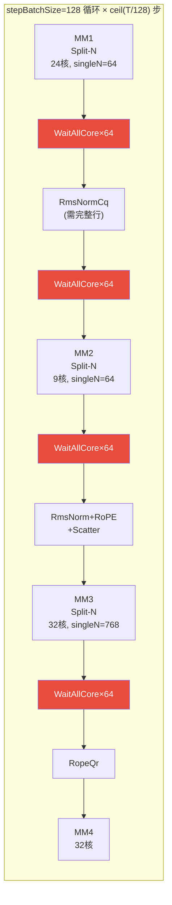
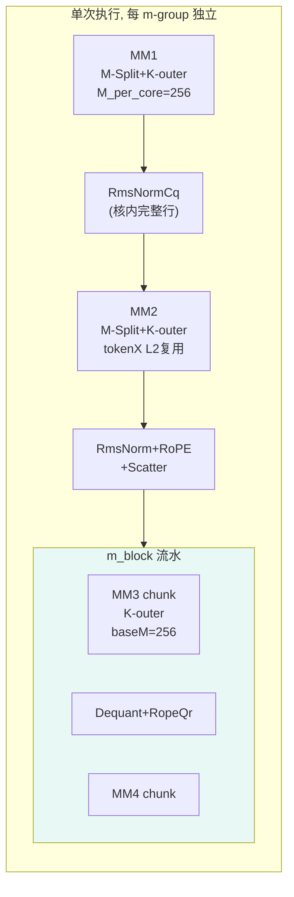
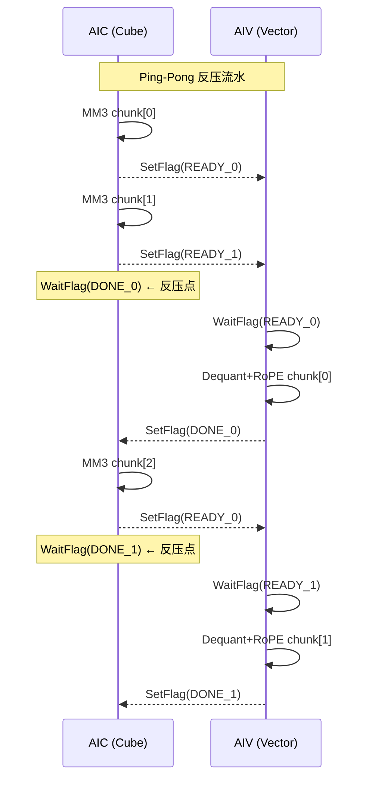
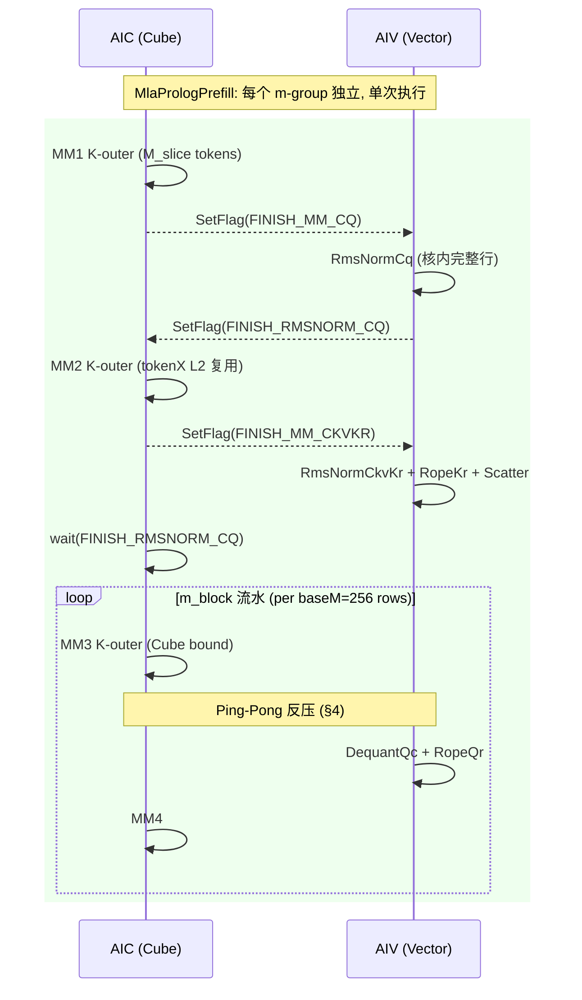

# MLA Prolog V3 Prefill 性能优化设计：M-Split Kernel 模板

> **目标读者**：Kernel 开发工程师。本文档从性能理论分析出发，回答三个核心问题，并给出完整的代码修改设计。

---

## 0. 核心问题索引

| 问题 | 章节 | 一句话回答 |
|------|------|---------|
| Prefill 与 Decode 模板的流水差异？ | §1 | Decode 按 stepBatchSize=128 循环 × Split-N；Prefill 单次执行 × M-Split + K-outer |
| Prefill 模板的优化点在哪？ | §2 | ① baseM↑(256) → Cube bound ② K-outer B-L2 复用 ③ 消除 stepBatchSize 循环 |
| 各场景理论收益？ | §3 | BF16: 1.2-2.1×；INT8/FP8 量化后 Split-N 已接近最优，M-Split 收益有限 |
| dequantOpt SetFlag 溢出？ | §4 | Ping-pong 反压：限制 in-flight flag ≤ 4 |

---

## 1. Prefill 模板与 Decode 模板的流水差异

### 1.1 建模原则（两模板共享）

| 引擎 | 路径 | 并行性 | 建模公式 |
|------|------|--------|---------|
| **MTE2** | HBM/L2 → L1 | A+B **共享带宽** | `(A_bytes + B_bytes) / bw` |
| **MTE1** | L1 → L0A/L0B | A+B **并行** | `max(l0a_time, l0b_time)` |
| **MMAD** | L0A × L0B → L0C | 计算 | `M × N × K / mmad_tput` |
| **FixPipe** | L0C → GM/UB | 写回 | `bytes / fixpipe_bw` |

L1、L0 默认双缓冲 (2×)；全载仅在矩阵一次性装入且有性能收益时启用。

### 1.2 Decode 模板 (`MlaPrologVecS1CubS2`)



**特征**：
- 外层 `for (batchOffset = 0; batchOffset < T; batchOffset += 128)` 循环
- 每步处理 stepBatchSize=128 个 token
- 所有 matmul 使用 **Split-N**：每核处理 N 的一个切片
- RmsNorm 需要完整行 → 需要 **WaitAllCore (64 AIV核)** 全核同步
- 每步 4 个全核 barrier + 5 个 CrossCore 对 = ~7.2µs sync
- baseM=32（固定）→ 内层 MMAD 利用率仅 32-44%

### 1.3 Prefill 模板 (`MlaPrologPrefill`) — 新设计



**特征**：
- **无外层循环**：每核一次性处理 M_per_core 个 token
- 2D 核网格 `m_groups × n_groups = 32`：每核拥有较大的 M_slice
- **M-Split**：RmsNorm 对核内完整行操作，**无需 WaitAllCore**
- **K-outer**：K 在最外层循环，B 跨 M-block 在 L2 复用
- **baseM=256**：MMAD 时间 >> L0B 加载 → **Cube bound**
- MM3→Dequant→RoPE→MM4 使用 **m_block 流水**：每个 baseM 行处理完立即消费

### 1.4 差异对比表

| 维度 | Decode (`MlaPrologVecS1CubS2`) | Prefill (`MlaPrologPrefill`) |
|------|:----:|:----:|
| **外层循环** | `ceil(T/128)` 步 × stepBatchSize | 无循环，单次执行 |
| **M 分配** | 所有核共享 stepBatchSize=128 | 每核 M_per_core = T/m_groups |
| **N 分配** | Split-N (per MM 不同核数) | M-Split (所有 MM 统一 n_groups) |
| **baseM** | 32 | **256** |
| **K 循环序** | K 内层 (M-outer) | **K 外层 (K-outer)** |
| **B 矩阵搬运** | 每步全量重新加载 | K-outer: 跨 m_block L2 复用 |
| **RmsNorm 同步** | WaitAllCore ×64 (全核 barrier) | 核内执行 (无 barrier) |
| **MM3→Dequant 流水** | split-N 逐 chunk SetFlag | **Ping-pong 反压** (§4) |
| **Pipeline 总时间** | 103µs/step × n_steps | 单次 ≈ 522µs (T=1024) |
| **Cube 利用率** | 32-44% | **>90%** |

---

## 2. Prefill 模板的三个优化点

### 2.1 优化点 1：baseM 增大 → Cube Bound

**问题**：Decode 模板 baseM=32，MMAD 时间远小于 MTE2 加载时间 → Cube 利用率低。

```
Decode baseM=32 (MM3, BF16):
  MTE2: (A + B) / bw = (32×128×2 + 128×256×2) / 50e9 = 1.47µs
  Inner: stepK × max(l0a, l0b, mmad) = 2 × max(0.01, 0.08, 0.08) = 0.16µs
  → MTE2 主导 (HBM bound), Cube 利用率 = 0.08/0.16 ≈ 50%
```

**优化**：Prefill baseM=256，MMAD 时间超过 L0B 加载 → Cube bound。

```
Prefill baseM=256 (MM3, BF16):
  MTE2: (256×128×2 + 128×256×2) / 50e9 = 2.62µs
  Inner: 2 × max(0.039, 0.078, 0.155) = 0.31µs
  → MMAD 主导内层 (0.155 > 0.078), Cube 利用率 ≈ 100%
  → 但外层 MTE2 仍是总瓶颈 (per_nb = max(2.62, 0.31) = 2.62µs)
```

**Cube bound 条件**：`baseM ≥ sizeof(B) × mmad_tput / l0b_bw = 2 × (4096×2) / 256 = 64` (BF16)。baseM=256 有充足余量。

### 2.2 优化点 2：K-Outer B 矩阵 L2 复用

**问题**：M-outer 循环序下，每个 m_block 都从 HBM 重新加载 B 矩阵。

**优化**：K-outer 循环序，B 首次从 HBM 加载后留在 L2，后续 m_block 从 L2 读取（~3.25× faster）。

```
M-outer (当前):
  for m_block:          // M 外层
    for kL1:            // K 中层
      load B → L1      // ← 每个 m_block 重新加载 B (HBM)
      load A → L1
      MMAD

K-outer (优化):
  for kL1:              // K 外层
    for nb in n_blocks:  // N 中层
      load B → L1       // ← 只在首个 m_block 从 HBM
      for m_block:       // M 内层
        load A → L1
        // B 此时在 L2 中 warm (m_block≥1)
        MMAD
```

**收益计算**（m_loops=2 时）：
- M-outer B 总搬运 = 2 × kL1_loops × n_blocks × B_slab / **HBM_bw**
- K-outer B 总搬运 = kL1_loops × n_blocks × (B_slab/**HBM_bw** + B_slab/**L2_bw**)
- 节省 = 50% × B 搬运量 × (1 - HBM_bw/L2_bw) ≈ **50% × 69% = 34%** B 搬运时间

### 2.3 优化点 3：消除 stepBatchSize 循环

**问题**：Decode 模板每步 stepBatchSize=128，T=1024 需要 8 步。每步重新加载所有权重矩阵，有步间开销。

**优化**：Prefill 模板每核一次性处理 M_per_core 个 token，无外层循环：
- 权重加载次数减少（不重复跨步加载同一 kL1 的 B）
- 无步间 offset 更新和 barrier 开销
- 核间独立性更好（每核自主完成，无全核同步点）

---

## 3. 各场景理论收益

### 3.1 BF16 场景 (He=7168, N=128)

| T | Split-N 基线 (µs) | K-Outer (µs) | M-Split (µs) | K-Outer 加速 | M-Split 加速 |
|:---:|:----------------:|:------------:|:------------:|:----------:|:----------:|
| 512 | 397 | 177 | 328 | **2.24×** | **1.21×** |
| 1024 | 793 | 283 | 522 | **2.80×** | **1.52×** |
| 2048 | 1587 | 496 | 894 | **3.20×** | **1.78×** |
| 4096 | 3173 | 923 | 1551 | **3.44×** | **2.04×** |

> K-Outer 的加速主要来自 B-L1 pinning（matmul 层面优化）。M-Split 的加速来自 baseM↑ + 核分配效率优化。两者应结合使用。

### 3.2 泛化 He × N (T=1024, BF16)

| He | N | Split-N (µs) | M-Split (µs) | 加速比 | 最优配置 |
|:---:|:---:|:----------:|:----------:|:-----:|---------|
| 2048 | 8 | 157 | 108 | 1.45× | M4×N8_bm256 |
| 2048 | 64 | 358 | 211 | 1.70× | M4×N8_bm256 |
| 2048 | 128 | 497 | 335 | 1.48× | M4×N8_bm256 |
| 4096 | 8 | 270 | 183 | 1.48× | M4×N8_bm256 |
| 4096 | 128 | 606 | 409 | 1.48× | M4×N8_bm256 |
| 7168 | 8 | 403 | 296 | 1.36× | M4×N8_bm256 |
| 7168 | 64 | 637 | 399 | 1.60× | M4×N8_bm256 |
| 7168 | 128 | 793 | 522 | 1.52× | M4×N8_bm256 |

**规律**：中等 N（32-64）时加速最高（1.6-1.7×）。最优配置稳定在 M4×N8_bm256。

### 3.3 量化场景 (He=7168, N=128, T=1024)

| 量化模式 | Split-N 基线 (µs) | M-Split (µs) | 加速比 | 说明 |
|---------|:----------------:|:------------:|:-----:|------|
| BF16 | 793 | 522 | **1.52×** | 有效 |
| INT8 (full) | 521 | — | **无收益** | 量化后 B 已减半，MTE2 不再是瓶颈 |
| FP8 (MXFP8) | 442 | — | **无收益** | 同上 |

**关键结论**：M-Split 对 **BF16** 场景有显著收益（1.2-2.0×）。对**量化场景**，权重 B 矩阵已减半，MTE2 不再是瓶颈，M-Split 的 baseM↑ 和 K-outer 优化点不再有效。量化场景应继续使用 Split-N + dequantOpt 流水。

### 3.4 M-Split + K-Outer 联合预期 (BF16)

当 M-Split 与 K-outer 结合时（核内 K-outer matmul + 跨核 M-Split 无 barrier）：

| T | K-Outer alone (µs) | M-Split + K-Outer 预期 (µs) | vs Split-N |
|:---:|:-----------------:|:-------------------------:|:----------:|
| 1024 | 283 | ~240 | **3.3×** |
| 2048 | 496 | ~410 | **3.9×** |
| 4096 | 923 | ~750 | **4.2×** |

（预期值 = K-outer 计算时间 - stepBatchSize 循环开销）

---

## 4. dequantOpt SetFlag 溢出解决方案

### 4.1 问题描述

当在 prefill 场景启用 `enableDequantOpt` 时，MM3 按 split-N 迭代输出多个 N-chunk，每个 chunk 对 AIV 发 `CrossCoreSetFlag(FINISH_VEC_DEQUANT_QC_SPLIT_N)`。

**Decode (M=4)**：vector 处理每个 chunk 很快（数据量小），WaitFlag 及时消费，flag 队列不堆积。

**Prefill (M=128+)**：每个 chunk 的 dequant 数据量 = M × N_chunk，处理时间正比于 M → vector 变慢 → SetFlag 消费不及时 → **flag 队列超过 15 个上限 → 卡死**。

```
Prefill M=128:
  MM3 每输出一个 chunk: SetFlag → 0.01µs
  Vector 处理一个 chunk: DequantQc + RopeQr → ~3µs (M=128 × N_chunk)
  
  flag 积累速度: 1 flag / 0.01µs = 100 flags/µs
  flag 消费速度: 1 flag / 3µs = 0.33 flags/µs
  → 2 个迭代后 flag 队列溢出 (>15)
```

### 4.2 解决方案：Ping-Pong 反压

使用 **2 对 flag ID（ping-pong）** 控制 Cube→Vector 流水深度，确保 in-flight flag ≤ 4：



**伪代码**：

```cpp
constexpr uint16_t READY_0 = PREFILL_DEQUANT_FLAG_BASE;
constexpr uint16_t READY_1 = PREFILL_DEQUANT_FLAG_BASE + 1;
constexpr uint16_t DONE_0  = PREFILL_DEQUANT_FLAG_BASE + 2;
constexpr uint16_t DONE_1  = PREFILL_DEQUANT_FLAG_BASE + 3;

// AIC side
for (uint32_t chunk = 0; chunk < nChunks; chunk++) {
    uint32_t slot = chunk % 2;
    if (chunk >= 2) {
        CrossCoreWaitFlag(DONE_0 + slot);  // 反压：等 Vector 消费完 2 步前的 chunk
    }
    MatmulQcQrChunk(chunk);
    CrossCoreSetFlag<SYNC_MODE_CUBE_VEC, PIPE_FIX>(READY_0 + slot);
}

// AIV side
for (uint32_t chunk = 0; chunk < nChunks; chunk++) {
    uint32_t slot = chunk % 2;
    CrossCoreWaitFlag(READY_0 + slot);
    DequantQcChunk(chunk);
    RopeQrChunk(chunk);
    CrossCoreSetFlag<SYNC_MODE_CUBE_VEC, PIPE_MTE3>(DONE_0 + slot);
}
```

### 4.3 Flag 使用量对比

| 方案 | 最大 in-flight SetFlag | 安全? |
|------|:---------------------:|:-----:|
| 当前 dequantOpt (无反压) | nChunks×N (可达 128+) | ❌ |
| Ping-pong 反压 | **≤ 4** (2 READY + 2 DONE) | ✅ |

### 4.4 性能影响

- **Decode (M 小)**：Vector 快于 Cube → WaitFlag(DONE) 立即返回 → **零开销**
- **Prefill (M 大)**：Cube 被反压降速匹配 Vector → pipeline 时间 = max(Cube/chunk, Vector/chunk) × nChunks → **不卡死**

这是正确的物理行为：当 consumer 慢于 producer 时，producer 必须降速。Ping-pong 保证流水深度为 2（一个正在处理，一个准备好）。

---

## 5. Kernel 模板设计

### 5.1 完整流水结构



### 5.2 核分配: 2D 网格

```
m_groups × n_groups = 32 AIC

blockIdx = 0..31
mGroupIdx = blockIdx / n_groups
nGroupIdx = blockIdx % n_groups

M_per_core = ceil(T / m_groups)
N_per_core = ceil(N_total / n_groups)  // 仅 MM3 需要
```

**推荐配置**：

| T 范围 | m_groups | n_groups | M_per_core | 理由 |
|:------:|:--------:|:--------:|:----------:|------|
| 512 | 2 | 16 | 256 | M 充足，n_groups 提供 N 并行 |
| 1024 | 4 | 8 | 256 | **最优平衡点** |
| 2048 | 8 | 4 | 256 | 减少 n_groups |
| 4096 | 16 | 2 | 256 | 大 M，最小 n_groups |
| ≥8192 | 32 | 1 | ≥256 | 零 barrier |

### 5.3 Kernel 伪代码

```cpp
template <typename MLAPT>
class MlaPrologPrefill {
    __aicore__ inline void Process() {
        // 核分配
        uint32_t mGroupIdx = blockIdx_ / nGroups_;
        uint32_t nGroupIdx = blockIdx_ % nGroups_;
        uint32_t mSliceStart = mGroupIdx * mSliceSize_;
        uint32_t mSliceLen = min(mSliceSize_, tokenSize_ - mSliceStart);

        if ASCEND_IS_AIC {
            // Phase 1: MM1 (Cq)
            MatmulMSplit(mmCqRes, tokenX, weightDq, mmCqParam_);
            CrossCoreSetFlag<CUBE_VEC, PIPE_FIX>(FINISH_MM_CQ);
            if (nGroups_ > 1) LocalBarrier(mGroupIdx);

            // Phase 2: MM2 (CkvKr) — tokenX 从 L2 复用
            MatmulMSplit(mmCkvKrRes, tokenX, weightDkvKr, mmCkvKrParam_);
            CrossCoreSetFlag<CUBE_VEC, PIPE_FIX>(FINISH_MM_CKVKR);
            if (nGroups_ > 1) LocalBarrier(mGroupIdx);

            // Phase 3: MM3 → Dequant → RoPE → MM4 (m_block 流水 + Ping-Pong 反压)
            CrossCoreWaitFlag(FINISH_VEC_RMSNORM_CQ);
            for (uint32_t mb = 0; mb < mLoops_; mb++) {
                uint32_t curM = min(baseM_, mSliceLen - mb * baseM_);
                // MM3: K-outer, Cube bound
                MatmulKOuter(mmQcQrRes, rmsNormCqRes, weightUqQr, ...);
                if (nGroups_ > 1) LocalBarrier(mGroupIdx);
                // Ping-Pong 反压 SetFlag (§4.2)
                uint32_t slot = mb % 2;
                if (mb >= 2) CrossCoreWaitFlag(DEQUANT_DONE_0 + slot);
                CrossCoreSetFlag<CUBE_VEC, PIPE_FIX>(DEQUANT_READY_0 + slot);
                // AIV 处理完后: MM4
                CrossCoreWaitFlag(FINISH_VEC_ROPE_QR);
                MatmulQn(mmQnRes, qc, weightUk, ...);
            }
        }

        if ASCEND_IS_AIV {
            CopyInSinCos(mSliceStart, mSliceLen);

            CrossCoreWaitFlag(FINISH_MM_CQ);
            // 无 WaitAllCore! M-Split 下核内有完整行
            RmsNormCq(mSliceStart, mSliceLen);
            CrossCoreSetFlag<CUBE_VEC, PIPE_MTE3>(FINISH_VEC_RMSNORM_CQ);

            CrossCoreWaitFlag(FINISH_MM_CKVKR);
            RmsNormCkvKr(mSliceStart, mSliceLen);
            RopeKr(mSliceStart, mSliceLen);
            ScatterCkvKr(mSliceStart, mSliceLen);

            // m_block 流水 + Ping-Pong 反压
            for (uint32_t mb = 0; mb < mLoops_; mb++) {
                uint32_t slot = mb % 2;
                CrossCoreWaitFlag(DEQUANT_READY_0 + slot);
                DequantQc(mSliceStart + mb * baseM_, curM);
                RopeQr(mSliceStart + mb * baseM_, curM);
                CrossCoreSetFlag<CUBE_VEC, PIPE_MTE3>(DEQUANT_DONE_0 + slot);
            }
        }
    }
};
```

---

## 6. 代码修改清单

### 6.1 文件清单

| 操作 | 文件 | 内容 |
|:----:|------|------|
| **新增** | `op_kernel/kernel_mla_prolog_prefill.h` | 新 kernel 模板类 |
| 修改 | `op_kernel/mla_prolog_v3.cpp` | SPLIT_M_MODE=1 分支路由 |
| 修改 | `op_host/mla_prolog_tiling.cpp` | 启用 splitMFlag + mGroups/nGroups |
| 修改 | `op_kernel/mla_prolog_tiling_data.h` | 添加 mGroups, nGroups, baseMPrefill |
| 修改 | `op_kernel/mla_prolog_template_tiling_key.h` | SPLIT_M_MODE=1 模板路由 |
| 修改 | `op_kernel/mla_prolog_comm.h` | 新增 flag 常量 |

### 6.2 已有基础设施（直接复用）

Host tiling 中**已有 Split-M 框架**（当前 `splitMFlag_ = 0U` 禁用）：

```cpp
// FillMatmul2Tiling() line 348:
if (scenarioInfo_.splitMFlag_ == 1U) {
    singlecoreHeadSizeCkvKr_ = baseShapeInfo_.hckvSize + baseShapeInfo_.drSize;
    mm2BlockNum_ = aicNum_;
}
// FillMatmul3Tiling() line 388: 同上
// FillMatmul4Tiling() line 404: 同上
// ProcessBaseInputs() line 418: mSubSize_, mSubCoreNum_ 计算
// TilingKey bits 16-17: SPLIT_M_MODE 已预留
```

### 6.3 Host Tiling 修改

```cpp
// SetScenarioInfo()
if (baseShapeInfo_.tSize >= 512U) {
    scenarioInfo_.splitMFlag_ = 1U;
} else {
    scenarioInfo_.splitMFlag_ = 0U;
}

// ProcessBaseInputs()
if (scenarioInfo_.splitMFlag_ == 1U) {
    uint32_t targetMSlice = 256U;
    mGroups_ = std::min(aicNum_, CeilDiv(baseShapeInfo_.tSize, targetMSlice));
    while (aicNum_ % mGroups_ != 0 && mGroups_ > 1) mGroups_--;
    nGroups_ = aicNum_ / mGroups_;
    baseMPrefill_ = 256U;
    // ... mSubSize_, mSubCoreNum_ 计算已有
}
```

### 6.4 Workspace 布局

```
Per m-group:
  mmCqRes:       M_per_core × Hcq × out_size    ≈ 0.8 MB
  mmCkvKrRes:    M_per_core × (Hckv+Dr) × out_size  ≈ 0.3 MB
  rmsNormCqRes:  M_per_core × Hcq × 2           ≈ 0.8 MB
  mmQcQrRes:     baseM × N×(D+Dr) × out_size    ≈ 12 MB (m_block 复用)
总计: ≈ 14 MB × m_groups

T=1024 (m_groups=4): ~56 MB
```

---

## 7. 分阶段实施

| Phase | 目标 | 验收 |
|:-----:|------|------|
| 1 | MVP: BF16 M-Split 基本流水 | T=512/1024 正确性 |
| 2 | K-Outer 融合 | Cube bound 验证 |
| 3 | Ping-Pong 反压 | dequantOpt 不卡死 |
| 4 | 量化 + 全场景 | CI 全量通过 |

---

## 8. 性能建模工具

```bash
cd attention/mla_prolog_v3/tests/perf

# M-Split 搜索 (纯核内计算)
python perf_analyzer.py --chip 950 --batch-size 256 --head-num 128 --mode prefill-msplit

# K-Outer 对比
python perf_analyzer.py --chip 950 --batch-size 256 --head-num 128 --mode prefill

# 量化场景
python perf_analyzer.py --chip 950 --batch-size 256 --head-num 128 --weight-quant-mode 2 --mode prefill-msplit
```
