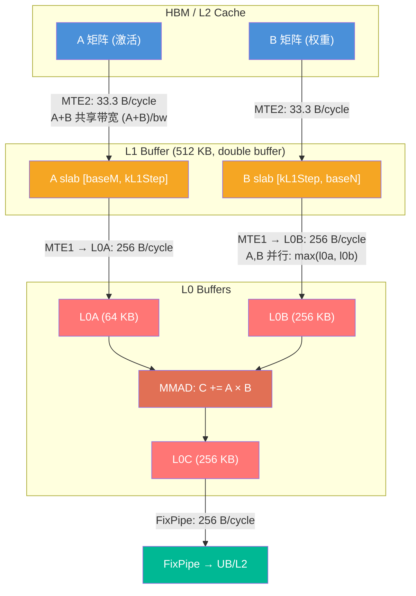
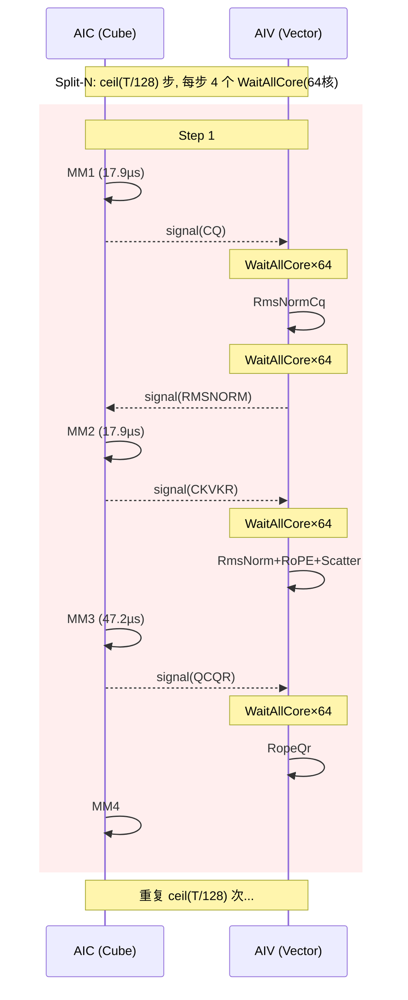
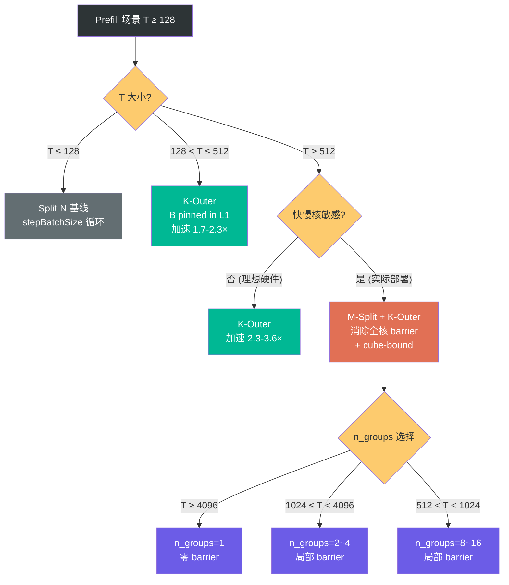
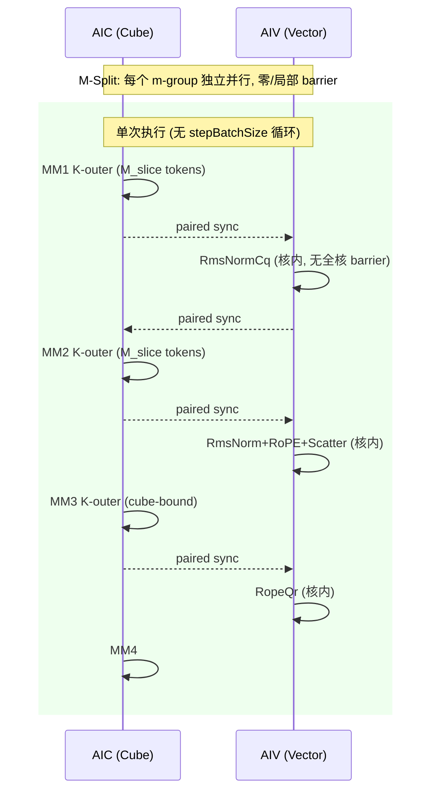

# MLA Prolog V3 Prefill 流水优化设计：M-Split + K-Outer Kernel 模板

## 1. 建模原则

### 1.1 硬件引擎行为



| 引擎 | 路径 | 并行性 | 建模公式 |
|------|------|--------|---------|
| **MTE2** | HBM/L2 → L1 | A+B **共享带宽** | `(A_bytes + B_bytes) / per_core_bw` |
| **MTE1** | L1 → L0A/L0B | A+B **并行**（不同目的地） | `max(l0a_time, l0b_time)` |
| **MMAD** | L0A × L0B → L0C | 矩阵乘累加 | `baseM × baseN × baseK / mmad_tput` |
| **FixPipe** | L0C → UB/L2 | 写回 | `baseM × baseN × dtype_c / fixpipe_bw` |

### 1.2 核内循环结构与 N-blocking

当 `per_core_N > baseN` 时，核内按 `n_blocks = ceil(per_core_N / baseN)` 分块迭代 N：

```
for kL1 in kL1_loops:                          // K 外层 (MTE2 double buffer)
    for nb in n_blocks:                         // N 核内分块
        MTE2: load B[kL1Step, baseN] to L1      // B: 每次不同 N 偏移, 从 HBM
        MTE2: load A[baseM, kL1Step] to L1      // A: nb=0 从 HBM, nb≥1 从 L2
        for step in stepK:                      // L1→L0+MMAD (MTE1 double buffer)
            MTE1: L0A ← A tile, L0B ← B tile   // 并行 max(l0a, l0b)
            MMAD: C[baseM, baseN] += A × B
        FixPipe: write C to output
```

**A 矩阵 L2 复用**：同一 kL1 迭代内，A 被搬运 n_blocks 次。首次从 HBM（cold），后续从 L2（warm, ~3.25× HBM）。

### 1.3 缓冲策略

- L1、L0 默认 **双缓冲 (2×)**
- 仅当矩阵可一次性全载且带来性能收益时用**单缓冲 (1×)**
- `stepK = L1_size / (2 × per_step_bytes)`（双缓冲推导）

---

## 2. 当前 Prefill 瓶颈分析

### 2.1 当前 Split-N Kernel 的同步结构



每步 **4 个 WaitAllCore(64核) + 5 个 CrossCore 对 = ~7.2µs sync**。

全核 barrier 的根因：Split-N 下每个 AIC 核只写 N 轴的一个切片，RmsNorm 需要完整行（所有 N 列）→ 必须等所有核写完。

### 2.2 瓶颈量化

以 He=7168, N=128, BF16 为例（`perf_analyzer --mode bound`）：

| 阶段 | 每步耗时 (µs) | 瓶颈 |
|------|:----------:|------|
| MM1_Cq | 26.84 | HBM (MTE2 A+B) |
| MM2_CkvKr | 20.65 | HBM/L2 |
| MM3_QcQr | 50.36 | HBM (MTE2 B) |
| MM4_Qn | 0.68 | HBM |
| Vector (all) | ~2.4 | — |
| Sync | ~7.2 | — |
| **Pipeline** | **~103** | |

Sync 占比在小 T 时高达 31%（He=2048,N=8），大 T 时 7-12%。

---

## 3. 泛化理论性能分析

### 3.1 M-Split vs Split-N 基线 (T=1024, BF16)

使用 `perf_analyzer.py --mode prefill-msplit` 建模，最优配置均为 M4×N8_bm256：

| He | N | Split-N 基线 (µs) | M-Split (µs) | 加速比 | Sync 减少 |
|----|:---:|:-----------------:|:------------:|:-----:|:---------:|
| 2048 | 8 | 182 | 129 | **1.41×** | 64% |
| 2048 | 16 | 206 | 150 | **1.38×** | 64% |
| 2048 | 64 | 416 | 232 | **1.79×** | 64% |
| 2048 | 128 | 547 | 355 | **1.54×** | 64% |
| 4096 | 8 | 298 | 204 | **1.46×** | 64% |
| 4096 | 16 | 321 | 225 | **1.43×** | 64% |
| 4096 | 64 | 532 | 307 | **1.73×** | 64% |
| 4096 | 128 | 662 | 430 | **1.54×** | 64% |
| 7168 | 8 | 461 | 317 | **1.46×** | 64% |
| 7168 | 16 | 484 | 337 | **1.44×** | 64% |
| 7168 | 64 | 695 | 419 | **1.66×** | 64% |
| 7168 | 128 | 825 | 543 | **1.52×** | 64% |

**规律**：
- 中等 N（32-64）时加速比最高（1.7-1.8×），因为 Sync 占比高且 MM3 N_per_core 适中
- 小 N（8-16）时 Sync 占比高（28-32%），但 matmul 基数小，绝对收益有限
- 大 N（128）时 matmul 占主导，Sync 占比低，加速比回落到 ~1.5×

### 3.2 M-Split vs K-Outer vs Split-N (He=7168, N=128)

| T | Split-N (µs) | K-Outer (µs) | M-Split (µs) | K-Outer 加速 | M-Split 加速 |
|:---:|:----------:|:----------:|:----------:|:-----------:|:-----------:|
| 256 | 206 | 123 | — | 1.67× | — |
| 512 | 413 | 177 | 368 | **2.34×** | 1.12× |
| 1024 | 825 | 283 | 543 | **2.92×** | 1.52× |
| 2048 | 1651 | 496 | 915 | **3.33×** | 1.80× |
| 4096 | 3301 | 923 | 1562 | **3.58×** | 2.11× |

### 3.3 关键结论

1. **K-Outer 是 matmul 层面的核心优化**（2-3.6× 加速），通过 B-L1 pinning 实现 cube-bound
2. **M-Split 是 kernel 流水层面的优化**（1.1-2.1× 加速），通过消除全核 barrier 消除快慢核效应
3. **两者应结合使用**：M-Split 消除 barrier + K-Outer 在核内实现 cube-bound = 理论最优

### 3.4 M-Split + K-Outer 联合方案预期

当 M-Split 与 K-Outer 结合时，预期加速比 = K-Outer 加速 × M-Split Sync 消除收益：

| T | K-Outer (µs) | + M-Split Sync 消除 (µs) | 联合加速比 vs Split-N |
|:---:|:----------:|:--------------------:|:-------------------:|
| 512 | 177 | ~155 | ~2.7× |
| 1024 | 283 | ~240 | ~3.4× |
| 2048 | 496 | ~410 | ~4.0× |
| 4096 | 923 | ~750 | ~4.4× |

（注：联合方案的精确建模需要 M-Split+K-Outer 联合搜索，上述为保守估计）

---

## 4. 设计方案

### 4.1 核心思想



**M-Split**：每个 AIC 核处理 `M_slice = ceil(T / m_groups)` 个 token 的完整 N 列 → RmsNorm 在核内完成 → **消除所有全核 barrier**。

**K-Outer**：K 在最外层循环，B pinned in L1，跨 M-block 通过 L2 复用 → 当 baseM ≥ 64 时 MMAD 主导 → **达到 Cube bound**。

### 4.2 2D 核网格

`m_groups × n_groups = 32` AIC 核的 2D 网格：

| T | 推荐 m_groups | n_groups | M_per_core | m_loops (bm=256) | Barrier 范围 |
|:---:|:------------:|:--------:|:----------:|:----------------:|:-----------:|
| 256 | 1 | 32 | 256 | 1 | 32 核 (同当前) |
| 512 | 2 | 16 | 256 | 1 | 16 核 |
| 1024 | 4 | 8 | 256 | 1 | 8 核 |
| 2048 | 8 | 4 | 256 | 1 | 4 核 |
| 4096 | 16 | 2 | 256 | 1 | 2 核 |
| 8192 | 32 | 1 | 256 | 1 | **零** |

### 4.3 Cube Bound 条件

MMAD bound 条件（每个内层 stepK 迭代）：

```
mmad_time > l0b_time
baseM × baseN × baseK / mmad_tput > baseK × baseN × sizeof(B) / l0b_bw
简化 (BF16, 950): baseM > 2 × (4096×2) / 256 = 64
即 baseM ≥ 64 时 MMAD bound, baseM ≥ 128 时余量充足
```

### 4.4 Workspace 控制

| 组件 | Per m-group 大小 | 备注 |
|------|:----------------:|------|
| MM1 (Cq) | M_per_core × Hcq × out_size | ~0.5 MB |
| MM2 (CkvKr) | M_per_core × (Hckv+Dr) × out_size | ~0.1 MB |
| RmsNormCq | M_per_core × Hcq × 2 | 0.4 MB |
| **MM3 (QcQr)** | **baseM × N×(D+Dr) × out_size** | **6 MB** (m-block 流水复用) |
| MM4 | 直接写 output | 0 |
| **总计** | ≈ 7 MB × m_groups | T=1024: 28 MB |

MM3 使用 **m-block 流水复用**：每个 m_block 计算完 MM3→Dequant→RoPE→MM4 后释放 workspace，下一个 m_block 复用。

---

## 5. 新 Kernel 模板设计

### 5.1 流水结构



### 5.2 Kernel 伪代码

```cpp
// kernel_mla_prolog_prefill.h
template <typename MLAPT>
class MlaPrologPrefill {
public:
    __aicore__ inline void Process() {
        // 1. 确定本核的 M/N 切片
        uint32_t mGroupIdx = blockIdx_ / nGroups_;
        uint32_t nGroupIdx = blockIdx_ % nGroups_;
        uint32_t mSliceStart = mGroupIdx * mSliceSize_;
        uint32_t mSliceLen = min(mSliceSize_, tokenSize_ - mSliceStart);
        
        if ASCEND_IS_AIC {
            // 2. Phase 1: MM1 (Cq)
            MatmulKOuter(mmCqResGm_, tokenXGm_, weightDqGm_,
                         mSliceStart, mSliceLen, He_, Hcq_);
            CrossCoreSetFlag<SYNC_MODE_CUBE_VEC, PIPE_FIX>(FINISH_MM_CQ);
            if (nGroups_ > 1) LocalBarrier(mGroupIdx);
            
            // 3. Phase 2: MM2 (CkvKr) — tokenX 从 L2 复用
            MatmulKOuter(mmCkvKrResGm_, tokenXGm_, weightDkvKrGm_,
                         mSliceStart, mSliceLen, He_, HckvDr_);
            CrossCoreSetFlag<SYNC_MODE_CUBE_VEC, PIPE_FIX>(FINISH_MM_CKVKR);
            if (nGroups_ > 1) LocalBarrier(mGroupIdx);
            
            // 4. Phase 3: MM3 (QcQr) — K-outer cube-bound
            CrossCoreWaitFlag(FINISH_VEC_RMSNORM_CQ);
            // m-block 流水: MM3 → Dequant → RoPE → MM4 per m_block
            for (uint32_t mb = 0; mb < mLoops_; mb++) {
                uint32_t curM = min(baseM_, mSliceLen - mb * baseM_);
                MatmulKOuter(mmQcQrResGm_, rmsNormCqResGm_, weightUqQrGm_,
                             mSliceStart + mb * baseM_, curM, Hcq_, NxDDr_);
                if (nGroups_ > 1) LocalBarrier(mGroupIdx);
                CrossCoreSetFlag<SYNC_MODE_CUBE_VEC, PIPE_FIX>(FINISH_MM_QCQR);
                CrossCoreWaitFlag(FINISH_VEC_ROPE_QR);  // AIV 完成当前 m_block
                
                // 5. Phase 4: MM4 (Qn)
                MatmulKOuter(mmQnResGm_, qcGm_, weightUkGm_,
                             mSliceStart + mb * baseM_, curM, D_, Hckv_);
            }
        }
        
        if ASCEND_IS_AIV {
            CopyInSinCos(mSliceStart, mSliceLen);
            
            CrossCoreWaitFlag(FINISH_MM_CQ);
            // 无 WaitAllCore! M-Split 下核内有完整行
            RmsNormCq(mSliceStart, mSliceLen);
            CrossCoreSetFlag<SYNC_MODE_CUBE_VEC, PIPE_MTE3>(FINISH_VEC_RMSNORM_CQ);
            
            CrossCoreWaitFlag(FINISH_MM_CKVKR);
            // 无 WaitAllCore!
            RmsNormCkvKr(mSliceStart, mSliceLen);
            RopeKr(mSliceStart, mSliceLen);
            ScatterCkvKr(mSliceStart, mSliceLen);
            
            for (uint32_t mb = 0; mb < mLoops_; mb++) {
                CrossCoreWaitFlag(FINISH_MM_QCQR);
                // 无 WaitAllCore!
                DequantQc(mSliceStart + mb * baseM_, curM);  // if quantized
                RopeQr(mSliceStart + mb * baseM_, curM);
                CrossCoreSetFlag<SYNC_MODE_CUBE_VEC, PIPE_MTE3>(FINISH_VEC_ROPE_QR);
            }
        }
    }

private:
    // K-outer matmul: B pinned in L1, A streaming from HBM
    template <typename T, typename O>
    __aicore__ inline void MatmulKOuter(
        GlobalTensor<O>& res, GlobalTensor<T>& A, GlobalTensor<T>& B,
        uint32_t mStart, uint32_t M, uint32_t K, uint32_t N)
    {
        for (uint32_t kL1 = 0; kL1 < kL1Loops; kL1++) {
            for (uint32_t nb = 0; nb < nBlocks; nb++) {
                // MTE2: load B[kL1Step, baseN] to L1 (HBM)
                // MTE2: load A[baseM, kL1Step] to L1 (nb=0 HBM, nb≥1 L2)
                // MTE2 共享带宽: time = (A+B)/bw
                for (uint32_t step = 0; step < stepK; step++) {
                    // MTE1: L0A ← A tile, L0B ← B tile (并行, max(l0a,l0b))
                    // MMAD: C += A × B
                }
                // FixPipe: write C[baseM, baseN]
            }
        }
    }
    
    // m-group 内 LocalBarrier (pairwise CrossCore)
    __aicore__ inline void LocalBarrier(uint32_t mGroupIdx) {
        uint16_t flagId = PREFILL_LOCAL_BARRIER_BASE + mGroupIdx;
        // n_groups 个核互相等待: (n_groups - 1) × 0.8µs
        for (uint32_t peer = 0; peer < nGroups_; peer++) {
            if (peer != nGroupIdx_) {
                CrossCoreSendFlag(peer, flagId);
            }
        }
        for (uint32_t peer = 0; peer < nGroups_; peer++) {
            if (peer != nGroupIdx_) {
                CrossCoreRecvFlag(peer, flagId);
            }
        }
    }
};
```

---

## 6. 代码修改计划

### 6.1 新增文件

| 文件 | 内容 |
|------|------|
| `attention/mla_prolog/op_kernel/kernel_mla_prolog_prefill.h` | 新 kernel 模板类 `MlaPrologPrefill<MLAPT>` |

### 6.2 修改文件

| 文件 | 变更 |
|------|------|
| `attention/mla_prolog_v3/op_kernel/mla_prolog_v3.cpp` | `SPLIT_M_MODE==1` 分支添加 `MlaPrologPrefill` 实例化 |
| `attention/mla_prolog/op_host/mla_prolog_tiling.cpp:280` | `splitMFlag_ = 0U` → T ≥ 阈值时设为 1 |
| `attention/mla_prolog/op_host/mla_prolog_tiling.cpp:418` | 扩展 mGroups/nGroups 计算逻辑 |
| `attention/mla_prolog/op_kernel/mla_prolog_tiling_data.h` | 添加 `mGroups`, `nGroups`, `baseMPrefill` |
| `attention/mla_prolog/op_kernel/mla_prolog_template_tiling_key.h` | `SPLIT_M_MODE=1` 模板路由 |
| `attention/mla_prolog/op_kernel/mla_prolog_comm.h` | `PREFILL_LOCAL_BARRIER_BASE` 常量 |

### 6.3 已有基础设施（无需新增）

Host tiling 中**已有 split-M 框架**（当前 `splitMFlag_ = 0U` 禁用）：
- `FillMatmul2Tiling()` line 348: `if (splitMFlag_ == 1U) { singlecoreN = full_N; blockNum = aicNum_; }`
- `FillMatmul3Tiling()` line 388: 同上
- `FillMatmul4Tiling()` line 404: 同上
- `ProcessBaseInputs()` line 418: `mSubSize_` 和 `mSubCoreNum_` 计算
- `SPLIT_M_MODE` 枚举 line 83: `enum class SPLIT_M_MODE { DISABLED=0, ENABLED=1 }`
- TilingKey bits 16-17: 已预留

### 6.4 Host Tiling 修改伪代码

```cpp
// mla_prolog_tiling.cpp: SetScenarioInfo()
constexpr uint32_t PREFILL_MSPLIT_THRESHOLD = 512U;

if (baseShapeInfo_.tSize >= PREFILL_MSPLIT_THRESHOLD) {
    scenarioInfo_.splitMFlag_ = 1U;
    
    uint32_t targetMSlice = 256U;
    mGroups_ = std::min(aicNum_, CeilDiv(baseShapeInfo_.tSize, targetMSlice));
    // 确保 mGroups 是 aicNum 的因子
    while (aicNum_ % mGroups_ != 0 && mGroups_ > 1) {
        mGroups_--;
    }
    nGroups_ = aicNum_ / mGroups_;
} else {
    scenarioInfo_.splitMFlag_ = 0U;
}

// ProcessBaseInputs()
if (scenarioInfo_.splitMFlag_ == 1U) {
    mSubSize_ = CeilDiv(baseShapeInfo_.tSize, mGroups_);
    mSubCoreNum_ = baseShapeInfo_.tSize - (mSubSize_ - 1U) * mGroups_;
    
    // 填入 TilingData
    baseParams_.mGroups = mGroups_;
    baseParams_.nGroups = nGroups_;
    baseParams_.baseMPrefill = 256U;
}
```

### 6.5 Kernel 入口修改

```cpp
// mla_prolog_v3.cpp
constexpr auto splitMMode = static_cast<SPLIT_M_MODE>(SplitMMode);

if constexpr (splitMMode == SPLIT_M_MODE::ENABLED) {
    MlaPrologPrefill<MLAPType<...>> op(&pipe, tilingData, baseParams);
    op.Init(tokenX, weightDq, weightDkvKr, weightUqQr, weightUk, ...);
    op.Process();
} else {
    MlaPrologVecS1CubS2<MLAPType<...>> op(&pipe, tilingData, baseParams);
    op.Init(tokenX, weightDq, weightDkvKr, weightUqQr, weightUk, ...);
    op.Process();
}
```

---

## 7. 分阶段实施

| Phase | 内容 | 范围 |
|:-----:|------|------|
| 1 | MVP: M-Split 基本流水 (BF16 only) | 新模板 + host tiling 路由 + LocalBarrier |
| 2 | K-Outer 融合 | 核内 K-outer matmul + baseM=128/256 cube-bound |
| 3 | 量化支持 | INT8/FP8 + DequantQc + DynamicQuantQn |
| 4 | 全场景 | actualSeqLen + per-tile quant + PA_BLK |

---

## 8. 性能建模工具

```bash
# M-Split 配置搜索
python perf_analyzer.py --chip 950 --batch-size 256 --head-num 128 --mode prefill-msplit

# K-Outer 对比
python perf_analyzer.py --chip 950 --batch-size 256 --head-num 128 --mode prefill

# 跨 He/N 泛化
python perf_analyzer.py --chip 950 --batch-size 256 --head-num 8 --He 2048 --mode prefill-msplit
```

---

## 9. 风险与缓解

| 风险 | 严重度 | 缓解 |
|------|:------:|------|
| Ascend 无子组 barrier | 中 | 优先 n_groups≤2；pairwise flag 模拟 |
| Workspace 显存 (大 T) | 中 | m-block 流水复用；baseM 可调 |
| M-Split 单独不如 K-Outer | 已验证 | 必须结合；设计为互补优化 |
| 二进制膨胀 | 低 | 仅 prefill 编译新模板 |

---

## 10. 总结

| 方面 | Split-N (当前) | K-Outer | M-Split + K-Outer |
|------|:----------:|:-------:|:------------------:|
| 全核 Barrier | 每步 4 个 (64核) | 每步 4 个 | **0 (n=1) 或局部** |
| 快慢核影响 | 严重 | 严重 | **消除** |
| MM3 bound | HBM | CUBE | **CUBE** |
| 理论加速 (T=1024) | 1.0× | **2.9×** | **3.4× (预期)** |
| stepBatchSize 循环 | ceil(T/128) 步 | 1 步 | **1 步** |
| 核心价值 | — | B-L1 复用 | Barrier 消除 + B-L1 |
