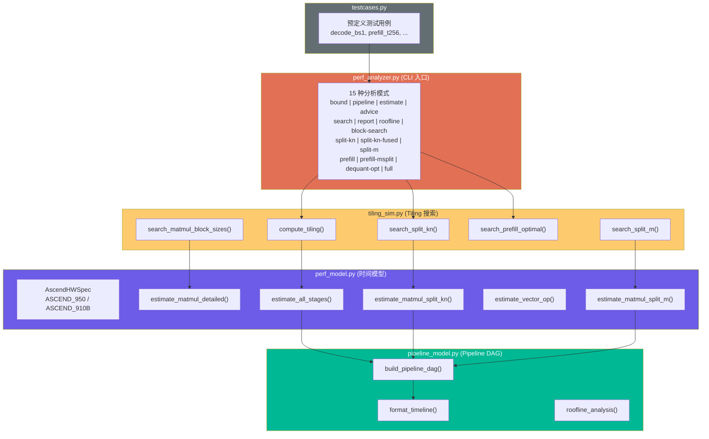

# MLA Prolog V3 Performance Modeling Tools

Theoretical performance modeling for the MLA Prolog V3 operator on Ascend NPU. Estimates execution time from chip specs and kernel tiling parameters — no hardware required.

## Quick Start

```bash
cd attention/mla_prolog_v3/tests/perf

# Full analysis on Ascend 950
python perf_analyzer.py --chip 950 --batch-size 1 --seq-len 1 --head-num 128 --mode full

# Report across all test cases
python perf_analyzer.py --chip 950 --mode report

# Ascend 910B (default, legacy chip-total model)
python perf_analyzer.py --batch-size 1 --seq-len 1 --head-num 128 --mode bound
```

## CLI Arguments

| Argument | Description | Default |
|----------|-------------|---------|
| `--chip` | Target chip (`910b`, `950`) | `910b` |
| `--from-testcase NAME` | Load params from `testcases.py` | — |
| `--batch-size N` | Batch size (mutually exclusive with `--from-testcase`) | — |
| `--seq-len N` | Sequence length | 4 |
| `--head-num N` | Number of attention heads | 8 |
| `--He N` | Hidden size | 7168 |
| `--weight-quant-mode` | 0=BF16, 1=INT8-partial, 2=INT8-full, 3=MXFP8 | 0 |
| `--kv-cache-quant-mode` | KV cache quantization mode | 0 |
| `--query-quant-mode` | 0=normal, 1=dynamic quant | 0 |
| `--mode` | Analysis mode (see below) | `full` |

## Analysis Modes

### `bound` — Per-Stage Resource Breakdown

Shows timing for each matmul (MTE1, L0A, L0B, MMAD, FixPipe) and vector op (MTE2, Vector, MTE3), identifying which resource bounds each stage.

On Ascend 950 (per-cycle specs available), shows inner-loop detail columns: L0A, L0B, MMAD per iteration, and kL1 loop count.

```bash
python perf_analyzer.py --chip 950 --batch-size 1 --head-num 128 --mode bound
```

### `pipeline` — AIC/AIV Timeline Visualization

ASCII art timeline showing how AIC (cube) and AIV (vector) stages overlap. Identifies the critical path through the pipeline DAG.

```bash
python perf_analyzer.py --chip 950 --batch-size 1 --head-num 128 --mode pipeline
```

### `estimate` — Kernel Duration Estimate

Reports estimated total kernel time, accounting for multi-step execution when T > stepBatchSize.

```bash
python perf_analyzer.py --chip 950 --batch-size 32 --head-num 128 --mode estimate
```

### `advice` — Performance Improvement Suggestions

Automated bottleneck detection and optimization advice: MTE1-bound stages, low core utilization, AIC/AIV imbalance, high sync overhead, scatter inefficiency.

```bash
python perf_analyzer.py --chip 950 --batch-size 1 --head-num 128 --mode advice
```

### `search` — Tiling Configuration Search

Explores stepBatchSize candidates (8, 16, 32, 64, 128) and ranks by estimated kernel time.

```bash
python perf_analyzer.py --chip 950 --batch-size 32 --head-num 128 --mode search
```

### `report` — All Test Cases Comparison

Runs all `perf_*` test cases from `testcases.py` and prints a comparison table with per-matmul timing, dominant bottleneck, and quant speedup comparison.

```bash
python perf_analyzer.py --chip 950 --mode report
```

### `roofline` — Roofline Model Analysis

Per-matmul roofline analysis: arithmetic intensity, peak vs achieved GFLOPS, efficiency, and bound classification. Shows ridge points for HBM bandwidth. Requires `--chip 950`.

```bash
python perf_analyzer.py --chip 950 --batch-size 1 --head-num 128 --mode roofline
```

### `block-search` — Optimal baseM/baseN/baseK Search

Exhaustive search over block tile sizes (baseM, baseN, baseK) for each matmul, with stepK auto-derived from L1 constraint. Includes MM2 split-N vs split-K comparison. Requires `--chip 950`.

```bash
python perf_analyzer.py --chip 950 --batch-size 32 --head-num 128 --mode block-search
```

### `split-kn` — 2D Core Split (N×K) Search

Searches 2D split configurations for MM1 and MM2 — splitting both N and K axes across cores. Evaluates each configuration via the **full pipeline** (all 4 matmuls + vector ops) to capture overlap between AIC accumulation and AIV stages.

Reports unified metrics per configuration:
- **Pipeline**: end-to-end kernel duration (critical path)
- **MM1–MM4**: per-matmul cube time
- **Accum**: vector accumulation overhead (may overlap with next AIC stage)
- **CubeUtil**: AIC busy time / pipeline total
- **AIC/AIV**: total busy time per pipe

Requires `--chip 950`.

```bash
python perf_analyzer.py --chip 950 --batch-size 1 --head-num 128 --mode split-kn
```

### `split-m` — M-axis Split Search (Prefill)

Searches M-axis split configurations for prefill scenarios (large T). Each core handles `ceil(T / m_groups)` tokens with the full N dimension — no cross-core synchronization between matmul stages. B (weight) matrix is shared across cores via L2 cache reuse.

Reports per-configuration:
- **Total**: end-to-end time for all T tokens (1 kernel launch)
- **MM1–MM4**: per-matmul time, **Vec**: total vector time per core
- **vs SplitN**: delta vs split-N baseline (`per_step × ceil(T / stepBatchSize)`)

Also searches optimal `baseM` per m_groups to maximize compute overlap with L2 B-loading (transition from L2-bound to cube-bound).

Not beneficial for decode (T=1). Requires `--chip 950`.

```bash
python perf_analyzer.py --chip 950 --batch-size 512 --head-num 128 --mode split-m
```

### `split-kn-fused` — Fused K-Accumulation + RmsNorm Analysis (Supplement to `split-kn`)

A *supplement* to `--mode split-kn`. For each split-kn configuration with `k_groups > 1`, estimates the savings from fusing the K-axis accumulation step into the existing M-split RmsNorm step in vector. The fused variant avoids (a) the new full-V-core barrier that a separate accumulation step would need, and (b) the UB → GM → UB round-trip between the accumulation output and the RmsNorm input.

The cube data path stays unchanged (still writes K-partials to GM via FixPipe). Existing kernel barriers at `kernel_mla_prolog_split_n.h:854,859,867` are unrelated to this optimization and remain in place. Reports per-config UB budget and chunking decisions when stepBatchSize is large enough that one V core's M slice doesn't fit in UB. Requires `--chip 950`.

```bash
python perf_analyzer.py --chip 950 --batch-size 1 --head-num 8 --mode split-kn-fused
```

### `dequant-opt` — UB-Pipelined Dequant+RoPE Analysis

Estimates the savings from running the dequant+RoPE pipeline directly through the L0C → UB → L1 path on a single AI core (intra-core HardEvent sync), instead of round-tripping through GM with cross-core CrossCoreSetFlag/WaitFlag pairs. Reports a stage-by-stage comparison vs the baseline pipeline, the DequantRopeUB sub-stage breakdown (L0C→UB, UB compute, UB→L1), and the per-core UB / L1 budget.

Applicable when the configuration uses byte-quantized weights (FP8 / INT8 / MXFP8) and `head_num >= 8`. Requires `--chip 950` because the model relies on the per-cycle UB↔L1 bandwidth path. Reference iterators: `attention/mla_preprocess/op_kernel/l0c_to_ub_iterator.h` and `l1_to_ub_iterator.h`.

```bash
python perf_analyzer.py --chip 950 --batch-size 1 --head-num 128 \
    --weight-quant-mode 3 --mode dequant-opt
```

### `prefill-msplit` — M-Split + K-outer for Cube-Bound Prefill

Searches `m_groups × n_groups` configurations to eliminate full-core barriers and achieve cube-bound execution in prefill. Each core handles `M/m_groups` tokens with `N/n_groups` columns — no full-AIV WaitAllCore barriers needed.

Reports per-configuration:
- **Total**: end-to-end time (single kernel launch, no multi-step)
- **MM1–MM4, Vec, Sync**: component breakdown
- **MM3 bound**: whether MM3 achieves cube-bound (goal of this optimization)
- **Workspace**: GM workspace size for partial sums
- **vs Base**: savings vs split-N multi-step baseline

Not beneficial for decode (T=1). Requires `--chip 950`.

```bash
python perf_analyzer.py --chip 950 --batch-size 256 --head-num 128 --mode prefill-msplit
```

### `full` — All Modes Combined

Runs bound + pipeline + estimate + advice + search. On Ascend 950, also runs roofline + block-search + split-kn + split-m. Note: `dequant-opt`, `split-kn-fused`, and `prefill-msplit` are intentionally **not** in `full` mode, run them explicitly.

## Architecture



> [在线编辑此图](https://l.mermaid.ai/OFwwLr)

### Key Concepts

- **Chip-total model** (910B): bandwidth in bytes/sec, compute in TFLOPS. No cache hierarchy detail.
- **Per-cycle model** (950): bandwidth in bytes/cycle + frequency, per-core cache sizes (L0A/L0B/L0C/L1). Models the matmul inner loop (MTE1 → L0 load → MMAD → FixPipe).
- **Buffer strategy**: double buffer (2×) by default. Full-load single buffer (1×) only when the complete matrix fits and it improves performance.
- **Split-KN**: 2D core grid (n_groups × k_groups). K-split cores produce float32 partial sums; vector side accumulates. Pipeline DAG captures overlap between accumulation and next matmul.
- **Split-M**: M-axis split for prefill. Each core handles `M/m_groups` tokens with full N. 3-level tiling (m_loops × kL1 × n_blocks). B matrix shared via L2; A rows unique per core from HBM.

## Documentation

- **[methodology.md](methodology.md)** — Performance modeling & optimization methodology with worked examples
- **[report_ascend950.md](report_ascend950.md)** — Comprehensive analysis for Ascend 950 across quantization modes
- **[report_split_m.md](report_split_m.md)** — Split-M (M-axis split) modeling details with worked examples and scenario comparison
- **[report_prefill_cube_bound.md](report_prefill_cube_bound.md)** — K-outer loop optimization: achieving cube-bound in prefill (3.3× speedup)
