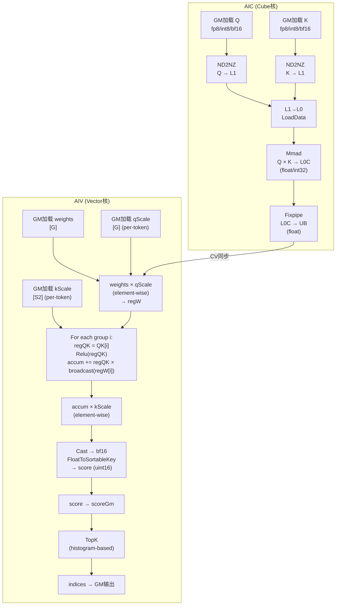
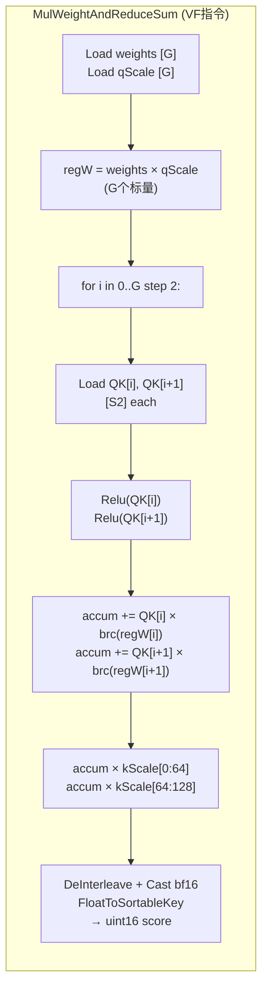
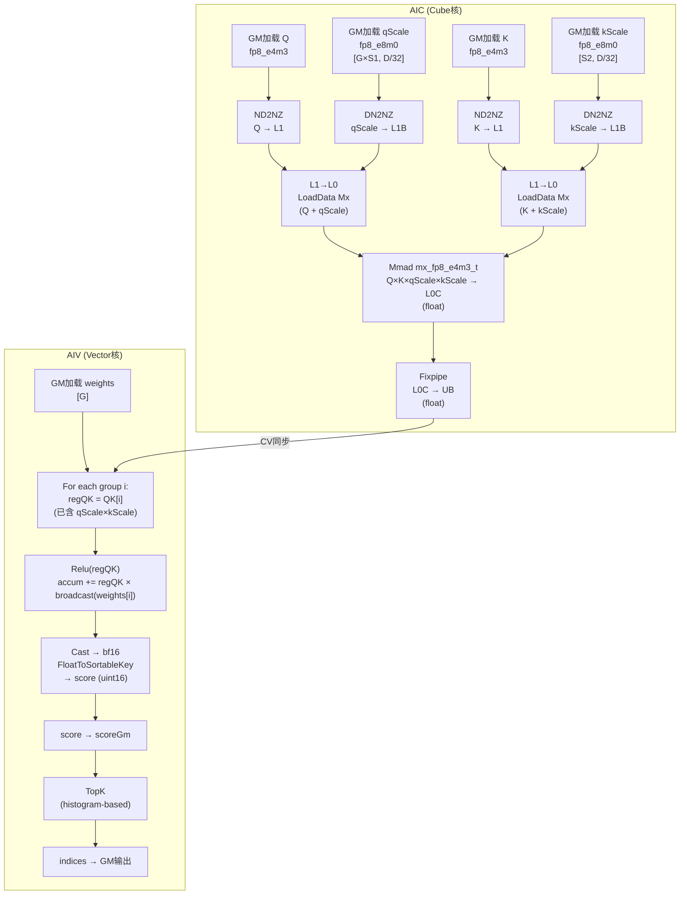
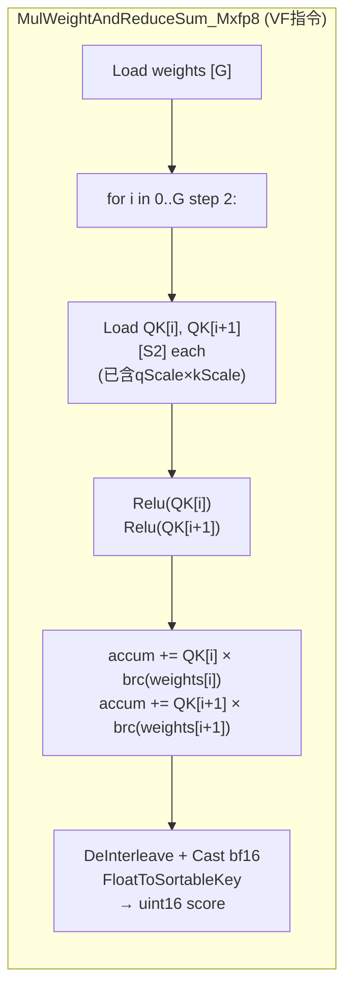
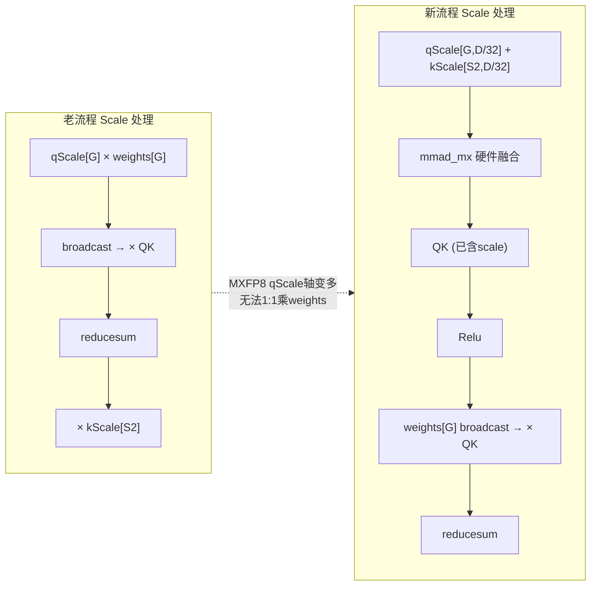
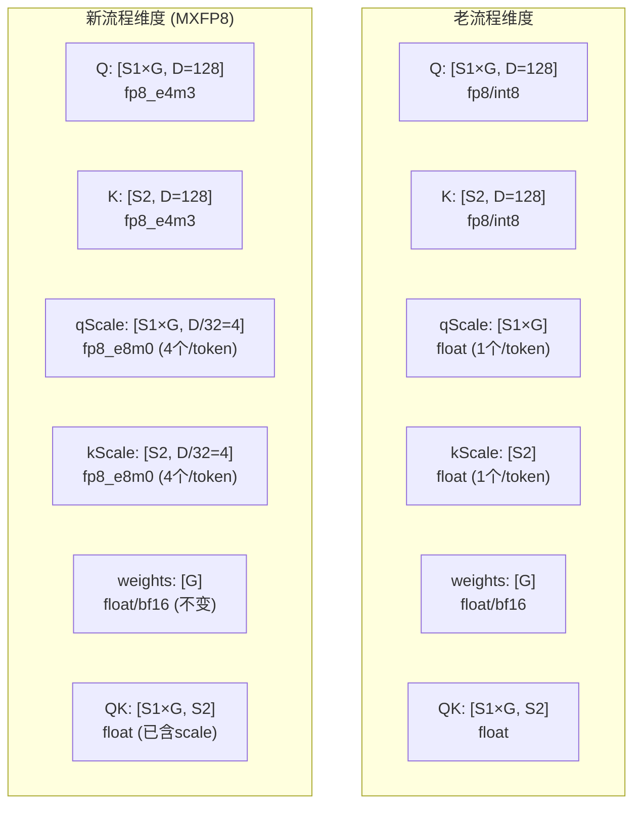

# QLI 算子 MXFP8 新老计算流程对比图

> 使用 Mermaid 语法，可在 VS Code (Markdown Preview Mermaid Support 插件)、draw.io、mermaid.live 等工具中编辑和渲染。

---

## 一、老流程（非 MXFP8）

### 1.1 整体流水线



### 1.2 Vector 核内部计算细节（老流程）



### 1.3 老流程 qScale 形状

```
qScale shape: [B, S1, N1]  (per-token, per-head)
                ↓
            每个 group 对应 1 个标量
                ↓
            weights[G] × qScale[G] = regW[G]  (element-wise, 1:1)
```

---

## 二、新流程（MXFP8）

### 2.1 整体流水线



### 2.2 Vector 核内部计算细节（新流程）



### 2.3 新流程 qScale 形状

```
qScale shape: [B, S1, N1, D/32]  (per-block, 每32个D元素一个scale)
                ↓
            每个 group 对应 D/32 = 4 个 scale (D=128)
                ↓
            无法与 weights[G] 做 1:1 element-wise 乘法
                ↓
            解决方案: 将 qScale 融入 mmad_mx 硬件指令
```

---

## 三、新老流程对比表

| 阶段 | 老流程 | 新流程 (MXFP8) |
|------|--------|----------------|
| **Q 数据** | fp8/int8/bf16 | fp8_e4m3 |
| **K 数据** | fp8/int8/bf16 | fp8_e4m3 |
| **qScale** | `[G]` float/half (per-token) | `[G, D/32]` fp8_e8m0 (per-block) |
| **kScale** | `[S2]` float/half (per-token) | `[S2, D/32]` fp8_e8m0 (per-block) |
| **Cube: Mmad** | `Q × K` → float/int32 | `Q × K × qScale × kScale` → float (mmad_mx) |
| **Cube: L0加载** | 普通 LoadData | LoadData Mx (数据+scale一起加载) |
| **Vec: 预处理** | `weights × qScale` | 无 (scale已在mmad_mx中处理) |
| **Vec: 主循环** | `Relu(QK) → × weight → accum` | `Relu(QK) → × weight → accum` (相同) |
| **Vec: 后处理** | `accum × kScale` | 无 (scale已在mmad_mx中处理) |
| **Vec: 输出** | cast bf16 → sortable key | cast bf16 → sortable key (相同) |
| **TopK** | histogram-based | histogram-based (相同) |

---

## 四、关键差异总结



---

## 五、数据维度变化


