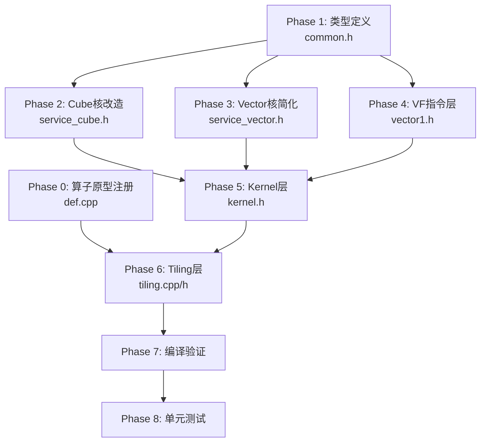

# QLI 算子 MXFP8 适配修改方案

> 版本: v1.1 (审核中)
> 日期: 2026-06-08
> 状态: **审核中** - v1.1 补充 def.cpp 修改（ascend950 注册 MXFP8 类型），Phase 0 已实施

---

## 一、修改背景

### 1.1 问题描述

QLI (quant_lightning_indexer) 算子原有计算流程中，`qScale` 的粒度为 **per-token**（每个 token 一个标量），形状为 `[G]`，可以与 `weights[G]` 做 1:1 的 element-wise 乘法后广播。

在 MXFP8 量化方案中，`qScale` 变为 **per-block**（每 32 个 D 维度元素一个 scale），形状变为 `[G, D/32]`（D=128 时为 `[G, 4]`），轴数增多，无法再与 `weights[G]` 做简单的 element-wise 乘法。

### 1.2 解决方案

将 `qScale` 和 `kscale` 的处理从 Vector 核移到 Cube 核，通过 `mmad_mx` 硬件指令在矩阵乘法阶段直接融合 scale，Vector 核只需处理 `weights` 的广播乘法和 ReduceSum。

---

## 二、新老流程对比

### 2.1 老流程

```
Cube: Q × K → float (mm1ResUB)
  ↓ CV同步
Vec:  weights × qScale → regW[G]
      for i in G:
          QK[i] → Relu → accum += QK[i] × broadcast(regW[i])
      accum × kScale → cast bf16 → sortable key → score
  ↓
TopK: score → indices
```

### 2.2 新流程

```
Cube: Q × K × qScale × kScale → float (mm1ResUB)  [mmad_mx]
  ↓ CV同步
Vec:  for i in G:
          QK[i] → Relu → accum += QK[i] × broadcast(weights[i])
      cast bf16 → sortable key → score
  ↓
TopK: score → indices
```

---

## 三、修改范围

### 3.1 需要修改的文件

| 序号 | 文件 | 修改内容 | 难度 |
|------|------|---------|------|
| 1 | `op_kernel/quant_lightning_indexer_common.h` | 添加 MXFP8 类型定义、QLIType 特化 | 低 |
| 2 | `op_kernel/arch35/quant_lightning_indexer_service_cube.h` | Cube 核加载 qScale/kScale，使用 mmad_mx | 高 |
| 3 | `op_kernel/arch35/quant_lightning_indexer_service_vector.h` | 移除 qScale/kScale 加载，简化 ProcessVec1 | 中 |
| 4 | `op_kernel/arch35/vf/quant_lightning_indexer_vector1.h` | 新增无 scale 的 MulWeightAndReduceSum 变体 | 中 |
| 5 | `op_kernel/arch35/quant_lightning_indexer_kernel.h` | 调整 Init 中 qScale/kScale 的 GM 设置 | 低 |
| 6 | `op_host/quant_lightning_indexer_tiling.cpp` | 调整 scale 偏移计算 (D/32) | 中 |
| 7 | `op_host/quant_lightning_indexer_tiling.h` | 添加 MXFP8 相关 tiling 参数 | 低 |
| 8 | `op_host/quant_lightning_indexer_def.cpp` | ascend950 配置添加第 5 个类型位置 (MXFP8: fp8_e8m0 scale) | 低 |

### 3.2 不需要修改的文件

| 文件 | 原因 |
|------|------|
| `vf/vf_topk.h` | TopK 逻辑不变 |
| `vf/quant_lightning_indexer_topk.h` | TopK 调度逻辑不变 |
| `op_host/quant_lightning_indexer_infershape.cpp` | 输入输出形状不变 |

---

## 四、详细修改方案

### 阶段 0: 算子原型注册 (Phase 0)

#### 4.0 `quant_lightning_indexer_def.cpp`

**目标**: 在 ascend950 配置中注册 MXFP8 类型组合，使 CANN 框架在算子原型校验阶段接受 `DT_FLOAT8_E8M0` 类型的 scale 输入。

**背景**: def.cpp 的 ascend950 配置中，每个 Input/Output 的 DataType 列表有 4 个位置，分别对应 4 种已有的类型组合。MXFP8 引入了第 5 种组合（fp8_e4m3 数据 + fp8_e8m0 scale），需要在每个 Input/Output 的 DataType 和 Format 列表中添加第 5 个元素。如果不添加，CANN 框架会在原型校验阶段（早于 tiling 和 kernel 执行）拒绝 MXFP8 scale 输入。

**MXFP8 类型组合（第 5 个位置）**:

| 输入/输出 | 数据类型 |
|-----------|---------|
| query | `DT_FLOAT8_E4M3FN` |
| key | `DT_FLOAT8_E4M3FN` |
| weights | `DT_BF16` |
| query_dequant_scale | `DT_FLOAT8_E8M0` ← **关键新增** |
| key_dequant_scale | `DT_FLOAT8_E8M0` ← **关键新增** |
| actual_seq_lengths_query | `DT_INT32` |
| actual_seq_lengths_key | `DT_INT32` |
| block_table | `DT_INT32` |
| sparse_indices (output) | `DT_INT32` |

**修改点**:
- [x] ascend950 配置所有 Input/Output 的 DataType 列表添加第 5 个元素
- [x] ascend950 配置所有 Input/Output 的 Format 列表添加第 5 个 `FORMAT_ND`
- [x] 添加类型位置说明注释

**不需要修改的方面**:
- Shape 定义：def.cpp 使用 `FORMAT_ND` + `DynamicShapeSupportFlag(true)` + `DynamicRankSupportFlag(true)`，shape 完全动态，从 `[G]` 到 `[G, D/32]` 的维度变化无需在 def.cpp 中修改
- ascend910b/ascend910_93 配置：MXFP8 仅在 ascend950 (DAV_3510) 上使用

---

### 阶段 1: 类型定义与基础设施 (Phase 1)

#### 4.1 `quant_lightning_indexer_common.h`

**目标**: 添加 MXFP8 类型支持

```cpp
// 新增类型别名
using FP8E4M3 = fp8_e4m3fn_t;
using FP8E8M0 = fp8_e8m0_t;

// 新增常量
constexpr uint32_t MXFP8_BLOCK_SIZE = 32;  // 每32个元素一个scale
constexpr uint32_t FP8_TWO = 2;            // 2个fp8_e8m0打包成1个bf16

// QLIType 模板特化（MXFP8场景）
// 当 Q_T = FP8E4M3 且 SCALE_T = FP8E8M0 时
template <...>
struct QLIType<FP8E4M3, FP8E4M3, OUT_T, PAGE_ATTENTION, Q_LAYOUT_T, K_LAYOUT_T,
               W_T, FP8E8M0, float, Args...> {
    using queryType = FP8E4M3;
    using keyType = FP8E4M3;
    using qkType = float;          // mmad_mx 输出为 float
    using outputType = OUT_T;
    using weightType = W_T;
    using scaleType = FP8E8M0;     // fp8_e8m0
    // ... 其他不变
};
```

**修改点**:
- [ ] 添加 `FP8E4M3`、`FP8E8M0` 类型别名
- [ ] 添加 `MXFP8_BLOCK_SIZE`、`FP8_TWO` 常量
- [ ] 添加 `QLIType` MXFP8 特化版本
- [ ] 添加 `isMxFp8` 编译期判断标志

---

### 阶段 2: Cube 核改造 (Phase 2)

#### 4.2 `quant_lightning_indexer_service_cube.h`

**目标**: 支持 qScale/kScale 加载和 mmad_mx 矩阵乘

##### 4.2.1 新增成员变量

```cpp
// 新增 Global Tensor
GlobalTensor<SCALE_T> qScaleGm_;
GlobalTensor<SCALE_T> kScaleGm_;

// 新增 L1 Buffer（scale 存储在 L1B 的上半区）
// scale 不需要单独的 buffer，复用 keyL1_ 的空间

// 新增 L0 Buffer 类型（mx_fp8_e4m3_t）
// 通过 ReinterpretCast 复用现有 L0 buffer
```

##### 4.2.2 修改 `InitMm1GlobalTensor`

```cpp
// 新增 qScaleGm 和 kScaleGm 参数
__aicore__ inline void InitMm1GlobalTensor(
    const GlobalTensor<int32_t> &blkTableGm,
    const GlobalTensor<K_T> &keyGm,
    const GlobalTensor<Q_T> &queryGm,
    const GlobalTensor<SCALE_T> &qScaleGm,   // 新增
    const GlobalTensor<SCALE_T> &kScaleGm);  // 新增
```

##### 4.2.3 新增 Scale 加载函数

```cpp
// 加载 qScale 到 L1B（DN2NZ 格式转换）
template <typename S>
__aicore__ inline void LoadQScaleToL1(
    uint64_t s1gL1RealSize, uint64_t s1gGmOffset,
    const QLICommon::RunInfo &runInfo);

// 加载 kScale 到 L1B（DN2NZ 格式转换）
template <typename S>
__aicore__ inline void LoadKScaleToL1(
    uint64_t s2L1RealSize, uint64_t s2GmOffset,
    const QLICommon::RunInfo &runInfo);
```

##### 4.2.4 修改 `LoadQueryToL0a` (MXFP8 分支)

```cpp
// MXFP8 场景下使用 LoadData Mx 变体
if constexpr (std::is_same<Q_T, FP8E4M3>::value && std::is_same<SCALE_T, FP8E8M0>::value) {
    LocalTensor<mx_fp8_e4m3_t> dstTensor = queryL0_[...].template ReinterpretCast<mx_fp8_e4m3_t>();
    LocalTensor<fp8_e8m0_t> scaleTensor = qScaleL1_[...].template ReinterpretCast<fp8_e8m0_t>();
    LoadData2DMxParams loadScaleParam;
    // ... 设置 scale 加载参数
    LoadData(dstTensor, queryL1_[...], scaleTensor, loadDataA2DParams, loadScaleParam);
}
```

##### 4.2.5 修改 `LoadKeyToL0b` (MXFP8 分支)

```cpp
// MXFP8 场景下使用 LoadData Mx 变体
if constexpr (std::is_same<K_T, FP8E4M3>::value && std::is_same<SCALE_T, FP8E8M0>::value) {
    LocalTensor<mx_fp8_e4m3_t> dstTensor = keyL0_[...].template ReinterpretCast<mx_fp8_e4m3_t>();
    LocalTensor<fp8_e8m0_t> scaleTensor = kScaleL1_[...].template ReinterpretCast<fp8_e8m0_t>();
    LoadData2DMxParams loadScaleParam;
    // ... 设置 scale 加载参数
    LoadData(dstTensor, keyL1_[...], scaleTensor, loadData2DV2, loadScaleParam);
}
```

##### 4.2.6 修改 `ComputeL0c` (MXFP8 分支)

```cpp
// MXFP8 场景下使用 mx_fp8_e4m3_t 类型触发 mmad_mx
if constexpr (std::is_same<Q_T, FP8E4M3>::value && std::is_same<SCALE_T, FP8E8M0>::value) {
    LocalTensor<mx_fp8_e4m3_t> qL0Mx = queryL0_[...].template ReinterpretCast<mx_fp8_e4m3_t>();
    LocalTensor<mx_fp8_e4m3_t> kL0Mx = keyL0_[...].template ReinterpretCast<mx_fp8_e4m3_t>();
    Mmad(cL0_[...], qL0Mx, kL0Mx, mmadParams);
}
```

##### 4.2.7 修改 `ComputeMm1` 主循环

在 `ComputeMm1` 中，MXFP8 场景下需要：
- 在 QueryNd2Nz 后加载 qScale
- 在 KeyNd2Nz 后加载 kScale
- 调整 L1 buffer 布局以容纳 scale 数据

**L1B 布局调整**:
```
L1B (128KB):
├── [0, s2BasicBlock*128)        : K 数据 (fp8_e4m3)
├── [s2BasicBlock*128, +qScale)  : qScale (fp8_e8m0, 以bf16方式存储)
└── [+qScale, +kScale)           : kScale (fp8_e8m0, 以bf16方式存储)
```

---

### 阶段 3: Vector 核简化 (Phase 3)

#### 4.3 `quant_lightning_indexer_service_vector.h`

**目标**: 移除 qScale/kScale 相关逻辑

##### 4.3.1 修改 `InitBuffers`

```cpp
// 移除 qScaleBuf_ 和 kScaleBuf_ 的初始化（MXFP8 场景）
if constexpr (!isMxFp8) {
    pipe->InitBuffer(kScaleBuf_, ...);
    pipe->InitBuffer(qScaleBuf_, ...);
}
```

##### 4.3.2 修改 `ProcessVec1`

```cpp
// MXFP8 场景下移除以下逻辑：
// 1. 移除 qScale 加载（isFirstS2InnerLoop 分支中的 qScaleGm → qScaleUB_）
// 2. 移除 kScale 加载（每16个s2 block 的 kScaleGm → kScaleUB_）
// 3. 修改 BatchMulWeightAndReduceSum 调用，不传 qScale 和 kScale

if constexpr (isMxFp8) {
    // 只加载 weights
    if (info.isFirstS2InnerLoop) {
        // weightsGm → weightUB_ (不变)
    }
    // 不加载 qScale 和 kScale

    // 调用简化版 BatchMulWeightAndReduceSum
    vector1::BatchMulWeightAndReduceSum_MxFP8(
        outBase, outStride,
        qkBase, qkVLstride, qkStride,
        weightBase, weightStride, weightFloatBase,
        gSize_, curAivS1ProcNum);
}
```

##### 4.3.3 修改 `InitVecInputTensor`

```cpp
// MXFP8 场景下不需要 qScaleGm 和 kScaleGm
if constexpr (!isMxFp8) {
    this->qScaleGm = qScaleGm;
    this->kScaleGm = kScaleGm;
}
```

---

### 阶段 4: VF 指令层改造 (Phase 4)

#### 4.4 `quant_lightning_indexer_vector1.h`

**目标**: 新增无 scale 版本的 MulWeightAndReduceSum

##### 4.4.1 新增 `MulWeightAndReduceSum_MxFP8`

```cpp
// 新流程：QK 已含 qScale×kScale，只需 weights 广播乘法 + Relu + ReduceSum
template <typename QK_T>
__simd_vf__ inline void MulWeightAndReduceSum_MxFP8(
    __ubuf__ uint16_t* out_,
    __ubuf__ QK_T* qk_,
    const uint32_t qkVLStride,
    __ubuf__ float* weight_,    // weights 已经是 float，不需要 × qScale
    const int gSize)
{
    // 1. 加载 weights（不乘 qScale）
    AscendC::MicroAPI::LoadAlign<float>(regW, weight_);
    // 注意：不再执行 regW = regW × regQScale

    // 2. 初始化累加器
    DuplicateZero(regSum0, maskAllB32);
    DuplicateZero(regSum1, maskAllB32);

    // 3. 主循环：Relu + MulAdd（不乘 kScale）
    for (uint16_t i = 0; i < gSize; i += 2) {
        MicroAPI::LoadAlign<float>(regQK[0], qk_ + 128 * i);
        MicroAPI::LoadAlign<float>(regQK[1], qk_ + 128 * i + qkVLStride);
        BroadcastLane(regwBrc, regW, i);
        WeightedAccum(regSum0, regQK, regwBrc, maskAllB32);  // 内含 Relu

        MicroAPI::LoadAlign<float>(regQK[0], qk_ + 128 * i + 128);
        MicroAPI::LoadAlign<float>(regQK[1], qk_ + 128 * i + 128 + qkVLStride);
        BroadcastLane(regwBrc, regW, i + 1);
        WeightedAccum(regSum1, regQK, regwBrc, maskAllB32);
    }

    // 4. 合并累加器
    AscendC::MicroAPI::Add(regSum0[0], regSum0[0], regSum1[0], maskAllB32);
    AscendC::MicroAPI::Add(regSum0[1], regSum0[1], regSum1[1], maskAllB32);
    // 注意：不再执行 regSum × kScale

    // 5. Cast + SortableKey（不变）
    AscendC::MicroAPI::DeInterleave(regSum0[0], regSum0[1], regSum0[0], regSum0[1]);
    AscendC::MicroAPI::Cast<bfloat16_t, float, castTraitF32ToF16_ODD>(regSumBF16, regSum0[1], maskAllB32);
    AscendC::MicroAPI::Cast<bfloat16_t, float, castTraitF32ToF16_EVEN>(regSumBF16, regSum0[0], maskAllB32);
    FloatToSortableKey<bfloat16_t>(regOut, regSumBF16, bf16Ctx, maskAllB16);
    AscendC::MicroAPI::StoreAlign<uint16_t>(out_, regOut, maskAllB16);
}
```

##### 4.4.2 新增 `MulWeightAndReduceSum2_MxFP8` (S1=2 版本)

同理，移除 qScale 和 kScale 的处理。

##### 4.4.3 新增 `BatchMulWeightAndReduceSum_MxFP8` (调度函数)

```cpp
template<typename QK_T, typename W_T, typename SCORE_T>
__aicore__ inline void BatchMulWeightAndReduceSum_MxFP8(
    const LocalTensor<SCORE_T> &out_,
    uint32_t outStride,
    const LocalTensor<QK_T> &qk_,
    uint32_t qkVLStride,
    uint32_t qkStride,
    const LocalTensor<W_T> &weight_,
    uint32_t weightStride,
    const LocalTensor<float> &weightFloat_,
    const int gSize,
    const int batch)
{
    // 调用无 scale 版本的 MulWeightAndReduceSum
    if (batch == 1) {
        MulWeightAndReduceSum_MxFP8(out, qk, qkVLStride, weightFloat, gSize);
    } else if (batch == 2) {
        MulWeightAndReduceSum2_MxFP8(out0, out1, outStride,
                                        qk0, qk1, qkVLStride, qkStride,
                                        weight0, weight1, weightStride, weightFloat,
                                        gSize);
    }
}
```

---

### 阶段 5: Kernel 层适配 (Phase 5)

#### 4.5 `quant_lightning_indexer_kernel.h`

**目标**: 调整 Init 中的 GM 设置

##### 4.5.1 修改 `Init` 函数

```cpp
// AIV 侧：MXFP8 场景不需要设置 qScaleGm 和 kScaleGm
if ASCEND_IS_AIV {
    vectorService.InitParams(constInfo, tiling);
    indiceOutGm.SetGlobalBuffer((__gm__ int32_t *)sparseIndices);
    weightsGm.SetGlobalBuffer((__gm__ W_T *)weights);
    if constexpr (!isMxFp8) {
        qScaleGm.SetGlobalBuffer((__gm__ SCALE_T *)queryScale);
        kScaleGm.SetGlobalBuffer((__gm__ SCALE_T *)keyScale);
    }
    blockTableGm.SetGlobalBuffer((__gm__ int32_t *)blockTable);
    vectorService.InitVecInputTensor(weightsGm, qScaleGm, kScaleGm, indiceOutGm, blockTableGm);
}

// AIC 侧：MXFP8 场景需要设置 qScaleGm 和 kScaleGm
} else {
    matmulService.InitParams(constInfo);
    queryGm.SetGlobalBuffer((__gm__ Q_T *)query);
    keyGm.SetGlobalBuffer((__gm__ K_T *)key);
    if constexpr (isMxFp8) {
        qScaleGm.SetGlobalBuffer((__gm__ SCALE_T *)queryScale);
        kScaleGm.SetGlobalBuffer((__gm__ SCALE_T *)keyScale);
    }
    matmulService.InitMm1GlobalTensor(blockTableGm, keyGm, queryGm, qScaleGm, kScaleGm);
}
```

##### 4.5.2 修改 `CalcRunInfo`

```cpp
// MXFP8 场景下 qScale 的偏移计算不同
if constexpr (isMxFp8) {
    // qScale offset: [B, S1, N1, D/32]
    // 每个 token 对应 D/32 = 4 个 scale
    runInfo.tensorQScaleOffset = ... * (constInfo_.headDim / MXFP8_BLOCK_SIZE);
    // kScale offset: [B, S2, D/32]
    runInfo.tensorKScaleOffset = ... * (constInfo_.headDim / MXFP8_BLOCK_SIZE);
}
```

---

### 阶段 6: Tiling 层适配 (Phase 6)

#### 4.6 `quant_lightning_indexer_tiling.cpp` / `.h`

**目标**: 调整 scale 相关的偏移和大小计算

##### 4.6.1 新增 MXFP8 scale stride 计算

```cpp
// MXFP8 场景下 scale 的 stride 不同
if (isMxFp8) {
    // qScale stride: 每个 token 有 D/32 个 scale
    tilingData->qScaleStride = headDim / MXFP8_BLOCK_SIZE;  // = 4
    // kScale stride: 每个 S2 token 有 D/32 个 scale
    tilingData->kScaleStride = headDim / MXFP8_BLOCK_SIZE;  // = 4
}
```

---

## 五、修改顺序与依赖关系



---

## 六、风险评估

| 风险项 | 影响 | 缓解措施 |
|--------|------|---------|
| L1 空间不足（scale 占用额外空间） | Cube 核 L1B 需要同时存放 K 数据 + qScale + kScale | 减小 s2BasicBlock 或调整 L1 布局 |
| mmad_mx 精度差异 | mmad_mx 的 scale 融合可能与软件计算有微小差异 | 对比 golden 数据验证精度 |
| Event 同步变化 | scale 加载需要额外的同步事件 | 复用现有 SCALE_EVENT 或新增事件 |
| 老流程兼容性 | 修改后需保证非 MXFP8 场景不受影响 | 使用 `if constexpr` 编译期分支 |

---

## 七、验证计划

1. **编译验证**: 确保 MXFP8 和非 MXFP8 两个模板实例都能编译通过
2. **功能验证**: 使用 `tests/pytest/quant_lightning_indexer_golden.py` 生成 golden 数据对比
3. **精度验证**: 对比新老流程的输出差异，确保在可接受范围内
4. **性能验证**: 对比新老流程的 cycle 数

---

## 八、审核清单

- [x] 新老流程对比图是否准确？
- [x] 修改范围是否完整？ → v1.1 补充: def.cpp 需修改（ascend950 缺少 DT_FLOAT8_E8M0 类型注册）
- [ ] 修改顺序是否合理？
- [ ] 风险评估是否充分？
- [x] 是否有遗漏的文件需要修改？ → v1.1 已补充 def.cpp
- [ ] L1 空间布局是否可行？
- [ ] Event 同步方案是否完备？
- [x] 上一笔修改是否影响 arch22？ → 已确认不影响（arch22 为死代码 + 共享文件向后兼容）

---

**请审核后告知是否需要调整，审核通过后我将按阶段顺序开始实施修改。**
