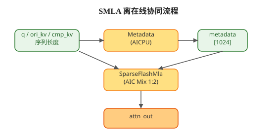
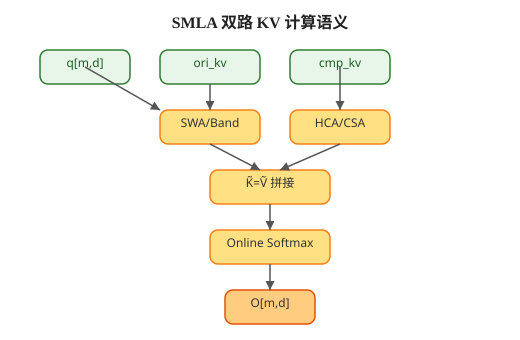
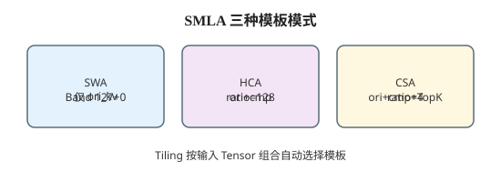
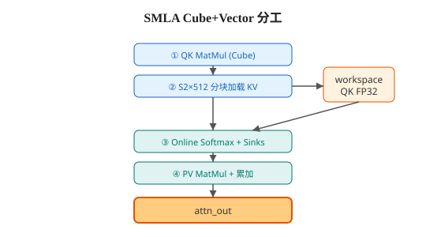

# CANN极致优化 SparseFlashMla 稀疏 MLA 注意力，长上下文推理算力再突破

## **01 长上下文 MLA 推理面临的注意力计算挑战**

在大语言模型向更长上下文、更大 Batch 演进的今天，Decoder 阶段自注意力仍是算力与显存的双重瓶颈。KV Cache 随序列长度线性增长，全量注意力对每个 Query 遍历全部历史 KV，在百万 token 级上下文下几乎不可承受。

MLA（Multi-head Latent Attention）通过低秩潜空间表示压缩 KV，显著降低 Cache 占用；但在实际部署中，模型往往还需要**局部精细建模**（近期 token 滑动窗口）与**远程历史概览**（压缩 KV）并存——如何在保证因果性与精度的前提下，把有效 KV 规模压到可算范围，是长序列 MLA 推理的核心命题。

SparseFlashMla（SMLA）面向这一场景：在昇腾 Cube+Vector 混合核上实现 Flash Attention 风格的在线 Softmax，并统一支持 SWA、HCA、CSA 三类稀疏/压缩注意力模板。配合 AICPU 侧 Metadata 算子做负载均衡分核，SMLA 将「算什么、算多少、哪个核算」解耦，使长上下文 MLA 推理在训练与 Decode 场景均可高效落地。

然而，SMLA 面临一个关键设计挑战：**ori_kv 与 cmp_kv 双路 KV、多种 mask 与 TopK 组合并存，且 GQA 分组、PageAttention 变长布局、Flash Decode 归并路径交织——如何在单一算子内保持语义正确，同时让 Cube/Vector 流水不空转，是 SMLA 架构设计的核心命题**。

## **02 SparseFlashMla 与稀疏 MLA 注意力设计**

SMLA，即 Sparse Flash Multi-head Latent Attention，是面向 MLA 潜空间（head_dim=512，nope 448 + rope 64 拼接）的**稀疏 Flash 注意力**算子——Query 与共享 KV（$K=V$）计算注意力，有效 KV 由滑动窗口内的 `ori_kv` 与因果边界内的 `cmp_kv` 共同构成，而非全序列稠密参与。

**SMLA 是一条「Metadata 调度 + 双路 KV 融合 + 分块 Flash 主循环」的计算链路**：AICPU 预生成固定 1024 维 `metadata` 任务表，AICore 按任务索引执行 S2 方向 512-token 分块的 Online Softmax，主循环在 Cube（QK）与 Vector（Softmax+PV）之间流水。

核心计算公式：

$$O = \mathrm{softmax}\!\left(Q \tilde{K}^{T} \cdot \mathrm{softmax\_scale}\right) \tilde{V}$$

其中 $\tilde{K}=\tilde{V}$ 为实际参与注意力计算的共享 KV，由 ori 路与 cmp 路按 mask 规则拼接而成：

$$\tilde{K} = \mathrm{Concat}\big(K_{\mathrm{ori}}^{\mathrm{win}},\; K_{\mathrm{cmp}}^{\mathrm{sparse}}\big)$$

Online Softmax 采用 Flash Attention V2 递推形式，S2 按 512 分块；`sinks` 作为每行初始 $\mathrm{row\_max}$，避免空窗口数值异常：

$$\mathrm{row\_max}^{(0)} = \mathrm{sinks}[g],\quad \mathrm{row\_sum}^{(0)} = 1.0,\quad O^{(0)} = 0$$

其中 $g$ 为 GQA 分组内 Query 头索引（$G=N_1/N_2$）。

SMLA 采用 **AICPU 调度 + AIC Mix 1:2 计算** 的联合架构。下图展示从输入到输出的完整协同流程：



- **SparseFlashMlaMetadata（AICPU）**：按 Batch/Head/Q/S2 维度估算开销，负载均衡切分 FA（Flash Attention）与 FD（Flash Decode）任务，写入 `metadata[1024]`
- **SparseFlashMla（AIC Mix 1:2）**：AIC 执行 QK MatMul 与 KV 分块加载，AIV 执行 Online Softmax、Sinks 融合与 PV 累加

从数学语义上看，双路 KV 如何汇入 Flash 主循环，可概括为下图：



SMLA 采用**三类模板模式**设计，Tiling 阶段根据输入 Tensor 组合**自动选择**，无需用户显式指定：



| 模式 | 输入组合 | cmp_ratio | 压缩侧行为 |
|------|----------|-----------|------------|
| **SWA** | 仅 `ori_kv` | — | 无 cmp 路；Band 滑动窗口（默认 left=127, right=0） |
| **HCA** | `ori_kv` + `cmp_kv` | 128 | cmp 侧取因果阈值内**连续**压缩 KV |
| **CSA** | `ori_kv` + `cmp_kv` + `cmp_sparse_indices` | 4 | cmp 侧按 TopK 索引**离散 gather**（K2=512/1024） |

其中 mask 与阈值规则分别为：

**(1) ori_kv 滑动窗口（SWA / 三路共用）**

对第 $i_{S1}$ 个 Query token，因果对角线位置：

$$\mathrm{ori\_threshold} = S2_{\mathrm{act}} - S1_{\mathrm{act}} + i_{S1} + 1$$

Band 窗口范围为 $[\max(\mathrm{ori\_threshold}-\mathrm{ori\_win\_left}-1,\,0),\;\mathrm{ori\_threshold}+\mathrm{ori\_win\_right})$。

**(2) cmp_kv 压缩历史（HCA / CSA）**

压缩侧因果阈值：

$$\mathrm{cmp\_threshold} = \left\lfloor \frac{\mathrm{ori\_threshold}}{\mathrm{cmp\_ratio}} \right\rfloor$$

HCA 取 $[0,\mathrm{cmp\_threshold})$ 内连续块；CSA 通过 `cmp_sparse_indices` 收集 $\mathrm{begin\_idx}<\mathrm{cmp\_threshold}$ 的 TopK 块。`cmp_residual_kv` 用于按 $\mathrm{cmp\_len}\times\mathrm{cmp\_ratio}+\mathrm{residual}$ 还原 cmp 侧 mask 使用的压缩前 KV 长度。

## **03 从 Metadata 调度到 Cube+Vector 在线计算**

### **前置处理：Metadata 负载均衡**

SMLA 的前处理由配套算子 `SparseFlashMlaMetadata` 在 **AICPU** 上完成，主算子仅消费其输出的 `metadata`，不在 Kernel 内重复分核。

Metadata 生成流程：`Prepare` 校验参数 → `CalcSplitInfo` 划分基本块 → `CalcCostInfo` 估算各块开销 → `CalcSplitPlan` 在 AIC/AIV 核间均衡 → `GenMetadata` 写入 FA/FD 两套索引。`metadata` 固定 shape `[1024]`，其中 FA 段记录每 AIC 核的 Batch/Head/M/S2 起止；FD 段记录 Decode 场景下 AIV 归约任务（workspace 索引与 M 维切片）。

这一设计使**分核策略与数值计算解耦**：Metadata 可随序列分布变化重算，Kernel 模板保持稳定，利于图模式与多 Batch 复用。

### **在线处理**

在线阶段，每个 AICore 从 `metadata` 解析任务区间，在有效 KV 范围内执行 Flash 主循环。Cube 与 Vector 分工如下：



**1. Cube 端：QK 与 KV 分块加载**

- 按 GQA 分组比 $G=N_1/N_2$ 组织 Query，Cube 对每个 S2 512-block 执行 $QK^{T}$ MatMul，score 以 FP32 写入 workspace
- 根据模板模式与 layout，从 `ori_kv` / `cmp_kv` 加载 KV：`BSND`/`TND` 直连；`PA_BBND` 经 `block_table` 做 PageAttention 间接寻址
- CSA 路径在加载 cmp KV 前先按 `cmp_sparse_indices` gather 有效块

**2. Vector 端：Online Softmax 与 PV 累加**

Vector 端对每个 S2 分块执行三步递推：

**(1) Softmax 分数更新**

以 `sinks` 初始化 $\mathrm{row\_max}$，对当前块 score 做 $\max$ / $\exp$ 递推，维护 $\mathrm{row\_sum}$ 与归一化系数。

**(2) PV 加权累加**

按 Flash Attention V2 公式更新 $O^{(t)}$，跨 S2 块累加直至覆盖 ori 窗口与 cmp 有效区间。

**(3) 输出写回**

最终 $O=\mathrm{row\_sum}^{-1}O^{(T)}$ 写回 `attn_out`；若 `return_softmax_lse=true`，同步输出 $\log\sum\exp$ 形式 LSE。

至此，SMLA 将 GQA 分组、双路 KV 稀疏、512 分块 Flash、Sinks、PageAttention 与 Metadata 分核统一在一条 Cube+Vector 流水内完成；SWA/HCA/CSA 仅改变有效 KV 的构造方式，不改变 Online Softmax 主循环结构。

### **可复用的关键技术点一览**

除上文展开的 SWA / HCA / CSA、Flash Attention（FA）外，SMLA 还统一承载以下能力，供外部开发者对照接口与代码：

| 技术点 | 在 SMLA 中的体现 |
|--------|------------------|
| **GQA** | $N_1/N_2=G$，Kernel 按 G 分组复用 KV 头；Tiling 含 `SPLIT_G` 策略 |
| **MLA 潜空间** | $D=512$（nope+rope），$K=V$ 共享存储 |
| **Attention Sinks** | `sinks[N1]` 作为 Online Softmax 初始 row_max |
| **PageAttention** | `layout_kv=PA_BBND` + `ori/cmp_block_table` |
| **变长 Batch (TND)** | `cu_seqlens_q/ori_kv/cmp_kv` 前缀和描述 token 边界 |
| **Flash Decode (FD)** | Metadata FD 段 + AIV workspace 归约路径 |
| **离散 TopK (CSA)** | `cmp_sparse_indices` gather cmp KV |
| **掩码长度还原** | `cmp_ratio` + `cmp_residual_kv` / `seqused_cmp_kv` |

**结语**

综上所述，SparseFlashMla 为 MLA 长上下文推理提供了稀疏注意力与昇腾混合核流水的统一载体。通过 Metadata AICPU 负载均衡、ori/cmp 双路 KV 融合、SWA/HCA/CSA 模板自动选择、512 分块 Online Softmax、GQA 与 PageAttention 布局支持，SMLA 在保持 Flash Attention 数值稳定性的同时，将有效 KV 规模控制在可部署范围内。随着稀疏注意力与 KV 压缩在主流模型中的普及，这类与硬件协同设计的注意力算子将成为长序列推理落地的关键组件。

SparseFlashMla 算子功能通过 CANN 软件包使能，社区版资源下载地址：

https://www.hiascend.com/developer/download/community/result?module=cann

算子接口定义为：

```
aclnnStatus aclnnSparseFlashMlaGetWorkspaceSize(
    const aclTensor *q, const aclTensor *oriKvOptional, const aclTensor *cmpKvOptional,
    const aclTensor *oriSparseIndicesOptional, const aclTensor *cmpSparseIndicesOptional,
    const aclTensor *oriBlockTableOptional, const aclTensor *cmpBlockTableOptional,
    const aclTensor *cuSeqlensQOptional, const aclTensor *cuSeqlensOriKvOptional,
    const aclTensor *cuSeqlensCmpKvOptional, const aclTensor *sequsedQOptional,
    const aclTensor *sequsedOriKvOptional, const aclTensor *sequsedCmpKvOptional,
    const aclTensor *cmpResidualKvOptional, const aclTensor *oriTopkLengthOptional,
    const aclTensor *cmpTopkLengthOptional, const aclTensor *sinksOptional,
    const aclTensor *metadataOptional, double softmaxScale, int64_t cmpRatio,
    int64_t oriMaskMode, int64_t cmpMaskMode, int64_t oriWinLeft, int64_t oriWinRight,
    char *layoutQOptional, char *layoutKvOptional, int64_t topkValueMode,
    bool returnSoftmaxLse, const aclTensor *attnOutOut,
    const aclTensor *softmaxLseOutOptional, uint64_t *workspaceSize, aclOpExecutor **executor)
```

详细接口文档可参考昇腾社区 API 描述：

https://www.hiascend.com/document/detail/zh/canncommercial/81RC1/apiref/aolapi/context/aclnnSparseFlashMla.md
