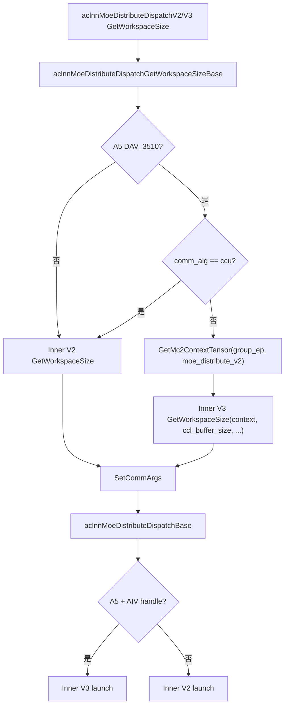
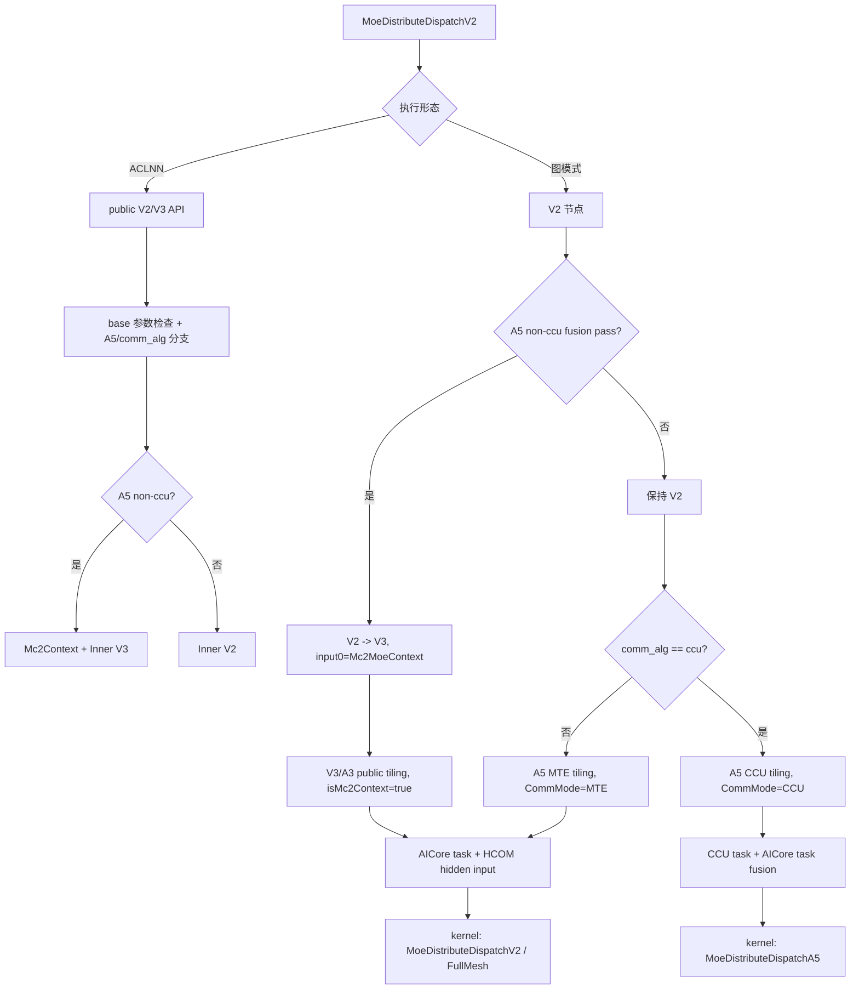

# MoeDistributeDispatchV2 A5 下发流程分析

## 目录

- [结论摘要](#结论摘要)
- [关键入口](#关键入口)
- [ACLNN 运行流程](#aclnn-运行流程)
- [图模式 fusion 流程](#图模式-fusion-流程)
- [Tiling 流程](#tiling-流程)
- [Kernel 分发流程](#kernel-分发流程)
- [GenerateTask 下发流程](#generatetask-下发流程)
- [端到端流程图](#端到端流程图)
- [风险和疑点](#风险和疑点)
- [参考文件](#参考文件)

分析对象：`/Users/yuantao/code/ops-transformer/mc2/moe_distribute_dispatch_v2`

重点分支：Ascend David V100/V120（代码中对应 `NpuArch::DAV_3510`、`NPUARCH_A5`、`__NPU_ARCH__ == 3510`）。

## 结论摘要

`MoeDistributeDispatchV2` 在 A5 上主要分成两条链路：

1. `comm_alg` 为空、`mte`、`fullmesh_v1`、`fullmesh_v2`
   - ACLNN 侧：public V2/V3 API 进入 `aclnnMoeDistributeDispatchGetWorkspaceSizeBase` 后，A5 non-ccu 创建 `Mc2Context`，转调 `aclnnInnerMoeDistributeDispatchV3GetWorkspaceSize`，执行阶段走 `aclnnInnerMoeDistributeDispatchV3`。
   - 图模式：fusion pass 将 `MoeDistributeDispatchV2` 改写为 `MoeDistributeDispatchV3`，新增 `Mc2MoeContext` 常量输入和 `ccl_buffer_size` 属性。
   - 下发：`GenerateTask` 走 `Mc2MoeGenTaskCallbackV2`，只修改 AICore task 的 args format，插入 HCOM hidden input，不额外生成 AICPU KFC task。
   - kernel：`CommMode=TILINGKEY_TPL_MTE`，按 `FullMesh` 选择 `MoeDistributeDispatchV2` 或 `MoeDistributeDispatchV2FullMesh`。

2. `comm_alg == "ccu"`
   - ACLNN 侧：A5 ccu 被代码注释标记为“暂时不支持新方案”，仍走 `aclnnInnerMoeDistributeDispatchV2`。
   - 图模式：fusion pass 显式跳过 ccu，节点保持 `MoeDistributeDispatchV2`。
   - tiling：进入 `MoeDistributeDispatchTilingImpl(context, OP_VERSION_2)` 的 A5 CCU tiling。
   - 下发：`GenerateTask` 走 `Mc2Arch35GenTaskCallBack`，生成 `ccu task + aicore task` 的 fusion task。
   - kernel：`CommMode=TILINGKEY_TPL_CCU`，进入 `arch35/moe_distribute_dispatch_arch35.h` 中的 `MoeDistributeDispatchA5`。

## 关键入口

算子定义在：

- `/Users/yuantao/code/ops-transformer/mc2/moe_distribute_dispatch_v2/op_host/moe_distribute_dispatch_v2_def.cpp`
- `/Users/yuantao/code/ops-transformer/mc2/moe_distribute_dispatch_v2/op_graph/moe_distribute_dispatch_v2_proto.h`

主要输入输出：

- 输入：`x`、`expert_ids`、`scales`、`x_active_mask`、`expert_scales`、`elastic_info`、`performance_info`
- 输出：`expand_x`、`dynamic_scales`、`assist_info_for_combine`、`expert_token_nums`、`ep_recv_count`、`tp_recv_count`、`expand_scales`
- 关键属性：`group_ep`、`group_tp`、`ep_world_size`、`tp_world_size`、`quant_mode`、`global_bs`、`expert_token_nums_type`、`comm_alg`、`zero_expert_num`、`copy_expert_num`、`const_expert_num`

A5 判定：

- host/graph 侧：`NPUARCH_A5 = { std::to_string(static_cast<uint32_t>(NpuArch::DAV_3510)) }`
- kernel 侧：`#if defined(__NPU_ARCH__) && (__NPU_ARCH__ == 3510)`

## ACLNN 运行流程

public API：

- `aclnnMoeDistributeDispatchV2GetWorkspaceSize`
- `aclnnMoeDistributeDispatchV3GetWorkspaceSize`
- `aclnnMoeDistributeDispatchV4GetWorkspaceSize`

V2/V3 都汇入：

- `/Users/yuantao/code/ops-transformer/mc2/moe_distribute_dispatch_v2/op_api/moe_distribute_dispatch_v2_base.cpp`
- 函数：`aclnnMoeDistributeDispatchGetWorkspaceSizeBase`

核心分支：

```text
is950 = GetCurrentPlatformInfo().GetCurNpuArch() == NpuArch::DAV_3510

if (!is950 || comm_alg == "ccu"):
    aclnnInnerMoeDistributeDispatchV2GetWorkspaceSize(...)
else:
    Mc2Context::GetMc2ContextTensor(group_ep, "moe_distribute_v2", hcclBuffSize, mc2Context)
    aclnnInnerMoeDistributeDispatchV3GetWorkspaceSize(mc2Context, ..., hcclBuffSize, ...)
```

执行阶段：

- `SetCommArgs` 对 A5 non-ccu 设置 user handle 为 `CommType::AIV`，HCCL server type 为 `MTE`。
- `comm_alg == "ccu"` 时 HCCL server type 为 `CCU`。
- `aclnnMoeDistributeDispatchBase` 中，如果 A5 且 handle 是 `AIV`，执行 `aclnnInnerMoeDistributeDispatchV3`；否则执行 `aclnnInnerMoeDistributeDispatchV2`。



## 图模式 fusion 流程

文件：

- `/Users/yuantao/code/ops-transformer/mc2/moe_distribute_dispatch_v2/op_graph/fusion_pass/moe_distribute_dispatch_v2_fusion_pass.cpp`

触发条件：

- 非 A2。
- 目标平台是 `NPUARCH_A5`。
- 节点类型是 `MoeDistributeDispatchV2`。
- `comm_alg != "ccu"`。

处理动作：

1. 通过 `Mc2MoeGraphContext::GetMc2ContextA5` 获取或创建 `Mc2MoeContext` 常量节点。
2. 创建 `MoeDistributeDispatchV3` 节点。
3. V3 input 0 接 `Mc2MoeContext`，原 V2 的 7 个输入后移到 input 1-7。
4. 拷贝 V2 输出描述。
5. 拷贝必要/可选属性，并新增 `ccl_buffer_size`。
6. 删除 V2 节点并重连输出边。

结果：A5 non-ccu 图模式下，运行时看到的可能是融合后的 `MoeDistributeDispatchV3`，不是原始 `MoeDistributeDispatchV2`。

## Tiling 流程

A5 V2 tiling 入口：

- `/Users/yuantao/code/ops-transformer/mc2/moe_distribute_dispatch_v2/op_host/op_tiling/arch35/moe_distribute_dispatch_v2_tiling_arch35.cpp`
- 函数：`MoeDistributeDispatchV2TilingFuncA5::MoeDistributeDispatchTilingFuncImpl`

分支规则：

- `comm_alg == "ccu"`：调用 `MoeDistributeDispatchTilingImpl(context, OP_VERSION_2)`，进入 A5 CCU tiling。
- `comm_alg == nullptr` 或空字符串：默认按 `fullmesh_v1`，走 MTE。
- `comm_alg == "fullmesh_v1"` 或 `"fullmesh_v2"`：走 MTE，并复用 A3 tiling public 实现 `MoeDistributeDispatchA3TilingFuncImplPublic`。
- 其他值：tiling 失败。

`TilingKey` 定义在：

- `/Users/yuantao/code/ops-transformer/mc2/moe_distribute_dispatch_v2/op_kernel/moe_distribute_dispatch_v2_tiling_key.h`

关键字段：

- `TILINGKEY_TP`
- `TILINGKEY_QUANT_MODE`
- `TILINGKEY_SCALE`
- `TILINGKEY_FULLMESH`
- `TILINGKEY_COMM_MODE`
- `ARCH_TAG`

关键枚举：

- `TILINGKEY_TPL_A5 = 2`
- `TILINGKEY_TPL_MTE = 0`
- `TILINGKEY_TPL_CCU = 2`
- `TILINGKEY_NO_FULLMESH = 0`
- `TILINGKEY_ENABLE_FULLMESH = 1`

A5 MTE 的 `CalTilingKey` 固定：

```text
tp=false
commMode=TILINGKEY_TPL_MTE
archTag=TILINGKEY_TPL_A5
```

A5 CCU 的 `GenTilingKey` 固定：

```text
tp=false
fullMesh=TILINGKEY_NO_FULLMESH
commMode=TILINGKEY_TPL_CCU
archTag=TILINGKEY_TPL_A5
```

## Kernel 分发流程

kernel 入口：

- `/Users/yuantao/code/ops-transformer/mc2/moe_distribute_dispatch_v2/op_kernel/moe_distribute_dispatch_v2.cpp`
- 函数模板：`moe_distribute_dispatch_v2<HasTp, QuantMode, ScaleMode, FullMesh, CommMode, ArchTag>`

A5 编译条件：

```cpp
#if defined(__NPU_ARCH__) && (__NPU_ARCH__ == 3510)
#include "arch35/moe_distribute_dispatch_arch35.h"
using namespace MoeDistributeDispatchA5Impl;
#endif
```

模板分发：

- `CommMode == TILINGKEY_TPL_CCU`
  - 使用 `MoeDistributeDispatchA5<...>`。
  - 定义在 `op_kernel/arch35/moe_distribute_dispatch_arch35.h`。
  - 内部使用 `Hccl<HcclServerType::HCCL_SERVER_TYPE_CCU>`。

- `CommMode == TILINGKEY_TPL_MTE`
  - `FullMesh == TILINGKEY_ENABLE_FULLMESH`：使用 `MoeDistributeDispatchV2FullMesh<...>`。
  - 否则：使用 `MoeDistributeDispatchV2<...>`。

量化模式映射：

- `0`：non-quant，`TILINGKEY_NO_QUANT`
- `1`：static quant，`TILINGKEY_STATIC_QUANT`
- `2`：per-token dynamic，`TILINGKEY_PERTOKEN_QUANT`
- `3`：per-group dynamic，`TILINGKEY_PERGROUP_QUANT`
- `4`：MX quant，`TILINGKEY_MX_QUANT`

## GenerateTask 下发流程

注册入口：

- `/Users/yuantao/code/ops-transformer/mc2/moe_distribute_dispatch_v2/op_graph/moe_distribute_dispatch_v2_gen_task.cpp`

`CalcOpParam`：

- A5 + `comm_alg == "ccu"`：绑定附加流 `"ccu server"`，reuse key 为 `"ccu_stream"`。
- 其他：绑定附加流 `"aicpu kfc server"`，reuse key 为 `"kfc_stream"`。

`GenerateTask`：

- A2：`Mc2MoeGenTaskCallback`
- A5：
  - `mte/fullmesh_v1/fullmesh_v2`：`Mc2MoeGenTaskCallbackV2`
  - `ccu`：`Mc2Arch35GenTaskCallBack`
  - 其他：失败
- A3：`Mc2MoeGenTaskCallbackV2`

### A5 MTE / fullmesh

`Mc2MoeGenTaskCallbackV2`：

1. 要求已有 AICore task。
2. 根据 op type 取通信域数量，`MoeDistributeDispatchV2` 是 2。
3. 给 AICore task 插入 HCOM hidden input。
4. 对 `MoeDistributeDispatchV2`，`useAiCpu=false`，因此不插入 wait/aicpu/record task。

最终主要下发一个被改写 args format 的 AICore task。

### A5 CCU

`Mc2Arch35GenTaskCallBack` 调用 `CreateCCUFusionTask`：

1. 读取 group info。
2. 创建 `ccuTask = KernelLaunchInfo::CreateCcuTask(context, ccuGroups)`。
3. 读取已有 AICore task，设置 `tvm_blockdim`。
4. 在 AICore args format 前面插入 HCOM hidden input。
5. 构造 `fusionTask = CreateFusionTask({ccuTask, aicoreTask})`。
6. 用 fusion task 替换原 AICore task。

最终下发的是 CCU+AICore fusion task。

## 端到端流程图



## 风险和疑点

1. `fallback_moe_distribute_dispatch_v2.cpp` 中 `comm_alg` 按 `attrs->GetInt(13)` 读取，但 proto/def 中 `comm_alg` 是 String。如果 fallback 实际触发，可能存在属性类型不匹配风险。

2. A5 `comm_alg` 在不同阶段的解释略有差异：
   - tiling 侧：空值默认 `fullmesh_v1`。
   - gen task 侧：空值由 `GetCommAlg` 返回 `"mte"`。
   - fusion pass：只显式排除 `"ccu"`，空值会融合为 V3。

3. A5 non-ccu 的 public API 名称可能仍是 V2，但内部执行会走 Inner V3；图模式也会把 V2 节点改写为 V3。排查日志/dump 时要区分“对外 API/IR op 名称”和“内部执行模板/融合后 op 名称”。

## 参考文件

- `/Users/yuantao/code/ops-transformer/mc2/moe_distribute_dispatch_v2/op_api/moe_distribute_dispatch_v2_base.cpp`
- `/Users/yuantao/code/ops-transformer/mc2/moe_distribute_dispatch_v2/op_api/aclnn_moe_distribute_dispatch_v2.cpp`
- `/Users/yuantao/code/ops-transformer/mc2/moe_distribute_dispatch_v2/op_api/aclnn_moe_distribute_dispatch_v3.cpp`
- `/Users/yuantao/code/ops-transformer/mc2/moe_distribute_dispatch_v2/op_graph/fusion_pass/moe_distribute_dispatch_v2_fusion_pass.cpp`
- `/Users/yuantao/code/ops-transformer/mc2/moe_distribute_dispatch_v2/op_graph/moe_distribute_dispatch_v2_gen_task.cpp`
- `/Users/yuantao/code/ops-transformer/mc2/moe_distribute_dispatch_v2/op_host/op_tiling/arch35/moe_distribute_dispatch_v2_tiling_arch35.cpp`
- `/Users/yuantao/code/ops-transformer/mc2/moe_distribute_dispatch_v2/op_kernel/moe_distribute_dispatch_v2.cpp`
- `/Users/yuantao/code/ops-transformer/mc2/moe_distribute_dispatch_v2/op_kernel/moe_distribute_dispatch_v2_tiling_key.h`
- `/Users/yuantao/code/ops-transformer/mc2/moe_distribute_dispatch_v2/op_kernel/arch35/moe_distribute_dispatch_arch35.h`
- `/Users/yuantao/code/ops-transformer/mc2/common/op_graph/mc2_moe_gen_task_ops_utils.cpp`
- `/Users/yuantao/code/ops-transformer/mc2/common/op_graph/mc2_gen_task_ops_utils_arch35.cpp`
- `/Users/yuantao/code/ops-transformer/mc2/common/op_graph/mc2_moe_graph_context.cpp`
