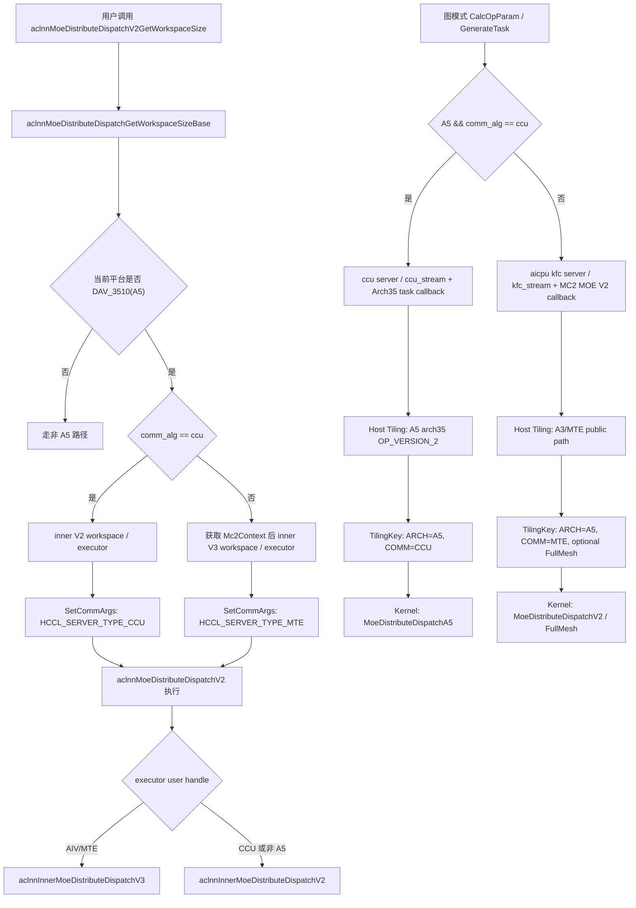
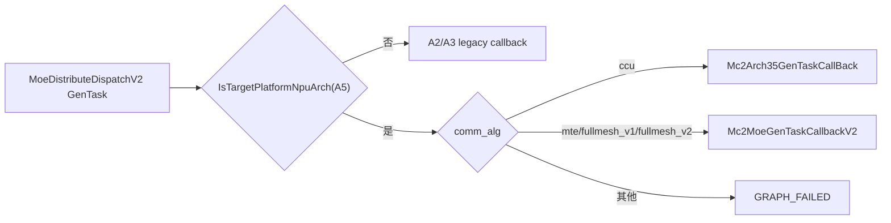

# moe_distribute_dispatch_v2 A5 下发与运行流程分析

## 1. 分析范围

- 算子路径：`/Users/yuantao/code/ops-transformer/mc2/moe_distribute_dispatch_v2`
- 重点分支：Ascend David V100/V120，代码中主要体现为 `NpuArch::DAV_3510`、`NPUARCH_A5`、`__NPU_ARCH__ == 3510`、`arch35`
- 重点内容：ACLNN 两段式入口、图模式 `CalcOpParam/GenerateTask` 下发、Host Tiling、tiling key 选择、Device kernel 模板派发与 A5 CCU/MTE 运行流程
- 输出假设：本次分析基于源码静态阅读，未在真实 A5 环境执行算子。

## 2. 总体结论

`MoeDistributeDispatchV2` 在 A5 上不是单一路径，而是由 `comm_alg` 决定下发与运行分支：

| `comm_alg` | Host/Graph 下发 | ACLNN 执行入口 | Kernel 主模板 | 主要特点 |
|---|---|---|---|---|
| `ccu` | `ccu server` / `ccu_stream`，A5 arch35 task callback | inner V2 | `MoeDistributeDispatchA5` | 使用 CCU HCCL，设备侧显式 `TokenScatter -> AlltoAllvWrite -> TokenGather` |
| 空字符串、`fullmesh_v1`、`fullmesh_v2` 或 MTE 类配置 | `aicpu kfc server` / `kfc_stream`，MC2 MOE V2 callback | A5 上优先 inner V3 新模板 | `MoeDistributeDispatchV2` 或 `MoeDistributeDispatchV2FullMesh` | 复用通用 MTE/fullmesh 模板，依赖 HCCL window/status 机制 |

关键代码证据：

- 算子原型注册 A5/A3/A2 配置，并声明 MC2 HCCL group：`op_host/moe_distribute_dispatch_v2_def.cpp:99-145`
- 图下发按 A5 + `comm_alg` 选择 CCU 或 MTE callback：`op_graph/moe_distribute_dispatch_v2_gen_task.cpp:28-68`
- ACLNN base 在 DAV_3510 上按 `comm_alg` 选择 inner V2/V3，并设置 HCCL server type：`op_api/moe_distribute_dispatch_v2_base.cpp:132-221`
- A5 Host Tiling 在 `comm_alg=ccu` 时走 arch35 A5 实现，否则复用 A3/MTE tiling public 实现：`op_host/op_tiling/arch35/moe_distribute_dispatch_v2_tiling_arch35.cpp:1173-1225`
- A5 kernel 编译目标 `__NPU_ARCH__ == 3510` 下，按 tiling key 进入 CCU A5、MTE 或 FullMesh 模板：`op_kernel/moe_distribute_dispatch_v2.cpp:26-32`、`op_kernel/moe_distribute_dispatch_v2.cpp:60-165`

## 3. 端到端流程图



## 4. ACLNN 两段式入口

`aclnn_moe_distribute_dispatch_v2.cpp` 只提供 V2 对外入口，实际参数校验、平台判断和 inner 算子选择都下沉到 `moe_distribute_dispatch_v2_base.cpp`：

1. `aclnnMoeDistributeDispatchV2GetWorkspaceSize` 接收 `x`、`expert_ids`、可选 `scales`、`x_active_mask`、`expert_scales`、EP/TP group、专家参数、量化模式和输出 tensor，然后调用 `aclnnMoeDistributeDispatchGetWorkspaceSizeBase`。见 `op_api/aclnn_moe_distribute_dispatch_v2.cpp:28-49`。
2. `aclnnMoeDistributeDispatchV2` 第二段接口只调用 `aclnnMoeDistributeDispatchBase` 执行 executor。见 `op_api/aclnn_moe_distribute_dispatch_v2.cpp:52-55`。
3. base 层先判断平台：
   - `is910B = SocVersion::ASCEND910B`
   - `is950 = GetCurNpuArch() == NpuArch::DAV_3510`
   这里 `is950` 对应本次关注的 A5/DAV_3510 分支。见 `op_api/moe_distribute_dispatch_v2_base.cpp:154-156`。
4. A5 上如果 `comm_alg != "ccu"`，会通过 `Mc2Context::GetMc2ContextTensor` 获取 MC2 context，并进入 `aclnnInnerMoeDistributeDispatchV3GetWorkspaceSize`；如果 `comm_alg == "ccu"`，仍走 `aclnnInnerMoeDistributeDispatchV2GetWorkspaceSize`。见 `op_api/moe_distribute_dispatch_v2_base.cpp:178-200`。
5. `SetCommArgs` 会给 executor 写入通信类型：
   - A5 + `ccu`：`NNOPBASE_HCCL_SERVER_TYPE_CCU`
   - A5 非 `ccu`：`NNOPBASE_HCCL_SERVER_TYPE_MTE`
   - 910B：`NNOPBASE_HCCL_SERVER_TYPE_AICPU`
   见 `op_api/moe_distribute_dispatch_v2_base.cpp:132-139`。
6. 第二段执行时，A5 且 user handle 标记为 `CommType::AIV` 时进入 inner V3；否则回落 inner V2。见 `op_api/moe_distribute_dispatch_v2_base.cpp:206-221`。

这一层的核心作用是把用户态 API 参数转换为 inner 算子的 executor，并在 A5 上把通信执行后端绑定为 CCU 或 MTE/AIV 新模板。

## 5. 图模式下发流程

`op_graph/moe_distribute_dispatch_v2_gen_task.cpp` 注册了 `MoeDistributeDispatchV2` 的 `CalcOpParam` 和 `GenerateTask`：

- `MoeDistributeDispatchV2CalcParamFunc`
  - A5 且 `comm_alg == ccu`：调用 `CommonKFCMc2CalcParamFunc(context, "ccu server", "ccu_stream")`
  - 其他情况：调用 `CommonKFCMc2CalcParamFunc(context, "aicpu kfc server", "kfc_stream")`
  - 见 `op_graph/moe_distribute_dispatch_v2_gen_task.cpp:28-37`
- `MoeDistributeDispatchV2GenTaskFunc`
  - A2：`Mc2MoeGenTaskCallback`
  - A5 + MTE/fullmesh：`Mc2MoeGenTaskCallbackV2`
  - A5 + CCU：`Mc2Arch35GenTaskCallBack`
  - 其他：按 A3 路径 `Mc2MoeGenTaskCallbackV2`
  - 见 `op_graph/moe_distribute_dispatch_v2_gen_task.cpp:39-68`

因此，A5 下发阶段有两套任务生成路径：



## 6. 算子原型和支持配置

`MoeDistributeDispatchV2` 的 OpDef 定义了输入、输出和属性：

- 输入：`x`、`expert_ids`、可选 `scales`、`x_active_mask`、`expert_scales`、`elastic_info`、`performance_info`
- 输出：`expand_x`、`dynamic_scales`、`assist_info_for_combine`、`expert_token_nums`、`ep_recv_count`、`tp_recv_count`、`expand_scales`
- 关键属性：`group_ep`、`ep_world_size`、`ep_rank_id`、`moe_expert_num`、`group_tp`、`tp_world_size`、`tp_rank_id`、`shared_expert_num`、`shared_expert_rank_num`、`quant_mode`、`global_bs`、`expert_token_nums_type`、`comm_alg`
- AICore 配置注册到 `ascend950`、`ascend910_93`、`ascend910b`
- MC2 通信组声明为 `group_ep` 和 `group_tp`

相关代码在 `op_host/moe_distribute_dispatch_v2_def.cpp:22-145`。

## 7. A5 Host Tiling 流程

### 7.1 A5 tiling 路由

`arch35/moe_distribute_dispatch_v2_tiling_arch35.cpp` 是 A5 Host Tiling 关键文件。入口 `MoeDistributeDispatchV2TilingFuncA5::MoeDistributeDispatchTilingFuncImpl` 先读取 `comm_alg`：

- `ccu`：调用 `MoeDistributeDispatchTilingImpl(context, OP_VERSION_2)`，即 A5/arch35 专用 CCU tiling
- 空字符串、`fullmesh_v1`、`fullmesh_v2`：视作 MTE/fullmesh 路径，构造 `DispatchV2Config` 后调用 `MoeDistributeDispatchA3TilingFuncImplPublic`
- 其他字符串：返回 `GRAPH_FAILED`

见 `op_host/op_tiling/arch35/moe_distribute_dispatch_v2_tiling_arch35.cpp:1173-1225`。

### 7.2 A5 CCU tiling 主流程

`MoeDistributeDispatchTilingImpl` 的执行顺序如下：

1. 设置 op version，并获取 `TilingContext`、`nodeName` 和 `MoeDistributeDispatchV2TilingData`。
2. `GetContextAttrs` 读取并校验 EP/TP、expert、quant、shared expert 等属性。
3. `CheckQuantModeAndExpandXType` 根据 `quant_mode + expand_x dtype` 映射真实量化模式。
4. 检查 `x_active_mask`、`scales` 是否存在，并校验 `quant_mode` 与 `scales` 组合。
5. 调用 `TilingCheckMoeDistributeDispatchA5` 做通用输入输出类型和参数检查。
6. `CheckAttrs` 计算 `localMoeExpertNum`，并校验 `tp_world_size`、`global_bs`、`bs` 等约束。
7. 判断当前 rank 是否 shared expert rank。
8. `CheckTensorShape` 校验 `expand_x`、`dynamic_scales`、`assist_info_for_combine`、`expert_token_nums`、`ep_recv_count`、`tp_recv_count` 等 shape。
9. `CheckAndSetScalesInfo` 写入 scales 行列、元素个数、类型大小。
10. `CheckCommAttrs` 校验 HCCL window size 是否足够。
11. `SetCommTiling` 生成 CCU 通信 tiling。
12. `SetWorkSpace` 设置 workspace size。
13. `GenTilingKey` 生成 A5 + CCU tiling key。
14. `SetPlatformInfo` 设置 block dim、AIV core 数和 UB size。

主流程见 `op_host/op_tiling/arch35/moe_distribute_dispatch_v2_tiling_arch35.cpp:946-1008`。

### 7.3 关键约束

A5 CCU tiling 里有几类重要限制：

- `ep_world_size`：V2 版本要求 `[2, 1024]`，见 `op_host/op_tiling/arch35/moe_distribute_dispatch_v2_tiling_arch35.cpp:160-182`
- `moe_expert_num`：V2 版本最大 1024，见 `op_host/op_tiling/arch35/moe_distribute_dispatch_v2_tiling_arch35.cpp:217-229`
- `shared_expert_num`：V2 版本范围 `[0, 4]`，见 `op_host/op_tiling/arch35/moe_distribute_dispatch_v2_tiling_arch35.cpp:185-202`
- 当前 A5 CCU 路径 `tp_world_size` 强制为 1，见 `op_host/op_tiling/arch35/moe_distribute_dispatch_v2_tiling_arch35.cpp:489-492`
- `x` 的 `bs` 范围 `[1, 512]`，`global_bs` 只能为 0 或 `max_bs * ep_world_size` 且可被 EP 整除，见 `op_host/op_tiling/arch35/moe_distribute_dispatch_v2_tiling_arch35.cpp:497-524`
- `h` 在 V2 版本要求 `[1024, 8192]`，见 `op_host/op_tiling/arch35/moe_distribute_dispatch_v2_tiling_arch35.cpp:733-746`
- `k` 在 V2 版本最大 16，且不能超过 `moe_expert_num`，见 `op_host/op_tiling/arch35/moe_distribute_dispatch_v2_tiling_arch35.cpp:749-771`

### 7.4 通信 tiling 和 workspace

CCU 分支 `SetCommTiling` 使用 EP group 构造 `Mc2CcTilingConfig`，op type 是 `HCCL_CMD_HALFALLTOALLV`，算法配置为 `AlltoAll=level0:fullmesh;level1:pairwise`，并设置通信引擎为 `A5_CCU_ENGINE`。当前注释明确说明 A5 不支持 TP 通信，只设置 HalfAllToAllV。见 `op_host/op_tiling/arch35/moe_distribute_dispatch_v2_tiling_arch35.cpp:854-871`。

`SetWorkSpace` 的 workspace 由系统保留区、EP world size、send/recv count、按 `alignedH` 和 `localMoeExpertNum` 计算的 token 通信区组成，并将 `totalWinSizeEp` 设置为 `HCCL_BUFFSIZE * 2`。见 `op_host/op_tiling/arch35/moe_distribute_dispatch_v2_tiling_arch35.cpp:824-851`。

`CheckCommAttrs` 会根据 `aivNum * STATUS_SIZE + 2 * epWorldSize * (...)` 估算实际窗口需求，超过 `GetMaxWindowSize() * 2` 时失败。见 `op_host/op_tiling/arch35/moe_distribute_dispatch_v2_tiling_arch35.cpp:899-928`。

## 8. Tiling Key 与 Kernel 模板选择

`moe_distribute_dispatch_v2_tiling_key.h` 定义了 tiling key 的模板维度：

- `TILINGKEY_TP`
- `TILINGKEY_QUANT_MODE`
- `TILINGKEY_SCALE`
- `TILINGKEY_FULLMESH`
- `TILINGKEY_COMM_MODE`
- `ARCH_TAG`

关键枚举：

- `ARCH_TAG`：A2=0、A3=1、A5=2
- `COMM_MODE`：MTE=0、AICPU=1、CCU=2
- `QUANT_MODE`：no/static/pertoken/pergroup/mx
- `FULLMESH`：no/fullmesh/hierarchy

见 `op_kernel/moe_distribute_dispatch_v2_tiling_key.h:20-48`。

A5 kernel 侧 `__NPU_ARCH__ == 3510` 时可选模板包含：

- A5 + CCU：`COMM_MODE` 支持 `MTE` 和 `CCU`，`FULLMESH=NO_FULLMESH`
- A5 + MTE fullmesh：`COMM_MODE=MTE`，`FULLMESH=ENABLE_FULLMESH`

见 `op_kernel/moe_distribute_dispatch_v2_tiling_key.h:49-95`。

Host 侧 A5 CCU `GenTilingKey` 固定：

- `tp=false`
- `fullMesh=TILINGKEY_NO_FULLMESH`
- `commMode=TILINGKEY_TPL_CCU`
- `arch=TILINGKEY_TPL_A5`

见 `op_host/op_tiling/arch35/moe_distribute_dispatch_v2_tiling_arch35.cpp:874-896`。

MTE/fullmesh tiling key 则通过 `MoeDistributeDispatchV2TilingFuncA5::CalTilingKey` 生成：

- `commMode=TILINGKEY_TPL_MTE`
- `fullMesh` 根据 fullmesh 或 hierarchy 选择
- `arch=TILINGKEY_TPL_A5`

见 `op_host/op_tiling/arch35/moe_distribute_dispatch_v2_tiling_arch35.cpp:1234-1254`。

## 9. Kernel 入口与模板派发

`op_kernel/moe_distribute_dispatch_v2.cpp` 是统一 kernel 入口。A5 编译目标下会 include `arch35/moe_distribute_dispatch_arch35.h`，非 A5 则 include A2 相关实现。见 `op_kernel/moe_distribute_dispatch_v2.cpp:26-32`。

A5 分支的模板派发规则：

1. `ArchTag == TILINGKEY_TPL_A5 && CommMode == TILINGKEY_TPL_CCU`
   - 进入 `MoeDistributeDispatchA5`
   - CCU 路径不传 `mc2Context`，而是在 A5 类内部通过 `GetHcclContext<0>()` 初始化 CCU HCCL
2. `ArchTag == TILINGKEY_TPL_A5 && CommMode == TILINGKEY_TPL_MTE && FullMesh == ENABLE_FULLMESH`
   - 进入 `MoeDistributeDispatchV2FullMesh`
3. `ArchTag == TILINGKEY_TPL_A5 && CommMode == TILINGKEY_TPL_MTE && FullMesh == NO_FULLMESH`
   - 进入通用 `MoeDistributeDispatchV2`

对应代码覆盖非量化、FP8/HIF8/FP4 非量化、动态/静态量化等组合。见 `op_kernel/moe_distribute_dispatch_v2.cpp:60-165`。

## 10. A5 CCU Device 侧运行流程

### 10.1 初始化

`MoeDistributeDispatchA5::Init` 完成：

- 设置浮点溢出控制
- 读取 `epRankId`、`blockIdx/aivId`
- `InitGlobalAttrs` 从 tilingData 读取 `bs/h/k/epWorldSize/moeExpertNum/sharedExpertRankNum/aivNum/expertTokenNumsType/scalesCount`，计算 `localExpertNum`、`moeUsedAivNum`、`sharedUsedAivNum`、`axisMaxBs`、`activeBsKNum`
- 绑定输入输出 GlobalTensor
- 初始化 UB buffer
- 根据量化模式设置 token 输入/输出/通信大小
- 初始化 CCU HCCL、workspace send/recv buffer 和双缓冲状态

见 `op_kernel/arch35/moe_distribute_dispatch_arch35.h:211-254`、`op_kernel/arch35/moe_distribute_dispatch_arch35.h:295-325`、`op_kernel/arch35/moe_distribute_dispatch_arch35.h:371-409`。

### 10.2 主 Process

CCU A5 主流程非常集中：

```cpp
if ASCEND_IS_AIV {
    if (isTokenMaskFlag_) {
        CalcTokenActiveMask();
    }
    TokenScatter();
    Communication();
    TokenGather();
    if (aivId_ == 0) {
        hccl_.Finalize();
    }
}
```

见 `op_kernel/arch35/moe_distribute_dispatch_arch35.h:1140-1156`。

### 10.3 TokenActiveMask

如果存在 `x_active_mask`，`CalcTokenActiveMask` 会：

- 将 mask 从 GM 拷贝到 UB
- cast 为 half 后求和
- 得到 `activeBs_`
- 更新 `activeBsKNum_`、`sortNum_`、`sortRepeat_`

见 `op_kernel/arch35/moe_distribute_dispatch_arch35.h:553-580`。

### 10.4 TokenScatter

`TokenScatter` 负责在通信前把本 rank 的 token 分发到本地 workspace 的发送区：

1. 拷贝 `expert_ids` 到 UB。
2. 对 expert id 排序并计算专家频次、前缀和。
3. 按 AIV 分工：
   - `aivId_ >= moeUsedAivNum_`：处理 shared expert 发送，调用 `ShareScatter`
   - `aivId_ < moeUsedAivNum_`：处理 MOE expert 发送，调用 `MoeScatter`

见 `op_kernel/arch35/moe_distribute_dispatch_arch35.h:817-849`。

`ShareScatter` 会把 token 发往共享专家所在 rank，并写 send size、send offset、send count。见 `op_kernel/arch35/moe_distribute_dispatch_arch35.h:591-681`。

`MoeScatter` 会根据排序后的 expert id 计算目标专家 rank，把 token 写入对应 rank 的发送 buffer，并为每个 rank 写入 size/offset/count。见 `op_kernel/arch35/moe_distribute_dispatch_arch35.h:722-815`。

token 处理时：

- 量化模式 `STATIC_QUANT`、`PERTOKEN_DYNAMIC_QUANT`、`MX_QUANT`、`PERGROUP_DYNAMIC_QUANT` 分别调用对应量化函数
- 非量化路径直接拷贝 token，若存在 smooth scale 则把 scale 附加到 token 后

见 `op_kernel/arch35/moe_distribute_dispatch_arch35.h:539-551`、`op_kernel/arch35/moe_distribute_dispatch_arch35.h:683-720`。

### 10.5 Communication

`Communication` 执行真正的跨 rank alltoall：

1. `SyncAll<true>()` 确保 scatter 准备完成。
2. `aivId_ == 0` 计算本 rank 需要发送的数据大小。
3. 调用 `hccl_.AlltoAllvWrite<true>(sendBufGM_, sendOffsetGM_, sendSizeGM_, recvOffset_, localDataSize)`。
4. 同时调用 `SaveExpandIdx()` 生成 combine 所需 index。
5. 初始化 gather 阶段的 recv count buffer。
6. `aivId_ == 0` 等待 HCCL 完成。
7. 再次 `SyncAll<true>()`。

见 `op_kernel/arch35/moe_distribute_dispatch_arch35.h:912-944`。

### 10.6 TokenGather

`TokenGather` 根据当前 rank 类型决定 local expert 数：

- shared expert rank：视作 `localExpertNum=1`
- 普通 MOE rank：使用 `localExpertNum_`

然后进入 `TokenGatherProcess`：

1. 从 recv buffer 读取每个 rank 的 recv count。
2. 对 recv count 做 reduce/cumsum，得到每个 expert 的输出偏移。
3. 从 `recvBufGM_` 按 rank 和 token 顺序搬出 token，写入 `expandXOut`。
4. 若量化产生 scale，则写入 `dynamicScalesOut`。
5. 更新 `ep_recv_count` 和 `expert_token_nums`；`expertTokenNumsType=0` 时写前缀累积，否则写当前专家 token 数。

见 `op_kernel/arch35/moe_distribute_dispatch_arch35.h:899-910`、`op_kernel/arch35/moe_distribute_dispatch_arch35.h:995-1138`。

## 11. A5 MTE/FullMesh Device 侧运行流程

当 `comm_alg` 不是 `ccu` 时，A5 进入通用 MTE/fullmesh 模板：

### 11.1 普通 MTE 模板

`MoeDistributeDispatchV2::Process` 流程：

1. `AlltoAllDispatch()`：根据 mask、expert id、shared expert 和 MOE expert 关系，将 token 写入 HCCL window。
2. `SetStatus()`：写每个专家/rank 的状态和发送 token 数。
3. `WaitDispatch()`：等待对端数据到达。
4. `LocalWindowCopy()`：从 window 拷贝到本地输出。
5. 如果不需要 TP allgather：
   - A5 调用 `SetExpertTokenNumsA5()`
6. 如果需要 TP allgather：
   - `AllGatherSetStatusAndWait()`
   - `AllgatherProcessOut()`
   - `AllGatherSetExpertTokenNumsAndTpRecvCount()`

见 `op_kernel/moe_distribute_dispatch_v2.h:1751-1771`。

`AlltoAllDispatch` 内部会处理 `x_active_mask`、expert mask、零计算专家裁剪、shared expert 发送、MOE expert 发送。见 `op_kernel/moe_distribute_dispatch_v2.h:967-1011`。

### 11.2 FullMesh 模板

`MoeDistributeDispatchV2FullMesh::Process` 将 AIV 核分成两类：

- 前半部分执行 `AllToAllDispatch`
- 后半部分执行 `CalCumSum`
- 最后统一 `LocalWindowCopy`，输出连续化后的 `expandX/scales/expandIdx`

见 `op_kernel/moe_distribute_dispatch_v2_full_mesh.h:1923-1936`。

## 12. 输出语义

结合 API、Host Tiling 和 kernel 写出逻辑，主要输出含义如下：

| 输出 | 作用 | 写出阶段 |
|---|---|---|
| `expand_x` | 按目标专家/rank 重新排列后的 token 数据；量化模式下为量化后类型 | CCU `TokenGatherProcess` 或 MTE `LocalWindowCopy` |
| `dynamic_scales` | 动态量化或带 scale 输入时输出的 per-token/per-group/mx scale | CCU `CopyScalesToOut` 或 MTE/FullMesh 对应 copy out |
| `assist_info_for_combine` | combine 阶段用于恢复 token 顺序的 expand index | CCU `SaveExpandIdx`，MTE/fullmesh dispatch 过程中生成 |
| `expert_token_nums` | 当前 rank 本地专家接收到的 token 数；可为当前值或前缀累积 | gather 后更新 |
| `ep_recv_count` | EP 维度每个来源 rank/专家的 recv count | gather 或 cumsum 后更新 |
| `tp_recv_count` | TP allgather 相关 recv count；A5 CCU 当前限制 TP=1，主要在 MTE TP 分支使用 | TP allgather 分支 |
| `expand_scales` | 分层/部分兼容路径中的扩展 scale 输出 | 非 CCU 相关分支 |

## 13. 关键风险和注意点

1. A5 CCU 路径当前 `tp_world_size` 强制为 1；如果用户传 TP>1，会在 Host Tiling 阶段失败。
2. `comm_alg` 在不同层的解释要对齐：
   - Graph GenTask 接受 `mte/fullmesh_v1/fullmesh_v2/ccu`
   - A5 tiling 里空字符串被解释为默认 `fullmesh_v1`
   - CCU 才进入 arch35 A5 tiling；MTE/fullmesh 会复用 A3 public tiling 实现
3. A5 CCU workspace/window size 与 `global_bs`、`h`、`localMoeExpertNum`、`epWorldSize` 强相关；超出 HCCL window 会在 `CheckCommAttrs` 失败。
4. A5 ACLNN 非 CCU 路径使用 inner V3 新模板，但 `ccu` 仍走 inner V2；排查问题时要同时看 API 层选择和 Host Tiling 的 `comm_alg`。
5. 本文未运行真实 A5 kernel，只基于源码静态分析；设备侧时序、HCCL 行为和性能数据仍需结合 A5 环境日志验证。

## 14. 追踪入口清单

建议排查下发/运行问题时按以下顺序看：

1. API 参数和 executor：`op_api/aclnn_moe_distribute_dispatch_v2.cpp`、`op_api/moe_distribute_dispatch_v2_base.cpp`
2. 图下发 task：`op_graph/moe_distribute_dispatch_v2_gen_task.cpp`
3. 算子原型：`op_host/moe_distribute_dispatch_v2_def.cpp`
4. A5 Host Tiling：`op_host/op_tiling/arch35/moe_distribute_dispatch_v2_tiling_arch35.cpp`
5. Tiling key：`op_kernel/moe_distribute_dispatch_v2_tiling_key.h`
6. Kernel 入口：`op_kernel/moe_distribute_dispatch_v2.cpp`
7. A5 CCU device 实现：`op_kernel/arch35/moe_distribute_dispatch_arch35.h`
8. A5 MTE/fullmesh device 实现：`op_kernel/moe_distribute_dispatch_v2.h`、`op_kernel/moe_distribute_dispatch_v2_full_mesh.h`
