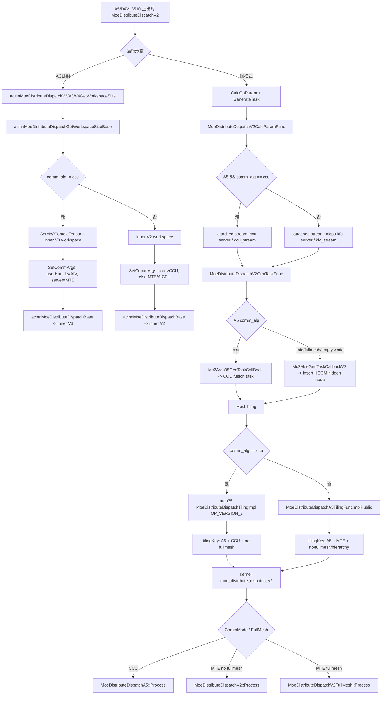

# moe_distribute_dispatch_v2 A5 下发流程详细分析

## 1. 分析范围

- 算子路径：`mc2/moe_distribute_dispatch_v2`
- 重点平台：Ascend David V100/V120，代码中主要体现为 `NpuArch::DAV_3510`、`NPUARCH_A5`、`__NPU_ARCH__ == 3510`、`arch35`
- 重点问题：`moe_distribute_dispatch_v2` 从 API 或图模式进入后，如何完成执行资源生成、Host Tiling、tiling key 选择、kernel 模板派发，以及 A5 上 CCU/MTE/FullMesh 三类路径的差异
- 分析方法：源码静态分析，未在真实 A5 环境运行验证

### 1.1 A5 专项分析口径

本文后续结论均以 A5/DAV_3510 为主线，非 A5 仅作为分支对照，不展开分析。判断依据主要来自以下代码条件：

- Host/API 侧：`GetCurrentPlatformInfo().GetCurNpuArch() == NpuArch::DAV_3510`
- Graph 侧：`IsTargetPlatformNpuArch(..., NPUARCH_A5)`
- Kernel 编译侧：`#if defined(__NPU_ARCH__) && (__NPU_ARCH__ == 3510)`
- Host Tiling 侧：`MoeDistributeDispatchV2TilingFuncA5`
- Device 侧：`arch35/moe_distribute_dispatch_arch35.h`

A5 下必须同时看四个阶段，单看某一个阶段容易误判：

| 阶段 | A5 专项判断点 | 决定结果 |
|---|---|---|
| Graph CalcOpParam | `NPUARCH_A5` + `comm_alg` | attached stream/server 类型 |
| Graph GenerateTask | `NPUARCH_A5` + `comm_alg` | CCU fusion task 或 MTE args format 改写 |
| ACLNN | `NpuArch::DAV_3510` + `comm_alg` | inner V2/V3 与 HCCL server type |
| Host Tiling | `MoeDistributeDispatchV2TilingFuncA5` + `comm_alg` | A5 CCU tiling 或 A5 MTE/fullmesh tiling key |
| Kernel | `__NPU_ARCH__ == 3510` + tiling key | `MoeDistributeDispatchA5` / `MoeDistributeDispatchV2` / `MoeDistributeDispatchV2FullMesh` |

## 2. 总体结论

`moe_distribute_dispatch_v2` 在 A5 上的下发主分支由 `comm_alg` 决定。本文不再展开 A2/A3/910B 的完整路径，仅在必要处说明 A5 与通用路径的差异：

| `comm_alg` | 图模式 CalcOpParam | 图模式 GenerateTask | Host Tiling | Kernel 模板 | Device 主流程 |
|---|---|---|---|---|---|
| `ccu` | attach `ccu server` / `ccu_stream` | `CreateCcuTask + AICore` fusion task | arch35 A5 CCU tiling，`OP_VERSION_2` | `MoeDistributeDispatchA5` | `CalcTokenActiveMask -> TokenScatter -> Communication -> TokenGather -> Finalize` |
| `mte` | attach `aicpu kfc server` / `kfc_stream` | 仅修改 AICore task args format，通常不插 AICPU task | 复用 A3 public tiling | `MoeDistributeDispatchV2` | `AlltoAllDispatch -> SetStatus -> WaitDispatch -> LocalWindowCopy -> SetExpertTokenNumsA5` |
| `fullmesh_v1` / `fullmesh_v2` | 同 MTE | 同 MTE | 复用 A3 public tiling，设置 fullmesh tiling key | `MoeDistributeDispatchV2FullMesh` | 前半 AIV 做 `AllToAllDispatch`，后半 AIV 做 `CalCumSum`，最后 `LocalWindowCopy` |
| 空字符串 | `GetCommAlg` 在图下发阶段解释为 `mte`；Host Tiling 注释说默认按 `fullmesh_v1` 处理 | MTE 类路径 | 复用 A3 public tiling | 取决于 tiling key | MTE/fullmesh 类流程 |

核心差异不是单个 kernel 内部的 if，而是多个阶段的分支需要一致：

1. Graph `CalcOpParam` 决定附加 stream/server 类型。
2. Graph `GenerateTask` 决定是否创建 CCU fusion task。
3. ACLNN base 决定 inner V2/V3 executor，以及 HCCL server type。
4. Host Tiling 决定 tiling data、workspace、block dim 和 tiling key。
5. Kernel 入口按 tiling key 的 `CommMode` 和 `FullMesh` 选择 device 模板。

### 2.1 A5 分支判定矩阵

A5 下真正影响下发路径的不是 op 名称本身，而是 `comm_alg` 在不同阶段被解释后的值：

| 输入 `comm_alg` | Graph `GetCommAlg` 结果 | ACLNN base 结果 | Host Tiling 结果 | Kernel 期望 |
|---|---|---|---|---|
| `"ccu"` | `ccu` | inner V2 + `HCCL_SERVER_TYPE_CCU` | `MoeDistributeDispatchTilingImpl(..., OP_VERSION_2)`，`COMM=CCU` | `MoeDistributeDispatchA5` |
| `"mte"` | `mte` | inner V3 + `HCCL_SERVER_TYPE_MTE` | 非 ccu public tiling，`COMM=MTE` | `MoeDistributeDispatchV2` |
| `"fullmesh_v1"` | `fullmesh_v1` | inner V3 + `HCCL_SERVER_TYPE_MTE` | 非 ccu public tiling，是否 fullmesh 由 tiling 配置决定 | `MoeDistributeDispatchV2` 或 `MoeDistributeDispatchV2FullMesh` |
| `"fullmesh_v2"` | `fullmesh_v2` | inner V3 + `HCCL_SERVER_TYPE_MTE` | 非 ccu public tiling，`FULLMESH=ENABLE_FULLMESH` | `MoeDistributeDispatchV2FullMesh` |
| `""` | `mte` | inner V3 + `HCCL_SERVER_TYPE_MTE` | 允许空值，日志描述默认 fullmesh_v1 | 以最终 tiling key 为准 |

需要重点关注的 A5 特性：

- A5 CCU 路径在 Graph GenerateTask 阶段会把 `ccu task` 和原 `AICore task` 封装为 fusion task。
- A5 non-ccu 路径在图融合 pass 中可能由 `MoeDistributeDispatchV2` 改写为 `MoeDistributeDispatchV3`，并添加 `Mc2MoeContext` 输入。
- A5 CCU Host Tiling 使用 `arch35` 专用实现，MTE/fullmesh 则复用 public tiling，但最终仍生成 `ARCH_TAG=A5` 的 tiling key。
- A5 kernel 编译侧只看 `__NPU_ARCH__ == 3510` 和 tiling key，不再重新读取 `comm_alg` 字符串。

### 2.2 A5 下发链路状态表

| 阶段 | CCU 路径 | MTE / FullMesh 路径 | A5 风险点 |
|---|---|---|---|
| CalcOpParam | attached `ccu server` / `ccu_stream` | attached `aicpu kfc server` / `kfc_stream` | stream 类型与后续 GenerateTask 不一致会导致下发异常 |
| GenerateTask | `CreateCcuTask` + AICore fusion task | 修改 AICore args format，插 HCOM hidden input | CCU fusion task 依赖 `tvm_blockdim` 和 group info |
| ACLNN workspace | inner V2 | inner V3 + `Mc2Context` | CCU 当前注释为“不支持新方案”，不能误判为 V3 |
| ACLNN execute | inner V2 | inner V3 | executor user handle 必须和 server type 一致 |
| Host Tiling | `OP_VERSION_2`，`COMM=CCU` | public tiling，`COMM=MTE`，可 fullmesh | 空 `comm_alg` 的阶段解释不完全一致 |
| Kernel | `MoeDistributeDispatchA5` | `MoeDistributeDispatchV2` / `MoeDistributeDispatchV2FullMesh` | 只由 tiling key 派发，错误 key 会进错模板 |

## 3. 推荐阅读顺序和原因

| 顺序 | 文件/函数 | 关注点 |
|---|---|---|
| 1 | `op_host/moe_distribute_dispatch_v2_def.cpp` / `MoeDistributeDispatchV2` | 算子输入输出、属性顺序、`comm_alg` index、MC2 HCCL group |
| 2 | `op_graph/moe_distribute_dispatch_v2_gen_task.cpp` / `MoeDistributeDispatchV2CalcParamFunc`、`MoeDistributeDispatchV2GenTaskFunc` | 图模式下发的第一处分支 |
| 3 | `op_api/moe_distribute_dispatch_v2_base.cpp` / `aclnnMoeDistributeDispatchGetWorkspaceSizeBase`、`aclnnMoeDistributeDispatchBase` | ACLNN 执行路径 inner V2/V3 选择 |
| 4 | `op_graph/fusion_pass/moe_distribute_dispatch_v2_fusion_pass.cpp` / `Run`、`Fusion` | A5 non-ccu 图融合为 V3 的条件 |
| 5 | `op_host/op_tiling/arch35/moe_distribute_dispatch_v2_tiling_arch35.cpp` / `MoeDistributeDispatchV2TilingFuncA5::MoeDistributeDispatchTilingFuncImpl` | A5 Host Tiling 分支 |
| 6 | `op_kernel/moe_distribute_dispatch_v2_tiling_key.h` | tiling key 维度和 A5 支持组合 |
| 7 | `op_kernel/moe_distribute_dispatch_v2.cpp` / `moe_distribute_dispatch_v2` | kernel 统一入口和模板派发 |
| 8 | `op_kernel/arch35/moe_distribute_dispatch_arch35.h`、`op_kernel/moe_distribute_dispatch_v2.h`、`op_kernel/moe_distribute_dispatch_v2_full_mesh.h` | CCU、MTE、FullMesh device 主流程 |

## 4. 算子定义和属性入口

算子定义位于 `op_host/moe_distribute_dispatch_v2_def.cpp`。

关键点：

- 输入包括 `x`、`expert_ids`、`scales`、`x_active_mask`、`expert_scales`、`elastic_info`、`performance_info`。
- 输出包括 `expand_x`、`dynamic_scales`、`assist_info_for_combine`、`expert_token_nums`、`ep_recv_count`、`tp_recv_count`、`expand_scales`。
- `comm_alg` 是第 13 个属性，定义为 optional string，默认 `""`。
- AICore 配置包含 `ascend950`，并声明 `this->MC2().HcclGroup({"group_ep", "group_tp"})`。

关键代码位置：

- `op_host/moe_distribute_dispatch_v2_def.cpp:99-116`：属性定义。
- `op_host/moe_distribute_dispatch_v2_def.cpp:142-145`：A5/A3/A2 AICore 配置与 HCCL group。
- `op_host/moe_distribute_dispatch_v2_def.cpp:149`：`OP_ADD(MoeDistributeDispatchV2)`。

`comm_alg` 的属性顺序很重要，因为图下发函数用固定 index `13` 读取：

```cpp
static const size_t ATTR_INDEX_COMM_ALG_DISTRIBUTE_DISPATCH_V2 = 13;
```

如果原型属性顺序变化而 GenTask 未同步，A5 分支会直接误判。

## 5. 图模式 CalcOpParam 阶段

入口：`op_graph/moe_distribute_dispatch_v2_gen_task.cpp`

```cpp
ge::Status MoeDistributeDispatchV2CalcParamFunc(gert::ExeResGenerationContext *context)
```

逻辑：

1. 判断是否 A5：`IsTargetPlatformNpuArch(..., NPUARCH_A5)`。
2. 读取 `comm_alg`：`Mc2Arch35GenTaskOpsUtils::GetCommAlg(context, 13)`。
3. 如果 A5 且 `comm_alg == "ccu"`：
   - 调用 `CommonKFCMc2CalcParamFunc(context, "ccu server", "ccu_stream")`
   - 作用是给执行资源上下文设置 attached stream，名称为 `ccu server`，reuse key 为 `ccu_stream`。
4. 否则：
   - 调用 `CommonKFCMc2CalcParamFunc(context, "aicpu kfc server", "kfc_stream")`

公共函数 `CommonKFCMc2CalcParamFunc` 位于 `mc2/common/op_graph/mc2_gen_task_ops_utils.cpp`：

- 构造 `gert::StreamInfo`
- 设置 `name`、`reuse_key`
- `required = true`
- 调 `context->SetAttachedStreamInfos(stream_infos)`

因此 CalcOpParam 阶段不直接生成 task，而是声明后续 GenerateTask 可使用的附加 stream/server 资源。

## 6. 图模式 GenerateTask 阶段

入口：

```cpp
ge::Status MoeDistributeDispatchV2GenTaskFunc(
    const gert::ExeResGenerationContext *context,
    std::vector<std::vector<uint8_t>> &tasks)
```

A5 下分支如下：

```text
if comm_alg in {"mte", "fullmesh_v1", "fullmesh_v2"}:
    Mc2MoeGenTaskCallbackV2(context, tasks)
elif comm_alg == "ccu":
    Mc2Arch35GenTaskCallBack(context, tasks)
else:
    GRAPH_FAILED
```

`GetCommAlg` 的细节在 `mc2/common/op_graph/mc2_gen_task_ops_utils_arch35.h`：

- 如果 `comm_alg` 指针为空，返回 `""` 并记录 error。
- 如果 `comm_alg` 是空字符串，返回 `"mte"` 并记录 warning。
- 否则返回原字符串。

这意味着图下发阶段将空 `comm_alg` 解释为 `mte`。

### 6.1 A5 MTE / FullMesh 的 GenerateTask

目标函数：`Mc2MoeGenTaskOpsUtils::Mc2MoeGenTaskCallbackV2`

位置：`mc2/common/op_graph/mc2_moe_gen_task_ops_utils.cpp:320-359`

主要动作：

1. 检查 `tasks` 非空，默认已有 AICore task。
2. 根据 op type 获取 group 数量。`MoeDistributeDispatchV2` 在公共 group map 中是 MC2/MOE 双通信域算子。
3. 调 `McMoeInsertHiddenInputForAicore` 修改 AICore task 的 args format：
   - 从 `tasks.back()` 加载 AICore task。
   - 在第一个 IR input 或 input instance 前插入 HCOM hidden input。
   - 插入数量等于 group count。
4. 如果 `ASCEND_MC2_DEBUG_MODE=1`，只保留计算侧改写，不继续插任务。
5. 对 `MoeDistributeDispatchV2`，`useAiCpu` 判断为 false，所以通常不插入 wait/aicpu/record task，直接返回 success。

结论：A5 MTE/fullmesh 路径的 GenerateTask 重点是给 AICore task 插 HCOM hidden inputs；实际通信调度主要依赖 AICore kernel 内部的 HCCL context/window/status 机制，而不是额外 AICPU KFC task。

### 6.2 A5 CCU 的 GenerateTask

目标函数：`Mc2Arch35GenTaskOpsUtils::Mc2Arch35GenTaskCallBack`

位置：

- `mc2/common/op_graph/mc2_gen_task_ops_utils_arch35.h:100-120`
- `mc2/common/op_graph/mc2_gen_task_ops_utils_arch35.cpp:20-90`

核心动作在 `CreateCCUFusionTask`：

1. 通过 `GetGroupInfo` 获取 op 对应通信域信息。
   - `MoeDistributeDispatchV2` 在 `GROUP_INFO_MAP_ARCH35` 中配置为 `{2, {"group_ep"}}`。
   - 注释说明当前 `GetCCuTaskInfo` 暂不支持多通信域接口，双通信域算子暂时不增加 TP 属性名。
2. 用通信域属性构造 `ccuGroups`。
3. 创建 CCU task：
   - `ge::KernelLaunchInfo::CreateCcuTask(context, ccuGroups)`
4. 取已有 AICore task：
   - `ge::KernelLaunchInfo::LoadFromData(context, tasks.back())`
5. 从 `tvm_blockdim` 取 block dim，并设置到 AICore task。
6. 反序列化 AICore task args format，在最前面插入 `groupCnt` 个 HCOM hidden inputs。
7. 将 `{ccuTask, prevAicoreTask}` 封装为 fusion task：
   - `ge::KernelLaunchInfo::CreateFusionTask(context, fusionTasks)`
8. 设置 fusion task args format 和 stream id。
9. 用 fusion task 替换 `tasks.back()`。

结论：CCU 路径不是简单改 AICore args，而是把 CCU task 和原 AICore task 组成一个 fusion task。这是 A5 CCU 下发路径和 MTE/fullmesh 下发路径的关键差异。

## 7. ACLNN 两段式运行流程

ACLNN 入口文件：

- `op_api/aclnn_moe_distribute_dispatch_v2.cpp`
- `op_api/aclnn_moe_distribute_dispatch_v3.cpp`
- `op_api/aclnn_moe_distribute_dispatch_v4.cpp`

V2/V3/V4 的 public API 都汇入：

- `aclnnMoeDistributeDispatchGetWorkspaceSizeBase`
- `aclnnMoeDistributeDispatchBase`

位置：`op_api/moe_distribute_dispatch_v2_base.cpp`

### 7.1 WorkspaceSize 阶段

核心判断：

```cpp
const static bool is950 =
    GetCurrentPlatformInfo().GetCurNpuArch() == NpuArch::DAV_3510;

if (!is950 || comm_alg == "ccu") {
    aclnnInnerMoeDistributeDispatchV2GetWorkspaceSize(...)
} else {
    Mc2Context::GetMc2ContextTensor(...)
    aclnnInnerMoeDistributeDispatchV3GetWorkspaceSize(...)
}
```

A5 结果：

- `comm_alg == "ccu"`：走 inner V2。代码注释写明“ccu 暂时不支持新方案”。
- `comm_alg != "ccu"`：获取 `Mc2Context`，走 inner V3。

### 7.2 SetCommArgs 阶段

`SetCommArgs` 做两件事：

1. 在 A5 上给 executor 写 user handle：
   - 默认 `CommType::AIV`
   - `comm_alg == "ccu"` 时写 `CommType::CCU`
2. 设置 HCCL server type：
   - 910B：`NNOPBASE_HCCL_SERVER_TYPE_AICPU`
   - A5 + ccu：`NNOPBASE_HCCL_SERVER_TYPE_CCU`
   - 其他：`NNOPBASE_HCCL_SERVER_TYPE_MTE`

### 7.3 Execute 阶段

`aclnnMoeDistributeDispatchBase` 在 A5 上读取 executor user handle：

- 如果是 `CommType::AIV`，执行 `aclnnInnerMoeDistributeDispatchV3`。
- 否则执行 `aclnnInnerMoeDistributeDispatchV2`。

因此 ACLNN 路径和图模式路径的分支语义一致：

- A5 + ccu：inner V2 + CCU server type。
- A5 non-ccu：inner V3 + MTE server type。

## 8. 图融合 pass：A5 non-ccu V2 -> V3

文件：`op_graph/fusion_pass/moe_distribute_dispatch_v2_fusion_pass.cpp`

入口：

```cpp
ge::graphStatus MoeDistributeDispatchV2FusionPass::Run(...)
```

核心条件：

1. A2 直接跳过。
2. 非 A5 直接跳过。
3. 只处理类型为 `MoeDistributeDispatchV2` 的节点。
4. 如果节点 `comm_alg == "ccu"`，跳过。
5. 其他 A5 V2 节点调用 `Fusion`。

`Fusion` 做的事情：

- 调 `Mc2MoeGraphContext::GetMc2ContextA5` 获取或创建共享 `Mc2MoeContext` Const 节点。
- 创建 `MoeDistributeDispatchV3` 节点。
- 将 V2 的输入整体右移一个 port，V3 的 input0 用于 context。
- 拷贝 V2 输出描述和属性。
- 额外写入 `ccl_buffer_size` 属性。
- 删除 V2 节点，重连输出边。

结论：图模式下，A5 non-ccu 不是一直保留 V2 op type；fusion pass 会把 V2 改写成 V3，以适配带 MC2 context 的新执行方案。`ccu` 明确不融合，保持 V2。

## 9. Host Tiling：A5 分支选择

入口注册：

```cpp
IMPL_OP_OPTILING(MoeDistributeDispatchV2)
    .Tiling(MoeDistributeDispatchV2TilingFuncImpl)
    .TilingParse<MoeDistributeDispatchCompileInfo>(TilingParseForMoeDistributeDispatchV2);
```

实际入口：

```cpp
MoeDistributeDispatchV2TilingFuncImpl
  -> MoeDistributeDispatchV2TilingFuncA5::MoeDistributeDispatchV2TilingFunc
  -> MoeDistributeDispatchV2TilingFuncA5::MoeDistributeDispatchTilingFuncImpl
```

A5 分支逻辑：

```text
读取 comm_alg
isNullOrEmpty = nullptr 或 ""
isFullmeshV1 = "fullmesh_v1"
isFullmeshV2 = "fullmesh_v2"
isMte = fullmesh_v1 || fullmesh_v2
isCcu = "ccu"

if 非法:
    GRAPH_FAILED
if isCcu:
    MoeDistributeDispatchTilingImpl(context, OP_VERSION_2)
else:
    MoeDistributeDispatchA3TilingFuncImplPublic(context, config)
```

注意：这里的 `isMte` 变量实际只包含 `fullmesh_v1/fullmesh_v2`，但空字符串也允许，并通过日志说明默认解释为 `fullmesh_v1`。和 GenTask 的 `GetCommAlg` 将空字符串解释为 `mte` 有命名差异，需要排查时关注最终 tiling key。

## 10. A5 CCU Host Tiling 细节

`MoeDistributeDispatchTilingImpl(context, OP_VERSION_2)` 是 CCU 专用核心路径。

主要步骤：

1. `OpVersionManager::SetVersion(opVersion)`
2. 获取 `MoeDistributeDispatchV2TilingData`
3. `GetContextAttrs`
   - 读取 EP/TP、专家数、共享专家、quant、global_bs、`comm_alg` 等属性
4. `CheckQuantModeAndExpandXType`
   - 根据 `quantMode` 和 `expand_x` 类型推导 real mode
5. 判断 `x_active_mask`、`scales` 是否存在
6. `MoeDistributeDispatchTilingHelper::TilingCheckMoeDistributeDispatchA5`
   - 校验 dim、dtype、format、token mask
7. `CheckAttrs`
   - 校验 EP/TP、shared expert、moe expert、quant 等属性
8. `CheckTensorShape`
   - 校验输入输出 shape
9. `CheckAndSetScalesInfo`
10. `CheckCommAttrs`
    - 根据 `HCCL_BUFFSIZE`、`epWorldSize`、`globalBs`、`h`、`localMoeExpertNum` 判断 window size 是否足够
11. `SetCommTiling`
    - `opType = HCCL_CMD_HALFALLTOALLV`
    - `algConfigStr = "AlltoAll=level0:fullmesh;level1:pairwise"`
    - `SetCommEngine(mc2tiling::A5_CCU_ENGINE)`
    - 生成 `mc2InitTiling`、`mc2CcTiling1`、`mc2CcTiling2`
12. `SetWorkSpace`
13. `GenTilingKey`
    - `tp=false`
    - `fullMesh=TILINGKEY_NO_FULLMESH`
    - `commMode=TILINGKEY_TPL_CCU`
    - `arch=TILINGKEY_TPL_A5`
14. `SetPlatformInfo`
    - 获取 AIV 数、UB size
    - `context->SetBlockDim(numBlocks)`

CCU tiling key 由 `GenTilingKey` 固定为 A5 + CCU + no fullmesh，只随 quant/scale 变化。

### 10.1 A5 CCU Host Tiling 关键约束

旧版分析文档中较有价值的约束信息已合并到本节。A5 CCU 下发不是只要 `comm_alg=ccu` 就能进入 kernel，Host Tiling 阶段会先做严格参数校验：

| 约束项 | A5 CCU 约束 | 代码关注点 |
|---|---|---|
| `ep_world_size` | V2 版本要求在有效 EP 范围内，旧版分析记录为 `[2, 1024]` | `CheckEpAttrs` / `CheckEpWorldSizeV1` |
| `moe_expert_num` | V2 版本最大值受限，旧版分析记录为 `<= 1024` | `CheckMoeExpertAttrs` |
| `shared_expert_num` | V2 版本 shared expert 数量受限，旧版分析记录为 `[0, 4]` | `CheckSharedExpertAttrs` |
| `tp_world_size` | 当前 A5 CCU 路径强制为 `1` | `CheckAttrs` 中 TP 检查 |
| `bs/global_bs` | `global_bs` 需与 EP world size 和本地 batch 约束一致 | `CheckAttrs` / shape check |
| `h` | V2 版本对 hidden size 有范围限制，旧版分析记录为 `[1024, 8192]` | `CheckAndSetH` |
| `k` | `topK` 不能超过专家数，旧版分析记录最大 `16` | `CheckExpertIdsAndSetK` |
| HCCL window | 由 `globalBs`、`h`、`epWorldSize`、`localMoeExpertNum`、`aivNum` 共同决定 | `CheckCommAttrs` |

这些约束的结论是：A5 CCU 路径的下发失败通常不只发生在 GenTask；更常见的是 Host Tiling 因 TP、shape、window size 或 quant/scale 组合不满足要求而失败。

## 11. A5 MTE / FullMesh Host Tiling 细节

A5 非 ccu 路径复用公共函数：

```cpp
MoeDistributeDispatchV2TilingFuncBase::MoeDistributeDispatchA3TilingFuncImplPublic(context, config)
```

虽然函数名包含 A3，但 A5 non-ccu 会传入 A5 的 `DispatchV2Config`，并最终调用 A5 override 的 `CalTilingKey`。

主要步骤：

1. `GetAttrAndSetTilingData`
2. `CheckAndGetOptionalInput`
3. `CheckQuantModeMatchScales`
4. 如果 `config.isMc2Context` 为 true，校验 MC2 context；当前 A5 V2 non-ccu config 中 `isMc2Context=false`
5. `TilingCheckMoeDistributeDispatch`
6. `CheckInputParam`
7. `CheckSizeAndSetRelevantCfg`
8. `CalTilingKey`
9. `CheckAndSetPlatformInfo`

A5 non-ccu 的 `CalTilingKey`：

- `commMode = TILINGKEY_TPL_MTE`
- `arch = TILINGKEY_TPL_A5`
- `templateDispatch` 根据 `fullmesh_v2` 或 hierarchy 决定：
  - 默认 `TILINGKEY_NO_FULLMESH`
  - `isSetFullMeshV2` 时 `TILINGKEY_ENABLE_FULLMESH`
  - `isLayered` 时 `TILINGKEY_ENABLE_HIERARCHY`

因此 non-ccu 是否进 FullMesh kernel，不看 GenerateTask 本身，而看 Host Tiling 生成的 `FullMesh` tiling key。

## 12. TilingKey 和 Kernel 模板选择

文件：`op_kernel/moe_distribute_dispatch_v2_tiling_key.h`

tiling key 维度：

| 维度 | 含义 | A5 关注值 |
|---|---|---|
| `TILINGKEY_TP` | 是否 TP | A5 当前主要是 0 |
| `TILINGKEY_QUANT_MODE` | quant 模式 | no/static/pertoken/pergroup/mx |
| `TILINGKEY_SCALE` | 是否存在 scale | 0/1 |
| `TILINGKEY_FULLMESH` | fullmesh/hierarchy | no/fullmesh/hierarchy |
| `TILINGKEY_COMM_MODE` | 通信模板 | MTE/AICPU/CCU |
| `ARCH_TAG` | 架构 | A2/A3/A5 |

A5 kernel 侧支持组合：

- A5 + `COMM_MODE=MTE` + `FULLMESH=NO`
- A5 + `COMM_MODE=MTE` + `FULLMESH=ENABLE_FULLMESH`
- A5 + `COMM_MODE=CCU` + `FULLMESH=NO`

`TILINGKEY_TPL_AICPU` 主要是 A2/旧路径概念，A5 当前重点是 MTE 与 CCU。

## 13. Kernel 统一入口和派发

文件：`op_kernel/moe_distribute_dispatch_v2.cpp`

统一入口：

```cpp
template<bool HasTp, uint8_t QuantMode, bool ScaleMode,
         uint8_t FullMesh, uint8_t CommMode, uint8_t ArchTag>
__global__ __aicore__ void moe_distribute_dispatch_v2(...)
```

A5 编译条件：

```cpp
#if defined(__NPU_ARCH__) && (__NPU_ARCH__ == 3510)
#include "arch35/moe_distribute_dispatch_arch35.h"
#endif
```

派发逻辑：

1. `ArchTag == TILINGKEY_TPL_A5`
2. 如果 `CommMode == TILINGKEY_TPL_CCU`
   - 构造 `MoeDistributeDispatchA5`
   - `op.Init(...)`
   - `op.Process()`
3. 如果 `CommMode == TILINGKEY_TPL_MTE`
   - 如果 `FullMesh == TILINGKEY_ENABLE_FULLMESH`
     - 构造 `MoeDistributeDispatchV2FullMesh`
   - 否则
     - 构造 `MoeDistributeDispatchV2`
   - 都传入 `HcclContextHolder` 和 `contextGM0`

不同 dtype/quant 分支会改变模板参数 `QuantMode`、`ScaleMode`、`IsNeedAllgather`，但分支骨架相同。

## 14. A5 CCU Device 流程

文件：`op_kernel/arch35/moe_distribute_dispatch_arch35.h`

主函数：

```cpp
MoeDistributeDispatchA5::Process()
```

主干：

```text
if ASCEND_IS_AIV:
    if isTokenMaskFlag_:
        CalcTokenActiveMask()
    TokenScatter()
    Communication()
    TokenGather()
    if aivId_ == 0:
        hccl_.Finalize()
```

关键函数含义：

- `Init`
  - 初始化 global attrs、buffer、通信对象、量化对象和输入输出 GM tensor。
- `CalcTokenActiveMask`
  - 根据 `x_active_mask` 过滤有效 token。
- `TokenScatter`
  - 内部区分 shared expert 和 moe expert。
  - 主要完成 token 到目标专家/rank 的发送准备、排序、count/offset 写入。
- `Communication`
  - 调用 CCU/HCCL AlltoAllv write/wait 相关逻辑。
  - 配合 `SaveExpandIdx` 保存 combine 所需索引。
- `TokenGather`
  - 从通信结果中读取 recv count。
  - 写 `expand_x`、`dynamic_scales`、`expert_token_nums`、`ep_recv_count` 等输出。
- `hccl_.Finalize`
  - 由 `aivId_ == 0` 完成清理。

CCU 路径的特点是 scatter、communication、gather 在 `MoeDistributeDispatchA5` 内显式组织，和 MTE/fullmesh 的 window/status 流程不同。

## 15. A5 MTE Device 流程

文件：`op_kernel/moe_distribute_dispatch_v2.h`

主函数：

```cpp
MoeDistributeDispatchV2::Process()
```

主干：

```text
if ASCEND_IS_AIV:
    AlltoAllDispatch()
    SetStatus()
    WaitDispatch()
    LocalWindowCopy()
    if !IsNeedAllgather:
        SetExpertTokenNumsA5()
    else:
        AllGatherSetStatusAndWait()
        AllgatherProcessOut()
        AllGatherSetExpertTokenNumsAndTpRecvCount()
```

特点：

- 通信和本地拷贝通过 HCCL context/window/status 机制协同。
- A5 下 `SetExpertTokenNumsA5` 是 A5 特化输出路径。
- 如果模板参数需要 allgather，则会进入 TP/allgather 相关流程；但 A5 CCU tiling 当前明确限制 TP 相关能力。

## 16. A5 FullMesh Device 流程

文件：`op_kernel/moe_distribute_dispatch_v2_full_mesh.h`

主函数：

```cpp
MoeDistributeDispatchV2FullMesh::Process()
```

主干：

```text
if ASCEND_IS_AIV:
    if aivId_ < aivUsedAllToAll_:
        AllToAllDispatch()
    else:
        CalCumSum()
    PipeBarrier()
    LocalWindowCopy()
```

特点：

- AIV 被划分为两类：
  - 前半部分负责 AllToAll dispatch。
  - 后半部分负责计算当前卡给每个专家的 token count，并输出 `epRecvCnt` / `expertTokenNums`。
- 最后通过 `LocalWindowCopy` 将本卡专家数据连续化，输出 `expand_x`、`scales`、`expand_idx` 等。

## 17. A5 端到端下发流程图



### 17.1 A5 最短确认链路

如果只想快速判断 A5 实际下发到了哪条路径，按下面 5 个点确认即可：

1. 图属性或 ACLNN 入参里的 `comm_alg`。
2. `MoeDistributeDispatchV2GenTaskFunc` 是否进入 `Mc2Arch35GenTaskCallBack`。
3. `MoeDistributeDispatchV2TilingFuncA5::MoeDistributeDispatchTilingFuncImpl` 是否进入 `MoeDistributeDispatchTilingImpl(..., OP_VERSION_2)`。
4. tiling key 中 `COMM_MODE` 是否为 `TILINGKEY_TPL_CCU` 或 `TILINGKEY_TPL_MTE`。
5. kernel 入口最终构造的是 `MoeDistributeDispatchA5`、`MoeDistributeDispatchV2` 还是 `MoeDistributeDispatchV2FullMesh`。

### 17.2 A5 输出语义

`moe_distribute_dispatch_v2` 的输出语义在 CCU、MTE、FullMesh 三条 A5 路径上保持一致，但写出阶段不同。合并旧版文档后，统一整理如下：

| 输出 | 语义 | A5 CCU 写出阶段 | A5 MTE / FullMesh 写出阶段 |
|---|---|---|---|
| `expand_x` | 按目标专家/rank 重新排列后的 token 数据；量化场景下为量化后类型 | `TokenGatherProcess` | `LocalWindowCopy` |
| `dynamic_scales` | 动态量化或带 scale 输入时输出的 per-token/per-group/mx scale | `CopyScalesToOut` 或 gather 相关逻辑 | dispatch/copy out 相关逻辑 |
| `assist_info_for_combine` | combine 阶段恢复 token 顺序所需的 expand index | `SaveExpandIdx` | dispatch 或 fullmesh 本地整理阶段生成 |
| `expert_token_nums` | 本地专家接收到的 token 数，可用于 combine 或后续统计 | `UpdateMoeRankOutput` / `TokenGather` | `SetExpertTokenNumsA5` 或 `CalCumSum` |
| `ep_recv_count` | EP 维度的 recv count | `TokenGather` / `UpdateMoeRankOutput` | `SetExpertTokenNumsA5`、`CalCumSum` 或相关输出阶段 |
| `tp_recv_count` | TP allgather 相关 recv count | A5 CCU 当前 `tp_world_size=1`，基本不走 TP 输出逻辑 | TP/allgather 模板参数启用时写出 |
| `expand_scales` | 部分兼容或扩展 scale 输出 | CCU 主流程中不是重点输出 | MTE/fullmesh 相关分支使用 |

排查输出错误时，建议先判断进入哪个 kernel 模板，再看对应的写出函数；不要只按输出 tensor 名称反推路径。

## 18. A5 排查建议

排查 A5 下发问题时，建议按以下顺序确认：

1. `comm_alg` 原始属性值
   - 重点看空字符串、`mte`、`fullmesh_v1`、`fullmesh_v2`、`ccu`。
   - 注意图下发阶段空字符串会被 `GetCommAlg` 解释为 `mte`。
2. Graph `CalcOpParam`
   - 是否设置了预期 attached stream：`ccu_stream` 或 `kfc_stream`。
3. Graph `GenerateTask`
   - CCU 是否进入 `CreateCCUFusionTask`。
   - MTE/fullmesh 是否只改写 AICore args format。
4. ACLNN 路径
   - A5 non-ccu 是否进入 inner V3。
   - A5 ccu 是否保留 inner V2。
   - `NnopbaseSetHcclServerType` 是否设置正确。
5. Host Tiling
   - `MoeDistributeDispatchV2TilingFuncA5::MoeDistributeDispatchTilingFuncImpl` 是否按预期分支。
   - CCU 是否生成 `TILINGKEY_TPL_CCU`。
   - FullMesh 是否生成 `TILINGKEY_ENABLE_FULLMESH`。
6. Kernel
   - `__NPU_ARCH__ == 3510` 是否生效。
   - tiling key 是否匹配 `MoeDistributeDispatchA5` / `MoeDistributeDispatchV2` / `MoeDistributeDispatchV2FullMesh`。

### 18.1 A5 常见误判点

| 误判点 | 正确判断 |
|---|---|
| 看到 op 名是 `MoeDistributeDispatchV2` 就认为一定走 V2 inner/kernel | A5 non-ccu 的 ACLNN 可能转 inner V3，图模式也可能通过 fusion pass 改写为 V3 |
| `comm_alg=""` 与 `comm_alg="mte"` 完全等价 | Graph GenerateTask 将空值解释为 `mte`，Host Tiling 日志描述默认 fullmesh_v1，最终必须看 tiling key |
| A5 CCU 和 MTE 只差一个 HCCL server type | CCU GenerateTask 会创建 CCU + AICore fusion task，MTE/fullmesh 主要改 AICore args format |
| CCU 支持 fullmesh 或 TP | 当前 CCU tiling key 固定 `tp=false`、`fullMesh=no`、`COMM=CCU` |
| Host Tiling 复用 A3 public 函数就不是 A5 | A5 non-ccu 确实复用 public tiling，但 A5 override 的 `CalTilingKey` 会写入 `ARCH_TAG=A5` |

## 19. 关键代码清单

| 阶段 | 文件 | 函数/位置 |
|---|---|---|
| 算子定义 | `op_host/moe_distribute_dispatch_v2_def.cpp` | `MoeDistributeDispatchV2`、`OP_ADD` |
| 图下发入口 | `op_graph/moe_distribute_dispatch_v2_gen_task.cpp` | `MoeDistributeDispatchV2CalcParamFunc`、`MoeDistributeDispatchV2GenTaskFunc` |
| attached stream | `mc2/common/op_graph/mc2_gen_task_ops_utils.cpp` | `CommonKFCMc2CalcParamFunc` |
| MTE/fullmesh task | `mc2/common/op_graph/mc2_moe_gen_task_ops_utils.cpp` | `Mc2MoeGenTaskCallbackV2`、`McMoeInsertHiddenInputForAicore` |
| CCU fusion task | `mc2/common/op_graph/mc2_gen_task_ops_utils_arch35.cpp` | `CreateCCUFusionTask` |
| ACLNN base | `op_api/moe_distribute_dispatch_v2_base.cpp` | `aclnnMoeDistributeDispatchGetWorkspaceSizeBase`、`SetCommArgs`、`aclnnMoeDistributeDispatchBase` |
| Fusion pass | `op_graph/fusion_pass/moe_distribute_dispatch_v2_fusion_pass.cpp` | `Run`、`Fusion`、`CreateFusionNode`、`AddEdge` |
| A5 tiling | `op_host/op_tiling/arch35/moe_distribute_dispatch_v2_tiling_arch35.cpp` | `MoeDistributeDispatchV2TilingFuncA5::MoeDistributeDispatchTilingFuncImpl`、`MoeDistributeDispatchTilingImpl` |
| MTE/fullmesh tiling | `op_host/op_tiling/moe_distribute_dispatch_v2_tiling.cpp` | `MoeDistributeDispatchA3TilingFuncImplPublic` |
| Tiling key | `op_kernel/moe_distribute_dispatch_v2_tiling_key.h` | `ASCENDC_TPL_ARGS_DECL`、`ASCENDC_TPL_SEL` |
| Kernel 入口 | `op_kernel/moe_distribute_dispatch_v2.cpp` | `moe_distribute_dispatch_v2` |
| CCU device | `op_kernel/arch35/moe_distribute_dispatch_arch35.h` | `MoeDistributeDispatchA5::Process` |
| MTE device | `op_kernel/moe_distribute_dispatch_v2.h` | `MoeDistributeDispatchV2::Process` |
| FullMesh device | `op_kernel/moe_distribute_dispatch_v2_full_mesh.h` | `MoeDistributeDispatchV2FullMesh::Process` |

## 20. 风险和未验证点

1. 本文是静态源码分析，未验证真实 A5 runtime 中 task 序列、stream id、HCCL context 内容。
2. `comm_alg` 空字符串在不同阶段的语义表述不完全一致：GenTask 解释为 `mte`，Host Tiling 日志描述默认 `fullmesh_v1`。实际 kernel 走向应以 Host Tiling 生成的 tiling key 为准。
3. `GROUP_INFO_MAP_ARCH35` 对 `MoeDistributeDispatchV2` 配置 `{2, {"group_ep"}}`，注释说明 CCU task info 当前暂不支持多通信域，因此 TP 未作为 CCU group attr 注入。若后续 TP 支持变化，需要重新检查下发逻辑。
4. A5 CCU tiling 当前 `GenTilingKey` 固定 `tp=false`、`fullMesh=no`、`commMode=CCU`，如果业务期望 CCU + TP 或 CCU + fullmesh，需要确认是否有新分支或尚未支持。
5. Fusion pass 只对 A5 non-ccu 做 V2 -> V3 改写；如果图中已经是 V3/V4 或被其他 pass 改写，需要结合实际图 dump 进一步确认。
