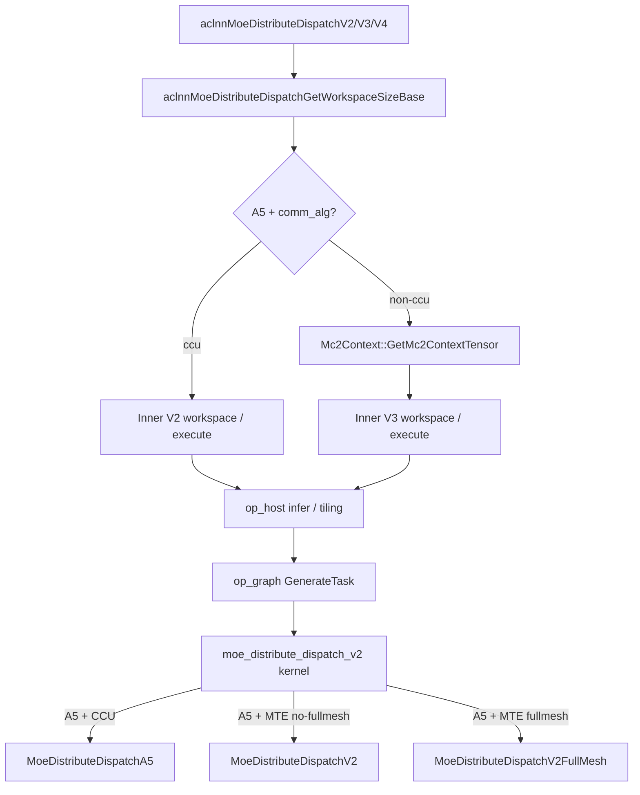
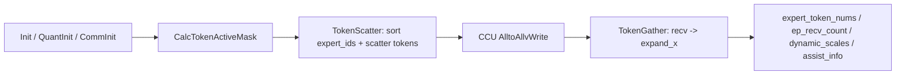
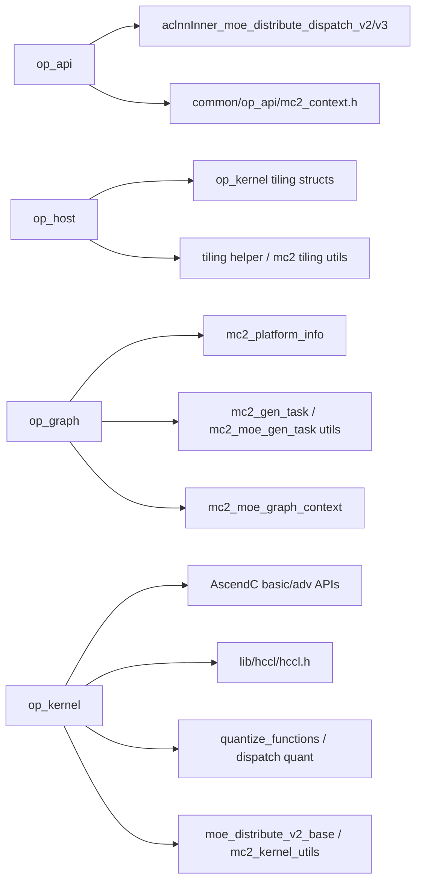

# moe_distribute_dispatch_v2 算子代码分析（Ascend David V100/V120 / A5 分支）

> 分析范围：`/Users/yuantao/code/ops-transformer/mc2/moe_distribute_dispatch_v2`  
> 重点分支：A5 / `arch35` / `NpuArch::DAV_3510` / `ascend950`。代码中未直接出现 `V100`、`V120` 字符串，本文按仓库中的 A5 判定条件 `DAV_3510` 与 `ascend950` 对应分析。  
> 重新生成时间：2026-06-17  
> 统计说明：文件总行数来自源码文本；代码行约为去除空行和注释后的静态估算；普通 C/C++ 函数起止行由括号匹配提取；AICore 大型模板头文件中的类内联方法以源码行号定位和语义分组为主，不展开宏和条件编译。

## 1. 总览结论

`MoeDistributeDispatchV2` 是 MoE dispatch 阶段的 MC2 通信算子，核心职责是根据 `expert_ids` 把本 rank token 按 expert/rank 路由，跨 EP/TP 通信域交换 token，在接收 rank 上连续化输出 `expand_x`，并生成 combine 所需的 `assist_info_for_combine`、`expert_token_nums`、`ep_recv_count`、`tp_recv_count`、`dynamic_scales` 和 `expand_scales`。

A5 分支分为两条主路径：

- `comm_alg == "ccu"`：走 A5 CCU 专用路径。API 保持 Inner V2；graph fusion 跳过；host tiling 调用 `MoeDistributeDispatchTilingImpl(..., OP_VERSION_2)`；kernel 进入 `MoeDistributeDispatchA5`，通信使用 `Hccl<HCCL_SERVER_TYPE_CCU>::AlltoAllvWrite`。
- `comm_alg == "" / "fullmesh_v1" / "fullmesh_v2"`（gen task 侧可归一化为 MTE）：走 A5 MTE/window 路径。API/graph 侧引入 `Mc2Context` 并转 Inner V3；host tiling 复用 A3 public tiling 但设置 `ARCH_TAG=A5`；kernel 按 `FullMesh` 选择 `MoeDistributeDispatchV2` 或 `MoeDistributeDispatchV2FullMesh`。

需要特别留意：`op_kernel/arch35/moe_distribute_dispatch_v2_host_kfc.h` 存在另一套 HostKfc/server 间 window 通信实现，但当前 `op_kernel/moe_distribute_dispatch_v2.cpp` 未直接 include 或派发该类，本文把它作为候选/备用实现单独说明。

## 2. 端到端调用链



## 3. 文件级结构与行数统计


| 文件 | 总行 | 非空行 | 代码行约 | 说明 |
|---|---:|---:|---:|---|
| `op_api/moe_distribute_dispatch_v2_base.h` | 67 | 56 | 41 | 公共 ACLNN base 声明、server type 枚举、dynamic quant 常量。 |
| `op_api/moe_distribute_dispatch_v2_base.cpp` | 227 | 204 | 191 | V2/V3/V4 公共参数检查、A5 平台分支、Inner V2/V3 选择、HCCL server type 设置。 |
| `op_api/aclnn_moe_distribute_dispatch_v2.cpp` | 59 | 53 | 44 | V2 public API wrapper。 |
| `op_api/aclnn_moe_distribute_dispatch_v3.cpp` | 60 | 55 | 46 | V3 public API wrapper，增加 elastic/zero/copy/const expert 参数。 |
| `op_api/aclnn_moe_distribute_dispatch_v4.cpp` | 61 | 55 | 46 | V4 public API wrapper，增加 performance_info。 |
| `op_host/moe_distribute_dispatch_v2_def.cpp` | 152 | 139 | 126 | 算子原型定义，输入/输出/attr 与 ascend950 AICore config。 |
| `op_host/moe_distribute_dispatch_v2_infershape.cpp` | 385 | 346 | 331 | InferShape/InferDtype，A5 dynamic_scales 和 y_dtype 规则。 |
| `op_host/op_tiling/moe_distribute_dispatch_tiling_helper.h` | 125 | 113 | 97 | tiling helper 声明、A5 quant/real mode 枚举。 |
| `op_host/op_tiling/moe_distribute_dispatch_tiling_helper.cpp` | 516 | 468 | 436 | shape/dtype/format/x_active_mask 校验工具。 |
| `op_host/op_tiling/arch35/moe_distribute_dispatch_v2_tiling_arch35.h` | 53 | 44 | 31 | A5 tiling 类声明。 |
| `op_host/op_tiling/arch35/moe_distribute_dispatch_v2_tiling_arch35.cpp` | 1301 | 1208 | 1132 | A5 CCU tiling 与 A5 MTE 入口选择。 |
| `op_graph/fusion_pass/moe_distribute_dispatch_v2_fusion_pass.cpp` | 204 | 193 | 179 | A5 non-ccu V2->V3 graph fusion。 |
| `op_graph/moe_distribute_dispatch_v2_gen_task.cpp` | 70 | 64 | 50 | A5 MTE/CCU GenerateTask 回调选择。 |
| `op_graph/fallback_moe_distribute_dispatch_v2.cpp` | 141 | 104 | 95 | fallback 路径读取 tensor/attr 后调用 ACLNN V2/V3。 |
| `op_kernel/moe_distribute_dispatch_v2_tiling_key.h` | 315 | 311 | 291 | template tiling key 维度和值域，含 A5 MTE/CCU 选择。 |
| `op_kernel/moe_distribute_dispatch_v2.cpp` | 325 | 318 | 305 | AICore global kernel 入口，按 dtype/quant/fullmesh/comm mode 派发。 |
| `op_kernel/arch35/moe_distribute_dispatch_arch35.h` | 1158 | 1041 | 1019 | A5 CCU 专用 kernel 实现。 |
| `op_kernel/moe_distribute_dispatch_v2.h` | 1774 | 1660 | 1578 | A3/A5 non-fullmesh MTE/window kernel 实现。 |
| `op_kernel/moe_distribute_dispatch_v2_full_mesh.h` | 1940 | 1847 | 1778 | A3/A5 fullmesh_v2 kernel 实现。 |
| `op_kernel/arch35/moe_distribute_dispatch_v2_host_kfc.h` | 2177 | 2035 | 1990 | A5 HostKfc/server 间通信候选实现。 |
| `op_kernel/moe_distribute_dispatch_v2_quant.h` | 314 | 290 | 270 | 通用 dispatch quant helper。 |
| `op_kernel/quantize_functions.h` | 527 | 486 | 454 | A5 FP8/MX/per-tile quant 低层函数。 |

## 4. op_api 分析

### 4.1 `moe_distribute_dispatch_v2_base.cpp`（总行 227，非空 204，代码行约 191）

职责：公共参数检查、平台识别、A5 non-ccu 新模板路径、A5 ccu 旧模板路径、HCCL server type/user handle 设置。


| 函数/方法 | 行号 | 行数/代码行约 | 功能 |
|---|---:|---:|---|
| `DispatchCheckNotNull` | 66-85 | 20/19 | 检查必选输入/输出 tensor 和 group_ep。 |
| `DispatchCheckParams` | 87-111 | 25/24 | 在空指针检查基础上校验 dynamic quant 的 dynamicScales 和 HCCL group 名长度。 |
| `SafeCopyGroupBuf` | 113-118 | 6/6 | 安全拷贝 group/comm_alg 到固定长度 char buffer。 |
| `SetCommArgs` | 120-141 | 22/21 | A5 下设置 user handle 为 AIV/CCU，并用弱符号指定 HCCL server type。 |
| `aclnnMoeDistributeDispatchGetWorkspaceSizeBase` | 143-204 | 62/59 | 公共 workspace 入口；A5 non-ccu 创建 Mc2Context 并调用 Inner V3，ccu/非 A5 调 Inner V2。 |
| `aclnnMoeDistributeDispatchBase` | 206-222 | 17/17 | 公共执行入口；A5 AIV handle 调 Inner V3，否则调 Inner V2。 |

### 4.2 V2/V3/V4 public wrapper

- `aclnn_moe_distribute_dispatch_v2.cpp`（总行 59，非空 53，代码行约 44）：`aclnnMoeDistributeDispatchV2GetWorkspaceSize` 透传 base，elastic/performance/zero/copy/const 置空或 0；`aclnnMoeDistributeDispatchV2` 调 base execute。
- `aclnn_moe_distribute_dispatch_v3.cpp`（总行 60，非空 55，代码行约 46）：V3 增加 `elasticInfo`、`zeroExpertNum/copyExpertNum/constExpertNum`。
- `aclnn_moe_distribute_dispatch_v4.cpp`（总行 61，非空 55，代码行约 46）：V4 在 V3 基础上增加 `performanceInfo`。

## 5. op_host 分析

### 5.1 `moe_distribute_dispatch_v2_def.cpp`（总行 152，非空 139，代码行约 126）

职责：注册 `MoeDistributeDispatchV2` 原型。输入包括 `x`、`expert_ids`、可选 `scales/x_active_mask/expert_scales/elastic_info/performance_info`；输出包括 `expand_x`、`dynamic_scales`、`assist_info_for_combine`、`expert_token_nums`、`ep_recv_count`、`tp_recv_count`、`expand_scales`。关键 attr 包含 EP/TP group、world/rank、expert 数、shared expert、quant mode、global_bs、`comm_alg`、zero/copy/const expert 和 `y_dtype`。A5 对应 `this->AICore().AddConfig("ascend950", aicore_config)`，且 `jitCompile.flag=static_true`。

### 5.2 `moe_distribute_dispatch_v2_infershape.cpp`（总行 385，非空 346，代码行约 331）


| 函数/方法 | 行号 | 行数/代码行约 | 功能 |
|---|---:|---:|---|
| `IsTargetSocVersionInfershape` | 73-83 | 11/10 | 通过 rtGetSocSpec Short_SoC_version 判断 A2。 |
| `IsTargetNpuArchInfershape` | 85-94 | 10/10 | 通过 rtGetSocSpec NpuArch 判断 A5。 |
| `InferShapeDynamicScalesA5` | 96-115 | 20/20 | 按 A5 quant_mode 推导 dynamic_scales 形状：pergroup、mx、no_quant+scales 或 1D。 |
| `InferDataTypeDynamicScales` | 117-127 | 11/11 | MX 输出 e8m0；no_quant+scales 输出 scales dtype；默认 float。 |
| `InferShapeMoeDistributeDispatchV2` | 129-314 | 186/161 | 根据 x/expert_ids/attrs 推导 expand_x、assist_info、expert_token_nums、ep/tp counts 等形状。 |
| `CheckQuantMode` | 316-342 | 27/26 | A5 y_dtype 与 quant_mode 的合法性校验。 |
| `InferDataTypeMoeDistributeDispatchV2` | 344-380 | 37/37 | 推导 expand_x/dynamic_scales/统计输出 dtype，A5 支持 y_dtype 覆盖。 |

### 5.3 A5 tiling helper（总行 516，非空 468，代码行约 436）

`QuantModeA5` 包含 `NON_QUANT/STATIC_QUANT/PERTOKEN_DYNAMIC_QUANT/PERGROUP_DYNAMIC_QUANT/MX_QUANT`；`RealModeA5` 将 quant mode、scales、输出 dtype 组合映射到实际模式。


| 函数/方法 | 行号 | 行数/代码行约 | 功能 |
|---|---:|---:|---|
| `MoeDistributeDispatchTilingHelper::CheckInputTensorDim` | 23-68 | 46/42 | 检查 x/expert_ids/scales 输入维度。 |
| `MoeDistributeDispatchTilingHelper::CheckDynamicScalesDim` | 70-92 | 23/21 | 检查 dynamic_scales 维度，pergroup/mx 为 2D。 |
| `MoeDistributeDispatchTilingHelper::CheckOutputTensorDim` | 94-124 | 31/27 | 检查 expand_x/assist_info/expert_token_nums 等输出维度。 |
| `MoeDistributeDispatchTilingHelper::CheckTensorDataTypeA5` | 360-375 | 16/14 | 按 A5 quant mode 检查输入输出 dtype。 |
| `MoeDistributeDispatchTilingHelper::CheckTensorFormat` | 377-459 | 83/73 | 拒绝不支持 format，尤其 FORMAT_FRACTAL_NZ。 |
| `MoeDistributeDispatchTilingHelper::TilingCheckMoeDistributeDispatchA5` | 474-490 | 17/16 | A5 V2 统一 shape/dtype/format/token mask 检查入口。 |
| `MoeDistributeDispatchTilingHelper::CheckTokenMask` | 492-515 | 24/22 | 检查 x_active_mask 为 1D bool。 |

### 5.4 A5 tiling 主实现（总行 1301，非空 1208，代码行约 1132）

A5 tiling 同时处理 CCU 专用实现与 MTE 复用 A3 的入口选择：

- `comm_alg == "ccu"`：进入 `MoeDistributeDispatchTilingImpl(context, OP_VERSION_2)`，生成 CCU tiling 和 `commMode=TILINGKEY_TPL_CCU`。
- 空值、`fullmesh_v1`、`fullmesh_v2`：构造 `DispatchV2Config` 后调用 `MoeDistributeDispatchA3TilingFuncImplPublic`，但 `CalTilingKey` 设置 `ARCH_TAG=TILINGKEY_TPL_A5` 和 `commMode=TILINGKEY_TPL_MTE`。


| 函数/方法 | 行号 | 行数/代码行约 | 功能 |
|---|---:|---:|---|
| `CheckTpAttrs` | 136-158 | 23/23 | 检查 TP world/rank/group，CCU 路径最终要求 tpWorldSize=1。 |
| `CheckEpAttrs` | 160-183 | 24/24 | 检查 EP group、epWorldSize/rank，V2 当前 epWorldSize 范围 [2,1024]。 |
| `CheckQuantAndExpertAttrs` | 185-203 | 19/19 | 检查 quantMode、sharedExpertNum、expertTokenNumsType。 |
| `CheckAttrs` | 464-527 | 64/53 | 综合 EP/TP/expert/globalBs/shared expert/token mask 约束。 |
| `CheckTensorShape` | 774-822 | 49/46 | 检查 x/expert_ids 和所有输出 shape，计算 shared/MoE rank 的 A。 |
| `SetWorkSpace` | 824-852 | 29/26 | 按 EP/local expert/alignedH/token 数计算 workspace/window 需求。 |
| `SetCommTiling` | 854-872 | 19/15 | 设置 HCCL half-alltoallv、fullmesh/pairwise alg 和 A5_CCU_ENGINE。 |
| `GenTilingKey` | 874-897 | 24/22 | 生成 CCU tiling key：tp=false、no fullmesh、commMode=CCU、arch=A5。 |
| `CheckCommAttrs` | 899-929 | 31/30 | 检查 A5 物理 window size 是否满足发送缓冲需求。 |
| `MoeDistributeDispatchTilingImpl` | 946-1010 | 65/51 | A5 CCU tiling 顶层流程：attrs、quant、shape、scales、comm、workspace、tiling key、platform。 |
| `MoeDistributeDispatchV2TilingFuncA5::MoeDistributeDispatchTilingFuncImpl` | 1173-1226 | 54/50 | A5 V2 optiling 入口，按 comm_alg 选择 CCU 或 MTE/A3 public tiling。 |
| `MoeDistributeDispatchV2TilingFuncA5::CalTilingKey` | 1234-1255 | 22/22 | 生成 A5 MTE tiling key，按 fullmesh_v2/layered 设置 FullMesh 维度。 |

## 6. op_graph 分析

### 6.1 fusion pass（总行 204，非空 193，代码行约 179）

A5 non-ccu 下将图中的 `MoeDistributeDispatchV2` 替换为 `MoeDistributeDispatchV3`，并新增 input0=`Mc2MoeContext`。`comm_alg == "ccu"` 显式跳过。


| 函数/方法 | 行号 | 行数/代码行约 | 功能 |
|---|---:|---:|---|
| `MoeDistributeDispatchV2FusionPass::AddAttr` | 45-72 | 28/28 | 拷贝 required/optional attrs，并新增 ccl_buffer_size。 |
| `MoeDistributeDispatchV2FusionPass::CreateFusionNode` | 75-104 | 30/30 | 创建 V3 节点，复制 V2 输入/输出 desc，context 占 input0。 |
| `MoeDistributeDispatchV2FusionPass::AddEdge` | 107-135 | 29/29 | 重连输入输出边，删除 V2，连接 context 到 V3。 |
| `MoeDistributeDispatchV2FusionPass::FusionNode` | 138-148 | 11/11 | 单节点融合封装。 |
| `MoeDistributeDispatchV2FusionPass::Fusion` | 151-168 | 18/18 | 获取/创建 Mc2MoeContext，并执行融合。 |
| `MoeDistributeDispatchV2FusionPass::Run` | 171-199 | 29/29 | 只在 A5 且非 ccu 的 V2 节点上运行融合。 |

### 6.2 GenerateTask（总行 70，非空 64，代码行约 50）


| 函数/方法 | 行号 | 行数/代码行约 | 功能 |
|---|---:|---:|---|
| `MoeDistributeDispatchV2CalcParamFunc` | 28-37 | 10/10 | A5+ccu 绑定 ccu server/ccu_stream；其他绑定 aicpu kfc server/kfc_stream。 |
| `MoeDistributeDispatchV2GenTaskFunc` | 39-63 | 25/25 | A2、A5 MTE/fullmesh、A5 CCU、A3 分别选择对应 task callback。 |

### 6.3 fallback（总行 141，非空 104，代码行约 95）

Host fallback 读取 tensor/attr 后调用 ACLNN。存在 `elastic_info` 或 zero/copy/const expert 非 0 时调用 V3，否则调用 V2。注意：该文件中 `comm_alg` 读取方式需结合 fallback ABI 复核，文末风险点单列。

## 7. op_kernel 分析

### 7.1 tiling key 与 kernel 入口

`moe_distribute_dispatch_v2_tiling_key.h`（总行 315，非空 311，代码行约 291）定义模板维度：`TP`、`QUANT_MODE`、`SCALE`、`FULLMESH`、`COMM_MODE`、`ARCH_TAG`。A5 关键值：`TILINGKEY_TPL_A5=2`、`TILINGKEY_TPL_MTE=0`、`TILINGKEY_TPL_CCU=2`、`TILINGKEY_ENABLE_FULLMESH=1`。

`moe_distribute_dispatch_v2.cpp`（总行 325，非空 318，代码行约 305）只有一个 global kernel 模板：


| 函数/方法 | 行号 | 行数/代码行约 | 功能 |
|---|---:|---:|---|
| `moe_distribute_dispatch_v2` | 44-325 | 282/280 | 按 __NPU_ARCH__、dtype、quant、FullMesh、CommMode、ArchTag 派发到 A5 CCU/MTE/fullmesh 或 A2/A3 实现。 |

A5 kernel 分发规则：

- `CommMode == TILINGKEY_TPL_CCU`：实例化 `MoeDistributeDispatchA5<...>`。
- `CommMode == TILINGKEY_TPL_MTE && FullMesh == TILINGKEY_ENABLE_FULLMESH`：实例化 `MoeDistributeDispatchV2FullMesh<...>`。
- `CommMode == TILINGKEY_TPL_MTE && FullMesh != TILINGKEY_ENABLE_FULLMESH`：实例化 `MoeDistributeDispatchV2<...>`。
- A5 分支会保存/恢复 `FLOAT_OVERFLOW_MODE_CTRL`。

### 7.2 A5 CCU kernel：`arch35/moe_distribute_dispatch_arch35.h`（总行 1158，非空 1041，代码行约 1019）

核心类：`MoeDistributeDispatchA5<XType, ExpandXOutType, QuantMode, IsSmoothScaleExist, IsNeedAllgather>`。其主要阶段为 init/quant init、token mask、token scatter、CCU AlltoAllvWrite、token gather、输出统计。

| 方法                       |  起始行 | 功能                                                                    |
| ------------------------ | ---: | --------------------------------------------------------------------- |
| `InitGlobalAttrs`        |  213 | 读取 tiling 中 bs/h/k/EP/shared expert/AIV 信息，计算本 rank 专家与通信分工。          |
| `InitBuf`                |  257 | 分配 expert id copy、sort、histogram、cumsum、mask、token queue 等 UB buffer。 |
| `InitCommAndStatus`      |  296 | 初始化 CCU HCCL、绑定 window、根据 status 选择双 buffer 接收半区。                     |
| `QuantInit`              |  328 | 按 quant mode 计算 token payload、scale tail、pergroup/mx 对齐和 scale 输出字节数。 |
| `Init`                   |  372 | 初始化 GM tensor、UB pipe、单 token/scale 大小和通信状态。                          |
| `QuantStatic`            |  412 | 执行 int8/hif8 static quant，支持 per-tensor、per-H、per-expert scale。       |
| `QuantDynamicPerToken`   |  450 | 按 token 求最大绝对值，生成 per-token dynamic scale 并量化。                        |
| `QuantDynamicPerTile`    |  496 | 调用 quant helper 做 per-tile/per-group dynamic 计算。                      |
| `QuantDynamicMxFp8`      |  519 | 调用 MX/FP8 scale 计算与 FP8 数据转换。                                         |
| `CalcTokenActiveMask`    |  554 | 读取 x_active_mask，计算 active token 数。                                   |
| `TokenScatter`           |  818 | 拷贝/排序 expert_ids，统计各 expert token，并把 token 写入 send window。            |
| `SetShareExpertSendSize` |  618 | 写 shared expert 路径的 send size/offset/count。                           |
| `ProcessToken`           |  684 | 按目标 expert/rank 处理单 token，执行量化或直接搬运，并把 scale 作为 token payload 尾部传输。     |
| `Communication`          |  913 | AIV0 发起 CCU AlltoAllvWrite，其他 AIV 同步等待并准备 gather。                     |
| `CopyScalesToOut`        |  979 | 把 dynamic/smooth scale 从接收 token 尾部写到 dynamic_scales。                 |
| `TokenGatherProcess`     | 1069 | 按 rank/expert 读取 recv buffer，连续化输出 token。                             |
| `TokenGather`            | 1128 | 初始化 gather 并写 expert_token_nums、ep_recv_count 等统计输出。                  |
| `Process`                | 1141 | 顶层流程：mask -> scatter -> CCU 通信 -> gather -> HCCL finalize。            |

CCU 简化流程：



#### 7.2.1 `MoeDistributeDispatchA5::Init` 详细分析（40 行，代码行约 33）

源码位置：`op_kernel/arch35/moe_distribute_dispatch_arch35.h:372-409`。

`Init` 的职责不是执行 dispatch，而是建立本次 kernel 所需的全部运行上下文：tiling 属性、GM tensor 视图、UB 临时 buffer、单 token 通信布局、量化队列，以及 CCU/HCCL 通信窗口。调用顺序如下：

```text
Init
  -> InitGlobalAttrs
  -> InitBuf
  -> QuantInit
  -> InitCommAndStatus
```

关键步骤：

1. 设置 `FLOAT_OVERFLOW_MODE_CTRL=0`，并保存 `TPipe*` 到 `pipe_`。A5 分支入口外层会保存/恢复原始 overflow mode。
2. 从 tiling 读取 `epRankId_`，用 `GetBlockIdx()` 得到当前 `aivId_`。
3. 调用 `InitGlobalAttrs` 解析 shape、EP rank、expert、shared expert 和 AIV 分工。
4. 绑定所有 GM tensor：`xGT_`、`expertIdsGT_`、`expandXOutGT_`、`expandIdxGT_`、`dynamicScaleGT_`、`expertTokenNumsGT_`、`sendCountsGT_`。当模板参数或 tiling 指示存在 scale/mask 时，再绑定 `scalesGT_` 和 `xActiveMaskGT_`。
5. 调用 `InitBuf` 分配排序、histogram、cumsum、mask 和辅助计算所需 UB buffer。
6. 初始化基础 token 尺寸：`perTokenInSize_ = axisH_ * sizeof(XType)`，`perTokenOutSize_ = axisH_ * sizeof(ExpandXOutType)`，`perTokenMergeSize_ = Align32(axisH_) * sizeof(ExpandXOutType)`。
7. 根据 `scalesCol * scalesTypeSize` 计算 `scaleInBytes_`，再由 `QuantInit` 修正 token payload、scale tail、通信对齐和 token queue。
8. 调用 `InitCommAndStatus` 初始化 HCCL V2、send workspace 布局和 CCL window 双缓冲接收区。

`InitGlobalAttrs` 进一步完成 A5 CCU 的拓扑计算：

| 字段/计算 | 含义 |
| --- | --- |
| `moeExpertRankNum_ = epWorldSize_ - sharedExpertRankNum_` | 排除 shared expert rank 后，真正承载 MoE expert 的 rank 数。 |
| `localExpertNum_ = moeExpertNum_ / moeExpertRankNum_` | 每个 MoE rank 持有的 expert 数。 |
| `sharedUsedAivNum_` | shared expert scatter 使用的 AIV 数，按 `aivNum_ / (axisK_ + 1)` 估算，至少为 1。 |
| `moeUsedAivNum_ = aivNum_ - sharedUsedAivNum_` | MoE expert scatter 使用的 AIV 数。 |
| `bskNum_ = axisBS_ * axisK_` | token 与 top-k expert 组合数，也是 `expert_ids` 排序规模。 |
| `axisMaxBs_` | 通信 buffer 按全局 batch 上限规划；`globalBs != 0` 时取 `globalBs / epWorldSize_`。 |
| `isTokenMaskFlag_` | 是否在 `Process` 开始阶段根据 `x_active_mask` 缩减活跃 token。 |

`QuantInit` 是 `Init` 中影响后续通信布局的关键函数。它把不同 quant mode 归一成“数据区 + 可选 scale tail + 512B 通信对齐”的 token payload：

| 模式 | `perTokenMergeSize_` 调整 | `scaleOutBytes_` | 说明 |
| --- | --- | ---: | --- |
| `UNQUANT && IsSmoothScaleExist` | 追加 `scaleInBytes_` | `scaleInBytes_` | smooth scale 随 token 一起发送，gather 后写到 `dynamic_scales`。 |
| `MX_QUANT` | `Align256(axisH_) * sizeof(out) + Align2(Ceil32(axisH_))` | `Align2(Ceil32(axisH_)) * sizeof(fp8_e8m0_t)` | 数据区按 256 对齐，尾部存 MX scale。 |
| `PERTOKEN_DYNAMIC_QUANT` | 追加 `sizeof(float)` | 4 | 每个 token 一个反量化 scale。 |
| `PERGROUP_DYNAMIC_QUANT` | `Align128(axisH_) * sizeof(out) + Ceil128(axisH_) * sizeof(float)` | `Ceil128(axisH_) * sizeof(float)` | 每 group/tile 输出 scale。 |

最后统一计算：

```text
perTokenCommSize_ = Align512(perTokenMergeSize_)
perRankDataSize_ = COUNT_OFFSET + perTokenCommSize_ * axisMaxBs_ * localExpertNum_
```

这两个字段后续同时用于 send buffer 地址计算、AlltoAllv size/offset、recv window 解析和 gather 地址步长。

`InitCommAndStatus` 的 CCU 通信布局如下：

```text
workspaceGM
  + 0                                             -> sendBufGM_
  + perRankDataSize_ * epWorldSize_              -> sendSizeGM_
  + epWorldSize_ * sizeof(uint64_t) * 2           -> sendOffsetGM_

context->windowsOut[0]
  + aivId_ * STATUS_OFFSET                       -> 当前 AIV status
  + aivNum_ * STATUS_OFFSET                      -> recv half-buffer 0
  + aivNum_ * STATUS_OFFSET + halfDataSize        -> recv half-buffer 1
```

`statusGT(0)` 在 0/1 之间翻转，用于在两块接收半区之间切换。每次读写 status 前后都调用 `DataCacheCleanAndInvalid`，避免 GM/window 状态缓存不一致。

注意事项：类声明中的 `Init` 参数名顺序写成 `expandXOut, xActiveMask`，但定义和调用点实际传参顺序是 `xActiveMask, expandXOut`。由于二者类型都是 `GM_ADDR`，编译器无法通过类型发现该命名误导，后续维护时应以函数定义和调用点为准。

#### 7.2.2 `MoeDistributeDispatchA5::Process` 详细分析（18 行，代码行约 15）

源码位置：`op_kernel/arch35/moe_distribute_dispatch_arch35.h:1141-1156`。

`Process` 是 A5 CCU dispatch 的顶层执行函数，只在 AIV 上运行：

```text
if ASCEND_IS_AIV:
  if isTokenMaskFlag_: CalcTokenActiveMask()
  TokenScatter()
  Communication()
  TokenGather()
  if aivId_ == 0: hccl_.Finalize()
```

执行链可以拆成四段。

**第一段：可选 token mask**

`CalcTokenActiveMask` 读取 `xActiveMaskGT_`，把 bool mask cast 成 half 后做 `Sum`，得到 `activeBs_`，并同步刷新：

```text
activeBsKNum_ = activeBs_ * axisK_
sortNum_ = Align(activeBsKNum_, ONE_REPEAT_SORT_NUM)
sortRepeat_ = Ceil(activeBsKNum_, ONE_REPEAT_SORT_NUM)
```

因此后续 sort/scatter 只处理活跃 token 对应的 `activeBsKNum_` 个 `expert_ids`。

**第二段：TokenScatter**

`TokenScatter` 的公共预处理是对 `expert_ids` 排序并统计 expert 频次：

1. 将 `expertIdsGT_` 拷入 `expertIdsLT_`。
2. 构造排序索引 `indexLT_`。
3. 将 expert id cast 到 float，乘以 -1 后排序，再乘回 -1，得到按 expert id 分组的 token/expert 组合。
4. 生成 `sortedOutI32LT_`、`sortedIndex1LT_`、`expertFreqLT_`、`expertCumSumLT_`。

之后按 AIV 分工进入不同 scatter 路径：

| AIV 范围 | 路径 | 作用 |
| --- | --- | --- |
| `aivId_ < moeUsedAivNum_` | `MoeScatter` | 按 MoE expert 所属 rank 写 send token、send size、send offset 和 per-expert count。 |
| `aivId_ >= moeUsedAivNum_` | `ShareScatter` | 按 shared expert 目标 rank 写 send token、send size、send offset 和 shared count。 |

`MoeScatterCopyTokens` 的地址计算核心是：

```text
toExpertRankId = expertId / localExpertNum_
toRankId = toExpertRankId + sharedExpertRankNum_
tokenGM = sendBufGM_
        + COUNT_OFFSET * (toRankId + 1)
        + (toRankId * axisMaxBs_ * localExpertNum_ + preCount) * perTokenCommSize_
```

其中 `preCount` 来自排序位置减去目标 expert rank 之前的 expert 累计 token 数。实际写 token 前会调用 `ProcessToken`：量化模式走 `QuantProcess`，非量化模式直接搬运；smooth/dynamic scale 会作为 payload 尾部进入 send buffer。

`ShareScatterCopyTokens` 的目标 rank 由 `CalcToSharedRankId` 计算。shared expert 的特殊点是它按 `activeBs_ * sharedExpertNum_` 复制/分发 token，且 shared rank 的接收 token 数可直接由 `activeBs_` 推导。

**第三段：Communication**

`Communication` 先 `SyncAll<true>()`，确保 scatter 阶段已写完 send buffer。随后只有 `aivId_ == 0` 发起 HCCL：

```text
hcclHandleId_ = hccl_.AlltoAllvWrite<true>(
  sendBufGM_, sendOffsetGM_, sendSizeGM_, recvOffset_, localDataSize)
```

`localDataSize` 对 MoE rank 是本 rank 持有 local expert 的 token payload 总量加 `COUNT_OFFSET`；对 shared rank 是 `activeBs_ * perTokenCommSize_ + COUNT_OFFSET`。

HCCL 进行期间，所有 AIV 继续做本地准备：

| 函数 | 作用 |
| --- | --- |
| `SaveExpandIdx` | 基于排序索引和 expert 前缀和生成 `assist_info_for_combine`/`expandIdxOut`。 |
| `TokenGatherInit` | 为 gather 阶段分配 `recvCntLT_`、`moeExpertRankTokenCumSumLT_` 和 `moeExpertTokenNumsLT_`。 |

最后 `aivId_ == 0` 等待 HCCL handle，所有 AIV 再次同步，进入 gather。

**第四段：TokenGather**

`TokenGather` 初始化 `tokenGatherQue_` 后，根据当前 rank 类型选择 gather 参数：

| 当前 rank | 调用 | 含义 |
| --- | --- | --- |
| shared expert rank | `TokenGatherProcess(0, 1)` | 把 shared rank 当作只有 1 个 local expert 的特殊 MoE rank。 |
| 普通 MoE rank | `TokenGatherProcess(sharedExpertRankNum_, localExpertNum_)` | 从 shared rank 偏移后计算本 rank 的 local expert id。 |

`TokenGatherProcess` 先用 `MoeGatherPrepare` 从 `recvBufGM_` 读取各源 rank 的 count，并计算每个 expert 的总 token 数和当前 rank 前缀和。随后按 expert、source rank、token 三层循环读取 recv window：

```text
baseAddr = recvBufGM_
         + curRankId * perRankDataSize_
         + COUNT_OFFSET
         + rankInPreCnt * perTokenCommSize_
```

每个 token 会被拷到 `expandXOutGT_[outPreCount * axisH_]`。如果 payload 尾部包含 dynamic scale 或 smooth scale，`CopyScalesToOut` 会按 quant mode 选择 scale offset，并写入 `dynamicScaleGT_`。每个 expert 处理结束后，`UpdateMoeRankOutput` 写 `sendCountsGT_` 和 `expertTokenNumsGT_`。

整体上，`Process` 的数据流是：

```text
x + expert_ids
  -> sort expert_ids / histogram / cumsum
  -> sendBufGM_ 按目标 rank/expert 打包 token
  -> CCU AlltoAllvWrite 写入 recvBufGM_
  -> recvBufGM_ 按 rank/expert 聚合
  -> expand_x + dynamic_scales + expert_token_nums + ep_recv_count + expandIdx
```

`Process` 自身只有 18 行，但它串联了 A5 CCU 路径的全部关键行为：活跃 token 缩减、专家路由、量化打包、CCU 变长通信、combine 辅助索引生成和接收侧连续化输出。

### 7.3 A5 MTE non-fullmesh：`moe_distribute_dispatch_v2.h`（总行 1774，非空 1660，代码行约 1578）

核心类：`MoeDistributeDispatchV2<Mc2Kernel::HcclContextHolder, ...>`，A3/A5 共用，A5 增加 `SetExpertTokenNumsA5`、`SetExpertPrefixSumA5`、`WaitStatusA5`、`GetCumSumA5` 等特化。

| 方法                     |  起始行 | 功能                                                                         |
| ---------------------- | ---: | -------------------------------------------------------------------------- |
| `Init`                 |  339 | 读取 tiling 和 HCCL context/window，建立输入输出 GM tensor、rank/expert 参数、window 布局。 |
| `SendToSharedExpert`   |  698 | shared expert token 写入目标 rank window。                                      |
| `ProcessToken`         |  642 | 处理单 token payload、expert offset、source token/topk 元数据和可选量化。                |
| `SendToMoeExpert`      |  754 | MoE expert token 写入目标 rank window。                                         |
| `AlltoAllDispatch`     |  967 | 完成跨 rank 状态交换和 dispatch 同步。                                                |
| `SetStatus`            | 1014 | 写/清 window 状态，驱动接收端等待。                                                     |
| `BufferInit`           | 1101 | 分配 window copy、mask、status、count、quant 相关 UB buffer。                       |
| `WaitStatusA5`         | 1221 | A5 特化等待 window 状态到达。                                                       |
| `GetCumSumA5`          | 1321 | A5 特化计算接收侧 prefix sum。                                                     |
| `LocalWindowCopy`      | 1421 | 等待本地 window 数据到齐，按 cumsum 输出 expand_x/assist_info。                         |
| `SetExpertPrefixSumA5` | 1596 | A5 写 expert 前缀和，用于 expert_token_nums 输出。                                   |
| `SetExpertTokenNumsA5` | 1633 | A5 特化写 expert_token_nums。                                                  |
| `Process`              | 1752 | 顶层流程：mask/发送/shared+moe dispatch/本地 copy/输出统计。                             |

### 7.4 A5 MTE fullmesh：`moe_distribute_dispatch_v2_full_mesh.h`（总行 1940，非空 1847，代码行约 1778）

核心类：`MoeDistributeDispatchV2FullMesh<...>`，服务 `fullmesh_v2`，使用状态区、flag 区、cumsum 区实现全量 window 写入与接收侧连续化。

| 方法 | 起始行 | 功能 |
|---|---:|---|
| `SetTilingData` | 350 | 读取拓扑、expert、shape、quant、window size 等 tiling 基础参数。 |
| `SetTilingDataAndCal` | 380 | 读取 tiling 并派生 token size、rank/expert 分片、buffer offset。 |
| `Init` | 457 | 初始化 fullmesh GM tensor、context/window、pipe 和本地状态。 |
| `SendToSharedExpert` | 661 | fullmesh 路径向 shared expert window 写 token。 |
| `CalExpertSendNum` | 714 | 统计每个 expert/rank 的发送 token 数。 |
| `SendToMoeExpert` | 759 | fullmesh 路径向 MoE expert window 写 token。 |
| `AllToAllDispatch` | 882 | 执行 fullmesh dispatch 状态同步和 token 写入调度。 |
| `CalAndSendCntByExp` | 996 | 按 expert 统计并发送 count。 |
| `CalAndSendCntByRank` | 1042 | 按 rank 聚合 count。 |
| `BufferInit` | 1102 | 分配 fullmesh status、flag、count、mask、quant 等 UB buffer。 |
| `GetCumSum` | 1200 | 计算接收侧 cumsum/prefix。 |
| `SetExpertTokenNums` | 1336 | 输出 expert_token_nums。 |
| `CalCumSum` | 1396 | 调度 cumsum 计算和跨 rank flag。 |
| `WaitCumSumFlag` | 1432 | 等待 cumsum 结果就绪。 |
| `WaitAndFormatOutput` | 1577 | 等待 token 到达并格式化输出。 |
| `LocalWindowCopy` | 1643 | 读取 fullmesh window，输出 expand_x/assist_info/dynamic_scales。 |
| `ExpIdsCopyAndMaskCal` | 1873 | 拷贝 expert_ids 并处理 token/expert mask。 |
| `Process` | 1924 | 顶层 fullmesh 流程。 |

### 7.5 HostKfc 候选实现与 quant helper

- `arch35/moe_distribute_dispatch_v2_host_kfc.h`（总行 2177，非空 2035，代码行约 1990）：`MoeDistributeDispatchV2HostKfc` 按 server 划分 rank，区分 intra/inter node，包含 `CalTokenMask`、`CalServerSendCnt`、`CalCumSum`、`ScatterTokenToRemote`、`GatherTokenFrRemote`、`LocalWindowCopy`、`CopyOut` 等流程；当前主 kernel 未直接派发。
- `moe_distribute_dispatch_v2_quant.h`（总行 314，非空 290，代码行约 270）：通用 quant helper，支持 static、per-token、A5 MX、pergroup dynamic。
- `quantize_functions.h`（总行 527，非空 486，代码行约 454）：A5 FP8/MX 低层量化函数，如 max exponent、scale、FP8 data、per-tile dynamic。

## 8. A5 分支选择矩阵

| 层级 | 条件 | 选择 |
|---|---|---|
| API workspace | A5 + `comm_alg != "ccu"` | `Mc2Context` + Inner V3 workspace |
| API workspace | A5 + `comm_alg == "ccu"` | Inner V2 workspace |
| API execute | A5 + user handle `AIV` | Inner V3 execute |
| API execute | A5 + `CCU` 或其他 | Inner V2 execute |
| Graph fusion | A5 + non-ccu V2 | V2 -> V3 + context input |
| Graph fusion | A5 + ccu | 不融合 |
| GenTask | A5 + MTE/fullmesh | `Mc2MoeGenTaskCallbackV2` |
| GenTask | A5 + ccu | `Mc2Arch35GenTaskCallBack` |
| Tiling | A5 + ccu | `MoeDistributeDispatchTilingImpl(OP_VERSION_2)` |
| Tiling | A5 + fullmesh_v1/v2/空 | A3 公共 tiling + `ARCH_TAG=A5` |
| Kernel | A5 + ccu | `MoeDistributeDispatchA5` |
| Kernel | A5 + MTE + no fullmesh | `MoeDistributeDispatchV2` |
| Kernel | A5 + MTE + fullmesh | `MoeDistributeDispatchV2FullMesh` |

## 9. A5 关键约束与量化规则

### CCU tiling 主要约束

- `tpWorldSize` 最终必须为 1。
- `epWorldSize` V2 范围为 `[2,1024]`。
- `bs` 范围为 `[1,512]`。
- `h` V2 范围为 `[1024,8192]`。
- `k` V2 范围为 `(0,min(16,moeExpertNum)]`。
- `sharedExpertNum` V2 范围为 `[0,4]`。
- `sharedExpertRankNum` 与 `sharedExpertNum` 必须同为 0 或可整除配置。
- `moeExpertNum` 必须能整除 `epWorldSize - sharedExpertRankNum`。
- token mask 下不允许各 rank 不同 BS。
- A5 window size 按物理 `HCCL_BUFFSIZE * 2` 检查。

### 量化/dtype

| quant_mode | 输出 `expand_x` 支持 | scales 约束 | dynamic_scales |
|---|---|---|---|
| 0 NON_QUANT | bf16/fp16/hif8/fp8/fp4 | bf16/fp16 通常为空；hif8/fp8/fp4 可带 scale | A5 下可为 `[a]` 或 `[a, scale_cols]` |
| 1 STATIC | int8/hif8 | 必须有 scales；hif8 只接受 1D scale | float |
| 2 PERTOKEN | int8/fp8_e4m3/fp8_e5m2 | scales 可作为 smooth scale | `[a]`, float |
| 3 PERGROUP | fp8_e4m3/fp8_e5m2 | scales 可作为 smooth scale | `[a, ceil(h/128)]`, float |
| 4 MX | fp8_e4m3/fp8_e5m2/fp4 | scales 必须为空 | `[a, even(ceil(h/32))]`, e8m0 |

## 10. 依赖关系



## 11. 测试覆盖线索

相关目录：

- `tests/ut/op_api/test_aclnn_moe_distribute_dispatch_v2.cpp`
- `tests/ut/op_api/test_aclnn_moe_distribute_dispatch_v3_v4.cpp`
- `tests/ut/op_host/test_moe_distribute_dispatch_v2_infershape.cpp`
- `tests/ut/op_host/arch35/test_moe_distribute_dispatch_v2_tiling.cpp`
- `tests/ut/op_kernel/test_moe_distribute_dispatch_v2.cpp`

A5 相关测试点包括 infer shape 的 pergroup/mx/no_quant/scales/static/shared expert/elasticInfo、infer dtype 的 static/per-token/pergroup，以及 ACLNN Ascend950 non-ccu workspace 分支。

## 12. 风险与未验证事项

1. `fallback_moe_distribute_dispatch_v2.cpp` 中 `comm_alg` 读取方式需要结合 fallback attr ABI 复核；op def 中该 attr 是 String。
2. `arch35/moe_distribute_dispatch_v2_host_kfc.h` 当前未见主 kernel 入口直接派发，可能是备用、历史或其他编译路径实现。
3. 本次未运行 AICore 编译、UT、仿真或硬件验证，只做静态代码阅读和文档/PPT 生成。
4. A5 CCU 路径当前 `tpWorldSize=1`；A5 MTE/fullmesh TP 能力依赖复用 A3 tiling 的约束。

## 13. 快速定位表

| 主题 | 文件 | 重点函数/类 |
|---|---|---|
| ACLNN API 入口 | `op_api/aclnn_moe_distribute_dispatch_v2.cpp` | `aclnnMoeDistributeDispatchV2GetWorkspaceSize` |
| API 公共派发 | `op_api/moe_distribute_dispatch_v2_base.cpp` | `aclnnMoeDistributeDispatchGetWorkspaceSizeBase`, `SetCommArgs` |
| 算子原型 | `op_host/moe_distribute_dispatch_v2_def.cpp` | `class MoeDistributeDispatchV2` |
| shape/dtype 推导 | `op_host/moe_distribute_dispatch_v2_infershape.cpp` | `InferShapeMoeDistributeDispatchV2`, `InferDataTypeMoeDistributeDispatchV2` |
| A5 CCU tiling | `op_host/op_tiling/arch35/moe_distribute_dispatch_v2_tiling_arch35.cpp` | `MoeDistributeDispatchTilingImpl` |
| A5 MTE tiling | 同上 | `MoeDistributeDispatchV2TilingFuncA5::MoeDistributeDispatchTilingFuncImpl` |
| tiling key | `op_kernel/moe_distribute_dispatch_v2_tiling_key.h` | `ASCENDC_TPL_ARGS_DECL/SEL` |
| kernel 入口 | `op_kernel/moe_distribute_dispatch_v2.cpp` | `moe_distribute_dispatch_v2` |
| A5 CCU kernel | `op_kernel/arch35/moe_distribute_dispatch_arch35.h` | `MoeDistributeDispatchA5` |
| A5 MTE kernel | `op_kernel/moe_distribute_dispatch_v2.h` | `MoeDistributeDispatchV2` |
| A5 fullmesh kernel | `op_kernel/moe_distribute_dispatch_v2_full_mesh.h` | `MoeDistributeDispatchV2FullMesh` |
| graph fusion | `op_graph/fusion_pass/moe_distribute_dispatch_v2_fusion_pass.cpp` | `MoeDistributeDispatchV2FusionPass::Run` |
| task 生成 | `op_graph/moe_distribute_dispatch_v2_gen_task.cpp` | `MoeDistributeDispatchV2GenTaskFunc` |
## 14. 附录：文件与函数代码行数统计

统计口径：

- 文件总行：源码文本总行数。
- 非空行：去除空白行后的行数。
- 代码行约：静态去除空行和注释后的估算值。
- 函数/方法统计：普通 C/C++ 函数和类外定义方法按括号匹配计算起止行；宏展开、条件编译未展开，少量宏注册或复杂模板签名按源码近似统计。

### 14.1 文件级统计

| 文件 | 总行 | 非空行 | 代码行约 |
|---|---:|---:|---:|
| `op_api/moe_distribute_dispatch_v2_base.h` | 67 | 56 | 41 |
| `op_api/moe_distribute_dispatch_v2_base.cpp` | 227 | 204 | 191 |
| `op_api/aclnn_moe_distribute_dispatch_v2.cpp` | 59 | 53 | 44 |
| `op_api/aclnn_moe_distribute_dispatch_v3.cpp` | 60 | 55 | 46 |
| `op_api/aclnn_moe_distribute_dispatch_v4.cpp` | 61 | 55 | 46 |
| `op_host/moe_distribute_dispatch_v2_def.cpp` | 152 | 139 | 126 |
| `op_host/moe_distribute_dispatch_v2_infershape.cpp` | 385 | 346 | 331 |
| `op_host/op_tiling/moe_distribute_dispatch_tiling_helper.h` | 125 | 113 | 97 |
| `op_host/op_tiling/moe_distribute_dispatch_tiling_helper.cpp` | 516 | 468 | 436 |
| `op_host/op_tiling/arch35/moe_distribute_dispatch_v2_tiling_arch35.h` | 53 | 44 | 31 |
| `op_host/op_tiling/arch35/moe_distribute_dispatch_v2_tiling_arch35.cpp` | 1301 | 1208 | 1132 |
| `op_graph/fusion_pass/moe_distribute_dispatch_v2_fusion_pass.h` | 44 | 40 | 27 |
| `op_graph/fusion_pass/moe_distribute_dispatch_v2_fusion_pass.cpp` | 204 | 193 | 179 |
| `op_graph/moe_distribute_dispatch_v2_gen_task.cpp` | 70 | 64 | 50 |
| `op_graph/fallback_moe_distribute_dispatch_v2.cpp` | 141 | 104 | 95 |
| `op_kernel/moe_distribute_dispatch_v2_tiling_key.h` | 315 | 311 | 291 |
| `op_kernel/moe_distribute_dispatch_v2.cpp` | 325 | 318 | 305 |
| `op_kernel/arch35/moe_distribute_dispatch_arch35.h` | 1158 | 1041 | 1019 |
| `op_kernel/moe_distribute_dispatch_v2.h` | 1774 | 1660 | 1578 |
| `op_kernel/moe_distribute_dispatch_v2_full_mesh.h` | 1940 | 1847 | 1778 |
| `op_kernel/arch35/moe_distribute_dispatch_v2_host_kfc.h` | 2177 | 2035 | 1990 |
| `op_kernel/moe_distribute_dispatch_v2_quant.h` | 314 | 290 | 270 |
| `op_kernel/quantize_functions.h` | 527 | 486 | 454 |

### 14.2 `op_api/aclnn_moe_distribute_dispatch_v2.cpp`

| 函数/方法 | 起止行 | 总行 | 代码行约 |
|---|---:|---:|---:|
| `aclnnMoeDistributeDispatchV2GetWorkspaceSize` | 26-50 | 25 | 23 |
| `aclnnMoeDistributeDispatchV2` | 52-56 | 5 | 5 |

### 14.3 `op_api/aclnn_moe_distribute_dispatch_v3.cpp`

| 函数/方法 | 起止行 | 总行 | 代码行约 |
|---|---:|---:|---:|
| `aclnnMoeDistributeDispatchV3GetWorkspaceSize` | 26-51 | 26 | 24 |
| `aclnnMoeDistributeDispatchV3` | 53-57 | 5 | 5 |

### 14.4 `op_api/aclnn_moe_distribute_dispatch_v4.cpp`

| 函数/方法 | 起止行 | 总行 | 代码行约 |
|---|---:|---:|---:|
| `aclnnMoeDistributeDispatchV4GetWorkspaceSize` | 27-52 | 26 | 24 |
| `aclnnMoeDistributeDispatchV4` | 54-58 | 5 | 5 |

### 14.5 `op_api/moe_distribute_dispatch_v2_base.cpp`

| 函数/方法 | 起止行 | 总行 | 代码行约 |
|---|---:|---:|---:|
| `DispatchCheckNotNull` | 66-85 | 20 | 19 |
| `DispatchCheckParams` | 87-111 | 25 | 24 |
| `SafeCopyGroupBuf` | 113-118 | 6 | 6 |
| `SetCommArgs` | 120-141 | 22 | 21 |
| `aclnnMoeDistributeDispatchGetWorkspaceSizeBase` | 143-204 | 62 | 59 |
| `aclnnMoeDistributeDispatchBase` | 206-222 | 17 | 17 |

### 14.6 `op_graph/fallback_moe_distribute_dispatch_v2.cpp`

| 函数/方法 | 起止行 | 总行 | 代码行约 |
|---|---:|---:|---:|
| `MoeDistributeDispatchV2ExecuteFunc` | 25-132 | 108 | 80 |

### 14.7 `op_graph/fusion_pass/moe_distribute_dispatch_v2_fusion_pass.cpp`

| 函数/方法 | 起止行 | 总行 | 代码行约 |
|---|---:|---:|---:|
| `MoeDistributeDispatchV2FusionPass::AddAttr` | 45-72 | 28 | 28 |
| `MoeDistributeDispatchV2FusionPass::CreateFusionNode` | 75-104 | 30 | 30 |
| `MoeDistributeDispatchV2FusionPass::AddEdge` | 107-135 | 29 | 29 |
| `MoeDistributeDispatchV2FusionPass::FusionNode` | 138-148 | 11 | 11 |
| `MoeDistributeDispatchV2FusionPass::Fusion` | 151-168 | 18 | 18 |
| `MoeDistributeDispatchV2FusionPass::Run` | 171-199 | 29 | 29 |

### 14.8 `op_graph/moe_distribute_dispatch_v2_gen_task.cpp`

| 函数/方法 | 起止行 | 总行 | 代码行约 |
|---|---:|---:|---:|
| `MoeDistributeDispatchV2CalcParamFunc` | 28-37 | 10 | 10 |
| `MoeDistributeDispatchV2GenTaskFunc` | 39-63 | 25 | 25 |

### 14.9 `op_host/moe_distribute_dispatch_v2_def.cpp`

| 函数/方法 | 起止行 | 总行 | 代码行约 |
|---|---:|---:|---:|
| `MoeDistributeDispatchV2` | 20-146 | 127 | 120 |

### 14.10 `op_host/moe_distribute_dispatch_v2_infershape.cpp`

| 函数/方法 | 起止行 | 总行 | 代码行约 |
|---|---:|---:|---:|
| `IsTargetSocVersionInfershape` | 73-83 | 11 | 10 |
| `IsTargetNpuArchInfershape` | 85-94 | 10 | 10 |
| `InferShapeDynamicScalesA5` | 96-115 | 20 | 20 |
| `InferDataTypeDynamicScales` | 117-127 | 11 | 11 |
| `InferShapeMoeDistributeDispatchV2` | 129-314 | 186 | 161 |
| `CheckQuantMode` | 316-342 | 27 | 26 |
| `InferDataTypeMoeDistributeDispatchV2` | 344-380 | 37 | 37 |

### 14.11 `op_host/op_tiling/arch35/moe_distribute_dispatch_v2_tiling_arch35.cpp`

| 函数/方法 | 起止行 | 总行 | 代码行约 |
|---|---:|---:|---:|
| `PrintTilingDataInfo` | 111-134 | 24 | 23 |
| `CheckTpAttrs` | 136-158 | 23 | 23 |
| `CheckEpAttrs` | 160-183 | 24 | 24 |
| `CheckQuantAndExpertAttrs` | 185-203 | 19 | 19 |
| `CheckSharedExpertAttrs` | 205-215 | 11 | 11 |
| `CheckMoeExpertAttrs` | 217-229 | 13 | 13 |
| `CheckOutputDataType` | 231-260 | 30 | 30 |
| `SetSharedExpertNum` | 262-270 | 9 | 9 |
| `SetEpTpInfo` | 272-279 | 8 | 8 |
| `SetExpertInfo` | 281-287 | 7 | 7 |
| `CheckContextAttrsNullptr` | 289-330 | 42 | 38 |
| `GetContextAttrs` | 332-376 | 45 | 41 |
| `CheckQuantModeAndExpandXType` | 378-393 | 16 | 16 |
| `CheckQuantModeAndScales` | 395-416 | 22 | 22 |
| `CheckEpWorldSizeV1` | 418-439 | 22 | 17 |
| `CheckSharedAttrs` | 441-462 | 22 | 17 |
| `CheckAttrs` | 464-527 | 64 | 53 |
| `CheckTwoDimScalesShape` | 529-553 | 25 | 25 |
| `CheckAndSetScalesInfo` | 555-609 | 55 | 52 |
| `CheckExpandXShape` | 611-629 | 19 | 17 |
| `CheckDynamicScalesShape` | 631-664 | 34 | 31 |
| `CheckExpandIdxAndMaskShape` | 666-684 | 19 | 17 |
| `CheckExpertTokenNumsShape` | 686-702 | 17 | 16 |
| `CheckEpTpTecvTensorShape` | 704-731 | 28 | 26 |
| `CheckAndSetH` | 733-747 | 15 | 14 |
| `CheckExpertIdsAndSetK` | 749-772 | 24 | 23 |
| `CheckTensorShape` | 774-822 | 49 | 46 |
| `SetWorkSpace` | 824-852 | 29 | 26 |
| `SetCommTiling` | 854-872 | 19 | 15 |
| `GenTilingKey` | 874-897 | 24 | 22 |
| `CheckCommAttrs` | 899-929 | 31 | 30 |
| `SetPlatformInfo` | 931-944 | 14 | 14 |
| `MoeDistributeDispatchTilingImpl` | 946-1010 | 65 | 51 |
| `MoeDistributeDispatchTilingA5::DoOpTiling` | 1012-1015 | 4 | 4 |
| `MoeDistributeDispatchTilingA5::GetTilingKey` | 1017-1024 | 8 | 7 |
| `MoeDistributeDispatchTilingA5::IsCapable` | 1026-1034 | 9 | 9 |
| `CheckTensorDataTypeStaticOrDynamic` | 1036-1059 | 24 | 22 |
| `CheckTensorDataTypeMxfp8` | 1061-1074 | 14 | 13 |
| `CheckTensorDataTypeNonQuant` | 1076-1119 | 44 | 39 |
| `CheckDistinctTensorDataType` | 1121-1136 | 16 | 15 |
| `CheckQuantModeAndExpandXTypeStatic` | 1138-1154 | 17 | 17 |
| `MoeDistributeDispatchV2TilingFuncA5::CheckTensorDataType` | 1156-1171 | 16 | 15 |
| `MoeDistributeDispatchV2TilingFuncA5::MoeDistributeDispatchTilingFuncImpl` | 1173-1226 | 54 | 50 |
| `MoeDistributeDispatchV2TilingFuncA5::MoeDistributeDispatchV2TilingFunc` | 1228-1232 | 5 | 5 |
| `MoeDistributeDispatchV2TilingFuncA5::CalTilingKey` | 1234-1255 | 22 | 22 |
| `MoeDistributeDispatchV2TilingFuncA5::CheckQuantModeMatchScales` | 1257-1265 | 9 | 9 |
| `MoeDistributeDispatchV2TilingFuncA5::CheckCommAlgPtr` | 1267-1270 | 4 | 4 |
| `MoeDistributeDispatchV2TilingFuncA5::CheckQuantModePtr` | 1272-1282 | 11 | 10 |
| `TilingParseForMoeDistributeDispatchV2` | 1285-1289 | 5 | 5 |
| `MoeDistributeDispatchV2TilingFuncImpl` | 1291-1295 | 5 | 5 |

### 14.12 `op_host/op_tiling/arch35/moe_distribute_dispatch_v2_tiling_arch35.h`

| 函数/方法 | 起止行 | 总行 | 代码行约 |
|---|---:|---:|---:|
| `MoeDistributeDispatchTilingA5` | 28-29 | 2 | 2 |

### 14.13 `op_host/op_tiling/moe_distribute_dispatch_tiling_helper.cpp`

| 函数/方法 | 起止行 | 总行 | 代码行约 |
|---|---:|---:|---:|
| `MoeDistributeDispatchTilingHelper::CheckInputTensorDim` | 23-68 | 46 | 42 |
| `MoeDistributeDispatchTilingHelper::CheckDynamicScalesDim` | 70-92 | 23 | 21 |
| `MoeDistributeDispatchTilingHelper::CheckOutputTensorDim` | 94-124 | 31 | 27 |
| `MoeDistributeDispatchTilingHelper::CheckEpTpRecvTensorDim` | 126-142 | 17 | 16 |
| `MoeDistributeDispatchTilingHelper::CheckTensorDim` | 144-161 | 18 | 15 |
| `MoeDistributeDispatchTilingHelper::CheckCommonOutputTensorDataType` | 163-192 | 30 | 26 |
| `MoeDistributeDispatchTilingHelper::CheckInputTensorDataType` | 194-217 | 24 | 22 |
| `MoeDistributeDispatchTilingHelper::CheckTensorDataType` | 219-253 | 35 | 33 |
| `MoeDistributeDispatchTilingHelper::CheckTensorDataTypeNoScales` | 255-299 | 45 | 40 |
| `MoeDistributeDispatchTilingHelper::CheckTensorDataTypeStaticOrDynamic` | 301-324 | 24 | 22 |
| `MoeDistributeDispatchTilingHelper::CheckTensorDataTypeMxfp8` | 326-341 | 16 | 15 |
| `MoeDistributeDispatchTilingHelper::CheckDistinctTensorDataType` | 343-358 | 16 | 15 |
| `MoeDistributeDispatchTilingHelper::CheckTensorDataTypeA5` | 360-375 | 16 | 14 |
| `MoeDistributeDispatchTilingHelper::CheckTensorFormat` | 377-459 | 83 | 73 |
| `MoeDistributeDispatchTilingHelper::TilingCheckMoeDistributeDispatch` | 461-472 | 12 | 11 |
| `MoeDistributeDispatchTilingHelper::TilingCheckMoeDistributeDispatchA5` | 474-490 | 17 | 16 |
| `MoeDistributeDispatchTilingHelper::CheckTokenMask` | 492-515 | 24 | 22 |

### 14.14 `op_kernel/arch35/moe_distribute_dispatch_arch35.h`

| 函数/方法 | 起止行 | 总行 | 代码行约 |
|---|---:|---:|---:|
| `MoeDistributeDispatchA5<TemplateMoeDistributeDispatchA5TypeFunc>::InitGlobalAttrs` | 209-254 | 46 | 42 |
| `MoeDistributeDispatchA5<TemplateMoeDistributeDispatchA5TypeFunc>::InitBuf` | 255-293 | 39 | 32 |
| `MoeDistributeDispatchA5<TemplateMoeDistributeDispatchA5TypeFunc>::InitCommAndStatus` | 294-325 | 32 | 27 |
| `MoeDistributeDispatchA5<TemplateMoeDistributeDispatchA5TypeFunc>::QuantInit` | 326-369 | 44 | 40 |
| `MoeDistributeDispatchA5<TemplateMoeDistributeDispatchA5TypeFunc>::Init` | 370-409 | 40 | 33 |
| `MoeDistributeDispatchA5<TemplateMoeDistributeDispatchA5TypeFunc>::QuantStatic` | 410-447 | 38 | 36 |
| `MoeDistributeDispatchA5<TemplateMoeDistributeDispatchA5TypeFunc>::QuantDynamicPerToken` | 448-493 | 46 | 42 |
| `MoeDistributeDispatchA5<TemplateMoeDistributeDispatchA5TypeFunc>::QuantDynamicPerTile` | 494-516 | 23 | 20 |
| `MoeDistributeDispatchA5<TemplateMoeDistributeDispatchA5TypeFunc>::QuantDynamicMxFp8` | 517-536 | 20 | 18 |
| `MoeDistributeDispatchA5<TemplateMoeDistributeDispatchA5TypeFunc>::QuantProcess` | 537-551 | 15 | 14 |
| `MoeDistributeDispatchA5<TemplateMoeDistributeDispatchA5TypeFunc>::CalcTokenActiveMask` | 552-580 | 29 | 25 |
| `MoeDistributeDispatchA5<TemplateMoeDistributeDispatchA5TypeFunc>::CalcToSharedRankId` | 581-589 | 9 | 8 |
| `MoeDistributeDispatchA5<TemplateMoeDistributeDispatchA5TypeFunc>::ShareScatterCopyTokens` | 590-615 | 26 | 23 |
| `MoeDistributeDispatchA5<TemplateMoeDistributeDispatchA5TypeFunc>::SetShareExpertSendSize` | 616-670 | 55 | 48 |
| `MoeDistributeDispatchA5<TemplateMoeDistributeDispatchA5TypeFunc>::ShareScatter` | 671-681 | 11 | 9 |
| `MoeDistributeDispatchA5<TemplateMoeDistributeDispatchA5TypeFunc>::ProcessToken` | 682-720 | 39 | 37 |
| `MoeDistributeDispatchA5<TemplateMoeDistributeDispatchA5TypeFunc>::MoeScatterCopyTokens` | 721-756 | 36 | 32 |
| `MoeDistributeDispatchA5<TemplateMoeDistributeDispatchA5TypeFunc>::MoeScatter` | 757-815 | 59 | 53 |
| `MoeDistributeDispatchA5<TemplateMoeDistributeDispatchA5TypeFunc>::TokenScatter` | 816-849 | 34 | 33 |
| `MoeDistributeDispatchA5<TemplateMoeDistributeDispatchA5TypeFunc>::SaveExpandIdx` | 850-897 | 48 | 45 |
| `MoeDistributeDispatchA5<TemplateMoeDistributeDispatchA5TypeFunc>::TokenGatherInit` | 898-910 | 13 | 12 |
| `MoeDistributeDispatchA5<TemplateMoeDistributeDispatchA5TypeFunc>::Communication` | 911-944 | 34 | 28 |
| `MoeDistributeDispatchA5<TemplateMoeDistributeDispatchA5TypeFunc>::UpdateShareRankOutput` | 945-976 | 32 | 29 |
| `MoeDistributeDispatchA5<TemplateMoeDistributeDispatchA5TypeFunc>::CopyScalesToOut` | 977-993 | 17 | 16 |
| `MoeDistributeDispatchA5<TemplateMoeDistributeDispatchA5TypeFunc>::MoeGatherPrepare` | 994-1023 | 30 | 27 |
| `MoeDistributeDispatchA5<TemplateMoeDistributeDispatchA5TypeFunc>::SplitToCore` | 1024-1048 | 25 | 24 |
| `MoeDistributeDispatchA5<TemplateMoeDistributeDispatchA5TypeFunc>::UpdateMoeRankOutput` | 1049-1066 | 18 | 17 |
| `MoeDistributeDispatchA5<TemplateMoeDistributeDispatchA5TypeFunc>::TokenGatherProcess` | 1067-1125 | 59 | 52 |
| `MoeDistributeDispatchA5<TemplateMoeDistributeDispatchA5TypeFunc>::TokenGather` | 1126-1138 | 13 | 10 |
| `MoeDistributeDispatchA5<TemplateMoeDistributeDispatchA5TypeFunc>::Process` | 1139-1156 | 18 | 15 |

### 14.15 `op_kernel/arch35/moe_distribute_dispatch_v2_host_kfc.h`

| 函数/方法 | 起止行 | 总行 | 代码行约 |
|---|---:|---:|---:|
| `MoeDistributeDispatchV2HostKfc<TemplateDispatchKFCTypeFunc>::SplitToCore` | 413-434 | 22 | 20 |
| `MoeDistributeDispatchV2HostKfc<TemplateDispatchKFCTypeFunc>::InitRecieveTilingContext` | 435-481 | 47 | 42 |
| `MoeDistributeDispatchV2HostKfc<TemplateDispatchKFCTypeFunc>::InitCommInfo` | 482-501 | 20 | 18 |
| `MoeDistributeDispatchV2HostKfc<TemplateDispatchKFCTypeFunc>::InitComputeInfo` | 502-538 | 37 | 35 |
| `MoeDistributeDispatchV2HostKfc<TemplateDispatchKFCTypeFunc>::InitSetWindows` | 539-570 | 32 | 28 |
| `MoeDistributeDispatchV2HostKfc<TemplateDispatchKFCTypeFunc>::InitExtraInfo` | 571-609 | 39 | 30 |
| `MoeDistributeDispatchV2HostKfc<TemplateDispatchKFCTypeFunc>::InitMaskInfo` | 610-660 | 51 | 45 |
| `MoeDistributeDispatchV2HostKfc<TemplateDispatchKFCTypeFunc>::InitDispatchBetweenServerInfo` | 661-690 | 30 | 26 |
| `MoeDistributeDispatchV2HostKfc<TemplateDispatchKFCTypeFunc>::Init` | 691-723 | 33 | 32 |
| `MoeDistributeDispatchV2HostKfc<TemplateDispatchKFCTypeFunc>::InitMaskReSource` | 724-738 | 15 | 13 |
| `MoeDistributeDispatchV2HostKfc<TemplateDispatchKFCTypeFunc>::TokenActiveMaskCal` | 739-761 | 23 | 21 |
| `MoeDistributeDispatchV2HostKfc<TemplateDispatchKFCTypeFunc>::ExpertActiveMaskCal` | 762-777 | 16 | 15 |
| `MoeDistributeDispatchV2HostKfc<TemplateDispatchKFCTypeFunc>::CalTokenMask` | 778-791 | 14 | 12 |
| `MoeDistributeDispatchV2HostKfc<TemplateDispatchKFCTypeFunc>::CalServerSendCnt` | 792-852 | 61 | 60 |
| `MoeDistributeDispatchV2HostKfc<TemplateDispatchKFCTypeFunc>::CalExpertTotalSendCnt` | 853-876 | 24 | 22 |
| `MoeDistributeDispatchV2HostKfc<TemplateDispatchKFCTypeFunc>::SendExpertCnt` | 877-924 | 48 | 44 |
| `MoeDistributeDispatchV2HostKfc<TemplateDispatchKFCTypeFunc>::InitStatusTensor` | 925-942 | 18 | 17 |
| `MoeDistributeDispatchV2HostKfc<TemplateDispatchKFCTypeFunc>::ReadDataFromWindows` | 943-957 | 15 | 13 |
| `MoeDistributeDispatchV2HostKfc<TemplateDispatchKFCTypeFunc>::WaitFlag` | 958-994 | 37 | 33 |
| `MoeDistributeDispatchV2HostKfc<TemplateDispatchKFCTypeFunc>::SetStatus` | 995-1042 | 48 | 43 |
| `MoeDistributeDispatchV2HostKfc<TemplateDispatchKFCTypeFunc>::InitCalCumSumBuffer` | 1043-1067 | 25 | 23 |
| `MoeDistributeDispatchV2HostKfc<TemplateDispatchKFCTypeFunc>::WaitDispatchClearStatus` | 1068-1082 | 15 | 14 |
| `MoeDistributeDispatchV2HostKfc<TemplateDispatchKFCTypeFunc>::GatherSumRecvCnt` | 1083-1120 | 38 | 29 |
| `MoeDistributeDispatchV2HostKfc<TemplateDispatchKFCTypeFunc>::WaitCntFrRemote` | 1121-1146 | 26 | 24 |
| `MoeDistributeDispatchV2HostKfc<TemplateDispatchKFCTypeFunc>::GetCumSum` | 1147-1202 | 56 | 54 |
| `MoeDistributeDispatchV2HostKfc<TemplateDispatchKFCTypeFunc>::CalRecvAndSetFlag` | 1203-1240 | 38 | 33 |
| `MoeDistributeDispatchV2HostKfc<TemplateDispatchKFCTypeFunc>::SetExpertTokenNums` | 1241-1275 | 35 | 32 |
| `MoeDistributeDispatchV2HostKfc<TemplateDispatchKFCTypeFunc>::CalCumSum` | 1276-1293 | 18 | 16 |
| `MoeDistributeDispatchV2HostKfc<TemplateDispatchKFCTypeFunc>::WriteExpertOffset` | 1294-1319 | 26 | 24 |
| `MoeDistributeDispatchV2HostKfc<TemplateDispatchKFCTypeFunc>::CalTokenSendExpertOffset` | 1320-1373 | 54 | 53 |
| `MoeDistributeDispatchV2HostKfc<TemplateDispatchKFCTypeFunc>::SetServerFlag` | 1374-1398 | 25 | 24 |
| `MoeDistributeDispatchV2HostKfc<TemplateDispatchKFCTypeFunc>::CalServerSplitCore` | 1399-1416 | 18 | 16 |
| `MoeDistributeDispatchV2HostKfc<TemplateDispatchKFCTypeFunc>::InitQuantBuffer` | 1417-1434 | 18 | 17 |
| `MoeDistributeDispatchV2HostKfc<TemplateDispatchKFCTypeFunc>::InitScatterBuffer` | 1435-1451 | 17 | 16 |
| `MoeDistributeDispatchV2HostKfc<TemplateDispatchKFCTypeFunc>::CalExpertOffset` | 1452-1483 | 32 | 30 |
| `MoeDistributeDispatchV2HostKfc<TemplateDispatchKFCTypeFunc>::FillTriple` | 1484-1497 | 14 | 12 |
| `MoeDistributeDispatchV2HostKfc<TemplateDispatchKFCTypeFunc>::WriteDataToWinOut` | 1498-1515 | 18 | 16 |
| `MoeDistributeDispatchV2HostKfc<TemplateDispatchKFCTypeFunc>::WriteDataToWinOut` | 1516-1534 | 19 | 16 |
| `MoeDistributeDispatchV2HostKfc<TemplateDispatchKFCTypeFunc>::QuantCleanTensor` | 1535-1547 | 13 | 11 |
| `MoeDistributeDispatchV2HostKfc<TemplateDispatchKFCTypeFunc>::IsInSameServer` | 1548-1554 | 7 | 6 |
| `MoeDistributeDispatchV2HostKfc<TemplateDispatchKFCTypeFunc>::ProcessToken` | 1555-1593 | 39 | 37 |
| `MoeDistributeDispatchV2HostKfc<TemplateDispatchKFCTypeFunc>::SendTokenToLocalServer` | 1594-1649 | 56 | 55 |
| `MoeDistributeDispatchV2HostKfc<TemplateDispatchKFCTypeFunc>::FillQuadruple` | 1650-1680 | 31 | 29 |
| `MoeDistributeDispatchV2HostKfc<TemplateDispatchKFCTypeFunc>::SingleTokenProcess` | 1681-1695 | 15 | 14 |
| `MoeDistributeDispatchV2HostKfc<TemplateDispatchKFCTypeFunc>::ScatterToken` | 1696-1711 | 16 | 14 |
| `MoeDistributeDispatchV2HostKfc<TemplateDispatchKFCTypeFunc>::SendTokenToRemoteServer` | 1712-1725 | 14 | 13 |
| `MoeDistributeDispatchV2HostKfc<TemplateDispatchKFCTypeFunc>::ScatterTokenToRemote` | 1726-1753 | 28 | 25 |
| `MoeDistributeDispatchV2HostKfc<TemplateDispatchKFCTypeFunc>::InitGatherTokenBuffer` | 1754-1790 | 37 | 33 |
| `MoeDistributeDispatchV2HostKfc<TemplateDispatchKFCTypeFunc>::WaitStatusFlag` | 1791-1815 | 25 | 24 |
| `MoeDistributeDispatchV2HostKfc<TemplateDispatchKFCTypeFunc>::SendToExpert` | 1816-1860 | 45 | 42 |
| `MoeDistributeDispatchV2HostKfc<TemplateDispatchKFCTypeFunc>::WaitToken` | 1861-1897 | 37 | 36 |
| `MoeDistributeDispatchV2HostKfc<TemplateDispatchKFCTypeFunc>::CleanTokenFlag` | 1898-1913 | 16 | 15 |
| `MoeDistributeDispatchV2HostKfc<TemplateDispatchKFCTypeFunc>::GatherTokenFrRemote` | 1914-1948 | 35 | 33 |
| `MoeDistributeDispatchV2HostKfc<TemplateDispatchKFCTypeFunc>::InitLocalCopyBuffer` | 1949-1987 | 39 | 34 |
| `MoeDistributeDispatchV2HostKfc<TemplateDispatchKFCTypeFunc>::WaitCumSumFlag` | 1988-2014 | 27 | 24 |
| `MoeDistributeDispatchV2HostKfc<TemplateDispatchKFCTypeFunc>::SetValidExpertInfo` | 2015-2042 | 28 | 25 |
| `MoeDistributeDispatchV2HostKfc<TemplateDispatchKFCTypeFunc>::CopyOut` | 2043-2080 | 38 | 36 |
| `MoeDistributeDispatchV2HostKfc<TemplateDispatchKFCTypeFunc>::WaitAndFormatOutput` | 2081-2135 | 55 | 54 |
| `MoeDistributeDispatchV2HostKfc<TemplateDispatchKFCTypeFunc>::LocalWindowCopy` | 2136-2153 | 18 | 17 |
| `MoeDistributeDispatchV2HostKfc<TemplateDispatchKFCTypeFunc>::Process` | 2154-2174 | 21 | 19 |

### 14.16 `op_kernel/moe_distribute_dispatch_v2.cpp`

| 函数/方法 | 起止行 | 总行 | 代码行约 |
|---|---:|---:|---:|
| `moe_distribute_dispatch_v2` | 44-325 | 282 | 280 |

### 14.17 `op_kernel/moe_distribute_dispatch_v2.h`

| 函数/方法 | 起止行 | 总行 | 代码行约 |
|---|---:|---:|---:|
| `Mc2Kernel::GetBaseWindAddrByRankId` | 131-135 | 5 | 5 |
| `Mc2Kernel::GetBaseWindAddrByRankId` | 136-150 | 15 | 12 |
| `MoeDistributeDispatchV2<TemplateDispatchV2TypeFunc>::Init` | 332-606 | 275 | 251 |
| `MoeDistributeDispatchV2<TemplateDispatchV2TypeFunc>::SplitToCore` | 607-629 | 23 | 22 |
| `MoeDistributeDispatchV2<TemplateDispatchV2TypeFunc>::FillTriple` | 630-639 | 10 | 9 |
| `MoeDistributeDispatchV2<TemplateDispatchV2TypeFunc>::ProcessToken` | 640-695 | 56 | 55 |
| `MoeDistributeDispatchV2<TemplateDispatchV2TypeFunc>::SendToSharedExpert` | 696-726 | 31 | 29 |
| `MoeDistributeDispatchV2<TemplateDispatchV2TypeFunc>::CalTokenSendExpertCnt` | 727-751 | 25 | 24 |
| `MoeDistributeDispatchV2<TemplateDispatchV2TypeFunc>::SendToMoeExpert` | 752-798 | 47 | 44 |
| `MoeDistributeDispatchV2<TemplateDispatchV2TypeFunc>::TokenActiveMaskCal` | 799-823 | 25 | 23 |
| `MoeDistributeDispatchV2<TemplateDispatchV2TypeFunc>::CalValidExpIdx` | 824-847 | 24 | 22 |
| `MoeDistributeDispatchV2<TemplateDispatchV2TypeFunc>::CalValidBSCnt` | 848-879 | 32 | 30 |
| `MoeDistributeDispatchV2<TemplateDispatchV2TypeFunc>::ExpertActiveMaskCal` | 880-898 | 19 | 16 |
| `MoeDistributeDispatchV2<TemplateDispatchV2TypeFunc>::MaskZeroComputeExpert` | 899-935 | 37 | 32 |
| `MoeDistributeDispatchV2<TemplateDispatchV2TypeFunc>::GenerateGatherMaskTensor` | 936-944 | 9 | 8 |
| `MoeDistributeDispatchV2<TemplateDispatchV2TypeFunc>::ZeroComputeExpertMaskCal` | 945-960 | 16 | 12 |
| `MoeDistributeDispatchV2<TemplateDispatchV2TypeFunc>::AlltoAllDispatch` | 961-1011 | 51 | 42 |
| `MoeDistributeDispatchV2<TemplateDispatchV2TypeFunc>::SetStatus` | 1012-1053 | 42 | 37 |
| `MoeDistributeDispatchV2<TemplateDispatchV2TypeFunc>::SyncCntOnCore` | 1054-1098 | 45 | 32 |
| `MoeDistributeDispatchV2<TemplateDispatchV2TypeFunc>::BufferInit` | 1099-1166 | 68 | 63 |
| `MoeDistributeDispatchV2<TemplateDispatchV2TypeFunc>::WaitDispatchClearStatus` | 1167-1181 | 15 | 14 |
| `MoeDistributeDispatchV2<TemplateDispatchV2TypeFunc>::PerformanceInfoPerRank` | 1182-1206 | 25 | 24 |
| `MoeDistributeDispatchV2<TemplateDispatchV2TypeFunc>::PerformanceInfoCopyOut` | 1207-1216 | 10 | 9 |
| `MoeDistributeDispatchV2<TemplateDispatchV2TypeFunc>::WaitStatusA5` | 1217-1252 | 36 | 33 |
| `MoeDistributeDispatchV2<TemplateDispatchV2TypeFunc>::WaitStatus` | 1253-1279 | 27 | 27 |
| `MoeDistributeDispatchV2<TemplateDispatchV2TypeFunc>::WaitDispatch` | 1280-1318 | 39 | 34 |
| `MoeDistributeDispatchV2<TemplateDispatchV2TypeFunc>::GetCumSumA5` | 1319-1355 | 37 | 30 |
| `MoeDistributeDispatchV2<TemplateDispatchV2TypeFunc>::GetCumSum` | 1356-1406 | 51 | 43 |
| `MoeDistributeDispatchV2<TemplateDispatchV2TypeFunc>::RunPosRecord` | 1407-1418 | 12 | 11 |
| `MoeDistributeDispatchV2<TemplateDispatchV2TypeFunc>::LocalWindowCopy` | 1419-1507 | 89 | 78 |
| `MoeDistributeDispatchV2<TemplateDispatchV2TypeFunc>::AllGatherSetStatusAndWait` | 1508-1539 | 32 | 29 |
| `MoeDistributeDispatchV2<TemplateDispatchV2TypeFunc>::AllgatherProcessOut` | 1540-1589 | 50 | 44 |
| `MoeDistributeDispatchV2<TemplateDispatchV2TypeFunc>::SetExpertPrefixSumA5` | 1590-1630 | 41 | 35 |
| `MoeDistributeDispatchV2<TemplateDispatchV2TypeFunc>::SetExpertTokenNumsA5` | 1631-1675 | 45 | 36 |
| `MoeDistributeDispatchV2<TemplateDispatchV2TypeFunc>::SetExpertTokenNums` | 1676-1722 | 47 | 43 |
| `MoeDistributeDispatchV2<TemplateDispatchV2TypeFunc>::AllGatherSetExpertTokenNumsAndTpRecvCount` | 1723-1742 | 20 | 16 |
| `MoeDistributeDispatchV2<TemplateDispatchV2TypeFunc>::Process` | 1745-1771 | 27 | 21 |

### 14.18 `op_kernel/moe_distribute_dispatch_v2_full_mesh.h`

| 函数/方法 | 起止行 | 总行 | 代码行约 |
|---|---:|---:|---:|
| `MoeDistributeDispatchV2FullMesh<TemplateMC2TypeFullmeshFunc>::InitElasticInfo` | 324-347 | 24 | 22 |
| `MoeDistributeDispatchV2FullMesh<TemplateMC2TypeFullmeshFunc>::SetTilingData` | 348-377 | 30 | 29 |
| `MoeDistributeDispatchV2FullMesh<TemplateMC2TypeFullmeshFunc>::SetTilingDataAndCal` | 378-435 | 58 | 56 |
| `MoeDistributeDispatchV2FullMesh<TemplateMC2TypeFullmeshFunc>::SetDataStatus` | 436-454 | 19 | 18 |
| `MoeDistributeDispatchV2FullMesh<TemplateMC2TypeFullmeshFunc>::Init` | 455-497 | 43 | 42 |
| `MoeDistributeDispatchV2FullMesh<TemplateMC2TypeFullmeshFunc>::FillTriple` | 498-516 | 19 | 18 |
| `MoeDistributeDispatchV2FullMesh<TemplateMC2TypeFullmeshFunc>::TokenToExpertInQuant` | 517-575 | 59 | 54 |
| `MoeDistributeDispatchV2FullMesh<TemplateMC2TypeFullmeshFunc>::TokenToExpert` | 576-633 | 58 | 53 |
| `MoeDistributeDispatchV2FullMesh<TemplateMC2TypeFullmeshFunc>::SplitToCore` | 634-658 | 25 | 24 |
| `MoeDistributeDispatchV2FullMesh<TemplateMC2TypeFullmeshFunc>::SendToSharedExpert` | 659-711 | 53 | 50 |
| `MoeDistributeDispatchV2FullMesh<TemplateMC2TypeFullmeshFunc>::CalExpertSendNum` | 712-737 | 26 | 25 |
| `MoeDistributeDispatchV2FullMesh<TemplateMC2TypeFullmeshFunc>::SplitExpertNumToCore` | 738-756 | 19 | 18 |
| `MoeDistributeDispatchV2FullMesh<TemplateMC2TypeFullmeshFunc>::SendToMoeExpert` | 757-863 | 107 | 97 |
| `MoeDistributeDispatchV2FullMesh<TemplateMC2TypeFullmeshFunc>::CalcSendTokenBufNum` | 864-879 | 16 | 13 |
| `MoeDistributeDispatchV2FullMesh<TemplateMC2TypeFullmeshFunc>::AllToAllDispatch` | 880-964 | 85 | 81 |
| `MoeDistributeDispatchV2FullMesh<TemplateMC2TypeFullmeshFunc>::CalTokenSendExpertCnt` | 965-993 | 29 | 28 |
| `MoeDistributeDispatchV2FullMesh<TemplateMC2TypeFullmeshFunc>::CalAndSendCntByExp` | 994-1039 | 46 | 42 |
| `MoeDistributeDispatchV2FullMesh<TemplateMC2TypeFullmeshFunc>::CalAndSendCntByRank` | 1040-1099 | 60 | 55 |
| `MoeDistributeDispatchV2FullMesh<TemplateMC2TypeFullmeshFunc>::BufferInit` | 1100-1144 | 45 | 44 |
| `MoeDistributeDispatchV2FullMesh<TemplateMC2TypeFullmeshFunc>::WaitDispatchClearStatus` | 1145-1159 | 15 | 14 |
| `MoeDistributeDispatchV2FullMesh<TemplateMC2TypeFullmeshFunc>::GatherSumRecvCnt` | 1160-1197 | 38 | 29 |
| `MoeDistributeDispatchV2FullMesh<TemplateMC2TypeFullmeshFunc>::GetCumSum` | 1198-1256 | 59 | 50 |
| `MoeDistributeDispatchV2FullMesh<TemplateMC2TypeFullmeshFunc>::WaitDispatch` | 1257-1294 | 38 | 36 |
| `MoeDistributeDispatchV2FullMesh<TemplateMC2TypeFullmeshFunc>::CalRecvAndSetFlag` | 1295-1333 | 39 | 34 |
| `MoeDistributeDispatchV2FullMesh<TemplateMC2TypeFullmeshFunc>::SetExpertTokenNums` | 1334-1367 | 34 | 32 |
| `MoeDistributeDispatchV2FullMesh<TemplateMC2TypeFullmeshFunc>::RecordRankCommDuration` | 1368-1393 | 26 | 24 |
| `MoeDistributeDispatchV2FullMesh<TemplateMC2TypeFullmeshFunc>::CalCumSum` | 1394-1429 | 36 | 33 |
| `MoeDistributeDispatchV2FullMesh<TemplateMC2TypeFullmeshFunc>::WaitCumSumFlag` | 1430-1458 | 29 | 25 |
| `MoeDistributeDispatchV2FullMesh<TemplateMC2TypeFullmeshFunc>::SetValidExpertInfo` | 1459-1507 | 49 | 45 |
| `MoeDistributeDispatchV2FullMesh<TemplateMC2TypeFullmeshFunc>::CheckDataArriveWithFlag` | 1508-1547 | 40 | 38 |
| `MoeDistributeDispatchV2FullMesh<TemplateMC2TypeFullmeshFunc>::CopyInAndOut` | 1548-1574 | 27 | 25 |
| `MoeDistributeDispatchV2FullMesh<TemplateMC2TypeFullmeshFunc>::WaitAndFormatOutput` | 1575-1629 | 55 | 53 |
| `MoeDistributeDispatchV2FullMesh<TemplateMC2TypeFullmeshFunc>::RunPosRecord` | 1630-1640 | 11 | 10 |
| `MoeDistributeDispatchV2FullMesh<TemplateMC2TypeFullmeshFunc>::LocalWindowCopy` | 1641-1695 | 55 | 51 |
| `MoeDistributeDispatchV2FullMesh<TemplateMC2TypeFullmeshFunc>::TokenActiveMaskCal` | 1696-1720 | 25 | 23 |
| `MoeDistributeDispatchV2FullMesh<TemplateMC2TypeFullmeshFunc>::CalValidBSCnt` | 1721-1752 | 32 | 30 |
| `MoeDistributeDispatchV2FullMesh<TemplateMC2TypeFullmeshFunc>::CalValidExpIdx` | 1753-1777 | 25 | 23 |
| `MoeDistributeDispatchV2FullMesh<TemplateMC2TypeFullmeshFunc>::ExpertActiveMaskInit` | 1778-1789 | 12 | 11 |
| `MoeDistributeDispatchV2FullMesh<TemplateMC2TypeFullmeshFunc>::ExpertActiveMaskCal` | 1790-1808 | 19 | 16 |
| `MoeDistributeDispatchV2FullMesh<TemplateMC2TypeFullmeshFunc>::MaskZeroComputeExpert` | 1809-1845 | 37 | 32 |
| `MoeDistributeDispatchV2FullMesh<TemplateMC2TypeFullmeshFunc>::GenerateGatherMaskTensor` | 1846-1854 | 9 | 8 |
| `MoeDistributeDispatchV2FullMesh<TemplateMC2TypeFullmeshFunc>::ZeroComputeExpertMaskCal` | 1855-1870 | 16 | 12 |
| `MoeDistributeDispatchV2FullMesh<TemplateMC2TypeFullmeshFunc>::ExpIdsCopyAndMaskCal` | 1871-1921 | 51 | 45 |
| `MoeDistributeDispatchV2FullMesh<TemplateMC2TypeFullmeshFunc>::Process` | 1922-1936 | 15 | 13 |

### 14.19 `op_kernel/moe_distribute_dispatch_v2_quant.h`

| 函数/方法 | 起止行 | 总行 | 代码行约 |
|---|---:|---:|---:|
| `quant::ComputeMaxExp` | 244-249 | 6 | 6 |
| `quant::ComputeMaxExp` | 250-259 | 10 | 7 |

### 14.20 `op_kernel/quantize_functions.h`

| 函数/方法 | 起止行 | 总行 | 代码行约 |
|---|---:|---:|---:|
| `MicroAPI::Duplicate` | 78-91 | 14 | 13 |
| `MicroAPI::And` | 92-130 | 39 | 33 |
| `MicroAPI::DataCopyUnAlignPost` | 131-206 | 76 | 64 |
| `MicroAPI::Mul` | 270-377 | 108 | 103 |
| `MicroAPI::Duplicate` | 440-452 | 13 | 10 |
| `MicroAPI::DataCopy` | 473-522 | 50 | 45 |
