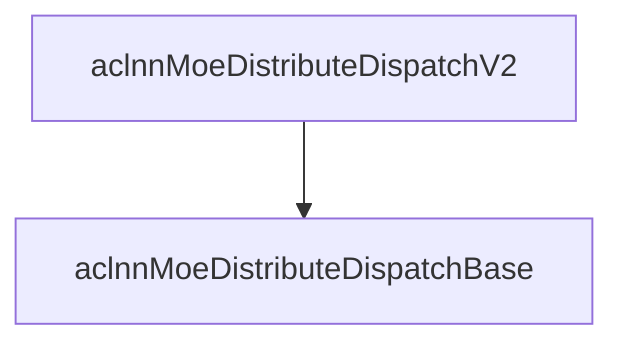
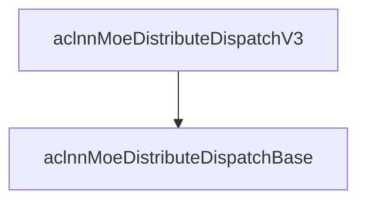
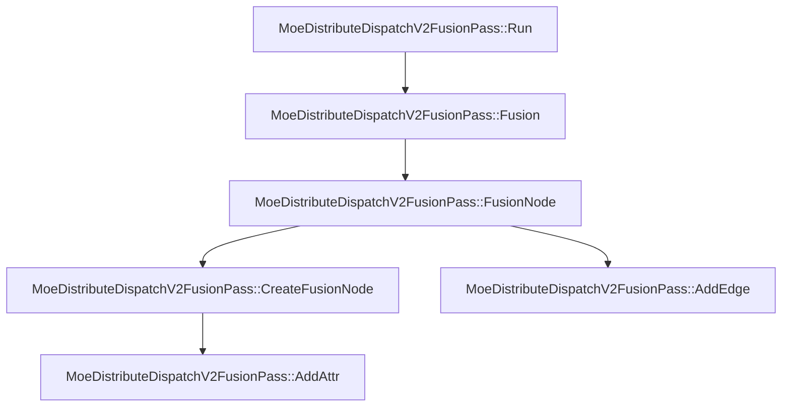
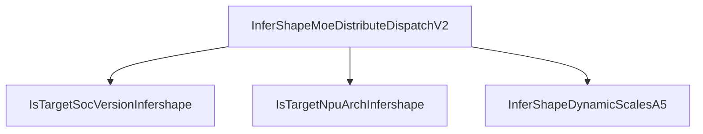
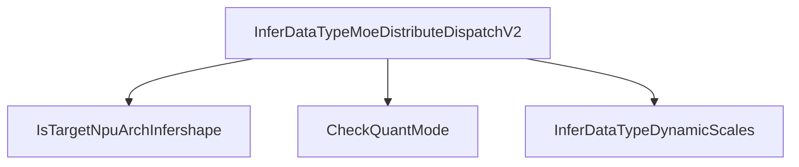
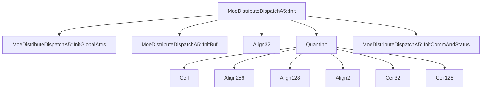

# MoeDistributeDispatchV2 A5 调用链 Mermaid Flowchart

- 生成时间：2026-06-18 01:00 Asia/Shanghai
- 每个入口限制展开深度 4、边数 60，避免图过大。

## aclnnMoeDistributeDispatchV2

## aclnnMoeDistributeDispatchV3

## aclnnMoeDistributeDispatchV4

## MoeDistributeDispatchV2CalcParamFunc

## MoeDistributeDispatchV2GenTaskFunc

## MoeDistributeDispatchV2FusionPass::Run

## InferShapeMoeDistributeDispatchV2

## InferDataTypeMoeDistributeDispatchV2

## MoeDistributeDispatchV2TilingFuncA5::MoeDistributeDispatchV2TilingFunc

## MoeDistributeDispatchV2TilingFuncA5::MoeDistributeDispatchTilingFuncImpl

```mermaid
flowchart TD
  NMoeDistributeDispatchV2TilingFuncA5_MoeDistributeDispatchTilingFuncImpl["MoeDistributeDispatchV2TilingFuncA5::MoeDistributeDispatchTilingFuncImpl"] --> NMoeDistributeDispatchTilingImpl["MoeDistributeDispatchTilingImpl"]
  NMoeDistributeDispatchV2TilingFuncA5_MoeDistributeDispatchTilingFuncImpl["MoeDistributeDispatchV2TilingFuncA5::MoeDistributeDispatchTilingFuncImpl"] --> NoeDistributeDispatchV2TilingFuncBase_MoeDistributeDispatchA3TilingFuncImplPublic["MoeDistributeDispatchV2TilingFuncBase::MoeDistributeDispatchA3TilingFuncImplPublic"]
  NMoeDistributeDispatchTilingImpl["MoeDistributeDispatchTilingImpl"] --> NGetContextAttrs["GetContextAttrs"]
  NMoeDistributeDispatchTilingImpl["MoeDistributeDispatchTilingImpl"] --> NCheckQuantModeAndExpandXType["CheckQuantModeAndExpandXType"]
  NMoeDistributeDispatchTilingImpl["MoeDistributeDispatchTilingImpl"] --> NCheckQuantModeAndScales["CheckQuantModeAndScales"]
  NMoeDistributeDispatchTilingImpl["MoeDistributeDispatchTilingImpl"] --> NMoeDistributeDispatchTilingHelper_TilingCheckMoeDistributeDispatchA5["MoeDistributeDispatchTilingHelper::TilingCheckMoeDistributeDispatchA5"]
  NMoeDistributeDispatchTilingImpl["MoeDistributeDispatchTilingImpl"] --> NCheckAttrs["CheckAttrs"]
  NMoeDistributeDispatchTilingImpl["MoeDistributeDispatchTilingImpl"] --> NCheckTensorShape["CheckTensorShape"]
  NMoeDistributeDispatchTilingImpl["MoeDistributeDispatchTilingImpl"] --> NCheckAndSetScalesInfo["CheckAndSetScalesInfo"]
  NMoeDistributeDispatchTilingImpl["MoeDistributeDispatchTilingImpl"] --> NCheckCommAttrs["CheckCommAttrs"]
  NMoeDistributeDispatchTilingImpl["MoeDistributeDispatchTilingImpl"] --> NSetCommTiling["SetCommTiling"]
  NMoeDistributeDispatchTilingImpl["MoeDistributeDispatchTilingImpl"] --> NSetWorkSpace["SetWorkSpace"]
  NoeDistributeDispatchV2TilingFuncBase_MoeDistributeDispatchA3TilingFuncImplPublic["MoeDistributeDispatchV2TilingFuncBase::MoeDistributeDispatchA3TilingFuncImplPublic"] --> NMoeDistributeDispatchV2TilingFuncBase_GetAttrAndSetTilingData["MoeDistributeDispatchV2TilingFuncBase::GetAttrAndSetTilingData"]
  NoeDistributeDispatchV2TilingFuncBase_MoeDistributeDispatchA3TilingFuncImplPublic["MoeDistributeDispatchV2TilingFuncBase::MoeDistributeDispatchA3TilingFuncImplPublic"] --> NCheckAndGetOptionalInput["CheckAndGetOptionalInput"]
  NoeDistributeDispatchV2TilingFuncBase_MoeDistributeDispatchA3TilingFuncImplPublic["MoeDistributeDispatchV2TilingFuncBase::MoeDistributeDispatchA3TilingFuncImplPublic"] --> NMoeDistributeDispatchV2TilingFuncA5_CheckQuantModeMatchScales["MoeDistributeDispatchV2TilingFuncA5::CheckQuantModeMatchScales"]
  NoeDistributeDispatchV2TilingFuncBase_MoeDistributeDispatchA3TilingFuncImplPublic["MoeDistributeDispatchV2TilingFuncBase::MoeDistributeDispatchA3TilingFuncImplPublic"] --> NCheckMc2Context["CheckMc2Context"]
  NoeDistributeDispatchV2TilingFuncBase_MoeDistributeDispatchA3TilingFuncImplPublic["MoeDistributeDispatchV2TilingFuncBase::MoeDistributeDispatchA3TilingFuncImplPublic"] --> NMoeDistributeDispatchV2TilingFuncBase_TilingCheckMoeDistributeDispatch["MoeDistributeDispatchV2TilingFuncBase::TilingCheckMoeDistributeDispatch"]
  NoeDistributeDispatchV2TilingFuncBase_MoeDistributeDispatchA3TilingFuncImplPublic["MoeDistributeDispatchV2TilingFuncBase::MoeDistributeDispatchA3TilingFuncImplPublic"] --> NCheckInputParam["CheckInputParam"]
  NoeDistributeDispatchV2TilingFuncBase_MoeDistributeDispatchA3TilingFuncImplPublic["MoeDistributeDispatchV2TilingFuncBase::MoeDistributeDispatchA3TilingFuncImplPublic"] --> NCheckSizeAndSetRelevantCfg["CheckSizeAndSetRelevantCfg"]
  NoeDistributeDispatchV2TilingFuncBase_MoeDistributeDispatchA3TilingFuncImplPublic["MoeDistributeDispatchV2TilingFuncBase::MoeDistributeDispatchA3TilingFuncImplPublic"] --> NMoeDistributeDispatchV2TilingFuncA5_CalTilingKey["MoeDistributeDispatchV2TilingFuncA5::CalTilingKey"]
  NoeDistributeDispatchV2TilingFuncBase_MoeDistributeDispatchA3TilingFuncImplPublic["MoeDistributeDispatchV2TilingFuncBase::MoeDistributeDispatchA3TilingFuncImplPublic"] --> NCheckAndSetPlatformInfo["CheckAndSetPlatformInfo"]
  NoeDistributeDispatchV2TilingFuncBase_MoeDistributeDispatchA3TilingFuncImplPublic["MoeDistributeDispatchV2TilingFuncBase::MoeDistributeDispatchA3TilingFuncImplPublic"] --> NPrintTilingDataInfo["PrintTilingDataInfo"]
  NGetContextAttrs["GetContextAttrs"] --> NCheckContextAttrsNullptr["CheckContextAttrsNullptr"]
  NGetContextAttrs["GetContextAttrs"] --> NCheckEpAttrs["CheckEpAttrs"]
  NGetContextAttrs["GetContextAttrs"] --> NCheckTpAttrs["CheckTpAttrs"]
  NGetContextAttrs["GetContextAttrs"] --> NCheckSharedExpertAttrs["CheckSharedExpertAttrs"]
  NGetContextAttrs["GetContextAttrs"] --> NCheckMoeExpertAttrs["CheckMoeExpertAttrs"]
  NGetContextAttrs["GetContextAttrs"] --> NCheckQuantAndExpertAttrs["CheckQuantAndExpertAttrs"]
  NGetContextAttrs["GetContextAttrs"] --> NCheckOutputDataType["CheckOutputDataType"]
  NGetContextAttrs["GetContextAttrs"] --> NSetEpTpInfo["SetEpTpInfo"]
  NGetContextAttrs["GetContextAttrs"] --> NSetExpertInfo["SetExpertInfo"]
  NGetContextAttrs["GetContextAttrs"] --> NSetSharedExpertNum["SetSharedExpertNum"]
  NMoeDistributeDispatchTilingHelper_TilingCheckMoeDistributeDispatchA5["MoeDistributeDispatchTilingHelper::TilingCheckMoeDistributeDispatchA5"] --> NCheckTensorDim["CheckTensorDim"]
  NMoeDistributeDispatchTilingHelper_TilingCheckMoeDistributeDispatchA5["MoeDistributeDispatchTilingHelper::TilingCheckMoeDistributeDispatchA5"] --> NMoeDistributeDispatchTilingHelper_CheckTensorDataTypeA5["MoeDistributeDispatchTilingHelper::CheckTensorDataTypeA5"]
  NMoeDistributeDispatchTilingHelper_TilingCheckMoeDistributeDispatchA5["MoeDistributeDispatchTilingHelper::TilingCheckMoeDistributeDispatchA5"] --> NCheckTensorFormat["CheckTensorFormat"]
  NMoeDistributeDispatchTilingHelper_TilingCheckMoeDistributeDispatchA5["MoeDistributeDispatchTilingHelper::TilingCheckMoeDistributeDispatchA5"] --> NMoeDistributeDispatchTilingHelper_CheckTokenMask["MoeDistributeDispatchTilingHelper::CheckTokenMask"]
  NCheckAttrs["CheckAttrs"] --> NCheckSharedAttrs["CheckSharedAttrs"]
  NCheckAttrs["CheckAttrs"] --> NCheckCommAlgAttrs["CheckCommAlgAttrs"]
  NCheckAttrs["CheckAttrs"] --> NCheckEpWorldSizeV1["CheckEpWorldSizeV1"]
  NCheckTensorShape["CheckTensorShape"] --> NCheckXAndExpertIdsTensorShape["CheckXAndExpertIdsTensorShape"]
  NCheckTensorShape["CheckTensorShape"] --> NFillScalesInfo["FillScalesInfo"]
  NCheckTensorShape["CheckTensorShape"] --> NCheckInputInfoTensorShape["CheckInputInfoTensorShape"]
  NCheckTensorShape["CheckTensorShape"] --> NCheckExpandXAndDynamicScalesTensorShape["CheckExpandXAndDynamicScalesTensorShape"]
  NCheckTensorShape["CheckTensorShape"] --> NCheckAssistInfoAndExpertTokenNumsTensorShape["CheckAssistInfoAndExpertTokenNumsTensorShape"]
  NCheckTensorShape["CheckTensorShape"] --> NCheckRecvCountTensorShape["CheckRecvCountTensorShape"]
  NCheckTensorShape["CheckTensorShape"] --> NCheckAndSetH["CheckAndSetH"]
  NCheckTensorShape["CheckTensorShape"] --> NCheckExpertIdsAndSetK["CheckExpertIdsAndSetK"]
  NCheckTensorShape["CheckTensorShape"] --> NCheckExpandXShape["CheckExpandXShape"]
  NCheckTensorShape["CheckTensorShape"] --> NCheckDynamicScalesShape["CheckDynamicScalesShape"]
  NCheckAndSetScalesInfo["CheckAndSetScalesInfo"] --> NCheckTwoDimScalesShape["CheckTwoDimScalesShape"]
  NMoeDistributeDispatchV2TilingFuncBase_GetAttrAndSetTilingData["MoeDistributeDispatchV2TilingFuncBase::GetAttrAndSetTilingData"] --> NCheckAttrPtrNullptr["CheckAttrPtrNullptr"]
  NMoeDistributeDispatchV2TilingFuncBase_GetAttrAndSetTilingData["MoeDistributeDispatchV2TilingFuncBase::GetAttrAndSetTilingData"] --> NMoeDistributeDispatchV2TilingFuncBase_CheckCommAttrParams["MoeDistributeDispatchV2TilingFuncBase::CheckCommAttrParams"]
  NMoeDistributeDispatchV2TilingFuncBase_GetAttrAndSetTilingData["MoeDistributeDispatchV2TilingFuncBase::GetAttrAndSetTilingData"] --> NCheckExpertAttrParams["CheckExpertAttrParams"]
  NMoeDistributeDispatchV2TilingFuncBase_GetAttrAndSetTilingData["MoeDistributeDispatchV2TilingFuncBase::GetAttrAndSetTilingData"] --> NSetAttrParams["SetAttrParams"]
  NMoeDistributeDispatchV2TilingFuncA5_CheckQuantModeMatchScales["MoeDistributeDispatchV2TilingFuncA5::CheckQuantModeMatchScales"] --> NCheckQuantModeAndScales["CheckQuantModeAndScales"]
  NMoeDistributeDispatchV2TilingFuncBase_TilingCheckMoeDistributeDispatch["MoeDistributeDispatchV2TilingFuncBase::TilingCheckMoeDistributeDispatch"] --> NCheckTensorPtrNullptr["CheckTensorPtrNullptr"]
  NMoeDistributeDispatchV2TilingFuncBase_TilingCheckMoeDistributeDispatch["MoeDistributeDispatchV2TilingFuncBase::TilingCheckMoeDistributeDispatch"] --> NCheckTensorDim["CheckTensorDim"]
  NMoeDistributeDispatchV2TilingFuncBase_TilingCheckMoeDistributeDispatch["MoeDistributeDispatchV2TilingFuncBase::TilingCheckMoeDistributeDispatch"] --> NMoeDistributeDispatchTilingHelper_CheckTensorDataType["MoeDistributeDispatchTilingHelper::CheckTensorDataType"]
  NMoeDistributeDispatchV2TilingFuncBase_TilingCheckMoeDistributeDispatch["MoeDistributeDispatchV2TilingFuncBase::TilingCheckMoeDistributeDispatch"] --> NCheckTensorFormat["CheckTensorFormat"]
  NCheckInputParam["CheckInputParam"] --> NCheckAttrs["CheckAttrs"]
  NCheckInputParam["CheckInputParam"] --> NCheckTensorShape["CheckTensorShape"]
```

## moe_distribute_dispatch_v2

## MoeDistributeDispatchA5::Init

## MoeDistributeDispatchA5::Process

```mermaid
flowchart TD
  NMoeDistributeDispatchA5_Process["MoeDistributeDispatchA5::Process"] --> NMoeDistributeDispatchA5_CalcTokenActiveMask["MoeDistributeDispatchA5::CalcTokenActiveMask"]
  NMoeDistributeDispatchA5_Process["MoeDistributeDispatchA5::Process"] --> NMoeDistributeDispatchA5_TokenScatter["MoeDistributeDispatchA5::TokenScatter"]
  NMoeDistributeDispatchA5_Process["MoeDistributeDispatchA5::Process"] --> NMoeDistributeDispatchA5_Communication["MoeDistributeDispatchA5::Communication"]
  NMoeDistributeDispatchA5_Process["MoeDistributeDispatchA5::Process"] --> NMoeDistributeDispatchA5_TokenGather["MoeDistributeDispatchA5::TokenGather"]
  NMoeDistributeDispatchA5_CalcTokenActiveMask["MoeDistributeDispatchA5::CalcTokenActiveMask"] --> NCeil["Ceil"]
  NMoeDistributeDispatchA5_TokenScatter["MoeDistributeDispatchA5::TokenScatter"] --> NGetExpertFreq["GetExpertFreq"]
  NMoeDistributeDispatchA5_TokenScatter["MoeDistributeDispatchA5::TokenScatter"] --> NGetExpertCumSum["GetExpertCumSum"]
  NMoeDistributeDispatchA5_TokenScatter["MoeDistributeDispatchA5::TokenScatter"] --> NMoeDistributeDispatchA5_ShareScatter["MoeDistributeDispatchA5::ShareScatter"]
  NMoeDistributeDispatchA5_TokenScatter["MoeDistributeDispatchA5::TokenScatter"] --> NMoeDistributeDispatchA5_MoeScatter["MoeDistributeDispatchA5::MoeScatter"]
  NMoeDistributeDispatchA5_Communication["MoeDistributeDispatchA5::Communication"] --> NMoeDistributeDispatchA5_SaveExpandIdx["MoeDistributeDispatchA5::SaveExpandIdx"]
  NMoeDistributeDispatchA5_Communication["MoeDistributeDispatchA5::Communication"] --> NMoeDistributeDispatchA5_TokenGatherInit["MoeDistributeDispatchA5::TokenGatherInit"]
  NMoeDistributeDispatchA5_TokenGather["MoeDistributeDispatchA5::TokenGather"] --> NMoeDistributeDispatchA5_TokenGatherProcess["MoeDistributeDispatchA5::TokenGatherProcess"]
  NMoeDistributeDispatchA5_ShareScatter["MoeDistributeDispatchA5::ShareScatter"] --> NMoeDistributeDispatchA5_ShareScatterCopyTokens["MoeDistributeDispatchA5::ShareScatterCopyTokens"]
  NMoeDistributeDispatchA5_ShareScatter["MoeDistributeDispatchA5::ShareScatter"] --> NMoeDistributeDispatchA5_SetShareExpertSendSize["MoeDistributeDispatchA5::SetShareExpertSendSize"]
  NMoeDistributeDispatchA5_MoeScatter["MoeDistributeDispatchA5::MoeScatter"] --> NMoeDistributeDispatchA5_MoeScatterCopyTokens["MoeDistributeDispatchA5::MoeScatterCopyTokens"]
  NMoeDistributeDispatchA5_MoeScatter["MoeDistributeDispatchA5::MoeScatter"] --> NMoeDistributeDispatchV2_SplitToCore["MoeDistributeDispatchV2::SplitToCore"]
  NMoeDistributeDispatchA5_SaveExpandIdx["MoeDistributeDispatchA5::SaveExpandIdx"] --> NMoeDistributeDispatchV2_SplitToCore["MoeDistributeDispatchV2::SplitToCore"]
  NMoeDistributeDispatchA5_TokenGatherProcess["MoeDistributeDispatchA5::TokenGatherProcess"] --> NMoeDistributeDispatchV2_SplitToCore["MoeDistributeDispatchV2::SplitToCore"]
  NMoeDistributeDispatchA5_TokenGatherProcess["MoeDistributeDispatchA5::TokenGatherProcess"] --> NMoeDistributeDispatchA5_MoeGatherPrepare["MoeDistributeDispatchA5::MoeGatherPrepare"]
  NMoeDistributeDispatchA5_TokenGatherProcess["MoeDistributeDispatchA5::TokenGatherProcess"] --> NCopyScalesToOut["CopyScalesToOut"]
  NMoeDistributeDispatchA5_TokenGatherProcess["MoeDistributeDispatchA5::TokenGatherProcess"] --> NMoeDistributeDispatchA5_UpdateMoeRankOutput["MoeDistributeDispatchA5::UpdateMoeRankOutput"]
  NMoeDistributeDispatchA5_ShareScatterCopyTokens["MoeDistributeDispatchA5::ShareScatterCopyTokens"] --> NMoeDistributeDispatchV2_SplitToCore["MoeDistributeDispatchV2::SplitToCore"]
  NMoeDistributeDispatchA5_ShareScatterCopyTokens["MoeDistributeDispatchA5::ShareScatterCopyTokens"] --> NMoeDistributeDispatchA5_CalcToSharedRankId["MoeDistributeDispatchA5::CalcToSharedRankId"]
  NMoeDistributeDispatchA5_ShareScatterCopyTokens["MoeDistributeDispatchA5::ShareScatterCopyTokens"] --> NMoeDistributeDispatchV2_ProcessToken["MoeDistributeDispatchV2::ProcessToken"]
  NMoeDistributeDispatchA5_SetShareExpertSendSize["MoeDistributeDispatchA5::SetShareExpertSendSize"] --> NMoeDistributeDispatchV2_SplitToCore["MoeDistributeDispatchV2::SplitToCore"]
  NMoeDistributeDispatchA5_MoeScatterCopyTokens["MoeDistributeDispatchA5::MoeScatterCopyTokens"] --> NMoeDistributeDispatchV2_SplitToCore["MoeDistributeDispatchV2::SplitToCore"]
  NMoeDistributeDispatchA5_MoeScatterCopyTokens["MoeDistributeDispatchA5::MoeScatterCopyTokens"] --> NMoeDistributeDispatchV2_ProcessToken["MoeDistributeDispatchV2::ProcessToken"]
  NMoeDistributeDispatchA5_MoeGatherPrepare["MoeDistributeDispatchA5::MoeGatherPrepare"] --> NGetReduceSum["GetReduceSum"]
  NCopyScalesToOut["CopyScalesToOut"] --> NCeil["Ceil"]
```

## MoeDistributeDispatchV2HostKfc::Init

```mermaid
flowchart TD
  NMoeDistributeDispatchV2HostKfc_Init["MoeDistributeDispatchV2HostKfc::Init"] --> NMoeDistributeDispatchV2HostKfc_InitRecieveTilingContext["MoeDistributeDispatchV2HostKfc::InitRecieveTilingContext"]
  NMoeDistributeDispatchV2HostKfc_Init["MoeDistributeDispatchV2HostKfc::Init"] --> NMoeDistributeDispatchV2HostKfc_InitCommInfo["MoeDistributeDispatchV2HostKfc::InitCommInfo"]
  NMoeDistributeDispatchV2HostKfc_Init["MoeDistributeDispatchV2HostKfc::Init"] --> NMoeDistributeDispatchV2HostKfc_InitComputeInfo["MoeDistributeDispatchV2HostKfc::InitComputeInfo"]
  NMoeDistributeDispatchV2HostKfc_Init["MoeDistributeDispatchV2HostKfc::Init"] --> NMoeDistributeDispatchV2HostKfc_InitSetWindows["MoeDistributeDispatchV2HostKfc::InitSetWindows"]
  NMoeDistributeDispatchV2HostKfc_Init["MoeDistributeDispatchV2HostKfc::Init"] --> NMoeDistributeDispatchV2HostKfc_InitExtraInfo["MoeDistributeDispatchV2HostKfc::InitExtraInfo"]
  NMoeDistributeDispatchV2HostKfc_Init["MoeDistributeDispatchV2HostKfc::Init"] --> NMoeDistributeDispatchV2HostKfc_InitMaskInfo["MoeDistributeDispatchV2HostKfc::InitMaskInfo"]
  NMoeDistributeDispatchV2HostKfc_Init["MoeDistributeDispatchV2HostKfc::Init"] --> NMoeDistributeDispatchV2HostKfc_InitDispatchBetweenServerInfo["MoeDistributeDispatchV2HostKfc::InitDispatchBetweenServerInfo"]
  NMoeDistributeDispatchV2HostKfc_InitCommInfo["MoeDistributeDispatchV2HostKfc::InitCommInfo"] --> NGetStatusDataSpaceGm["GetStatusDataSpaceGm"]
  NMoeDistributeDispatchV2HostKfc_InitCommInfo["MoeDistributeDispatchV2HostKfc::InitCommInfo"] --> NInitWinState["InitWinState"]
  NMoeDistributeDispatchV2HostKfc_InitCommInfo["MoeDistributeDispatchV2HostKfc::InitCommInfo"] --> NGetWindStateAddrByRankId["GetWindStateAddrByRankId"]
  NMoeDistributeDispatchV2HostKfc_InitSetWindows["MoeDistributeDispatchV2HostKfc::InitSetWindows"] --> NGetWindAddrByRankId["GetWindAddrByRankId"]
  NMoeDistributeDispatchV2HostKfc_InitSetWindows["MoeDistributeDispatchV2HostKfc::InitSetWindows"] --> NGetWindStateAddrByRankId["GetWindStateAddrByRankId"]
  NMoeDistributeDispatchV2HostKfc_InitSetWindows["MoeDistributeDispatchV2HostKfc::InitSetWindows"] --> NCeil["Ceil"]
  NMoeDistributeDispatchV2HostKfc_InitExtraInfo["MoeDistributeDispatchV2HostKfc::InitExtraInfo"] --> NCeil["Ceil"]
  NMoeDistributeDispatchV2HostKfc_InitMaskInfo["MoeDistributeDispatchV2HostKfc::InitMaskInfo"] --> NAlign128["Align128"]
  NMoeDistributeDispatchV2HostKfc_InitMaskInfo["MoeDistributeDispatchV2HostKfc::InitMaskInfo"] --> NCeil["Ceil"]
  NMoeDistributeDispatchV2HostKfc_InitDispatchBetweenServerInfo["MoeDistributeDispatchV2HostKfc::InitDispatchBetweenServerInfo"] --> NCeil["Ceil"]
  NGetStatusDataSpaceGm["GetStatusDataSpaceGm"] --> NGetStatusDataSpaceGm["GetStatusDataSpaceGm"]
```

## MoeDistributeDispatchV2HostKfc::Process

```mermaid
flowchart TD
  NMoeDistributeDispatchV2HostKfc_Process["MoeDistributeDispatchV2HostKfc::Process"] --> NMoeDistributeDispatchV2HostKfc_CalTokenMask["MoeDistributeDispatchV2HostKfc::CalTokenMask"]
  NMoeDistributeDispatchV2HostKfc_Process["MoeDistributeDispatchV2HostKfc::Process"] --> NMoeDistributeDispatchV2FullMesh_CalCumSum["MoeDistributeDispatchV2FullMesh::CalCumSum"]
  NMoeDistributeDispatchV2HostKfc_Process["MoeDistributeDispatchV2HostKfc::Process"] --> NMoeDistributeDispatchV2HostKfc_CalTokenSendExpertOffset["MoeDistributeDispatchV2HostKfc::CalTokenSendExpertOffset"]
  NMoeDistributeDispatchV2HostKfc_Process["MoeDistributeDispatchV2HostKfc::Process"] --> NMoeDistributeDispatchV2HostKfc_ScatterTokenToRemote["MoeDistributeDispatchV2HostKfc::ScatterTokenToRemote"]
  NMoeDistributeDispatchV2HostKfc_Process["MoeDistributeDispatchV2HostKfc::Process"] --> NMoeDistributeDispatchV2HostKfc_GatherTokenFrRemote["MoeDistributeDispatchV2HostKfc::GatherTokenFrRemote"]
  NMoeDistributeDispatchV2HostKfc_Process["MoeDistributeDispatchV2HostKfc::Process"] --> NMoeDistributeDispatchV2_LocalWindowCopy["MoeDistributeDispatchV2::LocalWindowCopy"]
  NMoeDistributeDispatchV2HostKfc_CalTokenMask["MoeDistributeDispatchV2HostKfc::CalTokenMask"] --> NMoeDistributeDispatchV2HostKfc_InitMaskReSource["MoeDistributeDispatchV2HostKfc::InitMaskReSource"]
  NMoeDistributeDispatchV2HostKfc_CalTokenMask["MoeDistributeDispatchV2HostKfc::CalTokenMask"] --> NMoeDistributeDispatchV2_TokenActiveMaskCal["MoeDistributeDispatchV2::TokenActiveMaskCal"]
  NMoeDistributeDispatchV2HostKfc_CalTokenMask["MoeDistributeDispatchV2HostKfc::CalTokenMask"] --> NMoeDistributeDispatchV2_ExpertActiveMaskCal["MoeDistributeDispatchV2::ExpertActiveMaskCal"]
  NMoeDistributeDispatchV2FullMesh_CalCumSum["MoeDistributeDispatchV2FullMesh::CalCumSum"] --> NCeil["Ceil"]
  NMoeDistributeDispatchV2FullMesh_CalCumSum["MoeDistributeDispatchV2FullMesh::CalCumSum"] --> NMoeDistributeDispatchV2FullMesh_ExpIdsCopyAndMaskCal["MoeDistributeDispatchV2FullMesh::ExpIdsCopyAndMaskCal"]
  NMoeDistributeDispatchV2FullMesh_CalCumSum["MoeDistributeDispatchV2FullMesh::CalCumSum"] --> NMoeDistributeDispatchV2FullMesh_CalAndSendCntByExp["MoeDistributeDispatchV2FullMesh::CalAndSendCntByExp"]
  NMoeDistributeDispatchV2FullMesh_CalCumSum["MoeDistributeDispatchV2FullMesh::CalCumSum"] --> NMoeDistributeDispatchV2FullMesh_CalAndSendCntByRank["MoeDistributeDispatchV2FullMesh::CalAndSendCntByRank"]
  NMoeDistributeDispatchV2FullMesh_CalCumSum["MoeDistributeDispatchV2FullMesh::CalCumSum"] --> NMoeDistributeDispatchV2_SplitToCore["MoeDistributeDispatchV2::SplitToCore"]
  NMoeDistributeDispatchV2FullMesh_CalCumSum["MoeDistributeDispatchV2FullMesh::CalCumSum"] --> NMoeDistributeDispatchV2_BufferInit["MoeDistributeDispatchV2::BufferInit"]
  NMoeDistributeDispatchV2FullMesh_CalCumSum["MoeDistributeDispatchV2FullMesh::CalCumSum"] --> NMoeDistributeDispatchV2_WaitDispatch["MoeDistributeDispatchV2::WaitDispatch"]
  NMoeDistributeDispatchV2FullMesh_CalCumSum["MoeDistributeDispatchV2FullMesh::CalCumSum"] --> NMoeDistributeDispatchV2FullMesh_CalRecvAndSetFlag["MoeDistributeDispatchV2FullMesh::CalRecvAndSetFlag"]
  NMoeDistributeDispatchV2FullMesh_CalCumSum["MoeDistributeDispatchV2FullMesh::CalCumSum"] --> NMoeDistributeDispatchV2_SetExpertTokenNums["MoeDistributeDispatchV2::SetExpertTokenNums"]
  NMoeDistributeDispatchV2HostKfc_CalTokenSendExpertOffset["MoeDistributeDispatchV2HostKfc::CalTokenSendExpertOffset"] --> NMoeDistributeDispatchV2_SplitToCore["MoeDistributeDispatchV2::SplitToCore"]
  NMoeDistributeDispatchV2HostKfc_CalTokenSendExpertOffset["MoeDistributeDispatchV2HostKfc::CalTokenSendExpertOffset"] --> NCeil["Ceil"]
  NMoeDistributeDispatchV2HostKfc_CalTokenSendExpertOffset["MoeDistributeDispatchV2HostKfc::CalTokenSendExpertOffset"] --> NMoeDistributeDispatchV2HostKfc_WriteExpertOffset["MoeDistributeDispatchV2HostKfc::WriteExpertOffset"]
  NMoeDistributeDispatchV2HostKfc_ScatterTokenToRemote["MoeDistributeDispatchV2HostKfc::ScatterTokenToRemote"] --> NMoeDistributeDispatchV2HostKfc_SetServerFlag["MoeDistributeDispatchV2HostKfc::SetServerFlag"]
  NMoeDistributeDispatchV2HostKfc_ScatterTokenToRemote["MoeDistributeDispatchV2HostKfc::ScatterTokenToRemote"] --> NMoeDistributeDispatchV2HostKfc_CalServerSplitCore["MoeDistributeDispatchV2HostKfc::CalServerSplitCore"]
  NMoeDistributeDispatchV2HostKfc_ScatterTokenToRemote["MoeDistributeDispatchV2HostKfc::ScatterTokenToRemote"] --> NMoeDistributeDispatchV2HostKfc_InitScatterBuffer["MoeDistributeDispatchV2HostKfc::InitScatterBuffer"]
  NMoeDistributeDispatchV2HostKfc_ScatterTokenToRemote["MoeDistributeDispatchV2HostKfc::ScatterTokenToRemote"] --> NMoeDistributeDispatchV2HostKfc_SendTokenToLocalServer["MoeDistributeDispatchV2HostKfc::SendTokenToLocalServer"]
  NMoeDistributeDispatchV2HostKfc_ScatterTokenToRemote["MoeDistributeDispatchV2HostKfc::ScatterTokenToRemote"] --> NMoeDistributeDispatchV2HostKfc_SendTokenToRemoteServer["MoeDistributeDispatchV2HostKfc::SendTokenToRemoteServer"]
  NMoeDistributeDispatchV2HostKfc_GatherTokenFrRemote["MoeDistributeDispatchV2HostKfc::GatherTokenFrRemote"] --> NMoeDistributeDispatchV2HostKfc_InitGatherTokenBuffer["MoeDistributeDispatchV2HostKfc::InitGatherTokenBuffer"]
  NMoeDistributeDispatchV2HostKfc_GatherTokenFrRemote["MoeDistributeDispatchV2HostKfc::GatherTokenFrRemote"] --> NMoeDistributeDispatchV2HostKfc_CalServerSplitCore["MoeDistributeDispatchV2HostKfc::CalServerSplitCore"]
  NMoeDistributeDispatchV2HostKfc_GatherTokenFrRemote["MoeDistributeDispatchV2HostKfc::GatherTokenFrRemote"] --> NMoeDistributeDispatchV2HostKfc_WaitStatusFlag["MoeDistributeDispatchV2HostKfc::WaitStatusFlag"]
  NMoeDistributeDispatchV2HostKfc_GatherTokenFrRemote["MoeDistributeDispatchV2HostKfc::GatherTokenFrRemote"] --> NMoeDistributeDispatchV2_SplitToCore["MoeDistributeDispatchV2::SplitToCore"]
  NMoeDistributeDispatchV2HostKfc_GatherTokenFrRemote["MoeDistributeDispatchV2HostKfc::GatherTokenFrRemote"] --> NMoeDistributeDispatchV2HostKfc_WaitToken["MoeDistributeDispatchV2HostKfc::WaitToken"]
  NMoeDistributeDispatchV2HostKfc_GatherTokenFrRemote["MoeDistributeDispatchV2HostKfc::GatherTokenFrRemote"] --> NMoeDistributeDispatchV2HostKfc_CleanTokenFlag["MoeDistributeDispatchV2HostKfc::CleanTokenFlag"]
  NMoeDistributeDispatchV2_LocalWindowCopy["MoeDistributeDispatchV2::LocalWindowCopy"] --> NMoeDistributeDispatchV2_RunPosRecord["MoeDistributeDispatchV2::RunPosRecord"]
  NMoeDistributeDispatchV2_LocalWindowCopy["MoeDistributeDispatchV2::LocalWindowCopy"] --> NMoeDistributeDispatchV2_GetCumSumA5["MoeDistributeDispatchV2::GetCumSumA5"]
  NMoeDistributeDispatchV2_LocalWindowCopy["MoeDistributeDispatchV2::LocalWindowCopy"] --> NMoeDistributeDispatchV2_GetCumSum["MoeDistributeDispatchV2::GetCumSum"]
  NMoeDistributeDispatchV2_LocalWindowCopy["MoeDistributeDispatchV2::LocalWindowCopy"] --> NCeil["Ceil"]
  NMoeDistributeDispatchV2_LocalWindowCopy["MoeDistributeDispatchV2::LocalWindowCopy"] --> NMIN["MIN"]
  NMoeDistributeDispatchV2_TokenActiveMaskCal["MoeDistributeDispatchV2::TokenActiveMaskCal"] --> NCeil["Ceil"]
  NMoeDistributeDispatchV2_ExpertActiveMaskCal["MoeDistributeDispatchV2::ExpertActiveMaskCal"] --> NMoeDistributeDispatchV2_CalValidBSCnt["MoeDistributeDispatchV2::CalValidBSCnt"]
  NMoeDistributeDispatchV2_ExpertActiveMaskCal["MoeDistributeDispatchV2::ExpertActiveMaskCal"] --> NMoeDistributeDispatchV2_CalValidExpIdx["MoeDistributeDispatchV2::CalValidExpIdx"]
  NMoeDistributeDispatchV2FullMesh_ExpIdsCopyAndMaskCal["MoeDistributeDispatchV2FullMesh::ExpIdsCopyAndMaskCal"] --> NMoeDistributeDispatchV2FullMesh_ExpertActiveMaskInit["MoeDistributeDispatchV2FullMesh::ExpertActiveMaskInit"]
  NMoeDistributeDispatchV2FullMesh_ExpIdsCopyAndMaskCal["MoeDistributeDispatchV2FullMesh::ExpIdsCopyAndMaskCal"] --> NMoeDistributeDispatchV2_TokenActiveMaskCal["MoeDistributeDispatchV2::TokenActiveMaskCal"]
  NMoeDistributeDispatchV2FullMesh_ExpIdsCopyAndMaskCal["MoeDistributeDispatchV2FullMesh::ExpIdsCopyAndMaskCal"] --> NMoeDistributeDispatchV2_ExpertActiveMaskCal["MoeDistributeDispatchV2::ExpertActiveMaskCal"]
  NMoeDistributeDispatchV2FullMesh_ExpIdsCopyAndMaskCal["MoeDistributeDispatchV2FullMesh::ExpIdsCopyAndMaskCal"] --> NMoeDistributeDispatchV2_ZeroComputeExpertMaskCal["MoeDistributeDispatchV2::ZeroComputeExpertMaskCal"]
  NMoeDistributeDispatchV2FullMesh_ExpIdsCopyAndMaskCal["MoeDistributeDispatchV2FullMesh::ExpIdsCopyAndMaskCal"] --> NCeil["Ceil"]
  NMoeDistributeDispatchV2FullMesh_CalAndSendCntByExp["MoeDistributeDispatchV2FullMesh::CalAndSendCntByExp"] --> NMoeDistributeDispatchV2_SplitToCore["MoeDistributeDispatchV2::SplitToCore"]
  NMoeDistributeDispatchV2FullMesh_CalAndSendCntByExp["MoeDistributeDispatchV2FullMesh::CalAndSendCntByExp"] --> NMoeDistributeDispatchV2_CalTokenSendExpertCnt["MoeDistributeDispatchV2::CalTokenSendExpertCnt"]
  NMoeDistributeDispatchV2FullMesh_CalAndSendCntByExp["MoeDistributeDispatchV2FullMesh::CalAndSendCntByExp"] --> NGetWindStateAddrByRankId["GetWindStateAddrByRankId"]
  NMoeDistributeDispatchV2FullMesh_CalAndSendCntByRank["MoeDistributeDispatchV2FullMesh::CalAndSendCntByRank"] --> NMoeDistributeDispatchV2_CalTokenSendExpertCnt["MoeDistributeDispatchV2::CalTokenSendExpertCnt"]
  NMoeDistributeDispatchV2FullMesh_CalAndSendCntByRank["MoeDistributeDispatchV2FullMesh::CalAndSendCntByRank"] --> NGetWindStateAddrByRankId["GetWindStateAddrByRankId"]
  NMoeDistributeDispatchV2_BufferInit["MoeDistributeDispatchV2::BufferInit"] --> NCeil["Ceil"]
  NMoeDistributeDispatchV2_BufferInit["MoeDistributeDispatchV2::BufferInit"] --> NReduceSumWorkNeedSize["ReduceSumWorkNeedSize"]
  NMoeDistributeDispatchV2_WaitDispatch["MoeDistributeDispatchV2::WaitDispatch"] --> NMoeDistributeDispatchV2_BufferInit["MoeDistributeDispatchV2::BufferInit"]
  NMoeDistributeDispatchV2_WaitDispatch["MoeDistributeDispatchV2::WaitDispatch"] --> NMoeDistributeDispatchV2_WaitStatusA5["MoeDistributeDispatchV2::WaitStatusA5"]
  NMoeDistributeDispatchV2_WaitDispatch["MoeDistributeDispatchV2::WaitDispatch"] --> NMoeDistributeDispatchV2_WaitStatus["MoeDistributeDispatchV2::WaitStatus"]
  NMoeDistributeDispatchV2_WaitDispatch["MoeDistributeDispatchV2::WaitDispatch"] --> NMoeDistributeDispatchV2_WaitDispatchClearStatus["MoeDistributeDispatchV2::WaitDispatchClearStatus"]
  NMoeDistributeDispatchV2_WaitDispatch["MoeDistributeDispatchV2::WaitDispatch"] --> NMoeDistributeDispatchV2_SyncCntOnCore["MoeDistributeDispatchV2::SyncCntOnCore"]
  NMoeDistributeDispatchV2FullMesh_CalRecvAndSetFlag["MoeDistributeDispatchV2FullMesh::CalRecvAndSetFlag"] --> NMoeDistributeDispatchV2_GetCumSum["MoeDistributeDispatchV2::GetCumSum"]
  NMoeDistributeDispatchV2FullMesh_CalRecvAndSetFlag["MoeDistributeDispatchV2FullMesh::CalRecvAndSetFlag"] --> NCeil["Ceil"]
  NMoeDistributeDispatchV2HostKfc_WriteExpertOffset["MoeDistributeDispatchV2HostKfc::WriteExpertOffset"] --> NCeil["Ceil"]
```

