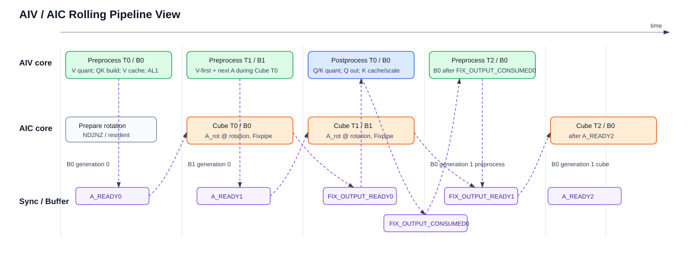

# Kernel 设计

本文按当前 `ops-transformer/posembedding/qkv_rms_norm_rope_cache_with_k_scale` 代码描述 arch35 kernel 分层、流水、buffer 分配、buffer 归属和同步关系。旧设计中的 `TileParam::bufferId`、`MakeDataBufferId`、历史 `flags`、`numVHeads` tiling 字段已经不在当前实现中。

## 1. Kernel 入口

当前 kernel 入口文件为：

```text
op_kernel/qkv_rms_norm_rope_cache_with_k_scale_apt.cpp
```

arch35 实现文件集中在：

```text
op_kernel/arch35/
  qkv_rms_norm_rope_cache_with_k_scale_common.h
  qkv_rms_norm_rope_cache_with_k_scale_tiling_data.h
  qkv_rms_norm_rope_cache_with_k_scale_tiling_key.h
  qkv_rms_norm_rope_cache_with_k_scale_controller.h
  qkv_rms_norm_rope_cache_with_k_scale_basic_block.h
  qkv_rms_norm_rope_cache_with_k_scale_vec.h
  qkv_rms_norm_rope_cache_with_k_scale_cube.h
  qkv_rms_norm_rope_cache_with_k_scale_vf.h
```

当前入口采用 arch35 默认的 `_apt.cpp` 后缀，没有额外的非 `_apt` 入口文件，也没有 `arch35/common/`、`arch35/basic_block/` 子目录。

入口函数模板固定 `HEAD_DIM == 128`，并在函数开始和结束处理 SoC overflow mode：

```cpp
AscendC::InitSocState();
int64_t oriOverflowMode = AscendC::GetCtrlSpr<FLOAT_OVERFLOW_MODE_CTRL, FLOAT_OVERFLOW_MODE_CTRL>();
AscendC::SetCtrlSpr<FLOAT_OVERFLOW_MODE_CTRL, FLOAT_OVERFLOW_MODE_CTRL>(0);
...
AscendC::SetCtrlSpr<FLOAT_OVERFLOW_MODE_CTRL, FLOAT_OVERFLOW_MODE_CTRL>(oriOverflowMode);
```

入口使用：

```cpp
KERNEL_TASK_TYPE_DEFAULT(KERNEL_TYPE_MIX_AIC_1_2);
REGISTER_TILING_DEFAULT(QkvRmsNormRopeCacheWithKScaleTilingData);
```

kernel 参数中 `seq_lens` 位于 `query_start_loc` 之后，cache 输出是独立 GM 地址：

```cpp
GM_ADDR query_start_loc,
GM_ADDR seq_lens,
GM_ADDR q_out,
GM_ADDR q_scale,
GM_ADDR k_cache_out,
GM_ADDR v_cache_out,
GM_ADDR k_scale_cache_out,
GM_ADDR workspace,
GM_ADDR tiling
```

ACLNN 层可以保持 in-place/alias 语义，但 kernel 侧按独立输出地址绑定。

## 2. Tiling Data

当前 kernel tiling data 为：

```cpp
struct QkvRmsNormRopeCacheWithKScaleTilingData {
    uint64_t totalTokens;
    uint64_t batch;
    uint64_t qHeadNum;
    uint64_t kvHeadNum;
    uint64_t headDim;
    uint64_t blockSize;
    uint64_t coreTokenTile;
    uint64_t coreGroupNum;
    uint64_t kvCacheStrideBlock;
    uint64_t kvCacheStrideHead;
    uint64_t kvCacheStrideToken;
    uint64_t kScaleCacheStrideBlock;
    uint64_t kScaleCacheStrideHead;
    uint64_t kScaleCacheStrideToken;
    uint64_t tokenTile;
    float epsilon;
    uint64_t mropeSectionH;
    uint64_t mropeSectionW;
};
```

字段口径：

1. `qHeadNum` 来自 `head_nums[0]`。
2. `kvHeadNum` 来自 `head_nums[1]`；host 已校验 `0 < Nq <= 64`、`Nq == 8 * Nk`、`Nk == Nv`，
   kernel 不携带独立 `vHeadNum`。
3. `layout_qkv` 不进入 tiling data，而是进入 tiling key。当前 key 常量为 `QKV_K_SCALE_LAYOUT_NTD = 0`、`QKV_K_SCALE_LAYOUT_TND = 1`；`qkvGmStrideT/qkvGmStrideN` 不进 tiling data，kernel 由 `headDim`、`totalTokens`、`qkvN` 和 `QKV_LAYOUT` 模板常量计算。
4. `rowTile`、`rowTileAligned`、`qkHeadTile`、`vHeadTile`、`dimTile`、`flags` 不进 tiling data，均由现有字段和静态策略推导。
5. K/V cache 共用 `kvCacheStride*`，K scale cache 使用独立 `kScaleCacheStride*`。

## 3. TileParam

当前 `TileParam` 定义在 `common.h`：

```cpp
struct TileParam {
    uint64_t tokenOffset;
    uint64_t tokenSize;
    uint64_t cubeTokenSize;
    uint64_t cubeHalfTokenSize;
    uint64_t aivTokenOffset;
    uint64_t aivTokenSize;
    uint64_t aivBlockTokenOffset;
    uint64_t vHeadSize;
    uint64_t cacheBaseOffset[QKV_K_SCALE_MAX_TOKEN_TILE_PER_AIV];
    uint64_t scaleCacheBaseOffset[QKV_K_SCALE_MAX_TOKEN_TILE_PER_AIV];
};
```

`TileParam` 不包含 `bufferId`，也不再维护两套 AIV slice 信息。controller 在填 tile 时直接前置：

```text
cubeTokenSize      = AlignUp(tokenSize, 2)
cubeHalfTokenSize  = cubeTokenSize / 2
aivBlockTokenOffset = GetSubBlockIdx() * cubeHalfTokenSize
aivTokenOffset     = tokenOffset + aivBlockTokenOffset
aivTokenSize       = AIV0 ? cubeHalfTokenSize : tokenSize - cubeHalfTokenSize
```

其中 `cubeHalfTokenSize` 是 FIXP dual M 轴切分后的本地容量；`aivTokenSize` 是当前 AIV 实际需要处理和写回的 token 数。odd token tail 下，AIV1 可能小于 `cubeHalfTokenSize`，甚至为 0。

controller 中的两槽 ring 只用于 current/last tile 参数保存。它有自己的
`tileParamBufferUseId`，不会复用 token tile 序号或其他数据 buffer 的计数器：

```text
Controller::TILE_PARAM_BUFFER_NUM = 2
currentBufferId  = tileParamBufferUseId % TILE_PARAM_BUFFER_NUM
previousBufferId = (tileParamBufferUseId + TILE_PARAM_BUFFER_NUM - 1)
                   % TILE_PARAM_BUFFER_NUM
```

它不是数据 buffer 归属规则。具体 UB/L1/L0C/output buffer 由各自 owner 的计数器决定。

## 4. Controller 层

Controller 只负责 AIC/AIV 分派、核组 token range 和 token tile 展开，不绑定 typed GM tensor，不处理 RMSNorm/RoPE/matmul/quant 细节。

核组关系：

```text
AIC cubeIndex = GetBlockIdx()
AIV cubeIndex = GetBlockIdx() / 2
AIV local id  = GetSubBlockIdx()
```

token range 由 `coreTokenTile/coreGroupNum/totalTokens` 决定：

```text
range.begin = cubeIndex * coreTokenTile
range.end   = min(totalTokens, range.begin + coreTokenTile)
```

tile 填充规则：

```text
tile.tokenSize   = min(tokenTile, range.end - tokenOffset)
tile.cubeTokenSize = AlignUp(tile.tokenSize, 2)
tile.cubeHalfTokenSize = tile.cubeTokenSize / 2
tile.vHeadSize   = kvHeadNum
```

AIC 路径：

```text
Init
PrepareBeforeLoop
for tile:
  ComputeTile(tile, lastTile)
End
```

AIV 路径：

```text
Init
PrepareBeforeLoop
for tile:
  FillTileParam(tileParam[currentBufferId])
  ComputeTile(tileParam[currentBufferId], tileParam[previousBufferId])
  ++tileParamBufferUseId
End(tileParam[previousBufferId])
```

`BasicBlock` 内部通过 `ASCEND_IS_AIC` 分派到 AIC/Cube 或 AIV/Vec 路径；controller 和 lower layers 不暴露 wait/set 拆分函数，也不让 Vec/Cube 直接处理 CrossCore 协议。

初始化链路直接透传同一个只读 tiling data 指针：

```text
BasicBlock::Init(tensors, tilingData)
  AIC -> InitAic(tensors, tilingData) -> Cube::Init(tensors, tilingData)
  AIV -> InitAiv(tensors, tilingData) -> Vec::Init(tensors, tilingData)
```

BasicBlock 不再拆出一长串标量入参。Cube 只复制 `qHeadNum/kvHeadNum`；Vec 将 token/head/cache stride、
`epsilon` 和场景所需 section 等字段复制到成员变量，后续热循环不保存或反复解引用 tiling data 指针。
RoPE 的 `batch` 与 M-RoPE 的 `mropeSectionH/W` 通过编译期场景条件复制，非本场景成员写 0。

## 5. Buffer 分配与归属

当前实现采用静态 buffer layout，tiling data 不携带 UB/L1/L0 buffer 大小、offset 或 buffer 数。common
只给出物理 pool/slot 的 bytes、offset 和 elements；Controller/BasicBlock/Vec owner 根据 pool 总容量与单
slot 容量在类内局部确定 buffer 数，运行期由该资源自己的 counter 取模选择物理 slot。

### 5.1 UB 分配

AIV 侧普通 RoPE 使用 `TPosition::LCM`，总口径为 248 KiB；M-RoPE 只使用下方 compact direct-Q 布局：

| 区域 | Offset | 大小 | 绑定对象 | 用途 |
|------|--------|------|----------|------|
| input pool | `0` | `2 * 40 KiB` | `Vec::inputPoolUb_` | `qkv` 当前 AIV slice staging，按 `inputBufferUseId_ % INPUT_BUFFER_NUM` 选择；`INPUT_BUFFER_NUM` 由 pool/slot 容量在 Vec 内局部推导。 |
| output DB pool | `80 KiB` | `2 * 64 KiB` | `BasicBlock::outputDbPoolUb_` | AIV Q/K BF16 NZ 前处理 staging；AIC Fixpipe Q/K FP32 输出；Q/K FP8 原地 staging。 |
| other fixed buffers | `208 KiB` | `40 KiB` | `Vec` | gamma、cos/sin、slot mapping、v_scale、NZ scatter index、V out DB、Q/K scale staging。 |

其他固定 buffers 当前静态分配：

| 子区 | 大小 | 说明 |
|------|------|------|
| `gammaUb_` | `1 KiB` | 前半保存 `q_gamma`，后半保存 `k_gamma`。 |
| `cosSinDbPoolUb_` | `2 * 6 KiB` | 当前 AIV token slice 的 cos/sin；RoPE 只消费一行，物理 slot 按 M-RoPE raw T/H/W 上限预留，由 `metadataBufferUseId_` 选择。 |
| `slotMappingDbPoolUb_` | `2 * 512 B` | 当前 AIV token slice 的 slot mapping，由 `metadataBufferUseId_` 选择。 |
| `vScaleUb_` | `512 B` | 普通 RoPE `[Nv]` `v_scale` 常驻；M-RoPE 不使用该子区。 |
| `qkNzScatterIndexUb_` | `512 B` | Q/K BF16 NZ scatter index，`PrepareBeforeLoop` 构建一次。 |
| `vOutDbPoolUb_` | `2 * 10 KiB` | V FP8 output；Q/K scale staging 时按 float reinterpret 使用。 |

output DB pool 的两个 64 KiB slot 没有固定语义，不再定义“slot0 只做前处理、slot1 只做 Q/K 输出”。同一个 slot 在不同时刻可能作为：

1. AIV 当前 tile 的 `qRopeNz/kRopeNz` BF16 NZ staging，其中前 32 KiB 是 Q segment，后 32 KiB 是 K segment。
2. AIC Fixpipe 写给 AIV 的 `qk_after_cube_ub` FP32 输出。
3. Q/K dynamic quant 后的 FP8 原地 staging。

RoPE 的 output DB 复用安全由 `BasicBlock::outputBufferUseId_` 顺序、`FIX_OUTPUT_CONSUMED` credit，以及
AIV 本核 `MTE3 -> V` output reusable event 共同保证。M-RoPE direct-Q 不把 Q 放入该 output DB；该场景
的同名 `outputDbPoolUb_` 只承担 Q/K 前处理 staging，K rotation 使用独立 pool 与 consumed credit。

### 5.1.1 M-RoPE compact UB（当前布局）

M-RoPE 只使用独立的 compact direct-Q 编译期布局，不改变普通 RoPE 的资源。历史代码使用 36 KiB
reserve 和 12 KiB position window，总 UB 为 222 KiB；当前为承载 `[Nv,D]` scale 的布局为：

| 区域 | 大小 | 说明 |
|------|-----:|------|
| input pool | `80 KiB` | 四个 `20 KiB` input slot，配合四 slot raw cos/sin staging |
| output DB | `80 KiB` | `outputDbPoolUb_` 的两个 `40 KiB` Q/K 前处理 slot |
| K rotation FP32 DB | `14 KiB` | 两个 `7 KiB` slot，最多 14 个 K row/AIV |
| compact reserve | `40 KiB` | gamma、4 KiB `[Nv,D]` V scale、raw cos/sin、V output、K quant/scale、索引和对齐空隙 |
| position window | `12 KiB` | 1024 token 的 `mrope_position[T,3]` cache |
| 合计 | `226 KiB` | 不超过物理 UB `256 KiB` |

compact 路径由 `kRows <= 14`、Q/K preprocess 不超过 `40 KiB` 和输入行数不超过 `80` 共同约束；不满足
时 host 降低 token tile，最小 token tile 仍不可行则拒绝。`16 MiB` workspace 是框架强制预留，
不属于 kernel UB layout，也不在本节中重新分配。

M-RoPE 不按输出大小生成第二个 L2 cache-hint 模板。q_out Fixpipe GM 使用默认 cache 行为，host
compile info 不读取 L2 大小，tiling key 也不计算 Q/K/V/K-scale 输出总字节。

compact reserve 的当前子区布局为：

| 相对 offset | 子区 | 大小 |
|-------------:|------|-----:|
| `0x0000` | Q/K gamma | `0x0400` |
| `0x0400` | M-RoPE `[Nv,D]` V scale | `0x1000` |
| `0x1400` | Q/K NZ scatter index | `0x0200` |
| `0x1600` | M-RoPE Gather index | `0x0100` |
| `0x1800` | `mrope_position` DB | `0x0100` |
| `0x1900` | `slot_mapping` DB | `0x0040` |
| `0x1A00` | raw T/H/W pool | `0x6000` |
| `0x7A00` | V output DB | `0x0E00` |
| `0x8800` | K quant DB | `0x1200` |
| `0x9A00..0xA000` | 对齐余量 | `0x0600` |

`vScaleUb_` 的 4 KiB 按最大 `Nv=8,D=128` 分配；循环前只搬运有效的 `Nv*D*sizeof(float)` 字节。

### 5.2 L1 / L0 分配

Cube 侧 L1 使用 `TPosition::TSCM`：

| 区域 | Offset | 大小 | 绑定对象 | 用途 |
|------|--------|------|----------|------|
| rotation L1 resident | `0` | 有效数据 `32 KiB`，静态分配 `64 KiB` | `Cube::rotationL1Nz_` | `rotation[D,D]` ND2NZ 后常驻；当前只填充和使用一份。 |
| A_rot L1 pool | `64 KiB` | `2 * 128 KiB` | `BasicBlock::aRotL1Pool_` | 两个 logical A buffer，每个 logical buffer 覆盖两个 AIV 写入的 Q/K BF16 NZ segment。 |

Cube 侧 L0 静态分配：

| 区域 | 大小 | 选择方式 | 用途 |
|------|------|----------|------|
| L0A | `64 KiB`，2 个 32 KiB buffer | segment 内 `l0aBufferUseId % AIC_L0A_BUFFER_NUM` | Q/K segment 的 A 矩阵分段加载。 |
| L0B | `64 KiB` | tile loop 前加载一次 | `rotation` 常驻复用。 |
| L0C | `256 KiB`，2 个 128 KiB buffer | `l0cBufferUseId_ % AIC_L0C_BUFFER_NUM` | Q/K side-by-side FP32 累加结果。 |

L0C 中 Q/K base 关系为：

```text
Q L0C base = 0
K L0C base = AlignUp(qRows, 16) * 128
```

`ComputeSegmentToL0C` 只在 D 方向切分，不切 M 轴。当前 `dTile` 由 L0A 当前可容纳的列数动态计算：

```text
alignedRows = AlignUp(segmentRows, 16)
maxDByL0a = floor(AIC_L0A_ONE_BUFFER_ELEMENTS / alignedRows / 16) * 16
dTile = min(128, maxDByL0a)
```

保留 M 轴连续是为了让 L0C 中每个 Q/K segment 保持连续布局，后续单次 Fixpipe 可以把完整 segment 按 M 轴二分写到两个 AIV UB；如果切 M，L0C->UB 的读取也会变成非连续分片。

### 5.3 Buffer owner

当前实现不使用 `MakeDataBufferId` 或 `MakeOutputBufferId` 维护额外 activate id。buffer id 归属如下：

| 资源 | owner | 选择方式 |
|------|-------|----------|
| TileParam ring | `Controller` | `tileParamBufferUseId % TILE_PARAM_BUFFER_NUM`；固定两槽 ring，由 Controller 局部定义 |
| A_rot AL1 pool | `BasicBlock` | `aRotL1BufferUseId_ % A_ROT_L1_BUFFER_NUM`；槽数由 AL1 pool/logical slot 容量局部推导 |
| RoPE / M-RoPE input UB | `Vec` | `inputBufferUseId_ % INPUT_BUFFER_NUM`；按场景由 input pool/slot 容量局部推导为 2/4 |
| RoPE metadata / M-RoPE raw cos/sin | `Vec` | `metadataBufferUseId_ % METADATA_BUFFER_NUM`；按场景由 metadata pool/slot 容量局部推导为 2/4 |
| RoPE output DB | `BasicBlock` | `outputBufferUseId_ % ROPE_OUTPUT_BUFFER_NUM`；由 output pool/slot 容量局部推导 |
| M-RoPE output DB | `BasicBlock` | `outputBufferUseId_ % MROPE_OUTPUT_BUFFER_NUM`；由 compact output pool/slot 容量局部推导 |
| RoPE / M-RoPE V output UB | `Vec` | `vOutBufferUseId_ % V_OUT_BUFFER_NUM`；按场景由 V output pool/slot 容量局部推导，当前均为 2 |
| M-RoPE K rotation DB | `BasicBlock` | `kRotationBufferUseId_ % MROPE_K_ROTATION_BUFFER_NUM`；由 rotation pool/slot 容量局部推导 |
| M-RoPE K quant DB | `Vec` | `kQuantBufferUseId_ % K_QUANT_BUFFER_NUM`；由 K quant pool/slot 容量局部推导 |
| L0A | `Cube` | segment-local `l0aBufferUseId % AIC_L0A_BUFFER_NUM` |
| L0C | `Cube` | `l0cBufferUseId_ % AIC_L0C_BUFFER_NUM` |

`QKV_K_SCALE_DOUBLE_BUFFER_NUM` 以及为每类资源新增的 common 全局 `*_BUFFER_NUM` 均已删除。物理布局
继续由 pool/slot bytes 或 elements 描述，owner 类在本地用 `POOL_CAPACITY / ONE_SLOT_CAPACITY` 得到槽数。
ring id 统一使用本资源的 `useId % BUFFER_NUM`，不假设槽数是 2 的幂；这样既避免 common 常量膨胀，
也不会让修改一个 pool 的深度隐式改变无关资源。

`BasicBlock` 同时在 AIC 和 AIV 路径维护 `aRotL1Pool_` 和 `outputDbPoolUb_`，并把当前 `aRotL1Nz`、
`outputUb` 以入参形式传给 Vec/Cube。旧名 `qkPreprocessDbPoolUb_` 已删除：同一物理区域在 AIV 前处理和
AIC Fixpipe 阶段有不同角色，成员名保持物理 `output DB` 语义。Vec 和 Cube 不各自维护 AL1 pool，避免
AIC/AIV 对同一 tile 的 AL1 选择错位。

input 与 metadata/raw cos-sin 也不再共享 buffer id。Vec 分别维护 `inputBufferUseId_` 和
`metadataBufferUseId_`；M-RoPE 的 `INPUT_BUFFER_NUM` 与 `METADATA_BUFFER_NUM` 都由各自 pool/slot 容量
局部推导为 4，RoPE 则分别推导为 input=2、metadata=2。相同数值不代表复用 counter。空 AIV slice
仍推进 input/metadata 的协议轮次。相比之下，
`StageMropeK` 在 `aivTokenSize == 0` 时没有实际 K quant slot 生命周期，因此直接返回且不推进
`kQuantBufferUseId_`；K rotation 的 CrossCore ready/consumed 计数仍照常配平。

output DB pool 不是固定语义 slot。当前两个 slot 都可能被用作：

1. AIV 当前 tile 前处理的 BF16 NZ staging，随后 MTE3 写入 AL1。
2. AIC Fixpipe 输出 Q/K FP32 到 AIV UB，随后 AIV 原地做 Q/K FP8 staging 和写回。

具体 slot 由该物理 pool 自己的 `BasicBlock::outputBufferUseId_` 访问顺序决定，并通过
`FIX_OUTPUT_CONSUMED` credit 和 AIV 本核 `MTE3 -> V` output reusable event 保护复用。任何物理 buffer id
都不能直接由 token tile id 或 controller 的 TileParam ring id 推导。

## 6. Basic Block 流水

Basic block 串联 AIV 前处理、AIC Cube、AIV 后处理，并管理 CrossCore flag。

当前实现是一拍延迟的 rolling pipeline：AIV 在 tile `i` 上先发起 V vector quant，再完成 Q/K BF16 NZ
staging，随后写 `v_cache`、搬运 Q/K AL1 并发送 `A_READY(i)` 让 AIC 计算 tile `i`；同一轮 AIV 在存在
上一 tile 时等待 `FIX_OUTPUT_READY(i-1)` 后处理 tile `i-1` 的输出。AIC 侧在覆盖物理输出 slot 前消费
一个 reusable credit，等待 `A_READY(i)`，完成 Cube/Fixpipe 后返还 `A_CONSUMED(i)` 并发送统一的
`FIX_OUTPUT_READY(i)`。`hasPreviousTile_` 只表达 rolling pipeline 是否有上一拍，不参与任何 buffer id 计算。



AIC 初始化：

```text
hasPreviousTile_ = false
aRotL1BufferUseId_ = 0
outputBufferUseId_ = 0
kRotationBufferUseId_ = 0
bind aRotL1Pool_
bind scene-local outputDbPoolUb_ or kRotationDbPoolUb_
cube.Init(tensors, tilingData)
cube.InitIntraCoreEvents()
```

AIC 进入 tile 循环前：

```text
cube.PrepareRotationBeforeLoop()
for i in [0, A_ROT_L1_BUFFER_NUM):
  SetAicMte1ToAivMte3AConsumed()
```

`A_CONSUMED` 初始 credit 数等于 A_rot L1 的物理槽数，用于允许 AIV 启动前两个 AL1 logical buffer 写入。

AIC 每个 RoPE tile：

```text
1. aRotId = aRotL1BufferUseId_ % A_ROT_L1_BUFFER_NUM
2. outputId = outputBufferUseId_ % ROPE_OUTPUT_BUFFER_NUM
3. WaitAivMte3ToAicFixOutputConsumed()
4. WaitAivMte3ToAicMte1AReady()
5. cube.ComputeTile(tile, aRotL1Pool_[aRotId], outputDbPoolUb_[outputId])
6. SetAicMte1ToAivMte3AConsumed()
7. SetAicFixToAivOutputReady()
8. ++aRotL1BufferUseId_
9. ++outputBufferUseId_
10. hasPreviousTile_ = true
```

M-RoPE 的结构相同，但 `outputId` 来自 `kRotationBufferUseId_`，覆盖 K rotation slot 前等待
`MROPE_K_CONSUMED`，Cube 先将 K Fixpipe 到该 slot，发送同一个 `FIX_OUTPUT_READY` 后再执行 Q direct-GM
Fixpipe。随后独立递增 `kRotationBufferUseId_`。

AIC 结束按当前场景物理 consumed credit 数 drain：

```text
RoPE:   wait ROPE_OUTPUT_BUFFER_NUM times FIX_OUTPUT_CONSUMED
M-RoPE: wait MROPE_K_ROTATION_BUFFER_NUM times MROPE_K_CONSUMED
cube.EndIntraCoreEvents()
```

RoPE 的初始 `FIX_OUTPUT_CONSUMED` 与 End drain 均为两个 physical output slot，不再保留一份 credit 或
`isLastTile` 特判。M-RoPE 同理按两个 K rotation slot 提供和回收 consumed credit。

AIV 初始化：

```text
hasPreviousTile_ = false
aRotL1BufferUseId_ = 0
outputBufferUseId_ = 0
kRotationBufferUseId_ = 0
bind aRotL1Pool_
bind outputDbPoolUb_
bind kRotationDbPoolUb_ for M-RoPE
vec.Init(tensors, tilingData)
vec.InitIntraCoreEvents()
```

AIV 进入 tile 循环前：

```text
vec.PrepareBeforeLoop()
RoPE:   set FIX_OUTPUT_CONSUMED twice
M-RoPE: set MROPE_K_CONSUMED twice
```

`PrepareBeforeLoop` 由标量流水一次性构造常驻的 Q/K NZ scatter index；M-RoPE 还会构造 T/H/W gather
index。两组索引完成后通过一条 `S -> PIPE_V` event 发布，保证第一次 VF 读取前可见；tile loop 内保持只读。

AIV 每个 RoPE tile：

```text
1. aRotId = aRotL1BufferUseId_ % A_ROT_L1_BUFFER_NUM
2. outputId = outputBufferUseId_ % ROPE_OUTPUT_BUFFER_NUM
3. WaitAicMte1ToAivMte3AConsumed()
4. vec.ComputeTile(tile, aRotL1Pool_[aRotId], outputDbPoolUb_[outputId], outputId)
   - wait input UB reusable
   - copy Q/K/V, slot_mapping and cos_sin
   - quant V and signal V-cache source ready
   - build Q/K RoPE BF16/NZ in UB
   - write V cache
   - copy Q/K RoPE BF16/NZ to AL1
   - release input UB reusable
5. SetAivMte3ToAicMte1AReady()
6. if hasPreviousTile_:
     lastOutputId = (outputBufferUseId_ + ROPE_OUTPUT_BUFFER_NUM - 1)
                    % ROPE_OUTPUT_BUFFER_NUM
     WaitAicFixToAivOutputReady()
     vec.PostprocessQk(lastTile, outputDbPoolUb_[lastOutputId], lastOutputId)
     SetAivMte3ToAicFixOutputConsumed()
7. ++aRotL1BufferUseId_
8. ++outputBufferUseId_
9. hasPreviousTile_ = true
```

M-RoPE 每轮先用 `outputBufferUseId_` 选择当前 output preprocess slot 并发送 `A_READY`；若存在上一拍，则
用独立 `kRotationBufferUseId_` 选择 `lastTile` 的 K rotation slot，等待统一的 `FIX_OUTPUT_READY`，调用
`StageMropeK(lastTile)`。Stage 内由 Vec 的 `kQuantBufferUseId_` 独立选择双缓冲 K quant slot，并先等待该
slot 的 `MTE3 -> V` reusable event。Stage 完成后 BasicBlock 立即返还 `MROPE_K_CONSUMED` rotation
credit，再在同一控制迭代调用 `ScatterMropeK(lastTile, kQuantBufferId)`；Scatter 等待 V->MTE3 ready，
写完 K cache 与 K scale 后才返还该 K quant slot 的 `MTE3 -> V` event。这里保留的是 AIC/AIV 一拍
rolling，不再为 K scatter 增加第二拍状态，也不能把 K rotation id 当作 K quant id。

AIV 结束：

```text
if hasPreviousTile_:
  RoPE:   wait ready -> PostprocessQk(lastTile) -> set FIX_OUTPUT_CONSUMED
  M-RoPE: wait ready -> StageMropeK(lastTile) -> set MROPE_K_CONSUMED
                   -> ScatterMropeK(lastTile)
for i in [0, A_ROT_L1_BUFFER_NUM):
  WaitAicMte1ToAivMte3AConsumed()
hasPreviousTile_ = false
vec.EndIntraCoreEvents()
```

结束时 AIV drain 两个 `A_CONSUMED` credit，与 AIC 初始化 credit 配平。

## 7. CrossCore 同步

当前硬编码 flag id：

```cpp
constexpr uint64_t SYNC_A_READY = 0;
constexpr uint64_t SYNC_FIX_OUTPUT_READY = 1;
constexpr uint64_t SYNC_FIX_OUTPUT_CONSUMED = 2;
constexpr uint64_t SYNC_A_CONSUMED = 3;
constexpr uint64_t SYNC_MROPE_K_CONSUMED = 4;
```

flag id 不按 buffer 派生。AIV0 使用基础 id，AIV1 使用 `基础 id + QKV_K_SCALE_AIV1_FLAG_OFFSET`，当前 offset 为 16；AIC 等待 AIV->AIC 方向时对同一基础 id wait 两次。

同步边：

| Flag | 方向 | Pipe | 语义 |
|------|------|------|------|
| `A_CONSUMED` | AIC -> AIV | AIC MTE1 -> AIV MTE3 | AL1 logical buffer 可由 AIV 写入 |
| `A_READY` | AIV -> AIC | AIV MTE3 -> AIC MTE1 | 当前 tile 的 A_rot AL1 写入完成 |
| `FIX_OUTPUT_READY` | AIC -> AIV | AIC FIX -> AIV V | 当前场景的 Fixpipe 输出已可读；RoPE 为 Q/K output，M-RoPE 为 K rotation |
| `FIX_OUTPUT_CONSUMED` | AIV -> AIC | AIV MTE3 -> AIC FIX | RoPE Q/K 后处理写回完成，返还 output DB credit |
| `MROPE_K_CONSUMED` | AIV -> AIC | AIV V -> AIC FIX | M-RoPE 已读完 K rotation 并完成独立 K quant staging |

`A_READY` 提供 AL1 跨核可见性，`FIX_OUTPUT_READY` 管理 Fixpipe 到 AIV UB 后的正向发布，
`A_CONSUMED` 管理 AL1 reuse credit。

RoPE 使用 `FIX_OUTPUT_READY/FIX_OUTPUT_CONSUMED`；M-RoPE direct-Q 复用相同的
`FIX_OUTPUT_READY` 正向边，只把反向复用边替换为 `MROPE_K_CONSUMED`。旧的独立
`SYNC_MROPE_K_READY`、`SetAicFixToAivMropeKReady` 与对应 wait 已删除。这里删除的是重复命名与重复 flag，
不是删除 FIX->V 的数据可见性边。所有 flag id 都是固定语义，不按 tile 或 buffer 派生。

## 8. Vec 层

Vec 负责 AIV 侧 GM/UB/L1 数据搬运、Q/K RMSNorm + 位置编码、V 写回、RoPE Q/K FP8 后处理，以及
M-RoPE K INT8 后处理。M-RoPE Q 不进入 Vec 后处理，由 Cube Fixpipe 直接转换并写 GM。

### 8.1 AIV tile fields

当前没有独立 `AivSlice` 结构。AIV 本地 slice 已经前置在 `TileParam`：

```text
aivBlockTokenOffset = GetSubBlockIdx() * tile.cubeHalfTokenSize
aivTokenOffset      = tile.tokenOffset + aivBlockTokenOffset
aivTokenSize        = AIV0 ? tile.cubeHalfTokenSize : tile.tokenSize - tile.cubeHalfTokenSize
```

Q/K 后处理读取 FIXP 双目标输出时使用 AIV-local layout，K base 直接使用：

```text
kLocalBaseOffset = tile.cubeHalfTokenSize * qHeadNum * headDim
```

### 8.2 前处理

前处理主要步骤：

1. `CopyPreprocessInputs` 根据 tiling key 中的 `QKV_LAYOUT` 模板常量从 NTD/TND GM 搬入当前 slice 的完整 Q/K/V。input UB 保留 layout-native staging，VF 通过 `qkvUbStrideN/qkvUbStrideT` 访问逻辑 `(localToken,n_qkv,d)`。
2. `CopyPreprocessInputs` 同时搬入当前 slice 的 slot mapping。
3. `CopyCosSinTile` 根据 `query_start_loc` 将 token 映射为 batch 内 local position，再结合 `seq_lens[b] - local_len(b)` 得到 RoPE position，并按连续 run 搬入 `cos_sin`。
4. 根据 slot mapping 填充 `tile.cacheBaseOffset[]` 和 `tile.scaleCacheBaseOffset[]`。
5. Q/K 调用 VF 完成 RMSNorm、RoPE 和 BF16 NZ staging。
6. V quant 完成后使用 `EVT_PIPE_V_TO_MTE3_V_CACHE_READY = 0` 通知 MTE3 写 `v_cache`；Q/K BF16 NZ staging 完成后使用 `EVT_PIPE_V_TO_MTE3_QK_READY = 1` 通知 MTE3 写 `aRotL1Nz`。两个 event 都是固定语义 ready edge，不按 buffer id 派生。

qkv GM stride：

```text
layout_qkv == NTD:
    qkvGmStrideT = headDim
    qkvGmStrideN = totalTokens * headDim

layout_qkv == TND:
    qkvGmStrideT = qkvN * headDim
    qkvGmStrideN = headDim
```

input UB stride：

```text
layout_qkv == NTD:
    qkvUbStrideN = tile.aivTokenSize * headDim
    qkvUbStrideT = headDim

layout_qkv == TND:
    qkvUbStrideT = qkvN * headDim
    qkvUbStrideN = headDim

VF access:
    qkvUb[n_qkv * qkvUbStrideN + localToken * qkvUbStrideT + d]
```

RoPE 后写出到 BF16 NZ staging 时，source offset 按 `qkvUbStrideN/qkvUbStrideT` 区分 `NTD/TND`；destination row order 统一由 `Q_OUT_LAYOUT` 决定：

```text
C0 = 16
aivTokenCapacity = tile.cubeHalfTokenSize
ubNzRowStride = QK_PREPROCESS_UB_NZ_ROW_STRIDE
dBlock = d / C0
dInner = d % C0

srcOffset = n_qkv * qkvUbStrideN + localToken * qkvUbStrideT + d
ubNzOffset = dBlock * ubNzRowStride * C0 + localRow * C0 + dInner

layout_q_out == NTD:
    qLocalRow = qHead * aivTokenCapacity + localToken

layout_q_out == TND:
    qLocalRow = localToken * qHeadNum + qHead

layout_q_out == NTD:
    kLocalRow = kHead * aivTokenCapacity + localToken

layout_q_out == TND:
    kLocalRow = localToken * kvHeadNum + kHead
```

Q 写 `qRopeNz[ubNzOffset(qLocalRow, d)]`，K 写 `kRopeNz[ubNzOffset(kLocalRow, d)]`。`qRopeNz` 和 `kRopeNz` 是两个独立 segment，K head 从 `0` 重新计数。`layout_qkv=TND,layout_q_out=NTD` 时，Q/K 仍按 TND source stride 读取输入，但按 NTD row order 写 `qRopeNz/kRopeNz`，TND->NTD 的内部布局转换在进入 Cube 前完成。

从 UB NZ 写到 `A_rot_l1_nz` 时仍使用固定 NZ row stride：

```text
tileSegmentRows = tile.cubeTokenSize * headSize
l1NzRowStride = AlignUp(tileSegmentRows, QKV_K_SCALE_NZ_C0)
aivRowBase = aivLocalId * aivTokenCapacity * headSize
copyRows = headSize * aivTokenCapacity
srcStride = ubNzRowStride - copyRows
dstStride = l1NzRowStride - copyRows
```

因此 AIC/Cube 侧不区分 `NTD/TND`，只接收固定的 Q segment 和 K segment；但 AIV 生成 `qRopeNz/kRopeNz` 时必须按 `layout_qkv` 使用不同 source stride。
更准确地说，AIC/Cube 只消费进入 L1 的 M 维 row order 并执行 `row @ rotation`，不在 Cube 层做 NTD/TND 语义转换。Q/K segment 进入 Cube 的 row order 统一由 `layout_q_out` 决定；Fixpipe 输出到 `qk_after_cube_ub` 后保持同样的 row order。

### 8.3 V 后处理

V 后处理不等待 Cube 输出。当前 V-first pipeline 在 `Vec::ComputeTile` 内先执行 V quant，再执行 Q/K RoPE BF16/NZ staging；随后写 `v_cache`，再将 Q/K BF16 NZ 搬入 AL1。BasicBlock 在 `Vec::ComputeTile` 返回后发送 `A_READY`：

```text
QuantVToFp8
  -> BuildRopeBf16NzUb
  -> ScatterVCache
  -> CopyRopeBf16NzUbToL1Nz
  -> A_READY
```

这里的 V-first 表示 V vector quant 先于 Q/K preprocess 发起，不表示 `v_cache` 写回先于 Q/K preprocess。V cache 地址使用前处理阶段根据 slot mapping 计算出的 cache base offset，head 数使用 `kvHeadNum`。

V scale VF 按编译期 `ROPE_MODE` 选择读取方式：RoPE 对每个 head 加载一个 FP32 scale 并沿 D 广播；
M-RoPE 对每个 head 加载连续的 128 个 FP32 scale，与 BF16 V row 的 128 个通道逐元素相乘。M-RoPE
GM/UB 线性下标均为 `head * D + d`，不得退化为 `vScale[head]` 或 `vScale[head * D]` 的整行广播。

### 8.4 Q/K 后处理

Q/K 后处理等待 `FIX_OUTPUT_READY` 后从当前 output DB slot 读取 AIV-local FP32：

```text
Q local base row = 0
K local base row = tile.cubeHalfTokenSize * qHeadNum
valid Q rows     = tile.aivTokenSize * qHeadNum
valid K rows     = tile.aivTokenSize * kvHeadNum
```

Q 写 `q_out/q_scale`，K 写 `k_cache_out/k_scale_cache_out`。padding rows 已经参与 Cube 并由 Fixpipe 搬到 AIV UB，但 Vec 后处理只遍历 `tile.aivTokenSize`，因此不量化、不写回 padding rows。

Q/K dynamic quant 是 VF 调用，不放在 VF 内层循环中。

Q 分支输出 staging 语义上需要跟 `layout_q_out` 保持一致。由于 RmsNormRopeNz 阶段已经按 `Q_OUT_LAYOUT` 决定 Q/K segment row order，kernel 使用 `Q_OUT_LAYOUT` 模板常量解释 Q/K 的 `qk_after_cube_ub` source row order，并选择 Q FP8/scale staging 和 GM 写回：

```text
layout_q_out == NTD:
    qFp8Ub[nq, local_t, d]
    qScaleUb[nq, local_t]

layout_q_out == TND:
    qFp8Ub[local_t, nq, d]
    qScaleUb[local_t, nq]
```

`q_scale` 是二维输出，TND 下 token 行连续，和 NTD 的 head 行连续不同。当前 Q/K dynamic quant 直接暴露：

```text
QDynamicQuantD128NtdVfImpl
QDynamicQuantD128TndVfImpl
KDynamicQuantD128VfImpl
```

`QKV_LAYOUT` 和 `Q_OUT_LAYOUT` 是调用侧模板常量，Vec 层通过 `if constexpr` 选择入口或计算 stride，VF 热循环内不按 runtime layout 分支。`NTD->NTD`、`TND->TND` 和 `TND->NTD` 都可继续让 Q FP8 staging 与 FP32 输入首地址相同，FP8 row 以 `D * sizeof(float)` 的 sparse stride 写在原 output UB 内，搬出时用 `srcStride` 适配；`TND->NTD` 不需要独立 FP8 NTD chunk staging。K 分支通过一个 stride 参数化 VF 读取同一套内部 row order：`NTD` 为 `[kHead, local_t, d]`，`TND` 为 `[local_t, kHead, d]`。K 最终写入 `k_cache_out/k_scale_cache_out` 时仍按 cache slot/head/token 目标布局 scatter，不继承 `q_out` 的对外 shape。

## 9. Cube 层

Cube 负责 Q/K 两路 `rope_out @ rotation`。

初始化绑定：

```text
rotationGm_
rotationL1Nz_
l0a_
l0b_
l0c_
```

`Cube::Init(tensors, tilingData)` 从 tiling data 复制 `qHeadNum/kvHeadNum`。场景对应的 output 或 K rotation
LocalTensor 由 BasicBlock 绑定，并在 `ComputeTile` 时传给 Cube；Cube 不重复持有 pool 成员。

`PrepareRotationBeforeLoop` 将 `rotation` 从 GM ND2NZ 到 L1，并通过一次 MTE1 加载到 L0B。Q/K segment 复用同一个 L0B resident 右矩阵：

```text
l0b_ <- rotation
```

当前没有 `rotationL0b()` 这类一行 wrapper。

`ComputeTile(tile, aRotL1Nz, qkAfterCubeUb)`：

1. 使用 `l0cBufferUseId_ % AIC_L0C_BUFFER_NUM` 选择 L0C buffer。
2. `cubeTokenSize = AlignUp(tile.tokenSize, 2)`。
3. `qRows = cubeTokenSize * qHeadNum`。
4. `kRows = cubeTokenSize * kvHeadNum`。
5. Q segment 从 `aRotL1Nz` 起始读取，K segment 从 `aRotL1Nz[NzMatrixElements(qRows)]` 读取。
6. 每个 segment 若 full-D L0A 放不下，则按 L0A buffer size 和当前 segmentRows 动态计算 `dTile`，在 D 方向分段累加。
7. Fixpipe 使用 `dualDstCtl = 1`、`subBlockId = false`，将 Q/K segment 分别按 M 轴切给两个 AIV，本地 K base 为 `cubeHalfToken * qHeadNum`。
8. odd tail 或 `tokenTile = 1` fallback 中，pad rows 仍包含在 `qRows/kRows` 内并实际搬出；Vec 后处理使用 `aivTokenSize` 限定有效 token，不处理 pad rows。

## 10. DataCopy 口径

当前 2D GM/UB copy helper 放在 `common.h`：

```text
DataCopyGmToUb2D
DataCopyUbToGm2D
```

调用侧统一通过 helper 走 2D 搬运口径，不在 vec 代码中混用裸 `DataCopy` 和 `DataCopyPad`。`DataCopyGmToUb2D` 内部为 GM->UB 处理 padding，`DataCopyUbToGm2D` 封装 UB->GM stride 访问。

## 11. 验证重点

后续测试和 review 重点：

1. tiling data 字段必须与 `qkv_rms_norm_rope_cache_with_k_scale_tiling_data.h` 保持一致。
2. `TileParam` 不再引入 `bufferId`。
3. AL1 pool 只由 basic block 维护，Vec/Cube 通过入参使用。
4. 每个物理 pool 的 slot 只由该资源自己的 use counter 与 owner-local buffer 数选择；槽数由 pool/slot
   容量局部推导，不由 tile id、TileParam ring id 或其他资源的 counter 推导。
5. `A_CONSUMED` credit 的初始化、wait、set 和 drain 次数配平。
6. odd token tail 下 pad rows 参与 Cube/Fixpipe，但 AIV 只按 `aivTokenSize` 消费有效 rows，不量化、不写 padding rows。
7. Q/K/V 都按 `layout_qkv` 选择 GM stride 读取，覆盖 NTD/TND 两条路径，避免任一路径退回错误 stride 假设。
8. Q 输出按 `layout_q_out` 选择写回，必须覆盖 `TND->NTD`，确认 RmsNormRopeNz 阶段完成 Q/K row order 转换后 `q_out/q_scale`、`k_cache/k_scale_cache` 与 golden 一致。

其中 event id、pipe pair、live buffer 冲突以及循环/Init/End 的 Set/Wait 数量与顺序通过静态设计审计检查，不要求 event id 范围 `static_assert`。Kernel 数值、layout、tail、多 tile、cache stride 和端到端无死锁验证使用 DiscussionForum 的 NPU golden/TTK 用例，不要求在 `ops-transformer` 新增 `tests/ut/op_kernel` 或 ST target。

## 12. M-RoPE 组合模式 Kernel

### 12.1 模板与参数

入口新增 `ROPE_MODE`、`K_QUANT_MODE`、`Q_QUANT_MODE` 三个独立模板参数，并透传到
Controller、BasicBlock、Vec/VF：

```cpp
template <uint32_t QKV_LAYOUT, uint32_t Q_OUT_LAYOUT, uint32_t ROPE_MODE,
          uint32_t K_QUANT_MODE, uint32_t Q_QUANT_MODE>
class QkvRmsNormRopeCacheWithKScaleController;

template <uint32_t QKV_LAYOUT, uint32_t Q_OUT_LAYOUT, uint32_t ROPE_MODE,
          uint32_t K_QUANT_MODE, uint32_t Q_QUANT_MODE>
class QkvRmsNormRopeCacheWithKScaleBasicBlock;

template <uint32_t QKV_LAYOUT, uint32_t Q_OUT_LAYOUT, uint32_t ROPE_MODE,
          uint32_t K_QUANT_MODE, uint32_t Q_QUANT_MODE>
class QkvRmsNormRopeCacheWithKScaleVec;
```

host checker/base tiling 先根据 `query_start_loc/seq_lens/mrope_position` 的 presence 和
`mrope_section` 是否非空匹配候选场景，再校验 `q_quant_mode/q_out_dtype` 等完整合同并分别选择三个
mode。当前只生成 `(ROPE, FP8, PER_TOKEN_PER_HEAD)` 和 `(MROPE, INT8, NO_QUANT)` 两种相关组合；
kernel 收到的是已经确定的编译期 mode。位置、K 量化和 Q 量化差异分别通过对应模板参数的
`if constexpr` 或专用 VF 入口隔离，禁止读取 runtime flag、`q_quant_mode`、dtype、nullable GM 地址或
`mrope_section` 值再次决定分支。Cube 计算无场景差异，继续复用。

M-RoPE 场景只实例化 `QKV_LAYOUT=TND,Q_OUT_LAYOUT=TND` 的 compact direct-Q 编译期流水。RoPE 场景的
三个 layout 实例保持不变，因此总注册选择为 4，不做 scene/layout 全组合实例化。

GlobalTensors 增加 `mrope_position`，kernel flat signature 在 input GM 参数组尾部追加该参数；input index 8/9 的
`query_start_loc/seq_lens` 以及 q_scale 都保留
固定 logical anchor 和既有相对顺序。由于 input 12 位于 output 参数之前，kernel flat signature 中
`q_out` 及后续 GM 形参序号会顺延 1，入口与 GlobalTensors 聚合初始化必须同步更新。RoPE 场景收到非空
`query_start_loc/seq_lens` 和空 `mrope_position`，M-RoPE 收到空
`query_start_loc/seq_lens`、非空 `mrope_position`。M-RoPE 的 `NoQuant` 分支不计算或写出 q_scale。
tiling data 只追加经 host 按 H/W 容量及三项总和不超过 $D_{\mathrm{half}}$ 校验后的
`mropeSectionH/mropeSectionW`，kernel 不接收 `mrope_section[0]`。

### 12.2 T/H/W staging 与 Gather

令 $C=\mathrm{cos\_sin}$、$P=\mathrm{mrope\_position}$、$D_{\mathrm{half}}=D/2$，并定义
$\iota(\mathrm T)=0$、$\iota(\mathrm H)=1$、$\iota(\mathrm W)=2$。$P$ 使用 `[T,3]` token-major
布局，行 $u$ 的列 0/1/2 分别是 T/H/W 位置。每个 token $u$ 必须完整搬入三路

$$
R_{a,u,d}=C_{P_{u,\iota(a)},d},
\qquad a\in\{\mathrm T,\mathrm H,\mathrm W\},\quad 0\le d<D,
$$

且 UB 中的布局为

$$
\operatorname{raw}_{u}
=R_{\mathrm T,u,:}\mathbin\Vert R_{\mathrm H,u,:}\mathbin\Vert R_{\mathrm W,u,:}.
$$

任何 `mrope_section` 值都不缩短上述搬运。令 $s_{\mathrm H}=\mathrm{mropeSectionH}$、
$s_{\mathrm W}=\mathrm{mropeSectionW}$。对局部 half lane
$\ell\in\{0,\ldots,D_{\mathrm{half}}-1\}$，定义

$$
r(\ell)=\left\lfloor\frac{\ell}{3}\right\rfloor,
\qquad \rho(\ell)=\ell\bmod 3,
$$

$$
\sigma(\ell)=
\begin{cases}
\mathrm H, & \rho(\ell)=1\ \land\ r(\ell)<s_{\mathrm H},\\
\mathrm W, & \rho(\ell)=2\ \land\ r(\ell)<s_{\mathrm W},\\
\mathrm T, & \text{其他情况},
\end{cases}
\qquad
g_{\ell}=\iota\!\left(\sigma(\ell)\right)D+\ell.
$$

VF 的 `RegTensor<uint32_t>` 保存索引向量 $\boldsymbol g$。cos/sin 两次 Gather 的源元素偏移集合为

$$
\mathcal I_{\cos}=\{g_{\ell}\mid 0\le\ell<D_{\mathrm{half}}\},
\qquad
\mathcal I_{\sin}=\{D_{\mathrm{half}}+g_{\ell}\mid 0\le\ell<D_{\mathrm{half}}\}.
$$

cos/sin 分别应用同一份 id；sin 的 source base 增加 $D_{\mathrm{half}}$。索引不乘 4。`mrope_section[0]` 不下发 kernel。
`mrope_position` 的 GM 元素偏移为 $3u+\iota(a)$；staging 从 token 起点一次搬入连续 `[tileT,3]`，
不再按三条 axis row 分段搬运。每 AIV buffer 静态分配 128 B，当前 cap=4 的有效数据最多 48 B；
UB 中 token stride 为 3、列 stride 为 1。对 `tileT=1/2/3/4`，只能从 GM 读取 12/24/36/48 B；
使用 `DataCopyPad` 或等价的长度安全路径在 UB 侧补齐，禁止按 128 B 对齐容量扩读 GM，尤其不能在
最后一个 tile 越过 tensor 末尾。

### 12.3 V-first 顺序

建议在 input/slot/mrope_position 可读后根据 mrope_position 发起 raw T/H/W 搬运，并在其 MTE2 延迟期间先执行
`QuantVToFp8`；随后等待 raw 可读，执行 Gather + Q/K RMSNorm/RoPE。`ScatterVCache -> Q/K AL1 copy
-> A_READY` 的相对顺序不变。M-RoPE compact 路径复用固定 `FIX_OUTPUT_READY`（flag 1），并使用
`MROPE_K_CONSUMED`（flag 4）保护 K rotation 生命周期；`StageMropeK(lastTile)` 后先返还 consumed
credit，再在同一控制迭代立即发起 `ScatterMropeK(lastTile)`。K quant slot 的复用由独立核内 event
保护，不按 tile 动态生成 CrossCore flag。

### 12.4 Q/K 后处理

`q_quant_mode=NoQuant`、`q_out_dtype=BF16` 时，Q 的 Fixpipe 直接将 Cube 输出转换为 BF16 并写入
`q_out` GM，不创建 q_scale staging，也不把 Q 放入 shared output DB。若 Q 的 Cube 输出为 $C^Q$，则

$$
Q^{\mathrm{out}}_{u,n,d}=\operatorname{RNE}_{\mathrm{BF16}}
\!\left(C^Q_{u,n,d}\right).
$$

不做 max/reduce/div，不创建 q_scale staging，不写 q_scale。旧的 Vec
`QCastBf16D128TndVfImpl -> QuantQMropeToBf16 -> StoreQMropeOutputs` 路径不可达且已删除；Cube 的
direct-GM Fixpipe 是唯一 M-RoPE Q 输出路径。M-RoPE compact 的 K FP32 结果进入独立 K rotation DB，
随后走 INT8 K staging。

若 K 的 Cube 输出为 $C^K$，INT8 K 定义为

$$
\begin{aligned}
m^K_{u,n}&=\max_{0\le d<D}\left|C^K_{u,n,d}\right|,\\
\alpha^K_{u,n}&=\frac{m^K_{u,n}}{127},\\
K^{\mathrm{int8}}_{u,n,d}
&=\operatorname{sat}_{[-127,127]}
  \!\left(\operatorname{rint}\!\left(\frac{C^K_{u,n,d}}{\alpha^K_{u,n}}\right)\right).
\end{aligned}
$$

INT8 与 FP8 都为 1 byte，K staging 使用 compact 独立 buffer；cache scatter、padding row 过滤和
layout row order 均沿用现有逻辑。RoPE 的 output handoff 使用
`FIX_OUTPUT_READY/FIX_OUTPUT_CONSUMED`；M-RoPE direct-Q 复用 `FIX_OUTPUT_READY` 并使用
`MROPE_K_CONSUMED`。compact 在 `StageMropeK(lastTile)` 后、`ScatterMropeK(lastTile)` 前返还 rotation
credit，scatter 在同一控制迭代立即发起，K quant 双缓冲由逐 slot reusable event 保护。

### 12.5 静态资源与验证

普通 RoPE 共享布局的 raw cos/sin DB 12 KiB、mrope_position DB 256B、Gather id 256B，使其各子 buffer
静态分配容量合计为 35.5 KiB，未超过 40 KiB 布局上限。当前 M-RoPE compact 使用独立 40 KiB reserve 和
12 KiB position window，总 UB 为 226 KiB；不满足 tile 资源门限时由 host 缩小 token tile，最小
tile 仍不可行则拒绝。上述证明均绑定每 AIV cap=4。验证使用 DiscussionForum NPU golden/TTK；重点覆盖
`mrope_section[0]` 不变量、`mrope_section[1] != mrope_section[2]`、`NoQuant` BF16 不计算 q_scale、INT8 K 和
M-RoPE `[Nv,D]` V scale 逐通道读取，以及 RoPE 场景 `[Nv]` V scale/`PerTokenPerHead` FP8 回归。
2026-08-03 实测 Host/Tiling UT `120/120`、ACLNN UT `128/128`、NPU 全量 `185/185`，M-RoPE
`v_cache` 与逐通道 CPU Golden 逐元素一致。
